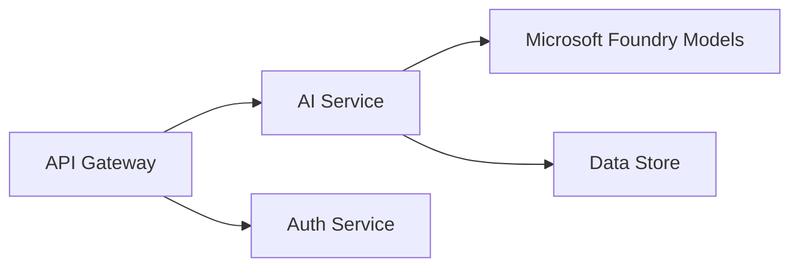

# Поглавље 8: Обрасци за производњу и предузећа

**📚 Курс**: [АЗД за почетнике](../../README.md) | **⏱️ Трајање**: 2-3 сата | **⭐ Комплексност**: Напредни

---

## Преглед

Ово поглавље покрива обрасце распореда спремних за предузећа, повећање безбедности, мониторинг и оптимизацију трошкова за производне AI радне оптерећења.

Ово је архитектонски референтни материјал, а не комплетан образац за производњу спреман за деплој. Примери изостављају детаље интеграције који морају бити обезбеђени и тестирани у вашој апликацији; читање чек-листе не потврђује спремност за производњу.

> **Ажурирање Foundry GA (2026-11-09):** Користите `azd >= 1.37.0` и општо доступни пакет `microsoft.foundry` 1.0 за Foundry workflow; евалуације се инсталирају посебно. Погледајте [опсег и миграција верзије](production-ai-practices.md#recent-release-changes-and-fixes) и [пример аутентификованог pipeline](production-ai-practices.md#cicd-pipeline-configuration). Ово је преглед документације, а не валидација живог распореда или општи статус GA за опционе preview функције.

## Циљеви учења

Завршавањем овог поглавља, моћи ћете да:
- Распоредите отпорне апликације у више региона
- Имплементирате безбедносне обрасце за предузећа
- Конфигуришете свеобухватни мониторинг
- Оптимизујете трошкове у великом обиму
- Подесите CI/CD pipeline користећи AZD

---

## 📚 Лекције

| # | Лекција | Опис | Време |
|---|--------|-------------|------|
| 1 | [Практични AI у производњи](production-ai-practices.md) | Обрасци распореда за предузећа | 90 мин |

---

## 🚀 Чек-листа за производњу

- [ ] Решење са више региона ради отпорности
- [ ] Управљачки идентитет за аутентификацију (без кључева)
- [ ] Application Insights за мониторинг
- [ ] Конфигурисани буџети трошкова и упозорења
- [ ] Омогућено безбедносно скенирање
- [ ] Интеграција CI/CD pipeline
- [ ] План за опоравак од катастрофа

---

## 🏗️ Архитектонски обрасци

### Образац 1: Микросервиси AI



### Образац 2: Догађајима управљани AI


---

## 🔐 Најбоље безбедносне праксе

```bicep
// Illustrative properties from different resources, NOT a standalone Bicep file.
// Attach identity to the application host:
identity: {
  type: 'SystemAssigned'
}

// AI account properties (also require private endpoints, DNS and app connectivity):
properties: {
  publicNetworkAccess: 'Disabled'
  networkAcls: {
    defaultAction: 'Deny'
  }
}
```

---

## 💰 Оптимизација трошкова

| Стратегија | Главно ограничење |
|----------|---------|
| Скалирање на нулу (Container Apps) | Захтева одговарајући тригер; остале услуге и даље праве трошкове |
| Користите tiers за потрошњу у развоју | Упоредите цену изабране услуге и радно оптерећење |
| Распоредно скалирање | Скалирање кроз подржану инфраструктуру/аутоматизацију |
| Резервације/резервисани капацитет | Само када је подржано; обавезе могу повећати трошкове мировања |

Користите [потпуни образац ресурса за буџет](production-ai-practices.md#2-cost-monitoring-and-budgets) са важећим датумом почетка, опсегом наплате, примаоцима и дозволама. Буџет шаље упозорења; не ограничава потрошњу. Уштеда зависи од измерене искоришћености и није загарантован проценат.

---

## 📊 Подешавање мониторинга

```bash
# Open the Application Insights logs view (requires configured monitoring)
azd monitor --logs

# Check Application Insights
azd monitor --overview

# View metrics
az monitor metrics list --resource <resource-id>
```

---

## 🔗 Навигација

| Правец | Поглавље |
|-----------|---------|
| **Претходно** | [Поглавље 7: Решавање проблема](../chapter-07-troubleshooting/README.md) |
| **Курс завршен** | [Почетна страница курса](../../README.md) |

---

## 📖 Повезани ресурси

- [Водич за AI агенте](../chapter-02-ai-development/agents.md)
- [Application Insights](../chapter-06-pre-deployment/application-insights.md)
- [Решења са више агената](../chapter-05-multi-agent/README.md)
- [Пример микросервиса](../../examples/microservices/README.md)

---

<!-- CO-OP TRANSLATOR DISCLAIMER START -->
**Изјава о одрицању одговорности**:
Овај документ је преведен коришћењем услуге за аутоматски превод [Co-op Translator](https://github.com/Azure/co-op-translator). Иако тежимо тачности, имајте у виду да аутоматски преводи могу садржати грешке или нетачности. Оригинални документ на његовом изворном језику треба сматрати ауторитативним извором. За критичне информације препоручује се професионални људски превод. Нисмо одговорни за било каква неспоразума или погрешна тумачења која произилазе из коришћења овог превода.
<!-- CO-OP TRANSLATOR DISCLAIMER END -->