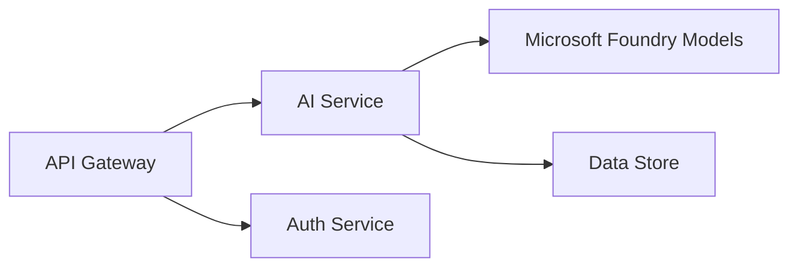
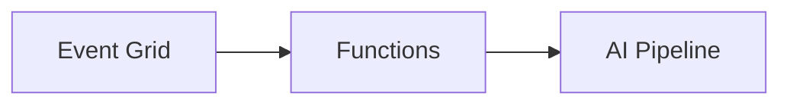

# Поглавље 8: Обрасци за производњу и предузеће

**📚 Курс**: [AZD за почетнике](../../README.md) | **⏱️ Трајање**: 2-3 часа | **⭐ Комплексност**: Напредни

---

## Преглед

Ово поглавље покрива обрасце за производњу спремну за предузећа, осигурање безбедности, надгледање и оптимизацију трошкова за радна оптерећења вештачке интелигенције у производњи.

Ово је архитектонска референца, а не комплетан производни шаблон за имплементацију. Примери изостају детаљи интеграције који морају бити обезбеђени и тестирани у вашој апликацији; читање контролне листе не потврђује спремност за производњу.

> **Преглед издања (2026-11-04):** Упутство за AI CLI проверено је у односу на документацију/изворе `azd 1.37.2`, агенте `1.0.0-beta.23`, и евалуације `1.0.0-beta.2` . Погледајте [промене и исправке издања](production-ai-practices.md#recent-release-changes-and-fixes) за захтеве компатибилности и детаље миграције; ово није валидација директне имплементације.

## Циљеви учења

Завршетком овог поглавља, бићете у стању да:
- Имплементирате мултирегионалне отпорне апликације
- Примeните безбедносне обрасце за предузећа
- Конфигуришете свеобухватно надгледање
- Оптимизујете трошкове у великом обиму
- Поставите CI/CD цевоводе са AZD

---

## 📚 Лекције

| # | Лекција | Опис | Време |
|---|--------|-------------|------|
| 1 | [Практични AI за производњу](production-ai-practices.md) | Обрасци за увођење у предузећу | 90 мин |

---

## 🚀 Контролна листа за производњу

- [ ] Мултирегионално увођење за отпорност
- [ ] Управљани идентитет за аутентификацију (без кључева)
- [ ] Application Insights за надгледање
- [ ] Конфигурисани буџети и аларми трошкова
- [ ] Омогућено безбедносно скенирање
- [ ] Интеграција CI/CD цевовода
- [ ] План за опоравак од катастрофа

---

## 🏗️ Архитектонски обрасци

### Образац 1: Микросервиси AI



### Образац 2: AI покретан догађајима



---

## 🔐 Најбоље праксе за безбедност

```bicep
// Illustrative properties from different resources, NOT a standalone Bicep file.
// Attach identity to the application host:
identity: {
  type: 'SystemAssigned'
}

// AI account properties (also require private endpoints, DNS and app connectivity):
properties: {
  publicNetworkAccess: 'Disabled'
  networkAcls: {
    defaultAction: 'Deny'
  }
}
```

---

## 💰 Оптимизација трошкова

| Стратегија | Главно ограничење |
|----------|---------|
| Скалирање на нулу (Container Apps) | Захтева одговарајући тригер; друге услуге и даље стварају трошкове |
| Користити tier-ове по потрошњи за развој | Упоредити цену изабране услуге и оптерећење |
| Распоредно скалирање | Скале у складу са подржаном инфраструктуром/аутоматизацијом |
| Резервације/постојећи капацитет | Само ако је подржано; обавезе могу повећати трошкове празног хода |

Користите [комплетан образац буџета ресурса](production-ai-practices.md#2-cost-monitoring-and-budgets) са важећим датумом почетка, обимом наплате, примаоцима и дозволама. Буџет шаље упозорења; не поставља лимит на трошкове. Уштеде зависе од мериене искоришћености и нису загарантовани проценти.

---

## 📊 Постављање надгледања

```bash
# Open the Application Insights logs view (requires configured monitoring)
azd monitor --logs

# Check Application Insights
azd monitor --overview

# View metrics
az monitor metrics list --resource <resource-id>
```

---

## 🔗 Навигација

| Смер | Поглавље |
|-----------|---------|
| **Претходно** | [Поглавље 7: Решавање проблема](../chapter-07-troubleshooting/README.md) |
| **Курс завршен** | [Почетна страница курса](../../README.md) |

---

## 📖 Повезани ресурси

- [Водич за AI агенте](../chapter-02-ai-development/agents.md)
- [Application Insights](../chapter-06-pre-deployment/application-insights.md)
- [Решења са више агената](../chapter-05-multi-agent/README.md)
- [Пример микросервиса](../../examples/microservices/README.md)

---

<!-- CO-OP TRANSLATOR DISCLAIMER START -->
**Изјава о одрицању одговорности**:
Овај документ је преведен коришћењем услуге за аутоматски превод [Co-op Translator](https://github.com/Azure/co-op-translator). Иако тежимо тачности, имајте у виду да аутоматски преводи могу садржати грешке или нетачности. Оригинални документ на његовом изворном језику треба сматрати ауторитативним извором. За критичне информације препоручује се професионални људски превод. Нисмо одговорни за било каква неспоразума или погрешна тумачења која произилазе из коришћења овог превода.
<!-- CO-OP TRANSLATOR DISCLAIMER END -->