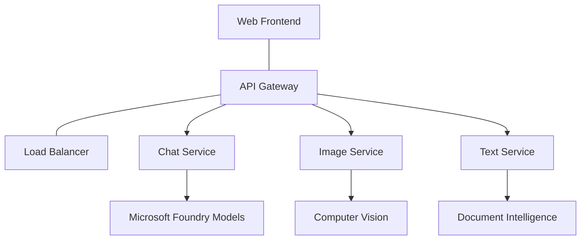

# Најбоље праксе радног оптерећења производног вештачког интелигенције са AZD

**Навигација кроз поглавља:**
- **📚 Почетна страница курса**: [AZD за почетнике](../../README.md)
- **📖 Тренутно поглавље**: Поглавље 8 - Производни и корпоративни обрасци
- **⬅️ Претходно поглавље**: [Поглавље 7: Решавање проблема](../chapter-07-troubleshooting/debugging.md)
- **⬅️ Такође повезано**: [AI радионица лабораторија](../chapter-02-ai-development/ai-workshop-lab.md)
- **🎯 Завршетак курса**: [AZD за почетнике](../../README.md)

## Преглед

Овај водич објашњава производне обрасце дизајна вештачке интелигенције користећи Azure Developer CLI (AZD). То је дизајнерски референт, а не применљива апликација или сертификат за производњу.

**Пример граница:** Ако није експлицитно описано као комплетно, фрагменти Bicep-а претпостављају параметре и референтне ресурсе из шаблона који их садржи. Они не укључују хост слике/планове, идентитете, доделе улога, DNS, излазне вредности и другу потребну интеграцију. YAML сервисни путеви и скрипте за хукове/тестове су илустративни фајлови које треба направити у **својој апликацији**; оне не обезбеђује овај курс. Користите радни AZD пример као базу, компајлирајте потпуну инфраструктуру и тестирате је у изолованом окружењу пре производње.

## Кључни изазови који се решавају

Уобичајене бриге у производњи укључују диспања више сервиса, управљање идентитетом и тајнама, скалирање, контролу трошкова и праћење. Овде није изјављена мерена преваленција.

## Архитектонски обрасци за производну вештачку интелигенцију

### Образац 1: Микросервисна AI архитектура

**Када користити**: Комплексне AI апликације са више могућности



**Имплементација у AZD-у**:

```yaml
# azure.yaml
name: enterprise-ai-platform
services:
  web:
    project: ./web
    host: staticwebapp
  api-gateway:
    project: ./api-gateway
    host: containerapp
  chat-service:
    project: ./services/chat
    host: containerapp
  vision-service:
    project: ./services/vision
    host: containerapp
  text-service:
    project: ./services/text
    host: containerapp
```

### Образац 2: AI обрада на бази догађаја

**Када користити**: Пакетна обрада, анализа докумената, асинхрони токови рада

```bicep
// Event Hub for AI processing pipeline
resource eventHub 'Microsoft.EventHub/namespaces@2024-01-01' = {
  name: eventHubNamespaceName
  location: location
  sku: {
    name: 'Standard'
    tier: 'Standard'
    capacity: 1
  }
}

// Service Bus for reliable message processing
resource serviceBus 'Microsoft.ServiceBus/namespaces@2024-01-01' = {
  name: serviceBusNamespaceName
  location: location
  sku: {
    name: 'Premium'
    tier: 'Premium'
    capacity: 1
  }
}

// Function App for processing
resource functionApp 'Microsoft.Web/sites@2023-01-01' = {
  name: functionAppName
  location: location
  kind: 'functionapp,linux'
  properties: {
    siteConfig: {
      appSettings: [
        {
          name: 'FUNCTIONS_EXTENSION_VERSION'
          value: '~4'
        }
        {
          name: 'AZURE_OPENAI_ENDPOINT'
          value: '@Microsoft.KeyVault(VaultName=${keyVault.name};SecretName=openai-endpoint)'
        }
      ]
    }
  }
}
```

Ово креира фрагменте имена простора, не хабове, редове, претплате или тригере Функција. Покретна функција такође захтева хостинг план, конфигурацију времена извршења/складиштења, прикачени идентитет, RBAC и приступ мрежи. Референца Key Vault-а треба дозволу за читање тајне; сам URL крајње тачке није акредитив.

## Размишљања о здрављу AI агента

Када се традиционална веб апликација поквари, симптоми су познати: страница се не учитава, API враћа грешку или распоређивање не успева. Апликације засноване на AI могу се покварити на све ове начине — али могу се и понашати неупадљивије начине који не производе очигледне поруке о грешци.

Овај одељак помаже у изради менталног модела за праћење AI радних оптерећења како бисте знали где да тражите када нешто није у реду.

### Како здравље агента разликује од здравља традиционалне апликације

Традиционалне апликације такође могу имати суптилне грешке у исправности. AI агент додаје недетерминисан квалитет одговора уз уобичајене бриге о доступности и исправности. Размислите о здрављу агента у два слоја:

| Слой | Шта пратити | Где тражити |
|-------|--------------|---------------|
| **Здравље инфраструктуре** | Да ли сервис ради? Да ли су ресурси обезбеђени? Да ли су крајње тачке доступне? | `azd monitor`, Azure портал статус ресурса, логови контејнера/апликације |
| **Здравље понашања** | Да ли агент одговара тачно? Да ли су одговори благовремени? Да ли се модел правилно позива? | Application Insights трагови, метрике латенције позива модела, евиденција квалитета одговора |

Здравље инфраструктуре је познато – исто је за сваку AZD апликацију. Здравље понашања је нови слој који уводе AI радна оптерећења.

### Где тражити када се AI апликације не понашају како се очекује

Ако ваша AI апликација не даје очекиване резултате, ево концептуалне контролне листе:

1. **Почните са основама.** Да ли апликација ради? Може ли да достигне зависности? Проверите `azd monitor` и статус ресурса као што бисте урадили за било коју апликацију.
2. **Проверите везу са моделом.** Да ли апликација успешно позива AI модел? Неуспели или временски истекли позиви модела су најчешћи узрок проблема AI апликација и појавиће се у вашим логовима апликације.
3. **Безбедно испитајте улаз и основну подршку.** Погрешни одговори могу резултирати из добијања података, инструкција, ограничења модела или извршења алата. Користите дијагностичке податке са контролисаним приступом и редакцијом; не укључујте индетерминисано логовање упита/одговора у производњи.
4. **Прегледајте латенцију одговора.** Позиви AI модела су спорији од типичних API позива. Ако апликација делује споро, проверите да ли се време одговора модела повећало — то може указивати на претрпавање, капацитетне лимите или загушења на нивоу региона.
5. **Обратите пажњу на сигнале трошкова.** Неочекивани скокови у коришћењу токена или API позивима могу указивати на петљу, погрешно конфигурисан упит или претеране покушаје.

Не морате одмах савладати алате за видљивост. Кључна поука је да AI апликације имају додатни слој понашања за праћење, а уграђени надзор azd-а (`azd monitor`) вам даје полазну тачку за испитивање оба слоя.

---

## Најбоље праксе за безбедност

### 1. Модел безбедности Null-поверења (Zero-Trust)

**Стратегија имплементације**:
- Нема комуникације између сервиса без аутентификације
- Сви API позиви користе управљане идентитете
- Изолација мреже приватним крајњим тачкама
- Контроле приступа најмањег привилегија

```bicep
// Managed Identity for each service
resource chatServiceIdentity 'Microsoft.ManagedIdentity/userAssignedIdentities@2023-01-31' = {
  name: 'chat-service-identity'
  location: location
}

// Role assignments with minimal permissions
resource openAIUserRole 'Microsoft.Authorization/roleAssignments@2022-04-01' = {
  scope: openAIAccount
  name: guid(openAIAccount.id, chatServiceIdentity.id, '5e0bd9bd-7b93-4f28-af87-19fc36ad61bd')
  properties: {
    roleDefinitionId: subscriptionResourceId('Microsoft.Authorization/roleDefinitions', '5e0bd9bd-7b93-4f28-af87-19fc36ad61bd')
    principalId: chatServiceIdentity.properties.principalId
    principalType: 'ServicePrincipal'
  }
}
```

### 2. Безбедно управљање тајнама

**Образац интеграције Key Vault-а**:

```bicep
// Key Vault with proper access policies
resource keyVault 'Microsoft.KeyVault/vaults@2023-02-01' = {
  name: keyVaultName
  location: location
  properties: {
    tenantId: tenant().tenantId
    sku: {
      family: 'A'
      name: 'standard' // Premium is needed for HSM-backed keys, not ordinary secrets
    }
    enableRbacAuthorization: true  // Use RBAC instead of access policies
    enablePurgeProtection: true    // Prevent accidental deletion
    enableSoftDelete: true
    softDeleteRetentionInDays: 90
  }
}

// Optional legacy key-auth alternative; omit when using Entra ID.
resource openAIKeySecret 'Microsoft.KeyVault/vaults/secrets@2023-02-01' = {
  parent: keyVault
  name: 'openai-api-key'
  properties: {
    value: openAIAccount.listKeys().key1
    attributes: {
      enabled: true
    }
  }
}
```

Доделите идентитет за време извршења `Key Vault Secrets User` на одговарајућем обиму и прикачите га хосту; `enableRbacAuthorization` сам по себи не даје приступ. Преферирајте аутентификацију управљаног идентитета OpenAI-а уз `disableLocalAuth: true`. Опционални тајни кључ има смисла само за намерно омогућен налог са кључем, а главни провајдер такође треба дозволу за упис тајни.

### 3. Безбедност мреже

**Конфигурација приватне крајње тачке**:

```bicep
// Virtual Network for AI services
resource virtualNetwork 'Microsoft.Network/virtualNetworks@2023-04-01' = {
  name: vnetName
  location: location
  properties: {
    addressSpace: {
      addressPrefixes: ['10.0.0.0/16']
    }
    subnets: [
      {
        name: 'ai-services-subnet'
        properties: {
          addressPrefix: '10.0.1.0/24'
          privateEndpointNetworkPolicies: 'Disabled'
        }
      }
      {
        name: 'app-services-subnet'
        properties: {
          addressPrefix: '10.0.2.0/24'
          delegations: [
            {
              name: 'Microsoft.Web/serverFarms'
              properties: {
                serviceName: 'Microsoft.Web/serverFarms'
              }
            }
          ]
        }
      }
    ]
  }
}

// Private endpoints for all AI services
resource openAIPrivateEndpoint 'Microsoft.Network/privateEndpoints@2023-04-01' = {
  name: '${openAIAccountName}-pe'
  location: location
  properties: {
    subnet: {
      id: virtualNetwork.properties.subnets[0].id
    }
    privateLinkServiceConnections: [
      {
        name: 'openai-connection'
        properties: {
          privateLinkServiceId: openAIAccount.id
          groupIds: ['account']
        }
      }
    ]
  }
}
```

Приватне крајње тачке такође захтевају групе приватних DNS зона/везе са VNet-ом и интеграцију апликације у VNet. One не блокирају аутоматски јавни приступ: експлицитно онемогућите јавни приступ AI налогу након валидације приватне конекције и приступа распоређивању.

## Перформансе и скалирање

### 1. Стратегије аутоматског скалирања

**Аутоматско скалирање Container апликација**:

```bicep
resource containerApp 'Microsoft.App/containerApps@2023-05-01' = {
  name: containerAppName
  location: location
  properties: {
    configuration: {
      ingress: {
        external: true
        targetPort: 8000
        transport: 'http'
      }
    }
    template: {
      scale: {
        minReplicas: 2  // Always have 2 instances minimum
        maxReplicas: 50 // Scale up to 50 for high load
        rules: [
          {
            name: 'http-scaling'
            http: {
              metadata: {
                concurrentRequests: '20'  // Scale when >20 concurrent requests
              }
            }
          }
          {
            name: 'cpu-scaling'
            custom: {
              type: 'cpu'
              metadata: {
                type: 'Utilization'
                value: '70'  // Scale when CPU >70%
              }
            }
          }
        ]
      }
    }
  }
}
```

### 2. Стратегије кеширања

**Redis кеш за AI одговоре**:

```bicep
// Legacy Azure Cache for Redis example (not recommended for new deployments)
resource redisCache 'Microsoft.Cache/redis@2023-04-01' = {
  name: redisCacheName
  location: location
  properties: {
    sku: {
      name: 'Premium'
      family: 'P'
      capacity: 1
    }
    enableNonSslPort: false
    minimumTlsVersion: '1.2'
    redisConfiguration: {
      'maxmemory-policy': 'allkeys-lru'
    }
    // Sharding distributes data; replication/failover provides availability.
    shardCount: 2
  }
}

// Cache configuration in application
var cacheConnectionString = '${redisCache.properties.hostName}:6380,password=${redisCache.listKeys().primaryKey},ssl=True,abortConnect=False'
```

Azure Cache for Redis Basic/Standard/Premium је на [путу пензионисања](https://learn.microsoft.com/azure/azure-cache-for-redis/retirement-faq). Користите Azure Managed Redis за нове дизајне и његову документовану SKU, идентитет и TLS конфигурацију, уместо да копирате овај застарели ресурс у нови производни систем. Линија за конекциони низ је нефункционални плејсхолдер, а не акредитив. Кеш кључеве делите по овлашћењу, моделу/инструкцијама и верзији добијања, са истеком важности; заједнички кеш само за упите може открити податке другог корисника.

### 3. Балансирање оптерећења и управљање саобраћајем

**Application Gateway са WAF-ом**:

```bicep
// Application Gateway with Web Application Firewall
resource applicationGateway 'Microsoft.Network/applicationGateways@2023-04-01' = {
  name: appGatewayName
  location: location
  properties: {
    sku: {
      name: 'WAF_v2'
      tier: 'WAF_v2'
      capacity: 2
    }
    webApplicationFirewallConfiguration: {
      enabled: true
      firewallMode: 'Prevention'
      ruleSetType: 'OWASP'
      ruleSetVersion: '3.2'
    }
    // Backend pools for AI services
    backendAddressPools: [
      {
        name: 'ai-services-pool'
        properties: {
          backendAddresses: [
            {
              fqdn: '${containerApp.properties.configuration.ingress.fqdn}'
            }
          ]
        }
      }
    ]
  }
}
```

Ово је делимичан ресурс gateway-а: право распоређивање такође захтева gateway subnet/IP конфигурацију, frontend IP-ове и портове, TLS слушаоце/сертификате, backend HTTP подешавања/probe-ове, правила усмеравања и приоритете и ревидирану WAF политику. TLS hostname/SNI и аутентикација морају се поклапати са backend-ом Container апликације.

## 💰 Оптимизација трошкова

### 1. Одговарајућа величина ресурса

**Конфигурације специфичне за окружење**:

Ова имена су **илустративни улази прилагођеног шаблона**, а не аутоматска подешавања AZD-а. Прво их мапирајте у `infra/main.parameters.json`/Bicep и хост конфигурацију. На пример, RAG пример користи `AZURE_SEARCH_SERVICE_SKU` и `AZURE_OPENAI_CHATGPT_DEPLOYMENT_CAPACITY`, не генерализована имена испод. Дајте Container апликацијама меморију у подржаној јединици као што је `1Gi` у стварном ресурсу. Примените инфраструктурне промене са `azd up` или `azd provision`; `azd deploy` сам по себи не примењује Bicep промене.

```bash
# Development environment
azd env new development
azd env set AZURE_OPENAI_SKU "S0"
azd env set AZURE_OPENAI_CAPACITY 10
azd env set AZURE_SEARCH_SKU "basic"
azd env set CONTAINER_CPU 0.5
azd env set CONTAINER_MEMORY 1.0

# Production environment  
azd env new production
azd env set AZURE_OPENAI_SKU "S0"
azd env set AZURE_OPENAI_CAPACITY 100
azd env set AZURE_SEARCH_SKU "standard"
azd env set CONTAINER_CPU 2.0
azd env set CONTAINER_MEMORY 4.0
```

### 2. Праћење трошкова и буџети

```bicep
// Supply the first day of the current UTC month, e.g. 2026-11-01T00:00:00Z.
param budgetStartDate string

// Cost management and budgets
resource budget 'Microsoft.Consumption/budgets@2024-08-01' = {
  name: 'ai-workload-budget'
  properties: {
    timePeriod: {
      startDate: budgetStartDate
    }
    timeGrain: 'Monthly'
    amount: 2000  // In the billing currency, not necessarily USD
    category: 'Cost'
    notifications: {
      warning: {
        enabled: true
        operator: 'GreaterThan'
        threshold: 80
        contactEmails: [
          'finance@company.com'
          'engineering@company.com'
        ]
        contactRoles: [
          'Owner'
          'Contributor'
        ]
      }
      critical: {
        enabled: true
        operator: 'GreaterThan'
        threshold: 95
        contactEmails: [
          'cto@company.com'
        ]
      }
    }
  }
}
```

Замените примере прималаца и проверите обим/овлашћења. Буџетске упозорења користе одложене податке фактурисања и не спроводе ограничење потрошње.

### 3. Оптимизација коришћења токена

**Управљање трошковима OpenAI-а**:

Ово је само хипотетичка процена заснована на броју карактера за UI преглед, **НЕ** валидатор за ограничење токена модела. Производни код мора користити токенизатор прикладан за распоређени модел и узети у обзир системске инструкције, шеме алата, историју и буџет излаза. Одбаците прекомерно дугу корисничку поруку уместо да је тихо скраћујете.

```typescript
// Application-level token optimization
class TokenOptimizer {
  private readonly maxTokens = 4000;
  private readonly reserveTokens = 500;
  
  optimizePrompt(userInput: string, context: string): string {
    const availableTokens = this.maxTokens - this.reserveTokens;
    if (this.estimateTokens(userInput) + 8 >= availableTokens) {
      throw new Error("User input exceeds the illustrative prompt budget");
    }
    const estimatedTokens = this.estimateTokens(userInput + context) + 8;
    
    if (estimatedTokens > availableTokens) {
      // Truncate context, not user input
      context = this.truncateContext(context, Math.max(0, availableTokens - this.estimateTokens(userInput) - 8));
    }
    
    return `${context}\n\nUser: ${userInput}`;
  }
  
  private estimateTokens(text: string): number {
    // Rough estimation: 1 token ≈ 4 characters
    return Math.ceil(text.length / 4);
  }

  private truncateContext(text: string, estimatedBudget: number): string {
    return text.slice(0, Math.max(0, estimatedBudget) * 4);
  }
}
```

## Праћење и видљивост

### 1. Свеобухватни Application Insights

```bicep
// Application Insights with advanced features
resource applicationInsights 'Microsoft.Insights/components@2020-02-02' = {
  name: applicationInsightsName
  location: location
  kind: 'web'
  properties: {
    Application_Type: 'web'
    WorkspaceResourceId: logAnalyticsWorkspace.id
    SamplingPercentage: 100  // Ingestion setting; review cost and SDK sampling separately
    DisableIpMasking: false  // Retain IP masking
  }
}

// Custom metrics for AI operations
resource aiMetricAlerts 'Microsoft.Insights/metricAlerts@2018-03-01' = {
  name: 'ai-high-error-rate'
  location: 'global'
  properties: {
    description: 'Alert when failed request count exceeds 10 in five minutes'
    severity: 2
    enabled: true
    scopes: [
      applicationInsights.id
    ]
    evaluationFrequency: 'PT1M'
    windowSize: 'PT5M'
    criteria: {
      'odata.type': 'Microsoft.Azure.Monitor.SingleResourceMultipleMetricCriteria'
      allOf: [
        {
          name: 'high-error-rate'
          metricName: 'requests/failed'
          operator: 'GreaterThan'
          threshold: 10
          timeAggregation: 'Count'
        }
      ]
    }
  }
}
```

### 2. Специфично праћење за AI

**Прилагођене контролне табле за AI метрике**:

```json
{
  "dashboard": {
    "name": "AI Application Monitoring",
    "tiles": [
      {
        "name": "OpenAI Request Volume",
        "query": "dependencies | where target contains 'openai' | summarize count() by bin(timestamp, 5m)"
      },
      {
        "name": "AI Response Latency",
        "query": "dependencies | where target contains 'openai' | summarize avg(duration) by bin(timestamp, 5m)"
      },
      {
        "name": "Token Usage",
        "query": "customMetrics | where name == 'openai_tokens_used' | summarize sum(value) by bin(timestamp, 1h)"
      },
      {
        "name": "Cost per Hour",
        "query": "customMetrics | where name == 'openai_cost' | summarize sum(value) by bin(timestamp, 1h)"
      }
    ]
  }
}
```

Овај JSON је дефинисан од стране апликације као скица, а не Azure портал importable шема контролне табле. Упити за токене/трошкове захтевају да ваша апликација емитује те тачно дефинисане метрике; оне нису креиране помоћу AZD-а. Прилагодите филтере зависности за стварне називе крајњих тачака/трагова модела.

### 3. Провере здравља и праћење доступности

```bicep
// Application Insights availability tests
resource availabilityTest 'Microsoft.Insights/webtests@2022-06-15' = {
  name: 'ai-app-availability-test'
  location: location
  tags: {
    'hidden-link:${applicationInsights.id}': 'Resource'
  }
  properties: {
    SyntheticMonitorId: 'ai-app-availability-test'
    Name: 'AI Application Availability Test'
    Description: 'Tests AI application endpoints'
    Enabled: true
    Frequency: 300  // 5 minutes
    Timeout: 120    // 2 minutes
    Kind: 'standard'
    Locations: [
      {
        Id: 'us-east-2-azr'
      }
      {
        Id: 'us-west-2-azr'
      }
    ]
    Request: {
      RequestUrl: 'https://${webApp.properties.defaultHostName}/health'
      HttpVerb: 'GET'
      FollowRedirects: true
      ParseDependentRequests: false
    }
    ValidationRules: {
      ExpectedHttpStatusCode: 200
      SSLCheck: true
      SSLCertRemainingLifetimeCheck: 7
    }
  }
}
```

## Опоравак од катастрофа и висока доступност

Претходни тест претпоставља постојећи App Service `webApp` и Application Insights ресурс. Стандардни тестови доступности су наплативи и захтевају достижну крајњу тачку; апликације са приватним приступом захтевају одговарајући дизајн приватног надзора. URL ping тестови су застарели; користите [стандардне тестове доступности](https://learn.microsoft.com/azure/azure-monitor/app/availability).

### 1. Дисперзија по више регија

```yaml
# azure.yaml - Multi-region configuration
name: ai-app-multiregion
services:
  api-primary:
    project: ./api
    host: containerapp
    env:
      AZURE_REGION: eastus
  api-secondary:
    project: ./api
    host: containerapp
    env:
      AZURE_REGION: westus2
```

```bicep
// Separate App Service topology, not the Container Apps declarations above
resource trafficManager 'Microsoft.Network/trafficManagerProfiles@2022-04-01' = {
  name: trafficManagerProfileName
  location: 'global'
  properties: {
    profileStatus: 'Enabled'
    trafficRoutingMethod: 'Priority'
    dnsConfig: {
      relativeName: trafficManagerProfileName
      ttl: 30
    }
    monitorConfig: {
      protocol: 'HTTPS'
      port: 443
      path: '/health'
      intervalInSeconds: 30
      toleratedNumberOfFailures: 3
      timeoutInSeconds: 10
    }
    endpoints: [
      {
        name: 'primary-endpoint'
        type: 'Microsoft.Network/trafficManagerProfiles/azureEndpoints'
        properties: {
          targetResourceId: primaryAppService.id
          endpointStatus: 'Enabled'
          priority: 1
        }
      }
      {
        name: 'secondary-endpoint'
        type: 'Microsoft.Network/trafficManagerProfiles/azureEndpoints'
        properties: {
          targetResourceId: secondaryAppService.id
          endpointStatus: 'Enabled'
          priority: 2
        }
      }
    ]
  }
}
```

Променљиве окружења не бирају локације ресурса. IaC мора обезбедити јединствене регионалне хостове и повезати сваки сервис са `resourceName` или `azd-service-name` ознакама. Пример Traffic Manager-а је **посебна топологија App Service-а** (`primaryAppService`/`secondaryAppService`), а не рутирање за Container апликације. Container апликације захтевају исправно конфигурисану спољну крајњу тачку/front door, TLS/рутирање прилагођеног домена и probe-ове за проверу здравља.

### 2. Бекап података и опоравак

```bicep
// Backup configuration for critical data
resource backupVault 'Microsoft.DataProtection/backupVaults@2023-05-01' = {
  name: backupVaultName
  location: location
  identity: {
    type: 'SystemAssigned'
  }
  properties: {
    storageSettings: [
      {
        datastoreType: 'VaultStore'
        type: 'LocallyRedundant'
      }
    ]
  }
}

```

Само складиштење у Vault-у не обезбеђује бекап. Конфигуришите **политику и инстанцу за бекап специфичну за радно оптерећење**, дозволе извора, задржавање и тестове опоравка користећи [Azure Backup подршку](https://learn.microsoft.com/azure/backup/backup-support-matrix). Не постоји општа политика Azure Backup-а за домаћине распоређене Azure OpenAI моделе. Чувајте дефиниције инфраструктуре/распоређивања модела у контролу верзија; заштитите отпремљене документе, податке апликације и фине параметре подешавања коришћењем подржаних алата за бекап/извоз сваког сервиса. Дефинишите и тестирајте RPO/RTO експлицитно.

## DevOps и CI/CD интеграција

### 1. GitHub Actions радни ток

```yaml
# .github/workflows/deploy-ai-app.yml
name: Deploy AI Application

on:
  push:
    branches: [main]
  pull_request:
    branches: [main]

jobs:
  test:
    runs-on: ubuntu-latest
    steps:
      - uses: actions/checkout@v4
      
      - name: Setup Python
        uses: actions/setup-python@v4
        with:
          python-version: '3.11'
          
      - name: Install dependencies
        run: |
          pip install -r requirements.txt
          pip install pytest
          
      - name: Run tests
        run: pytest tests/
        
      - name: AI Safety Tests
        run: |
          python scripts/test_ai_safety.py
          python scripts/validate_prompts.py

```

Ово је **само тестни део** радног тока и претпоставља да сте креирали `requirements.txt`, `tests/` и два скрипта за безбедност. Додајте аутентификоване OIDC задатке за провизију/распоређивање из [CI/CD конфигурације путање](#cicd-pipeline-configuration), са `needs: test`, провереном push/maual тригером и заштићеним GitHub окружењима. Не распоређујте неповерљиви pull-request код са cloud акредитивима. Нови runner нема изабрано локално AZD окружење; доставите уносе за окружење/претплату/локацију и користите `azd auth login`, не само `azure/login`.

### 2. Валидација инфраструктуре

```bash
# scripts/validate_infrastructure.sh
#!/bin/bash
set -euo pipefail

echo "Validating AI infrastructure deployment..."

# Requires Azure CLI login and the resource group selected explicitly.
: "${AZURE_RESOURCE_GROUP:?Set AZURE_RESOURCE_GROUP}"
: "${AZURE_OPENAI_NAME:?Set AZURE_OPENAI_NAME}"
: "${AZURE_OPENAI_CHAT_DEPLOYMENT:?Set the actual deployment name}"

# A successful empty list is not proof that resources exist.
types=("Microsoft.CognitiveServices/accounts" "Microsoft.Search/searchServices"
       "Microsoft.Storage/storageAccounts" "Microsoft.KeyVault/vaults")
for resource_type in "${types[@]}"; do
    count=$(az resource list --resource-group "$AZURE_RESOURCE_GROUP" \
        --resource-type "$resource_type" --query "length(@)" -o tsv)
    if [[ "$count" -lt 1 ]]; then
        echo "ERROR: No $resource_type found in $AZURE_RESOURCE_GROUP"
        exit 1
    fi
done

# Validate OpenAI model deployments
echo "Validating OpenAI model deployments..."
state=$(az cognitiveservices account deployment show \
  --name "$AZURE_OPENAI_NAME" --resource-group "$AZURE_RESOURCE_GROUP" \
  --deployment-name "$AZURE_OPENAI_CHAT_DEPLOYMENT" \
  --query "properties.provisioningState" -o tsv)
if [[ "$state" != "Succeeded" ]]; then
    echo "ERROR: Required model deployment is not provisioned successfully"
    exit 1
fi

echo "Infrastructure validation completed successfully!"
```

Очекује се: излаз 0 и порука о завршетку само када сви очекивани типови постоје и именовани модел је распоређен. Ово проверава стање инвентара/провизије, **не** здравље ресурса, тачну топологију, RBAC, доступност мреже или понашање модела. Прилагодите очекиване типове за вашу архитектуру, а затим изведите посебан аутентификовани тест спремности апликације.

## Контролна листа спремности за производњу

### Безбедност ✅
- [ ] Сви сервиси користе управљане идентитете
- [ ] Тајне се чувају у Key Vault-у
- [ ] Приватне крајње тачке конфигурисане
- [ ] Имплементиране групе за безбедност мреже
- [ ] RBAC са најмањим привилегијама
- [ ] WAF омогућен на јавним крајњим тачкама

### Перформансе ✅
- [ ] Конфигурисано аутоматско скалирање
- [ ] Имплементирано кеширање
- [ ] Постављено балансирање оптерећења
- [ ] CDN за статички садржај
- [ ] Пул веза базе података
- [ ] Оптимизација коришћења токена

### Надзор ✅
- [ ] Конфигурисан Application Insights
- [ ] Дефинисане прилагођене метрике
- [ ] Постављена правила за упозорења
- [ ] Креирана контролна табла
- [ ] Имплементиране провере здравља
- [ ] Политике задржавања логова

### Поузданост ✅
- [ ] Распоређивање по више региона
- [ ] План за бекап и опоравак
- [ ] Имплементирани циљни прекидачи (Circuit breakers)
- [ ] Конфигурисане политике поновних покушаја
- [ ] Грациозна деградација
- [ ] Крајње тачке за проверу здравља

### Управљање трошковима ✅
- [ ] Конфигурисана упозорења буџета
- [ ] Одговарајућа величина ресурса
- [ ] Попусти за развој/тестирање примењени
- [ ] Купљене резервисане инстанце
- [ ] Контролна табла за праћење трошкова
- [ ] Редовне ревизије трошкова

### Усклађеност ✅
- [ ] Испуњени услови о пребивалишту података
- [ ] Омогућено вођење рачуна о ревизији
- [ ] Примењене политике усклађености
- [ ] Имплементиране безбедносне основе
- [ ] Редовне безбедносне процене
- [ ] План реаговања на инциденте

## Перформансни референтни тестови

### Илустративни циљеви производње

Ово су пример СЛО-ова за преговарање и тестирање оптерећења, а не мерене референтне вредности или гаранције. Латенција одговора зависи од дужине модела/излаза; месечна потрошња токена зависи од саобраћаја и цена, а не само броја токена.

| Метрика | Циљ | Праћење |
|--------|--------|------------|
| **Време одговора** | < 2 секунде | Application Insights |
| **Доступност** | 99.9% | Пратење рада |
| **Стопа грешака** | < 0.1% | Логови апликације |
| **Трошкови модела** | < $500/месечно (пример буџета) | Управљање трошковима |
| **Паралелни корисници** | 1000+ | Тестирање оптерећења |
| **Време за опоравак** | < 1 сат | Тестови опоравка од катастрофе |

### Тестирање оптерећења

Следећи је скица интерфејса за скрипту за тестирање оптерећења **коју морате имплементирати**; овај репозиторијум не обезбеђује `scripts/load_test.py`. Дефинишите захтеве упутства, аутентификацију, репрезентативна оптерећења, процентили латенције/тврђења о грешкама и ограничење трошкова у алату за тестирање оптерећења пре покретања:

```bash
# Load testing script for AI applications
python scripts/load_test.py \
  --endpoint https://your-ai-app.azurewebsites.net \
  --concurrent-users 100 \
  --duration 300 \
  --ramp-up 60
```

## 🤝 Најбоље праксе заједнице

На основу повратних информација са Microsoft Foundry Discord заједнице:

### Најбољи савети од заједнице:

1. **Почните мало, скалирајте постепено**: Почните са основним SKU и повећајте према стварној употреби
2. **Пратите све**: Поставите свеобухватно праћење од првог дана
3. **Аутоматизујте безбедност**: Користите инфраструктуру као код за конзистентну безбедност
4. **Тестирајте темељно**: Укључите AI-специфично тестирање у ваш процес
5. **Планирајте трошкове**: Пратите употребу токена и рано поставите аларме за буџет

### Уобичајене замке које треба избегавати:

- ❌ Тврдо уношење API кључева у коду
- ❌ Непостављање одговарајућег праћења
- ❌ Игнорисање оптимизације трошкова
- ❌ Не тестирање сценарија отказа
- ❌ Деплој без провера здравља

## AZD AI CLI наредбе и екстензије

AZD укључује растући скуп AI-специфичних наредби и екстензија које поједностављују производне AI радне токове. Ови алати превазилазе јаз између локалног развоја и производног деплоја за AI оптерећења.

> **Foundry GA ажурирање (2026-11-09):** Пакет `microsoft.foundry` је достигао **1.0 / општу доступност** на [5. новембар 2026](https://devblogs.microsoft.com/azure-sdk/microsoft-foundry-azure-developer-cli-ga/). Користите **`azd >= 1.37.0`** за овај радни ток. Претходни `azd 1.37.2`, агенти beta.23, и преглед евалуација beta.2 су сачувани доле као историја миграције, а не као тренутна верзија пакета. Ово је преглед документације/извора, а не валидација живе имплементације или тврдња да је сваки опционални продужетак, API или прегледна функција GA.

### AZD продужетци за AI

AZD користи систем продужетака за додавање специфичних могућности вештачке интелигенције. Инсталирајте и управљајте продужецима са:

```bash
# List all available extensions (including AI)
azd extension list

# Inspect installed versions
azd version
azd ext list --installed

# Install the GA Foundry bundle
azd ext install microsoft.foundry

# Install the separate Foundry evaluations extension
azd extension install azure.ai.evaluations

# Install the fine-tuning extension
azd extension install azure.ai.finetune

# Install the custom models extension
azd extension install azure.ai.models

# Upgrade the Foundry bundle
azd ext upgrade microsoft.foundry
```

**Доступни AI продужеци:**

| Екстензија | Сврха | Статус |
|-----------|---------|--------|
| `microsoft.foundry` | Мета-пакет који инсталира седам основних екстензија испод; нема сопствену групу команди | GA пакетић 1.0 |
| `azure.ai.agents` | `azd ai agent`: подешавање агента, локална извршења и операције | Укључено; независно верзионирано |
| `azure.ai.connections` | `azd ai connection`: везе пројеката | Укључено; независно верзионирано |
| `azure.ai.inspector` | `azd ai inspector`: локални UI инспектора агента | Укључено; независно верзионирано |
| `azure.ai.projects` | `azd ai project`: ресурси пројекта и распоређивања модела | Укључено; независно верзионирано |
| `azure.ai.routines` | `azd ai routine`: распореди и окидачи | Укључено; независно верзионирано |
| `azure.ai.skills` | `azd ai skill`: поновљиве смернице понашања | Укључено; независно верзионисано |
| `azure.ai.toolboxes` | `azd ai toolbox`: верзионисани скупови алата | Укључено; независно верзионисано |
| `azure.ai.evaluations` | Скупови за процену, процењивачи, групе за процену и извођења | Посебна инсталација/издање |
| `azure.ai.dataset` | Регистрација и верзионисање скупова података | Посебна инсталација/издање |
| `azure.ai.finetune` | Фино подешавање модела Foundry | Посебна инсталација/издање |
| `azure.ai.models` | Прилагођени модели Foundry | Посебна инсталација/издање |

Инсталирање `azure.ai.agents` појединачно и даље је подржано и инсталира његове зависности; скуп је подразумевани за овај курс у GA радном току. Bundle GA није општа гаранција статуса издања за опционе функције његових компоненти. Погледајте [паковање и верификацију екстензија](https://learn.microsoft.com/azure/foundry/agents/how-to/install-cli-foundry-extensions) и прегледајте помоћ командне линије пре коришћења.

> Прво ажурирајте основни CLI са `azd update` или одговарајућом [методом инсталације/ажурирања](https://learn.microsoft.com/azure/developer/azure-developer-cli/install-azd), затим покрените `azd ext upgrade microsoft.foundry`. Потребно је одвојено ажурирати појединачно инсталиране процене са `azd ext upgrade azure.ai.evaluations`. Не постоји основна команда `azd upgrade`. Записујте и прегледајте независно верзионисане екстензије у производној аутоматизацији; надоградња аутоматски не мигрира стару конфигурацију.

### Недавне промене и исправке издања

| Издање | Шта се мења за овај курс |
|---------|------------------------------|
| `microsoft.foundry` 1.0 GA (2026-11-05) | Подразумевано на пакет са седам екстензија, чувајте подешавања агента/деплоја у `azure.yaml`, тестирајте локално са Agent Inspector-ом и отпремајте код за удаљено Foundry прављење. Инсталирајте евалуације одвојено и поново инсталирајте потребне екстензије на CI рачунарима. |
| `azd 1.37.0` | Додаје стабилне deployment-preview API-је и исправља преписивање подешавања `azure.yaml` која нису повезана приликом измена екстензија. |
| `azd 1.37.1` | Поправља пренос Ctrl+C преко екстензија и разликује отказивање/таймаут од општих грешака. |
| `azd 1.37.2` | Побољшава валидацију пружања услуга: критична упозорења су подразумевано на **Не**, неуспех без потврде у неприсутним извршењима, а отказивање прескаче post-provision кључеве. Такође исправља нерешене вредности окружења у Deployment Stacks deny листама када је омогућена та алфа функција. |
| Agents `beta.22` | Мигрира евалуацију на `azd ai eval`, мења оптимизацију на GA v1 API, захтева множину `toolboxes` и раздваја managed-harness, voice и дуготрајне preview приступе. Поправља избор модела специфичних за окружење и аутентификацију у toolbox-у. |
| Agents `beta.23` | Износи `init --harness`; исправља A2A 0.3 излаз одговора, неприхватљиве путеве/модуле prompt-agenta кроз слојеве инфраструктуре, дијагностику активирања-такмина и задржана упозорења девелоперског RBAC-а. |
| Evaluations `beta.2` | Захтева конфигурацију евалуације у camelCase формату, додаје статичко/симулирано ауторство разговора и експлицитне локалне изворе фајлова, и исправља руковање идентитетом/верзијом скупова података, рачуне quality-gate и дијагностику неуспелих покретања. |

Таймаут активирања агента **не** значи неуспех деплоја: прегледајте покушану верзију и њено стање пре поновног покушаја. Упозорења девелоперског RBAC-а могу остати чак и када пружање успе; разрешите недостатак приступа пре позива као тај девелопер.

Бета редови горе описују раније исправке и границе миграције, а не обавезу да се нови пројекти везују за те верзије.

Извори: [Foundry GA announcement](https://devblogs.microsoft.com/azure-sdk/microsoft-foundry-azure-developer-cli-ga/), [AZD releases](https://github.com/Azure/azure-dev/releases), [agents beta.23 release](https://github.com/Azure/azure-dev/releases/tag/azd-ext-azure-ai-agents_1.0.0-beta.23), [agents beta.22 migration](https://github.com/Azure/azure-dev/releases/tag/azd-ext-azure-ai-agents_1.0.0-beta.22), и [evaluations beta.2 release](https://github.com/Azure/azure-dev/releases/tag/azd-ext-azure-ai-evaluations_1.0.0-beta.2).

**Које су то пакетне `skills` и `connections` екстензије?**

Оне су инсталиране са језгром пакета али имају различите сврхе:

- **`azure.ai.skills`** — **вештина** пакује поновно употребљиве смернице понашања за агенте. Делите прегледана упутства између агената уместо да их копирате. Вештина сама по себи не имплементира алат или не даје приступ подацима; за извршење алата користите toolbox-ове и апликациони код.
- **`azure.ai.connections`** — **веза** је управљана веза између вашег Foundry пројекта и спољног ресурса који вашим агентима треба — извор података (као што је Azure AI Search), крајња тачка алата, или друга услуга. Везе централизују *где* и *како* агенти приступају подацима, тако да акредитиви и крајње тачке живе на једном регулисаном месту уместо да су расути по коду.

Не морате конфигурисати сваки пакетни капацитет да бисте распоредили свог првог агента. Користите вештине када агенти деле смернице понашања, а везе када деле спољне ресурсе.

### Иницијализација агенцијских пројеката са `azd ai agent init`

Команда `azd ai agent init` креира Microsoft Foundry агент пројекат. За пример који може да се покрене за распоређивање кода са Python 3.13+ и актуелним uv пратите [GA hosted-agent walkthrough](../chapter-02-ai-development/microsoft-foundry-integration.md#hosted-agent-walkthrough-ga). Испод наведене команде илуструју усвајање **вашег сопственог** актуелног шаблона пројекта `azure.yaml`; именовани локални шаблон није обезбеђен овим курсом:

```bash
# Initialize a new agent project from a local project template
azd ai agent init --template ./templates/support-agent/azure.yaml

# Initialize and target a specific Foundry project
azd ai agent init --template ./templates/support-agent/azure.yaml --project-id <foundry-project-id>

# Adopt the template into a different directory
azd ai agent init --template ./templates/support-agent/azure.yaml --src ./agents/my-agent
```

**Кључне опције:**

| Опција | Опис |
|------|-------------|
| `-t, --template` | Путања или подржани GitHub URI до документа пројекта `azure.yaml` |
| `-p, --project-id` | Постојећи Microsoft Foundry Project ID за ваше azd окружење |
| `-s, --src` | Изворни директоријум за генерисане агенте, или одредишни директоријум при усвајању пројекта |
| `--deploy-mode code` | Пошаљи извор за удаљену Foundry изградњу уместо изградње локалног контејнера |
| `--model-deployment` | Поново користи именовано постојеће распоређивање модела током иницијализације |
| `--kind` | Иницијализује `hosted`, `prompt` или претпреглед `prompt-voice` агента |
| `--harness` | Опциони извршни оквир за `--kind prompt`; захтева његову претпреглед опцију |
| `-e, --environment` | azd окружење које треба користити |

`--manifest`/`-m` је застарела алтернатива за `--template`/`-t`; променом имена опције не конвертује се стари манифест у актуелни документ пројекта. `--host containerapp` није актуелна опција агента за иницијализацију. За обичну Container Apps апликацију користите `azd init --template` са шаблоном који декларише `host: containerapp`.

За постојећи пројекат са тачно једном `azure.ai.project` услугом, `azd ai agent add support-agent --file ./agents/support-agent.yaml` додаје или ажурира директну дефиницију агента без провизије или распоређивања. Команде на време извршавања одбацују наслеђене имплицитне `agent.yaml`/AgentManifest и угнежђене дефиниције услуге `config:`; мигрирајте их у актуелну `azure.ai.agent` услугу. Када init штампа `cd` следећи корак, извршите га пре `azd up`: init не мења ваш радни директоријум у љусци.

**Савет за продукцију**: Користите `--project-id` да бисте се директно повезали са постојећим Foundry пројектом, одржавајући да ваш агентски код и ресурси у облаку од почетка буду повезани.

#### Опционе претпреглед функције

Управљани оквир, глас и дуготрајна позивна извршења су подразумевано независно онемогућени. Поставите само прекидач за функцију која вам треба у **окружењу процеса љуске/CI**, а не са `azd env set`:

| Функција | Променљива окружења процеса |
|---------|------------------------------|
| Управљани оквир (`init --kind prompt --harness ...`) | `AZD_ALPHA_ENABLE_AGENTS_MANAGED_HARNESS=true` |
| Глас (`init --kind prompt-voice`) | `AZD_ALPHA_ENABLE_AGENTS_VOICE=true` |
| Дуготрајна позивна извршења | `AZD_ALPHA_ENABLE_AGENTS_LONG_RUNNING=true` |

На пример, употребите `export AZD_ALPHA_ENABLE_AGENTS_MANAGED_HARNESS=true` у Bash или `$env:AZD_ALPHA_ENABLE_AGENTS_MANAGED_HARNESS = "true"` у PowerShell пре извршавања релевантне команде. Један прекидач не омогућава остале. Погледајте [released agents README](https://github.com/Azure/azure-dev/blob/azd-ext-azure-ai-agents_1.0.0-beta.23/cli/azd/extensions/azure.ai.agents/README.md) за све претпреглед прекидаче и ограничења.

### Управљање животним циклусом агента

Екстензија пакета `azure.ai.agents` подржава локално тестирање и рад деплојованог агента. Инсталирајте `azure.ai.evaluations` одвојено за мерење квалитета:

```bash
# Start the local agent and Agent Inspector (leave running)
azd ai agent run

# From a second terminal in the project directory
azd ai agent invoke --local "Explain how this agent is deployed."

# Invoke a deployed agent and view server response timing
# (total latency and time to first byte)
azd ai agent invoke

# Show the live endpoint configuration before changing it
azd ai agent endpoint show

# Download the deployed source of a code-based hosted agent
# (with SHA-256 verification)
azd ai agent code download

# Delete a hosted agent and all of its versions
# (--force terminates active sessions)
azd ai agent delete --force
```

**Животни циклус на први поглед:**

| Фаза | Команда | Производна употреба |
|-------|---------|----------------|
| Локални тест | `azd ai agent run`, затим `azd ai agent invoke --local "Test prompt"` | Испитајте захтеве и одговоре пре распоређивања; Azure позиви модела се и даље наплаћују |
| Распоређивање | `azd deploy` | У режиму кода, изгради отпремљени извор удаљено у Foundry |
| Тестирање | `azd ai agent invoke` | Валидација одговора и мерење латенције пре издавања |
| Дијагностика | `azd ai agent doctor`, `azd ai agent monitor --follow` | Проверите подешавање/дозволе и прегледајте логове агента у току |
| Испитивање | `azd ai agent endpoint show` | Прегледајте аутентификацију/конфигурацију крајње тачке; уочите ране промене које могу изазвати грешке |
| Мерење | `azd ai eval init`, `generate`, `run start` | Дефинишите, распореди и извршавајте поновљиве евалуације |
| Побољшање | `azd ai agent optimize --eval <evaluation-name> --optimize-model <optimizer-deployment>` | Поново користите компатибилну евалуацију за оптимизацију агента |
| Опоравак | `azd ai agent code download` | Преузмите тачно распоређени извор за ревизију/повратак назад |
| Повећићање | `azd ai agent delete --force` | Чисто уклоните агента и његове верзије |

> Покрените `azd ai agent --help` да прегледате команде у вашем инсталираном издању. Пакет је GA; независно ограничене preview функције су и даље по избору. Пре чишћења разликујте брисање агента од брисања пројекта: `azd down` брише ресурсну групу новокреираног пројекта, али оставља ресурсе поновно-коришћених пројеката на месту. Пратите [упутство за чишћење](../chapter-02-ai-development/microsoft-foundry-integration.md#7-clean-up-deliberately).

`endpoint show` подржава хостоване, упитне и гласовне агенте, али ажурирања крајњих тачака су само за хостоване; агенте радног тока није подржано. Преузимање кода и пример повлачења хостованог агента горе нису опште операције за сваки тип агента.

#### Миграција евалуације и провере квалитета

Почевши од агената **1.0.0-beta.22 (2026-10-23)**, наслеђене `azd ai agent eval` команде пружају смернице за миграцију уместо бившег евалуационог токa. Немојте копирати старе `eval generate --dataset ...` примере: евалуација је сада под **`azd ai eval`**.

У иницираном агент пројекту, аутентификујте се са `azd auth login`, потврдите изабрано окружење/Пројекат Foundry, и инсталирајте `azure.ai.evaluations`. Потребно је распоређивање модела судије за оцењивање засновано на моделу; генерисање и симулација разговора могу захтевати своје изборе модела и довести до додатних трошкова.

```bash
# Generate a draft rubric and dataset from the deployed agent
azd ai eval generate

# After reviewing the assets, configure a named evaluation
azd ai eval init --name quality

# Review generated files, then register datasets, evaluators, and eval groups
azd up

# Start an evaluation and wait for its results
azd ai eval run start --eval quality --wait

# Inspect runs and available test-case output
azd ai eval run list
azd ai eval run show <run-id>
azd ai eval run output list <run-id>
```

За пример најаве GA, изаберите **Dataset and evaluator** и **Turn** током генерисања, затим изаберите оне прегледане ресурсе и судијски модел током иницијализације. Пратите исписане следеће кораке уместо да претпостављате да су генерисани ресурси већ регистровани. Такође можете да инициализујете постојећи прегледани скуп података/рубрику без генерисања нових података. Конфигурација евалуације обично се налази у `evals/azure.eval.yaml`, на коју се позива услуга `azure.ai.eval` у `azure.yaml`. Кључеви су у **camelCase** (`evaluationLevel`, `maxSamples`, `initializationParameters`, `dataMapping`); стари кључеви конфигурације у snake_case су одбијени. Путање унутар пољем поменуте конфигурације решавају се релативно у односу на тај фајл, а не у односу на корен репозиторијума.

За евалуацију разговора, изаберите **static** да бисте оценили комплетне транскрипте без позивања агента, или **simulation** да генеришете разговоре из сценарио семена. Симулација захтева циљног агента, симулатор модел и посебан избор судијског модела. За необслуживане команде, доставите улазе наведене у `azd ai eval init --help` и `azd ai eval generate --help`; немојте претпостављати да је модел за генерисање такође судија или симулатор.

За CI, конфигуришите експлицитну политику квалитета користећи `azd ai eval run start --help` (`--fail-on`) и третирајте ненулти код изласка хоста као неуспех. Завршено покретање није аутоматски пролаз квалитета. Прегледајте редове који нису успели/имали грешке и дијагностику; недостајући или неусклађени бројеви резултата нису доказ успешности. Регистровани скупови података задржавају свој идентитет/верзију услуге; `--max-samples` не може да узме подскуп регистрованог скупа података. Објавите мањи скуп података намерно или користите подршку за локални фајл као извор.

```bash
# Example CI policy: at least 90% of all test cases must pass
azd ai eval run start --eval quality --wait --no-prompt --fail-on "pass-rate=0.9"
```

Прелазни праг пролаза користи број успешних тест случајева подељен са укупним бројем тест случајева; неуспели, са грешкама, прескочени и други неуспешни редови се рачунају против њега. Немојте комбиновати праг са `--no-wait`, који се враћа пре него што је доступна одлука.

#### Миграција конфигурације оптимизације

Оптимизација сада користи GA v1 API. Да бисте поново користили компатибилну **ocену на нивоу потеза, засновану на скупу података** из новог радног тока:

```bash
# Replace placeholders with the evaluation name and optimizer model deployment
azd ai agent optimize --eval-config ./evals/azure.eval.yaml --eval <evaluation-name> --optimize-model <optimizer-deployment>
```

`--eval` бира евалуацију; `--eval-config` бира њен конфигурациони фајл (укључујући дефиниције из фајлова). `--config` уместо тога узима **самосталан захтев за оптимизацију API-ја** у YAML или JSON формату. Не прослеђујте стари агент `eval.yaml` или нови `azure.eval.yaml` `--config`, и не комбинујте `--config` са `--eval`/`--eval-config`. Евалуације разговора, са трагом или симулацијом нису заменљиве са пречицом оптимизације заснованом на скупу података; користите подржани формат захтева за оптимизацију за те сценарије. Прегледајте кандидате пре него што их примените или имплементирате.

Погледајте [приручник за евалуације за прегледано издање](https://github.com/Azure/azure-dev/blob/azd-ext-azure-ai-evaluations_1.0.0-beta.2/cli/azd/extensions/azure.ai.evaluations/README.md) и [извор команде за оптимизацију за прегледано издање](https://github.com/Azure/azure-dev/blob/azd-ext-azure-ai-agents_1.0.0-beta.23/cli/azd/extensions/azure.ai.agents/internal/cmd/optimize.go) за тачне опције.

#### Преглед распоређивања само за читање Hosted-Agent-а

За постојеће окружење везано за Foundry са унифицираном `azure.ai.agent` услугом `kind: hosted`, упоредите подржану конфигурацију пре распоређивања:

```bash
azd deploy <service-name> --preview --no-prompt
```

Овај преглед не распореди агента. Није потпуна инфраструкурна/сигурносна разлика: агенти за упите/глас/радни ток, наслеђени распореди конфигурације и нека хостирана подешавања су изван његовог домена. Резултат `unknown` није одобрење за распоређивање. Не постоји самостална `azd ai agent deploy` или агентска `--dry-run` команда; користите основни радни ток за распоређивање.

### Протокол контекста модела (MCP) са `azd mcp`

AZD укључује уграђену подршку за MCP сервер (Алфа), омогућавајући AI агентима и алатима да комуницирају са вашим Azure ресурсима путем стандаризованог протокола:

```bash
# Start the MCP server for your project
azd mcp start

# Review current Copilot consent rules for tool execution
azd copilot consent list
```

MCP сервер изложи контекст вашег azd пројекта — окружења, сервисе и Azure ресурсе — AI-ом покретаним алатима за развој. Ово омогућава:

- **AI-помогнуто распоређивање**: Дозволите агентима за кодирање да упитују стање вашег пројекта и покрећу распоређивања
- **Откривање ресурса**: AI алати могу открити које Azure ресурсе користи ваш пројекат
- **Управљање окружењем**: Агенти могу пребацивати између развојних/стагинг/производних окружења

### Генерисање инфраструктуре са `azd infra generate`

За продуктивне AI задатке, можете генерисати и прилагодити Infrastructure as Code уместо да се ослањате на аутоматску провизију:

```bash
# Generate supported infrastructure for this project type
azd infra generate
```

Подршка зависи од пројекта/хоста и инсталираних провајдера; ово није општа команда за реверзно инжењерство произвољних Azure ресурса или обећање да ће генерисати и Bicep и Terraform. Покрените `azd infra generate --help` и прегледајте генерисани формат. Где је подржано, писање IaC на диск вам омогућава:
- Преглед и ревизију инфраструктуре пре распоређивања
- Додавање прилагођених безбедносних политика (мрежна правила, приватне тачке приступа)
- Интеграцију са постојећим IaC процесима ревизије
- Контролу верзија инфраструктурних измена одвојено од кода апликације

### Продукциони животни циклични хукови

AZD хукови вам омогућавају да убаците прилагођену логику у свакој фази животног циклуса распоређивања — критично за продукционе AI радне токове:

```yaml
# azure.yaml - Production hooks example
name: ai-production-app
hooks:
  preprovision:
    shell: sh
    run: scripts/validate-quotas.sh    # Check AI model quota before provisioning
  postprovision:
    shell: sh
    run: scripts/verify-networking.sh  # Verify IaC-provisioned private connectivity
  predeploy:
    shell: sh
    run: scripts/run-ai-safety-tests.sh  # Run prompt safety checks
  postdeploy:
    shell: sh
    run: scripts/smoke-test.sh           # Verify agent responses post-deploy
services:
  agent-api:
    project: ./src/agent
    host: containerapp
    hooks:
      predeploy:
        shell: sh
        run: scripts/validate-model-access.sh  # Per-service hook
```

```bash
# Run a specific hook manually during development
azd hooks run predeploy
```

**Препоручени продукциони хукови за AI радне токове:**

| Hook | Примена |
|------|----------|
| `preprovision` | Валидација квота претплате за капацитет AI модела |
| `postprovision` | Провера приватне повезаности и потребних резултата ресурса |
| `predeploy` | Покретање AI сигурносних тестова, валидација шаблона упита |
| `postdeploy` | Смока тест одговора агента, провера повезаности модела |

### Конфигурација CI/CD линије

Прво проверите пројекат локално и завршите успешан `azd up`. Потом користите `azd pipeline config` да повежете са GitHub Actions или Azure Pipelines са безбедном Azure аутентикацијом:

```bash
# Configure CI/CD pipeline (interactive)
azd pipeline config

# Configure with a specific provider
azd pipeline config --provider github
```

Ова команда:
- Креира или конфигурише идентитет линије; прегледајте њен генерисани обим улога/дозвола уместо да претпоставите најмање привилегије
- Конфигурише федералне креденцијале (без сачуваних тајни)
- Генерише или ажурира дефинициони фајл ваше линије
- Поставља потребне променљиве окружења у вашем CI/CD систему

#### Корак по корак: ваша прва GitHub Actions линија

Ево потпуног водича од радног azd пројекта до аутоматских распоређивања при сваком push-у.

**1. Проверите да ли вам је пројекат на GitHub-у**

```bash
git init
git add .
git commit -m "Initial azd project"
gh repo create my-ai-app --private --source=. --push
```

**2. Покрените конфигурацију линије**

```bash
azd pipeline config --provider github
```

azd ће интерактивно:
- Питати која Azure претплата и окружење ће бити циљ
- Креирати Entra **апликацијску регистрацију + сервисни главни налог** за линију
- Подесити **федералне креденцијале (OIDC)** — тако да GitHub аутентификује Azure уз краткотрајне токене и **није потребно складиштити тајне**
- Поставити потребне **променљиве** у ваш GitHub репо (`AZURE_CLIENT_ID`, `AZURE_TENANT_ID`, `AZURE_SUBSCRIPTION_ID`, `AZURE_ENV_NAME`, `AZURE_LOCATION`)

**3. Разумите генерисани радни ток**

За подржани шаблон, конфигуришите/прегледајте `.github/workflows/azure-dev.yml`. Следећи Foundry пример задржава подешавања checkout, OIDC пријаве и циљног окружења, и инсталира GA пакет плус евалуације на runner-у. Додајте алатке и захтеве за провајдера инфраструктуре ваше апликације; за Terraform задржите његову генерисану поставку, удаљено стање и аутентификацију. Изаберите и закачијте прегледану AZD верзију 1.37.0 или новију; овај исечак користи минимум најаве.

```yaml
# .github/workflows/azure-dev.yml
on:
  push:
    branches: [ main ]
  workflow_dispatch:        # lets you run it manually too

permissions:
  id-token: write           # required for OIDC federated login
  contents: read

concurrency:
  group: foundry-production-deployment
  cancel-in-progress: false

jobs:
  build:
    runs-on: ubuntu-latest
    env:
      AZURE_CLIENT_ID: ${{ vars.AZURE_CLIENT_ID }}
      AZURE_TENANT_ID: ${{ vars.AZURE_TENANT_ID }}
      AZURE_SUBSCRIPTION_ID: ${{ vars.AZURE_SUBSCRIPTION_ID }}
      AZURE_ENV_NAME: ${{ vars.AZURE_ENV_NAME }}
      AZURE_LOCATION: ${{ vars.AZURE_LOCATION }}
    steps:
      - uses: actions/checkout@v4
      - name: Install azd
        uses: Azure/setup-azd@v2
        with:
          version: 1.37.0
      - name: Install Foundry extensions
        run: azd ext install microsoft.foundry azure.ai.evaluations
      - name: Log in with OIDC
        run: azd auth login --client-id "$AZURE_CLIENT_ID" --federated-credential-provider "github" --tenant-id "$AZURE_TENANT_ID"
      - name: Provision infrastructure
        run: azd provision --no-prompt
      - name: Deploy application
        run: azd deploy --no-prompt
      - name: Evaluate deployed agent
        run: azd ai eval run start --eval quality --wait --no-prompt --fail-on "pass-rate=0.9"
```

Евалуациони корак захтева обавезани `evals/azure.eval.yaml`, њену референцу услуге у `azure.yaml`, прегледане нетајне тест ресурсе и приступ линији узерама за наведене скупове података, оцењиваче и распоређене моделе. Конфигуришите `quality` евалуацију пре омогућавања овог корака; изоставите и корак и инсталацију евалуација ако ваш пројекат то не користи. Само завршен покрет није праг квалитета: овај пример захтева најмање 90% свих случајева за пролаз.

Користите посебно AZD окружење и одговарајућа одобрења за сваку фазу. Група за истовременост серијализује само овај радни ток, а не друге алате или репозиторијуме који ажурирају истог агента. Дајте потребна овлашћења ресурса и Foundry линији идентитета и складиштите све потребне токене за извршење у тајнама, не у конфигурацији у верзији. Погледајте [потпуни Foundry CI/CD водич](https://learn.microsoft.com/azure/foundry/agents/how-to/set-up-ci-cd-cli) за захтеве специфичне за провајдера.

**4. Потврдите да ради**

```bash
# Push a change to trigger the pipeline
git commit -am "Trigger pipeline" --allow-empty
git push
```

Отворите картицу **Actions** у вашем GitHub репоу и аутоматски прати рад ток `azd provision` и `azd deploy`.

> **Зашто су федералне креденцијале важне:** старији цевоводи су чували тајну клијента у GitHub-у. OIDC федералне креденцијале у потпуности уклањају ту тајну — GitHub у време извршења тражи краткотрајни токен који је безбеднији и нема потребе за ротацијом или цурењем. Ово је подразумевана поставка коју поставља `azd pipeline config`.

> **Тајне против променљивих:** неосетљиви идентификатори (`AZURE_CLIENT_ID` итд.) иду у променљиве **variables** у репо-у. Ако ваша апликација стварно треба тајну при градњи, додајте је као GitHub **секрет** и референтно је са `${{ secrets.NAME }}` — али више волите Key Vault + управљани идентитет у време извршења (погледајте [Поглавље 3](../chapter-03-configuration/authsecurity.md)).

**Продукциони радни ток са конфигурацијом линије:**

```bash
# 1. Set up production environment
azd env new production
azd env set AZURE_OPENAI_CAPACITY 100

# 2. Configure the pipeline
azd pipeline config --provider github

# 3. Review the generated trigger, provisioning/deployment steps, and approvals
```

#### Корак по корак: Azure DevOps Pipelines

Можете преферирати Azure DevOps уместо GitHub Actions? azd га нативно подржава преко провајдера `azdo`. Ток је скоро идентичан — azd генерише фајл линије, креира сервисно повезивање и поставља аутентификацију.

**1. Проверите да ли имате Azure DevOps пројекат**

Потребна вам је организација и пројекат на `https://dev.azure.com/<your-org>`. Генеришите Personal Access Token (PAT) са опсегом **Build (Read & execute)**, **Code (Read & write)**, и **Service Connections (Read, query & manage)** — azd ће вас питати за то.

**2. Конфигуришите линију**

```bash
azd pipeline config --provider azdo
```

azd ће:
- Тражити вашу Azure DevOps организацију и пројекат
- Креирати (или поново користити) **сервисно повезивање** ка Azure-у користећи сервисни главни налог
- Конфигурисати **federated workload identity (OIDC)** тако да никаква тајна клијента није сачувана
- Конфигурисати дефиницију линије (обично `.azdo/pipelines/azure-dev.yml`) из шаблона линије пројекта

**3. Прегледајте генерисану линију**

Користите генерисану линију пројекта, укључујући њено **Azure сервисно повезивање и AZD аутентификационе кораке**. Званични [приручник за Azure Pipelines](https://learn.microsoft.com/azure/developer/azure-developer-cli/pipeline-azure-pipelines) показује убачак за инсталацију испод; ово је само **инсталација**, а не радни ток за аутентификовано распоређивање који се може покренути:

```yaml
# .azdo/pipelines/azure-dev.yml (installer fragment only)
trigger:
  - main

pool:
  vmImage: ubuntu-latest

steps:
  - task: setup-azd@0
    displayName: Install azd
```

Инсталирајте AZD Azure DevOps екстензију ако тај задатак није доступан у вашој организацији. За Foundry послове, проверите AZD 1.37.0+ и инсталирајте `microsoft.foundry` на runner-у, плус `azure.ai.evaluations` кад су евалуације потребне. Не копирајте голе `azd provision`/`azd deploy` shell кораке без аутентификације: конфигурисано сервисно повезивање не пријављује аутоматски сваки процес у AZD. Пратите OIDC пријаву и овлашћен контекст за задатак из генерисаног шаблона, и доставите изабрано окружење/претплату/локацију.

**4. Одакле долазе променљиве**

azd чува вредности окружења (`AZURE_ENV_NAME`, `AZURE_LOCATION`, `AZURE_SUBSCRIPTION_ID`) као **variable group** у Azure DevOps-у тако да линија може да их прочита. Можете их видети и изменити у одељку **Pipelines → Library**.

> **Иста OIDC предност као код GitHub-а:** провајдер `azdo` такође подразумевано конфигурише workload identity federation, тако да се у сервисном повезивању не чува тајна клијента — Azure DevOps мења краткотрајни токен у време извршења. Проследите `--auth-type client-credentials` само ако ваша организација још не може да користи OIDC.

**5. Покрените је**

```bash
git commit -am "Add Azure DevOps pipeline" --allow-empty
git push
```

Отворите **Pipelines** у Azure DevOps да бисте пратити извршење `azd provision` и `azd deploy`.

### Додавање компоненти са `azd add`

Инкрементално додајте Azure сервисе у постојећи пројекат:

```bash
# Add a new service component interactively
azd add
```

Ово је посебно корисно за проширење продукционих AI апликација — на пример, додавање векторске претраге, нови агентски endpoint, или компоненту мониторинга у постојеће распореде.

## Додатни ресурси

- **Azure Well-Architected Framework**: [Упутства за AI радне токове](https://learn.microsoft.com/azure/well-architected/ai/)
- **Microsoft Foundry документација**: [Званични документи](https://learn.microsoft.com/azure/ai-studio/)
- **Заједнички шаблони**: [Azure примери](https://github.com/Azure-Samples)
- **Заједница на Discord-у**: [#Azure канал](https://discord.gg/microsoft-azure)
- **Вештине агента за Azure**: [microsoft/github-copilot-for-azure на skills.sh](https://skills.sh/microsoft/github-copilot-for-azure) - Реупотребљиве агентске вештине за Azure AI, Foundry, распоређивање, оптимизацију трошкова и дијагностику. Инсталирајте у вашем едитору:
  ```bash
  npx skills add microsoft/github-copilot-for-azure
  ```

---

**Навигација кроз поглавља:**
- **📚 Почетак курса**: [AZD за почетнике](../../README.md)
- **📖 Тренутно поглавље**: Поглавље 8 - Продукциони & предузетнички образци
- **⬅️ Претходно Поглавље**: [Поглавље 7: Решавање проблема](../chapter-07-troubleshooting/debugging.md)
- **⬅️ Такође Повезано**: [AI Радна Лабораторија](../chapter-02-ai-development/ai-workshop-lab.md)
- **🎯 Курс Завршен**: [AZD За Почетнике](../../README.md)

**Запамтите**: Произвођачки AI радни токови захтевају пажљиво планирање, праћење и континуирану оптимизацију. Почните са овим шаблонима и прилагодите их својим специфичним захтевима.

---

<!-- CO-OP TRANSLATOR DISCLAIMER START -->
**Изјава о одрицању одговорности**:
Овај документ је преведен коришћењем услуге за аутоматски превод [Co-op Translator](https://github.com/Azure/co-op-translator). Иако тежимо тачности, имајте у виду да аутоматски преводи могу садржати грешке или нетачности. Оригинални документ на његовом изворном језику треба сматрати ауторитативним извором. За критичне информације препоручује се професионални људски превод. Нисмо одговорни за било каква неспоразума или погрешна тумачења која произилазе из коришћења овог превода.
<!-- CO-OP TRANSLATOR DISCLAIMER END -->