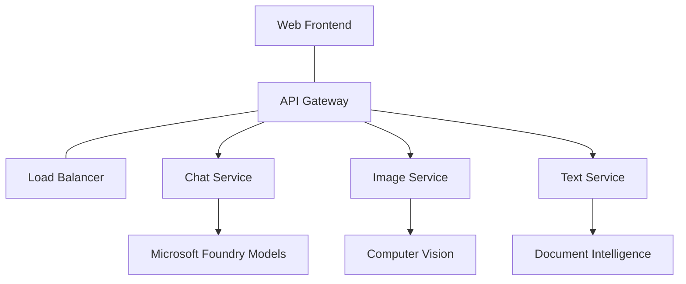

# Најбоље праксе за продукционе AI радне оптерећења са AZD

**Навигација кроз поглавља:**
- **📚 Почетна страница курса**: [AZD За Почетнике](../../README.md)
- **📖 Тренутно поглавље**: Поглавље 8 - Продукциони и предузетнички обрасци
- **⬅️ Претходно поглавље**: [Поглавље 7: Решавање проблема](../chapter-07-troubleshooting/debugging.md)
- **⬅️ Такође повезано**: [AI Радионица Лабораторија](../chapter-02-ai-development/ai-workshop-lab.md)
- **🎯 Курс завршен**: [AZD За Почетнике](../../README.md)

## Преглед

Овај водич објашњава шаблоне за дизајн продукционог AI уз коришћење Azure Developer CLI (AZD). То је референца за дизајн, а не развојна апликација или продукциона сертификација.

**Пример граница:** Ако није експлицитно описано као комплетно, фрагменти Bicep подразумевају параметре и референтне ресурсе из обухватајућег шаблона. Они изостављају хост слике/планове, идентитете, доделе улога, DNS, резултате и другу потребну интеграцију. YAML путање услуга и скрипте за хук/тест су илустративне датотеке које треба креирати у **вашој сопственој апликацији**; нису обезбеђене овим курсом. Користите радни AZD пример као основу, компајлирајте комплетну инфраструктуру, и тестирајте је у изолованом окружењу пре производње.

## Кључни изазови које решава

Уобичајене бриге у продукцији укључују вишесервисне расподеле, управљање идентитетима и тајнама, скалирање, контролу трошкова и надзор. Овде се не тврди било каква мерена преваленција.

## Архитектонски обрасци за продукциони AI

### Образац 1: Микросервисна AI архитектура

**Када користити**: Комплексне AI апликације са више могућности



**AZD имплементација**:

```yaml
# azure.yaml
name: enterprise-ai-platform
services:
  web:
    project: ./web
    host: staticwebapp
  api-gateway:
    project: ./api-gateway
    host: containerapp
  chat-service:
    project: ./services/chat
    host: containerapp
  vision-service:
    project: ./services/vision
    host: containerapp
  text-service:
    project: ./services/text
    host: containerapp
```

### Образац 2: Догађајима управљана AI обрада

**Када користити**: Батцх обрада, анализа докумената, асинхрони протокови рада

```bicep
// Event Hub for AI processing pipeline
resource eventHub 'Microsoft.EventHub/namespaces@2024-01-01' = {
  name: eventHubNamespaceName
  location: location
  sku: {
    name: 'Standard'
    tier: 'Standard'
    capacity: 1
  }
}

// Service Bus for reliable message processing
resource serviceBus 'Microsoft.ServiceBus/namespaces@2024-01-01' = {
  name: serviceBusNamespaceName
  location: location
  sku: {
    name: 'Premium'
    tier: 'Premium'
    capacity: 1
  }
}

// Function App for processing
resource functionApp 'Microsoft.Web/sites@2023-01-01' = {
  name: functionAppName
  location: location
  kind: 'functionapp,linux'
  properties: {
    siteConfig: {
      appSettings: [
        {
          name: 'FUNCTIONS_EXTENSION_VERSION'
          value: '~4'
        }
        {
          name: 'AZURE_OPENAI_ENDPOINT'
          value: '@Microsoft.KeyVault(VaultName=${keyVault.name};SecretName=openai-endpoint)'
        }
      ]
    }
  }
}
```

Ово креира просторне фрагменте, а не хабове, редове, претплате или тригере функција. Извршива функција такође захтева хостинг план, конфигурацију извршења/складиштења, прикључени идентитет, RBAC, и приступ мрежи. Референца Key Vault-а треба дозволу за читање тајне; сам URL крајње тачке није акредитација.

## Размишљање о здрављу AI агента

Када се традиционална веб апликација поквари, симптоми су познати: страница се не учитава, API враћа грешку или имплементација не успе. AI апликације могу да се покваре на све ове начине—али такође могу се понашати суптилније, без очигледних грешака.

Овај одељак вам помаже да изградите ментални модел за праћење AI радних оптерећења тако да знате где да тражите када нешто није у реду.

### Како се здравље агента разликује од здравља традиционалне апликације

Традиционалне апликације такође могу имати суптилне проблеме коректности. AI агент додаје недетерминистички квалитет одговора уз уобичајене бриге о доступности и коректности. Размислите о здрављу агента у два слоја:

| Слој | Шта пратити | Где гледати |
|-------|--------------|---------------|
| **Здравље инфраструктуре** | Да ли је сервис покренут? Да ли су ресурси обезбеђени? Да ли су крајње тачке доступне? | `azd monitor`, Azure Portal здравље ресурса, евиденције контејнера/апликација |
| **Здравље понашања** | Да ли агент прецизно одговара? Да ли су одговори благовремени? Да ли се модел позива правилно? | Application Insights трагови, метрике латенције позива модела, записи квалитета одговора |

Здравље инфраструктуре је познато—исто као за било коју азд апликацију. Здравље понашања је нови слој који уводе AI радни задаци.

### Где гледати када се AI апликације не понашају као што се очекује

Ако ваша AI апликација не даје очекиване резултате, ево концептуалне листе за проверу:

1. **Почните са основама.** Да ли апликација ради? Може ли да достигне своје зависности? Проверите `azd monitor` и здравље ресурса као и за било коју апликацију.
2. **Проверите везу са моделом.** Да ли ваша апликација успешно позива AI модел? Неуспели или временски истекли позиви модела су најчешћи узрок проблема AI апликација и појавиће се у логовима апликације.
3. **Безбедно прегледајте улаз и основне податке.** Погрешни одговори могу бити узроковани преузимањем, упутствима, ограничењима модела или извршењем алата. Користите дијагностичке податке са контролом приступа и црвеним маркама; не омогућавајте непроверено бележење упита/одговора у продукцији.
4. **Прегледајте латенцију одговора.** Позиви AI модела су спорији од типичних API позива. Ако апликација делује споро, проверите да ли су се повећала времена одговора модела — ово може указивати на успоравање, капацитетна ограничења или гужву на нивоу региона.
5. **Пратите сигнале за трошкове.** Неочекивани скокови у коришћењу токена или API позивима могу указивати на циклус, погрешно конфигурисан упит или прекомерне поновне покушаје.

Не морате одмах знати све о алатима за посматрање. Кључна порука је да AI апликације имају додатни слој понашања за праћење, а уграђени мониторинг азд-а (`azd monitor`) вам пружа полазну тачку за истраживање оба слоја.

---

## Најбоље безбедносне праксе

### 1. Нула-поверења модел безбедности

**Стратегија имплементације**:
- Ниједна комуникација сервис-сервис без аутентикације
- Сви API позиви користе управљане идентитете
- Мрежна изолација помоћу приватних крајњих тачака
- Контроле приступа најмањег привилегија

```bicep
// Managed Identity for each service
resource chatServiceIdentity 'Microsoft.ManagedIdentity/userAssignedIdentities@2023-01-31' = {
  name: 'chat-service-identity'
  location: location
}

// Role assignments with minimal permissions
resource openAIUserRole 'Microsoft.Authorization/roleAssignments@2022-04-01' = {
  scope: openAIAccount
  name: guid(openAIAccount.id, chatServiceIdentity.id, '5e0bd9bd-7b93-4f28-af87-19fc36ad61bd')
  properties: {
    roleDefinitionId: subscriptionResourceId('Microsoft.Authorization/roleDefinitions', '5e0bd9bd-7b93-4f28-af87-19fc36ad61bd')
    principalId: chatServiceIdentity.properties.principalId
    principalType: 'ServicePrincipal'
  }
}
```

### 2. Сигурно управљање тајнама

**Образац интеграције са Key Vault-ом**:

```bicep
// Key Vault with proper access policies
resource keyVault 'Microsoft.KeyVault/vaults@2023-02-01' = {
  name: keyVaultName
  location: location
  properties: {
    tenantId: tenant().tenantId
    sku: {
      family: 'A'
      name: 'standard' // Premium is needed for HSM-backed keys, not ordinary secrets
    }
    enableRbacAuthorization: true  // Use RBAC instead of access policies
    enablePurgeProtection: true    // Prevent accidental deletion
    enableSoftDelete: true
    softDeleteRetentionInDays: 90
  }
}

// Optional legacy key-auth alternative; omit when using Entra ID.
resource openAIKeySecret 'Microsoft.KeyVault/vaults/secrets@2023-02-01' = {
  parent: keyVault
  name: 'openai-api-key'
  properties: {
    value: openAIAccount.listKeys().key1
    attributes: {
      enabled: true
    }
  }
}
```

Доделите идентитет извршења `Key Vault Secrets User` на одговарајућем обухвату и прикључите га хосту; `enableRbacAuthorization` сам по себи не даје приступ. Преферирајте аутентификацију управљаног идентитета OpenAI са `disableLocalAuth: true`. Опционо тајна кључа има смисла само за свесно омогућен налог са кључем, а и главни корисник провизије треба дозволу за упис тајни.

### 3. Мрежна безбедност

**Конфигурација приватне крајње тачке**:

```bicep
// Virtual Network for AI services
resource virtualNetwork 'Microsoft.Network/virtualNetworks@2023-04-01' = {
  name: vnetName
  location: location
  properties: {
    addressSpace: {
      addressPrefixes: ['10.0.0.0/16']
    }
    subnets: [
      {
        name: 'ai-services-subnet'
        properties: {
          addressPrefix: '10.0.1.0/24'
          privateEndpointNetworkPolicies: 'Disabled'
        }
      }
      {
        name: 'app-services-subnet'
        properties: {
          addressPrefix: '10.0.2.0/24'
          delegations: [
            {
              name: 'Microsoft.Web/serverFarms'
              properties: {
                serviceName: 'Microsoft.Web/serverFarms'
              }
            }
          ]
        }
      }
    ]
  }
}

// Private endpoints for all AI services
resource openAIPrivateEndpoint 'Microsoft.Network/privateEndpoints@2023-04-01' = {
  name: '${openAIAccountName}-pe'
  location: location
  properties: {
    subnet: {
      id: virtualNetwork.properties.subnets[0].id
    }
    privateLinkServiceConnections: [
      {
        name: 'openai-connection'
        properties: {
          privateLinkServiceId: openAIAccount.id
          groupIds: ['account']
        }
      }
    ]
  }
}
```

Приватне крајње тачке такође захтевају приватне DNS зоне групе/ВНет линкове и интеграцију апликација са ВНет-ом. Оне аутоматски не блокирају јавни приступ: експлицитно онемогућите јавни мрежни приступ AI налогу након валидације приватне конективности и приступа имплементацији.

## Перформансе и скалирање

### 1. Стратегије аутоматског скалирања

**Аутоматско скалирање контејнер апликација**:

```bicep
resource containerApp 'Microsoft.App/containerApps@2023-05-01' = {
  name: containerAppName
  location: location
  properties: {
    configuration: {
      ingress: {
        external: true
        targetPort: 8000
        transport: 'http'
      }
    }
    template: {
      scale: {
        minReplicas: 2  // Always have 2 instances minimum
        maxReplicas: 50 // Scale up to 50 for high load
        rules: [
          {
            name: 'http-scaling'
            http: {
              metadata: {
                concurrentRequests: '20'  // Scale when >20 concurrent requests
              }
            }
          }
          {
            name: 'cpu-scaling'
            custom: {
              type: 'cpu'
              metadata: {
                type: 'Utilization'
                value: '70'  // Scale when CPU >70%
              }
            }
          }
        ]
      }
    }
  }
}
```

### 2. Стратегије кеширања

**Redis кеш за AI одговоре**:

```bicep
// Legacy Azure Cache for Redis example (not recommended for new deployments)
resource redisCache 'Microsoft.Cache/redis@2023-04-01' = {
  name: redisCacheName
  location: location
  properties: {
    sku: {
      name: 'Premium'
      family: 'P'
      capacity: 1
    }
    enableNonSslPort: false
    minimumTlsVersion: '1.2'
    redisConfiguration: {
      'maxmemory-policy': 'allkeys-lru'
    }
    // Sharding distributes data; replication/failover provides availability.
    shardCount: 2
  }
}

// Cache configuration in application
var cacheConnectionString = '${redisCache.properties.hostName}:6380,password=${redisCache.listKeys().primaryKey},ssl=True,abortConnect=False'
```

Azure Cache for Redis Basic/Standard/Premium је на [путах повлачења](https://learn.microsoft.com/azure/azure-cache-for-redis/retirement-faq). Користите Azure Managed Redis за нове дизајне и његове документоване SKU, идентитет и TLS конфигурацију, уместо копирања овог застарелог ресурса у Нови продукциони систем. Линија са конекцијским низом је нефункционални плейсхолдер, а не акредитација. Кључеви кеша треба да буду партиционисани по овлашћењу, моделу/упутствима и верзији преузимања, са истеком; заједнички кеш само за упите може открити податке другог корисника.

### 3. Балансирање оптерећења и управљање саобраћајем

**Application Gateway са WAF-ом**:

```bicep
// Application Gateway with Web Application Firewall
resource applicationGateway 'Microsoft.Network/applicationGateways@2023-04-01' = {
  name: appGatewayName
  location: location
  properties: {
    sku: {
      name: 'WAF_v2'
      tier: 'WAF_v2'
      capacity: 2
    }
    webApplicationFirewallConfiguration: {
      enabled: true
      firewallMode: 'Prevention'
      ruleSetType: 'OWASP'
      ruleSetVersion: '3.2'
    }
    // Backend pools for AI services
    backendAddressPools: [
      {
        name: 'ai-services-pool'
        properties: {
          backendAddresses: [
            {
              fqdn: '${containerApp.properties.configuration.ingress.fqdn}'
            }
          ]
        }
      }
    ]
  }
}
```

Ово је делимичан ресурс гејтвеја: права имплементација такође захтева Гејтвеј подсет/ИП конфигурацију, фронтенд ИП и портове, TLS слушаоце/сертификате, бекенд HTTP подешавања/пробе, правила рутирања и приоритете, и прегледану WAF политику. TLS hostname/SNI и аутентификација морају одговарати контейнер апликацијском бекенду.

## 💰 Оптимизација трошкова

### 1. Правилна величина ресурса

**Конфигурације специфичне за окружење**:

Ова имена су **илустративни прилази прилагођеног шаблона**, а не аутоматска подешавања AZD-а. Прво пресликајте сваки у `infra/main.parameters.json`/Bicep и конфигурацију хоста. На пример, РАГ пример користи `AZURE_SEARCH_SERVICE_SKU` и `AZURE_OPENAI_CHATGPT_DEPLOYMENT_CAPACITY`, а не општа имена испод. Дајте меморији Container Apps подржану јединицу као што је `1Gi` у стварном ресурсу. Примењујте промене инфраструктуре помоћу `azd up` или `azd provision`; `azd deploy` сам по себи не примењује Bicep промене.

```bash
# Development environment
azd env new development
azd env set AZURE_OPENAI_SKU "S0"
azd env set AZURE_OPENAI_CAPACITY 10
azd env set AZURE_SEARCH_SKU "basic"
azd env set CONTAINER_CPU 0.5
azd env set CONTAINER_MEMORY 1.0

# Production environment  
azd env new production
azd env set AZURE_OPENAI_SKU "S0"
azd env set AZURE_OPENAI_CAPACITY 100
azd env set AZURE_SEARCH_SKU "standard"
azd env set CONTAINER_CPU 2.0
azd env set CONTAINER_MEMORY 4.0
```

### 2. Праћење трошкова и буџети

```bicep
// Supply the first day of the current UTC month, e.g. 2026-11-01T00:00:00Z.
param budgetStartDate string

// Cost management and budgets
resource budget 'Microsoft.Consumption/budgets@2024-08-01' = {
  name: 'ai-workload-budget'
  properties: {
    timePeriod: {
      startDate: budgetStartDate
    }
    timeGrain: 'Monthly'
    amount: 2000  // In the billing currency, not necessarily USD
    category: 'Cost'
    notifications: {
      warning: {
        enabled: true
        operator: 'GreaterThan'
        threshold: 80
        contactEmails: [
          'finance@company.com'
          'engineering@company.com'
        ]
        contactRoles: [
          'Owner'
          'Contributor'
        ]
      }
      critical: {
        enabled: true
        operator: 'GreaterThan'
        threshold: 95
        contactEmails: [
          'cto@company.com'
        ]
      }
    }
  }
}
```

Замените примере прималаца и проверите опсег/дозволе. Упозорења буџета користе одложене податке о наплати и не спроводе ограничење потрошње.

### 3. Оптимизација коришћења токена

**Управљање трошковима OpenAI-а**:

Ово је само хеуристика заснована на броју карактера за UI преглед, **није** валидатор ограничења токена модела. Продукциони код мора користити токајзер прикладан за распоређени модел и узети у обзир системске инструкције, шеме алата, историју и буџет излаза. Одбијте превелики кориснички захтев уместо да га тихо скраћујете.

```typescript
// Application-level token optimization
class TokenOptimizer {
  private readonly maxTokens = 4000;
  private readonly reserveTokens = 500;
  
  optimizePrompt(userInput: string, context: string): string {
    const availableTokens = this.maxTokens - this.reserveTokens;
    if (this.estimateTokens(userInput) + 8 >= availableTokens) {
      throw new Error("User input exceeds the illustrative prompt budget");
    }
    const estimatedTokens = this.estimateTokens(userInput + context) + 8;
    
    if (estimatedTokens > availableTokens) {
      // Truncate context, not user input
      context = this.truncateContext(context, Math.max(0, availableTokens - this.estimateTokens(userInput) - 8));
    }
    
    return `${context}\n\nUser: ${userInput}`;
  }
  
  private estimateTokens(text: string): number {
    // Rough estimation: 1 token ≈ 4 characters
    return Math.ceil(text.length / 4);
  }

  private truncateContext(text: string, estimatedBudget: number): string {
    return text.slice(0, Math.max(0, estimatedBudget) * 4);
  }
}
```

## Надзор и посматрање

### 1. Свеобухватни Application Insights

```bicep
// Application Insights with advanced features
resource applicationInsights 'Microsoft.Insights/components@2020-02-02' = {
  name: applicationInsightsName
  location: location
  kind: 'web'
  properties: {
    Application_Type: 'web'
    WorkspaceResourceId: logAnalyticsWorkspace.id
    SamplingPercentage: 100  // Ingestion setting; review cost and SDK sampling separately
    DisableIpMasking: false  // Retain IP masking
  }
}

// Custom metrics for AI operations
resource aiMetricAlerts 'Microsoft.Insights/metricAlerts@2018-03-01' = {
  name: 'ai-high-error-rate'
  location: 'global'
  properties: {
    description: 'Alert when failed request count exceeds 10 in five minutes'
    severity: 2
    enabled: true
    scopes: [
      applicationInsights.id
    ]
    evaluationFrequency: 'PT1M'
    windowSize: 'PT5M'
    criteria: {
      'odata.type': 'Microsoft.Azure.Monitor.SingleResourceMultipleMetricCriteria'
      allOf: [
        {
          name: 'high-error-rate'
          metricName: 'requests/failed'
          operator: 'GreaterThan'
          threshold: 10
          timeAggregation: 'Count'
        }
      ]
    }
  }
}
```

### 2. AI специфични мониторинг

**Прилагођене контролне табле за AI метрике**:

```json
{
  "dashboard": {
    "name": "AI Application Monitoring",
    "tiles": [
      {
        "name": "OpenAI Request Volume",
        "query": "dependencies | where target contains 'openai' | summarize count() by bin(timestamp, 5m)"
      },
      {
        "name": "AI Response Latency",
        "query": "dependencies | where target contains 'openai' | summarize avg(duration) by bin(timestamp, 5m)"
      },
      {
        "name": "Token Usage",
        "query": "customMetrics | where name == 'openai_tokens_used' | summarize sum(value) by bin(timestamp, 1h)"
      },
      {
        "name": "Cost per Hour",
        "query": "customMetrics | where name == 'openai_cost' | summarize sum(value) by bin(timestamp, 1h)"
      }
    ]
  }
}
```

Овај JSON је апликацијски дефинисан скиц са нацртом, није увозна шема контролне табле Azure портала. Упити за токене/трошкове захтевају да ваша апликација емитује те тачно прилагођене метрике; нису направљени од стране AZD-а. Прилагодите филтере зависности за праве називе крајње тачке/опсега модела.

### 3. Провере здравља и праћење доступности

```bicep
// Application Insights availability tests
resource availabilityTest 'Microsoft.Insights/webtests@2022-06-15' = {
  name: 'ai-app-availability-test'
  location: location
  tags: {
    'hidden-link:${applicationInsights.id}': 'Resource'
  }
  properties: {
    SyntheticMonitorId: 'ai-app-availability-test'
    Name: 'AI Application Availability Test'
    Description: 'Tests AI application endpoints'
    Enabled: true
    Frequency: 300  // 5 minutes
    Timeout: 120    // 2 minutes
    Kind: 'standard'
    Locations: [
      {
        Id: 'us-east-2-azr'
      }
      {
        Id: 'us-west-2-azr'
      }
    ]
    Request: {
      RequestUrl: 'https://${webApp.properties.defaultHostName}/health'
      HttpVerb: 'GET'
      FollowRedirects: true
      ParseDependentRequests: false
    }
    ValidationRules: {
      ExpectedHttpStatusCode: 200
      SSLCheck: true
      SSLCertRemainingLifetimeCheck: 7
    }
  }
}
```

## Опоравак од катастрофе и висока доступност

Претходни тест претпоставља постојећи App Service `webApp` и Application Insights ресурс. Стандардни тестови доступности се наплаћују и захтевају постижну крајњу тачку; апликације са само приватним приступом захтевају одговарајући дизајн приватног надзора. Пинг тестови URL-а су застарели; користите [стандардне тестове доступности](https://learn.microsoft.com/azure/azure-monitor/app/availability).

### 1. Више-регионска имплементација

```yaml
# azure.yaml - Multi-region configuration
name: ai-app-multiregion
services:
  api-primary:
    project: ./api
    host: containerapp
    env:
      AZURE_REGION: eastus
  api-secondary:
    project: ./api
    host: containerapp
    env:
      AZURE_REGION: westus2
```

```bicep
// Separate App Service topology, not the Container Apps declarations above
resource trafficManager 'Microsoft.Network/trafficManagerProfiles@2022-04-01' = {
  name: trafficManagerProfileName
  location: 'global'
  properties: {
    profileStatus: 'Enabled'
    trafficRoutingMethod: 'Priority'
    dnsConfig: {
      relativeName: trafficManagerProfileName
      ttl: 30
    }
    monitorConfig: {
      protocol: 'HTTPS'
      port: 443
      path: '/health'
      intervalInSeconds: 30
      toleratedNumberOfFailures: 3
      timeoutInSeconds: 10
    }
    endpoints: [
      {
        name: 'primary-endpoint'
        type: 'Microsoft.Network/trafficManagerProfiles/azureEndpoints'
        properties: {
          targetResourceId: primaryAppService.id
          endpointStatus: 'Enabled'
          priority: 1
        }
      }
      {
        name: 'secondary-endpoint'
        type: 'Microsoft.Network/trafficManagerProfiles/azureEndpoints'
        properties: {
          targetResourceId: secondaryAppService.id
          endpointStatus: 'Enabled'
          priority: 2
        }
      }
    ]
  }
}
```

Променљиве окружења не бирају локације ресурса. IaC мора провизионати јединствене регионалне хостове и везати сваку услугу са `resourceName` или `azd-service-name` ознакама. Пример Traffic Manager-а је **посебна App Service топологија** (`primaryAppService`/`secondaryAppService`), а не рутирање за декларације Container Apps. Container Apps захтева одговарајуће подешену спољашњу крајњу тачку/front door, TLS/рутирање по прилагођеном домену и проверу здравља.

### 2. Прављење резервних копија и опоравак података

```bicep
// Backup configuration for critical data
resource backupVault 'Microsoft.DataProtection/backupVaults@2023-05-01' = {
  name: backupVaultName
  location: location
  identity: {
    type: 'SystemAssigned'
  }
  properties: {
    storageSettings: [
      {
        datastoreType: 'VaultStore'
        type: 'LocallyRedundant'
      }
    ]
  }
}

```

Сам волт не прави никакве резервне копије. Конфигуришите **специфичну политику и инстанцу резервне копије за радно оптерећење**, дозволе извора, чување и тестове враћања помоћу [Azure Backup support matrices](https://learn.microsoft.com/azure/backup/backup-support-matrix). Не постоји општа политика Azure Backup-а за хостиране Azure OpenAI имплементације модела. Чувајте дефиниције инфраструктуре/деплојмента модела у систему за контролу верзија; заштитите отпремљене документе, податке апликације и артефакте фино подешавања користећи подржане функције резервне копије/експорта сваке сервисне позадине. Јасно дефинишите и тестирате RPO/RTO.

## Интеграција са DevOps и CI/CD

### 1. GitHub Actions Workflow

```yaml
# .github/workflows/deploy-ai-app.yml
name: Deploy AI Application

on:
  push:
    branches: [main]
  pull_request:
    branches: [main]

jobs:
  test:
    runs-on: ubuntu-latest
    steps:
      - uses: actions/checkout@v4
      
      - name: Setup Python
        uses: actions/setup-python@v4
        with:
          python-version: '3.11'
          
      - name: Install dependencies
        run: |
          pip install -r requirements.txt
          pip install pytest
          
      - name: Run tests
        run: pytest tests/
        
      - name: AI Safety Tests
        run: |
          python scripts/test_ai_safety.py
          python scripts/validate_prompts.py

```

Ово је **само тест део** радног тока и претпоставља да сте креирали `requirements.txt`, `tests/`, и два безбедносна скрипта. Додајте аутентификоване OIDC job-ове за провизију/деплојмент из [CI/CD Pipeline Configuration](#cicd-pipeline-configuration), са `needs: test`, поузданим пуш/ручно покретање и заштићеним GitHub окружењима. Немојте деплојовати непоуздан код из pull request-а са облачним акредитивима. Нов тркач нема изабрано локално AZD окружење; доставите улазе за окружење/претплату/локацију и користите `azd auth login`, а не само `azure/login`.

### 2. Валидација инфраструктуре

```bash
# scripts/validate_infrastructure.sh
#!/bin/bash
set -euo pipefail

echo "Validating AI infrastructure deployment..."

# Requires Azure CLI login and the resource group selected explicitly.
: "${AZURE_RESOURCE_GROUP:?Set AZURE_RESOURCE_GROUP}"
: "${AZURE_OPENAI_NAME:?Set AZURE_OPENAI_NAME}"
: "${AZURE_OPENAI_CHAT_DEPLOYMENT:?Set the actual deployment name}"

# A successful empty list is not proof that resources exist.
types=("Microsoft.CognitiveServices/accounts" "Microsoft.Search/searchServices"
       "Microsoft.Storage/storageAccounts" "Microsoft.KeyVault/vaults")
for resource_type in "${types[@]}"; do
    count=$(az resource list --resource-group "$AZURE_RESOURCE_GROUP" \
        --resource-type "$resource_type" --query "length(@)" -o tsv)
    if [[ "$count" -lt 1 ]]; then
        echo "ERROR: No $resource_type found in $AZURE_RESOURCE_GROUP"
        exit 1
    fi
done

# Validate OpenAI model deployments
echo "Validating OpenAI model deployments..."
state=$(az cognitiveservices account deployment show \
  --name "$AZURE_OPENAI_NAME" --resource-group "$AZURE_RESOURCE_GROUP" \
  --deployment-name "$AZURE_OPENAI_CHAT_DEPLOYMENT" \
  --query "properties.provisioningState" -o tsv)
if [[ "$state" != "Succeeded" ]]; then
    echo "ERROR: Required model deployment is not provisioned successfully"
    exit 1
fi

echo "Infrastructure validation completed successfully!"
```

Очекује се: нула излазна вредност и порука о завршетку само ако постоје сви очекивани типови и именовани деплојмент модела је провидиран. Ово проверава стање инвентара/провизије, **не** здравље ресурса, тачну топологију, RBAC, доступност мреже или понашање модела. Прилагодите очекиване типове својој архитектури, а затим извршите посебан тест спремности апликације са аутентикацијом.

## Контролна листа спремности за производњу

### Безбедност ✅
- [ ] Сви сервиси користе управљане идентитете
- [ ] Тајне чувају се у Key Vault-у
- [ ] Приватне крајње тачке конфигурисане
- [ ] Имплементиране групе мрежне безбедности
- [ ] RBAC са најмањим привилегијама
- [ ] WAF омогућен на јавним крајњим тачкама

### Перформансе ✅
- [ ] Аутоматско скалирање конфигурисано
- [ ] Кеширање имплементирано
- [ ] Подешен балансер оптерећења
- [ ] CDN за статички садржај
- [ ] Пул повезивања базе података
- [ ] Оптимизација коришћења токена

### Надгледање ✅
- [ ] Application Insights конфигурисан
- [ ] Дефинисане прилагођене метрике
- [ ] Подешени алармни регулативи
- [ ] Направљен контролни панел
- [ ] Имплементиране провере здравља
- [ ] Политике чувања логова

### Ветроуздрастност ✅
- [ ] Деплојмент у више регија
- [ ] План резервне копије и опоравка
- [ ] Имплементирани прекидачи кола
- [ ] Конфигурисане политике поновних покушаја
- [ ] Грациозна деградација
- [ ] Крајње тачке за провере здравља

### Управљање трошковима ✅
- [ ] Подешени алерти буџета
- [ ] Правилно димензионисање ресурса
- [ ] Примењени попусти за развој/тестирање
- [ ] Купљене резервансе инстанце
- [ ] Контролни панел за праћење трошкова
- [ ] Редовни прегледи трошкова

### Усклађеност ✅
- [ ] Испуњени услови за резиденцију података
- [ ] Омогућено аутитовање лога
- [ ] Примењене политике усклађености
- [ ] Имплементирани безбедносни оквири
- [ ] Редовне безбедносне процене
- [ ] План реаговања на инциденте

## Перформанс мерења

### Илустративни циљеви за производњу

Ово су примерени SLO-ови за преговарање и оптерећење тестирања, а не мерљиви стандарди или гаранције. Латенција одговора зависи од дужине модела/излаза; месечна потрошња токена зависи од саобраћаја и цена, не само од броја токена.

| Метрика | Циљ | Надгледање |
|--------|--------|------------|
| **Време одговора** | < 2 секунде | Application Insights |
| **Доступност** | 99.9% | Надгледање времена рада |
| **Стопа грешака** | < 0.1% | Логови апликације |
| **Потрошња модела** | < 500 $/месечно (пример буџета) | Управљање трошковима |
| **Паралелни корисници** | 1000+ | Тестирање оптерећења |
| **Време опоравка** | < 1 сат | Тестови опоравка од катастрофе |

### Тестирање оптерећења

Следеће је нацрт интерфејса за скрипту за тестирање оптерећења коју **морате имплементирати**; овај репозиторијум не пружа `scripts/load_test.py`. Дефинишите захтеве за податке, аутентификацију, репрезентативне радне скупове, провере латенције/греха у процентилу и лимит трошкова у алату за тестирање оптерећења по избору пре него што га покренете:

```bash
# Load testing script for AI applications
python scripts/load_test.py \
  --endpoint https://your-ai-app.azurewebsites.net \
  --concurrent-users 100 \
  --duration 300 \
  --ramp-up 60
```

## 🤝 Најбоље праксе заједнице

На основу повратних информација заједнице Microsoft Foundry Discord:

### Топ препоруке заједнице:

1. **Почните мало, повећавајте постепено**: Започните са основним SKU-овима и повећавајте по реалној употреби
2. **Пратите све**: Поставите обухватно праћење од првог дана
3. **Аутоматизујте безбедност**: Користите инфраструктуру као код за конзистентну безбедност
4. **Тестирајте темељно**: Укључите тестирање специфично за AI у ваш ток рада
5. **Планирајте трошкове**: Пратите употребу токена и поставите ране упозорења о буџету

### Уобичајене замке које треба избећи:

- ❌ Тврдокодирање API кључева у коду
- ❌ Не постављање правилног праћења
- ❌ Игнорисање оптимизације трошкова
- ❌ Не тестирање сценарија квара
- ❌ Деплој без провере здравља

## AZD AI CLI команде и екстензије

AZD укључује растући скуп AI-специфичних команди и екстензија које поједностављују производне AI токове рада. Ови алати повезују локални развој и производно распоређивање за AI радне оптерећења.

> **Преглед издања (2026-11-04):** Упутства за CLI испод проверавана су у односу на објављена издања `azd` **1.37.2**, `azure.ai.agents` **1.0.0-beta.23** и `azure.ai.evaluations` **1.0.0-beta.2**. Агенти beta.23 захтевају `azd >= 1.37.0`; евалуације beta.2 захтевају `azd >= 1.33.0`. Користите најмање 1.37.0 за комбиновани ток рада. Ово је преглед документације/извора, а не валидација живог Azure деплоја.

### AZD екстензије за AI

AZD користи систем екстензија за додавање AI-специфичних могућности. Инсталирајте и управљајте екстензијама помоћу:

```bash
# List all available extensions (including AI)
azd extension list

# Inspect installed extension details
azd version
azd extension show azure.ai.agents

# Install the Foundry agents extension
azd extension install azure.ai.agents

# Install the separate Foundry evaluations extension
azd extension install azure.ai.evaluations

# Install the fine-tuning extension
azd extension install azure.ai.finetune

# Install the custom models extension
azd extension install azure.ai.models

# Upgrade all installed extensions
azd extension upgrade --all
```

**Доступне AI екстензије:**

| Екстензија | Сврха | Статус |
|-----------|---------|--------|
| `azure.ai.agents` | Управљање Foundry Agent Service | Преглед |
| `azure.ai.evaluations` | Скупови за оцену, оценитељи, групе за евалуацију и покретачи | Преглед |
| `azure.ai.skills` | Поново употребљиве агенцијске вештине | Преглед |
| `azure.ai.connections` | Foundry везе (извори података, алати) | Преглед |
| `azure.ai.finetune` | Прецизна подешавања модела Foundry | Преглед |
| `azure.ai.models` | Прилагођени Foundry модели | Преглед |
| `azure.coding-agent` | Конфигурација кодирајућег агента | Доступно |

> Покрените `azd extension list --installed` и `azd extension show azure.ai.evaluations` за преглед инсталираних верзија. Прво надоградите основни CLI помоћу [упутстава за инсталацију/ажурирање](https://learn.microsoft.com/azure/developer/azure-developer-cli/install-azd) (за Windows winget инсталацију: `winget upgrade Microsoft.Azd`), затим покрените `azd extension upgrade --all`. Нема основне командe `azd upgrade`. Прегледајте прекидне промене пре надоградње продукционе аутоматизације; не претпостављајте да надоградња екстензије чува старе формате команди или конфигурација.

### Недавне промене и исправке у издањима

| Издање | Шта се мијења за овај курс |
|---------|------------------------------|
| `azd 1.37.0` | Додаје стабилне deployment-preview API-је и исправља редиговања екстензија која преписују неповезане `azure.yaml` поставке. |
| `azd 1.37.1` | Исправља пропагацију Ctrl+C кроз екстензије и разликује отказивање/таймаут од општих неуспеха. |
| `azd 1.37.2` | Побољшава провјеру провизије: критична упозорења подразумевано на **Не**, отказује без потврде у нерегулисаним покретањима, а отказивање прескаче post-provision hooks. Такође исправља нерешене вредности окружења у Deployment Stacks deny листама када је укључена та алфа функција. |
| Агенти `beta.22` | Мигрира евалуацију на `azd ai eval`, мења оптимизацију на GA v1 API, захтева плеуралне `toolboxes` и раздваја managed-harness, voice и long-running preview укључивања. Поправља избор модела специфичних за окружење и аутентификацију алатки. |
| Агенти `beta.23` | Излаже `init --harness`; исправља излаз одговора A2A 0.3, неважеће путеве/модуле prompt-agenta кроз инфраструктурне слојеве, дијагностику таймаута активације и задржане RBAC упозорења за развојне програмере. |
| Евалуације `beta.2` | Захтева camelCase конфигурацију евалуације, додаје статичко/симулационо ауторство конверзација и експлицитне изворе са локалног фајла, и исправља руковање идентитетом/верзијом скупова података, бројеве квалитативних капија и дијагностику неуспешних покретања. |

Таймаут активације агента **не** доказује неуспех деплоја: прегледајте покушану верзију и њено стање пре покушаја поново. RBAC упозорења за развојне програмере могу остати чак и кад провизија успе; решите недостатак приступа пре позива као тај развојни програмер.

Извори: [AZD издања](https://github.com/Azure/azure-dev/releases), [agents beta.23 издање](https://github.com/Azure/azure-dev/releases/tag/azd-ext-azure-ai-agents_1.0.0-beta.23), [agents beta.22 миграција](https://github.com/Azure/azure-dev/releases/tag/azd-ext-azure-ai-agents_1.0.0-beta.22), и [evaluations beta.2 издање](https://github.com/Azure/azure-dev/releases/tag/azd-ext-azure-ai-evaluations_1.0.0-beta.2).

**Шта су новије `skills` и `connections` екстензије?**

Две preview екстензије појавиле су се уз алате за агенте и вреди их разумети чак и као почетник:

- **`azure.ai.skills`** — **вештина** је поново употребљива могућност (пакетирани алат или понашање) коју можете доделити једном или више агената уместо поновне имплементације сваки пут. Замислите је као заједнички грађевински блок: дефинишите "претраживање докумената" или "претрага поруџбине" вештину једном, па је поново употребите код агената. Ово држи мулти-агент систем (Поглавље 5) конзистентним и избегава копирање.
- **`azure.ai.connections`** — **веза** је управљана повезница из вашег Foundry пројекта ка спољном ресурсу који агенти требају—извор података (нпр. Azure AI Search), алатски ендпоинт или друга услуга. Везе централизују *где* и *како* агенти приступају подацима, тако да креденцијали и ендпоинти живе на једном контролисаном месту, а не разбацани кроз код.

Не треба вам ово за распоређивање првих агената—држите се `azure.ai.agents` док учите. Користите `skills` када приметите да дуплирате исти алат код много агената, а `connections` када више агената дели исти извор података.

### Иницијализација пројеката агената са `azd ai agent init`

Команда `azd ai agent init` креира Microsoft Foundry агент пројекат. Користите тренутни шаблон `azure.yaml` пројекта, не имплицитни стари агент манифест:

```bash
# Initialize a new agent project from a local project template
azd ai agent init --template ./templates/support-agent/azure.yaml

# Initialize and target a specific Foundry project
azd ai agent init --template ./templates/support-agent/azure.yaml --project-id <foundry-project-id>

# Adopt the template into a different directory
azd ai agent init --template ./templates/support-agent/azure.yaml --src ./agents/my-agent
```

**Кључне заставице:**

| Заставица | Опис |
|------|-------------|
| `-t, --template` | Путања или подржани GitHub URI ка `azure.yaml` пројектном документу |
| `-p, --project-id` | Постојећи Microsoft Foundry Project ID за ваше azd окружење |
| `-s, --src` | Изворни директоријум за генерисане агенте, или директоријум циља при усвајању пројекта |
| `--kind` | Иницијализујте `hosted`, `prompt`, или preview `prompt-voice` агента |
| `--harness` | Опциона извршна логика за `--kind prompt`; захтева preview укључивање |
| `-e, --environment` | azd окружење које се користи |

`--manifest`/`-m` је застарели алтернативни назив за `--template`/`-t`; преименовање заставице не претвара стари манифест у тренутни пројектни документ. `--host containerapp` није тренутна flag агента-иницијализације. За обичну апликацију Container Apps користите `azd init --template` са шаблоном који декларише `host: containerapp`.

За постојећи пројекат са тачно једним `azure.ai.project` сервисом, `azd ai agent add support-agent --file ./agents/support-agent.yaml` додаје или ажурира директну дефиницију агента без провизије или деплоја. Runtime команде одбијају стари implicit `agent.yaml`/AgentManifest и унутрашње сервисне `config:` дефиниције; мигрирајте их у тренутни `azure.ai.agent` сервис. Када init испише `cd` следећи корак, покрените га пре `azd up`: init не мења вашу shell фасциклу.

**Производни савет**: Користите `--project-id` за директно повезивање са постојећим Foundry пројектом, задржавајући ваш агент код и cloud ресурсе повезане од почетка.

#### Опционе preview функције

Managed harness, voice и long-running позиви су по дефаулту искључени. Подесите само прекидач за функцију која вам треба у **shell/CI процесном окружењу**, а не са `azd env set`:

| Функција | Променљива окружења процеса |
|---------|------------------------------|
| Managed harness (`init --kind prompt --harness ...`) | `AZD_ALPHA_ENABLE_AGENTS_MANAGED_HARNESS=true` |
| Voice (`init --kind prompt-voice`) | `AZD_ALPHA_ENABLE_AGENTS_VOICE=true` |
| Long-running позив | `AZD_ALPHA_ENABLE_AGENTS_LONG_RUNNING=true` |

На пример, користите `export AZD_ALPHA_ENABLE_AGENTS_MANAGED_HARNESS=true` у Bash-у или `$env:AZD_ALPHA_ENABLE_AGENTS_MANAGED_HARNESS = "true"` у PowerShell-у пре покретања релевантне команде. Један прекидач не укључује остале. Погледајте [ пуштени agents README](https://github.com/Azure/azure-dev/blob/azd-ext-azure-ai-agents_1.0.0-beta.23/cli/azd/extensions/azure.ai.agents/README.md) за све preview прекидаче и ограничења.

### Управљање животним циклусом агента

Користите `azure.ai.agents` за тестирање, преглед, оптимизацију и повлачење агената, а посебно `azure.ai.evaluations` екстензију за мјерење квалитета:

```bash
# Invoke a deployed agent and view server response timing
# (total latency and time to first byte)
azd ai agent invoke

# Show the live endpoint configuration before changing it
azd ai agent endpoint show

# Download the deployed source of a code-based hosted agent
# (with SHA-256 verification)
azd ai agent code download

# Delete a hosted agent and all of its versions
# (--force terminates active sessions)
azd ai agent delete --force
```

**Животни циклус на први поглед:**

| Фаза | Команда | Производна употреба |
|-------|---------|----------------|
| Тестирање | `azd ai agent invoke` | Потврдите одговоре и измерите латенцију пре пуштања у рад |
| Преглед | `azd ai agent endpoint show` | Прегледајте аутентификацију/конфигурацију ендпоинта; рано уочавање прекидних промена |
| Мерење | `azd ai eval init`, `generate`, `run start` | Дефинишите, деплојујте и извршавајте понављајуће евалуације |
| Побољшање | `azd ai agent optimize --eval <evaluation-name> --optimize-model <optimizer-deployment>` | Поново употребите компатибилну евалуацију за оптимизацију агента |
| Опоравак | `azd ai agent code download` | Повратите тачан у промењиво/ревизу извор за ревизију/повратак на претходно |
| Пензионисање | `azd ai agent delete --force` | Контролисано уклањање агента и његових верзија |

> Ово су preview команде и могу се мењати између верзија екстензија. Покрените `azd ai agent --help` да видите тачно подкоманде доступне у вашој инсталираној верзији.

`endpoint show` подржава hostovane, prompt и voice агенте, али ажурирања ендпоинта су само за хостоване; workflow агенти нису подржани. Преузимање кода и пример пензионисања хостованог агента горе нису уобичајене операције за сваки тип агента.

#### Миграција евалуације и провере квалитета

Почевши од агената **1.0.0-beta.22 (2026-10-23)**, старије `azd ai agent eval` команде пружају смернице за миграцију уместо претходног тока евалуације. Не копирајте старе `eval generate --dataset ...` примере: евалуација сада живи под **`azd ai eval`**.

У иницијализованом агент пројекту, аутентификујте се са `azd auth login`, потврдите изабрано окружење/Foundry пројекат и инсталирајте `azure.ai.evaluations`. Потребна је деплоирање судијског модела за оцењивање засновано на моделу; генерисање и симулација конверзације могу захтевати своје изборе модела и изазвати додатне трошкове.

```bash
# Scaffold evals/ and wire an azure.ai.eval service into azure.yaml
azd ai eval init

# Optionally synthesize a rubric and dataset from the agent
azd ai eval generate

# Review generated files, then register datasets, evaluators, and eval groups
azd up

# Start an evaluation and wait for its results
azd ai eval run start --wait

# Inspect runs and available test-case output
azd ai eval run list
azd ai eval run show <run-id>
azd ai eval run output list <run-id>
```

Пратите интерактивне изборе и штампане следеће кораке уместо да претпостављате да су генерисани ресурси већ регистровани. Конфигурација евалуације обично стоји у `evals/azure.eval.yaml`, реферисана од стране `azure.ai.eval` сервиса у `azure.yaml`. Кључеви су **camelCase** (`evaluationLevel`, `maxSamples`, `initializationParameters`, `dataMapping`); стари snake_case кључеви конфигурације се одбијају. Путеви унутар реферисане конфигурације се решавају релативно у односу на тај фајл, а не на коријен репозиторијума.

За евалуације конверзација, изаберите **статичко** за оцењивање завршених транскрипата без позива агента, или **симулацију** за генерисање конверзација из сценаријских семена. Симулација захтева агента таргет, модел симулатора и посебан судијски модел. За неприсутне команде, обезбедите улазе наведене у `azd ai eval init --help` и `azd ai eval generate --help`; не претпостављајте да је модел генерисања истовремено и судија или симулатор.

За CI, конфигуришите експлицитну политику квалитета користећи `azd ai eval run start --help` (`--fail-on`) и сматрајте ненулти излаз домаћина као неуспех. Завршени покретач није аутоматски пролаз квалитета. Прегледајте неуспеле/погрешне редове и дијагностику; недостајући или неконзистентни бројеви резултата нису доказ успеха. Регистровани скупови података задржавају свој идентитет/верзију сервиса; `--max-samples` не може подсетити регистрован скуп података. Објавите намерно мањи скуп података или користите подржани локални извор.

```bash
# Example CI policy: at least 90% of all test cases must pass
azd ai eval run start --wait --fail-on "pass-rate=0.9"
```

Проценат проласка користи број успешно положених тест случајева подељен са укупним бројем тестова; неуспели, погрешни, прескочени и други непролазни редови се рачунају против њега. Немојте комбиновати капију са `--no-wait`, који се враћа пре него што достаје пресуда.

#### Миграција конфигурације оптимизације

Оптимизација сада користи GA v1 API. За поновну употребу компатибилне **на нивоу окретања, скупом података подржане** евалуације из новог тока рада:

```bash
# Replace placeholders with the evaluation name and optimizer model deployment
azd ai agent optimize --eval-config ./evals/azure.eval.yaml --eval <evaluation-name> --optimize-model <optimizer-deployment>
```

`--eval` бира процену; `--eval-config` бира њену конфигурациону датотеку (укључујући дефиниције подржане датотекама). `--config` уместо тога узима **самосталан API захтев за оптимизацију** у YAML или JSON формату. Не преносите стари агента `eval.yaml` или нови `azure.eval.yaml` у `--config`, и не комбинујте `--config` са `--eval`/`--eval-config`. Процене засноване на разговору, праћењу трага или симулацији нису заменљиве са скраћеним путем оптимизације заснованим на скупу података; за те сценарије користите подржани формат захтева за оптимизацију. Прегледајте кандидате пре примене или распоређивања.

Погледајте [референцу процена за прегледану верзију](https://github.com/Azure/azure-dev/blob/azd-ext-azure-ai-evaluations_1.0.0-beta.2/cli/azd/extensions/azure.ai.evaluations/README.md) и [изворну команду за оптимизацију за прегледану верзију](https://github.com/Azure/azure-dev/blob/azd-ext-azure-ai-agents_1.0.0-beta.23/cli/azd/extensions/azure.ai.agents/internal/cmd/optimize.go) за тачне опције.

#### Преглед распореда агента само за читање на хосту

За постојеће окружење везано за Foundry са јединственом `azure.ai.agent` услугом `kind: hosted`, упоредите подржану конфигурацију пре распореда:

```bash
azd deploy <service-name> --preview --no-prompt
```

Овај преглед не распореди агента. Није потпуна разлика инфраструктуре/безбедности: агенти за упите/глас/радне токове, наслеђени распореди конфигурација и нека хостована подешавања су ван његовог опсега. Резултат `unknown` није одобрење за распоредање. Не постоји самостална команда `azd ai agent deploy` или агента `--dry-run`; користите основни радни ток распореда.

### Протокол контекста модела (MCP) са `azd mcp`

AZD укључује уграђену подршку за MCP сервер (Алфа), омогућавајући AI агентима и алатима да комуницирају са вашим Azure ресурсима кроз стандардизован протокол:

```bash
# Start the MCP server for your project
azd mcp start

# Review current Copilot consent rules for tool execution
azd copilot consent list
```

MCP сервер изложи контекст вашег azd пројекта—окружења, услуге и Azure ресурсе—за алате за развој засноване на AI. Ово омогућава:

- **Деплојмент уз помоћ AI:** Дозволите агентима за кодирање да питају стање вашег пројекта и иницирају распореде
- **Откривање ресурса:** AI алати могу открити које Azure ресурсе користи ваш пројекат
- **Управљање окружењима:** Агентима је омогућено да пребацују између развојног/тест/продукционог окружења

### Генерисање инфраструктуре са `azd infra generate`

За продукционе AI радне оптерећења, можете генерисати и прилагодити Infrastructure as Code уместо да се ослањате на аутоматско провајдовање:

```bash
# Generate supported infrastructure for this project type
azd infra generate
```

Подршка зависи од пројекта/хоста и инсталираних провајдера; ово није општа команда за реверзни инжењеринг произвољних Azure ресурса нити обећање да ће генерисати и Bicep и Terraform. Покрените `azd infra generate --help` и прегледајте генерисани формат. Где је подржано, писање IaC на диск вам омогућава:
- Преглед и ревизију инфраструктуре пре распореда
- Додавање прилагођених безбедносних политика (мрежна правила, приватне тачке приступа)
- Интеграцију са постојећим процесима ревизије IaC
- Верзионисање промена инфраструктуре одвојено од апликационог кода

### Хукови за животни циклус продукције

AZD хукови вам омогућавају да убаците прилагођену логику у сваку фазу животног циклуса распореда — критично за продукционе AI токове:

```yaml
# azure.yaml - Production hooks example
name: ai-production-app
hooks:
  preprovision:
    shell: sh
    run: scripts/validate-quotas.sh    # Check AI model quota before provisioning
  postprovision:
    shell: sh
    run: scripts/verify-networking.sh  # Verify IaC-provisioned private connectivity
  predeploy:
    shell: sh
    run: scripts/run-ai-safety-tests.sh  # Run prompt safety checks
  postdeploy:
    shell: sh
    run: scripts/smoke-test.sh           # Verify agent responses post-deploy
services:
  agent-api:
    project: ./src/agent
    host: containerapp
    hooks:
      predeploy:
        shell: sh
        run: scripts/validate-model-access.sh  # Per-service hook
```

```bash
# Run a specific hook manually during development
azd hooks run predeploy
```

**Препоручени продукциони хукови за AI радне оптерећења:**

| Хук | Примена |
|------|----------|
| `preprovision` | Валидација квота претплате за капацитет AI модела |
| `postprovision` | Провера приватне повезаности и потребних излаза ресурса |
| `predeploy` | Покретање AI тестова безбедности, валидација шаблона упита |
| `postdeploy` | Smoke тестирање одговора агента, провера повезаности модела |

### Конфигурација CI/CD пипелина

Користите `azd pipeline config` да повежете свој пројекат са GitHub Actions или Azure Pipelines уз безбедну Azure аутентификацију:

```bash
# Configure CI/CD pipeline (interactive)
azd pipeline config

# Configure with a specific provider
azd pipeline config --provider github
```

Ова команда:
- Креира или конфигурише идентитет пипелина; прегледајте генерисане опсеге улога/дозволе уместо да претпостављате најмање привилегије
- Конфигурише федеративне акредитиве (без сачуваних тајни)
- Генерише или ажурира дефиницију вашег пипелина
- Поставља потребне променљиве окружења у вашем CI/CD систему

#### Корак по корак: ваш први GitHub Actions пипелин

Ево целог прегледа од радног azd пројекта до аутоматизованих распореда на сваки push.

**1. Уверите се да је ваш пројекат на GitHub-у**

```bash
git init
git add .
git commit -m "Initial azd project"
gh repo create my-ai-app --private --source=. --push
```

**2. Покрените конфигурацију пипелина**

```bash
azd pipeline config --provider github
```

azd ће интерактивно:
- Питати коју Azure претплату и окружење циљате
- Креирати Entra **регистрацију апликације + сервисни главни налог** за пипелин
- Подесити **федеративне акредитиве (OIDC)** — тако да GitHub аутентификује Azure помоћу краткотрајних токена и **не чува се ниједна тајна**
- Пошаљете потребне **променљиве** у ваш GitHub репозиторијум (`AZURE_CLIENT_ID`, `AZURE_TENANT_ID`, `AZURE_SUBSCRIPTION_ID`, `AZURE_ENV_NAME`, `AZURE_LOCATION`)

**3. Разумевање генерисаног радног тока**

За подржани шаблон, конфигуришите/прегледајте `.github/workflows/azure-dev.yml`. Кључни делови изгледају овако (шаблон мора бити обезбедио ланац алата апликације и параметре окружења):

```yaml
# .github/workflows/azure-dev.yml
on:
  push:
    branches: [ main ]
  workflow_dispatch:        # lets you run it manually too

permissions:
  id-token: write           # required for OIDC federated login
  contents: read

jobs:
  build:
    runs-on: ubuntu-latest
    env:
      AZURE_CLIENT_ID: ${{ vars.AZURE_CLIENT_ID }}
      AZURE_TENANT_ID: ${{ vars.AZURE_TENANT_ID }}
      AZURE_SUBSCRIPTION_ID: ${{ vars.AZURE_SUBSCRIPTION_ID }}
      AZURE_ENV_NAME: ${{ vars.AZURE_ENV_NAME }}
      AZURE_LOCATION: ${{ vars.AZURE_LOCATION }}
    steps:
      - uses: actions/checkout@v4
      - name: Install azd
        uses: Azure/setup-azd@v2
      - name: Log in with OIDC
        run: azd auth login --client-id "$AZURE_CLIENT_ID" --federated-credential-provider "github" --tenant-id "$AZURE_TENANT_ID"
      - name: Provision infrastructure
        run: azd provision --no-prompt
      - name: Deploy application
        run: azd deploy --no-prompt
```

**4. Потврдите да ради**

```bash
# Push a change to trigger the pipeline
git commit -am "Trigger pipeline" --allow-empty
git push
```

Отворите картицу **Actions** у вашем GitHub репозиторијуму и посматрајте како радни ток аутоматски извршава `azd provision` и `azd deploy`.

> **Зашто су федеративни акредитиви важни:** стари пипелини су чували клијентску тајну у GitHub-у. OIDC федеративни акредитиви у потпуности уклањају ту тајну—GitHub захтева краткотрајни токен током извршавања, што је безбедније и нема потребу за ротацијом или цурењем. Ово је подразумевана конфигурација коју поставља `azd pipeline config`.

> **Тајне у односу на променљиве:** неосетљиви идентификатори (`AZURE_CLIENT_ID`, итд.) иду у репозиторијум **променљиве**. Ако ваша апликација стварно треба тајну током изградње, додајте је као GitHub **тајну** и референцирајте је помоћу `${{ secrets.NAME }}`—али преферирајте Key Vault + управљани идентитет током извршавања (погледајте [Поглавље 3](../chapter-03-configuration/authsecurity.md)).

**Продукциони радни ток са конфигурацијом пипелина:**

```bash
# 1. Set up production environment
azd env new production
azd env set AZURE_OPENAI_CAPACITY 100

# 2. Configure the pipeline
azd pipeline config --provider github

# 3. Review the generated trigger, provisioning/deployment steps, and approvals
```

#### Корак по корак: Azure DevOps Pipelines

Преферирате Azure DevOps уместо GitHub Actions? azd га нативно подржава са `azdo` провајдером. Ток је скоро идентичан—azd генерише пипелин датотеку, креира сервисну конекцију и поставља аутентификацију.

**1. Уверите се да имате Azure DevOps пројекат**

Потребна вам је организација и пројекат у `https://dev.azure.com/<your-org>`. Генеришите Personal Access Token (PAT) са опсегом за **Build (Read & execute)**, **Code (Read & write)** и **Service Connections (Read, query & manage)**—azd ће вас то затражити.

**2. Конфигуришите пипелин**

```bash
azd pipeline config --provider azdo
```

azd ће:
- Питати за вашу Azure DevOps организацију и пројекат
- Креирати (или поново искористити) **сервисну конекцију** ка Azure користећи сервисни главни налог
- Конфигурисати **federated workload identity (OIDC)** тако да се не чува клијентска тајна
- Конфигурисати дефиницију пипелина (обично `.azdo/pipelines/azure-dev.yml`) из шаблона пипелина пројекта

**3. Прегледајте генерисани пипелин**

Користите генерисани пипелин пројекта, укључујући његов **Azure сервисни конекцији и AZD аутентификационе кораке**. Званичан [водич за подешавање Azure Pipelines](https://learn.microsoft.com/azure/developer/azure-developer-cli/pipeline-azure-pipelines) приказује подфрагмент за инсталацију испод; ово је само **инсталација**, не покретни аутентификовани радни ток распореда:

```yaml
# .azdo/pipelines/azure-dev.yml (installer fragment only)
trigger:
  - main

pool:
  vmImage: ubuntu-latest

steps:
  - task: setup-azd@0
    displayName: Install azd
```

Инсталирајте AZD Azure DevOps екстензију ако тај задатак није доступан у вашој организацији. Немојте копирати голе `azd provision`/`azd deploy` шелл кораке без аутентификације: подешавање сервисне конекције не аутоматски аутентификује сваки процес у AZD. Пратите OIDC пријаву и ауторизовани контекст задатка у генерисаном шаблону, и обезбедите изабрано окружење/претплату/локацију.

**4. Одакле долазе променљиве**

azd чува вредности окружења (`AZURE_ENV_NAME`, `AZURE_LOCATION`, `AZURE_SUBSCRIPTION_ID`) као **групу променљивих** у Azure DevOps-у тако да пипелин може да их чита. Можете их прегледати и уређивати под **Pipelines → Library**.

> **Иста OIDC корист као у GitHub-у:** `azdo` провајдер такође подразумевано конфигурише федеративну workload identity, тако да се у сервисној конекцији не чува клијентска тајна—Azure DevOps размењује краткотрајни токен током извршавања. Преносите `--auth-type client-credentials` само ако ваша организација још не може да користи OIDC.

**5. Покрените то**

```bash
git commit -am "Add Azure DevOps pipeline" --allow-empty
git push
```

Отворите **Pipelines** у Azure DevOps-у и пратите како `azd provision` и `azd deploy` раде.

### Додавање компоненти са `azd add`

Инкрементално додајте Azure услуге у постојећи пројекат:

```bash
# Add a new service component interactively
azd add
```

Ово је посебно корисно за проширење продукционих AI апликација—на пример, додавање сервисa за векторско претраживање, новог агентског крајњег точки или компоненти за надзор у постојећи распоред.

## Допунски ресурси

- **Azure Well-Architected Framework**: [AI смернице за радно оптерећење](https://learn.microsoft.com/azure/well-architected/ai/)
- **Microsoft Foundry документација**: [Званични документи](https://learn.microsoft.com/azure/ai-studio/)
- **Заједнички шаблони**: [Azure примери](https://github.com/Azure-Samples)
- **Discord заједница**: [#Azure канал](https://discord.gg/microsoft-azure)
- **Вештине агената за Azure**: [microsoft/github-copilot-for-azure на skills.sh](https://skills.sh/microsoft/github-copilot-for-azure) - Поновно искористиве вештине агената за Azure AI, Foundry, располагање, оптимизацију трошкова и дијагностику. Инсталирајте у ваш уређивач:
  ```bash
  npx skills add microsoft/github-copilot-for-azure
  ```

---

**Навигација поглавља:**
- **📚 Почетна страница курса**: [AZD за почетнике](../../README.md)
- **📖 Текуће поглавље**: Поглавље 8 - Продакшн & Ентерпрајс обрасци
- **⬅️ Претходно поглавље**: [Поглавље 7: Решавање проблема](../chapter-07-troubleshooting/debugging.md)
- **⬅️ Такође повезано**: [AI радионица лаб](../chapter-02-ai-development/ai-workshop-lab.md)
- **🎯 Курс завршен**: [AZD за почетнике](../../README.md)

**Запамтите**: Продакшн AI радна оптерећења захтевају пажљиво планирање, праћење и континуирану оптимизацију. Почните са овим обрасцима и прилагодите их вашим специфичним захтевима.

---

<!-- CO-OP TRANSLATOR DISCLAIMER START -->
**Изјава о одрицању одговорности**:
Овај документ је преведен коришћењем услуге за аутоматски превод [Co-op Translator](https://github.com/Azure/co-op-translator). Иако тежимо тачности, имајте у виду да аутоматски преводи могу садржати грешке или нетачности. Оригинални документ на његовом изворном језику треба сматрати ауторитативним извором. За критичне информације препоручује се професионални људски превод. Нисмо одговорни за било каква неспоразума или погрешна тумачења која произилазе из коришћења овог превода.
<!-- CO-OP TRANSLATOR DISCLAIMER END -->