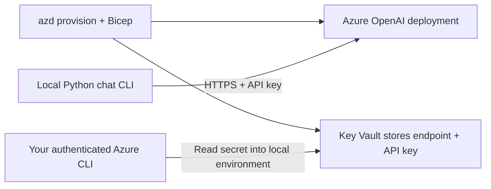

# Azure OpenAI Chat — Локални CLI и AZD инфраструктура

**Ниво:** Средњи · **Време:** 35–60 минута укључујући подешавање

Овај пример обезбеђује **Azure OpenAI ресурс и Key Vault**, затим покреће
интерактивни Python chat CLI **на вашем уређају**. Не хостује веб апликацију
или Container App. Подразумевани модел је `gpt-4.1`, верзија `2025-04-14`, са
`GlobalStandard` капацитетом распореда 20. Проверите тренутну доступност и квоту у
изабраном региону пре обезбеђивања; датуми животног циклуса модела могу се променити.

## Циљеви учења

- Обезбедити инфраструктуру модела помоћу Bicep и azd.
- Приступити API кључу из Key Vault без стављања у излазне резултате распореда.
- Слање Chat Completions захтева и одржавање историје разговора.
- Интерпретирати број токена и ограничења процена трошкова.



У овом примеру нема интеграције управљаног идентитета у време извршавања, мулти-регионалног феиловера,
прилагођеног ограничивача брзине, стриминг режима или хостираног рачунарства. OpenAI SDK
изводи до два поновна покушаја за грешке које се могу поновити; CLI пријављује преостале грешке.

## Захтеви

- Тренутна стабилна верзија [azd](https://learn.microsoft.com/azure/developer/azure-developer-cli/install-azd)
  (објављена верзија у време прегледа: 1.37.2).
- [Azure CLI](https://learn.microsoft.com/cli/azure/install-azure-cli).
- Python **3.10+** (препоручује се 3.11) и виртуелно окружење.
- Azure претплата са дозволама за креирање Cognitive Services и Key Vault
  ресурса, распореда модела и читања тајни из складишта.
- Регионална доступност и `GlobalStandard` квота за `gpt-4.1`. Захтеви за приступ
  зависе од претплате и функције; не постоји гарантовано време одобрења.

```bash
azd version
az version
python --version
azd auth login
az login
```

Ово су посебне аутентификационе сесије. Изаберите исту претплату у оба
алата пре покретања команди испод.

## Брзи почетак (Bash)

Покрените из корена репозиторијума:

```bash
cd examples/azure-openai-chat
azd env new myopenai
azd provision
```

Изаберите подржани регион. Обезбеђивање креира ресурсну групу, OpenAI налог,
распоређивање модела, Key Vault и `openai-endpoint`/`openai-api-key` тајне.
Нема **услуга за распоређивање** у `azure.yaml`.

Учитајте не-тајне излазе и преузмите тајну у ваш тренутни шел:

```bash
export AZURE_OPENAI_ENDPOINT="$(azd env get-value AZURE_OPENAI_ENDPOINT)"
export AZURE_OPENAI_MODEL="$(azd env get-value AZURE_OPENAI_MODEL)"
KV_NAME="$(azd env get-value AZURE_KEY_VAULT_NAME)"
export AZURE_OPENAI_API_KEY="$(az keyvault secret show \
  --vault-name "$KV_NAME" --name openai-api-key --query value --output tsv)"

python -m venv .venv
source .venv/bin/activate
python -m pip install -r src/requirements.txt
python src/chat.py
```

У PowerShell активирајте са `.\.venv\Scripts\Activate.ps1` и доделите околинске
променљиве са `$env:AZURE_OPENAI_ENDPOINT = azd env get-value AZURE_OPENAI_ENDPOINT`
(и слично за модел). Преузмите API кључ користећи
`$env:AZURE_OPENAI_API_KEY = az keyvault secret show --vault-name $KV_NAME --name openai-api-key --query value -o tsv`.
Подесите `$KV_NAME = azd env get-value AZURE_KEY_VAULT_NAME` прво.

Не штампајте, не комитујте и не лепите API кључ у извештаје о проблемима. CLI чита
променљиве окружења процеса; **не** преузима тајне из Key Vault или учитава `.env` фајлове.
`config.py` проверава крајњу тачку, лимит токена и температуру приликом покретања.

Очекујани излаз (садржај и коришћење варирају):

```text
Azure OpenAI Chat Application
Model: gpt-4.1
...
You: Say hello in one sentence.
Assistant: Hello! How can I help you today?
[Tokens: ... | Cost: $...]
```

Команде: `stats` приказује укупно, `clear` чисти историју разговора, и
`quit`/`exit` завршава сесију. Нема `--stream`, `--show-tokens`, `tokens`,
или `cost` команда.

## Проверите распоређивање

Након учитавања променљивих окружења:

```bash
curl --fail-with-body \
  "${AZURE_OPENAI_ENDPOINT%/}/openai/deployments/${AZURE_OPENAI_MODEL}/chat/completions?api-version=2024-10-21" \
  -H "Content-Type: application/json" \
  -H "api-key: $AZURE_OPENAI_API_KEY" \
  -d '{"messages":[{"role":"user","content":"Say hello!"}],"max_tokens":50}'

az keyvault secret list --vault-name "$KV_NAME" --query "[].name" -o table
```

Успешно: API враћа HTTP 200 са `choices[0].message.content` и `usage`;
складиште приказује `openai-api-key` и `openai-endpoint`. Само успешно ARM распоређивање
не потврђује закључивање.

## Фајлови и конфигурација

```text
azure.yaml                         # Infrastructure-only AZD project
infra/main.bicep                   # Subscription deployment
infra/main.parameters.json         # Environment, location, principal ID
infra/resources/openai.bicep       # Account + model
infra/resources/keyvault.bicep     # Vault + deploying user's secret access policy
infra/resources/secrets.bicep      # Writes secrets, no key output
src/chat.py                        # Interactive CLI
src/config.py                      # Environment validation
src/requirements.txt               # Python packages
```

Да бисте променили обезбеђени модел/верзију/капацитет, измените подразумеване вредности у
`infra/main.bicep` и покрените `azd provision`. Подешавање `AZURE_OPENAI_MODEL` у вашем
шелу само бира **постојећи назив распореда**; не распоређује други модел.

| Рунтиме променљива | Подразумевано / извор |
|---|---|
| `AZURE_OPENAI_ENDPOINT` | Обавезно; azd не-тајни излаз |
| `AZURE_OPENAI_API_KEY` | Обавезно; преузмите из Key Vault |
| `AZURE_OPENAI_MODEL` | `gpt-4.1`; Azure назив распореда |
| `AZURE_OPENAI_MAX_TOKENS` | 800 (опсег валидације 1–4096) |
| `AZURE_OPENAI_TEMPERATURE` | 0.7 (опсег 0–2) |
| `AZURE_OPENAI_INPUT_PRICE_PER_1K` | 0.002 USD; илустративна стопа за некењирани улаз |
| `AZURE_OPENAI_OUTPUT_PRICE_PER_1K` | 0.008 USD; илустративна стопа за излаз |

## Трошкови и безбедносна ограничења

Приказ трошкова је **приближан**, а не Azure наплата. Множи коришћење API токена
са конфигурисаним стопама и не узима у обзир попусте за кеширан улаз,
регионалне/СКУ разлике, порезе, промене цена или неуспеле/поновљене позиве.
Пондеришите **обе стопе** када користите други модел или СКУ и проверите тренутне
[Azure OpenAI цене](https://azure.microsoft.com/pricing/details/cognitive-services/openai-service/).

За илустрацију, 100 захтева са по 500 некењираних улазних и 200 излазних токена
по подразумеваним стопама кошта `100 × (500/1000 × .002 + 200/1000 × .008) = $0.26`.
Операције и складиштење Key Vault-а имају посебне трошкове. Не постоји фиксна накнада од 50$ месечно
за овај локални CLI и у предложку нема хостираног рачунарства.

Складиште користи приступну политику за примарног учесника распореда; ово није пример RBAC или
апликације с управљаним идентитетом. Јавне крајње тачке и аутентификација API кључем
служе за едукацију. Ограничите дозволе и додајте одговарајуће контроле идентитета/мреже
пре прилагођавања за производњу.

## Практичне вежбе

### 1. Потврдите контекст и ресетујте га

**Почетак:** покренути CLI. **Циљ:** посматрати историју.
Реците „Запамти реч cedar,“ затим питајте „Коју реч сам те замолио да запамтиш?“
Покрените `stats`; два успешна корака треба да рачунају као две размењене поруке.
Покрените `clear` и `stats`; размењене поруке треба да буду нула (укупни број токена остаје).
Тачна реченица модела није детерминистичка.

### 2. Промените лимит одговора

**Почетак:** напустите CLI, задржавајући исти шел.
Покрените `export AZURE_OPENAI_MAX_TOKENS=100`, поново покрените `python src/chat.py`, и затражите
кратко објашњење azd. Проверите да ли банер показује 100.
Вратите са `unset AZURE_OPENAI_MAX_TOKENS`. Мањи лимит одговора не
смањује већ послате токене у историји.

### Чести проблеми

- **Недостајуће променљиве окружења:** обезбеђивање не експортује вредности у шел;
  поновите кораке за извоз. Нови терминал их поново треба.
- **403 читање Key Vault-а:** проверите претплату/пријаву Azure CLI-а и примарног
  учесника у политици приступа складишту. Промене политика могу потрајати.
- **404 закључивање:** проверите назив распореда, крајњу тачку и статус распореда.
- **429 закључивање:** сачекајте да се ограничења брзине ресетују; провјерите регионалну квоту за модел.
  CLI уклања неуспеле кораке из историје тако да поновни покушај не дуплира поруке.
- **Дужина контекста:** пример не скраћује дуге разговоре; користите `clear`.
- **Модел није доступан/пензионисан:** консултујте тренутну доступност модела и ажурирајте
  модел/верзију/СКУ заједно; верзија API-ја и верзија модела су различита подешавања.

## Чишћење и следећи кораци

```bash
azd down
unset AZURE_OPENAI_API_KEY
```

Чување Key Vault-а после меких брисања је седам дана; чишћење захтева посебне дозволе.
Нема посвећеног тестног пакета; немојте покретати непостојећу команду `pytest tests/`.
Додајте имитацију API тестова пре проширења кода.

[Примери контејнера](../../../../examples/container-app) · [Шаблон архитектуре за трговину](../retail-scenario.md) ·
[Почетна страница курса](../../README.md) · [Пријавите проблем](https://github.com/microsoft/AZD-for-beginners/issues)

---

<!-- CO-OP TRANSLATOR DISCLAIMER START -->
**Изјава о одрицању одговорности**:
Овај документ је преведен коришћењем услуге за аутоматски превод [Co-op Translator](https://github.com/Azure/co-op-translator). Иако тежимо тачности, имајте у виду да аутоматски преводи могу садржати грешке или нетачности. Оригинални документ на његовом изворном језику треба сматрати ауторитативним извором. За критичне информације препоручује се професионални људски превод. Нисмо одговорни за било каква неспоразума или погрешна тумачења која произилазе из коришћења овог превода.
<!-- CO-OP TRANSLATOR DISCLAIMER END -->