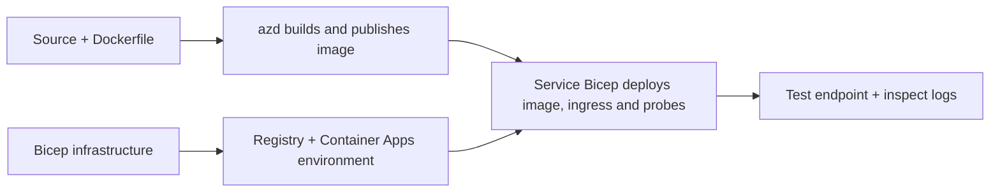

# Примери распореда апликација у контејнерима уз AZD

Овај директоријум садржи два примерка за учење са изворним кодом, Dockerfile-овима,
Bicep инфраструктуром и `azure.yaml`. Ниједан није припремљен за продукцију.

## Изаберите пример

| Пример | Шта је реализовано | Захтеви |
|---|---|---|
| [Једноставан Flask API](../../../../examples/container-app/simple-flask-api) | Једно Python CRUD API, ставке у меморији, health probes, HTTP скалирање | Основно познавање CLI и HTTP |
| [Микросервис са два сервиса](../../../../examples/container-app/microservices) | Node.js gateway, интерни Python сервис само за читање, телеметрија и скалирање | Прво завршите пример једног сервиса |

Одвојите 30–60 минута, укључујући подешавање и проверу. Време обезбеђења ресурса у Azure-у варира.

## Захтеви

- [Azure Developer CLI](https://learn.microsoft.com/azure/developer/azure-developer-cli/install-azd)
- [Azure CLI](https://learn.microsoft.com/cli/azure/install-azure-cli) за команде верификације
- Docker са активним демон процесом за градњу ових слика контејнера
- Azure претплата са дозволама за креирање ресурса и довољним регионалним квотама
- Bash за команде у шкољци, или еквивалентне PowerShell команде

```bash
azd version
az version
docker info
azd auth login
az login
```

Оба алата имају одвојене сесије пријаве. Користите актуелни стабилни azd; тренутна
објављена верзија у време прегледа је 1.37.2. Старије минималне верзије нису
гаранција компатибилности.

## Брзи почетак

Из корена репозиторијума:

```bash
cd examples/container-app/simple-flask-api
azd env new flask-demo
azd up
API_URL=$(azd env get-value API_ENDPOINT)
curl --fail-with-body "${API_URL}/health"
```

Очекује се: HTTP 200 са `"status": "healthy"`. Пратите README уз пример да бисте креирали,
читали, ажурирали и брисали ставку и прегледали логове.



Почетна конфигурација користи јавну hello-world слику на порту 80. Датотеке параметара Bicep
специфичне по сервису дозвољавају `azd deploy` да је замени изграђеном сликом апликације
и исправним портом/пробама апликације (8000 за Flask/продукт, 8080 за gateway).
Чувајте те датотеке са њиховим `azure.yaml` `module` подешавањима.

## Конфигурација: шта мења шта

`azure.yaml` бира изворне директоријуме, језике, хостове и модуле распореда.
CPU/меморија контейнера, приступ, probe-ови, број реплика и правила скалирања дефинишу се
у **Bicep**, а не произвољним `resources`, `scale` или `regions` својствима сервиса.

`azd env set SOME_VALUE ...` чува вредност локално. Она мења распоређени
ресурс само када параметар, мапирање окружења или хук експлицитно користи ту
вредност. Ови примери не користе `MAX_REPLICAS`, `SCALE_TO_ZERO_TIMEOUT`,
`CONTAINER_APP_REPLICA_TYPE` или прилагођена canary подешавања из вредности azd окружења.
Уредите релевантни Bicep и покрените `azd up` да бисте поново обезбедили и распоредили.

Не стављајте извор апликације у `infra/`. `project` мора показивати на изворни
директоријум који садржи Dockerfile и манифест зависности.

## Праћење и трошкови

- `azd monitor --logs` отвара портал; то није терминалски приказ логова.
  Користите `az containerapp logs show --follow` са стварним именом ресурса.
- Једноставан API уписује stdout логове које сакупља Container Apps/Log Analytics.
  Његов обезбеђени Application Insights ресурс није аутоматски инструментован.
- Gateway микросервиса користи Node.js Application Insights SDK; Python
  сервис извози трагове апликацијских логова. Потпуно праћење Python захтева/зависности
  није конфигурисано.
- Scale-to-zero може смањити трошкове рачунара, али регистрација и унос/складиштење логова
  и даље могу коштати новац. Подразумевана подешавања микросервиса држе реплике активним.
  Процените свој регион и коришћење у
  [Azure pricing calculator](https://azure.microsoft.com/pricing/calculator/).

## Напредни обрасци — нису укључене имплементације

Ово су смернице за дизајн, а не додатни локални пројекти или примерци кода за покретање:

- **Перзистентни подаци и аутентификација:** заменити колекције у меморији и додати
  Microsoft Entra ID аутентификацију/авторизацију пре продукције.
- **Blue-green/canary:** користити режим више ревизија Container Apps, етикете ревизија,
  тежине саобраћаја, проверу здравља и процедуре враћања различитих верзија.
  Не постоји `deploymentStrategy: canary` azd конфигурација у овим примерима.
  Погледајте [revision management](https://learn.microsoft.com/azure/container-apps/revisions).
- **Мулти-регион:** креирати одвојена окружења и апликације у Bicep и дизајнирати
  глобално рутирање и конзистентност података. Листа сервиса `regions` није azd
  механизам распореда.
- **Queue радници:** додати извор радника, зависности, queue ресурсе, управљани
  идентификациони налог са улогама за data-plane и аутентификовано правило скалирања. Немојте копирати
  празан `src/worker` path и очекивати извршив пројекат.
- **Dapr:** обезбедити компоненте, конфигурисати sidecar, инсталирати одговарајући SDK
  и имплементирати руковање грешкама државе/publish-subscribe.
- **Тајне:** користити managed identity и доделе улога где је могуће. Само
  креирање Key Vault-а не даје апликацијама приступ или утовар тајни.

## Чишћење

Из директоријума са примерком:

```bash
azd down
```

Прегледајте упите за брисање и потврдите да је посебна група ресурса уклоњена.
Не користите ове примере као основу за продукцију без додатног пројектовања и тестирања.

[Индекс примера](../README.md) · [Почетна страница курса](../../README.md) ·
[Документација Container Apps](https://learn.microsoft.com/azure/container-apps/) ·
[Пријави проблем](https://github.com/microsoft/AZD-for-beginners/issues)

---

<!-- CO-OP TRANSLATOR DISCLAIMER START -->
**Изјава о одрицању одговорности**:
Овај документ је преведен коришћењем услуге за аутоматски превод [Co-op Translator](https://github.com/Azure/co-op-translator). Иако тежимо тачности, имајте у виду да аутоматски преводи могу садржати грешке или нетачности. Оригинални документ на његовом изворном језику треба сматрати ауторитативним извором. За критичне информације препоручује се професионални људски превод. Нисмо одговорни за било каква неспоразума или погрешна тумачења која произилазе из коришћења овог превода.
<!-- CO-OP TRANSLATOR DISCLAIMER END -->