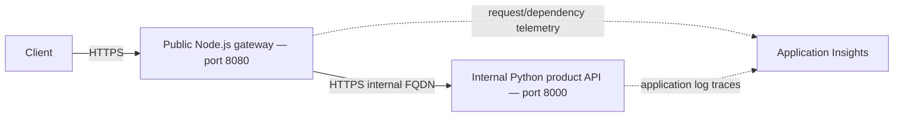

# Микросервиси са две услуге — Azure Container Apps

**Ниво:** Средњи · **Време:** 45–60 минута укључујући подешавање

Овај образовни пример реализује **Node.js API Gateway** и **Python услугу за производе само за читање**.
Укључени су изворни код, Dockerfiles, Bicep и конфигурација azd.
Није систем прилагођен за производњу.

## Шта ћете научити

- Деплојовати две услуге независно.
- Користити интерни backend FQDN преко HTTPS-а.
- Верификовати одговоре за успех, није пронађено и недоступну услугу.
- Разумети телеметрију и границе самосталног скалирања.



Каталог производа садржи пет фиксних производа у меморији. Нема **POST,
PUT или DELETE руковаоца**, базе података, Service Bus-а, услуге за наруџбине/кориснике/обавештења,
C# или Go кода. То су будуће идеје за развој, а не укључене функције.
Гатеwај не аутентификује кориснике; интерни улаз није замена
за ауторизацију апликације.

## Захтеви

Прво завршите [једноставан Flask API](../../../../../examples/container-app/simple-flask-api).
Инсталирајте актуелни стабилни azd (објављена верзија у време прегледа: 1.37.2), Azure CLI,
и Docker са покренутим демоном. Потребна вам је Azure претплата, дозволе за креирање ресурса
и регионална квота за Container Apps.

```bash
azd version
az version
docker info
azd auth login
az login
```

Користите исту претплату у оба CLI алата. Испод су команде за Bash.

## Деплој и верификација

Из корена репозиторијума:

```bash
cd examples/container-app/microservices
azd env new microservices-demo
azd up
GATEWAY_URL=$(azd env get-value API_GATEWAY_URL)
RG_NAME=$(azd env get-value AZURE_RESOURCE_GROUP)
GATEWAY_NAME=$(azd env get-value API_GATEWAY_NAME)
PRODUCT_NAME=$(azd env get-value PRODUCT_SERVICE_NAME)

curl --fail-with-body "${GATEWAY_URL}/health"
curl --fail-with-body "${GATEWAY_URL}/api/products"
curl --fail-with-body "${GATEWAY_URL}/api/products/1"
curl -i "${GATEWAY_URL}/api/products/999"
```

**Успех:** health 200; list 200 са **пет** производа; производ 1 је лаптоп
цена 999.99, залиха 50; непознати производ враћа 404.
Описаније су укључене у одговорима; времески ознаке варирају.

Почетно распоређивање користи јавне hello-world слике на порту 80 тако да не покушава
да повуче непостојеће слике из празног регистра. Модули Bicep специфични за услуге
и параметарске датотеке замењују их са изграђеним сликама и портовима/проверама током
`azd deploy`. Главни параметри задржавају име објављене слике за касније распоређивање.

## Услуге и мрежа

| Услуга | Изложени крајњи поенти | Подразумевани ресурси |
|---|---|---|
| Гатеwај | GET `/`, `/health`, `/api/products`, `/api/products/:id` | 1 vCPU, 2 GiB, 2–20 реплика |
| Производ | GET `/`, `/health`, `/products`, `/products/<id>` | 0.5 vCPU, 1 GiB, 1–10 реплика |

Произвођачки улаз има `external: false` и `allowInsecure: false`. Bicep убацује
`PRODUCT_SERVICE_URL=https://<actual-internal-fqdn>` у гатеwај. HTTP би
пренаменио; HTTPS одговара конфигурисаном улазу. Кратко DNS име мора да одговара
**стварном имену Container App-а**, а не логичком кључу услуге `product-service`.
Немојте покушавати да позивате интерну URL адресу директно са вашег лаптопа.

Гатеwај има пет секунди тајмаут за позиве производа. Недостајући ID-ови производа
се преносе као 404; неуспеси транспорта/други бекенд неуспеси враћају 503. Гатеwај
`/health` проверава само гатеwај, а не доступност бекенда.

## Датотеке и конфигурација

```text
azure.yaml
infra/main.bicep
infra/main.parameters.json
infra/abbreviations.json
infra/core/container-apps-environment.bicep
infra/core/monitor.bicep
infra/app/api-gateway.bicep
infra/app/api-gateway.parameters.json
infra/app/product-service.bicep
infra/app/product-service.parameters.json
src/api-gateway/{app.js,package.json,Dockerfile}
src/product-service/{main.py,requirements.txt,Dockerfile}
```

Скалирање, ЦПУ/меморија, портови и контроле су подешени у `infra/app/*.bicep`. Промените те
датотеке и покрените `azd up` да примените инфраструктуру и поново распоредите. Нема
`GATEWAY_MAX_REPLICAS` параметра променљиве окружења у овом примеру.

За промене само кода:

```bash
azd deploy product-service
azd deploy api-gateway
```

Node слика користи Node 22; Python слика користи Python 3.11. Обе везују на
`0.0.0.0`. Улаз/провере користе порт 8080 (гатеwај) и 8000 (производ), респективно.

## Локални развој са Docker-ом

Покрените из овог директоријума примерка. Користите дефинисану мрежу корисника, **не `localhost`
са једног контејнера да бисте приступили другом**:

```bash
docker network create azd-microservices-demo
docker build -t local-product ./src/product-service
docker build -t local-gateway ./src/api-gateway
docker run -d --name azd-product --network azd-microservices-demo local-product
docker run -d --name azd-gateway --network azd-microservices-demo \
  -p 8080:8080 -e PRODUCT_SERVICE_URL=http://azd-product:8000 local-gateway
curl --fail-with-body http://localhost:8080/api/products
```

Очекује се: пет производа. HTTP се користи само за ову локалну Docker мрежу.

```bash
docker stop azd-product azd-gateway
docker rm azd-product azd-gateway
docker network rm azd-microservices-demo
```

## Мониторинг

```bash
az containerapp logs show --name "$GATEWAY_NAME" --resource-group "$RG_NAME" --follow
# In a separate terminal:
az containerapp logs show --name "$PRODUCT_NAME" --resource-group "$RG_NAME" --tail 100
```

`azd monitor --logs` отвара портал; не приказује терминалне логове у реалном времену.
Node SDK прикупља запросе/зависности гатеwаја. Python `AzureLogHandler`
извози **трагове логова**, а не аутоматске Flask захтеве, SQL зависности или потпуну
дистрибуирану трасу. OpenCensus је застарели SDK; пожељно је користити Azure Monitor OpenTelemetry
при проширивању овог примера.

У Application Insights Logs, генеришите захтеве и прегледајте:

```kusto
requests
| where timestamp > ago(1h)
| where name contains "products"
| summarize RequestCount=count(), AvgDuration=avg(duration) by bin(timestamp, 5m)
```

За поруке Python апликације:

```kusto
traces
| where timestamp > ago(1h)
| where message contains "products"
| project timestamp, message, severityLevel
```

Допустите кашњење при пријему и узорковање; не очекујте тачан број захтева или
загарантовано кашњење. Нема прилагођених упозорења или контролних табли.

## Практичне вежбе

### Вежба 1: Измена каталога

**Полазна тачка:** `src/product-service/main.py`.
**Циљ:** проверити независно распоређивање услуге.
Промените залиху лаптопа са 50 на 49 у фиксној `products` листи, покрените
`azd deploy product-service`, затим захтевајте `${GATEWAY_URL}/api/products/1`.

**Критеријум успеха / решење:** HTTP 200 са `"stock":49`. Вратите на 50 и поново деплојујте.
**Уобичајен проблем:** уређивање гатеwаја уместо услуге која има каталог.
Ово мења изворни податак, а не перзистентну базу залиха.

### Вежба 2: Провера конфигурације реплика

**Полазна тачка:** `infra/app/product-service.bicep`.
**Циљ:** посматрати промену инфраструктуре без нагађања о аутоматском скалирању.
Промените `minReplicas: 1` у `minReplicas: 2`, покрените `azd up`, затим:

```bash
az containerapp show --name "$PRODUCT_NAME" --resource-group "$RG_NAME" \
  --query properties.template.scale -o json
```

**Критеријум успеха:** конфигурисани минимум је 2 а максимум остаје 10.
Вратите минимум 1 и покрените `azd up`.
**Уобичајен проблем:** само `azd deploy` не примењује промене на неповезану заједничку
инфраструктуру. Не постављајте `maxReplicas` на нулу као симулацију неуспеха.
Ово верификује конфигурацију, а не тест оптерећења или загарантовану тренутну број реплика.

### Вежба 3: Тестирајте руковање недоступном услугом локално

**Полазна тачка:** оба локална Docker контејнера горе раде.
**Циљ:** разликовати неуспех бекенда од непостојећег производа.
Стопирајте само продукт контејнер:

```bash
docker stop azd-product
curl -i http://localhost:8080/api/products
docker start azd-product
curl --fail-with-body http://localhost:8080/api/products
```

**Критеријум успеха:** док је заустављен, гатеwај враћа 503 са
`"error":"Product service unavailable"`; након поновног покретања листа враћа 200.
Поново покушајте након кратког кашњења при покретању ако је потребно.
**Уобичајен проблем:** заустављање гатеwаја тестира другачији неуспех (нема HTTP одговора).

## Трошкови и произвођачке празнине

Подразумеване минималне реплике одржавају рачунар у раду. Регистар и мониторинг такође наплаћују
трошкове. Не постоји проверена фиксна укупна цена од 50$ месечно: процените регионални ЦПУ/меморију,
сате реплике, захтеве, регистар и задржавање лога у
[Azure pricing calculator](https://azure.microsoft.com/pricing/calculator/).
Брзо обришите ресурсе за учење када завршите.

Производни рад укључује аутентификацију/ауторизацију, управљане идентитете са опсегом,
перзистентне податке, валидацију уноса/одговора, подржану инструментализацију за опсервабилност,
тестирање оптерећења/неуспеха, CI/CD, упозорења и процедуре опоравка. Додавање услуге наруџбина,
реда или базе података је посебан задатак имплементације, а не завршена
вежба или већ доступна функција овде.

## Решавање проблема и чишћење

- **Слика није пронађена током првог распоређивања:** почетна конфигурација треба да користи јавну слику;
  проверите подразумеване параметре главне слике и мапирање модула за распоређивање.
- **503 за производе:** проверите логове производа, ревизију слике и убацивани интерни HTTPS URL.
- **Неочекивана путања 404:** производни API је само за читање; проверите путању, а не непостојећи CRUD руковалац.
- **Нема телеметрије:** прегледајте Runtime connection strings без излагања и
  допустите кашњење при пријему. Python табеле захтева нису попуњене његовим хендлером логова.

Из овог директоријума примера:

```bash
azd down
```

Прегледајте упите за брисање и проверите да ли је специјализована ресурсна група уклоњена.

[Претходно: Flask API](../../../../../examples/container-app/simple-flask-api) · [Следеће: Database app](../../../../../examples/database-app) ·
[Развој AI](../../../docs/chapter-02-ai-development/README.md) ·
[Почетак курса](../../../README.md) · [Пријави проблем](https://github.com/microsoft/AZD-for-beginners/issues)

---

<!-- CO-OP TRANSLATOR DISCLAIMER START -->
**Изјава о одрицању одговорности**:
Овај документ је преведен коришћењем услуге за аутоматски превод [Co-op Translator](https://github.com/Azure/co-op-translator). Иако тежимо тачности, имајте у виду да аутоматски преводи могу садржати грешке или нетачности. Оригинални документ на његовом изворном језику треба сматрати ауторитативним извором. За критичне информације препоручује се професионални људски превод. Нисмо одговорни за било каква неспоразума или погрешна тумачења која произилазе из коришћења овог превода.
<!-- CO-OP TRANSLATOR DISCLAIMER END -->