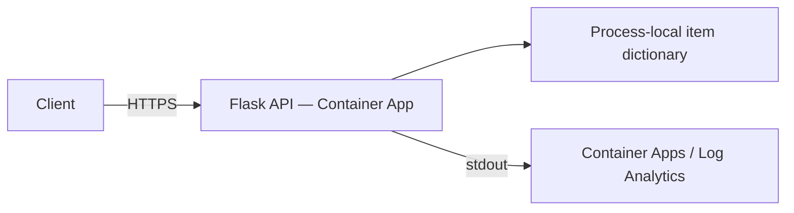

# Једноставни Flask API — Azure Container Apps

**Ниво:** Почетник · **Време:** 30–45 минута укључујући подешавање

Размесите Python Flask CRUD API користећи Azure Developer CLI (azd). Укључује изворни код, Dockerfile,
Bicep и параметре размештања. Ово је **учни пример**, а не
API спреман за производњу.

## Шта ћете научити

- Креирање и објављивање контејнера преко azd.
- Конфигурисање улаза и провера животне/спремности апликације.
- Верификација CRUD одговора и преглед апликационих логова.
- Разумевање зашто у меморији подаци нису погодни за издржљиве апликације.



**Важно:** ставки се чувају у једном процесу. Подразумевано је **један Gunicorn радник,
0–1 реплика**, намерно избегавајући неконзистентне податке између радника/реплика.
Ставке се губе при поновном покретању, промени ревизије или скалирању на нулу. Повећање реплика
захтева заједничко трајно складиште. API нема аутентификацију или ауторизацију.

## Захтеви

- [Тренутна стабилна верзија azd](https://learn.microsoft.com/azure/developer/azure-developer-cli/install-azd)
  (објављена верзија у тренутку прегледа: 1.37.2).
- [Azure CLI](https://learn.microsoft.com/cli/azure/install-azure-cli) за проверу.
- Docker са покренутим демонским процесом; потребан за подразумевану локалну изградњу слике.
- Azure претплата, дозволе за креирање ресурса и регионална квота за Container Apps.
- Bash за наредбе испод (или еквивалентни PowerShell).
- Python 3.11 за опционални локални развој.

```bash
azd version
az version
docker info
azd auth login
az login
```

CLI алати имају засебне сесије за пријављивање. Користите исту претплату у обема.

## Брзи почетак

Из коренског фолдерa репозиторијума:

```bash
cd examples/container-app/simple-flask-api
azd env new flask-demo
azd up
API_URL=$(azd env get-value API_ENDPOINT)
RG_NAME=$(azd env get-value AZURE_RESOURCE_GROUP)
API_NAME=$(azd env get-value API_NAME)
curl --fail-with-body "${API_URL}/health"
```

Очекује се: HTTP 200 и JSON са `"status":"healthy"`,
`"service":"simple-flask-api"`, и тренутним UTC временским жигом.
Обично, време потребно за припрему и изградњу слике траје неколико минута; време варира.

Почетна припрема користи јавну hello-world слику која слуша на порту 80.
`azure.yaml` бира `infra/app/api.bicep` и одговарајући параметарски фајл за
размештање сервиса, што мења слику, улаз и проверу на порт 8000.
Немојте бриcати те параметре приликом размештања.

## Верификација CRUD

Покрените следеће наредбе узастопно док је иста реплика активна:

```bash
# Create: HTTP 201; note the returned id (1 for a fresh process).
curl -i -X POST "${API_URL}/api/items" \
  -H "Content-Type: application/json" \
  -d '{"name":"Test Item","description":"My first item"}'

# Read list: HTTP 200, total 1 in a fresh process.
curl --fail-with-body "${API_URL}/api/items"

# Replace 1 if your create response returned another id.
curl --fail-with-body "${API_URL}/api/items/1"
curl -i -X PUT "${API_URL}/api/items/1" \
  -H "Content-Type: application/json" -d '{"name":"Updated Item"}'
curl -i -X DELETE "${API_URL}/api/items/1"
curl -i "${API_URL}/api/items/1"
```

Успешно: POST 201, читање/PUT 200, DELETE 204 без тела, затим непостојећа ставка 404.
Неисправан или непотпун JSON враћа 400.
Ако ставка нестане између захтева, проверите поновно покретање или скалирање на нулу;
ово је намерно ограничење у меморији, а не упорност.

| Ендпоинт | Методе |
|---|---|
| `/` | GET — информације о сервису |
| `/health` | GET — проверa животне/спремности |
| `/api/items` | GET, POST |
| `/api/items/{id}` | GET, PUT, DELETE |

## Логови и конфигурација

```bash
az containerapp logs show --name "$API_NAME" --resource-group "$RG_NAME" --follow
```

Очекује се: покретање Gunicorn-а, приступни лoгови захтева и поруке апликације.
`azd monitor --logs` отвара портал за приказ; не стримује се на терминал.
Application Insights је припремљен, али **није инструментован овим Flask кодом**;
користите Container Apps/Log Analytics за логове стандардног излаза.

Измените `infra/app/api.bicep` за CPU/памет, лимите реплика или скалирање, затим
покрените `azd up`. Подразумеване вредности су 0.5 vCPU, 1 GiB, минимум 0 / максимум 1 реплика, и
HTTP праг од 50 истовремених захтева. Скалирање на нулу може додати кашњење приликом хладног стартовања.

Арбитрарне `azd env set MAX_REPLICAS`, `API_KEY`, `LOG_LEVEL`, или
`SCALE_TO_ZERO_TIMEOUT` вредности **нису повезане са овим шаблоном или апликацијом**.
Постављање вредности не чини је аутоматски променљивом окружења у време извршавања.
Слика експлицитно везује порт 8000; ажурирајте Dockerfile, Bicep ingress и провере
заједно ако промените порт.

## Фајлови

```text
azure.yaml
infra/main.bicep
infra/main.parameters.json
infra/app/container-apps.bicep       # Environment, registry, monitoring
infra/app/api.bicep                  # App, ingress, probes, scale settings
infra/app/api.parameters.json        # Image and resource values for azd deploy
src/app.py
src/Dockerfile
src/requirements.txt
```

## Локални развој

Из овог примера фолдера:

```bash
python -m venv .venv
source .venv/bin/activate  # PowerShell: .\.venv\Scripts\Activate.ps1
python -m pip install -r src/requirements.txt
python src/app.py
```

У другом терминалу тестирајте `http://localhost:8000/health` и CRUD ендпоинте.
Или изградите и покрените стварну слику:

```bash
docker build -t flask-api:local ./src
docker run --rm -p 8000:8000 flask-api:local
```

За промене само у коду након првог размештања, покрените `azd deploy api`.
За измене у Bicep-у, покрените `azd up` да поново припремите и разместите.

## Практичне вежбе

### 1. Валидација одбијања улаза

**Почетна тачка:** размештени API, `API_URL` горе.
**Циљ:** потврдити да API одбија неисправне JSON облике и недостајућа имена.

```bash
curl -i -X POST "${API_URL}/api/items" \
  -H "Content-Type: application/json" -d '[]'
curl -i -X POST "${API_URL}/api/items" \
  -H "Content-Type: application/json" -d '{"name":""}'
```

**Критеријуми успеха / решење:** оба враћају 400 са JSON грешком, не 500.
**Чест проблем:** изостављање JSON content-type хедера.

### 2. Додавање ендпоинта само за читање

**Почетна тачка:** `src/app.py`. **Циљ:** проширити и поново разместити API.
Додајте ово пре блока `if __name__ == '__main__':`:

```python
@app.route('/version', methods=['GET'])
def version():
    return jsonify({'version': '1.0.0'})
```

Покрените `azd deploy api`, затим `curl --fail-with-body "${API_URL}/version"`.
**Критеријуми успеха:** HTTP 200 и `{"version":"1.0.0"}`.
**Чест проблем:** стављање руте после блокирајућег `app.run()` позива приликом
тестирања са `python src/app.py`.

### Контролна тачка знања

Зашто један радник није довољан за издржљиве податке? Јер чак и један процес губи
свој речник при поновном покретању. Производна верзија захтева упорно заједничко складиште,
аутентификацију, ауторизацију, миграције, тестове и оперативно праћење.

## Трошкови и решавање проблема

Ово није гарантована безтрошковна имплементација: Основни регистар и складиште/унос логова
могу изазвати трошкове чак и када је рачунарска снага апликације нула. Користите
[рачунар ценa](https://azure.microsoft.com/pricing/calculator/) за ваш регион.

- **Неуспешна Docker изградња:** потврдите `docker info`, приступ мрежи и зависности.
- **Неисправна апликација:** прегледајте конзолне/системске логове и проверите слагање порта слике, улаза
  и провера. Чуварац (placeholder) не сме бити проверан на Flask порту.
- **403/дозволе:** потврдите претплату и дозволе за креирање ресурса.
- **Ставке нестају:** стање у меморији се ресетује при поновном покретању/скалирању на нулу; додајте базу података
  за издржљиво понашање.

## Чишћење и следећи кораци

```bash
azd down
```

Прегледајте захтев за брисање и уверите се да је namens grupa ресурса уклоњена.
Немојте користити деструктивно чишћење према групи ресурса која садржи несродне податке.

[Следеће: апликација са базом података](../../../../../examples/database-app) · [Микросервиси](../../../../../examples/container-app/microservices) ·
[Преглед контејнера](../README.md) · [Почетак курса](../../../README.md) ·
[Пријави проблем](https://github.com/microsoft/AZD-for-beginners/issues)

---

<!-- CO-OP TRANSLATOR DISCLAIMER START -->
**Изјава о одрицању одговорности**:
Овај документ је преведен коришћењем услуге за аутоматски превод [Co-op Translator](https://github.com/Azure/co-op-translator). Иако тежимо тачности, имајте у виду да аутоматски преводи могу садржати грешке или нетачности. Оригинални документ на његовом изворном језику треба сматрати ауторитативним извором. За критичне информације препоручује се професионални људски превод. Нисмо одговорни за било каква неспоразума или погрешна тумачења која произилазе из коришћења овог превода.
<!-- CO-OP TRANSLATOR DISCLAIMER END -->