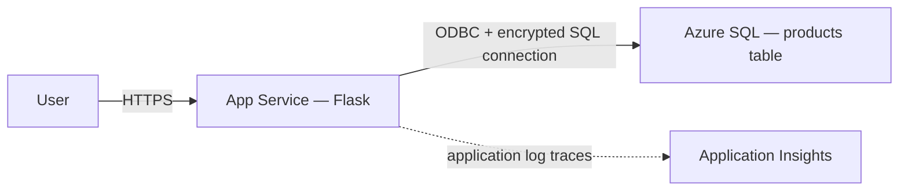

# Flask и Azure SQL на App Service

**Ниво:** Средњи · **Време:** 30–60 минута укључујући предуслове

Овај пример поставља Python Flask read API на **Linux App Service** и Basic
Azure SQL базу података. Изворни код, Bicep и azd конфигурација су укључени. То је
апликација за учење, а не архитектура базе података спремна за продукцију.

## Шта ћете научити

- Поставити App Service, SQL и ресурсе за праћење помоћу Bicep.
- Конфигурисати шифровану SQL конекцију без уноса креденцијала.
- Иницијализовати шему пре покретања Gunicorn радника.
- Верификовати иницијалне податке, одговоре „није пронађено“ и здравље базе.



Ресурси: посвећена група ресурса, B1 Linux App Service план, Python 3.11 Web
апликација, SQL сервер и Basic 2-GB база, Application Insights, и Log Analytics.
Веб апликација користи **source/ZIP деплојмент и Oryx инсталацију зависности**;
`azd deploy` не изводи градњу или деплој опционалног Dockerfile-а.

## Предуслови

- Тренутно стабилни [azd](https://learn.microsoft.com/azure/developer/azure-developer-cli/install-azd)
  (објављено у тренутку прегледа: 1.37.2).
- [Azure CLI](https://learn.microsoft.com/cli/azure/install-azure-cli) за верификацију.
- Azure претплата, дозволе за креирање наведених ресурса и регионална квота.
- Python **3.11** за локални развој; одговарајући `pyodbc==5.0.1` може захтевати
  нативне алате за градњу на новијим верзијама Pythona.
- Microsoft ODBC Driver 18 (или 17) за SQL Server на локалним машинама. `pip install
  pyodbc` не инсталира системски драјвер. Погледајте
  [ODBC инсталацију](https://learn.microsoft.com/sql/connect/odbc/download-odbc-driver-for-sql-server).
- Docker само ако тестирате опционални контејнер локално.

```bash
azd version
az version
azd auth login
az login
```

Користите исту претплату у оба алата. Испод су команде за Bash.

## Деплој

Из корена репозиторијума:

```bash
cd examples/database-app
azd env new sql-demo
azd provision
azd deploy
WEB_URL=$(azd env get-value WEB_APP_URI)
WEB_NAME=$(azd env get-value WEB_APP_NAME)
RG_NAME=$(azd env get-value AZURE_RESOURCE_GROUP)
```

Одаберите подржан регион. `sqlAdminLogin` подразумевано не поставља `sqladmin`; потребни
`sqlAdminPassword` је безбедан параметар. Унесите јаку лозинку када се затражи.
Чувајте креденцијале за деплојмент изван Гит-а и пријава грешака. Тренутна веза
интерполација низа очекује лозинку без ограничења низа за повезивање као
што је `;`; прилагодите бекство пре коришћења таквих вредности.

Bicep подешава почетну команду која се покреће `init_database()` **пре** него што стартују Gunicorn
радници. Ово је неопходно јер увоз `app:app` не извршава
Python-ов `if __name__ == '__main__'` блок. На свежој бази података, иницијализација
креира `products` и убацује пет редова. То је једноставан наставни пример, а не
оквир за више миграција; користите одговарајуће миграције пре него што повећате број инстанци.

Апликација бира инсталирани Microsoft ODBC Driver 18, а затим 17, ако конекцијски низ
експлицитно не именује драјвер. Ако ни један не постоји, покретање не успева са
инсталационим проблемом који се може решити. Проверите доступност драјвера у вашем одабраном
App Service окружењу уместо да само претпостављате.

## Проверите

```bash
curl --fail-with-body "${WEB_URL}/"
curl --fail-with-body "${WEB_URL}/health"
curl --fail-with-body "${WEB_URL}/products"
curl --fail-with-body "${WEB_URL}/products/1"
curl -i "${WEB_URL}/products/999"
```

Очекује се:

- `/` враћа информације крајње тачке.
- `/health` враћа 200 са `{"status":"healthy","database":"connected"}`.
- `/products` враћа пет унапред додатих производа у свежој бази података.
- `/products/1` враћа Laptop са ценом 1299.99.
- Не постојећи производ враћа 404 са `{"error":"Product not found"}`.

API је само за читање. Нема POST/PUT/DELETE руту нити UI у прегледачу.
Неуспех повезивања са базом података враћа 503 из `/health`; то није успех.

## Фајлови и конфигурација

```text
azure.yaml                         # Python App Service source deployment
infra/main.bicep
infra/main.parameters.json
infra/abbreviations.json
infra/resources/sql-server.bicep
infra/resources/sql-database.bicep
infra/resources/app-service-plan.bicep
infra/resources/web-app.bicep       # Settings + initialization/startup command
infra/resources/app-insights.bicep
src/web/app.py
src/web/requirements.txt
src/web/Dockerfile                 # Optional local container, not the azd target
.env.sample
```

`SQL_CONNECTION_STRING` се прослеђује као сигуран параметар Bicep модула за Web App
и чува у поставкама App Service, а не у резултатима деплоја.
`APPLICATIONINSIGHTS_CONNECTION_STRING` конфигурише извоз логова.
`SCM_DO_BUILD_DURING_DEPLOYMENT=true` омогућава инсталацију зависности са стране сервера.
Постављање произвољних вредности `azd env` не мења аутоматски подешавања апликације.

SQL заштитни зид правила `0.0.0.0` дозвољава конекције од **Azure сервиса,
укључујући претплате других корисника**, подложно SQL аутентификацији. Није
ограничено само на ову апликацију или претплату. Јавни приступ SQL мрежи је омогућен.
Коришћење ограниченог умрежавања и аутентификције апликације без администраторских права препоручује се пре продукције.

## Локални развој

Користите Python 3.11 и инсталиран Microsoft SQL ODBC драјвер:

```bash
python -m venv .venv
source .venv/bin/activate  # PowerShell: .\.venv\Scripts\Activate.ps1
python -m pip install -r src/web/requirements.txt
export SQL_CONNECTION_STRING='Server=tcp:YOUR_SERVER.database.windows.net,1433;Database=YOUR_DATABASE;UID=YOUR_USER;PWD=YOUR_PASSWORD;Encrypt=yes;TrustServerCertificate=no;Connection Timeout=30;'
python src/web/app.py
```

Безбедно замените ознаке за замењивање. Копирани `.env` фајл **није аутоматски учитан**
од стране ове апликације. Уместо тога, извозите променљиве у вашем тренутном шеллу.
За Azure SQL са лаптопа, привремено дозволите само вашу јавну IP адресу:

```bash
SQL_SERVER=$(azd env get-value SQL_SERVER_NAME)
MY_IP=YOUR_PUBLIC_IP
az sql server firewall-rule create -g "$RG_NAME" -s "$SQL_SERVER" \
  -n AllowMyLearningIP --start-ip-address "$MY_IP" --end-ip-address "$MY_IP"
```

Уклоните правило након тестирања:

```bash
az sql server firewall-rule delete -g "$RG_NAME" -s "$SQL_SERVER" -n AllowMyLearningIP
```

Опционални тест контејнера из овог пример каталога:

```bash
docker build -t sql-flask:local src/web
docker run --rm -p 8000:8000 -e SQL_CONNECTION_STRING sql-flask:local
```

Ова слика инсталира Driver 18 користећи Debian 12 пакетни репозиторијум који одговара
Bookworm бази, једном иницијализује базу података, затим покреће Gunicorn.

## Надгледање и решавање проблема

Омогућите/пратите системске дневнике фајл система App Service при дијагностици стартовања:

```bash
az webapp log config --name "$WEB_NAME" --resource-group "$RG_NAME" \
  --application-logging filesystem --level information
az webapp log tail --name "$WEB_NAME" --resource-group "$RG_NAME"
```

Овај код извози **трагове лога** апликације преко наслеђеног OpenCensus хендлера.
Не конфигурише аутоматско праћење Flask захтева/зависности, Live Metrics,
SQL ревизију, дијагностичка подешавања или аларме. За то је потребна посебна конфигурација.
За нову инструментализацију, препоручује се Azure Monitor OpenTelemetry.

У Application Insights Logs, након слања API захтева:

```kusto
traces
| where timestamp > ago(1h)
| where message contains "products" or message contains "Health check"
| project timestamp, message, severityLevel
```

Дозволите кашњење у уносу података. Табела захтева или активност Live Metrics није сигнал да је завршено
критеријум за ову инструментализацију која је само за логове.

- **Недостаје драјвер:** проверите `pyodbc.drivers()` у окружењу и инсталирајте
  подржани Microsoft ODBC драјвер. Сам Python пакет није довољан.
- **Неуспех конекције:** проверите SQL подешавања, учетне податке, заштитни зид и изабрану
  претплату. Не онемогућавајте енкрипцију да бисте заобишли грешку.
- **Недостаје табела производа:** потврдите да је Bicep стартна команда распоређена;
  покретање `gunicorn app:app` само прескаче иницијализацију.
- **Неуспех изградње пакета:** користите Python 3.11 или обезбедите нативне захтеве изградње.
- **Подаци са ценом нула:** нула је важећа децимална цена; мора се серијализовати као 0.0,
  не као `null`.

## Практичне вежбе

### Вежба 1: Проверите понашање у случају недостајућег производа

**Полазна тачка:** распоређен API и `WEB_URL` горе.
**Циљ:** разликовати недостајући ред од покварене базе података.
Затражите `/health` и `/products/999` користећи команде горе.
**Критеријуми успеха / одговор:** статус 200 за здравље, 404 за непостојећи производ (не 500 или 503).
**Чест проблем:** претпоставка да одговор „није пронађен“ доказује да је SQL конекција покварена.

### Вежба 2: Промените унапред постављену вредност

**Полазна тачка:** Azure SQL Query Editor, повезан са пример базом података.
**Циљ:** показати да се подаци API чувају у SQL-у, а не у меморији процеса.

```sql
UPDATE products SET price = 0 WHERE id = 1;
SELECT id, name, price FROM products WHERE id = 1;
```

Захтев `${WEB_URL}/products/1`. **Критеријум успеха:** цена је `0.0`, а не `null`.
Вратите вредност:

```sql
UPDATE products SET price = 1299.99 WHERE id = 1;
```

**Чест проблем:** измена почетне листе у Питону не ажурира редове који су већ у SQL-у.
Не изводите вежбе са шемом/подацима на продукционој бази података.

### Вежба 3: Додајте read-only крајњу тачку за бројача

**Полазна тачка:** `src/web/app.py`.
**Циљ:** проширити API коришћењем агрегатног упита без параметара.
Додајте ово пре блока `if __name__ == '__main__':`:

```python
@app.route('/product-count')
def product_count():
    from contextlib import closing
    with closing(get_db_connection()) as conn, closing(conn.cursor()) as cursor:
        cursor.execute("SELECT COUNT(*) FROM products")
        return jsonify({'count': cursor.fetchone()[0]})
```

Покрените `azd deploy web`, затим захтев `${WEB_URL}/product-count`.
**Критеријум успеха:** 200 са `{"count":5}` на нетакнутој иницијалној бази.
**Чест проблем:** промена руте али заборављање поновног деплоја.
За продукцију додајте руковање грешкама/тестове; ова кратка вежба се фокусира на упит.

## Трошкови, пропусти у продукцији и чишћење

Б1 App Service и Basic база се наплаћују док су активни. Пауза за
Web App **не** зауставља наплату App Service плана. Логови и складиштење могу додати трошкове.
Користите [Azure pricing calculator](https://azure.microsoft.com/pricing/calculator/)
за актуелно регионално цена. Прелазак на F1 захтева и онемогућавање `alwaysOn`;
није то једноставна замена једне линије. SQL serverless није аутоматски бесплатан.

Продукциони рад укључује идентитет апликације са најмањим привилегијама (не SQL админ),
аутентификацију/овлашћење, приватне мреже, безбедне миграције, преглед
пулова веза/животног циклуса, телеметрију, ревизију, аларме, тестове и процедуре опоравка.
Redis кеширање и додатне табеле су идеје за развој, а не имплементиране вежбе.

Из овог директоријума примера:

```bash
azd down
```

Прегледајте упит за брисање и потврдите да је посебна група ресурса уклоњена.
Не бришите групе које садрже несродне податке.

[Примери контејнера](../../../../examples/container-app) ·
[AI развој](../../docs/chapter-02-ai-development/README.md) ·
[Почетна страница курса](../../README.md) · [Пријавите проблем](https://github.com/microsoft/AZD-for-beginners/issues)

---

<!-- CO-OP TRANSLATOR DISCLAIMER START -->
**Изјава о одрицању одговорности**:
Овај документ је преведен коришћењем услуге за аутоматски превод [Co-op Translator](https://github.com/Azure/co-op-translator). Иако тежимо тачности, имајте у виду да аутоматски преводи могу садржати грешке или нетачности. Оригинални документ на његовом изворном језику треба сматрати ауторитативним извором. За критичне информације препоручује се професионални људски превод. Нисмо одговорни за било каква неспоразума или погрешна тумачења која произилазе из коришћења овог превода.
<!-- CO-OP TRANSLATOR DISCLAIMER END -->