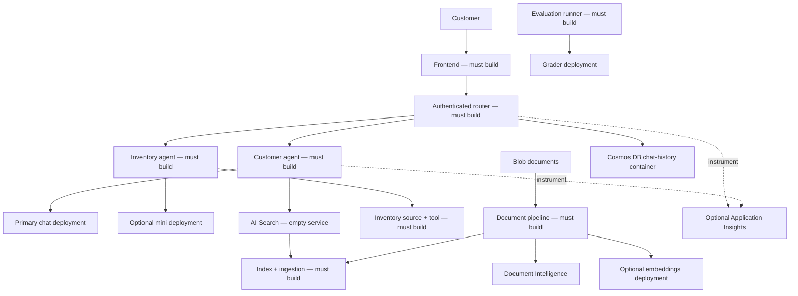

# Мулти-Агент Корисничка Подршка — План Архитектуре за Малопродају

**Поглавље 5: Мулти-Агент AI Решења**

- [Почетна страница курса](../README.md)
- [Поглавље 5](../docs/chapter-05-multi-agent/README.md)
- [Претпоставка: AI интеграција](../docs/chapter-02-ai-development/microsoft-foundry-integration.md)
- [Следеће: Планирање капацитета](../docs/chapter-06-pre-deployment/capacity-planning.md)
- [ARM инфраструктурни скелет](retail-multiagent-arm-template/README.md)

> **Водич за архитектуру, а не радни програм.** Једини фајлови имплементације
> за продају су `azuredeploy.json`, `azuredeploy.parameters.json` и `deploy.sh` у
> `retail-multiagent-arm-template/`. Рутер/фронтенд контејнери су привремени примери.
> Нема локално агента за продају, корисничког интерфејса, канала за унос података,
> процењивача, скенера или тестног пакета апликације.

## Преглед

**Циљ:** дизајнирати систем корисничке подршке са агентом за кориснике и агентом за
залихе, идентификовати шта инфраструктура пружа и планирати недостајуће уговоре и
верификацију апликације.

**Циљна група:** програмери који су завршили локални
[пример ћаскања](../../../examples/azure-openai-chat) и [пример са два сервиса у контејнеру](../../../examples/container-app/microservices).
Одвојите 2-3 сата за проучавање архитектуре. Изградња апликације је посебан
пројекат: 80-120 сати развоја је илустративна процена за искусне програмере,
**а не обећање испоруке**; припрема за производњу, тестови,
безбедносна процена и операције захтевају додатни рад.

### Резултати учења

- Објаснити маршрутирање, утемељење, дозволе алата и власништво разговора.
- Разликовати идентификаторе модела, имена распоређивања, верзије API-ја и ARM верзије.
- Дизајнирати унос и проналажење докумената са усклађеним димензијама вектора.
- Дефинисати проверљиве функционалне, евалуационе и захтеве за опоравак од грешака.
- Раздвојити опционе архитектонске циљеве од ресурса који су стварно обезбеђени.

## Архитектура решења



Ово је **архитектура циљне апликације**, а не дијаграм покренутих сервиса агената.
ARM шаблон креира само основне сервисе и два привремена контејнера.
Front Door, регистар, управљани идентитети, доделе улога,
приватне тачке приступа, преузимање контрола, инструментација апликације и аларми нису укључени.

### Одговорности и уговори

| Компонента | Потребно понашање | Докази пре завршетка |
|---|---|---|
| Фронтенд | Аутентификује кориснике, приказује ћаскање, безбедно отпрема документе | UI и тестови отпремања, приступачне грешке |
| Рутер | Ауторизује захтеве, бира агента, ограничава позиве/време алата | Тестови маршрутирања, провере ауторизације, тестови отказа |
| Кориснички агент | Утемељује политике/производне одговоре у одобреним изворима | Тачне цитате, повлачење кад недостају подаци |
| Алат за залихе | Чита ауторитет залиха са ограниченим дозволама | Детeрминистички тестови залиха; без измишљене доступности |
| Канал докумената | Извлачи, дели, уграђује, индексира, ажурира/брише | Индексиране проверке и понашање поновног покушаја/дед-леттер |
| Складиштење разговора | Изолује кориснике, спроводи задржавање | Тестови ауторизације преко корисника и TTL |
| Извршни евалуатор | Поређење резултата са чињеницама и рубриком | Покривеност, број отказа, репродуктивни извештаји |

Размотрите рутер као пријемну службу, а алате као ограничене интерне системе:
изабрати специјалисту није дозвола за приступ свим корисничким подацима.
Провера идентитета и дозвола мора бити у коду апликације и сервисима података, а не у упитима.

## Инфраструктура у односу на апликацију

Прочитајте [scaffold README](retail-multiagent-arm-template/README.md) пре
обезбеђивања ресурса. Наводи прецизне ресурсе, начине, трошкове и ограничења.

| Логичка намена | Име ARM распореда | Модел / верзија | Подразумевани регион |
|---|---|---|---|
| Корисничко ћаскање | `gpt-4.1-chat` | `gpt-4.1` / `2025-04-14` | `eastus2` |
| Залихе | `gpt-4.1-mini-inventory` | `gpt-4.1-mini` / `2025-04-14` | `westus2`, опционално |
| Уграђени модели | `text-embedding-ada-002` | `text-embedding-ada-002` / `2` | `francecentral`, опционално |
| Евалуација | `gpt-4.1-grader` | `gpt-4.1` / `2025-04-14` | По подразумеваном првом региону |

Препровери расположивост модела/верзије/SKU и квоту у **сваком региону**. ћаскање/мини/градер
користи `GlobalStandard`; уграђени модели користе `Standard`. Пропорције капацитета 
соло мапирања су специфичне за модел. Не додавати различите јединице капацитета као универзалну гаранцију квоте.

Аргумент `model` у Azure OpenAI захтеву је **име распореда**, не
нужно идентификатор модела из каталога. Верзија API-ја `2024-10-21`
је различита од верзије модела `2025-04-14` и ARM ресурса `apiVersion`.
Не може се решити недоступни модел само изменом верзије API-ја.

`--no-multi-region` прескаче секундарне и уграђене налоге. Примарни налог за ћаскање и
независни градер налог остају. Посебни налози модела не обезбеђују аутоматски
преузимање контрола; то захтева маршрутирање апликације, компатибилна распореди,
провере здравља, ограничења поновних покушаја и ревизију резиденције података.

## План имплементације

### 1. Почните са једном тестираном интеракцијом

Пре обезбеђивања обимног шаблона, користите локални пример ћаскања да успоставите
повезаност предвиђања. Дефинишите једно репрезентативно корисничко питање, одобрени
извор одговора, очекиване цитате и понашање у случају изостанка тог извора.

### 2. Дефинишите границе маршрутирања и алата

Креирајте свој изворни код рутера, манифест зависности, Dockerfile и тестове. Илустративни уговор
може бити `POST /chat` са `{"message":"...","conversation_id":"..."}`.
**Та крајња тачка је дизајнерски предлог; није имплементирана у ARM шаблону.**

Потврдите типове/ограничења у телу, изведите идентитет корисника из аутентификације, спроведите
власништво разговора, примените временска ограничења захтева и вратите значајне кодове грешака.
Немојте третирати HTTP неуспехе или празне одговоре као успешне резултате агената.

### 3. Имплементирајте утемељење и унос

ARM шаблон не креира индекс за претрагу. Ово је **референтни JSON
фрагмент за адаптацију у вашој дефиницији индекса**, а не фајл већ у репозиторјуму:

```json
{
  "name": "retail-product-index",
  "fields": [
    {"name": "id", "type": "Edm.String", "key": true},
    {"name": "title", "type": "Edm.String", "searchable": true},
    {"name": "content", "type": "Edm.String", "searchable": true},
    {"name": "category", "type": "Edm.String", "filterable": true},
    {
      "name": "content_vector",
      "type": "Collection(Edm.Single)",
      "searchable": true,
      "dimensions": 1536,
      "vectorSearchProfile": "retail-profile"
    }
  ],
  "vectorSearch": {
    "algorithms": [{"name": "retail-hnsw", "kind": "hnsw"}],
    "profiles": [{"name": "retail-profile", "algorithm": "retail-hnsw"}]
  }
}
```

Профил повезује векторско поље са његовим алгоритмом. Димензије морају одговарати
стварном излазу уграђеног модела (1536 за ову `ada-002` имплементацију). За Python претрагу,
користите `azure.search.documents.models.VectorizedQuery` уместо непотпуног
речника без његовог векторског типа упита:

```python
# Reference function only: supply an authenticated async SearchClient and an embedding.
from azure.search.documents.models import VectorizedQuery

async def retrieve(search_client, embedding):
    results = await search_client.search(
        search_text=None,
        vector_queries=[VectorizedQuery(
            vector=embedding,
            k_nearest_neighbors=5,
            fields="content_vector"
        )],
        select=["id", "title", "content"]
    )
    return [document async for document in results]
```

Креирајте посебну имплементацију уноса која:

1. Овлашћује приступ отпремању и проверава тип и величину садржаја.
2. Чита приватне објекте коришћењем аутентификованих SDK позива. Сам URL приватног објекта
   није читљив улаз Документ Интелигенције; пошаљите преузете бајтове са
   `AnalyzeDocumentRequest(bytes_source=...)` или користите одговарајуће ограничени,
   краткорочни SAS након прегледа захтева за приступом.
3. Извлачи текст, дели га на делове који одговарају ограничењима уноса и генерише уграђене моделе.
4. Креира стабилне и валидне кључеве докумената и отпрема делове са усклађеним векторима.
5. Проверава резултате индексирања по документу, рукује поновним покушајима и ажурира/брише застареле податке.

Не интерполирајте произвољне кључеве/вредности корисника у OData филтере. Дозволите само одређена поља,
потврдите типове вредности и избезбедите наводнике у стринговима. Булови и нумерички филтери захтевају
типизиране литерале, а не цитиране стрингове.

### 4. Веб утемељење

**Bing Search v7 је укинут 11. августа 2025.** Стари `Microsoft.Bing/accounts`
ресурс и `api.bing.microsoft.com/v7.0/search` примери нису подржани
пут имплементације. Процените тренутно подржану интеграцију утемељења у
Microsoft Foundry, његов SDK, дозволе, наплату и захтеве за цитирање;
овде није имплементирана. Није замена „без замене“ за укинуту крајњу тачку.

### 5. Додајте телеметрију и евалуацију

Креирање Application Insights не инструментује код. Користите подржану Azure Monitor
OpenTelemetry инструментацију при изградњи нове апликације, преносите контекст трага између сервиса,
и избегавајте евидентирање корисничких упита, докумената или тајни.
Скраћивање упита **не** анонимизује га.

Мерите трајање захтева, отказе маршрутирања/алата, релевантност проналажења, исправност цитирања,
потрошњу токена и повлачење. Чувајте чињеничне податке о залихама/политикама
уз евалуационе случајеве: градер не може поуздано одредити чињеничну тачност
само са питањем и одговором.

Распоред градара није извршни евалуатор. Имплементирајте верзионисану рубрику,
структурирани излаз/валидирање шеме, провере опсега поена, бројеве отказа транспорта
и случајеве које прегледава човек. Пријавите непотпуне/грешка случајеве одвојено;
немојте их претварати у успешне оцене или тихо укључивати као одговоре модела са нултим квалитетом.

Такође, неколико провера кључних речи није безбедносна сертификатија. Неуспешан HTTP
захтев, недостатак стратегије тестирања или празан одговор морају учинити тест **неодређеним или
неуспелим**, а не дати резултат „100% сигурност“. Спроводите овлашћено тестирање уз одговарајуће
алате и људски преглед пре икакве тврдње о спремности за производњу.

### 6. Распоредите вашу апликацију

Креирајте своје изворне фасцикле, манифесте, тестове, регистар и дозволе за приступ сликама.
Замените привремене вредности направљеним сликама и ажурирајте улазе/пробе да
одговарају порту којем свака апликација слуша. Конфигуришите променљиве окружења у Bicep
или јасној подржаној мапи окружења azd.

Не постоји општи `config` речник испод azd сервиса који аутоматски
креира променљиве окружења. `azd env set` мења само ресурсе који
јасно користе те вредности. Ниједан канари, листа региона или кука за фино подешавање
није имплементирана у овом шаблону.

## Практичне вежбе дизајна

Ово су **архитектонске вежбе**, а не тврдње о извршном коду за почетнике у продаји.

### Вежба 1: Верификујте границу

**Полазна тачка:** три фајла у `retail-multiagent-arm-template/`.
**Циљ:** разликовати обезбеђивање ресурса од функционалности апликације.
Отворите `azuredeploy.json`, пронађите обе контејнерски слике и вредности у `targetPort`,
затим наведите компоненте апликације које недостају у репозиторијуму.

**Критеријуми успеха / одговор:** обе слике су привремени примери hello-world који слушају
на порту 80; агенти, UI за ћаскање, руковаоци рутера, индекс/унос, евалуатор и скенер
недостају. Успешан коренски захтев не проверава `/chat`.
**Уобичајени проблем:** тумачење имена ресурса као што је `retail-router` као радног кода.

### Вежба 2: Пратите конфигурацију вектора

**Полазна тачка:** горњи JSON индекс.
**Циљ:** разумети однос поље → профил → алгоритам.
Идентификујте које вредности морају да се промене при преласку на модел уграђеног вектора
са другачијом излазном димензијом, затим анализирајте функцију `retrieve`.

**Критеријуми успеха / одговор:** промените поље `dimensions` на стварну дужину вектора;
држите `vectorSearchProfile` усклађено са декларисаним профилом и његовим алгоритмом;
упит `fields` мора именовати векторско поље. Поново генеришите постојеће векторе докумената
када се промени модел уграђеног вектора.
**Уобичајени проблем:** мењање само имена модела са некомпатибилним векторима.

### Вежба 3: Дефинишите тест отказа

**Полазна тачка:** табела одговорности.
**Циљ:** спречити лажни успех.
Напишите очекивано понашање за недоступан API залиха, индекс претраге без
одговарајућих докумената и захтев за евалуацију који враћа HTTP 503.

**Критеријуми успеха / одговор:** нема измишљених вредности залиха; изричито повлачење или
ескалација ако контекст недостаје; евалуација пријављује отказ транспорта уместо
проласка квалитета или безбедности. Додајте извршне тестове када градите апликацију.
**Уобичајени проблем:** хватање сваког изузетка и наставак са празним одговором.

## Трошкови, решавање проблема и чишћење

- Инфраструктура има континуиране трошкове чак и са празним индексима претраге и привременим
  апликацијама. Користите актуелне регионалне цене; ни „минимално“ ни мултирегионално није бесплатно.
- Трошкови токена зависе од модела, кешираних/некешираних улаза, излаза и SKU распореда.
  Маршуртирање може уштедети новац само ако измерени пуни рад и резултати квалитета то оправдају;
  фиксна уштеда од 60-80% није загарантована.
- Проверите расположивост модела и квоту пре обезбеђивања; разликујте грешке због дозвола,
  имена распореда, региона, верзије модела и верзије API-ја.
- Не покрећите недостајуће `setup-data.sh`, извршне CLIs процењивача или `pytest tests/` команде.
  Њихове имплементације су део вашег развојног заостатка.
- Овај шаблон је само ARM: пратите његове
  [упутства за верификацију и чишћење](retail-multiagent-arm-template/README.md).
  `azd down` не управља тим ресурсима.

## Повезани ресурси

- [Радни локални пример ћаскања](../../../examples/azure-openai-chat)
- [Радни пример са два сервиса у контејнеру](../../../examples/container-app/microservices)
- [AI Сеарцх индекс вектора](https://learn.microsoft.com/azure/search/vector-search-how-to-create-index)
- [Документација за Container Apps](https://learn.microsoft.com/azure/container-apps/)
- [Решавање проблема](../docs/chapter-07-troubleshooting/common-issues.md)
- [Пријави проблем](https://github.com/microsoft/AZD-for-beginners/issues)

---

<!-- CO-OP TRANSLATOR DISCLAIMER START -->
**Изјава о одрицању одговорности**:
Овај документ је преведен коришћењем услуге за аутоматски превод [Co-op Translator](https://github.com/Azure/co-op-translator). Иако тежимо тачности, имајте у виду да аутоматски преводи могу садржати грешке или нетачности. Оригинални документ на његовом изворном језику треба сматрати ауторитативним извором. За критичне информације препоручује се професионални људски превод. Нисмо одговорни за било каква неспоразума или погрешна тумачења која произилазе из коришћења овог превода.
<!-- CO-OP TRANSLATOR DISCLAIMER END -->