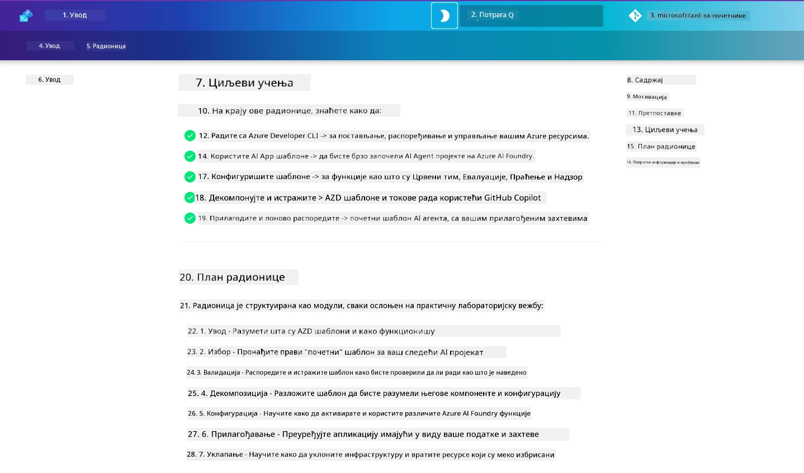

<div align="center">
  <div style="background: linear-gradient(135deg, #0078d4, #106ebe); border-radius: 10px; padding: 20px; margin: 20px 0; box-shadow: 0 4px 15px rgba(0, 120, 212, 0.3); border: 2px solid #005a9e;">
    <h2 style="color: white; margin: 0; font-size: 24px; text-shadow: 1px 1px 2px rgba(0,0,0,0.3);">
      🎯 AZD ради AI програмере радионица
    </h2>
    <p style="color: white; margin: 10px 0 0 0; font-size: 16px; text-shadow: 1px 1px 2px rgba(0,0,0,0.3);">
      <strong>Радионица с практичним радом за израду AI апликација са Azure Developer CLI.</strong><br>
      Завршите 7 модула и савладајте AZD шаблоне и AI радне токове деплоја.
    </p>
    <div style="margin-top: 15px;">
      <span style="background: rgba(255,255,255,0.2); padding: 5px 10px; border-radius: 15px; color: white; font-size: 14px;">
        📅 Изворни водич прегледан: новембар 2026
      </span>
    </div>
  </div>
</div>

# AZD радионица за AI програмере

Добродошли на радионицу са практичним радом за учење Azure Developer CLI (AZD) са фокусом на имплементацију AI апликација. Ова радионица вам помаже да стекнете примењено разумевање AZD шаблона у три корака:

1. **Откривање** - пронађите шаблон који вам одговара.
1. **Деплој** - имплементирајте и потврдите да ради
1. **Прилагођавање** - измените и прилагодите да буде ваш!

Током ове радионице бићете упознати и са основним алатима за програмере и радним токовима, који ће вам помоћи да поједноставите ваш развојни процес од почетка до краја.

<br/>

## Водич у прегледачу

Лекције радионице су у Markdown формату. Можете их прегледати директно на GitHub-у или покренути прегледачки преглед као што је приказано на снимку екрана испод.



Да бисте користили ову опцију – форкујте репозиторијум на свој профил и покрените GitHub Codespaces. Када терминал VS Code постане активан, укуцајте ову команду:

Овај преглед у прегледачу ради у GitHub Codespaces, дев контејнерима или локалној копији са инсталираним Python и MkDocs.

```bash title="" linenums="0"
python -m pip install -r requirements-dev.txt
python -m mkdocs serve --config-file workshop/mkdocs.yml
```

Покрените ове команде из **корена репозиторијума курса**, а не из посебно иницијализованог AI узорка. Држите преглед у првом плану да би грешке биле видљиве; зауставите га са Ctrl+C. Да бисте проверили сајт без сервирања, покрените `python -m mkdocs build --strict --config-file workshop/mkdocs.yml`.

За неколико секунди ће се појавити дијалог прозор. Одаберите опцију да `Open in browser`. Веб водич ће сада бити отворен у новом картици прегледача. Неки од предности овог прегледа:

1. **Уграђена претрага** - брзо пронађите кључне речи или лекције.
1. **Икона за копирање** - задржите курсор изнад кода да се појави опција
1. **Промена теме** - пребацујте се између тамне и светле теме
1. **Добијте помоћ** - кликните икону Discord у подножју да се придружите!

<br/>

## Преглед радионице

**Трајање:** 3-4 сата  
**Ниво:** Почетни до средњи  
**Претходни услови:** Познавање Azure-а, AI концепата, VS Code-а и алата командне линије.

Ово је радионица са практичним радом где учите кроз рад. Када завршите вежбе, препоручујемо да прегледате AZD For Beginners наставни план како бисте наставили учење о безбедности и најбољим праксама продуктивности.

| Време| Модул  | Циљ |
|:---|:---|:---|
| 15 минута | [Увод](docs/instructions/0-Introduction.md) | Постављање теме, разумевање циљева |
| 30 минута | [Одаберите AI шаблон](docs/instructions/1-Select-AI-Template.md) | Истражите опције и изаберите почетни |
| 30 минута | [Потврдите AI шаблон](docs/instructions/2-Validate-AI-Template.md) | Имплементирајте подразумевано решење на Azure |
| 30 минута | [Разложите AI шаблон](docs/instructions/3-Deconstruct-AI-Template.md) | Истражите структуру и конфигурацију |
| 30 минута | [Конфигуришите AI шаблон](docs/instructions/4-Configure-AI-Template.md) | Активирање и испробавање доступних функција |
| 30 минута | [Прилагодите AI шаблон](docs/instructions/5-Customize-AI-Template.md) | Прилагодите шаблон својим потребама |
| 30 минута | [Демонтaжа инфраструктуре](docs/instructions/6-Teardown-Infrastructure.md) | Чишћење и ослобађање ресурса |
| 15 минута | [Завршетак и следећи кораци](docs/instructions/7-Wrap-up.md) | Ресурси за учење, изазов радионице |

<br/>

## Шта ћете научити

Размислите о AZD шаблону као простору за учење где истражујете различите могућности и алате за развој од почетка до краја на Microsoft Foundry платформи. До краја ове радионице требало би да имате интуитивно разумевање различитих алата и концепата у овом контексту.

| Концепт  | Циљ |
|:---|:---|
| **Azure Developer CLI** | Разумети команде алата и радне токове|
| **AZD шаблони**| Разумети структуру пројекта и конфигурацију|
| **Azure AI агент**| Обезбедити и имплементирати Microsoft Foundry пројекат  |
| **Azure AI претрага**| Омогућити контекстуално моделирање са агентима |
| **Прегледност**| Истражити тражење, мониторинг и евалуације |
| **Ред Тиминг**| Истражити супротстављање тестирању и ублажавања |

<br/>

## Структура радионице

Радионица је структуирана тако да вас води од откривања шаблона, преко деплоја, разлагања и прилагођавања, користећи званични [Getting Started with AI Agents](https://github.com/Azure-Samples/get-started-with-ai-agents) почетни шаблон као основу.

### [Модул 1: Одабир AI шаблона](docs/instructions/1-Select-AI-Template.md) (30 минута)

- Шта су AI шаблони?
- Где могу пронаћи AI шаблоне?
- Како могу почети са израдом AI агената?
- **Лабораторија**: Брзи почетак у Codespaces или дев контејнеру

### [Модул 2: Потврда AI шаблона](docs/instructions/2-Validate-AI-Template.md) (30 минута)

- Шта је архитектура AI шаблона?
- Шта је AZD развојни радни ток?
- Како могу добити помоћ за AZD развој?
- **Лабораторија**: Имплементирајте и потврдите AI агенате шаблон

### [Модул 3: Разлагање AI шаблона](docs/instructions/3-Deconstruct-AI-Template.md) (30 минута)

- Истражите своје окружење у `.azure/` 
- Истражите подешавање ресурса у `infra/` 
- Истражите AZD конфигурацију у `azure.yaml`s
- **Лабораторија**: Измените Варијабле Окружења и поново имплементирајте

### [Модул 4: Конфигуришите AI шаблон](docs/instructions/4-Configure-AI-Template.md) (30 минута)
- Истражите: Ретријевал Аугментед Генератион
- Истражите: Евалуацију агената и ред тиминг
- Истражите: Тражење и мониторинг
- **Лабораторија**: Истражите AI агента + прегледност

### [Модул 5: Прилагођавање AI шаблона](docs/instructions/5-Customize-AI-Template.md) (30 минута)
- Дефинишите: PRD са захтевима сценарија
- Конфигуришите: Варијабле окружења за AZD
- Имплементирајте: Лифецицле Хук-ове за додатне задатке
- **Лабораторија**: Прилагодите шаблон свом сценарију

### [Модул 6: Демонтажа инфраструктуре](docs/instructions/6-Teardown-Infrastructure.md) (30 минута)
- Подсетник: Шта су AZD шаблони?
- Подсетник: Зашто користити Azure Developer CLI?
- Следећи кораци: Испробајте други шаблон!
- **Лабораторија**: Демонтирајте инфраструктуру и очистите

<br/>

## Изазов радионице

Желите да изазовете себе да урадите више? Ево неких предлога пројеката - или поделите своје идеје са нама!!

| Пројекат | Опис |
|:---|:---|
|1. **Разложите сложен AI шаблон** | Користите описани радни ток и алате и покушајте да имплементирате, потврдите и прилагодите други AI шаблон решења. _Шта сте научили?_|
|2. **Прилагодите свом сценарију**  | Покушајте написати PRD (документ захтева производа) за други сценариј. Затим користите GitHub Copilot у вашем репозиторијуму шаблона у Agent Model и замолите га да вам генерише радни ток прилагођавања. _Шта сте научили? Како бисте могли побољшати ове предлоге?_|
| | |

## Имате повратну информацију?

1. Поставите issue на овај репозиторијум - ознаците је `Workshop` ради лакше претраге.
1. Придружите се Microsoft Foundry Discord-у - повежите се са својим колегама!


| | | 
|:---|:---|
| **📚 Почетак курса**| [AZD For Beginners](../README.md)|
| **📖 Документација** | [Почните са AI шаблонима](https://learn.microsoft.com/en-us/azure/ai-foundry/how-to/develop/ai-template-get-started)|
| **🛠️AI шаблони** | [Microsoft Foundry шаблони](https://ai.azure.com/templates) |
|**🚀 Следећи кораци** | [Почните радионицу](#workshop-overview) |
| | |

<br/>

---

**Навигација:** [Главни курс](../README.md) | [Увод](docs/instructions/0-Introduction.md) | [Модул 1: Одабир шаблона](docs/instructions/1-Select-AI-Template.md)

**Спремни да почнете са израдом AI апликација са AZD?**

[Почните радионицу: Увод →](docs/instructions/0-Introduction.md)

---

<!-- CO-OP TRANSLATOR DISCLAIMER START -->
**Изјава о одрицању одговорности**:
Овај документ је преведен коришћењем услуге за аутоматски превод [Co-op Translator](https://github.com/Azure/co-op-translator). Иако тежимо тачности, имајте у виду да аутоматски преводи могу садржати грешке или нетачности. Оригинални документ на његовом изворном језику треба сматрати ауторитативним извором. За критичне информације препоручује се професионални људски превод. Нисмо одговорни за било каква неспоразума или погрешна тумачења која произилазе из коришћења овог превода.
<!-- CO-OP TRANSLATOR DISCLAIMER END -->