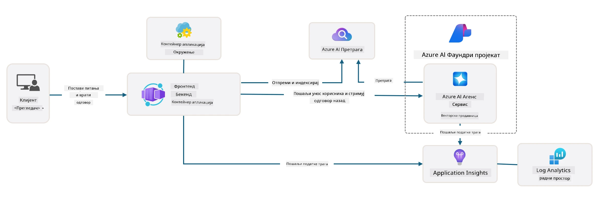

# 3. Демонтирање шаблона

!!! tip "НА КРАЈУ ОВОГ МОДУЛА БИЋЕТЕ У МОГУЋНОСТИ ДА"

    - [ ] Use GitHub Copilot and optional MCP tools for Azure documentation and read-only exploration
    - [ ] Identify the template's application, infrastructure, configuration, and test entry points
    - [ ] Verify generated explanations against actual repository files
    - [ ] **Lab 3:** Trace one request and one configuration input through the project

---

## 1. Активирајте GitHub Copilot

Отворите иницијализовани AI пример у VS Code-у и омогућите [GitHub Copilot](https://code.visualstudio.com/docs/copilot/chat/chat-agent-mode). Пријавите се налогом који има одговарајући план; ограничења коришћења варирају. Замолите Copilot да објасни репозиторијум пре него што одобрите измене.

### Опциони MCP сервери

Ове услуге могу пружити додатне алате:

- [Azure MCP Server](https://learn.microsoft.com/azure/developer/azure-mcp-server/overview)
- [Microsoft Learn MCP Server](https://learn.microsoft.com/training/support/mcp)

У VS Code-у прегледајте [MCP упутства за конфигурацију](https://code.visualstudio.com/docs/copilot/chat/mcp-servers) и направите `.vscode/mcp.json` ако је потребно:

```json
{
  "servers": {
    "Azure MCP Server": {
      "type": "stdio",
      "command": "npx",
      "args": ["-y", "@azure/mcp@latest", "server", "start"]
    },
    "microsoft.docs.mcp": {
      "type": "http",
      "url": "https://learn.microsoft.com/api/mcp"
    }
  }
}
```

Наредба `npx` захтева подржану инсталацију Node.js/npm и преузима извршни код. Прегледајте пакет и закључајте одобренију верзију за репродуцирано тимско окружење. Покрените сервере помоћу MCP контролa у VS Code-у и проверите доступне алате; имена се могу мењати између верзија.

**Аутентификација је посебна.** Користите `azd auth login` за AZD. Пратите документовани ток аутентификације Azure MCP алата; пријава у AZD сама по себи не успоставља MCP сесију. Користите `az login` посебно када вежба или кук позива Azure CLI.

Испробајте упите само за читање:

1. „Користи Microsoft Learn MCP да пронађеш документацију конфигурације Azure Developer CLI.“
2. „Објасни `azure.yaml` овог репозиторијума; наведи датотеке које имплементирају сваки кук.“
3. „Користећи расположиве Azure MCP алате, направи списак мојих деплојованих ресурса без измена.“

Проверите изабрани закупац/претплату и сваки предложени позив алата. Немојте одобравати креирање, брисање или промене приступа ресурсима само ради истраживања архитектуре.

## 2. Разумевање архитектуре

Пример хостује Python FastAPI бекенд и React/TypeScript фронтенд у Azure Container Apps. Бекенд комуницира са агентом у Microsoft Foundry пројекту. Преузимање и посматрање зависе од омогућених шаблонских карактеристика и успешног подешавања; нису загарантовани само зато што је апликација деплојована.



Упоредите овај дијаграм са [важећим упутством за upstream деплој](https://github.com/Azure-Samples/get-started-with-ai-agents/blob/main/docs/deployment.md) и вашим стварним ресурсима. Проверите конфигурисани модел деплоирања, агентске алате, управљани идентитет, доделе улога и опционе Azure Search/Application Insights ресурсе.

**Вежба:** Замолите Copilot да прати захтев за разговор од фронтенда преко API-ја до Foundry-а, са референцама на датотеке и функције. Отворите те референце и потврдите објашњење. Не извлачите закључке о имплементираној аутентификацији, рутирању или ауторизацији само из дијаграма.

## 3. Структура репозиторијума

Следећи изабрани путеви су проверавани у односу на пример 4. новембра 2026. године. Ваша иницијализована ревизија остаје извор истине:

```text
get-started-with-ai-agents/
  azure.yaml
  docker-compose.yaml
  requirements-dev.txt
  .devcontainer/
  infra/
    main.bicep
    main.parameters.json
    api.bicep
    core/
  src/
    Dockerfile
    pyproject.toml
    requirements.txt
    api/
      main.py
      routes.py
      search_index_manager.py
    frontend/
      package.json
      src/
    files/
  scripts/
    validate_env_vars.sh
    validate_env_vars.ps1
    postdeploy.sh
    postdeploy.ps1
  tests/
    test_evaluation.py
    test_red_teaming.py
  docs/
    deployment.md
    deploy_customization.md
    ai_search.md
    observability.md
    local_development.md
    troubleshooting.md
```

### Инфраструктура и конфигурација

`infra/main.bicep` оркестрира ресурсе; `main.parameters.json` повезује улазне вредности шаблона са AZD вредностима окружења. `azure.yaml` бира услугу апликације и животне куке. Пратите унос као што је `USE_AZURE_AI_SEARCH_SERVICE` кроз ове датотеке да бисте нашли шта се заправо мења.

### Апликација и идентитет

Читајте `src/api/` и `src/frontend/` заједно. Идентификујте где се агент креира или преузима, где се конфигуришу упутства/алати и који идентитет сваки Azure позив користи. Пример датотека под `src/files/` су демонстративни подаци, а не производни каталог или модел ауторизације.

### Тестови и посматрање

Тренутни улази за евалуацију и тестирање са црвеним тимом налазе се под `tests/`; старији директоријуми `evals/` и `airedteaming/` су застарели за овај пример. Прочитајте `docs/observability.md` предуслове и трошкове пре покретања облачних тестова. Ови Python тестови су одвојени од опционог `azure.ai.evaluations` AZD проширења.

## 4. Верификујте своје налазе

- Идентификујте API руту, интеракцију са агентом и код за преузимање за једно пример питање.
- Објасните који идентитет приступа Foundry-у и која конфигурација бира њен крајњи чвор.
- Пронађите стварне скрипте пре-покретања и после-деплоја и њихово понашање у случају грешке.
- Наведите све зависности или опционе функције које недостају у вашем деплоју.

Наставите са [Конфигурисањем шаблона](4-Configure-AI-Template.md).

---

<!-- CO-OP TRANSLATOR DISCLAIMER START -->
**Изјава о одрицању одговорности**:
Овај документ је преведен коришћењем услуге за аутоматски превод [Co-op Translator](https://github.com/Azure/co-op-translator). Иако тежимо тачности, имајте у виду да аутоматски преводи могу садржати грешке или нетачности. Оригинални документ на његовом изворном језику треба сматрати ауторитативним извором. За критичне информације препоручује се професионални људски превод. Нисмо одговорни за било каква неспоразума или погрешна тумачења која произилазе из коришћења овог превода.
<!-- CO-OP TRANSLATOR DISCLAIMER END -->