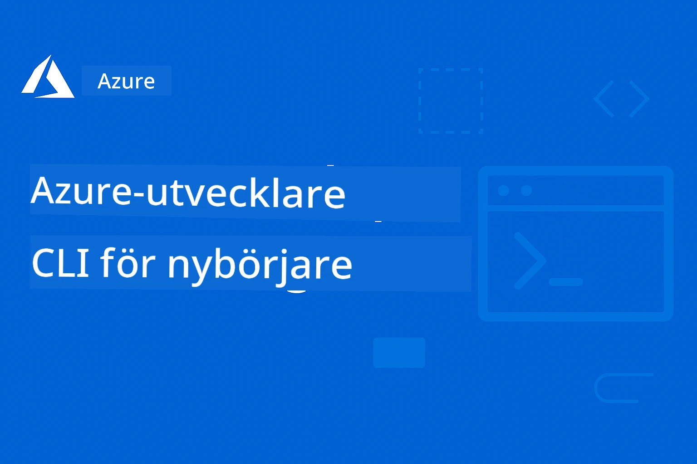

# AZD För Nybörjare: En Strukturerad Läranderesa

 

[](https://github.com/microsoft/AZD-for-beginners)
[](https://GitHub.com/microsoft/azd-for-beginners/network/)
[](https://github.com/microsoft/AZD-for-beginners)

[](https://discord.com/invite/nkVh3dp)
[](https://discord.gg/nTYy5BXMWG)

---

### Automatiserade Översättningar (Alltid Uppdaterade)

<!-- CO-OP TRANSLATOR LANGUAGES TABLE START -->
[Arabic](../ar/README.md) | [Bengali](../bn/README.md) | [Bulgarian](../bg/README.md) | [Burmese (Myanmar)](../my/README.md) | [Chinese (Simplified)](../zh-CN/README.md) | [Chinese (Traditional, Hong Kong)](../zh-HK/README.md) | [Chinese (Traditional, Macau)](../zh-MO/README.md) | [Chinese (Traditional, Taiwan)](../zh-TW/README.md) | [Croatian](../hr/README.md) | [Czech](../cs/README.md) | [Danish](../da/README.md) | [Dutch](../nl/README.md) | [Estonian](../et/README.md) | [Finnish](../fi/README.md) | [French](../fr/README.md) | [German](../de/README.md) | [Greek](../el/README.md) | [Hebrew](../he/README.md) | [Hindi](../hi/README.md) | [Hungarian](../hu/README.md) | [Indonesian](../id/README.md) | [Italian](../it/README.md) | [Japanese](../ja/README.md) | [Kannada](../kn/README.md) | [Khmer](../km/README.md) | [Korean](../ko/README.md) | [Lithuanian](../lt/README.md) | [Malay](../ms/README.md) | [Malayalam](../ml/README.md) | [Manipuri (Meitei Mayek)](../mni/README.md) | [Marathi](../mr/README.md) | [Nepali](../ne/README.md) | [Nigerian Pidgin](../pcm/README.md) | [Norwegian](../no/README.md) | [Persian (Farsi)](../fa/README.md) | [Polish](../pl/README.md) | [Portuguese (Brazil)](../pt-BR/README.md) | [Portuguese (Portugal)](../pt-PT/README.md) | [Punjabi (Gurmukhi)](../pa/README.md) | [Romanian](../ro/README.md) | [Russian](../ru/README.md) | [Serbian (Cyrillic)](../sr/README.md) | [Slovak](../sk/README.md) | [Slovenian](../sl/README.md) | [Spanish](../es/README.md) | [Swahili](../sw/README.md) | [Swedish](./README.md) | [Tagalog (Filipino)](../tl/README.md) | [Tamil](../ta/README.md) | [Telugu](../te/README.md) | [Thai](../th/README.md) | [Turkish](../tr/README.md) | [Ukrainian](../uk/README.md) | [Urdu](../ur/README.md) | [Vietnamese](../vi/README.md)

> **Föredrar du att klona lokalt?**
>
> Den här repo innehåller över 50 språköversättningar som avsevärt ökar nedladdningsstorleken. För att klona utan översättningar, använd sparse checkout:
>
> **Bash / macOS / Linux:**
> ```bash
> git clone --filter=blob:none --sparse https://github.com/microsoft/AZD-for-beginners.git
> cd AZD-for-beginners
> git sparse-checkout set --no-cone '/*' '!translations' '!translated_images'
> ```
>
> **CMD (Windows):**
> ```cmd
> git clone --filter=blob:none --sparse https://github.com/microsoft/AZD-for-beginners.git
> cd AZD-for-beginners
> git sparse-checkout set --no-cone "/*" "!translations" "!translated_images"
> ```
>
> Detta ger dig allt du behöver för att slutföra kursen med en mycket snabbare nedladdning.
<!-- CO-OP TRANSLATOR LANGUAGES TABLE END -->

## 🆕 Vad är nytt i azd idag

> 📌 **AI CLI versionsöversikt (2026-11-04):** Riktlinjer kontrollerades mot publicerad **`azd 1.37.2`**, **agenter `1.0.0-beta.23`**, och **utvärderingar `1.0.0-beta.2`** dokumentation/källa. Använd `azd >= 1.37.0` för det kombinerade arbetsflödet. Kör `azd version` och [uppdatera kärn-CLI](https://learn.microsoft.com/azure/developer/azure-developer-cli/install-azd) före tillägg. Se [versionsändringar och fixar](docs/chapter-08-production/production-ai-practices.md#recent-release-changes-and-fixes). Detta är inte en livevalidering av hela kursen.

Azure Developer CLI stödjer många applikationstyper, inklusive webbappar, API:er och AI-agenter, via stödda värdar, mallar och tillägg.

Här är vad det innebär för dig:

- **AI-agenter är nu förstklassiga azd-arbetsbelastningar.** Du kan initiera, distribuera och hantera AI-agentprojekt med samma `azd init` → `azd up` arbetsflöde som du redan känner till.
- **En agentlivscykel över två tillägg.** Använd `azure.ai.agents` för att initiera, anropa, optimera och pensionera agenter. Installera **`azure.ai.evaluations`** separat för `azd ai eval init`, `generate` och `run start`. Agenter beta.22 ersatte det gamla utvärderingsarbetsflödet och ändrade optimeringskonfigurationen; följ [migreringsguiden](docs/chapter-08-production/production-ai-practices.md#evaluation-migration-and-quality-checks).
- **Fler AI-byggstenar.** Nya förhandsgransknings-tillägg—`azure.ai.skills` och `azure.ai.connections`—låter dig hantera återanvändbara agentfärdigheter och Foundry-anslutningar direkt med azd.
- **Microsoft Foundry-integration** för in modellutplacering, agenthosting och AI-tjänstkonfiguration direkt i azd:s mall-ekosystem.
- **Smidigare vardagsgrunder.** Senaste utgåvor gjorde `azd init` idempotent (säkert att köra om), gjorde `azd auth login` att automatiskt rensa föråldrade tokens och lade till en vänlig `azd tool` första-körnings inställningsprompt.
- **Kärnarbetsflödet har inte ändrats.** Oavsett om du distribuerar en todo-app, en mikrotjänst eller en AI-lösning med flera agenter, är kommandona desamma.

> **Notera för Aspire-användare:** Microsoft refererar nu till produkten helt enkelt som **Aspire** (tidigare ".NET Aspire"). azd:s Aspire-stöd är oförändrat—endast namnet har uppdaterats.

Om du har använt azd tidigare är AI-stödet en naturlig förlängning—inte ett separat verktyg eller en avancerad spår. Om du börjar från början lär du dig ett arbetsflöde som fungerar för allt.

---

## 🚀 Vad är Azure Developer CLI (azd)?

**Azure Developer CLI (azd)** är ett utvecklarvänligt kommandoradsverktyg som gör det enkelt att distribuera applikationer till Azure. Istället för att manuellt skapa och ansluta dussintals Azure-resurser, kan du distribuera hela applikationer med ett enda kommando.

### Magin med `azd up`

```bash
# This single command does everything:
# ✅ Creates all Azure resources  
# ✅ Configures networking and security
# ✅ Builds your application code
# ✅ Deploys to Azure
# ✅ Gives you a working URL
azd up
```

Mallen levererar applikations- och infrastrukturskonfigurationen. Framgångsrik distribution kräver fortfarande stöd för tjänster/modeller, tillräcklig kvot och rättigheter, korrekta indata och verifiering av den distribuerade applikationen. `azd up` gör inte automatiskt en mall säker, överensstämmande eller produktionsklar.

---

## ❓ Azure Developer CLI vs Azure CLI: Vad är skillnaden?

Detta är den vanligaste frågan nybörjare ställer. Här är det enkla svaret:

| Funktion | **Azure CLI (`az`)** | **Azure Developer CLI (`azd`)** |
|---------|---------------------|--------------------------------|
| **Syfte** | Hantera individuella Azure-resurser | Distribuera kompletta applikationer |
| **Tankesätt** | Infrastrukturfokuserad | Applikationsfokuserad |
| **Exempel** | `az webapp create --name myapp...` | `azd up` |
| **Inlärningskurva** | Måste kunna Azure-tjänster | Behöver bara veta din app |
| **Bäst för** | DevOps, Infrastruktur | Utvecklare, Prototyputveckling |

### Enkel Liknelse

- **Azure CLI** är som att ha alla verktyg för att bygga ett hus - hammare, sågar, spikar. Du kan bygga vad som helst, men du måste kunna byggnadsteknik.
- **Azure Developer CLI** är som att anlita en entreprenör - du beskriver vad du vill ha, och de tar hand om byggandet.

### När man ska använda vilket

| Scenario | Använd Detta |
|----------|----------|
| "Jag vill snabbt distribuera min webbapp" | `azd up` |
| "Jag behöver bara skapa ett lagringskonto" | `az storage account create` |
| "Jag bygger en fullständig AI-applikation" | `azd init --template azure-search-openai-demo` |
| "Jag behöver felsöka en specifik Azure-resurs" | `az resource show` |
| "Jag vill distribuera till min konfigurerade produktionsmiljö" | Granska konfigurering, åtkomst, kostnader och driftgaller innan `azd up --environment production` |

### De fungerar tillsammans!

AZD och Azure CLI har separat autentisering och konfiguration. Använd `azd auth login` för AZD, och `az login` när en hook eller diagnostikkommando uttryckligen behöver Azure CLI. Du kan använda båda:
```bash
# Deploy your app with AZD
azd up

# Then fine-tune specific resources with Azure CLI
az webapp config set --name myapp --always-on true
```

---

## 🌟 Hitta Mallar i Awesome AZD

Börja inte från början! **Awesome AZD** är community-samlingen av färdiga mallar för distribution:

| Resurs | Beskrivning |
|----------|-------------|
| 🔗 [**Awesome AZD Gallery**](https://azure.github.io/awesome-azd/) | Bläddra bland 200+ mallar med ett klick för distribution |
| 🔗 [**Skicka in en mall**](https://github.com/Azure/awesome-azd/issues) | Bidra med din egen mall till communityt |
| 🔗 [**GitHub Repository**](https://github.com/Azure/awesome-azd) | Märk som favorit och utforska källan |

### Populära AI-mallar från Awesome AZD

Välj en mall i sin egen tomma katalog; nedanstående kommandon är alternativ. Den avslutande `.` initierar den katalogen.

```bash
# RAG Chat with Microsoft Foundry Models + AI Search
azd init --template azure-search-openai-demo .

# Quick AI Chat Application
azd init --template openai-chat-app-quickstart .

# AI Agents with Foundry Agents
azd init --template get-started-with-ai-agents .
```

---

## 🎯 Kom igång på 3 steg

Innan du börjar, säkerställ att din dator är redo för mallen du vill distribuera:

**Windows:**
```powershell
.\validate-setup.ps1
```

**macOS / Linux:**
```bash
bash ./validate-setup.sh
```

Om någon nödvändig kontroll misslyckas, fixa det först och fortsätt sedan med snabbstarten.

### Steg 1: Installera AZD (2 minuter)

**Windows:**
```powershell
winget install microsoft.azd
```

**macOS:**
```bash
brew tap azure/azd && brew install azd
```

**Linux:**
```bash
curl -fsSL https://aka.ms/install-azd.sh | bash
```

### Steg 2: Autentisera för AZD

```bash
# Optional if you plan to use Azure CLI commands directly in this course
az login

# Required for AZD workflows
azd auth login
```

Om du är osäker på vilken du behöver, följ hela installationsflödet i [Installation & Setup](docs/chapter-01-foundation/installation.md#authentication-setup).

### Steg 3: Distribuera din första app

```bash
# Initialize from a template
azd init --template todo-nodejs-mongo .

# Deploy to Azure (creates everything!)
azd up
```

**🎉 Klart!** Din app är nu live på Azure.

### Rensa upp (glöm inte!)

```bash
# Remove all resources when done experimenting
azd down --force --purge
```

---

## 📚 Så här använder du den här kursen

Denna kurs är utformad för **progressivt lärande** - börja där du känner dig bekväm och arbeta dig uppåt:

| Din Erfarenhet | Börja Här |
|-----------------|------------|
| **Helt ny med Azure** | [Kapitel 1: Grundläggande](#-chapter-1-foundation--quick-start) |
| **Kan Azure, ny med AZD** | [Kapitel 1: Grundläggande](#-chapter-1-foundation--quick-start) |
| **Vill distribuera AI-appar** | [Kapitel 2: AI-först utveckling](#-chapter-2-ai-first-development-recommended-for-ai-developers) |
| **Vill ha praktisk träning** | [🎓 Interaktiv Workshop](workshop/README.md) - 3-4 timmars guidad labb |
| **Behöver produktionsmönster** | [Kapitel 8: Produktion & Företag](#-chapter-8-production--enterprise-patterns) |

### Snabb installation

1. **Forka detta repo**: [](https://GitHub.com/microsoft/azd-for-beginners/fork)
2. **Klona det**: `git clone https://github.com/YOUR-USERNAME/azd-for-beginners.git`
3. **Få hjälp**: [Azure Discord Community](https://discord.com/invite/ByRwuEEgH4)

> **Föredrar du att klona lokalt?**

> Den här repo innehåller över 50 språköversättningar som avsevärt ökar nedladdningsstorleken. För att klona utan översättningar, använd sparse checkout:
> ```bash
> git clone --filter=blob:none --sparse https://github.com/microsoft/AZD-for-beginners.git
> cd AZD-for-beginners
> git sparse-checkout set --no-cone '/*' '!translations' '!translated_images'
> ```
> Detta ger dig allt du behöver för att slutföra kursen med en mycket snabbare nedladdning.


## Kursöversikt

Behärska Azure Developer CLI (azd) genom strukturerade kapitel utformade för progressivt lärande. **Särskilt fokus på AI-applikationsdistribution med Microsoft Foundry-integration.**

### Varför denna kurs är viktig för moderna utvecklare

Utvecklare som distribuerar AI-arbetsbelastningar behöver ofta vägledning kring:
- Komplexa AI-arkitekturer med flera tjänster
- Bästa praxis för AI-distribution i produktion  
- Integration och konfiguration av Azure AI-tjänster
- Kostnadsoptimering för AI-arbetsbelastningar
- Felsökning av AI-specifika distributionsproblem

### Lärandemål

Genom att slutföra denna strukturerade kurs kommer du att:
- **Behärska AZD-grunderna**: Kärnkoncept, installation och konfiguration
- **Distribuera AI-applikationer**: Använd AZD med Microsoft Foundry-tjänster
- **Implementera Infrastruktur som Kod**: Hantera Azure-resurser med Bicep-mallar
- **Felsöka distributioner**: Lösa vanliga problem och felsöka fel
- **Optimera för produktion**: Säkerhet, skalning, övervakning och kostnadshantering
- **Bygga lösningar med flera agenter**: Distribuera komplexa AI-arkitekturer

## Innan du börjar: Konton, åtkomst och förutsättningar

Innan du börjar Kapitel 1, se till att du har följande på plats. Installationsstegen senare i denna guide antar att dessa grunder redan är hanterade.

- **En Azure-prenumeration**: Du kan använda en befintlig prenumeration från jobbet eller ditt eget konto, eller skapa ett [gratis testkonto](https://aka.ms/azurefreetrial) för att komma igång.
- **Behörighet att skapa Azure-resurser**: För de flesta övningar bör du ha minst **Bidragsgivare**-åtkomst på målprenumerationen eller resursgruppen. Vissa kapitel förutsätter även att du kan skapa resursgrupper, hanterade identiteter och RBAC-tilldelningar.
- [**Ett GitHub-konto**](https://github.com): Detta är användbart för att forka repot, spåra dina egna ändringar och använda GitHub Codespaces för workshopen.
- **Förutsättningar för mallens körning**: Vissa mallar kräver lokala verktyg såsom Node.js, Python, Java eller Docker. Kör installationsvalidatorn innan du börjar för att tidigt upptäcka saknade verktyg.
- **Grundläggande terminalvana**: Du behöver inte vara expert, men bör känna dig bekväm med att köra kommandon som `git clone`, `azd auth login` och `azd up`.

> **Arbetar du i en företagsprenumeration?**
> Om din Azure-miljö hanteras av en administratör, bekräfta i förväg att du kan distribuera resurser i prenumerationen eller resursgruppen du tänker använda. Om inte, be om en sandlåsprenumeration eller Bidragsgivare-åtkomst innan du börjar.

> **Ny på Azure?**
> Börja med din egen Azure-testprenumeration eller betala-per-användning-prenumeration på https://aka.ms/azurefreetrial så att du kan slutföra övningarna från början till slut utan att vänta på godkännanden på hyresnivå.

## 🗺️ Kurskarta: Snabb navigering per kapitel

Varje kapitel har en dedikerad README med lärandemål, snabbinstruktioner och övningar:

| Kapitel | Ämne | Lektioner | Tidsåtgång | Svårighetsgrad |
|---------|-------|---------|----------|------------|
| **[Kap 1: Grundläggande](docs/chapter-01-foundation/README.md)** | Komma igång | [AZD-grunder](docs/chapter-01-foundation/azd-basics.md) &#124; [Installation](docs/chapter-01-foundation/installation.md) &#124; [Första projektet](docs/chapter-01-foundation/first-project.md) | 30-45 min | ⭐ |
| **[Kap 2: AI-utveckling](docs/chapter-02-ai-development/README.md)** | AI-först-appar | [Foundry-integration](docs/chapter-02-ai-development/microsoft-foundry-integration.md) &#124; [AI-agenter](docs/chapter-02-ai-development/agents.md) &#124; [Modellutplacering](docs/chapter-02-ai-development/ai-model-deployment.md) &#124; [Workshop](docs/chapter-02-ai-development/ai-workshop-lab.md) | 1-2 tim | ⭐⭐ |
| **[Kap 3: Konfiguration](docs/chapter-03-configuration/README.md)** | Auth & Säkerhet | [Konfiguration](docs/chapter-03-configuration/configuration.md) &#124; [Auth & Säkerhet](docs/chapter-03-configuration/authsecurity.md) | 45-60 min | ⭐⭐ |
| **[Kap 4: Infrastruktur](docs/chapter-04-infrastructure/README.md)** | IaC & Distribution | [Distributionsguide](docs/chapter-04-infrastructure/deployment-guide.md) &#124; [Provisionering](docs/chapter-04-infrastructure/provisioning.md) | 1-1,5 tim | ⭐⭐⭐ |
| **[Kap 5: Flera agenter](docs/chapter-05-multi-agent/README.md)** | AI-agentlösningar | [Retail-scenario](examples/retail-scenario.md) &#124; [Koordinationsmönster](docs/chapter-06-pre-deployment/coordination-patterns.md) | 2-3 tim | ⭐⭐⭐⭐ |
| **[Kap 6: Fördistribution](docs/chapter-06-pre-deployment/README.md)** | Planering & Validering | [Preflight-kontroller](docs/chapter-06-pre-deployment/preflight-checks.md) &#124; [Kapacitetsplanering](docs/chapter-06-pre-deployment/capacity-planning.md) &#124; [SKU-val](docs/chapter-06-pre-deployment/sku-selection.md) &#124; [App Insights](docs/chapter-06-pre-deployment/application-insights.md) | 1 tim | ⭐⭐ |
| **[Kap 7: Felsökning](docs/chapter-07-troubleshooting/README.md)** | Felsök & Åtgärda | [Vanliga problem](docs/chapter-07-troubleshooting/common-issues.md) &#124; [Felsökning](docs/chapter-07-troubleshooting/debugging.md) &#124; [AI-problem](docs/chapter-07-troubleshooting/ai-troubleshooting.md) | 1-1,5 tim | ⭐⭐ |
| **[Kap 8: Produktion](docs/chapter-08-production/README.md)** | Företagsmönster | [Produktionspraxis](docs/chapter-08-production/production-ai-practices.md) | 2-3 tim | ⭐⭐⭐⭐ |
| **[🎓 Workshop](workshop/README.md)** | Praktisk labb | [Introduktion](workshop/docs/instructions/0-Introduction.md) &#124; [Val](workshop/docs/instructions/1-Select-AI-Template.md) &#124; [Validering](workshop/docs/instructions/2-Validate-AI-Template.md) &#124; [Nedmontering](workshop/docs/instructions/3-Deconstruct-AI-Template.md) &#124; [Konfiguration](workshop/docs/instructions/4-Configure-AI-Template.md) &#124; [Anpassning](workshop/docs/instructions/5-Customize-AI-Template.md) &#124; [Nedmontering](workshop/docs/instructions/6-Teardown-Infrastructure.md) &#124; [Avslutning](workshop/docs/instructions/7-Wrap-up.md) | 3-4 tim | ⭐⭐ |

**Total kurstid:** ~10-14 timmar | **Färdighetsutveckling:** Nybörjare → Produktionsklar

---

## 📚 Lärandekapitel

*Välj din lärandestig baserat på erfarenhetsnivå och mål*

### 🚀 Kapitel 1: Grund & Snabbstart
**Förutsättningar**: Azure-prenumeration, grundläggande kommandoradskunskaper  
**Tidsåtgång**: 30-45 minuter  
**Svårighetsgrad**: ⭐

#### Vad du kommer att lära dig
- Förstå grunderna i Azure Developer CLI
- Installera AZD på din plattform
- Din första lyckade distribution

#### Lärresurser
- **🎯 Börja här**: [Vad är Azure Developer CLI?](#-what-is-azure-developer-cli-azd)
- **📖 Teori**: [AZD-grunder](docs/chapter-01-foundation/azd-basics.md) - Kärnkoncept och terminologi
- **⚙️ Installation**: [Installation & Setup](docs/chapter-01-foundation/installation.md) - Plattformsspecifika guider
- **🛠️ Praktiskt**: [Ditt första projekt](docs/chapter-01-foundation/first-project.md) - Steg-för-steg handledning
- **📋 Snabbreferens**: [Kommandoöversikt](resources/cheat-sheet.md)

#### Praktiska övningar
```bash
# Quick installation check
azd version

# Deploy your first application
azd init --template todo-nodejs-mongo .
azd up
```

**💡 Kapitelresultat**: Lyckas distribuera en enkel webbapplikation till Azure med AZD

**✅ Framgångsvalidering:**
```bash
# After completing Chapter 1, you should be able to:
azd version              # Shows installed version
azd init --template todo-nodejs-mongo  # Initializes project
azd up                  # Deploys to Azure
azd show                # Displays running app URL
# Application opens in browser and works
azd down --force --purge  # Cleans up resources
```

**📊 Tidsåtgång:** 30-45 minuter  
**📈 Färdighetsnivå efteråt:** Kan distribuera grundläggande applikationer självständigt

---

### 🤖 Kapitel 2: AI-Först Utveckling (Rekommenderas för AI-utvecklare)
**Förutsättningar**: Kapitel 1 genomfört  
**Tidsåtgång**: 1-2 timmar  
**Svårighetsgrad**: ⭐⭐

#### Vad du kommer att lära dig
- Microsoft Foundry-integration med AZD
- Distribuera AI-drivna applikationer
- Förståelse för AI-tjänsters konfigurationer

#### Lärresurser
- **🎯 Börja här**: [Microsoft Foundry-integration](docs/chapter-02-ai-development/microsoft-foundry-integration.md)
- **🤖 AI-agenter**: [AI-agentsguide](docs/chapter-02-ai-development/agents.md) - Distribuera intelligenta agenter med AZD
- **📖 Mönster**: [AI-modellutplacering](docs/chapter-02-ai-development/ai-model-deployment.md) - Distribuera och hantera AI-modeller
- **🛠️ Workshop**: [AI-workshoplabb](docs/chapter-02-ai-development/ai-workshop-lab.md) - Gör dina AI-lösningar redo för AZD
- **🎥 Interaktiv guide**: [Workshop-material](workshop/README.md) - Webbläsarbaserat lärande med MkDocs * DevContainer-miljö
- **📋 Mallar**: [Microsoft Foundry-mallar](#featured-microsoft-foundry-templates)
- **📝 Exempel**: [AZD-distributionsexempel](examples/README.md)

#### Praktiska övningar
```bash
# Deploy your first AI application
azd init --template azure-search-openai-demo .
azd up

# Try additional AI templates
azd init --template openai-chat-app-quickstart .
azd init --template agent-openai-python-prompty .
```

**💡 Kapitelresultat**: Distribuera och konfigurera en AI-driven chattapplikation med RAG-funktioner

**✅ Framgångsvalidering:**
```bash
# After Chapter 2, you should be able to:
azd init --template azure-search-openai-demo .
azd up
# Test the AI chat interface
# Ask questions and get AI-powered responses with sources
# Verify search integration works
azd monitor  # Check Application Insights shows telemetry
azd down --force --purge
```

**📊 Tidsåtgång:** 1-2 timmar  
**📈 Färdighetsnivå efteråt:** Kan distribuera AI-lärande applikationer och identifiera ytterligare produktionsberedskapskrav
**💰 Kostnadsmedvetenhet:** Förstå utvecklingskostnader på 80-150 $/månad och produktionskostnader på 300-3500 $/månad

#### 💰 Kostnadsaspekter för AI-distributioner

**Utvecklingsmiljö (Beräknat till 80-150 $/månad):**
- Microsoft Foundry-modeller (Pay-as-you-go): 0-50 $/månad (baserat på token-användning)
- AI Search (Grundnivå): 75 $/månad
- Container Apps (Förbrukningsbaserat): 0-20 $/månad
- Lagring (Standard): 1-5 $/månad

**Produktionsmiljö (Beräknat till 300-3 500+ $/månad):**
- Microsoft Foundry-modeller (PTU för konsekvent prestanda): 3 000+ $/månad ELLER Pay-as-you-go med hög volym
- AI Search (Standardnivå): 250 $/månad
- Container Apps (Dedikerat): 50-100 $/månad
- Application Insights: 5-50 $/månad
- Lagring (Premium): 10-50 $/månad

**💡 Kostnadsoptimeringstips:**
- Kontrollera pris för modellinferens och kontospecifika krediter; Azure OpenAI inkluderar inte en universell månadsfri gräns på 50 000 token
- Kör `azd down` för att ta bort resurser när de inte längre behövs, efter att ha granskat den valda miljön
- Börja med förbrukningsbaserad fakturering, uppgradera till PTU endast för produktion
- Använd `azd provision --preview` för att granska planerad infrastruktur, och prissätt sedan resurserna med Azure Pricing Calculator
- Aktivera autoskalning: betala endast för faktisk användning

**Kostnadsövervakning:**
```bash
# Inspect planned resources (this does not calculate prices)
azd provision --preview

# Monitor actual costs in Azure Portal
az consumption budget list --resource-group <your-rg>
```

---

### ⚙️ Kapitel 3: Konfiguration & Autentisering
**Förutsättningar**: Kapitel 1 genomfört  
**Tidsåtgång**: 45-60 minuter  
**Svårighetsgrad**: ⭐⭐

#### Vad du kommer att lära dig
- Miljökonfiguration och hantering
- Autentisering och säkerhets-bästa praxis
- Resursnamngivning och organisation

#### Lärresurser
- **📖 Konfiguration**: [Konfigurationsguide](docs/chapter-03-configuration/configuration.md) - Miljöinställningar
- **🔐 Säkerhet**: [Autentiseringsmönster och hanterad identitet](docs/chapter-03-configuration/authsecurity.md) - Autentiseringsmönster
- **📝 Exempel**: [Databasapp-exempel](examples/database-app/README.md) - AZD-databasexempel

#### Praktiska övningar
- Konfigurera flera miljöer (dev, staging, prod)
- Ställ in autentisering med hanterad identitet
- Implementera miljöspecifika konfigurationer

**💡 Kapitelresultat**: Hantera flera miljöer med rätt autentisering och säkerhet

---

### 🏗️ Kapitel 4: Infrastruktur som Kod & Distribution
**Förutsättningar**: Kapitlen 1-3 genomförda  
**Tidsåtgång**: 1-1,5 timmar  
**Svårighetsgrad**: ⭐⭐⭐

#### Vad du kommer att lära dig
- Avancerade distributionsmönster
- Infrastruktur som Kod med Bicep
- Strategier för resursprovisionering

#### Lärresurser
- **📖 Distribution**: [Distributionsguide](docs/chapter-04-infrastructure/deployment-guide.md) - Kompletta arbetsflöden
- **🏗️ Provisionering**: [Provisionera resurser](docs/chapter-04-infrastructure/provisioning.md) - Azure-resurshantering
- **📝 Exempel**: [Containerapp-exempel](../../examples/container-app) - Containeriserade distributioner

#### Praktiska övningar
- Skapa custom Bicep-mallar
- Distribuera multi-tjänst applikationer
- Implementera blue-green-distributionsstrategier

**💡 Kapitelresultat**: Distribuera komplexa multi-tjänst applikationer med egna infrastrukturs-mallar

---

### 🎯 Kapitel 5: Multi-Agent AI-lösningar (Avancerat)
**Förutsättningar**: Kapitlen 1-2 genomförda  
**Tidsåtgång**: 2-3 timmar  
**Svårighetsgrad**: ⭐⭐⭐⭐

#### Vad du kommer att lära dig
- Multi-agent arkitekturmönster
- Agentorkestrering och koordinering
- Produktionsklara AI-distributioner

#### Lärresurser
- **🤖 Utvald design**: [Retail multi-agent lösning](examples/retail-scenario.md) - Arkitekturplan, inte en komplett applikation
- **🛠️ ARM-mallar**: [ARM Template Package](../../examples/retail-multiagent-arm-template) - Infrastrukturstomme; granska förutsättningar och saknade applikationskomponenter
- **📖 Arkitektur**: [Mönster för samordning av flera agenter](docs/chapter-06-pre-deployment/coordination-patterns.md) - Mönster

#### Praktiska övningar
```bash
# Inspect the retail infrastructure scaffold before choosing to deploy it
cd examples/retail-multiagent-arm-template
cat README.md

# After an intentional deployment, inspect infrastructure state
az deployment group show --resource-group <rg-name> --name <deployment-name>
```

**💡 Kapitelresultat**: Förstå design av multi-agenter och identifiera implementerings-, validerings- och driftarbete som krävs utöver en infrastrukturstomme

---

### 🔍 Kapitel 6: Validering och planering före driftsättning
**Förutsättningar**: Kapitel 4 klart  
**Varaktighet**: 1 timme  
**Komplexitet**: ⭐⭐

#### Vad du kommer att lära dig
- Kapacitetsplanering och resursvalidering
- Strategier för val av SKU
- Pre-flight kontroller och automation

#### Lärresurser
- **📊 Planering**: [Kapacitetsplanering](docs/chapter-06-pre-deployment/capacity-planning.md) - Resursvalidering
- **💰 Urval**: [Val av SKU](docs/chapter-06-pre-deployment/sku-selection.md) - Kostnadseffektiva val
- **✅ Validering**: [Pre-flight kontroller](docs/chapter-06-pre-deployment/preflight-checks.md) - Automatiserade skript

#### Praktiska övningar
- Kör skript för kapacitetsvalidering
- Optimera SKU-val för kostnad
- Implementera automatiserade pre-deployment kontroller

**💡 Kapitelresultat**: Validera och optimera driftsättningar före utförande

---

### 🚨 Kapitel 7: Felsökning och avlusning
**Förutsättningar**: Något driftsättningskapitel klart  
**Varaktighet**: 1-1,5 timmar  
**Komplexitet**: ⭐⭐

#### Vad du kommer att lära dig
- Systematiska felsökningsmetoder
- Vanliga problem och lösningar
- AI-specifik felsökning

#### Lärresurser
- **🔧 Vanliga problem**: [Vanliga problem](docs/chapter-07-troubleshooting/common-issues.md) - FAQ och lösningar
- **🕵️ Felsökning**: [Felsökningsguide](docs/chapter-07-troubleshooting/debugging.md) - Steg-för-steg-strategier
- **🤖 AI-problem**: [AI-specifik felsökning](docs/chapter-07-troubleshooting/ai-troubleshooting.md) - AI-tjänsteproblem

#### Praktiska övningar
- Diagnostisera driftsättningsfel
- Lös autentiseringsproblem
- Felsök AI-tjänsters anslutning

**💡 Kapitelresultat**: Självständigt diagnostisera och lösa vanliga driftsättningsproblem

---

### 🏢 Kapitel 8: Produktions- och företagsmönster
**Förutsättningar**: Kapitel 1-4 klart  
**Varaktighet**: 2-3 timmar  
**Komplexitet**: ⭐⭐⭐⭐

#### Vad du kommer att lära dig
- Produktionsdriftsättningsstrategier
- Företagssäkerhetsmönster
- Övervakning och kostnadsoptimering

#### Lärresurser
- **🏭 Produktion**: [Produktionsrekommendationer för AI](docs/chapter-08-production/production-ai-practices.md) - Företagsmönster
- **📝 Exempel**: [Mikrotjänstexempel](../../examples/microservices) - Komplexa arkitekturer
- **📊 Övervakning**: [Integration av Application Insights](docs/chapter-06-pre-deployment/application-insights.md) - Övervakning

#### Praktiska övningar
- Implementera företagssäkerhetsmönster
- Sätt upp omfattande övervakning
- Driftsätt i produktion med korrekt styrning

**💡 Kapitelresultat**: Driftsätt företagsanpassade applikationer med full produktionskapacitet

---

## 🎓 Workshopöversikt: Praktisk inlärningsupplevelse

> **⚠️ WORKSHOPSTATUS: Aktiv utveckling**  
> Workshopmaterialet utvecklas och förbättras för närvarande. Kärnmodulerna fungerar, men några avancerade delar är ofullständiga. Vi arbetar aktivt för att slutföra allt innehåll. [Följ framstegen →](workshop/README.md)

### Interaktiva workshopmaterial
**Omfattande praktiskt lärande med webbläsarbaserade verktyg och guidade övningar**

Våra workshopmaterial erbjuder en strukturerad, interaktiv inlärningsupplevelse som kompletterar kapitelbaserad kursplan ovan. Workshopen är utformad för både självstudier och instruktörsledda sessioner.

#### 🛠️ Workshopfunktioner
- **Webbläsarbaserat gränssnitt**: Komplett MkDocs-driven workshop med sök-, kopierings- och temafunktioner
- **Integrering med GitHub Codespaces**: Enkel miljösetup med ett klick
- **Strukturerad lärväg**: 8 moduler med guidade övningar (3-4 timmar totalt)
- **Progressiv metodik**: Introduktion → Urval → Validering → De-konstruering → Konfiguration → Anpassning → Nedmontering → Avslutning
- **Interaktiv DevContainer-miljö**: Förkonfigurerade verktyg och beroenden

#### 📚 Workshopmodulstruktur
Workshopen följer en **8-moduls progressiv metodik** som tar dig från upptäckt till mästerskap i driftsättning:

| Modul | Ämne | Vad du gör | Varaktighet |
|--------|-------|----------------|----------|
| **0. Introduktion** | Workshopöversikt | Förstå lärandemål, förutsättningar och workshopstruktur | 15 min |
| **1. Urval** | Mallupptäckt | Utforska AZD-mallar och välj rätt AI-mall för ditt scenario | 20 min |
| **2. Validering** | Driftsätt & verifiera | Driftsätt mallen med `azd up` och validera infrastrukturen | 30 min |
| **3. De-konstruering** | Förstå struktur | Använd GitHub Copilot för att utforska mallarkitektur, Bicep-filer och kodorganisation | 30 min |
| **4. Konfiguration** | djupdykning i azure.yaml | Bemästra `azure.yaml` konfiguration, livscykelhooks och miljövariabler | 30 min |
| **5. Anpassning** | Gör den din | Aktivera AI-sökning, spårning, utvärdering och anpassa till ditt scenario | 45 min |
| **6. Nedmontering** | Städa upp | Avveckla resurser på ett säkert sätt med `azd down --purge` | 15 min |
| **7. Avslutning** | Nästa steg | Granska prestationer, nyckelkoncept och fortsätt din läranderesa | 15 min |

**Workshopflöde:**
```
Introduction → Selection → Validation → Deconstruction → Configuration → Customization → Teardown → Wrap-up
     ↓            ↓           ↓              ↓               ↓              ↓            ↓           ↓
  Overview    Find the     Deploy &      Explore        Master         Customize     Clean up    Review &
             right        verify        code &        azure.yaml      for your      resources   next steps
             template                   structure                     scenario
```

#### 🚀 Kom igång med workshopen
```bash
# Option 1: GitHub Codespaces (Recommended)
# Click "Code" → "Create codespace on main" in the repository

# Option 2: Local Development
git clone https://github.com/microsoft/azd-for-beginners.git
cd azd-for-beginners/workshop
# Follow the setup instructions in workshop/README.md
```

#### 🎯 Workshopmål
Genom att genomföra workshopen kommer deltagarna att:
- **Driftsätta produktionsklara AI-applikationer**: Använda AZD med Microsoft Foundry-tjänster
- **Bemästra multi-agentarkitekturer**: Implementera samordnade AI-agentlösningar
- **Implementera säkerhetsbästa praxis**: Konfigurera autentisering och åtkomstkontroll
- **Optimera för skala**: Designa kostnadseffektiva och presterande driftsättningar
- **Felsöka driftsättningar**: Lösa vanliga problem självständigt

#### 📖 Workshopresurser
- **🎥 Interaktiv guide**: [Workshopmaterial](workshop/README.md) - Webbläsarbaserad lärmiljö
- **📋 Modul-för-modul instruktioner**:
  - [0. Introduktion](workshop/docs/instructions/0-Introduction.md) - Workshopöversikt och mål
  - [1. Urval](workshop/docs/instructions/1-Select-AI-Template.md) - Hitta och välj AI-mallar
  - [2. Validering](workshop/docs/instructions/2-Validate-AI-Template.md) - Driftsätt och verifiera mallar
  - [3. De-konstruering](workshop/docs/instructions/3-Deconstruct-AI-Template.md) - Utforska mallarkitektur
  - [4. Konfiguration](workshop/docs/instructions/4-Configure-AI-Template.md) - Bemästra azure.yaml
  - [5. Anpassning](workshop/docs/instructions/5-Customize-AI-Template.md) - Anpassa för ditt scenario
  - [6. Nedmontering](workshop/docs/instructions/6-Teardown-Infrastructure.md) - Städa upp resurser
  - [7. Avslutning](workshop/docs/instructions/7-Wrap-up.md) - Granskning och nästa steg
- **🛠️ AI Workshop Lab**: [AI Workshop Lab](docs/chapter-02-ai-development/ai-workshop-lab.md) - AI-fokuserade övningar
- **💡 Snabbstart**: [Workshop Setup Guide](workshop/README.md#browser-based-guide) - Miljökonfiguration

**Perfekt för**: Företagsutbildningar, universitetskurser, självstudier och utvecklarbootcamps.

---

## 📖 Fördjupning: AZD-funktioner

Utöver grunderna tillhandahåller AZD kraftfulla funktioner för produktionsdriftsättningar:

- **Mallbaserade driftsättningar** - Använd förbyggda mallar för vanliga applikationsmönster
- **Infrastructure as Code** - Hantera Azure-resurser med Bicep eller Terraform  
- **Integrerade arbetsflöden** - Sömlöst provisionera, driftsätt och övervaka applikationer
- **Utvecklarvänligt** - Optimerat för produktivitet och erfarenhet för utvecklare

### **AZD + Microsoft Foundry: Perfekt för AI-driftsättningar**

**Varför AZD för AI-lösningar?** AZD adresserar de största utmaningarna AI-utvecklare möter:

- **AI-klara mallar** - Förkonfigurerade mallar för Microsoft Foundry-modeller, Azure AI-tjänster och ML-arbetsbelastningar
- **Säkra AI-driftsättningar** - Inbyggda säkerhetsmönster för AI-tjänster, API-nycklar och modelendpunkter  
- **Produktions-AI-mönster** - Bästa praxis för skalbara, kostnadseffektiva AI-applikationsdriftsättningar
- **End-to-end AI-arbetsflöden** - Från modellutveckling till produktionsdriftsättning med korrekt övervakning
- **Kostnadsoptimering** - Smart resurstilldelning och skalningsstrategier för AI-arbetsbelastningar
- **Microsoft Foundry-integration** - Sömlös anslutning till Microsoft Foundry-modellkatalog och endpunkter

---

## 🎯 Mallar & Exempelbibliotek

### Utvalda: Microsoft Foundry-mallar
**Börja här om du driftsätter AI-applikationer!**

> **Notera:** Dessa mallar visar olika AI-mönster. Vissa är externa Azure Samples, andra är lokala implementationer.

| Mall | Kapitel | Komplexitet | Tjänster | Typ |
|----------|---------|------------|----------|------|
| [**Kom igång med AI-chatt**](https://github.com/Azure-Samples/get-started-with-ai-chat) | Kapitel 2 | ⭐⭐ | AzureOpenAI + Azure AI Model Inference API + Azure AI Search + Azure Container Apps + Application Insights | Extern |
| [**Kom igång med AI-agenter**](https://github.com/Azure-Samples/get-started-with-ai-agents) | Kapitel 2 | ⭐⭐ | Foundry Agents + AzureOpenAI + Azure AI Search + Azure Container Apps + Application Insights| Extern |
| [**Azure Search + OpenAI-demo**](https://github.com/Azure-Samples/azure-search-openai-demo) | Kapitel 2 | ⭐⭐ | Azure OpenAI + Azure AI Search + Container Apps (standard) + Storage | Extern |
| [**OpenAI Chat App Snabbstart**](https://github.com/Azure-Samples/openai-chat-app-quickstart) | Kapitel 2 | ⭐ | AzureOpenAI + Container Apps + Application Insights | Extern |
| [**Agent OpenAI Python Prompty**](https://github.com/Azure-Samples/agent-openai-python-prompty) | Kapitel 5 | ⭐⭐⭐ | AzureOpenAI + Azure Functions + Prompty | Extern |
| [**Contoso Chat RAG**](https://github.com/Azure-Samples/contoso-chat) | Kapitel 8 | ⭐⭐⭐⭐ | AzureOpenAI + AI Search + Cosmos DB + Container Apps | Extern |
| [**Retail Multi-Agent Solution**](examples/retail-scenario.md) | Kapitel 5 | ⭐⭐⭐⭐ | Föreslagen arkitektur och infrastrukturstomme; applikationsimplementation krävs | **Lokal mall** |

### Utvalda: Kompletta lärscenarier
**Produktionsklara applikationsmallar kopplade till lärokapitel**

| Mall | Lärokapitel | Komplexitet | Nyckellärande |
|----------|------------------|------------|--------------|
| [**openai-chat-app-quickstart**](https://github.com/Azure-Samples/openai-chat-app-quickstart) | Kapitel 2 | ⭐ | Grundläggande AI-driftsättningsmönster |
| [**azure-search-openai-demo**](https://github.com/Azure-Samples/azure-search-openai-demo) | Kapitel 2 | ⭐⭐ | RAG-implementation med Azure AI Search |
| [**get-started-with-ai-agents**](https://github.com/Azure-Samples/get-started-with-ai-agents) | Kapitel 2 | ⭐⭐ | Agentstödd chatt och sampelspecifika utvärderingstester |
| [**agent-openai-python-prompty**](https://github.com/Azure-Samples/agent-openai-python-prompty) | Kapitel 5 | ⭐⭐⭐ | Agentramverk och funktionsanrop |
| [**contoso-chat**](https://github.com/Azure-Samples/contoso-chat) | Kapitel 8 | ⭐⭐⭐ | Företags-AI-orchestration |
| [**retail-multi-agent-solution**](examples/retail-scenario.md) | Kapitel 5 | ⭐⭐⭐⭐ | Multi-agentarkitektur med kund- och lageragenter |

### Lära genom exempeltyp

> **📌 Lokala vs. externa exempel:**  
> **Lokala exempel** (i detta repo) = Granska exempelns README för implementeringsstatus och förutsättningar
> **Externa exempel** (Azure Samples) = Klona från länkade repor

#### Lokala exempel (Klara att använda)
- [**Retail Multi-Agent Solution**](examples/retail-scenario.md) - Arkitekturmall med ARM infrastrukturstomme
  - Föreslagna kund- och lageragentroller
  - Övervakning, utvärdering och applikationskod måste implementeras och verifieras
  - Endast provisionering av resurser producerar inte en fungerande retailapplikation

#### Lokala exempel - Containerapplikationer (Kapitel 2-5)
**Omfattande exempel på containerdriftsättningar i detta repo:**
- [**Container App Exempel**](examples/container-app/README.md) - Komplett guide till containerdriftsättningar
  - [Enkel Flask-API](../../examples/container-app/simple-flask-api) - Grundläggande REST API med scale-to-zero
  - [Mikrotjänstarkitektur](../../examples/container-app/microservices) - Två-tjänst sampel; produktionshårdnande är ytterligare arbete
  - Snabbstart, produktion och avancerade driftsättningsmönster
  - Övervakning, säkerhet och kostnadsoptimeringsvägledning

#### Externa exempel - Enkla applikationer (Kapitel 1-2)
**Klona dessa Azure Samples-repon för att komma igång:**
- [Enkel webbapp - Node.js + MongoDB](https://github.com/Azure-Samples/todo-nodejs-mongo) - Grundläggande driftsättningsmönster
- [Statisk webbplats - React SPA](https://github.com/Azure-Samples/todo-csharp-sql-swa-func) - Driftsättning av statiskt innehåll
- [Container App - Python Flask](https://github.com/Azure-Samples/container-apps-store-api-microservice) - Driftsättning av REST API

#### Externa exempel - Databasintegration (Kapitel 3-4)  
- [Databasapp - C# + SQL](https://github.com/Azure-Samples/todo-csharp-sql) - Databasanslutningsmönster
- [Funktioner + Cosmos DB](https://github.com/Azure-Samples/todo-python-mongo-swa-func) - Serverlös dataflöde

#### Externa Exempel - Avancerade Mönster (Kapitel 4-8)
- [Java Mikrotjänster](https://github.com/Azure-Samples/java-microservices-aca-lab) - Arkitekturer med flera tjänster
- [Container Apps Jobb](https://github.com/Azure-Samples/container-apps-jobs) - Bakgrundsprocesser  
- [Enterprise ML Pipeline](https://github.com/Azure/mlops-v2) - MLOps referensmönster; inte en drop-in AZD-mall

### Externa Mall-Samlingar
- [**Officiella AZD Mallgalleri**](https://azure.github.io/awesome-azd/) - Kurerad samling av officiella och community-mallar
- [**Azure Developer CLI Mallar**](https://learn.microsoft.com/en-us/azure/developer/azure-developer-cli/azd-templates) - Microsoft Learn dokumentation för mallar
- [**Exempelkatalog**](examples/README.md) - Lokala lärandeexempel med detaljerade förklaringar

---

## 📚 Läranderesurser & Referenser

### Snabbreferenser
- [**Kommandokort**](resources/cheat-sheet.md) - Viktiga azd-kommandon organiserade per kapitel
- [**Glossarium**](resources/glossary.md) - Azure och azd terminologi  
- [**Vanliga Frågor**](resources/faq.md) - Vanliga frågor organiserade per lärandekapitel
- [**Studieguide**](resources/study-guide.md) - Omfattande övningar

### Praktiska Workshops
- [**AI Workshop Lab**](docs/chapter-02-ai-development/ai-workshop-lab.md) - Gör dina AI-lösningar deployerbara med AZD (2-3 timmar)
- [**Interaktiv Workshop**](workshop/README.md) - 8 modulers guidade övningar med MkDocs och GitHub Codespaces
  - Följ: Introduktion → Val → Validering → Nedbrytning → Konfiguration → Anpassning → Nedmontering → Avslutning

### Externa Läranderesurser
- [Azure Developer CLI Dokumentation](https://learn.microsoft.com/en-us/azure/developer/azure-developer-cli/)
- [Azure Arkitekturscenter](https://learn.microsoft.com/en-us/azure/architecture/)
- [Azure Prisberäknare](https://azure.microsoft.com/pricing/calculator/)
- [Azure Status](https://status.azure.com/)

### AI Agent-Kompetenser för Din Redigerare
- [**Microsoft Azure-kompetenser på skills.sh**](https://skills.sh/microsoft/github-copilot-for-azure) - 37 öppna agentkompetenser för Azure AI, Foundry, deployment, diagnostik, kostnadsoptimering och mer. Installera dem i GitHub Copilot, Cursor, Claude Code eller någon stödjande agent:
  ```bash
  npx skills add microsoft/github-copilot-for-azure
  ```

---

## 🔧 Snabb Felsökningsguide

**Vanliga problem nybörjare stöter på och omedelbara lösningar:**

<details>
<summary><strong>❌ "azd: command not found"</strong></summary>

```bash
# Install AZD first
# Windows (PowerShell):
winget install microsoft.azd

# macOS:
brew tap azure/azd && brew install azd

# Linux:
curl -fsSL https://aka.ms/install-azd.sh | bash

# Verify installation
azd version
```
</details>

<details>
<summary><strong>❌ "No subscription found" eller "Subscription not set"</strong></summary>

```bash
# List available subscriptions
az account list --output table

# Set default subscription
az account set --subscription "<subscription-id-or-name>"

# Set for AZD environment
azd env set AZURE_SUBSCRIPTION_ID "<subscription-id>"

# Verify
az account show
```
</details>

<details>
<summary><strong>❌ "InsufficientQuota" eller "Quota exceeded"</strong></summary>

```bash
# Try different Azure region
azd env set AZURE_LOCATION "westus2"
azd up

# Or use smaller SKUs in development
# Edit infra/main.parameters.json:
{
  "sku": "B1"  // Instead of "P1V2"
}
```
</details>

<details>
<summary><strong>❌ "azd up" misslyckas halvvägs</strong></summary>

```bash
# Option 1: Inspect the error and retry after correcting its cause
azd show
azd up --debug

# Option 2: Just fix infrastructure
azd provision

# Option 3: Check detailed status
azd show

# Option 4: Check logs in Azure Monitor
azd monitor --logs
```
</details>

<details>
<summary><strong>❌ "Authentication failed" eller "Token expired"</strong></summary>

```bash
# Re-authenticate for AZD
azd auth logout
azd auth login

# Optional: refresh Azure CLI too if you are running az commands
az logout
az login

# Verify authentication
az account show
```
</details>

<details>
<summary><strong>❌ "Resursen finns redan" eller namngivningskonflikter</strong></summary>

```bash
# Inspect the conflicting resource before changing or deleting anything.
# For an isolated new deployment, create a separate environment:
azd env new dev-v2
azd up
```
</details>

<details>
<summary><strong>❌ Mallutplacering tar för lång tid</strong></summary>

**Normala väntetider:**
- Enkel webbapp: 5-10 minuter
- App med databas: 10-15 minuter
- AI-applikationer: 15-25 minuter (OpenAI-provisionering är långsam)

```bash
# Check progress
azd show

# If stuck >30 minutes, check Azure Portal:
azd monitor --overview
# Look for failed deployments
```
</details>

<details>
<summary><strong>❌ "Permission denied" eller "Forbidden"</strong></summary>

```bash
# Check your Azure role
az role assignment list --assignee $(az account show --query user.name -o tsv)

# You need at least "Contributor" role
# Ask your Azure admin to grant:
# - Contributor (for resources)
# - User Access Administrator (for role assignments)
```
</details>

<details>
<summary><strong>❌ Kan inte hitta utplacerad applikations-URL</strong></summary>

```bash
# Show all service endpoints
azd show

# Or open Azure Portal
azd monitor

# Check specific service
azd env get-values
# Look for *_URL variables
```
</details>

### 📚 Fullständiga Felsökningsresurser

- **Guide för Vanliga Problem:** [Detaljerade Lösningar](docs/chapter-07-troubleshooting/common-issues.md)
- **AI-specifika problem:** [AI Felsökning](docs/chapter-07-troubleshooting/ai-troubleshooting.md)
- **Felsökningsguide:** [Steg-för-steg Felsökning](docs/chapter-07-troubleshooting/debugging.md)
- **Få Hjälp:** [Azure Discord](https://discord.gg/microsoft-azure) #azure-developer-cli

---

## 🎓 Kursavslutning & Certifiering

### Framstegsuppföljning
Följ din lärandeprogress genom varje kapitel:

- [ ] **Kapitel 1**: Grund & Snabbstart ✅
- [ ] **Kapitel 2**: AI-först utveckling ✅  
- [ ] **Kapitel 3**: Konfiguration & Autentisering ✅
- [ ] **Kapitel 4**: Infrastruktur som Kod & Utrullning ✅
- [ ] **Kapitel 5**: Multi-agent AI-lösningar ✅
- [ ] **Kapitel 6**: Förvalidering & Planering före utrullning ✅
- [ ] **Kapitel 7**: Felsökning & Debugging ✅
- [ ] **Kapitel 8**: Produktion & Företagsmönster ✅

### Lärandeverifiering
Efter att ha slutfört varje kapitel, verifiera din kunskap genom att:
1. **Praktisk övning**: Utför kapitelns praktiska utrullning
2. **Kunskapskontroll**: Gå igenom FAQ-sektionen för ditt kapitel
3. **Community Diskussion**: Dela dina erfarenheter i Azure Discord
4. **Nästa Kapitel**: Gå vidare till nästa komplexitetsnivå

### Fördelar med kursavslutning
När du slutfört alla kapitel kommer du att ha:
- **Produktionserfarenhet**: Utplacerade riktiga AI-applikationer i Azure
- **Professionella färdigheter**: Företagsanpassade utrullningsförmågor  
- **Community-erkännande**: Aktiv medlem i Azure utvecklargemenskap
- **Karriärsutveckling**: Efterfrågad AZD och AI-utrullningsexpertis

---

## 🤝 Gemenskap & Support

### Få Hjälp & Support
- **Tekniska problem**: [Rapportera buggar och begär funktioner](https://github.com/microsoft/azd-for-beginners/issues)
- **Frågor om lärande**: [Microsoft Azure Discord Community](https://discord.gg/microsoft-azure) och [](https://discord.gg/nTYy5BXMWG)
- **AI-specifik hjälp**: Gå med i [](https://discord.gg/nTYy5BXMWG)
- **Dokumentation**: [Officiell Azure Developer CLI dokumentation](https://learn.microsoft.com/en-us/azure/developer/azure-developer-cli/)

### Gemenskapens insikter från Microsoft Foundry Discord

**Ämnen som diskuteras av gemenskapen:**
- Utrullningar med flera tjänster, hantering av behörigheter och produktionsberedskap
- AI-specifika mallar, felsökningsguider och bästa praxis

**Gå med i vår gemenskap för att:**
- Dela dina AZD + AI-upplevelser och få hjälp
- Få tillgång till tidiga förhandsvisningar av nya AI-mallar
- Bidra till AI-utrullnings bästa praxis
- Påverka framtida AI + AZD funktionsutveckling

### Bidra till Kursen
Vi välkomnar bidrag! Läs vår [Bidragsguide](CONTRIBUTING.md) för detaljer om:
- **Innehållsförbättringar**: Förbättra befintliga kapitel och exempel
- **Nya Exempel**: Lägg till verkliga scenarier och mallar  
- **Översättning**: Hjälp till att upprätthålla flerspråkigt stöd
- **Felrapporter**: Förbättra noggrannhet och tydlighet
- **Gemenskapsstandarder**: Följ våra inkluderande gemenskapsriktlinjer

---

## 📄 Kursinformation

### Licens
Detta projekt är licensierat under MIT-licensen - se [LICENSE](../../LICENSE)-filen för detaljer.

### Relaterade Microsoft Läranderesurser

Vårt team producerar andra omfattande lärandekurser:

<!-- CO-OP TRANSLATOR OTHER COURSES START -->
### LangChain
[](https://aka.ms/langchain4j-for-beginners)
[](https://aka.ms/langchainjs-for-beginners?WT.mc_id=m365-94501-dwahlin)
[](https://github.com/microsoft/langchain-for-beginners?WT.mc_id=m365-94501-dwahlin)
---

### Azure / Edge / MCP / Agenter
[](https://github.com/microsoft/AZD-for-beginners?WT.mc_id=academic-105485-koreyst)
[](https://github.com/microsoft/edgeai-for-beginners?WT.mc_id=academic-105485-koreyst)
[](https://github.com/microsoft/mcp-for-beginners?WT.mc_id=academic-105485-koreyst)
[](https://github.com/microsoft/ai-agents-for-beginners?WT.mc_id=academic-105485-koreyst)

---
 
### Generativ AI-serie
[](https://github.com/microsoft/generative-ai-for-beginners?WT.mc_id=academic-105485-koreyst)
[-9333EA?style=for-the-badge&labelColor=E5E7EB&color=9333EA)](https://github.com/microsoft/Generative-AI-for-beginners-dotnet?WT.mc_id=academic-105485-koreyst)
[-C084FC?style=for-the-badge&labelColor=E5E7EB&color=C084FC)](https://github.com/microsoft/generative-ai-for-beginners-java?WT.mc_id=academic-105485-koreyst)
[-E879F9?style=for-the-badge&labelColor=E5E7EB&color=E879F9)](https://github.com/microsoft/generative-ai-with-javascript?WT.mc_id=academic-105485-koreyst)

---
 
### Kärnkunskaper
[](https://aka.ms/ml-beginners?WT.mc_id=academic-105485-koreyst)
[](https://aka.ms/datascience-beginners?WT.mc_id=academic-105485-koreyst)
[](https://aka.ms/ai-beginners?WT.mc_id=academic-105485-koreyst)
[](https://github.com/microsoft/Security-101?WT.mc_id=academic-96948-sayoung)
[](https://aka.ms/webdev-beginners?WT.mc_id=academic-105485-koreyst)
[](https://aka.ms/iot-beginners?WT.mc_id=academic-105485-koreyst)
[](https://github.com/microsoft/xr-development-for-beginners?WT.mc_id=academic-105485-koreyst)

---
 
### Copilot-serie
[](https://aka.ms/GitHubCopilotAI?WT.mc_id=academic-105485-koreyst)
[](https://github.com/microsoft/mastering-github-copilot-for-dotnet-csharp-developers?WT.mc_id=academic-105485-koreyst)
[](https://github.com/microsoft/CopilotAdventures?WT.mc_id=academic-105485-koreyst)
<!-- CO-OP TRANSLATOR OTHER COURSES END -->

---

## 🗺️ Kursnavigering

**🚀 Redo att börja lära dig?**

**Nybörjare**: Börja med [Kapitel 1: Grund & Snabbstart](#-chapter-1-foundation--quick-start)  
**AI-utvecklare**: Hoppa till [Kapitel 2: AI-först Utveckling](#-chapter-2-ai-first-development-recommended-for-ai-developers)  
**Erfarna utvecklare**: Börja med [Kapitel 3: Konfiguration & Autentisering](#️-chapter-3-configuration--authentication)

**Nästa steg**: [Börja Kapitel 1 - AZD Grunder](docs/chapter-01-foundation/azd-basics.md) →

---

<!-- CO-OP TRANSLATOR DISCLAIMER START -->
**Ansvarsfriskrivning**:
Detta dokument har översatts med hjälp av AI-översättningstjänsten [Co-op Translator](https://github.com/Azure/co-op-translator). Även om vi strävar efter noggrannhet, var vänlig notera att automatiska översättningar kan innehålla fel eller brister. Det ursprungliga dokumentet på dess modersmål bör betraktas som den auktoritativa källan. För kritisk information rekommenderas professionell mänsklig översättning. Vi ansvarar inte för några missförstånd eller feltolkningar som uppstår till följd av användningen av denna översättning.
<!-- CO-OP TRANSLATOR DISCLAIMER END -->