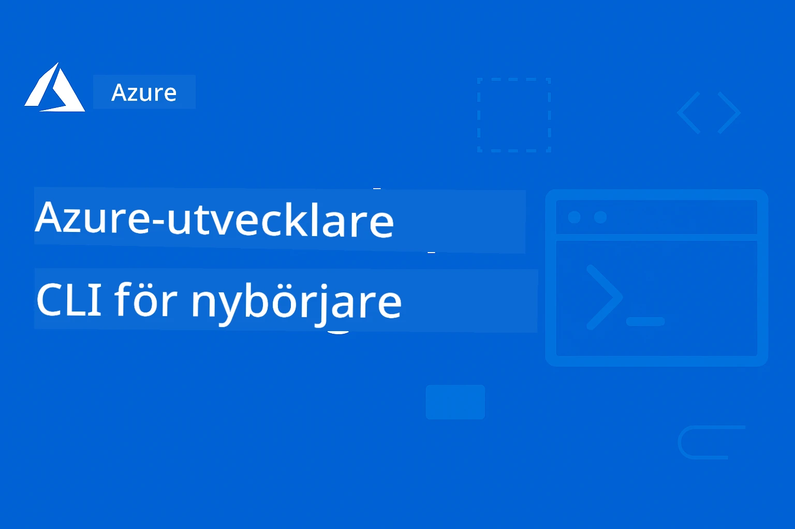

# AZD för nybörjare: En strukturerad läranderesa

 

[](https://github.com/microsoft/AZD-for-beginners)
[](https://GitHub.com/microsoft/azd-for-beginners/network/)
[](https://github.com/microsoft/AZD-for-beginners)

[](https://discord.com/invite/nkVh3dp)
[](https://discord.gg/nTYy5BXMWG)

---

### Automatiserade översättningar (alltid uppdaterade)

<!-- CO-OP TRANSLATOR LANGUAGES TABLE START -->
[Arabiska](../ar/README.md) | [Bengali](../bn/README.md) | [Bulgarska](../bg/README.md) | [Burmese (Myanmar)](../my/README.md) | [Kinesiska (Förenklad)](../zh-CN/README.md) | [Kinesiska (Traditionell, Hong Kong)](../zh-HK/README.md) | [Kinesiska (Traditionell, Macau)](../zh-MO/README.md) | [Kinesiska (Traditionell, Taiwan)](../zh-TW/README.md) | [Kroatiska](../hr/README.md) | [Tjeckiska](../cs/README.md) | [Danska](../da/README.md) | [Nederländska](../nl/README.md) | [Estniska](../et/README.md) | [Finska](../fi/README.md) | [Franska](../fr/README.md) | [Tyska](../de/README.md) | [Grekiska](../el/README.md) | [Hebreiska](../he/README.md) | [Hindi](../hi/README.md) | [Ungerska](../hu/README.md) | [Indonesiska](../id/README.md) | [Italienska](../it/README.md) | [Japanska](../ja/README.md) | [Kannada](../kn/README.md) | [Khmer](../km/README.md) | [Koreanska](../ko/README.md) | [Litauiska](../lt/README.md) | [Malajiska](../ms/README.md) | [Malayalam](../ml/README.md) | [Marathi](../mr/README.md) | [Nepalesiska](../ne/README.md) | [Nigeriansk Pidgin](../pcm/README.md) | [Norska](../no/README.md) | [Persiska (Farsi)](../fa/README.md) | [Polska](../pl/README.md) | [Portugisiska (Brasilien)](../pt-BR/README.md) | [Portugisiska (Portugal)](../pt-PT/README.md) | [Punjabi (Gurmukhi)](../pa/README.md) | [Rumänska](../ro/README.md) | [Ryska](../ru/README.md) | [Serbiska (Kyrilliska)](../sr/README.md) | [Slovakiska](../sk/README.md) | [Slovenska](../sl/README.md) | [Spanska](../es/README.md) | [Swahili](../sw/README.md) | [Svenska](./README.md) | [Tagalog (Filippinska)](../tl/README.md) | [Tamil](../ta/README.md) | [Telugu](../te/README.md) | [Thailändska](../th/README.md) | [Turkiska](../tr/README.md) | [Ukrainska](../uk/README.md) | [Urdu](../ur/README.md) | [Vietnamesiska](../vi/README.md)

> **Föredrar du att klona lokalt?**
>
> Detta repository innehåller över 50 språköversättningar vilket ökar nedladdningsstorleken avsevärt. För att klona utan översättningar, använd sparsamt utsnitt:
>
> **Bash / macOS / Linux:**
> ```bash
> git clone --filter=blob:none --sparse https://github.com/microsoft/AZD-for-beginners.git
> cd AZD-for-beginners
> git sparse-checkout set --no-cone '/*' '!translations' '!translated_images'
> ```
>
> **CMD (Windows):**
> ```cmd
> git clone --filter=blob:none --sparse https://github.com/microsoft/AZD-for-beginners.git
> cd AZD-for-beginners
> git sparse-checkout set --no-cone "/*" "!translations" "!translated_images"
> ```
>
> Detta ger dig allt du behöver för att slutföra kursen med en mycket snabbare nedladdning.
<!-- CO-OP TRANSLATOR LANGUAGES TABLE END -->

## 🆕 Vad är nytt i azd idag

> 📌 **Foundry GA-uppdatering (2026-11-09):** Den **`microsoft.foundry` 1.0-paketet är allmänt tillgängligt**, tillkännagavs den [5 november 2026](https://devblogs.microsoft.com/azure-sdk/microsoft-foundry-azure-developer-cli-ga/). Använd **`azd >= 1.37.0`** och installera den med `azd ext install microsoft.foundry`. Följ [handledningen för hosted-agent](docs/chapter-02-ai-development/microsoft-foundry-integration.md#hosted-agent-walkthrough-ga) för installation, lokal testning och distribution. Denna uppdatering baseras på publicerad vägledning, inte en live Azure-distribution; GA-paketet gör inte alla valfria funktioner, tillägg eller SDK generellt tillgängliga.

Azure Developer CLI stödjer många applikationstyper, inklusive webbappar, API:er och AI-agenter, genom stöd för värdar, mallar och tillägg.

Här är vad det betyder för dig:

- **Ett GA-paket för Foundry-utveckling.** `microsoft.foundry` installerar sju kärntillägg, inklusive agenter, projekt och Agent Inspector. Agentkod och distributionsinställningar hålls samman i `azure.yaml`.
- **Testa lokalt, sedan distribuera din kod.** Använd `azd ai agent init --deploy-mode code`, `azd provision` och `azd ai agent run` för att inspektera lokala förfrågningar och svar. Använd sedan `azd deploy` för en fjärruppbyggnad i Foundry, utan lokal containeruppbyggnad.
- **Mät kvalitet separat.** Installera **`azure.ai.evaluations`** för `azd ai eval generate`, `init` och `run start`; det ingår inte i paketet. Behåll granskade dataset och bedömningsmallar med din kod. Äldre projekt bör följa [migrationsguiden för utvärdering och optimering](docs/chapter-08-production/production-ai-practices.md#evaluation-migration-and-quality-checks).
- **Återanvänd konfiguration i CI/CD.** Efter en lyckad `azd up`, konfigurera en pipeline med `azd pipeline config`. Installera paketet på köraren och behåll genererade autentiserings- och miljöinställningar.
- **Smidigare vardagliga grunder.** Nyliga versioner har gjort `azd init` idempotent (säkert att köra om), gjort `azd auth login` att automatiskt rensa utgångna tokens och lagt till en vänlig `azd tool` första-run-setup-prompt.
- **Kärnarbetet har inte ändrats.** Oavsett om du distribuerar en todo-app, en mikrotjänst eller en multi-agent AI-lösning, är kommandona desamma.

> **Notera för Aspire-användare:** Microsoft refererar nu till produkten helt enkelt som **Aspire** (tidigare ".NET Aspire"). azd:s Aspire-stöd är oförändrat – det är bara namnet som uppdaterats.

Om du har använt azd tidigare är AI-stödet en naturlig förlängning – inte ett separat verktyg eller en avancerad bana. Om du börjar från början lär du dig ett arbetsflöde som fungerar för allt.

---

## 🚀 Vad är Azure Developer CLI (azd)?

**Azure Developer CLI (azd)** är ett utvecklarvänligt kommandoradsverktyg som gör det enkelt att distribuera applikationer till Azure. Istället för att manuellt skapa och koppla samman dussintals Azure-resurser kan du distribuera hela applikationer med ett enda kommando.

### Magin med `azd up`

```bash
# This single command does everything:
# ✅ Creates all Azure resources  
# ✅ Configures networking and security
# ✅ Builds your application code
# ✅ Deploys to Azure
# ✅ Gives you a working URL
azd up
```

Mallen tillhandahåller applikations- och infrastrukturkonfiguration. Framgångsrik distribution kräver fortfarande stöd för tjänster/modeller, tillräcklig kvot och behörigheter, korrekta indata och verifiering av den distribuerade applikationen. `azd up` gör inte automatiskt en mall säker, kompatibel eller produktionsklar.

---

## ❓ Azure Developer CLI vs Azure CLI: Vad är skillnaden?

Det här är den vanligaste frågan nybörjare ställer. Här är det enkla svaret:

| Funktion | **Azure CLI (`az`)** | **Azure Developer CLI (`azd`)** |
|---------|---------------------|--------------------------------|
| **Syfte** | Hantera individuella Azure-resurser | Distribuera kompletta applikationer |
| **Tänk** | Infrastrukturfokuserad | Applikationsfokuserad |
| **Exempel** | `az webapp create --name myapp...` | `azd up` |
| **Inlärningskurva** | Måste kunna Azure-tjänster | Behöver bara känna din app |
| **Bäst för** | DevOps, Infrastruktur | Utvecklare, Prototypning |

### Enkel analogi

- **Azure CLI** är som att ha alla verktyg för att bygga ett hus – hammare, sågar, spikar. Du kan bygga vad som helst, men du måste kunna konstruktion.
- **Azure Developer CLI** är som att anlita en entreprenör – du beskriver vad du vill ha, och de sköter byggandet.

### När ska man använda vad

| Scenario | Använd detta |
|----------|----------|
| "Jag vill snabbt distribuera min webbapp" | `azd up` |
| "Jag behöver bara skapa ett lagringskonto" | `az storage account create` |
| "Jag bygger en fullständig AI-applikation" | `azd init --template azure-search-openai-demo` |
| "Jag behöver felsöka en specifik Azure-resurs" | `az resource show` |
| "Jag vill distribuera till min konfigurerade produktionsmiljö" | Granska konfiguration, åtkomst, kostnad och driftsinställningar innan `azd up --environment production` |

### De fungerar tillsammans!

AZD och Azure CLI har separat autentisering och konfiguration. Använd `azd auth login` för AZD, och `az login` när ett hook- eller diagnostikkommando explicit behöver Azure CLI. Du kan använda båda:
```bash
# Deploy your app with AZD
azd up

# Then fine-tune specific resources with Azure CLI
az webapp config set --name myapp --always-on true
```

---

## 🌟 Hitta mallar i Awesome AZD

Börja inte från början! **Awesome AZD** är communityns samling av färdiga att distribuera mallar:

| Resurs | Beskrivning |
|----------|-------------|
| 🔗 [**Awesome AZD Gallery**](https://azure.github.io/awesome-azd/) | Bläddra bland 200+ mallar med ett klick för distribution |
| 🔗 [**Skicka in en mall**](https://github.com/Azure/awesome-azd/issues) | Bidra med din egen mall till communityn |
| 🔗 [**GitHub Repository**](https://github.com/Azure/awesome-azd) | Star och utforska koden |

### Populära AI-mallar från Awesome AZD

Välj en mall i sin egen tomma katalog; kommandona nedan är alternativ. Den efterföljande `.` initialiserar den katalogen.

```bash
# RAG Chat with Microsoft Foundry Models + AI Search
azd init --template azure-search-openai-demo .

# Quick AI Chat Application
azd init --template openai-chat-app-quickstart .

# AI Agents with Foundry Agents
azd init --template get-started-with-ai-agents .
```

---

## 🎯 Kom igång i 3 steg

Innan du börjar, se till att din dator är redo för mallen du vill distribuera:

**Windows:**
```powershell
.\validate-setup.ps1
```

**macOS / Linux:**
```bash
bash ./validate-setup.sh
```

Om någon nödvändig kontroll misslyckas, fixa det först och fortsätt sedan med snabbstarten.

### Steg 1: Installera AZD (2 minuter)

**Windows:**
```powershell
winget install microsoft.azd
```

**macOS:**
```bash
brew tap azure/azd && brew install azd
```

**Linux:**
```bash
curl -fsSL https://aka.ms/install-azd.sh | bash
```

### Steg 2: Autentisera för AZD

```bash
# Optional if you plan to use Azure CLI commands directly in this course
az login

# Required for AZD workflows
azd auth login
```

Om du är osäker på vilken du behöver, följ det fullständiga installationsflödet i [Installation & Setup](docs/chapter-01-foundation/installation.md#authentication-setup).

### Steg 3: Distribuera din första app

```bash
# Initialize from a template
azd init --template todo-nodejs-mongo .

# Deploy to Azure (creates everything!)
azd up
```

**🎉 Klart!** Din app är nu live på Azure.

### Rensa upp (glöm inte!)

```bash
# Remove all resources when done experimenting
azd down --force --purge
```

---

## 📚 Hur du använder denna kurs

Denna kurs är utformad för **progressivt lärande** – börja där du känner dig bekväm och jobba dig uppåt:

| Din erfarenhet | Börja här |
|-----------------|------------|
| **Helt ny på Azure** | [Kapitel 1: Grundläggande](#-chapter-1-foundation--quick-start) |
| **Kan Azure, ny på AZD** | [Kapitel 1: Grundläggande](#-chapter-1-foundation--quick-start) |
| **Vill distribuera AI-appar** | [Kapitel 2: AI-först utveckling](#-chapter-2-ai-first-development-recommended-for-ai-developers) |
| **Vill öva praktiskt** | [🎓 Interaktiv workshop](workshop/README.md) – 3-4 timmars guidad lab |
| **Behöver produktionsmönster** | [Kapitel 8: Produktion & Företag](#-chapter-8-production--enterprise-patterns) |

### Snabb installation

1. **Forka detta repository**: [](https://GitHub.com/microsoft/azd-for-beginners/fork)
2. **Klona det**: `git clone https://github.com/YOUR-USERNAME/azd-for-beginners.git`
3. **Få hjälp**: [Azure Discord Community](https://discord.com/invite/ByRwuEEgH4)

> **Föredrar du att klona lokalt?**

> Detta repository innehåller över 50 språköversättningar vilket avsevärt ökar nedladdningsstorleken. För att klona utan översättningar, använd sparse checkout:
> ```bash
> git clone --filter=blob:none --sparse https://github.com/microsoft/AZD-for-beginners.git
> cd AZD-for-beginners
> git sparse-checkout set --no-cone '/*' '!translations' '!translated_images'
> ```
> Detta ger dig allt du behöver för att slutföra kursen med en mycket snabbare nedladdning.


## Kursöversikt

Bemästra Azure Developer CLI (azd) genom strukturerade kapitel designade för progressivt lärande. **Särskilt fokus på AI-applikationsutplacering med Microsoft Foundry-integration.**

### Varför denna kurs är viktig för moderna utvecklare

Utvecklare som distribuerar AI-arbetsbelastningar behöver ofta vägledning om:
- Komplexa AI-arkitekturer med flera tjänster
- Bästa praxis för produktion av AI-utplaceringar  
- Integration och konfiguration av Azure AI-tjänster
- Kostnadsoptimering för AI-arbetsbelastningar
- Felsökning av AI-specifika utplaceringsproblem

### Lärandemål

Genom att slutföra denna strukturerade kurs kommer du att:
- **Bemästra AZD-grunderna**: Kärnkoncept, installation och konfiguration
- **Distribuera AI-applikationer**: Använd AZD med Microsoft Foundry-tjänster
- **Implementera Infrastruktur som kod**: Hantera Azure-resurser med Bicep-mallar
- **Felsöka utplaceringar**: Lösa vanliga problem och debugga fel
- **Optimera för produktion**: Säkerhet, skalning, övervakning och kostnadshantering
- **Bygga multi-agentlösningar**: Distribuera komplexa AI-arkitekturer

## Innan du börjar: Konton, åtkomst och antaganden

Innan du startar Kapitel 1, se till att följande är på plats. Installationsstegen senare i denna guide förutsätter att dessa grundläggande saker redan är ordnade.

- **En Azure-prenumeration**: Du kan använda en befintlig prenumeration från jobbet eller ditt eget konto, eller skapa en [gratis provperiod](https://aka.ms/azurefreetrial) för att komma igång.
- **Behörighet att skapa Azure-resurser**: För de flesta övningar bör du ha minst **Bidragsgivare**-åtkomst på målprenumerationen eller resursgruppen. Vissa kapitel förutsätter också att du kan skapa resursgrupper, hanterade identiteter och RBAC-tilldelningar.
- [**Ett GitHub-konto**](https://github.com): Det är användbart för att forka repositoryt, spåra dina egna ändringar och använda GitHub Codespaces för workshopen.
- **Förutsättningar för mallarnas körning**: Vissa mallar kräver lokala verktyg som Node.js, Python, Java eller Docker. Kör setups-valideraren innan du börjar så att du tidigt fårnga upp saknade verktyg.
- **Grundläggande terminalvana**: Du behöver inte vara expert, men du bör vara bekväm med att köra kommandon som `git clone`, `azd auth login` och `azd up`.

> **Arbetar du i en företagsprenumeration?**
> Om din Azure-miljö hanteras av en administratör, bekräfta i förväg att du kan distribuera resurser i prenumerationen eller resursgruppen du planerar att använda. Om inte, be om en sandbox-prenumeration eller Bidragsgivare-åtkomst innan du börjar.

> **Ny på Azure?**
> Börja med din egen Azure-prövoperiod eller pay-as-you-go-prenumeration på https://aka.ms/azurefreetrial så att du kan slutföra övningarna från början till slut utan att vänta på godkännanden på tenantnivå.

## 🗺️ Kurskarta: Snabb navigering efter kapitel

Varje kapitel har en dedikerad README med lärandemål, snabbinstruktioner och övningar:

| Kapitel | Ämne | Lektioner | Varaktighet | Svårighet |
|---------|-------|---------|----------|------------|
| **[Kap 1: Grundläggande](docs/chapter-01-foundation/README.md)** | Komma igång | [AZD Basics](docs/chapter-01-foundation/azd-basics.md) &#124; [Installation](docs/chapter-01-foundation/installation.md) &#124; [Första projektet](docs/chapter-01-foundation/first-project.md) | 30-45 min | ⭐ |
| **[Kap 2: AI-utveckling](docs/chapter-02-ai-development/README.md)** | AI-först-appar | [Foundry-integration](docs/chapter-02-ai-development/microsoft-foundry-integration.md) &#124; [AI-agenter](docs/chapter-02-ai-development/agents.md) &#124; [Modellutplacering](docs/chapter-02-ai-development/ai-model-deployment.md) &#124; [Workshop](docs/chapter-02-ai-development/ai-workshop-lab.md) | 1-2 tim | ⭐⭐ |
| **[Kap 3: Konfiguration](docs/chapter-03-configuration/README.md)** | Auth & Säkerhet | [Konfiguration](docs/chapter-03-configuration/configuration.md) &#124; [Autentisering & säkerhet](docs/chapter-03-configuration/authsecurity.md) | 45-60 min | ⭐⭐ |
| **[Kap 4: Infrastruktur](docs/chapter-04-infrastructure/README.md)** | IaC & Utplacering | [Utplaceringsguide](docs/chapter-04-infrastructure/deployment-guide.md) &#124; [Provisionering](docs/chapter-04-infrastructure/provisioning.md) | 1-1.5 tim | ⭐⭐⭐ |
| **[Kap 5: Multi-Agent](docs/chapter-05-multi-agent/README.md)** | AI-agentlösningar | [Detaljhandelsscenario](examples/retail-scenario.md) &#124; [Koordinationsmönster](docs/chapter-06-pre-deployment/coordination-patterns.md) | 2-3 tim | ⭐⭐⭐⭐ |
| **[Kap 6: Före utplacering](docs/chapter-06-pre-deployment/README.md)** | Planering & Validering | [Preflight-kontroller](docs/chapter-06-pre-deployment/preflight-checks.md) &#124; [Kapacitetsplanering](docs/chapter-06-pre-deployment/capacity-planning.md) &#124; [SKU-val](docs/chapter-06-pre-deployment/sku-selection.md) &#124; [App Insights](docs/chapter-06-pre-deployment/application-insights.md) | 1 tim | ⭐⭐ |
| **[Kap 7: Felsökning](docs/chapter-07-troubleshooting/README.md)** | Debugga & åtgärda | [Vanliga problem](docs/chapter-07-troubleshooting/common-issues.md) &#124; [Felsökning](docs/chapter-07-troubleshooting/debugging.md) &#124; [AI-frågor](docs/chapter-07-troubleshooting/ai-troubleshooting.md) | 1-1.5 tim | ⭐⭐ |
| **[Kap 8: Produktion](docs/chapter-08-production/README.md)** | Företagsmönster | [Produktionspraxis](docs/chapter-08-production/production-ai-practices.md) | 2-3 tim | ⭐⭐⭐⭐ |
| **[🎓 Workshop](workshop/README.md)** | Praktisk labb | [Introduktion](workshop/docs/instructions/0-Introduction.md) &#124; [Urval](workshop/docs/instructions/1-Select-AI-Template.md) &#124; [Validering](workshop/docs/instructions/2-Validate-AI-Template.md) &#124; [Nedmontering](workshop/docs/instructions/3-Deconstruct-AI-Template.md) &#124; [Konfiguration](workshop/docs/instructions/4-Configure-AI-Template.md) &#124; [Anpassning](workshop/docs/instructions/5-Customize-AI-Template.md) &#124; [Nedtagning](workshop/docs/instructions/6-Teardown-Infrastructure.md) &#124; [Sammanfattning](workshop/docs/instructions/7-Wrap-up.md) | 3-4 tim | ⭐⭐ |

**Total kurslängd:** ~10-14 timmar | **Färdighetsutveckling:** Nybörjare → Produktionsklar

---

## 📚 Lärandekapitel

*Välj din lärandestig baserat på erfarenhetsnivå och mål*

### 🚀 Kapitel 1: Grund & Snabbstart
**Förkunskaper**: Azure-prenumeration, grundläggande kunskaper i kommandorad  
**Varaktighet**: 30-45 minuter  
**Svårighet**: ⭐

#### Vad du kommer att lära dig
- Förstå Azure Developer CLI-grunderna
- Installera AZD på din plattform
- Din första framgångsrika utplacering

#### Läranderesurser
- **🎯 Börja här**: [Vad är Azure Developer CLI?](#-what-is-azure-developer-cli-azd)
- **📖 Teori**: [AZD Basics](docs/chapter-01-foundation/azd-basics.md) - Kärnkoncept och terminologi
- **⚙️ Installation**: [Installation & Setup](docs/chapter-01-foundation/installation.md) - Plattformsspecifika guider
- **🛠️ Praktiskt**: [Ditt första projekt](docs/chapter-01-foundation/first-project.md) - Steg-för-steg-guide
- **📋 Snabbreferens**: [Kommandolista](resources/cheat-sheet.md)

#### Praktiska övningar
```bash
# Quick installation check
azd version

# Deploy your first application
azd init --template todo-nodejs-mongo .
azd up
```

**💡 Kapitelresultat**: Distribuera framgångsrikt en enkel webbapplikation till Azure med AZD

**✅ Validering:**
```bash
# After completing Chapter 1, you should be able to:
azd version              # Shows installed version
azd init --template todo-nodejs-mongo  # Initializes project
azd up                  # Deploys to Azure
azd show                # Displays running app URL
# Application opens in browser and works
azd down --force --purge  # Cleans up resources
```

**📊 Tidsåtgång:** 30-45 minuter  
**📈 Färdighetsnivå efter:** Kan distribuera grundläggande applikationer självständigt

---

### 🤖 Kapitel 2: AI-Först Utveckling (Rekommenderas för AI-utvecklare)
**Förkunskaper**: Kapitel 1 slutfört  
**Varaktighet**: 1-2 timmar  
**Svårighet**: ⭐⭐

#### Vad du kommer att lära dig
- Microsoft Foundry-integration med AZD
- Distribuera AI-drivna applikationer
- Förstå AI-tjänstkonfigurationer

#### Läranderesurser
- **🎯 Börja här**: [Microsoft Foundry-integration](docs/chapter-02-ai-development/microsoft-foundry-integration.md)
- **🤖 AI-agenter**: [AI-agentguide](docs/chapter-02-ai-development/agents.md) - Distribuera intelligenta agenter med AZD
- **📖 Mönster**: [AI-modellutplacering](docs/chapter-02-ai-development/ai-model-deployment.md) - Distribuera och hantera AI-modeller
- **🛠️ Workshop**: [AI Workshop Lab](docs/chapter-02-ai-development/ai-workshop-lab.md) - Gör dina AI-lösningar AZD-klara
- **🎥 Interaktiv guide**: [Workshop-material](workshop/README.md) - Webbläsarbaserat lärande med MkDocs * DevContainer-miljö
- **📋 Mallar**: [Microsoft Foundry-mallar](#featured-microsoft-foundry-templates)
- **📝 Exempel**: [AZD-utplacerings-exempel](examples/README.md)

#### Praktiska övningar
```bash
# Deploy your first AI application
azd init --template azure-search-openai-demo .
azd up

# Try additional AI templates
azd init --template openai-chat-app-quickstart .
azd init --template agent-openai-python-prompty .
```

**💡 Kapitelresultat**: Distribuera och konfigurera en AI-driven chattapplikation med RAG-funktioner

**✅ Validering:**
```bash
# After Chapter 2, you should be able to:
azd init --template azure-search-openai-demo .
azd up
# Test the AI chat interface
# Ask questions and get AI-powered responses with sources
# Verify search integration works
azd monitor  # Check Application Insights shows telemetry
azd down --force --purge
```

**📊 Tidsåtgång:** 1-2 timmar  
**📈 Färdighetsnivå efter:** Kan distribuera AI-lärandeapplikationer och identifiera ytterligare krav för produktionsberedskap
**💰 Kostnadsmedvetenhet:** Förstå utvecklingskostnader på 80-150 USD/månad, produktionskostnader på 300-3500 USD/månad

#### 💰 Kostnadsaspekter för AI-utplaceringar

**Utvecklingsmiljö (Beräknat 80-150 USD/månad):**
- Microsoft Foundry-modeller (Pay-as-you-go): 0-50 USD/månad (baserat på tokenanvändning)
- AI Search (Grundnivå): 75 USD/månad
- Container Apps (Consumption): 0-20 USD/månad
- Lagring (Standard): 1-5 USD/månad

**Produktionsmiljö (Beräknat 300-3 500+ USD/månad):**
- Microsoft Foundry-modeller (PTU för konsekvent prestanda): 3 000+ USD/månad ELLER Pay-as-you-go med hög volym
- AI Search (Standardnivå): 250 USD/månad
- Container Apps (Dedikerade): 50-100 USD/månad
- Application Insights: 5-50 USD/månad
- Lagring (Premium): 10-50 USD/månad

**💡 Tips för kostnadsoptimering:**
- Kontrollera prissättningen för modellinferens och konto-specifika krediter; Azure OpenAI inkluderar inte en universell gratistokenmängd på 50 000 per månad
- Kör `azd down` för att ta bort resurser när de inte längre behövs, efter att ha granskat den valda miljön
- Börja med konsumtionsbaserad fakturering, uppgradera till PTU endast för produktion
- Använd `azd provision --preview` för att inspektera planerad infrastruktur och sedan prissätta de resulterande resurserna med Azure Pricing Calculator
- Aktivera autoskalning: betala endast för faktisk användning

**Kostnadsövervakning:**
```bash
# Inspect planned resources (this does not calculate prices)
azd provision --preview

# Monitor actual costs in Azure Portal
az consumption budget list --resource-group <your-rg>
```

---

### ⚙️ Kapitel 3: Konfiguration & Autentisering
**Förkunskaper**: Kapitel 1 slutfört  
**Varaktighet**: 45-60 minuter  
**Svårighet**: ⭐⭐

#### Vad du kommer att lära dig
- Miljökonfiguration och hantering
- Autentisering och säkerhetsbästa praxis
- Namngivning och organisering av resurser

#### Läranderesurser
- **📖 Konfiguration**: [Konfigurationsguide](docs/chapter-03-configuration/configuration.md) - Miljöinställningar
- **🔐 Säkerhet**: [Autentiseringsmönster och hanterad identitet](docs/chapter-03-configuration/authsecurity.md) - Autentiseringsmönster
- **📝 Exempel**: [Exempel på databasapp](examples/database-app/README.md) - AZD-databasexempel

#### Praktiska övningar
- Konfigurera flera miljöer (dev, staging, prod)
- Sätt upp autentisering med hanterad identitet
- Implementera miljöspecifika konfigurationer

**💡 Kapitelresultat**: Hantera flera miljöer med korrekt autentisering och säkerhet

---

### 🏗️ Kapitel 4: Infrastruktur som kod & Utplacering
**Förkunskaper**: Kapitel 1-3 slutförda  
**Varaktighet**: 1-1.5 timmar  
**Svårighet**: ⭐⭐⭐

#### Vad du kommer att lära dig
- Avancerade utplaceringsmönster
- Infrastruktur som kod med Bicep
- Strategier för resursprovisionering

#### Läranderesurser
- **📖 Utplacering**: [Utplaceringsguide](docs/chapter-04-infrastructure/deployment-guide.md) - Kompletta arbetsflöden
- **🏗️ Provisionering**: [Provisionera resurser](docs/chapter-04-infrastructure/provisioning.md) - Azure-resurshantering
- **📝 Exempel**: [Container App-exempel](../../examples/container-app) - Containeriserade utplaceringar

#### Praktiska övningar
- Skapa egna Bicep-mallar
- Distribuera multi-tjänst-applikationer
- Implementera blue-green-utplaceringsstrategier

**💡 Kapitelresultat**: Distribuera komplexa multi-tjänst-applikationer med egna infrastrukturen-mallar

---

### 🎯 Kapitel 5: Multi-Agent AI-lösningar (Avancerat)
**Förkunskaper**: Kapitel 1-2 slutförda  
**Varaktighet**: 2-3 timmar  
**Svårighet**: ⭐⭐⭐⭐

#### Vad du kommer att lära dig
- Multi-agent arkitekturmönster
- Agentorkestrering och koordinering
- Produktionsklara AI-utplaceringar

#### Läranderesurser
- **🤖 Utvald design**: [Retail Multi-Agent Solution](examples/retail-scenario.md) - Arkitekturplan, inte en komplett applikation
- **🛠️ ARM-mallar**: [ARM Template Package](../../examples/retail-multiagent-arm-template) - Infrastrukturstomme; granska förutsättningar och saknade applikationskomponenter
- **📖 Arkitektur**: [Multi-agent coordination patterns](docs/chapter-06-pre-deployment/coordination-patterns.md) - Mönster

#### Praktiska övningar
```bash
# Inspect the retail infrastructure scaffold before choosing to deploy it
cd examples/retail-multiagent-arm-template
cat README.md

# After an intentional deployment, inspect infrastructure state
az deployment group show --resource-group <rg-name> --name <deployment-name>
```

**💡 Kapitelresultat**: Förstå multi-agent-design och identifiera implementerings-, validerings- och driftarbete som krävs utöver en infrastrukturstomme

---

### 🔍 Kapitel 6: Validering och planering före distribution
**Förutsättningar**: Kapitel 4 slutfört  
**Varaktighet**: 1 timme  
**Komplexitet**: ⭐⭐

#### Vad du kommer att lära dig
- Kapacitetsplanering och resursvalidering
- Strategier för val av SKU
- Kontroll före genomförande och automatisering

#### Läromedel
- **📊 Planering**: [Capacity Planning](docs/chapter-06-pre-deployment/capacity-planning.md) - Resursvalidering
- **💰 Urval**: [SKU Selection](docs/chapter-06-pre-deployment/sku-selection.md) - Kostnadseffektiva val
- **✅ Validering**: [Pre-flight Checks](docs/chapter-06-pre-deployment/preflight-checks.md) - Automatiserade skript

#### Praktiska övningar
- Kör valideringsskript för kapacitet
- Optimera SKU-val för kostnad
- Implementera automatiserade kontroller före distribution

**💡 Kapitelresultat**: Validera och optimera distributioner före utförande

---

### 🚨 Kapitel 7: Felsökning och debugging
**Förutsättningar**: Valfritt distributionskapitel slutfört  
**Varaktighet**: 1-1.5 timmar  
**Komplexitet**: ⭐⭐

#### Vad du kommer att lära dig
- Systematiska felsökningsmetoder
- Vanliga problem och lösningar
- AI-specifik felsökning

#### Läromedel
- **🔧 Vanliga problem**: [Common Issues](docs/chapter-07-troubleshooting/common-issues.md) - Vanliga frågor och lösningar
- **🕵️ Felsökning**: [Debugging Guide](docs/chapter-07-troubleshooting/debugging.md) - Steg-för-steg-strategier
- **🤖 AI-problem**: [AI-Specific Troubleshooting](docs/chapter-07-troubleshooting/ai-troubleshooting.md) - AI-tjänsteproblem

#### Praktiska övningar
- Diagnostisera distributionsfel
- Lös autentiseringsproblem
- Felsök AI-tjänstekonnektivitet

**💡 Kapitelresultat**: Självständigt diagnostisera och lösa vanliga distributionsproblem

---

### 🏢 Kapitel 8: Produktions- och företagsmönster
**Förutsättningar**: Kapitel 1-4 slutförda  
**Varaktighet**: 2-3 timmar  
**Komplexitet**: ⭐⭐⭐⭐

#### Vad du kommer att lära dig
- Produktionsdistributionsstrategier
- Säkerhetsmönster för företag
- Övervakning och kostnadsoptimering

#### Läromedel
- **🏭 Produktion**: [Production AI Best Practices](docs/chapter-08-production/production-ai-practices.md) - Företagsmönster
- **📝 Exempel**: [Microservices Example](../../examples/microservices) - Komplex arkitektur
- **📊 Övervakning**: [Application Insights integration](docs/chapter-06-pre-deployment/application-insights.md) - Övervakning

#### Praktiska övningar
- Implementera företagsmässiga säkerhetsmönster
- Sätt upp omfattande övervakning
- Distribuera i produktion med korrekt styrning

**💡 Kapitelresultat**: Distribuera företagsredo applikationer med full produktionskapacitet

---

## 🎓 Workshopöversikt: Praktisk lärandeupplevelse

> **⚠️ WORKSHOPSTATUS: Aktiv utveckling**  
> Workshopmaterialet utvecklas och förfinas för närvarande. Kärnmoduler är funktionella men vissa avancerade delar är ofullständiga. Vi arbetar aktivt för att slutföra allt innehåll. [Följ framstegen →](workshop/README.md)

### Interaktiva workshopmaterial
**Omfattande praktisk inlärning med webbläsarbaserade verktyg och guidade övningar**

Våra workshopmaterial erbjuder en strukturerad, interaktiv lärandeupplevelse som kompletterar det kapitelbaserade kursinnehållet ovan. Workshopen är utformad för både självstyrd inlärning och instruktörsledda sessioner.

#### 🛠️ Workshopfunktioner
- **Webbläsarbaserat gränssnitt**: Komplett MkDocs-driven workshop med sökfunktion, kopiering och temafunktioner
- **GitHub Codespaces-integration**: Enklicksinställning av utvecklingsmiljö
- **Strukturerad lärandebana**: 8-moduls guidade övningar (totalt 3-4 timmar)
- **Progressiv metodik**: Introduktion → Urval → Validering → Nedbrytning → Konfiguration → Anpassning → Nedmontering → Sammanfattning
- **Interaktiv DevContainer-miljö**: Förkonfigurerade verktyg och beroenden

#### 📚 Struktur för workshopmoduler
Workshopen följer en **progressiv metodik i 8 moduler** som tar dig från upptäckt till mästerskap i distribution:

| Modul | Ämne | Vad du kommer att göra | Varaktighet |
|--------|-------|----------------|----------|
| **0. Introduktion** | Workshopöversikt | Förstå lärandemål, förutsättningar och workshopstruktur | 15 min |
| **1. Urval** | Mallupptäckt | Utforska AZD-mallar och välj rätt AI-mall för din scenario | 20 min |
| **2. Validering** | Distribuera & verifiera | Distribuera mallen med `azd up` och validera att infrastrukturen fungerar | 30 min |
| **3. Nedbrytning** | Förstå struktur | Använd GitHub Copilot för att utforska mallarkitektur, Bicep-filer och kodorganisation | 30 min |
| **4. Konfiguration** | azure.yaml på djupet | Bemästra `azure.yaml` konfiguration, livscykelhakar och miljövariabler | 30 min |
| **5. Anpassning** | Gör det ditt | Aktivera AI-sök, spårning, utvärdering och anpassa för ditt scenario | 45 min |
| **6. Nedmontering** | Rensa upp | Avprovisionera resurser säkert med `azd down --purge` | 15 min |
| **7. Sammanfattning** | Nästa steg | Granska prestationer, nyckelkoncept och fortsätt din läranderesa | 15 min |

**Workshopflöde:**
```
Introduction → Selection → Validation → Deconstruction → Configuration → Customization → Teardown → Wrap-up
     ↓            ↓           ↓              ↓               ↓              ↓            ↓           ↓
  Overview    Find the     Deploy &      Explore        Master         Customize     Clean up    Review &
             right        verify        code &        azure.yaml      for your      resources   next steps
             template                   structure                     scenario
```

#### 🚀 Kom igång med workshopen
```bash
# Option 1: GitHub Codespaces (Recommended)
# Click "Code" → "Create codespace on main" in the repository

# Option 2: Local Development
git clone https://github.com/microsoft/azd-for-beginners.git
cd azd-for-beginners/workshop
# Follow the setup instructions in workshop/README.md
```

#### 🎯 Workshopens lärandemål
Genom att slutföra workshopen kommer deltagarna att:
- **Distribuera produktions-AI-applikationer**: Använd AZD med Microsoft Foundry-tjänster
- **Bemästra multi-agent-arkitekturer**: Implementera koordinerade AI-agentlösningar
- **Implementera säkerhetsbästa praxis**: Konfigurera autentisering och åtkomstkontroll
- **Optimera för skalning**: Designa kostnadseffektiva och högpresterande distributioner
- **Felsök distributioner**: Lös vanliga problem självständigt

#### 📖 Workshopresurser
- **🎥 Interaktiv guide**: [Workshop Materials](workshop/README.md) - Webbläsarbaserad lärandemiljö
- **📋 Instruktioner modul för modul**:
  - [0. Introduktion](workshop/docs/instructions/0-Introduction.md) - Workshopöversikt och mål
  - [1. Urval](workshop/docs/instructions/1-Select-AI-Template.md) - Hitta och välj AI-mallar
  - [2. Validering](workshop/docs/instructions/2-Validate-AI-Template.md) - Distribuera och verifiera mallar
  - [3. Nedbrytning](workshop/docs/instructions/3-Deconstruct-AI-Template.md) - Utforska mallarkitektur
  - [4. Konfiguration](workshop/docs/instructions/4-Configure-AI-Template.md) - Bemästra azure.yaml
  - [5. Anpassning](workshop/docs/instructions/5-Customize-AI-Template.md) - Anpassa för ditt scenario
  - [6. Nedmontering](workshop/docs/instructions/6-Teardown-Infrastructure.md) - Rensa upp resurser
  - [7. Sammanfattning](workshop/docs/instructions/7-Wrap-up.md) - Granska och nästa steg
- **🛠️ AI Workshop Lab**: [AI Workshop Lab](docs/chapter-02-ai-development/ai-workshop-lab.md) - AI-fokuserade övningar
- **💡 Snabbstart**: [Workshop Setup Guide](workshop/README.md#browser-based-guide) - Miljökodfiguration

**Perfekt för**: Företagsutbildningar, universitetskurser, självstudier och utvecklarbootcamps.

---

## 📖 Djupdykning: AZD-funktioner

Utöver grunderna erbjuder AZD kraftfulla funktioner för produktionsdistributioner:

- **Mallbaserade distributioner** - Använd förbyggda mallar för vanliga applikationsmönster
- **Infrastructure as Code** - Hantera Azure-resurser med Bicep eller Terraform  
- **Integrerade arbetsflöden** - Sömlös provisionering, distribution och övervakning av applikationer
- **Utvecklarvänligt** - Optimerat för utvecklarproduktivitet och användarupplevelse

### **AZD + Microsoft Foundry: Perfekt för AI-distributioner**

**Varför AZD för AI-lösningar?** AZD löser de största utmaningarna AI-utvecklare möter:

- **AI-redo mallar** - Förkonfigurerade mallar för Microsoft Foundry-modeller, Azure AI-tjänster och ML-arbetsbelastningar
- **Säkra AI-distributioner** - Inbyggda säkerhetsmönster för AI-tjänster, API-nycklar och model endpoints  
- **Produktions-AI-mönster** - Bästa praxis för skalbara och kostnadseffektiva AI-applikationsdistributioner
- **End-to-end AI-arbetsflöden** - Från modellutveckling till produktionsdistribution med korrekt övervakning
- **Kostnadsoptimering** - Smart resursallokering och skalningsstrategier för AI-arbetsbelastningar
- **Microsoft Foundry-integration** - Sömlös anslutning till Microsoft Foundrys modulkatalog och endpoints

---

## 🎯 Mall- och exempelbibliotek

### Utvalda: Microsoft Foundry-mallar
**Börja här om du distribuerar AI-applikationer!**

> **Notera:** Dessa mallar visar olika AI-mönster. Vissa är externa Azure-exempel, andra lokala implementationer.

| Mall | Kapitel | Komplexitet | Tjänster | Typ |
|----------|---------|------------|----------|------|
| [**Kom igång med AI-chatt**](https://github.com/Azure-Samples/get-started-with-ai-chat) | Kapitel 2 | ⭐⭐ | AzureOpenAI + Azure AI Model Inference API + Azure AI Search + Azure Container Apps + Application Insights | Extern |
| [**Kom igång med AI-agenter**](https://github.com/Azure-Samples/get-started-with-ai-agents) | Kapitel 2 | ⭐⭐ | Foundry Agents + AzureOpenAI + Azure AI Search + Azure Container Apps + Application Insights| Extern |
| [**Azure Search + OpenAI Demo**](https://github.com/Azure-Samples/azure-search-openai-demo) | Kapitel 2 | ⭐⭐ | Azure OpenAI + Azure AI Search + Container Apps (standard) + Storage | Extern |
| [**OpenAI Chat App Snabbstart**](https://github.com/Azure-Samples/openai-chat-app-quickstart) | Kapitel 2 | ⭐ | AzureOpenAI + Container Apps + Application Insights | Extern |
| [**Agent OpenAI Python Prompty**](https://github.com/Azure-Samples/agent-openai-python-prompty) | Kapitel 5 | ⭐⭐⭐ | AzureOpenAI + Azure Functions + Prompty | Extern |
| [**Contoso Chat RAG**](https://github.com/Azure-Samples/contoso-chat) | Kapitel 8 | ⭐⭐⭐⭐ | AzureOpenAI + AI Search + Cosmos DB + Container Apps | Extern |
| [**Retail Multi-Agent Solution**](examples/retail-scenario.md) | Kapitel 5 | ⭐⭐⭐⭐ | Föreslagen arkitektur och infrastrukturstomme; applikationsimplementering krävs | **Lokal plan** |

### Utvalda: Kompletta lärandescenarier
**Produktionsredo applikationsmallar kopplade till lärandekapitel**

| Mall | Lärandekapitel | Komplexitet | Nyckellärande |
|----------|------------------|------------|--------------|
| [**openai-chat-app-quickstart**](https://github.com/Azure-Samples/openai-chat-app-quickstart) | Kapitel 2 | ⭐ | Grundläggande AI-distributionsmönster |
| [**azure-search-openai-demo**](https://github.com/Azure-Samples/azure-search-openai-demo) | Kapitel 2 | ⭐⭐ | RAG-implementering med Azure AI Search |
| [**get-started-with-ai-agents**](https://github.com/Azure-Samples/get-started-with-ai-agents) | Kapitel 2 | ⭐⭐ | Agentstödd chatt och scenario-specifika utvärderingstester |
| [**agent-openai-python-prompty**](https://github.com/Azure-Samples/agent-openai-python-prompty) | Kapitel 5 | ⭐⭐⭐ | Agentramverk och funktionsanrop |
| [**contoso-chat**](https://github.com/Azure-Samples/contoso-chat) | Kapitel 8 | ⭐⭐⭐ | Företagsmässig AI-orkestrering |
| [**retail-multi-agent-solution**](examples/retail-scenario.md) | Kapitel 5 | ⭐⭐⭐⭐ | Multi-agent-arkitektur med kund- och lageragenter |

### Lärande efter exempeltyp

> **📌 Lokala vs. externa exempel:**  
> **Lokala exempel** (i detta repo) = Inspektera examples README för implementeringsstatus och förutsättningar
> **Externa exempel** (Azure Samples) = Klona från länkade repositorys

#### Lokala exempel (redo att använda)
- [**Retail Multi-Agent Solution**](examples/retail-scenario.md) - Arkitekturplan med ARM-infrastrukturstomme
  - Föreslagna roller för kund- och lageragenter
  - Övervakning, utvärdering och applikationskod måste implementeras och verifieras
  - Att bara provisionera resurser ger inte en fungerande detaljhandelsapp

#### Lokala exempel - Container-applikationer (Kapitel 2-5)
**Omfattande exempel på containerdistributioner i detta repository:**
- [**Exempel på Container-appar**](examples/container-app/README.md) - Komplett guide till containeriserade distributioner
  - [Enkel Flask API](../../examples/container-app/simple-flask-api) - Grundläggande REST API med scale-to-zero
  - [Mikrotjänstarkitektur](../../examples/container-app/microservices) - Två-tjänsters lärandeexempel; produktionserfarenhet kräver mer arbete
  - Snabbstart, produktion och avancerade distributionsmönster
  - Riktlinjer för övervakning, säkerhet och kostnadsoptimering

#### Externa exempel - Enkla applikationer (Kapitel 1-2)
**Klona dessa Azure Samples repositoryn för att komma igång:**
- [Enkel webbapp - Node.js + MongoDB](https://github.com/Azure-Samples/todo-nodejs-mongo) - Grundläggande distributionsmönster
- [Statisk webbplats - React SPA](https://github.com/Azure-Samples/todo-csharp-sql-swa-func) - Distribution av statiskt innehåll
- [Container App - Python Flask](https://github.com/Azure-Samples/container-apps-store-api-microservice) - Distribuering av REST API

#### Externa exempel - Databasintegration (Kapitel 3-4)  
- [Database App - C# + SQL](https://github.com/Azure-Samples/todo-csharp-sql) - Databasanslutningsmönster
- [Functions + Cosmos DB](https://github.com/Azure-Samples/todo-python-mongo-swa-func) - Serverlös dataflöde

#### Externa exempel - Avancerade mönster (Kapitel 4-8)
- [Java Microservices](https://github.com/Azure-Samples/java-microservices-aca-lab) - Arkitekturer med flera tjänster
- [Container Apps Jobs](https://github.com/Azure-Samples/container-apps-jobs) - Bakgrundsprocesser  
- [Enterprise ML Pipeline](https://github.com/Azure/mlops-v2) - MLOps referensmönster; inte en direkt AZD-mall

### Externa mall-samlingar
- [**Officiella AZD-mallgalleriet**](https://azure.github.io/awesome-azd/) - Handplockad samling av officiella och community-mallar
- [**Azure Developer CLI-mallar**](https://learn.microsoft.com/en-us/azure/developer/azure-developer-cli/azd-templates) - Microsoft Learn mall-dokumentation
- [**Exempelkatalog**](examples/README.md) - Lokala inlärningsexempel med detaljerade förklaringar

---

## 📚 Inlärningsresurser & Referenser

### Snabba referenser
- [**Kommandofusklista**](resources/cheat-sheet.md) - Viktiga azd-kommandon organiserade per kapitel
- [**Ordlista**](resources/glossary.md) - Terminologi för Azure och azd  
- [**FAQ**](resources/faq.md) - Vanliga frågor organiserade per inlärningskapitel
- [**Studieguide**](resources/study-guide.md) - Omfattande övningar

### Praktiska workshops
- [**AI Workshop Lab**](docs/chapter-02-ai-development/ai-workshop-lab.md) - Gör dina AI-lösningar AZD-distribuerbara (2-3 timmar)
- [**Interaktiv workshop**](workshop/README.md) - Guidade övningar i 8 moduler med MkDocs och GitHub Codespaces
  - Följer: Introduktion → Val → Validering → Nedbrytning → Konfiguration → Anpassning → Avslut → Sammanfattning

### Externa inlärningsresurser
- [Azure Developer CLI-dokumentation](https://learn.microsoft.com/en-us/azure/developer/azure-developer-cli/)
- [Azure Architecture Center](https://learn.microsoft.com/en-us/azure/architecture/)
- [Azure Pricing Calculator](https://azure.microsoft.com/pricing/calculator/)
- [Azure Status](https://status.azure.com/)

### AI-agentfärdigheter för din editor
- [**Microsoft Azure Skills på skills.sh**](https://skills.sh/microsoft/github-copilot-for-azure) - 37 öppna agentfärdigheter för Azure AI, Foundry, distribution, diagnostik, kostnadsoptimering och mer. Installera dem i GitHub Copilot, Cursor, Claude Code eller någon stödd agent:
  ```bash
  npx skills add microsoft/github-copilot-for-azure
  ```

---

## 🔧 Snabb felsökningsguide

**Vanliga problem nybörjare stöter på och omedelbara lösningar:**

<details>
<summary><strong>❌ "azd: command not found"</strong></summary>

```bash
# Install AZD first
# Windows (PowerShell):
winget install microsoft.azd

# macOS:
brew tap azure/azd && brew install azd

# Linux:
curl -fsSL https://aka.ms/install-azd.sh | bash

# Verify installation
azd version
```
</details>

<details>
<summary><strong>❌ "No subscription found" or "Subscription not set"</strong></summary>

```bash
# List available subscriptions
az account list --output table

# Set default subscription
az account set --subscription "<subscription-id-or-name>"

# Set for AZD environment
azd env set AZURE_SUBSCRIPTION_ID "<subscription-id>"

# Verify
az account show
```
</details>

<details>
<summary><strong>❌ "InsufficientQuota" or "Quota exceeded"</strong></summary>

```bash
# Try different Azure region
azd env set AZURE_LOCATION "westus2"
azd up

# Or use smaller SKUs in development
# Edit infra/main.parameters.json:
{
  "sku": "B1"  // Instead of "P1V2"
}
```
</details>

<details>
<summary><strong>❌ "azd up" fails halfway through</strong></summary>

```bash
# Option 1: Inspect the error and retry after correcting its cause
azd show
azd up --debug

# Option 2: Just fix infrastructure
azd provision

# Option 3: Check detailed status
azd show

# Option 4: Check logs in Azure Monitor
azd monitor --logs
```
</details>

<details>
<summary><strong>❌ "Authentication failed" or "Token expired"</strong></summary>

```bash
# Re-authenticate for AZD
azd auth logout
azd auth login

# Optional: refresh Azure CLI too if you are running az commands
az logout
az login

# Verify authentication
az account show
```
</details>

<details>
<summary><strong>❌ "Resource already exists" or naming conflicts</strong></summary>

```bash
# Inspect the conflicting resource before changing or deleting anything.
# For an isolated new deployment, create a separate environment:
azd env new dev-v2
azd up
```
</details>

<details>
<summary><strong>❌ Mallutplacering tar för lång tid</strong></summary>

**Normala väntetider:**
- Enkel webbapp: 5-10 minuter
- App med databas: 10-15 minuter
- AI-applikationer: 15-25 minuter (OpenAI-provisionering går långsamt)

```bash
# Check progress
azd show

# If stuck >30 minutes, check Azure Portal:
azd monitor --overview
# Look for failed deployments
```
</details>

<details>
<summary><strong>❌ "Permission denied" or "Forbidden"</strong></summary>

```bash
# Check your Azure role
az role assignment list --assignee $(az account show --query user.name -o tsv)

# You need at least "Contributor" role
# Ask your Azure admin to grant:
# - Contributor (for resources)
# - User Access Administrator (for role assignments)
```
</details>

<details>
<summary><strong>❌ Kan inte hitta URL för distribuerad applikation</strong></summary>

```bash
# Show all service endpoints
azd show

# Or open Azure Portal
azd monitor

# Check specific service
azd env get-values
# Look for *_URL variables
```
</details>

### 📚 Fullständiga felsökningsresurser

- **Guide för vanliga problem:** [Detaljerade lösningar](docs/chapter-07-troubleshooting/common-issues.md)
- **AI-specifika problem:** [AI-felsökning](docs/chapter-07-troubleshooting/ai-troubleshooting.md)
- **Felsökningsguide:** [Steg-för-steg felsökning](docs/chapter-07-troubleshooting/debugging.md)
- **Få hjälp:** [Azure Discord](https://discord.gg/microsoft-azure) #azure-developer-cli

---

## 🎓 Slutförande av kurs & Certifiering

### Spårning av framsteg
Följ din inlärningsprogress genom varje kapitel:

- [ ] **Kapitel 1**: Grund & Snabbstart ✅
- [ ] **Kapitel 2**: AI-First Utveckling ✅  
- [ ] **Kapitel 3**: Konfiguration & Autentisering ✅
- [ ] **Kapitel 4**: Infrastruktur som kod & Distributering ✅
- [ ] **Kapitel 5**: Multi-Agent AI-lösningar ✅
- [ ] **Kapitel 6**: Validering & Planering före distribution ✅
- [ ] **Kapitel 7**: Felsökning & Debugging ✅
- [ ] **Kapitel 8**: Produktion & Företagsmönster ✅

### Verifiering av lärande
Efter att ha slutfört varje kapitel, verifiera dina kunskaper genom att:
1. **Praktisk övning**: Slutför kapitlets praktiska distribution
2. **Kunskapskontroll**: Granska FAQ-sektionen för ditt kapitel
3. **Communitydiskussion**: Dela dina erfarenheter i Azure Discord
4. **Nästa kapitel**: Gå vidare till nästa komplexitetsnivå

### Fördelar med kursavslutning
Efter att ha slutfört alla kapitel, kommer du att ha:
- **Produktionserfarenhet**: Distribuerade riktiga AI-applikationer till Azure
- **Professionella färdigheter**: Distribution redo för företag  
- **Community-erkenning**: Aktiv medlem i Azure utvecklargemenskap
- **Karriärutveckling**: Eftertraktad AZD- och AI-distributionskompetens

---

## 🤝 Community & Support

### Få hjälp & support
- **Tekniska problem**: [Rapportera buggar och begär funktioner](https://github.com/microsoft/azd-for-beginners/issues)
- **Frågor om inlärning**: [Microsoft Azure Discord Community](https://discord.gg/microsoft-azure) och [](https://discord.gg/nTYy5BXMWG)
- **AI-specifik hjälp**: Gå med i [](https://discord.gg/nTYy5BXMWG)
- **Dokumentation**: [Officiell Azure Developer CLI-dokumentation](https://learn.microsoft.com/en-us/azure/developer/azure-developer-cli/)

### Communityinsikter från Microsoft Foundry Discord

**Ämnen som diskuteras av communityn:**
- Distribueringar med flera tjänster, hantering av autentiseringsuppgifter och produktionsberedskap
- AI-specifika mallar, felsökningsguider och bästa praxis

**Gå med i vårt community för att:**
- Dela dina erfarenheter med AZD + AI och få hjälp
- Få tillgång till tidiga förhandsvisningar av nya AI-mallar
- Bidra till bästa praxis för AI-distribution
- Påverka framtida AI + AZD-funktionsutveckling

### Bidra till kursen
Vi välkomnar bidrag! Läs gärna vår [Bidragsguide](CONTRIBUTING.md) för detaljer om:
- **Förbättring av innehåll**: Förbättra befintliga kapitel och exempel
- **Nya exempel**: Lägg till verkliga scenarier och mallar  
- **Översättning**: Hjälp till att upprätthålla flerspråkigt stöd
- **Buggrapporter**: Förbättra noggrannhet och tydlighet
- **Community-standarder**: Följ våra inkluderande community-riktlinjer

---

## 📄 Kursinformation

### Licens
Detta projekt är licensierat under MIT-licensen - se [LICENSE](../../LICENSE) för detaljer.

### Relaterade Microsoft-inlärningsresurser

Vårt team producerar andra omfattande inlärningskurser:

<!-- CO-OP TRANSLATOR OTHER COURSES START -->
### LangChain
[](https://aka.ms/langchain4j-for-beginners)
[](https://aka.ms/langchainjs-for-beginners?WT.mc_id=m365-94501-dwahlin)
[](https://github.com/microsoft/langchain-for-beginners?WT.mc_id=m365-94501-dwahlin)
---

### Azure / Edge / MCP / Agenter
[](https://github.com/microsoft/AZD-for-beginners?WT.mc_id=academic-105485-koreyst)
[](https://github.com/microsoft/edgeai-for-beginners?WT.mc_id=academic-105485-koreyst)
[](https://github.com/microsoft/mcp-for-beginners?WT.mc_id=academic-105485-koreyst)
[](https://github.com/microsoft/ai-agents-for-beginners?WT.mc_id=academic-105485-koreyst)

---
 
### Generativ AI-serie
[](https://github.com/microsoft/generative-ai-for-beginners?WT.mc_id=academic-105485-koreyst)
[-9333EA?style=for-the-badge&labelColor=E5E7EB&color=9333EA)](https://github.com/microsoft/Generative-AI-for-beginners-dotnet?WT.mc_id=academic-105485-koreyst)
[-C084FC?style=for-the-badge&labelColor=E5E7EB&color=C084FC)](https://github.com/microsoft/generative-ai-for-beginners-java?WT.mc_id=academic-105485-koreyst)
[-E879F9?style=for-the-badge&labelColor=E5E7EB&color=E879F9)](https://github.com/microsoft/generative-ai-with-javascript?WT.mc_id=academic-105485-koreyst)

---
 
### Kärninlärning
[](https://aka.ms/ml-beginners?WT.mc_id=academic-105485-koreyst)
[](https://aka.ms/datascience-beginners?WT.mc_id=academic-105485-koreyst)
[](https://aka.ms/ai-beginners?WT.mc_id=academic-105485-koreyst)
[](https://github.com/microsoft/Security-101?WT.mc_id=academic-96948-sayoung)
[](https://aka.ms/webdev-beginners?WT.mc_id=academic-105485-koreyst)
[](https://aka.ms/iot-beginners?WT.mc_id=academic-105485-koreyst)
[](https://github.com/microsoft/xr-development-for-beginners?WT.mc_id=academic-105485-koreyst)

---
 
### Copilot-serie
[](https://aka.ms/GitHubCopilotAI?WT.mc_id=academic-105485-koreyst)
[](https://github.com/microsoft/mastering-github-copilot-for-dotnet-csharp-developers?WT.mc_id=academic-105485-koreyst)
[](https://github.com/microsoft/CopilotAdventures?WT.mc_id=academic-105485-koreyst)
<!-- CO-OP TRANSLATOR OTHER COURSES END -->

---

## 🗺️ Kursnavigering

**🚀 Redo att börja lära?**

**Nybörjare**: Börja med [Kapitel 1: Grund & Snabbstart](#-chapter-1-foundation--quick-start)  
**AI-utvecklare**: Hoppa till [Kapitel 2: AI-First Utveckling](#-chapter-2-ai-first-development-recommended-for-ai-developers)  
**Erfarna utvecklare**: Börja med [Kapitel 3: Konfiguration & Autentisering](#️-chapter-3-configuration--authentication)

**Nästa steg**: [Börja Kapitel 1 - AZD-grunder](docs/chapter-01-foundation/azd-basics.md) →

---

<!-- CO-OP TRANSLATOR DISCLAIMER START -->
**Ansvarsfriskrivning**:
Detta dokument har översatts med hjälp av AI-översättningstjänsten [Co-op Translator](https://github.com/Azure/co-op-translator). Även om vi strävar efter noggrannhet, var vänlig notera att automatiska översättningar kan innehålla fel eller brister. Det ursprungliga dokumentet på dess modersmål bör betraktas som den auktoritativa källan. För kritisk information rekommenderas professionell mänsklig översättning. Vi ansvarar inte för några missförstånd eller feltolkningar som uppstår till följd av användningen av denna översättning.
<!-- CO-OP TRANSLATOR DISCLAIMER END -->