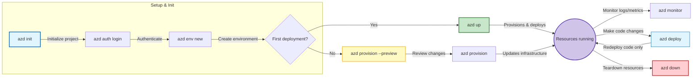
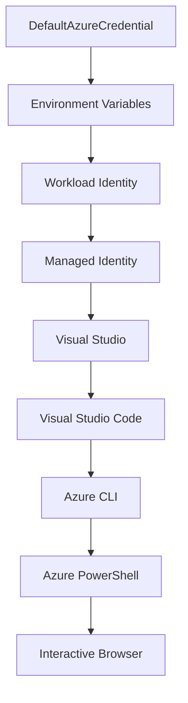

# AZD-grunder – Kärnbegrepp och Grundläggande Principer

**Kapitelnavigering:**
- **📚 Kursstart**: [AZD för nybörjare](../../README.md)
- **📖 Aktuellt kapitel**: Kapitel 1 – Grund och Snabbstart
- **⬅️ Föregående**: [Kursöversikt](../../README.md#-chapter-1-foundation--quick-start)
- **➡️ Nästa**: [Installation och Installation](installation.md)
- **🚀 Nästa kapitel**: [Kapitel 2: AI-först utveckling](../chapter-02-ai-development/microsoft-foundry-integration.md)

## Introduktion

> Granskad mot `azd 1.37.2` (november 2026). Bash-kommandon använder citerade platshållare som du måste ersätta. Mallarbetsflöden använder `.` för att initiera den aktuella katalogen; utan katalogargument skapar mallinitialiseringen en undermapp och ändrar inte skalets arbetskatalog. Avancerade kodexempel är illustrativa, inte kompletta projekt.

Denna lektion introducerar dig till Azure Developer CLI (azd), ett kraftfullt kommandoradsverktyg som påskyndar din resa från lokal utveckling till Azure-distribution. Du lär dig grundläggande begrepp, kärnfunktioner och får förståelse för hur azd förenklar distribution av molnnativa applikationer.

## Lärandemål

I slutet av denna lektion kommer du att:
- Förstå vad Azure Developer CLI är och dess främsta syfte
- Lära dig kärnbegreppen mallar, miljöer och tjänster
- Utforska viktiga funktioner inklusive mallstyrd utveckling och Infrastruktur som kod
- Förstå strukturen och arbetsflödet i ett azd-projekt
- Vara beredd att installera och konfigurera azd för din utvecklingsmiljö

## Läranderesultat

Efter att ha slutfört denna lektion kommer du kunna:
- Förklara azds roll i moderna molnutvecklingsarbetsflöden
- Identifiera komponenterna i ett azd-projeksstruktur
- Beskriva hur mallar, miljöer och tjänster samverkar
- Förstå fördelarna med Infrastruktur som kod med azd
- Känna igen olika azd-kommandon och deras syften

## Vad är Azure Developer CLI (azd)?

Azure Developer CLI (azd) är ett kommandoradsverktyg designat för att påskynda din resa från lokal utveckling till distribution på Azure. Det förenklar processen att bygga, distribuera och hantera molnnativa applikationer på Azure.

### Vad kan du distribuera med azd?

azd stödjer en bred variation av arbetsbelastningar – och listan växer ständigt. Idag kan du använda azd för att distribuera:

| Typ av arbetsbelastning | Exempel | Samma arbetsflöde? |
|-------------------------|---------|-------------------|
| **Traditionella applikationer** | Webbappar, REST-API:er, statiska webbplatser | ✅ `azd up` |
| **Tjänster och mikrotjänster** | Container Apps, Funktionsappar, flertjänstade backend-system | ✅ `azd up` |
| **AI-drivna applikationer** | Chattappar med Microsoft Foundry-modeller, RAG-lösningar med AI-sökning | ✅ `azd up` |
| **Intelligenta agenter** | Foundry-hostade agenter, flertalsagentsorkestrering | ✅ `azd up` |

Den viktiga insikten är att **azd:s livscykel är densamma oavsett vad du distribuerar**. Du initierar ett projekt, tillhandahåller infrastruktur, distribuerar din kod, övervakar din app och städar upp – oavsett om det är en enkel webbplats eller en sofistikerad AI-agent.

Denna kontinuitet är avsiktlig. azd behandlar AI-funktioner som en annan typ av tjänst som din applikation kan använda, inte som något fundamentalt annorlunda. En chattendpoint med Microsoft Foundry-modeller är, från azd:s perspektiv, bara en annan tjänst att konfigurera och distribuera.

### 🎯 Varför använda AZD? En verklig jämförelse

Låt oss jämföra distribution av en enkel webbapp med databas:

#### ❌ UTAN AZD: Manuell Azure-distribution (30+ minuter)

**Illustrativ Bash-jämförelse, inte en körbar applikationsstart.** Antar befintlig applikationskod, unika resursnamn, Azure CLI-autentisering och eventuella nödvändiga CLI-tillägg. Använd mallövningen nedan för den stödda end-to-end-vägen.

```bash
# Step 1: Create resource group
az group create --name myapp-rg --location eastus

# Step 2: Create App Service Plan
az appservice plan create --name myapp-plan \
  --resource-group myapp-rg \
  --sku B1 --is-linux

# Step 3: Create Web App
az webapp create --name myapp-web-unique123 \
  --resource-group myapp-rg \
  --plan myapp-plan \
  --runtime "NODE:22-lts"

# Step 4: Create Cosmos DB account (10-15 minutes)
az cosmosdb create --name myapp-cosmos-unique123 \
  --resource-group myapp-rg \
  --kind MongoDB

# Step 5: Create database
az cosmosdb mongodb database create \
  --account-name myapp-cosmos-unique123 \
  --resource-group myapp-rg \
  --name tododb

# Step 6: Create collection
az cosmosdb mongodb collection create \
  --account-name myapp-cosmos-unique123 \
  --resource-group myapp-rg \
  --database-name tododb \
  --name todos

# Step 7: Get connection string
CONN_STR=$(az cosmosdb keys list \
  --name myapp-cosmos-unique123 \
  --resource-group myapp-rg \
  --type connection-strings \
  --query "connectionStrings[0].connectionString" -o tsv)

# Step 8: Configure app settings
az webapp config appsettings set \
  --name myapp-web-unique123 \
  --resource-group myapp-rg \
  --settings MONGODB_URI="$CONN_STR"

# Step 9: Enable logging
az webapp log config --name myapp-web-unique123 \
  --resource-group myapp-rg \
  --application-logging filesystem \
  --detailed-error-messages true

# Step 10: Set up Application Insights
az monitor app-insights component create \
  --app myapp-insights \
  --location eastus \
  --resource-group myapp-rg

# Step 11: Link App Insights to Web App
INSTRUMENTATION_KEY=$(az monitor app-insights component show \
  --app myapp-insights \
  --resource-group myapp-rg \
  --query "instrumentationKey" -o tsv)

az webapp config appsettings set \
  --name myapp-web-unique123 \
  --resource-group myapp-rg \
  --settings APPINSIGHTS_INSTRUMENTATIONKEY="$INSTRUMENTATION_KEY"

# Step 12: Build application locally
npm install
npm run build

# Step 13: Create deployment package
zip -r app.zip . -x "*.git*" "node_modules/*"

# Step 14: Deploy application
az webapp deployment source config-zip \
  --resource-group myapp-rg \
  --name myapp-web-unique123 \
  --src app.zip

# Step 15: Wait and pray it works 🙏
# (No automated validation, manual testing required)
```

**Problem:**
- ❌ 15+ kommandon att minnas och köra i ordning
- ❌ 30-45 minuter manuell arbetsinsats
- ❌ Lätt att göra misstag (stavfel, fel parametrar)
- ❌ Inloggningsuppgifter kräver explicita hanteringar; felsökningsloggar och skalspårning kan exponera dem
- ❌ Ingen automatiserad återställning om något misslyckas
- ❌ Svårt att repetera för teammedlemmar
- ❌ Olika varje gång (icke-reproducerbart)

#### ✅ MED AZD: Automatiserad distribution (5 kommandon, 10-15 minuter)

```bash
# Step 1: Initialize from template
azd init --template todo-nodejs-mongo .

# Step 2: Authenticate
azd auth login

# Step 3: Select the environment created during init
azd env select dev

# Step 4: Preview changes (optional but recommended)
azd provision --preview

# Step 5: Deploy everything
azd up

# ✨ Done! Everything is deployed, configured, and monitored
```

**Fördelar:**
- ✅ **5 kommandon** jämfört med 15+ manuella steg
- ✅ **10-15 minuter** total tid (mest väntan på Azure)
- ✅ **Färre manuell misstag** – konsekvent, mallstyrt arbetsflöde
- ✅ **Säker hemlighetshantering** – många mallar använder Azure-hanterad hemlighetslagring
- ✅ **Reproducerbara distributioner** – samma arbetsflöde varje gång
- ✅ **Reproducerbara infrastruktursdefinitioner** – beroende på kvoter, regions tillgänglighet och mallversioner
- ✅ **Teamredo** – vem som helst kan distribuera med samma kommandon
- ✅ **Infrastruktur som kod** – versionshanterade Bicep-mallar
- ✅ **Malldefinierad övervakning** – Application Insights om inkluderat i mallen

### Tid och pålitlighet

Tiderna ovan är uppskattningar, inte riktmärken. azd minskar antalet kommandon du måste koordinera, men garanterar inte distributionstid, eliminerar inte fel eller erbjuder automatisk återställning av applikation/databas. Behåll fungerande versioner i källkontroll och testa återställningsprocedurer.

## Kärnbegrepp

### Mallar
Mallar är grunden för azd. De innehåller:
- **Applikationskod** – Din källkod och beroenden
- **Infrastruktursdefinitioner** – Azure-resurser definierade i Bicep eller Terraform
- **Konfigurationsfiler** – Inställningar och miljövariabler
- **Distributionsskript** – Automatiserade distributionsarbetsflöden

### Miljöer
Miljöer representerar olika distributionsmål:
- **Utveckling** – För test och utveckling
- **Staging** – Förproduktionsmiljö
- **Produktion** – Live produktionsmiljö

Varje miljö behåller sin egen:
- Miljönamn och värden; resursisolering beror på infrastrukturen i mallen
- Konfigurationsinställningar
- Distributionsstatus

### Tjänster
Tjänster i `azure.yaml` beskriver distribuerbara applikationskomponenter:
- **Frontend** – Webbapplikationer, SPA:er
- **Backend** – API:er, mikrotjänster

Databaser och lagring tillhandahålls normalt som infrastruktursresurser, inte som uppfunna tjänstvärdar som `host: postgres`.

## Nyckelfunktioner

### 1. Mallstyrd utveckling
```bash
# Browse available templates
azd template list

# Initialize from a template
azd init --template "<template-name>" .
```

### 2. Infrastruktur som kod
- **Bicep** – Azures domänspecifika språk
- **Terraform** – Multi-molninfrastrukturverktyg
- Bicep kompileras till ARM-mallar; rå ARM-JSON är inte en separat inbyggd `infra.provider`.

### 3. Integrerade arbetsflöden
```bash
# Complete deployment workflow
azd up            # Provision + Deploy this is hands off for first time setup

# 🧪 NEW: Preview infrastructure changes before deployment (SAFE)
azd provision --preview    # Simulate infrastructure deployment without making changes

azd provision     # Create Azure resources if you update the infrastructure use this
azd deploy        # Deploy application code or redeploy application code once update
azd down          # Clean up resources
```

#### 🛡️ Säker infrastrukturplanering med förhandsgranskning
Kommandot `azd provision --preview` är en revolutionerande funktion för säkra distributioner:
- **Simulering** – Visar vad som kommer skapas, ändras eller tas bort
- **Ingen infrastrukturapplicering** – Granskar leverantörsändringar; inspektera projektets krokar först, eftersom krokar kan köra kommandon med sidoeffekter
- **Team-samarbete** – Dela resultat av förhandsgranskningen före distribution
- **Kostnadsplaneringsunderlag** – Inspektera föreslagna SKU:er, prisberäkna sedan med Azure Pricing Calculator; förhandsgranskningen beräknar inte priser

```bash
# Example preview workflow
azd provision --preview           # See what will change
# Review the output, discuss with team
azd provision                     # Apply changes with confidence
```

### 📊 Visualisering: AZD-utvecklingsarbetsflöde



**Förklaring av arbetsflödet:**
1. **Init** – Börja med mall eller nytt projekt
2. **Auth** – Autentisera mot Azure
3. **Environment** – Skapa isolerad distributionsmiljö
4. **Preview** – 🆕 Förhandsgranska alltid infrastruktursändringar först (säker praxis)
5. **Provision** – Skapa/uppdatera Azure-resurser
6. **Deploy** – Skicka din applikationskod
7. **Monitor** – Observera applikationsprestanda
8. **Iterate** – Gör ändringar och distribuera om koden
9. **Cleanup** – Ta bort resurser när du är färdig

### 4. Miljöhantering
```bash
# Create and manage environments
azd env new "<environment-name>"
azd env select "<environment-name>"
azd env list
```

### 5. Tillägg och AI-kommandon

azd använder ett tilläggssystem för att lägga till kapabiliteter utöver kärn-CLI. Detta är särskilt användbart för AI-arbetsbelastningar:

```bash
# List available extensions
azd extension list

# Install the Foundry agents extension
azd extension install azure.ai.agents

# Initialize an AI agent project interactively
azd ai agent init

# Test a deployed agent (shows latency and time-to-first-byte)
azd ai agent invoke

# Start the MCP server for AI-assisted development (Alpha)
azd mcp start
```

**Agentens livscykel, helt och hållet.** Använd `azure.ai.agents` för agentlivscykeloperationer och installera `azure.ai.evaluations` separat för utvärdering. Använd `azd >= 1.37.0` för det kombinerade arbetsflödet. Du behöver inte alla dessa första dagen:

| Steg | Kommando | Funktion |
|-------|---------|--------------|
| **Scaffold** | `azd ai agent init --template <path-to-azure.yaml>` | Adoptera en aktuell agentprojektsmall |
| **Test** | `azd ai agent invoke` | Anropa agenten och visa responstider |
| **Measure** | `azd ai eval init`, `generate`, `run start` | Konfigurera, distribuera och köra utvärderingar med separat tillägg |
| **Improve** | `azd ai agent optimize --eval <evaluation-name> --optimize-model <optimizer-deployment>` | Återanvänd kompatibel utvärdering för att optimera agenten |
| **Inspect** | `azd ai agent endpoint show` | Visa live endpunktkonfiguration |
| **Clean up** | `azd ai agent delete` | Radera en hostad agent och alla dess versioner |

> Tillägg behandlas i detalj i [Kapitel 2: AI-först utveckling](../chapter-02-ai-development/agents.md) och referensen [AZD AI CLI-kommandon](../chapter-08-production/production-ai-practices.md#azd-ai-cli-commands-and-extensions).

## 📁 Projektstruktur

En typisk azd-projektstruktur:
```
my-app/
├── .azure/                  # Local environments and selected-environment config
│   ├── config.json
│   └── dev/.env
├── .devcontainer/          # Development container config
├── .github/workflows/      # GitHub Actions
├── .vscode/               # VS Code settings
├── infra/                 # Infrastructure code
│   ├── main.bicep        # Main infrastructure template
│   ├── main.parameters.json
│   └── modules/          # Reusable modules
├── src/                  # Application source code
│   ├── api/             # Backend services
│   └── web/             # Frontend application
├── azure.yaml           # azd project configuration
└── README.md
```

## 🔧 Konfigurationsfiler

### azure.yaml
Huvudkonfigurationsfilen för projektet:
```yaml
name: my-awesome-app
metadata:
  template: my-template@1.0.0

services:
  web:
    project: ./src/web
    language: js
    host: appservice
  api:
    project: ./src/api
    language: js
    host: appservice

hooks:
  preprovision:
    shell: pwsh
    run: echo "Preparing to provision..."
```

### .azure/config.json
Projektlokalt val av standardmiljö (illustrativ; hanteras av azd):
```json
{
  "defaultEnvironment": "dev"
}
```

## 🎪 Vanliga arbetsflöden med praktiska övningar

> **💡 Lärandets tips:** Följ dessa övningar i ordning för att bygga dina AZD-kunskaper stegvis.

### 🎯 Övning 1: Initiera ditt första projekt

**Mål:** Skapa ett AZD-projekt och utforska dess struktur

**Steg:**
```bash
# Use a proven template
mkdir azd-basics-practice
cd azd-basics-practice
# Choose "dev" for the environment name when prompted
azd init --template todo-nodejs-mongo .

# Explore the generated files
ls -la  # View all files including hidden ones

# Key files created:
# - azure.yaml (main config)
# - infra/ (infrastructure code)
# - src/ (application code)
```

**✅ Framgång:** Du har azure.yaml, infra/ och src/-kataloger

---

### 🎯 Övning 2: Distribuera till Azure

**Mål:** Slutför en distribution från början till slut

**Steg:**
```bash
# 1. Authenticate
azd auth login

# 2. Select the dev environment created in Exercise 1
azd env select dev
azd env set AZURE_LOCATION eastus

# 3. Preview changes (RECOMMENDED)
azd provision --preview

# 4. Deploy everything
azd up

# 5. Verify deployment
azd show    # View your app URL
```

**Beräknad tid:** 10-15 minuter  
**✅ Framgång:** Applikations-URL öppnas i webbläsaren

---

### 🎯 Övning 3: Flera miljöer

**Mål:** Distribuera till dev och staging

**Steg:**
```bash
# Already have dev, create staging
azd env new staging
azd env set AZURE_LOCATION westus2
azd up

# Switch between them
azd env list
azd env select dev
```

**✅ Framgång:** Två separata resursgrupper i Azure-portalen

**Rensa upp:** Övning 3 skapar en andra fakturerbar distribution. Ta bort båda när du är klar:

```bash
azd down --environment dev
azd down --environment staging
```

---

### 🛡️ Destruktiv rensning: `azd down --force --purge`

När du avsiktligt vill ta bort valda miljöns Azure-resurser:

```bash
azd down --force --purge
```

**Vad det gör:**
- `--force`: Inga bekräftelsepromptar
- `--purge`: Tar också permanent bort stödda mjukborttagna resurser (t.ex. Key Vaults), där rensningsskydd tillåter det. Tar inte bort den lokala `.azure/`-katalogen.

**Använd när:** du är klar med en förbrukningsbar miljö. Använd inte destruktiv rensning som första steg vid autentiserings-, kvot- eller konfigurationsfel.

---

## 🎪 Ursprungliga arbetsflödesreferenser

### Starta ett nytt projekt
```bash
# Method 1: Use existing template
azd init --template todo-nodejs-mongo .

# Method 2: Start from scratch
azd init

# Method 3: Use current directory
azd init .
```

### Utvecklingscykel
```bash
# Set up development environment
azd auth login
azd env new dev
azd env select dev

# Deploy everything
azd up

# Make changes and redeploy
azd deploy

# Clean up when done
azd down --force --purge # Deletes this environment's discovered Azure resources; review before forcing deletion.
```

## Förstå `azd down --force --purge`
Kommandot `azd down --force --purge` är ett kraftfullt sätt att helt riva ner din azd-miljö och alla associerade resurser. Här är en översikt över vad varje flagga gör:
```
--force
```
- Hoppar över bekräftelsepromptar.
- Användbart för automation eller skriptning där manuellt inmatning inte är möjlig.
- Bypassar inte behörigheter, rensningsskydd eller borttagningsfel.

```
--purge
```
Tar permanent bort stödda mjukborttagna Azure-resurser utan ytterligare bekräftelse. Rensningsskydd och behörigheter gäller fortfarande. Tar **inte** bort lokala miljöer eller `.azure/`-mappen.


### Varför använda båda?
Använd båda endast när du avser att radera valda miljöns Azure-resurser och rena återställningsbara resurser. Detta är destruktiv rensning, inte en generell reparation eller återställning av lokal status.

Det är särskilt hjälpsamt efter manuell resursborttagning i Azure-portalen eller vid byte av mallar, miljöer eller namngivningskonventioner för resursgrupper.


### Hantera flera miljöer
```bash
# Create staging environment
azd env new staging
azd env select staging
azd up

# Switch back to dev
azd env select dev

# Compare environments
azd env list
```

## 🔐 Autentisering och legitimationer

Distingvera autentisering för distribution (`azd auth login`) från autentisering av applikations-SDK (`DefaultAzureCredential`). De är separata. azd använder inte automatiskt Azure CLI-uppgifter.

### Azure CLI-autentisering (`az login`)

Kör `azd auth login` för azd. Följande Azure CLI-kommandon är valfria och autentiserar `az`-kommandon separat:

```bash
# Interactive login (opens browser)
az login

# Login with specific tenant
az login --tenant "<tenant-id>"

# Login with service principal
az login --service-principal -u "<app-id>" -p "<password>" --tenant "<tenant-id>"

# Check current login status
az account show

# List available subscriptions
az account list --output table

# Set default subscription
az account set --subscription "<subscription-id>"
```

### Autentiseringsflöde
1. **Interaktiv inloggning**: Öppnar din standardwebbläsare för autentisering
2. **Device Code Flow**: För miljöer utan webbläsaråtkomst
3. **Service Principal**: För automatiserings- och CI/CD-scenarier
4. **Managed Identity**: För Azure-hostade applikationer

### DefaultAzureCredential-kedjan

`DefaultAzureCredential` är en referenstyp som ger en förenklad autentiseringsupplevelse genom att automatiskt försöka flera referenskällor i en specifik ordning:

#### Applikations-SDK-referenskedja

Den exakta kedjan beror på Azure Identity SDK-språk, version, installerade plugins och alternativ. Den här diagrammet är konceptuellt, inte en fast azd-autentiseringssekvens; de senaste SDK:erna kan också inkludera Azure Developer CLI-behörigheter.


#### 1. Miljövariabler
```bash
# Set environment variables for service principal
export AZURE_CLIENT_ID="<app-id>"
export AZURE_CLIENT_SECRET="<password>"
export AZURE_TENANT_ID="<tenant-id>"
```

#### 2. Workload Identity (Kubernetes/GitHub Actions)
Används automatiskt i:
- Azure Kubernetes Service (AKS) med Workload Identity
- GitHub Actions med OIDC-federation
- Andra federerade identitetsscenarier

#### 3. Hanterad identitet
För Azure-resurser som:
- Virtuella maskiner
- App Service
- Azure Functions
- Container Instances

```bash
# Inspect a deployed Container App's configured identity (requires az login)
az containerapp show --name "<app-name>" --resource-group "<rg-name>" --query identity
```

#### 4. Integration med utvecklingsverktyg
- **Visual Studio**: Använder automatiskt inloggad konto
- **VS Code**: Stödet beror på SDK och dess stödda broker/plugin-konfiguration
- **Azure CLI**: Använder `az login`-behörigheter (mest vanligt för lokal utveckling)

### AZD autentiseringsinställning

```bash
# Method 1: Direct azd authentication (recommended)
azd auth login

# Method 2: Direct azd authentication
azd auth login --use-device-code  # For headless environments

# Method 3: Check authentication status
azd auth login --check-status

# Method 4: Logout and re-authenticate
azd auth logout
azd auth login
```

### Bästa praxis för autentisering

#### För lokal utveckling
```bash
# 1. Log in to azd
azd auth login

# 2. Select the subscription for this initialized environment
azd env set AZURE_SUBSCRIPTION_ID "<subscription-id>"

# 3. Check azd sign-in details (read the status message)
azd auth login --check-status
```

#### För CI/CD-pipelines
```yaml
# Partial GitHub Actions steps: assumes checkout, azd installation,
# required AZURE_* environment values, and pipeline secret configuration.
- name: Deploy with azd
  run: |
    azd auth login --client-id ${{ secrets.AZURE_CLIENT_ID }} \
                    --client-secret ${{ secrets.AZURE_CLIENT_SECRET }} \
                    --tenant-id ${{ secrets.AZURE_TENANT_ID }}
    azd up --no-prompt
```

#### För produktionsmiljöer
- Använd **Managed Identity** när du kör på Azure-resurser
- Använd **Service Principal** för automationsscenarier
- Undvik att lagra behörigheter i kod eller konfigurationsfiler
- Använd **Azure Key Vault** för känslig konfiguration

### Vanliga autentiseringsproblem och lösningar

#### Problem: "Ingen prenumeration hittades"
```bash
# Solution: Set default subscription
az account list --output table
az account set --subscription "<subscription-id>"
azd env set AZURE_SUBSCRIPTION_ID "<subscription-id>"
```

#### Problem: "Otillräckliga behörigheter"
```bash
# Solution: Check and assign required roles
az role assignment list --assignee $(az account show --query user.name --output tsv)

# Common required roles:
# - Contributor (for resource management)
# - User Access Administrator (for role assignments)
```

#### Problem: "Token har gått ut"
```bash
# Solution: Re-authenticate
az logout
az login
azd auth logout
azd auth login
```

### Autentisering i olika scenarier

#### Lokal utveckling
```bash
# Personal development account
az login
azd auth login
```

#### Teamutveckling
```bash
# Use specific tenant for organization
az login --tenant contoso.onmicrosoft.com
azd auth login --tenant-id "<tenant-id>"
```

#### Multi-tenant scenarier
```bash
# Switch between tenants
az login --tenant tenant1.onmicrosoft.com
azd auth login --tenant-id "<tenant-1-id>"
# Select an environment configured with tenant 1's subscription
azd env select tenant1-dev
# Deploy to tenant 1
azd up

az login --tenant tenant2.onmicrosoft.com  
azd auth login --tenant-id "<tenant-2-id>"
azd env select tenant2-dev
# Deploy to tenant 2
azd up
```

### Säkerhetsöverväganden

1. **Lagring av behörigheter**: Lagra aldrig behörigheter i källkod
2. **Begränsning av behörigheter**: Använd principen om minsta privilegium för service principals
3. **Tokenrotation**: Rotera regelbundet service principal-hemligheter
4. **Revisionsspår**: Övervaka autentiserings- och distributionsaktiviteter
5. **Nätverkssäkerhet**: Använd privata slutpunkter när det är möjligt

### Felsökning av autentisering

```bash
# Debug authentication issues
azd auth login --check-status
az account show
az account get-access-token

# Common diagnostic commands
whoami                          # Current user context
az ad signed-in-user show      # Microsoft Entra ID user details
az group list                  # Test resource access
```

## Kommandoupptäckt

### Upptäckt
```bash
azd template list              # Browse templates
azd template list --help       # Template discovery options
azd init --help               # Initialization options
```

### Projektledning
```bash
azd show                     # Project overview
azd env list                # Available environments and selected default
azd config show            # Configuration settings
```

### Övervakning
```bash
azd monitor                  # Open Azure portal monitoring
azd monitor --logs           # View application logs
azd monitor --live           # View live metrics
azd pipeline config          # Set up CI/CD
```

## Bästa praxis

### 1. Använd meningsfulla namn
```bash
# Good
azd env new production-east
azd init --template todo-nodejs-mongo .

# Avoid
azd env new env1
azd init --template template1 .
```

### 2. Utnyttja mallar
- Börja med befintliga mallar
- Anpassa efter dina behov
- Skapa återanvändbara mallar för din organisation

### 3. Miljöisolering
- Använd separata miljöer för utveckling/test/produktion
- Distribuera aldrig direkt till produktion från lokal maskin
- Använd CI/CD-pipelines för produktionsdistributioner

### 4. Konfigurationshantering
- Använd hanterad identitet och Key Vault för hemligheter; vanliga `azd env set`-värden är lokal klartext
- Håll konfiguration i versionskontroll
- Dokumentera miljöspecifika inställningar

## Inlärningsprogression

### Nybörjare (vecka 1-2)
1. Installera azd och autentisera
2. Distribuera en enkel mall
3. Förstå projektstruktur
4. Lär dig grundläggande kommandon (up, down, deploy)

### Mellanliggande (vecka 3-4)
1. Anpassa mallar
2. Hantera flera miljöer
3. Förstå infrastrukturkod
4. Sätt upp CI/CD-pipelines

### Avancerad (vecka 5+)
1. Skapa egna mallar
2. Avancerade infrastrukturmönster
3. Multi-region distributioner
4. Företagsklass konfigurationer

## Nästa steg

**📖 Fortsätt kapitel 1 lärande:**
- [Installation & Setup](installation.md) - Få azd installerat och konfigurerat
- [Ditt första projekt](first-project.md) - Fullfölj praktisk handledning
- [Konfigurationsguide](../chapter-03-configuration/configuration.md) - Avancerade konfigurationsalternativ

**🎯 Redo för nästa kapitel?**
- [Kapitel 2: AI-First Development](../chapter-02-ai-development/microsoft-foundry-integration.md) - Börja bygga AI-applikationer

## Ytterligare resurser

- [Översikt över Azure Developer CLI](https://learn.microsoft.com/en-us/azure/developer/azure-developer-cli/)
- [Mallgalleri](https://azure.github.io/awesome-azd/)
- [Community Samples](https://github.com/Azure-Samples)

---

## 🙋 Vanliga frågor

### Allmänna frågor

**F: Vad är skillnaden mellan AZD och Azure CLI?**

S: Azure CLI (`az`) är för att hantera enskilda Azure-resurser. AZD (`azd`) är för att hantera hela applikationer:

```bash
# Azure CLI - Low-level resource management
az webapp create --name myapp --resource-group rg
az sql server create --name myserver --resource-group rg
# ...many more commands needed

# AZD - Application-level management
azd up  # Deploys entire app with all resources
```

**Tänk så här:**
- `az` = Arbeta med individuella Legobitar
- `azd` = Arbeta med kompletta Legosatser

---

**F: Behöver jag kunna Bicep eller Terraform för att använda AZD?**

S: Nej! Börja med mallar:
```bash
# Use existing template - no IaC knowledge needed
azd init --template todo-nodejs-mongo .
azd up
```

Du kan lära dig Bicep senare för att anpassa infrastrukturen. Mallarna ger fungerande exempel att lära av.

---

**F: Hur mycket kostar det att köra AZD-mallar?**

S: Kostnader varierar beroende på region, SKU, driftstid, databasläge och modellanvändning. En utvecklingsmiljö kan medföra betydande månadskostnader även i vila; anta inte en universell 50-150 $-intervall:

```bash
# Preview resource changes (not prices)
azd provision --preview

# Always cleanup when not using
azd down --force --purge  # Removes all resources
```

**Proffstips:** Använd fria nivåer där det finns:
- App Service: F1 (Gratis)-nivå
- Azure OpenAI: ingen allmän garanterad månatlig gratis tokenkvot; kontrollera nuvarande modell och pris
- Cosmos DB: berättigade konton med provisionerad prestanda kan välja en gratisnivå; serverlösa mallar kvalificerar sig inte automatiskt

---

**F: Kan jag använda AZD med befintliga Azure-resurser?**

S: Ja, men det är enklare att börja från början. AZD fungerar bäst när det hanterar hela livscykeln. För befintliga resurser:

```bash
# Option 1: Import existing resources (advanced)
azd init
# Then modify infra/ to reference existing resources

# Option 2: Start fresh (recommended)
azd init --template "<verified-template-name>" .
azd up  # Creates new environment
```

---

**F: Hur delar jag mitt projekt med lagkamrater?**

S: Committa AZD-projektet till Git (men INTE .azure-mappen):

```bash
# Already in .gitignore by default
.azure/        # Contains secrets and environment data
*.env          # Environment variables

# Team members then:
git clone "<your-repo>"
# Change into the cloned repository before running the remaining commands.
azd auth login
azd env new "<their-name>-dev"
azd up
```

Alla får identisk infrastruktur från samma mallar.

---

### Felsökningsfrågor

**F: "azd up" misslyckades halvvägs. Vad gör jag?**

S: Kontrollera felet, rätta det, och försök igen:

```bash
# Capture detailed diagnostics (redact sensitive values before sharing)
azd up --debug

# Common fixes:

# 1. If quota exceeded:
azd env set AZURE_LOCATION "westus2"  # Try different region

# 2. If resource name conflict:
azd down --force --purge  # Clean slate
azd up  # Retry

# 3. If auth expired:
az login
azd auth login
azd up
```

**Vanligaste problemet:** Fel Azure-prenumeration vald
```bash
az account list --output table
az account set --subscription "<correct-subscription>"
azd env set AZURE_SUBSCRIPTION_ID "<correct-subscription-id>"
```

---

**F: Hur distribuerar jag bara kodändringar utan reprovisionering?**

S: Använd `azd deploy` istället för `azd up`:

```bash
azd up          # First time: provision + deploy (slow)

# Make code changes...

azd deploy      # Subsequent times: deploy only (fast)
```

Jämförelse av hastighet:
- `azd up`: 10-15 minuter (provisionerar infrastruktur)
- `azd deploy`: 2-5 minuter (endast kod)

---

**F: Kan jag anpassa infrastrukturmallarna?**

S: Ja! Redigera Bicep-filerna i `infra/`:

```bash
# After azd init
cd infra/
code main.bicep  # Edit in VS Code

# Preview changes
azd provision --preview

# Apply changes
azd provision
```

**Tips:** Börja smått - ändra SKU:er först:
```bicep
// infra/main.bicep
sku: {
  name: 'B1'  // Change to 'P1V2' for production
}
```

---

**F: Hur raderar jag allt som AZD skapade?**

S: Ett kommando tar bort alla resurser:

```bash
azd down --force --purge

# This deletes:
# - Azure resources/resource groups discovered for the selected environment
# - Supported soft-deleted resources, if purge protection allows
# Local .azure files remain; shared/external resources may remain too.
```

**Kör alltid detta när:**
- Testning av en mall är klar
- Byter till ett annat projekt
- Vill börja om från början

**Kostnadskontroll:** Bekräfta borttagning i Azure och kontrollera för kvarvarande/delade resurser. Tidigare uppkomna kostnader gäller fortfarande.

---

**F: Vad gör jag om jag av misstag tog bort resurser i Azure-portalen?**

S: AZD-tillstånd kan komma ur synk. Nollställningsmetod:

```bash
# 1. Delete remaining resources only if that is your intent
azd down --force --purge

# 2. Start fresh
azd up

# Alternative: Let AZD detect and fix
azd provision  # Will create missing resources
```

---

### Avancerade frågor

**F: Kan jag använda AZD i CI/CD-pipelines?**

S: Ja! GitHub Actions-exempel:

```yaml
# .github/workflows/deploy.yml
name: Deploy with AZD

on:
  push:
    branches: [main]

jobs:
  deploy:
    runs-on: ubuntu-latest
    steps:
      - uses: actions/checkout@v4
      
      - name: Install azd
        run: curl -fsSL https://aka.ms/install-azd.sh | bash
      
      - name: Azure Login
        run: |
          azd auth login \
            --client-id ${{ secrets.AZURE_CLIENT_ID }} \
            --client-secret ${{ secrets.AZURE_CLIENT_SECRET }} \
            --tenant-id ${{ secrets.AZURE_TENANT_ID }}
      
      - name: Deploy
        env:
          AZURE_ENV_NAME: dev
          AZURE_LOCATION: ${{ vars.AZURE_LOCATION }}
          AZURE_SUBSCRIPTION_ID: ${{ vars.AZURE_SUBSCRIPTION_ID }}
        run: azd up --no-prompt
```

---

**F: Hur hanterar jag hemligheter och känsliga data?**

S: Använd Key Vault explicit. `azd env set` skriver vanliga värden till lokal miljöfil; den skapar inte automatiskt en vault, tilldelar roller eller injicerar hemligheter i din applikation.

```bash
# Interactive: create/select a Key Vault secret and save its reference
azd env set-secret DATABASE_PASSWORD
```

Du behöver lämpliga behörigheter för valvet. Din infrastruktur/applikation måste fortfarande koppla hemligheten till dess konsument och ge körtidsidentiteten åtkomst. Skriv inte ut lösta hemlighetsvärden i loggar.

**Lägg aldrig till i commit:**
- `.azure/`-mappen (innehåller miljödata)
- `.env`-filer (lokala hemligheter)
- Anslutningssträngar

---

**F: Kan jag distribuera till flera regioner?**

S: Ja, skapa en miljö per region:

```bash
# East US environment
azd env new prod-eastus
azd env set AZURE_LOCATION eastus
azd up

# West Europe environment
azd env new prod-westeurope
azd env set AZURE_LOCATION westeurope
azd up

# Each environment is independent
azd env list
```

För verkliga multi-region-appar, anpassa Bicep-mallar för att distribuera till flera regioner samtidigt.

---

**F: Var kan jag få hjälp om jag fastnar?**

1. **AZD-dokumentation:** https://learn.microsoft.com/azure/developer/azure-developer-cli/
2. **GitHub Issues:** https://github.com/Azure/azure-dev/issues
3. **Discord:** [Azure Discord](https://discord.gg/microsoft-azure) - #azure-developer-cli-kanal
4. **Stack Overflow:** Tagga `azure-developer-cli`
5. **Den här kursen:** [Felsökningsguide](../chapter-07-troubleshooting/common-issues.md)

**Proffstips:** Innan du frågar, kör:
```bash
azd show       # Shows current state
azd version    # Shows your version
```
Inkludera denna info i din fråga för snabbare hjälp.

---

## 🎓 Vad händer härnäst?

Du förstår nu grunderna i AZD. Välj din väg:

### 🎯 För nybörjare:
1. **Nästa:** [Installation & Setup](installation.md) - Installera AZD på din maskin
2. **Sedan:** [Ditt första projekt](first-project.md) - Distribuera din första app
3. **Öva:** Slutför alla 3 övningar i denna lektion

### 🚀 För AI-utvecklare:
1. **Hoppa till:** [Kapitel 2: AI-First Development](../chapter-02-ai-development/microsoft-foundry-integration.md)
2. **Distribuera:** I en tom projektmapp, börja med `azd init --template get-started-with-ai-chat .`
3. **Lär dig:** Bygg samtidigt som du distribuerar

### 🏗️ För erfarna utvecklare:
1. **Granska:** [Konfigurationsguide](../chapter-03-configuration/configuration.md) - Avancerade inställningar
2. **Utforska:** [Infrastructure as Code](../chapter-04-infrastructure/provisioning.md) - Djupdykning i Bicep
3. **Bygg:** Skapa egna mallar för din stack

---

**Kapitelnavigering:**
- **📚 Kurshemsida**: [AZD For Beginners](../../README.md)
- **📖 Aktuellt kapitel**: Kapitel 1 - Grundläggande & Snabbstart  
- **⬅️ Föregående**: [Kursöversikt](../../README.md#-chapter-1-foundation--quick-start)
- **➡️ Nästa**: [Installation & Setup](installation.md)
- **🚀 Nästa kapitel**: [Kapitel 2: AI-First Development](../chapter-02-ai-development/microsoft-foundry-integration.md)

---

<!-- CO-OP TRANSLATOR DISCLAIMER START -->
**Ansvarsfriskrivning**:
Detta dokument har översatts med hjälp av AI-översättningstjänsten [Co-op Translator](https://github.com/Azure/co-op-translator). Även om vi strävar efter noggrannhet, var vänlig notera att automatiska översättningar kan innehålla fel eller brister. Det ursprungliga dokumentet på dess modersmål bör betraktas som den auktoritativa källan. För kritisk information rekommenderas professionell mänsklig översättning. Vi ansvarar inte för några missförstånd eller feltolkningar som uppstår till följd av användningen av denna översättning.
<!-- CO-OP TRANSLATOR DISCLAIMER END -->