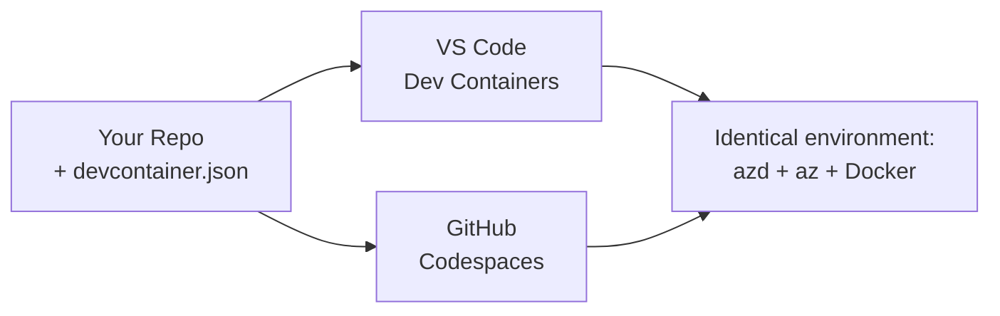

# Dev Containers & GitHub Codespaces för azd

**Kapitelnavigering:**
- **📚 Kursstart**: [AZD För Nybörjare](../../README.md)
- **📖 Nuvarande Kapitel**: Kapitel 1 - Grundläggande & Snabbstart
- **⬅️ Föregående**: [Ta Med Din Egen App](bring-your-own-app.md)
- **🚀 Nästa Kapitel**: [Kapitel 2: AI-Först Utveckling](../chapter-02-ai-development/README.md)

> Granskning av kommandon och konfiguration mål: `azd 1.37.2` (november 2026). Containerbyggen och Azure-distributioner ingick inte i denna granskning.

## Introduktion

Att installera azd, rätt språkruntime, Docker och Azure CLI på varje maskin är ett besvär—och det är den främsta anledningen till att en handledning som ”fungerar på min maskin” misslyckas för någon annan. En **dev container** löser detta genom att beskriva din hela verktygskedja i en fil. Alla som öppnar projektet i VS Code eller GitHub Codespaces får exakt samma miljö, med azd redan installerad. Denna lektion visar hur du lägger till en.

## Lärandemål

I slutet av denna lektion kommer du att:
- Förstå vad en dev container är och varför den hjälper med azd
- Lägga till en minimal `.devcontainer/devcontainer.json` till ett projekt
- Inkludera azd, Azure CLI och Docker via Dev Container *funktioner*
- Öppna projektet i GitHub Codespaces eller VS Code

## Läranderesultat

Efter att ha genomfört denna lektion kommer du att kunna:
- Skapa en `devcontainer.json` för ett azd-projekt
- Lägga till azd och Azure-verktyg utan manuella installationer
- Köra `azd up` inifrån en container eller Codespace

---

## Vad är en Dev Container?

En dev container är en Docker-baserad utvecklingsmiljö definierad av en `.devcontainer/devcontainer.json`-fil i ditt repo. När du öppnar projektet:

- **VS Code** (med Dev Containers-tillägget) bygger containern och ansluter till den.
- **GitHub Codespaces** bygger samma container i molnet och ger dig en webbläsarbaserad editor.

Oavsett får varje bidragsgivare identiska verktyg—ingen ”har du installerat azd?” felsökning.



---

## Steg 1: Skapa devcontainer-filen

Skapa `.devcontainer/devcontainer.json` i roten av ditt projekt:

```json
{
  "name": "azd-project",
  "image": "mcr.microsoft.com/devcontainers/base:bookworm",
  "features": {
    "ghcr.io/devcontainers/features/azure-cli:1": {},
    "ghcr.io/azure/azure-dev/azd:0": { "version": "1.37.2" },
    "ghcr.io/devcontainers/features/docker-in-docker:2": {},
    "ghcr.io/devcontainers/features/node:1": {}
  },
  "customizations": {
    "vscode": {
      "extensions": [
        "ms-azuretools.azure-dev",
        "ms-azuretools.vscode-bicep"
      ]
    }
  },
  "forwardPorts": [3000],
  "postCreateCommand": "azd version"
}
```

Vad varje del gör:

| Nyckel | Syfte |
|-----|---------|
| `image` | Bas-OS för containern |
| `features` | Förbyggda installatörer—här: Azure CLI, **azd**, Docker och Node.js |
| `customizations.vscode.extensions` | Installerar automatiskt azd och Bicep VS Code-tillägg |
| `forwardPorts` | Exponerar din apps port till din webbläsare |
| `postCreateCommand` | Körs en gång efter att containern byggts (här en kontroll) |

> Funktionsversionen (`azd:0`) och installerad CLI-version är olika. Sätt funktionens `version`-alternativ till `"1.37.2"` för att låsa CLI; använd inte en CLI-version som funktionstagg.

---

## Steg 2: Anpassa funktionen till ditt appspråk

Byt ut `node` funktionen mot vad ditt program använder:

```jsonc
// Python project
"ghcr.io/devcontainers/features/python:1": {},

// .NET project
"ghcr.io/devcontainers/features/dotnet:2": {},

// Java project
"ghcr.io/devcontainers/features/java:1": {},

// Go project
"ghcr.io/devcontainers/features/go:1": {}
```

Behåll `docker-in-docker` vid lokala imagebyggen. En konfigurerad fjärr-ACR-bygg (`docker.remoteBuild: true`) är ett alternativ; själva värdtypen kräver inte alltid lokal Docker.

---

## Steg 3: Öppna den

**I VS Code:**
1. Installera **Dev Containers** tillägget.
2. Öppna projektmappen.
3. Klicka på **Öppna om i container** när du får frågan (eller kör *Dev Containers: Reopen in Container*).

**I GitHub Codespaces:**
1. Pusha repot till GitHub.
2. Klicka **Code → Codespaces → Create codespace on main**.
3. Vänta på att containern byggs—azd är klart i terminalen.

---

## Steg 4: Distribuera från insidan av containern

Containern har azd förinstallerat, så det vanliga arbetsflödet fungerar direkt:

```bash
azd auth login --use-device-code   # device code is handy inside Codespaces
azd up
```

> **Varför `--use-device-code`?** I en fjärrcontainer eller Codespace finns ingen lokal webbläsare att omdirigera till, så device-code inloggning är den pålitliga vägen. Du klistrar in en kod i en webbläsarflik för att slutföra inloggningen.

---

## Vanliga fallgropar

| Fallgrop | Lösning |
|---------|-----|
| `azd up` kan inte bygga en image | Lägg till `docker-in-docker`-funktionen |
| Webbläsarinloggning fastnar i Codespaces | Använd `azd auth login --use-device-code` |
| Verktyg skiljer sig mellan lagmedlemmar | Lås CLI via azd-funktionens `version`-alternativ och lås språk-runtime |
| App ej nåbar i webbläsare | Lägg till porten i `forwardPorts` |

---

## Sammanfattning

- En dev container gör din azd-verktygskedja reproducerbar för alla.
- Lägg till azd, Azure CLI och Docker via Dev Container *funktioner*.
- Anpassa språkfunktionen till din app och behåll `docker-in-docker` för containerhosts.
- Använd device-code inloggning när du kör i Codespaces.

---

## 🔗 Navigering

| Riktning | Resurs |
|-----------|----------|
| **Föregående** | [Ta Med Din Egen App](bring-your-own-app.md) |
| **Kapitel Hem** | [Kapitel 1: Grundläggande & Snabbstart](README.md) |
| **Nästa Kapitel** | [Kapitel 2: AI-Först Utveckling](../chapter-02-ai-development/README.md) |

## 📖 Relaterade resurser

- [Installation & Uppstart](installation.md)
- [Kommando-översikt](../../resources/cheat-sheet.md)
- [Officiella Dev Containers-specifikation](https://containers.dev/)
- [azd Dev Container-funktion](https://github.com/Azure/azure-dev/tree/main/ext/devcontainer)

---

<!-- CO-OP TRANSLATOR DISCLAIMER START -->
**Ansvarsfriskrivning**:
Detta dokument har översatts med hjälp av AI-översättningstjänsten [Co-op Translator](https://github.com/Azure/co-op-translator). Även om vi strävar efter noggrannhet, var vänlig notera att automatiska översättningar kan innehålla fel eller brister. Det ursprungliga dokumentet på dess modersmål bör betraktas som den auktoritativa källan. För kritisk information rekommenderas professionell mänsklig översättning. Vi ansvarar inte för några missförstånd eller feltolkningar som uppstår till följd av användningen av denna översättning.
<!-- CO-OP TRANSLATOR DISCLAIMER END -->