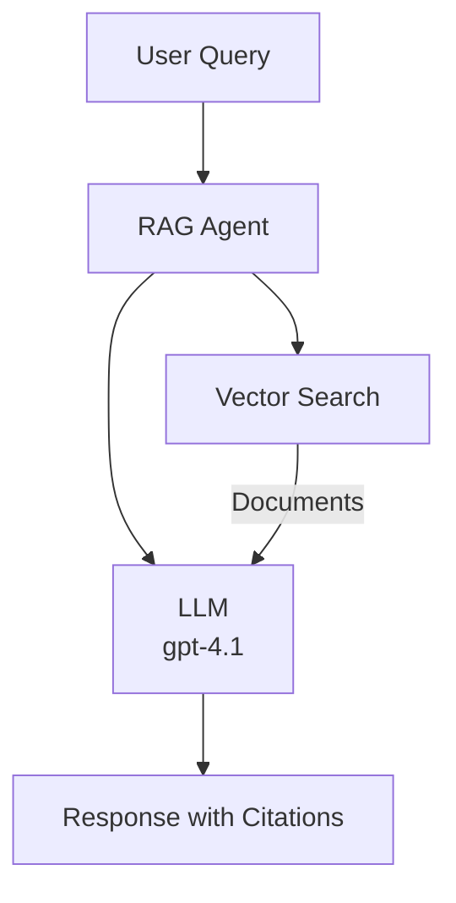
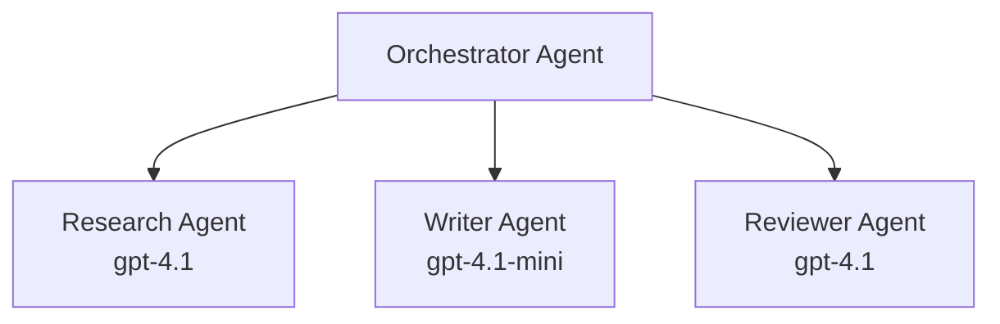

# AI-Agenter med Azure Developer CLI

**Kapitelnavigering:**
- **📚 Kursstart**: [AZD För Nybörjare](../../README.md)
- **📖 Nuvarande Kapitel**: Kapitel 2 - AI-First Utveckling
- **⬅️ Föregående**: [Microsoft Foundry Integration](microsoft-foundry-integration.md)
- **➡️ Nästa**: [AI Modellutplacering](ai-model-deployment.md)
- **🚀 Avancerat**: [Multi-Agent Lösningar](../../examples/retail-scenario.md)

---

## Introduktion

AI-agenter är autonoma program som kan uppfatta sin omgivning, fatta beslut och vidta åtgärder för att uppnå specifika mål. Till skillnad från enkla chatbottar som svarar på uppmaningar kan agenter:

- **Använda verktyg** - Anropa API:er, söka i databaser, köra kod
- **Planera och resonera** - Bryta ner komplexa uppgifter i steg
- **Lära sig från kontext** - Behålla minne och anpassa beteende
- **Samarbeta** - Arbeta med andra agenter (multi-agent system)

Denna guide visar hur du distribuerar AI-agenter till Azure med Azure Developer CLI (azd).

Att använda samtalskontext är inte modellträning: bestående minne, åtkomstkontroll och retention måste implementeras/konfigureras av applikationen.

> **Foundry GA-uppdatering (2026-11-09):** Installera det generellt tillgängliga `microsoft.foundry` 1.0-paketet med `azd >= 1.37.0`. Utvärderingar installeras separat; valfria förhandsvisningsfunktioner och den klassiska SDK-fragmentet nedan ingår inte i GA genom paketmeddelandet. Denna vägledning baseras på [GA-meddelandet](https://devblogs.microsoft.com/azure-sdk/microsoft-foundry-azure-developer-cli-ga/) och dokumentation, inte en live Azure-distribution.

## Lärandemål

Genom att slutföra denna guide kommer du att:
- Förstå vad AI-agenter är och hur de skiljer sig från chatbottar
- Distribuera förbyggda AI-agentmallar med AZD
- Konfigurera Foundry-agenter för anpassade agenter
- Implementera grundläggande agentmönster (verktygsanvändning, RAG, multi-agent)
- Övervaka och felsöka distribuerade agenter

## Läranderesultat

Efter avslutad guide kommer du att kunna:
- Distribuera AI-agentapplikationer till Azure med ett enda kommando
- Konfigurera agentverktyg och funktioner
- Implementera retrieval-augmented generation (RAG) med agenter
- Designa multi-agentarkitekturer för komplexa arbetsflöden
- Felsöka vanliga problem vid agentdistribuering

---

## 🤖 Vad skiljer en agent från en chatbot?

| Funktion | Chatbot | AI-Agent |
|---------|---------|----------|
| **Beteende** | Svarar på uppmaningar | Vidtar autonoma åtgärder |
| **Verktyg** | Kan använda sök eller verktyg | Använder ofta verktyg i en målstyrd loop |
| **Minne** | Applikationsberoende | Bestående minne endast om uttryckligen implementerat |
| **Planering** | Enkelt svar | Flera steg i resonemang |
| **Samarbete** | En enhet | Kan arbeta med andra agenter |

### Enkel liknelse

- **Chatbot** = En hjälpsam person som svarar på frågor i en informationsdisk
- **AI-Agent** = En personlig assistent som kan ringa samtal, boka möten och slutföra uppgifter åt dig

---

## 🚀 Snabbstart: Distribuera din första agent

Välj ett alternativ i en **ny tom arbetskatalog**. Den avslutande `.` initierar där; utan en uttrycklig destination kan aktuell AZD skapa en undermapp med mallnamnet och byter inte skalets katalog. Håll separata mallar/miljöer i separata kataloger.

Tid/kostnadsintervallen nedan är illustrativa, inte verifierade offerter. Kontrollera varje exempelmallens aktuella förutsättningar, prissättning, modellkvot och valfria tjänster före distribution.

### Alternativ 1: Foundry Agent-Mall (Rekommenderad)

```bash
# Initialize the AI agents template
azd init --template get-started-with-ai-agents .

# Deploy to Azure
azd up
```

**Vad som distribueras:** Exempelns aktuella infrastruktur och valda alternativ bestämmer modell, verktyg, hosting och övervakningsresurser. Granska dess README och `infra/` innan du provisionerar; anta inte att varje agentmall inkluderar sök eller ett webbgränssnitt.

**Tid:** ~15-20 minuter
**Kostnad:** ~$100-150/månad (utveckling)

### Alternativ 2: Kreativa skrivagenter med Prompty

```bash
# Initialize the Prompty-based agent template
azd init --template https://github.com/Azure-Samples/contoso-creative-writer .

# Deploy to Azure
azd up
```

**Vad som distribueras:** Ett FastAPI/Prompty multi-agent skrivexempel som använder Azure OpenAI, Bing Grounding, och Azure AI Search. Det tidigare `agent-openai-python-prompty`-arkivet omdirigerar hit; det är inte en minimal Azure Functions weather-agent mall. Följ dess aktuella README för hosting, modellkvot och Bing Grounding-förutsättningar.

**Tid:** ~10-15 minuter
**Kostnad:** ~$50-100/månad (utveckling)

### Alternativ 3: RAG Chat Agent

```bash
# Initialize RAG chat template
azd init --template azure-search-openai-demo .

# Deploy to Azure
azd up
```

**Vad som distribueras:**
- ✅ Microsoft Foundry-modeller
- ✅ Azure AI Search med exempeldatum
- ✅ Dokumenthanteringspipeline
- ✅ Chattgränssnitt med källhänvisningar

**Tid:** ~15-25 minuter
**Kostnad:** ~$80-150/månad (utveckling)

### Alternativ 4: Hostad Agent med GA Foundry-paketet

Använd [den kompletta walkthroughen för hostad agent](microsoft-foundry-integration.md#hosted-agent-walkthrough-ga) för det grundläggande Python Agent Framework Responses API-exemplet. Denna koddistributionsväg kräver Python 3.13+, aktuellt uv, Foundry-behörigheter och regional modellkvot. Autentisera lokala SDK-anrop separat vid användning av Azure CLI-uppgifter.

```bash
azd auth login
azd ext install microsoft.foundry
```

Initiera exemplet i den tomma katalogen:

```text
azd ai agent init --template https://github.com/microsoft-foundry/foundry-samples/blob/main/samples/python/hosted-agents/agent-framework/responses/01-basic/azure.yaml --deploy-mode code --src .
```

Välj ett nytt eller befintligt projekt, granska `azure.yaml` och kör `azd provision`. Använd `azd ai agent run` för att öppna Agent Inspector och, från en annan terminal i den katalogen, `azd ai agent invoke --local "Explain how this agent is hosted."`. Efter lokal verifiering, använd `azd deploy` och `azd ai agent invoke "Explain how this agent is hosted."` för att jämföra det distribuerade svaret. Foundry bygger den uppladdade koden på distans; en lokal containerbyggnad krävs inte.

**När använda `azd ai agent init` vs `azd init --template`:**

| Tillvägagångssätt | Passar bäst för | Hur det fungerar |
|----------|----------|------|
| `azd init --template` | Börjar från en fungerande exempelapp | Klonar ett komplett mall-repo med kod + infra |
| `azd ai agent init --template` | Tar över ett befintligt Foundry-agentprojekt | Använder ett `azure.yaml` projekt dokument och dess definitioner |

> **Tips:** Alternativ 1-3 startar från kompletta applikationsmallar; Alternativ 4 lär ut GA-workflow för hostad agent. Ingen initialiseringskommando migrerar automatiskt äldre agentmanifest. För att lägga till en direkt agentdefinition till ett befintligt projekt, se [initialiserings- och migreringsinstruktioner](../chapter-08-production/production-ai-practices.md#initializing-agent-projects-with-azd-ai-agent-init).

Installera `azure.ai.evaluations` separat för att generera och granska testdata/rubrikar, konfigurera en utvärdering och köra den med `azd ai eval`. Optimering kan återanvända en kompatibel utvärdering; granska kandidater före explicit distribution. Följ [utvärderingsarbetsflödet](../chapter-08-production/production-ai-practices.md#evaluation-migration-and-quality-checks) och [optimeringsmigrering](../chapter-08-production/production-ai-practices.md#optimization-configuration-migration) innan du återanvänder äldre exempel. För borttagning kvarstår resurserna i ett återanvänt Foundry-projekt efter `azd down`; en nyligen skapad projektresursgrupp tas bort. Se [rengöringsinstruktioner för walkthrough](microsoft-foundry-integration.md#7-clean-up-deliberately).

---

## 🏗️ Agentarkitekturmönster

### Mönster 1: Enskild agent med verktyg

Det enklaste agentmönstret - en agent som kan använda flera verktyg.

```mermaid
graph TD
    UI[User Interface] --> Agent[AI Agent<br/>gpt-4.1]
    Agent --> Search[Search Tool]
    Agent --> Database[Database Tool]
    Agent --> API[API Tool]
```



**Bäst för:**
- Kundsupportbotar
- Forskningsassistenter
- Dataanalysagenter

**Relaterat applikationsexempel:** `azure-search-openai-demo` demonstrerar RAG, inte en allmän agentloop för valfria verktyg.

### Mönster 2: RAG-Agent (Retrieval-Augmented Generation)

En agent som hämtar relevanta dokument innan den genererar svar.



**Bäst för:**
- Företagskunskapsbaser
- Dokument-Q&A-system
- Efterlevnad och juridisk forskning

**AZD-mall:** `azure-search-openai-demo`

### Mönster 3: Multi-Agent System

Flera specialiserade agenter som samarbetar i komplexa uppgifter.



**Bäst för:**
- Komplex innehållsgenerering
- Arbetsflöden med flera steg
- Uppgifter som kräver olika expertis

**Läs mer:** [Multi-Agent Koordineringsmönster](../chapter-06-pre-deployment/coordination-patterns.md)

---

## ⚙️ Konfigurera agentverktyg

Agenter blir kraftfulla när de kan använda verktyg. Så här konfigurerar du vanliga verktyg:

### Verktygskonfiguration i Foundry-agenter

Detta **klassiska Agent Service SDK-fragment** riktar sig mot `azure-ai-projects==1.0.0` och `azure-ai-agents==1.1.0` med `azure-identity`. Det är inte den nyare versionerade agent/Responses API som används av några nuvarande Foundry-mallar, inte heller `azure.ai.agents`-AZD-förlängningen (ett annat paket). Blanda inte dessa API-generationer. Sätt `PROJECT_ENDPOINT` till en klassisk Foundry-projektendpoint och `MODEL_DEPLOYMENT_NAME` till en befintlig stödd modellutplacering; autentisera med `az login` lokalt och bevilja nödvändiga projektbehörigheter.

```python
# agent_config.py
import os
from azure.ai.projects import AIProjectClient
from azure.ai.agents.models import FunctionTool
from azure.identity import DefaultAzureCredential

def search_knowledge_base(query: str) -> str:
    """Search the demonstration knowledge base.

    :param query: Search text.
    :return: Matching demonstration information.
    """
    # Local fixture only, not a production search implementation.
    return "Demo policy: returns are accepted within 30 days."

project_client = AIProjectClient(
    endpoint=os.environ["PROJECT_ENDPOINT"],
    credential=DefaultAzureCredential(),
)
search_tool = FunctionTool(functions={search_knowledge_base})
project_client.agents.enable_auto_function_calls(search_tool)
agent = project_client.agents.create_agent(
    model=os.environ["MODEL_DEPLOYMENT_NAME"],
    name="Support Agent",
    instructions="Use search_knowledge_base for policy questions. Label results as demo data.",
    tools=search_tool.definitions,
)
```

Att registrera ett funktionsschema kör inte Python på tjänsten. I denna SDK kör `enable_auto_function_calls` plus `agents.runs.create_and_process(...)` registrerade callback-funktioner i din klientprocess. Se [exempel på SDK som släppts](https://github.com/Azure/azure-sdk-for-python/blob/azure-ai-agents_1.1.0/sdk/ai/azure-ai-agents/samples/agents_tools/sample_agents_auto_function_call.py). Stäng klienten och ta bort demonstrationsagenter/trådar när du är klar.

### Miljökonfiguration

Följande namn är **illustrativa indata för anpassade mallar**, inte inbyggda AZD-omkopplare. Först kopplas varje värde genom `infra/main.parameters.json`, infrastruktur och applikationskod. `azd env set` ändrar inte en agents verktyg eller instruktioner ensam.

```bash
# Set up agent-specific environment variables
azd env set AZURE_OPENAI_MODEL "gpt-4.1"
azd env set AGENT_INSTRUCTIONS "You are a helpful assistant..."
azd env set ENABLE_CODE_INTERPRETER "true"
azd env set ENABLE_FILE_SEARCH "true"

# Apply wired infrastructure and application changes
azd up
```

---

## 📊 Övervakning av agenter

### Integration med Application Insights

Om din valda mall provisionerar Application Insights och konfigurerar instrumentering:

```bash
# Open monitoring dashboard
azd monitor --overview

# Open the Application Insights logs view (not a streaming log tail)
azd monitor --logs

# View live metrics
azd monitor --live
```

### Viktiga mätvärden att följa

| Mätvärde | Beskrivning | Mål |
|--------|-------------|--------|
| Svarsdröjsmål | Tid för att generera svar | < 5 sekunder |
| Tokenanvändning | Tokens per förfrågan | Övervaka kostnad |
| Framgångsgrad för verktygsanrop | % av lyckade verktygsanrop | > 95 % |
| Felprocent | Misslyckade agentförfrågningar | < 1 % |
| Användarnöjdhet | Feedbackpoäng | > 4.0/5.0 |

### Anpassad loggning för agenter

```python
import os
from azure.monitor.opentelemetry import configure_azure_monitor
from opentelemetry import trace

# Configure Azure Monitor with OpenTelemetry
configure_azure_monitor(
    connection_string=os.environ["APPLICATIONINSIGHTS_CONNECTION_STRING"]
)

tracer = trace.get_tracer(__name__)

def log_agent_interaction(user_query, agent_response, tools_used, latency_ms):
    with tracer.start_as_current_span("agent_interaction") as span:
        span.set_attributes({
            "query_length": len(user_query),  # Do not log raw prompts or personal data
            "response_length": len(agent_response),
            "tools_used": tools_used,
            "latency_ms": latency_ms
        })
```

> **Notera:** Installera det nödvändiga paketet: `pip install azure-monitor-opentelemetry`. Det för med sig OpenTelemetry-beroenden; importnamnrymden är inte ett krav för att installera ett paket med namnet `opentelemetry`.

---

## 💰 Kostnadsöverväganden

### Uppskattade månadskostnader per mönster

Dessa är illustrativa planeringsintervall, inte offerter eller budgettak. Region, modelltokens, Search/compute SKU:er, verktygssessioner, lagring och trafik kan överstiga dessa. Kontrollera exempelmallens kostnadsguide och Azure-prissättning innan `azd up`.

| Mönster | Utvecklingsmiljö | Produktion |
|---------|-----------------|------------|
| Enskild agent | $50-100 | $200-500 |
| RAG-agent | $80-150 | $300-800 |
| Multi-agent (2-3 agenter) | $150-300 | $500-1,500 |
| Företags-multi-agent | $300-500 | $1,500-5,000+ |

### Tips för kostnadsoptimering

1. **Använd gpt-4.1-mini för enkla uppgifter** (endast om din mall använder detta indata)
   ```bash
   azd env set AZURE_OPENAI_MODEL "gpt-4.1-mini"
   ```

2. **Implementera scoped caching för säkra, upprepade förfrågningar.** Inkludera hyresgäst-/användarbehörighet, modellutplacering, instruktioner och hämtversion i cache-nyckeln; sätt ett utgångsdatum. Dela inte privata samtalssvar via en processomfattande cache endast för förfrågningar. SDK-agentobjektet har ingen generisk `agent.run()` metod.

3. **Sätt tokengränser per körning**
   ```python
   # Set max_completion_tokens when running the agent, not during creation
   run = project_client.agents.runs.create_and_process(
       thread_id=thread.id,
       agent_id=agent.id,
       max_completion_tokens=1000  # Budget across the run; may finish as incomplete
   )
   ```

4. **Skala ned berättigade Container Apps till noll när de inte används**
   ```bash
   # Custom-template input: must map to template.scale.minReplicas
   azd env set MIN_REPLICAS "0"
   ```
   Tillämpa infrastrukturändringen med `azd provision` eller `azd up`. Skalning till noll behöver en lämplig trigger och stoppar inte Search, lagring eller modell-/verktygsavgifter.

---

## 🔧 Felsökning av agenter

### Vanliga problem och lösningar

<details>
<summary><strong>❌ Agent svarar inte på verktygsanrop</strong></summary>

```bash
# Inspect the application deployment (not the agent's registered tools)
azd show

# Verify OpenAI deployment
az cognitiveservices account deployment list \
  --name $AZURE_OPENAI_NAME \
  --resource-group $RG_NAME

# Check agent logs
azd monitor --logs
```

**Vanliga orsaker:**
- Verktygsfunktionens signaturmatchar inte
- Saknade nödvändiga behörigheter
- API-endpoint är inte åtkomlig
</details>

<details>
<summary><strong>❌ Hög latens i agentsvar</strong></summary>

```bash
# Check Application Insights for bottlenecks
azd monitor --live

# Consider using a faster model
azd env set AZURE_OPENAI_MODEL "gpt-4.1-mini"
azd up
```

**Optimeringstips:**
- Använd strömmande svar
- Implementera cachesvar
- Minska kontextfönstrets storlek
</details>

<details>
<summary><strong>❌ Agent returnerar felaktig eller hallucinerad information</strong></summary>

```python
# Improve with better system prompts
instructions = """
You are a helpful assistant. IMPORTANT:
- Only answer based on provided context
- If you don't know, say "I don't know"
- Always cite your sources
- Never make up information
"""

# Use these instructions in the agent definition.
# For classic file search, first upload/index documents in a vector store,
# then use FileSearchTool(vector_store_ids=[...]) and pass both its
# .definitions and .resources when creating the agent.
```
Instruktioner och hämtning minskar risken; ingen garanterar faktabaserade svar. Utvärdera grundade och utom räckhåll-frågor mot kända svar.
</details>

<details>
<summary><strong>❌ Fel vid överskridande av tokengräns</strong></summary>

```python
# Implement context window management
def truncate_context(messages, max_tokens=8000, model="gpt-4.1"):
    """Approximate content-only budget for objects with .content strings."""
    import tiktoken
    encoding = tiktoken.encoding_for_model(model)
    total_tokens = 0
    truncated = []
    
    for msg in reversed(messages):
        msg_tokens = len(encoding.encode(msg.content))
        if total_tokens + msg_tokens > max_tokens:
            break
        truncated.insert(0, msg)
        total_tokens += msg_tokens
    
    return truncated
```
Denna hjälpreda exkluderar roll-/verktygsscheman, systeminstruktioner, bildtokens och protokollöverhuvud. Avsätt utrymme för dessa och för färdigställandet; dela inte verktygsanrop-/resultatpar eller kassera nödvändiga systeminstruktioner. Installera `tiktoken` separat. Den är inte en generell validator för kontextfönster.
</details>

---

## 🎓 Praktiska övningar

### Övning 1: Distribuera en grundläggande agent (20 minuter)

**Mål:** Distribuera din första AI-agent med AZD

```bash
# Step 1: Initialize template
azd init --template get-started-with-ai-agents .

# Step 2: Login to Azure
azd auth login
# If you work across tenants, add --tenant-id <tenant-id>

# Step 3: Deploy
azd up

# Step 4: Test the agent
# Expected output after deployment:
#   Deployment Complete!
#   Endpoint: https://<app-name>.<region>.azurecontainerapps.io
# Open the URL shown in the output and try asking a question

# Step 5: View monitoring
azd monitor --overview

# Step 6: Review the listed resources and confirm cleanup
azd down
```

**Kriterier för Framgång:**
- [ ] Agent svarar på frågor
- [ ] Kan få åtkomst till övervakningspanelen via `azd monitor`
- [ ] Resurser rensades upp framgångsrikt

### Övning 2: Lägg till ett Anpassat Verktyg (30 minuter)

**Mål:** Utöka en agent med ett anpassat verktyg

**Startpunkt:** Använd den klassiska SDK-klienten från [Verktygskonfiguration](#tool-configuration-in-foundry-agents), inte en godtycklig mall med en annan SDK-generering.

1. Lägg till denna deterministiska testuppsättning i `agent_config.py`:
   ```python
   def get_weather(location: str) -> str:
       """Return demonstration weather, not live conditions.

       :param location: City name.
       :return: A clearly labelled fixture.
       """
       print(f"TOOL_CALLED: {location}")
       return f"Demo weather in {location}: Sunny, 72°F (fixture, not live)"
   ```
2. Ersätt registrerings- och skapelseblocket för sökverktyget med:
   ```python
   weather_tool = FunctionTool(functions={get_weather})
   project_client.agents.enable_auto_function_calls(weather_tool)
   agent = project_client.agents.create_agent(
       model=os.environ["MODEL_DEPLOYMENT_NAME"],
       name="Weather Agent",
       instructions="Call get_weather for weather questions; explain that it returns demo data.",
       tools=weather_tool.definitions,
   )
   thread = project_client.agents.threads.create()
   try:
       project_client.agents.messages.create(
           thread_id=thread.id, role="user", content="Use get_weather for Seattle."
       )
       run = project_client.agents.runs.create_and_process(
           thread_id=thread.id, agent_id=agent.id
       )
       if run.status != "completed":
           raise RuntimeError(f"Run status: {run.status}; error: {run.last_error}")
       for message in project_client.agents.messages.list(thread_id=thread.id):
           for text in message.text_messages:
               print(text.text.value)
   finally:
       project_client.agents.threads.delete(thread.id)
       project_client.agents.delete_agent(agent.id)
       project_client.close()
   ```
3. Kör lokalt (detta anropar det befintliga Azure-projektet och medför modellkostnader):
   ```bash
   python agent_config.py
   # Expected: TOOL_CALLED: Seattle, then a completed answer labelled demo data.
   ```

**Kriterier för Framgång:**
- [ ] Agenten känner igen väderrelaterade frågor
- [ ] Verktyget anropas korrekt
- [ ] Svaret inkluderar väderinformation

### Övning 3: Bygg en RAG-Agent (45 minuter)

**Mål:** Skapa en agent som svarar på frågor baserat på dina dokument

```bash
# Step 1: Deploy RAG template
azd init --template azure-search-openai-demo .
azd up

# Step 2: Upload your documents
# For the sample's local ingestion path, place supported files in data/.
# Run from the sample root after following its Python environment setup:
./scripts/prepdocs.sh
# Windows PowerShell equivalent: .\\scripts\\prepdocs.ps1

# Step 3: Test with domain-specific questions
# Open the web app URL from the azd up output
# Ask questions about your uploaded documents
# Responses should include citation references like [doc.pdf]
```

**Kriterier för Framgång:**
- [ ] Agent svarar från uppladdade dokument
- [ ] Svaren innehåller källhänvisningar
- [ ] Testfrågor utanför området hanteras utan otillåtna påståenden (ingen garanti för varje framtida fråga)

Om `USE_CLOUD_INGESTION=true`, använd istället provets molnbaserade ingestion-/uppladdningsflöde; den lokala omhändertagaren hoppar avsiktligt över ingestion. Efter test, kör `azd down` i RAG-miljön och granska resurserna som ska tas bort.

---

## 📚 Nästa Steg

Nu när du förstår AI-agenter, utforska dessa avancerade ämnen:

| Ämne | Beskrivning | Länk |
|-------|-------------|------|
| **Multi-Agent System** | Bygg system med flera samarbetande agenter | [Retail Multi-Agent Example](../../examples/retail-scenario.md) |
| **Koordinationsmönster** | Lär dig orkestrering och kommunikationsmönster | [Koordinationsmönster](../chapter-06-pre-deployment/coordination-patterns.md) |
| **Produktionssättning** | Företagsredo agentdistribution | [Produktions AI-praktiker](../chapter-08-production/production-ai-practices.md) |
| **Agentutvärdering** | Testa och utvärdera agentprestanda | [AI Felsökning](../chapter-07-troubleshooting/ai-troubleshooting.md) |
| **AI Workshop Lab** | Praktiskt: Gör din AI-lösning AZD-redo | [AI Workshop Lab](ai-workshop-lab.md) |

---

## 📖 Ytterligare Resurser

### Officiell Dokumentation
- [Microsoft Foundry Agent Service](https://learn.microsoft.com/azure/ai-services/agents/)
- [Microsoft Foundry Agent Service Snabbstart](https://learn.microsoft.com/azure/ai-services/agents/quickstart)
- [Semantic Kernel Agent Framework](https://learn.microsoft.com/semantic-kernel/)

### AZD-mallar för Agenter
- [Kom igång med AI-agenter](https://github.com/Azure-Samples/get-started-with-ai-agents)
- [Kreativa skrivagenter med Prompty](https://github.com/Azure-Samples/contoso-creative-writer)
- [Azure Search OpenAI Demo](https://github.com/Azure-Samples/azure-search-openai-demo)

### Community-resurser
- [Awesome AZD - Agentmallar](https://azure.github.io/awesome-azd/?tags=ai-agents)
- [Azure AI Discord](https://discord.gg/microsoft-azure)
- [Microsoft Foundry Discord](https://discord.gg/nTYy5BXMWG)

### Agentfärdigheter för din Editor
- [**Microsoft Azure Agent Skills**](https://skills.sh/microsoft/github-copilot-for-azure) - Installera återanvändbara AI-agentfärdigheter för Azure-utveckling i GitHub Copilot, Cursor eller någon stödjad agent. Inkluderar färdigheter för [Azure AI](https://skills.sh/microsoft/github-copilot-for-azure/azure-ai), [Microsoft Foundry](https://skills.sh/microsoft/github-copilot-for-azure/microsoft-foundry), [distribution](https://skills.sh/microsoft/github-copilot-for-azure/azure-deploy) och [diagnostik](https://skills.sh/microsoft/github-copilot-for-azure/azure-diagnostics):
  ```bash
  npx skills add microsoft/github-copilot-for-azure
  ```

---

**Navigation**
- **Föregående Lektion**: [Microsoft Foundry Integration](microsoft-foundry-integration.md)
- **Nästa Lektion**: [AI Model Deployment](ai-model-deployment.md)

---

<!-- CO-OP TRANSLATOR DISCLAIMER START -->
**Ansvarsfriskrivning**:
Detta dokument har översatts med hjälp av AI-översättningstjänsten [Co-op Translator](https://github.com/Azure/co-op-translator). Även om vi strävar efter noggrannhet, var vänlig notera att automatiska översättningar kan innehålla fel eller brister. Det ursprungliga dokumentet på dess modersmål bör betraktas som den auktoritativa källan. För kritisk information rekommenderas professionell mänsklig översättning. Vi ansvarar inte för några missförstånd eller feltolkningar som uppstår till följd av användningen av denna översättning.
<!-- CO-OP TRANSLATOR DISCLAIMER END -->