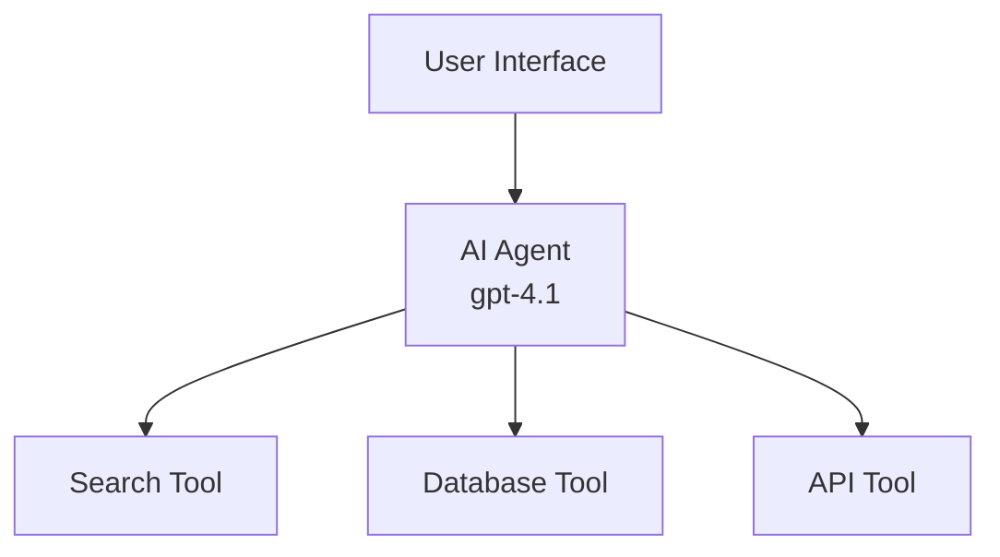
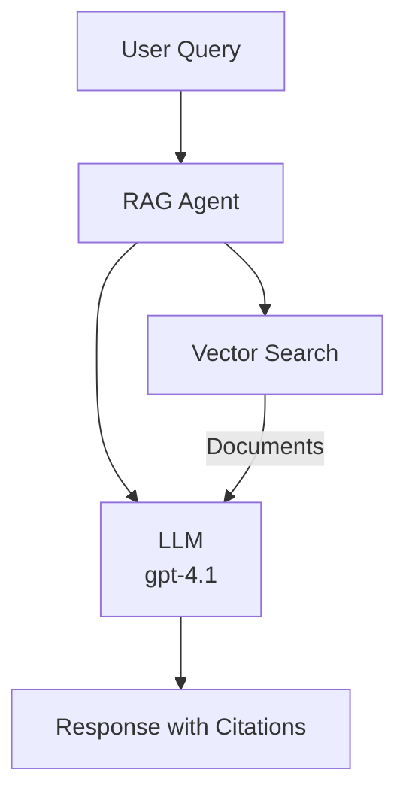
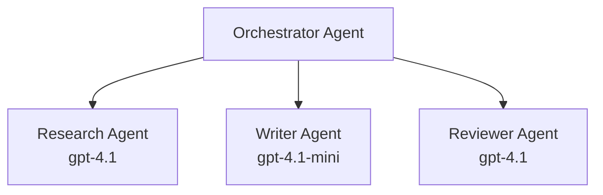

# AI-agenter med Azure Developer CLI

**Kapitelnavigation:**
- **📚 Kursstart**: [AZD För Nybörjare](../../README.md)
- **📖 Nuvarande kapitel**: Kapitel 2 - AI-Först utveckling
- **⬅️ Föregående**: [Microsoft Foundry Integration](microsoft-foundry-integration.md)
- **➡️ Nästa**: [AI Modellutplacering](ai-model-deployment.md)
- **🚀 Avancerat**: [Multi-Agentlösningar](../../examples/retail-scenario.md)

---

## Introduktion

AI-agenter är autonoma program som kan uppfatta sin omgivning, fatta beslut och vidta åtgärder för att uppnå specifika mål. Till skillnad från enkla chattbotar som svarar på uppmaningar kan agenter:

- **Använda verktyg** - Anropa API:er, söka databaser, köra kod
- **Planera och resonera** - Dela upp komplexa uppgifter i steg
- **Lära sig från kontext** - Behålla minne och anpassa beteende
- **Samarbeta** - Arbeta med andra agenter (multi-agent system)

Denna guide visar hur du distribuerar AI-agenter till Azure med Azure Developer CLI (azd).

Användning av konversationskontext är inte modellträning: bestående minne, åtkomstkontroll och lagring måste implementeras/konfigureras av applikationen.

> **Utgåvarevision (2026-11-04):** CLI-exempel kontrollerades mot `azd` `1.37.2`, `azure.ai.agents` `1.0.0-beta.23`, och `azure.ai.evaluations` `1.0.0-beta.2` dokumentation/källor, inte en live Azure-distribution. Använd `azd >= 1.37.0` för den sammanlagda arbetsflödet. Se [senaste ändringar och fixar](../chapter-08-production/production-ai-practices.md#recent-release-changes-and-fixes) innan du uppgraderar äldre projekt.

## Läromål

När du slutfört denna guide kommer du att:
- Förstå vad AI-agenter är och hur de skiljer sig från chattbotar
- Distribuera förbyggda AI-agentmallar med AZD
- Konfigurera Foundry-agenter för anpassade agenter
- Implementera grundläggande agentmönster (verktygsanvändning, RAG, multi-agent)
- Övervaka och felsöka distribuerade agenter

## Inlärningsresultat

Efter avslutad kurs kan du:
- Distribuera AI-agentapplikationer till Azure med ett enda kommando
- Konfigurera agentverktyg och funktioner
- Implementera retrieval-augmented generation (RAG) med agenter
- Designa multi-agent arkitekturer för komplexa arbetsflöden
- Felsöka vanliga problem vid agentdistribuering

---

## 🤖 Vad skiljer en agent från en chattbot?

| Funktion | Chattbot | AI-agent |
|---------|---------|----------|
| **Beteende** | Svarar på uppmaningar | Tar autonoma åtgärder |
| **Verktyg** | Kan använda sök eller verktyg | Använder typiskt verktyg i en målinriktad loop |
| **Minne** | Applikationsberoende | Bestående minne endast om det uttryckligen implementeras |
| **Planering** | Enskilt svar | Flera steg av resonemang |
| **Samarbete** | Enskild enhet | Kan samarbeta med andra agenter |

### Enkel analogi

- **Chattbot** = En hjälpsam person som svarar på frågor vid en informationsdisk
- **AI-agent** = En personlig assistent som kan ringa, boka möten och utföra uppgifter åt dig

---

## 🚀 Kom igång snabbt: Distribuera din första agent

Välj ett alternativ i en **ny tom arbetskatalog**. Den avslutande `.` initierar där; utan en explicit destination kan nuvarande AZD skapa en undermapp med mallnamnet och ändrar inte din skal-katalog. Håll separata mallar/miljöer i separata kataloger.

Tids-/kostnadsintervallen nedan är vägledande, inte verifierade offerter. Kontrollera varje exempeltext aktuella förutsättningar, prissättning, modellkvot och valfria tjänster före distribution.

### Alternativ 1: Foundry Agents mall (Rekommenderas)

```bash
# Initialize the AI agents template
azd init --template get-started-with-ai-agents .

# Deploy to Azure
azd up
```

**Vad som distribueras:** Exempelns aktuella infrastruktur och valda alternativ bestämmer modell, verktyg, hosting och övervakningsresurser. Granska dess README och `infra/` innan provisioning; anta inte att varje agentmall inkluderar Sök eller ett webbgränssnitt.

**Tid:** ~15-20 minuter
**Kostnad:** ~$100-150/månad (utveckling)

### Alternativ 2: Kreativa skrivagenten med Prompty

```bash
# Initialize the Prompty-based agent template
azd init --template https://github.com/Azure-Samples/contoso-creative-writer .

# Deploy to Azure
azd up
```

**Vad som distribueras:** Ett FastAPI/Prompty multi-agent skrivprov med Azure OpenAI, Bing Grounding och Azure AI Sök. Det tidigare `agent-openai-python-prompty`-förrådet omdirigerar hit; det är inte en minimal Azure Functions väderagentmall. Följ dess aktuella README för hosting, modellkvot och Bing Grounding-förutsättningar.

**Tid:** ~10-15 minuter
**Kostnad:** ~$50-100/månad (utveckling)

### Alternativ 3: RAG Chattagent

```bash
# Initialize RAG chat template
azd init --template azure-search-openai-demo .

# Deploy to Azure
azd up
```

**Vad som distribueras:**
- ✅ Microsoft Foundry Modeller
- ✅ Azure AI Search med exempeldata
- ✅ Dokumentbehandlingspipeline
- ✅ Chattgränssnitt med referenser

**Tid:** ~15-25 minuter
**Kostnad:** ~$80-150/månad (utveckling)

### Alternativ 4: AZD AI Agent Init (Projektmall Förhandsvisning)

Använd `azd ai agent init` interaktivt, eller adoptera ett aktuellt `azure.yaml` agentprojekt med `--template`/`-t`. Det gamla `--manifest`/`-m`-alternativet är en föråldrad alias, inte en konverterare för äldre manifester.

```bash
# Install the AI agents extension
azd extension install azure.ai.agents

# Optional: verify the installed preview version
azd extension show azure.ai.agents

# Initialize from a current agent project template (supply your template path)
azd ai agent init --template ./templates/support-agent/azure.yaml

# Deploy to Azure
azd up

# Test the deployed agent (shows latency + time-to-first-byte)
azd ai agent invoke
```

**När man ska använda `azd ai agent init` vs `azd init --template`:**

| Tillvägagångssätt | Bäst för | Hur det fungerar |
|----------|----------|------|
| `azd init --template` | Start från en fungerande exempelapp | Klonar ett fullständigt mallförråd med kod + infrastruktur |
| `azd ai agent init --template` | Adoptera ett aktuellt Foundry agentprojekt | Använder en `azure.yaml` projektfil och dess definitioner |

> **Tips:** Använd `azd init --template` när du lär dig (Alternativ 1-3 ovan). Använd `azd ai agent init` för Foundry agentarbetsflödet. För att lägga till en direkt agentdefinition till ett befintligt projekt, se [initialiserings- och migrationsanvisningar](../chapter-08-production/production-ai-practices.md#initializing-agent-projects-with-azd-ai-agent-init).

Efter `azd up`, använd `azd ai agent invoke` för testning, den separata `azure.ai.evaluations`-tillägget (`azd ai eval init`, `generate`, och `run start`) för att mäta kvalitet, och `azd ai agent optimize` för att förbättra det med den nya utvärderingskonfigurationen. Agenter beta.22 ersatte det äldre utvärderingsarbetsflödet och ändrade optimeringens `--config`-format. Se [utvärderingsmigrering](../chapter-08-production/production-ai-practices.md#evaluation-migration-and-quality-checks) och [optimeringsmigrering](../chapter-08-production/production-ai-practices.md#optimization-configuration-migration) innan du återanvänder äldre exempel.

---

## 🏗️ Agentarkitekturmönster

### Mönster 1: Enskild agent med verktyg

Det enklaste agentmönstret - en agent som kan använda flera verktyg.



**Bäst för:**
- Kundsupportbotar
- Forskningsassistenter
- Dataanalysagenter

**Relaterat applikationsexempel:** `azure-search-openai-demo` demonstrerar RAG, inte en generell agentloop för godtyckliga verktyg.

### Mönster 2: RAG-agent (Retrieval-Augmented Generation)

En agent som hämtar relevanta dokument innan den genererar svar.



**Bäst för:**
- Företagskunskapsbaser
- Dokument Q&A-system
- Regelefterlevnad och juridisk forskning

**AZD-mall:** `azure-search-openai-demo`

### Mönster 3: Multi-agent system

Flera specialiserade agenter som arbetar tillsammans med komplexa uppgifter.



**Bäst för:**
- Komplex innehållsgenerering
- Flera steg i arbetsflöden
- Uppgifter som kräver olika expertis

**Läs mer:** [Multi-Agent Koordineringsmönster](../chapter-06-pre-deployment/coordination-patterns.md)

---

## ⚙️ Konfigurera agentverktyg

Agenter blir kraftfulla när de kan använda verktyg. Här är hur du konfigurerar vanliga verktyg:

### Verktygskonfiguration i Foundry Agents

Detta **klassiska Agent Service SDK-fragment** riktar sig mot `azure-ai-projects==1.0.0` och `azure-ai-agents==1.1.0` med `azure-identity`. Det är inte den nyare versionerade agent/Responses API som används av några nuvarande Foundry-mallar, inte heller `azure.ai.agents` AZD-tillägget (ett annat paket). Blanda inte dessa API-generationer. Sätt `PROJECT_ENDPOINT` till en klassisk Foundry projektendpunkt och `MODEL_DEPLOYMENT_NAME` till en befintlig stöd modellutplacering; autentisera med `az login` lokalt och ge nödvändiga projektbehörigheter.

```python
# agent_config.py
import os
from azure.ai.projects import AIProjectClient
from azure.ai.agents.models import FunctionTool
from azure.identity import DefaultAzureCredential

def search_knowledge_base(query: str) -> str:
    """Search the demonstration knowledge base.

    :param query: Search text.
    :return: Matching demonstration information.
    """
    # Local fixture only, not a production search implementation.
    return "Demo policy: returns are accepted within 30 days."

project_client = AIProjectClient(
    endpoint=os.environ["PROJECT_ENDPOINT"],
    credential=DefaultAzureCredential(),
)
search_tool = FunctionTool(functions={search_knowledge_base})
project_client.agents.enable_auto_function_calls(search_tool)
agent = project_client.agents.create_agent(
    model=os.environ["MODEL_DEPLOYMENT_NAME"],
    name="Support Agent",
    instructions="Use search_knowledge_base for policy questions. Label results as demo data.",
    tools=search_tool.definitions,
)
```

Att registrera ett funktionsschema kör inte Python på tjänsten. I detta SDK kör `enable_auto_function_calls` plus `agents.runs.create_and_process(...)` registrerade callback-funktioner i din klientprocess. Se [publicerat SDK-exempel](https://github.com/Azure/azure-sdk-for-python/blob/azure-ai-agents_1.1.0/sdk/ai/azure-ai-agents/samples/agents_tools/sample_agents_auto_function_call.py). Stäng klienten och ta bort demonstrationsagenter/trådar när du är klar.

### Miljökonfiguration

Följande namn är **illustrativa egna mallinmatningar**, inte inbyggda AZD-växlar. Trä först varje värde genom `infra/main.parameters.json`, infrastruktur och applikationskod. `azd env set` ändrar inte agentens verktyg eller instruktioner själv.

```bash
# Set up agent-specific environment variables
azd env set AZURE_OPENAI_MODEL "gpt-4.1"
azd env set AGENT_INSTRUCTIONS "You are a helpful assistant..."
azd env set ENABLE_CODE_INTERPRETER "true"
azd env set ENABLE_FILE_SEARCH "true"

# Apply wired infrastructure and application changes
azd up
```

---

## 📊 Övervakning av agenter

### Application Insights Integration

Om din valda mall installerar Application Insights och konfigurerar instrumentering:

```bash
# Open monitoring dashboard
azd monitor --overview

# Open the Application Insights logs view (not a streaming log tail)
azd monitor --logs

# View live metrics
azd monitor --live
```

### Viktiga mätvärden att följa

| Mätvärde | Beskrivning | Mål |
|--------|-------------|--------|
| Responstid | Tid för att generera svar | < 5 sekunder |
| Tokenanvändning | Tokens per förfrågan | Övervaka kostnader |
| Framgångsgrad för verktygsanrop | % av lyckade verktygsexekveringar | > 95% |
| Felprocent | Misslyckade agentförfrågningar | < 1% |
| Användarnöjdhet | Feedbackpoäng | > 4.0/5.0 |

### Anpassad loggning för agenter

```python
import os
from azure.monitor.opentelemetry import configure_azure_monitor
from opentelemetry import trace

# Configure Azure Monitor with OpenTelemetry
configure_azure_monitor(
    connection_string=os.environ["APPLICATIONINSIGHTS_CONNECTION_STRING"]
)

tracer = trace.get_tracer(__name__)

def log_agent_interaction(user_query, agent_response, tools_used, latency_ms):
    with tracer.start_as_current_span("agent_interaction") as span:
        span.set_attributes({
            "query_length": len(user_query),  # Do not log raw prompts or personal data
            "response_length": len(agent_response),
            "tools_used": tools_used,
            "latency_ms": latency_ms
        })
```

> **Notera:** Installera nödvändigt paket: `pip install azure-monitor-opentelemetry`. Det medför OpenTelemetry-beroenden; import-namnutrymmet är inte ett krav för att installera ett paket som heter `opentelemetry`.

---

## 💰 Kostnadsöverväganden

### Beräknade månadskostnader per mönster

Dessa är illustrativa planeringsintervall, inte offerter eller spenderingstak. Region, modelltokens, Sök/beräknings-SKU:er, verktygssessioner, lagring och trafik kan överstiga dem. Kontrollera exempelns kostnadsguide och Azure-priser innan `azd up`.

| Mönster | Utvecklingsmiljö | Produktion |
|---------|-----------------|------------|
| Enskild agent | $50-100 | $200-500 |
| RAG-agent | $80-150 | $300-800 |
| Multi-agent (2-3 agenter) | $150-300 | $500-1,500 |
| Företags-multi-agent | $300-500 | $1,500-5,000+ |

### Tips för kostnadsoptimering

1. **Använd gpt-4.1-mini för enkla uppgifter** (endast om din mall använder denna input)
   ```bash
   azd env set AZURE_OPENAI_MODEL "gpt-4.1-mini"
   ```

2. **Implementera scoped caching för säkra, upprepade frågor.** Inkludera tenant-/användarbehörighet, modellutplacering, instruktioner och återvinningsversion i cache-nyckeln; ställ in utgångstid. Dela inte privata konversationssvar via en processomfattande query-only cache. SDK-agentobjektet har ingen generell `agent.run()`-metod.

3. **Sätt tokenbegränsningar per körning**
   ```python
   # Set max_completion_tokens when running the agent, not during creation
   run = project_client.agents.runs.create_and_process(
       thread_id=thread.id,
       agent_id=agent.id,
       max_completion_tokens=1000  # Budget across the run; may finish as incomplete
   )
   ```

4. **Skala behöriga Container Apps till noll när de inte används**
   ```bash
   # Custom-template input: must map to template.scale.minReplicas
   azd env set MIN_REPLICAS "0"
   ```
   Tillämpa infrastrukturnändringen med `azd provision` eller `azd up`. Skalning till noll kräver en lämplig trigger och stoppar inte Sök, lagring eller modell/verktygsavgifter.

---

## 🔧 Felsökning av agenter

### Vanliga problem och lösningar

<details>
<summary><strong>❌ Agent svarar inte på verktygsanrop</strong></summary>

```bash
# Inspect the application deployment (not the agent's registered tools)
azd show

# Verify OpenAI deployment
az cognitiveservices account deployment list \
  --name $AZURE_OPENAI_NAME \
  --resource-group $RG_NAME

# Check agent logs
azd monitor --logs
```

**Vanliga orsaker:**
- Verktygsfunktionssignatur stämmer inte
- Saknade nödvändiga behörigheter
- API-endpunkt ej åtkomlig
</details>

<details>
<summary><strong>❌ Hög latens i agentsvar</strong></summary>

```bash
# Check Application Insights for bottlenecks
azd monitor --live

# Consider using a faster model
azd env set AZURE_OPENAI_MODEL "gpt-4.1-mini"
azd up
```

**Optimeringstips:**
- Använd strömmande svar
- Implementera svarscaching
- Minska storleken på kontextfönstret
</details>

<details>
<summary><strong>❌ Agent returnerar felaktig eller hallucinerad information</strong></summary>

```python
# Improve with better system prompts
instructions = """
You are a helpful assistant. IMPORTANT:
- Only answer based on provided context
- If you don't know, say "I don't know"
- Always cite your sources
- Never make up information
"""

# Use these instructions in the agent definition.
# For classic file search, first upload/index documents in a vector store,
# then use FileSearchTool(vector_store_ids=[...]) and pass both its
# .definitions and .resources when creating the agent.
```
Instruktioner och återvinning minskar risken; ingen garanterar faktabaserade svar. Utvärdera underbyggda och utanför-räckvidds-frågor mot kända svar.
</details>

<details>
<summary><strong>❌ Fel på grund av överskriden token-gräns</strong></summary>

```python
# Implement context window management
def truncate_context(messages, max_tokens=8000, model="gpt-4.1"):
    """Approximate content-only budget for objects with .content strings."""
    import tiktoken
    encoding = tiktoken.encoding_for_model(model)
    total_tokens = 0
    truncated = []
    
    for msg in reversed(messages):
        msg_tokens = len(encoding.encode(msg.content))
        if total_tokens + msg_tokens > max_tokens:
            break
        truncated.insert(0, msg)
        total_tokens += msg_tokens
    
    return truncated
```
Denna hjälpare exkluderar roll-/verktygsscheman, systeminstruktioner, bildtokens och protokolloverhead. Reservera plats för dessa och komplettering; dela inte upp verktygsanrops-/resultatpar eller kasta viktiga systeminstruktioner. Installera `tiktoken` separat. Det är inte en generell validator för kontextfönster.
</details>

---

## 🎓 Praktiska övningar

### Övning 1: Distribuera en grundläggande agent (20 minuter)

**Mål:** Distribuera din första AI-agent med AZD

```bash
# Step 1: Initialize template
azd init --template get-started-with-ai-agents .

# Step 2: Login to Azure
azd auth login
# If you work across tenants, add --tenant-id <tenant-id>

# Step 3: Deploy
azd up

# Step 4: Test the agent
# Expected output after deployment:
#   Deployment Complete!
#   Endpoint: https://<app-name>.<region>.azurecontainerapps.io
# Open the URL shown in the output and try asking a question

# Step 5: View monitoring
azd monitor --overview

# Step 6: Clean up
azd down --force --purge
```

**Framgångskriterier:**
- [ ] Agenten svarar på frågor
- [ ] Kan komma åt övervakningsinstrumentpanel via `azd monitor`
- [ ] Resurser städade framgångsrikt

### Övning 2: Lägg till ett anpassat verktyg (30 minuter)

**Mål:** Utöka en agent med ett anpassat verktyg

**Startpunkt:** Använd den klassiska SDK-klienten från [Verktygskonfiguration](#tool-configuration-in-foundry-agents), inte en godtycklig mall med en annan SDK-generation.

1. Lägg till denna deterministiska fixture i `agent_config.py`:
   ```python
   def get_weather(location: str) -> str:
       """Return demonstration weather, not live conditions.

       :param location: City name.
       :return: A clearly labelled fixture.
       """
       print(f"TOOL_CALLED: {location}")
       return f"Demo weather in {location}: Sunny, 72°F (fixture, not live)"
   ```
2. Ersätt blocket för registrering och skapande av sökverktyget med:
   ```python
   weather_tool = FunctionTool(functions={get_weather})
   project_client.agents.enable_auto_function_calls(weather_tool)
   agent = project_client.agents.create_agent(
       model=os.environ["MODEL_DEPLOYMENT_NAME"],
       name="Weather Agent",
       instructions="Call get_weather for weather questions; explain that it returns demo data.",
       tools=weather_tool.definitions,
   )
   thread = project_client.agents.threads.create()
   try:
       project_client.agents.messages.create(
           thread_id=thread.id, role="user", content="Use get_weather for Seattle."
       )
       run = project_client.agents.runs.create_and_process(
           thread_id=thread.id, agent_id=agent.id
       )
       if run.status != "completed":
           raise RuntimeError(f"Run status: {run.status}; error: {run.last_error}")
       for message in project_client.agents.messages.list(thread_id=thread.id):
           for text in message.text_messages:
               print(text.text.value)
   finally:
       project_client.agents.threads.delete(thread.id)
       project_client.agents.delete_agent(agent.id)
       project_client.close()
   ```
3. Kör lokalt (detta anropar det befintliga Azure-projektet och medför modellkostnader):
   ```bash
   python agent_config.py
   # Expected: TOOL_CALLED: Seattle, then a completed answer labelled demo data.
   ```

**Kriterier för framgång:**
- [ ] Agenten känner igen frågor relaterade till väder
- [ ] Verktyget anropas korrekt
- [ ] Svar innehåller väderinformation

### Övning 3: Bygg en RAG Agent (45 minuter)

**Mål:** Skapa en agent som svarar på frågor från dina dokument

```bash
# Step 1: Deploy RAG template
azd init --template azure-search-openai-demo .
azd up

# Step 2: Upload your documents
# For the sample's local ingestion path, place supported files in data/.
# Run from the sample root after following its Python environment setup:
./scripts/prepdocs.sh
# Windows PowerShell equivalent: .\\scripts\\prepdocs.ps1

# Step 3: Test with domain-specific questions
# Open the web app URL from the azd up output
# Ask questions about your uploaded documents
# Responses should include citation references like [doc.pdf]
```

**Kriterier för framgång:**
- [ ] Agent svarar utifrån uppladdade dokument
- [ ] Svaren inkluderar källhänvisningar
- [ ] Testfrågor utanför omfattningen hanteras utan obekräftade påståenden (inte en garanti för varje framtida fråga)

Om `USE_CLOUD_INGESTION=true`, använd istället exempelns molnbaserade intagnings-/uppladdningsflöde; den lokala wrappningen hoppar medvetet över intagningen. Efter testning kör `azd down` i RAG-miljön och granska resurserna som ska raderas.

---

## 📚 Nästa steg

Nu när du förstår AI-agenter, utforska dessa avancerade ämnen:

| Ämne | Beskrivning | Länk |
|-------|-------------|------|
| **Multi-Agent System** | Bygg system med flera samarbetande agenter | [Retail Multi-Agent Example](../../examples/retail-scenario.md) |
| **Koordinationsmönster** | Lär dig orkestrering och kommunikationsmönster | [Coordination Patterns](../chapter-06-pre-deployment/coordination-patterns.md) |
| **Produktionssättning** | Agentdrift redo för företag | [Production AI Practices](../chapter-08-production/production-ai-practices.md) |
| **Agentutvärdering** | Testa och utvärdera agenternas prestanda | [AI Troubleshooting](../chapter-07-troubleshooting/ai-troubleshooting.md) |
| **AI Workshop Lab** | Praktiskt: Gör din AI-lösning AZD-redo | [AI Workshop Lab](ai-workshop-lab.md) |

---

## 📖 Ytterligare resurser

### Officiell dokumentation
- [Microsoft Foundry Agent Service](https://learn.microsoft.com/azure/ai-services/agents/)
- [Microsoft Foundry Agent Service Quickstart](https://learn.microsoft.com/azure/ai-services/agents/quickstart)
- [Semantic Kernel Agent Framework](https://learn.microsoft.com/semantic-kernel/)

### AZD-mallar för agenter
- [Kom igång med AI-agenter](https://github.com/Azure-Samples/get-started-with-ai-agents)
- [Creative Writing Agents med Prompty](https://github.com/Azure-Samples/contoso-creative-writer)
- [Azure Search OpenAI Demo](https://github.com/Azure-Samples/azure-search-openai-demo)

### Gemenskapens resurser
- [Awesome AZD - Agentmallar](https://azure.github.io/awesome-azd/?tags=ai-agents)
- [Azure AI Discord](https://discord.gg/microsoft-azure)
- [Microsoft Foundry Discord](https://discord.gg/nTYy5BXMWG)

### Agentfunktioner för din editor
- [**Microsoft Azure Agent Skills**](https://skills.sh/microsoft/github-copilot-for-azure) - Installera återanvändbara AI-agentfunktioner för Azure-utveckling i GitHub Copilot, Cursor eller någon annan stödjad agent. Inkluderar funktioner för [Azure AI](https://skills.sh/microsoft/github-copilot-for-azure/azure-ai), [Microsoft Foundry](https://skills.sh/microsoft/github-copilot-for-azure/microsoft-foundry), [driftsättning](https://skills.sh/microsoft/github-copilot-for-azure/azure-deploy) och [diagnostik](https://skills.sh/microsoft/github-copilot-for-azure/azure-diagnostics):
  ```bash
  npx skills add microsoft/github-copilot-for-azure
  ```

---

**Navigering**
- **Föregående lektion**: [Microsoft Foundry Integration](microsoft-foundry-integration.md)
- **Nästa lektion**: [AI Model Deployment](ai-model-deployment.md)

---

<!-- CO-OP TRANSLATOR DISCLAIMER START -->
**Ansvarsfriskrivning**:
Detta dokument har översatts med hjälp av AI-översättningstjänsten [Co-op Translator](https://github.com/Azure/co-op-translator). Även om vi strävar efter noggrannhet, var vänlig notera att automatiska översättningar kan innehålla fel eller brister. Det ursprungliga dokumentet på dess modersmål bör betraktas som den auktoritativa källan. För kritisk information rekommenderas professionell mänsklig översättning. Vi ansvarar inte för några missförstånd eller feltolkningar som uppstår till följd av användningen av denna översättning.
<!-- CO-OP TRANSLATOR DISCLAIMER END -->