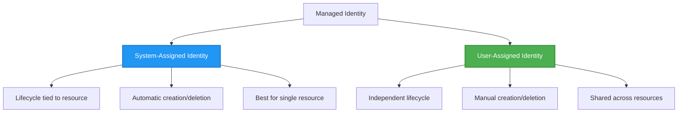

# Autentiseringsmönster och hanterad identitet

⏱️ **Beräknad tid**: 45-60 minuter läsning; avsätt extra tid för att integrera övningar | 💰 **Kostnadspåverkan**: Identitet/RBAC är gratis; distribuerad beräkning, lagring och Key Vault debiteras | ⭐ **Svårighetsgrad**: Medelnivå

> Granskad mot `azd 1.37.2` (november 2026). Denna lektion innehåller **illustrativa integrationsfragment, inte en komplett nedladdningsbar `secure-app`-mall**. Skapa de refererade filerna, tillhandahåll matchande infrastruktur och ersätt platshållare före distribution. Inga Azure-resurser skapades under granskningen.

**📚 Lärandestig:**
- ← Föregående: [Konfigurationshantering](configuration.md) - Hantera miljövariabler och hemligheter
- 🎯 **Du är här**: Autentisering & Säkerhet (Hanterad identitet, Key Vault, säkra mönster)
- → Nästa: [Infrastructure as Code](../chapter-04-infrastructure/README.md) - Provisionera och distribuera resurser
- 🏠 [Kursstartsida](../../README.md)

---

## Vad du kommer att lära dig

Genom att slutföra denna lektion kommer du att:
- Förstå Azure-autentiseringsmönster (nycklar, anslutningssträngar, hanterad identitet)
- Implementera **Hanterad identitet** för lösenordsfri autentisering
- Säkerställa hemligheter med **Azure Key Vault**-integration
- Konfigurera **behörighetsstyrning baserad på roller (RBAC)** för AZD-distributioner
- Använda säkerhetsbästa praxis i Container Apps och Azure-tjänster
- Migrera från nyckelbaserad till identitetsbaserad autentisering

## Varför Hanterad Identitet är Viktigt

### Problemet: Traditionell autentisering

**Före hanterad identitet:**
```javascript
// ❌ SECURITY RISK: Hardcoded secrets in code
const connectionString = "Server=mydb.database.windows.net;User=admin;Password=P@ssw0rd123";
const storageKey = "xK7mN9pQ2wR5tY8uI0oP3aS6dF1gH4jK...";
const cosmosKey = "C2x7B9n4M1p8Q5w3E6r0T2y5U8i1O4p7...";
```

**Problem:**
- 🔴 **Exponerade hemligheter** i kod, konfigurationsfiler, miljövariabler
- 🔴 **Behörighetsrotation** kräver kodändringar och omdistribution
- 🔴 **Revisionsproblem** - vem har åtkomst till vad, när?
- 🔴 **Spridning** - hemligheter utspridda i flera system
- 🔴 **Regelefterlevnadsrisker** - misslyckas vid säkerhetsrevisioner

### Lösningen: Hanterad identitet

**Efter hanterad identitet:**
```javascript
// ✅ SECURE: No secrets in code
const credential = new DefaultAzureCredential();
const client = new BlobServiceClient(
  "https://mystorageaccount.blob.core.windows.net",
  credential  // Azure automatically handles authentication
);
```

**Fördelar:**
- ✅ **Inga hemligheter** i kod eller konfiguration
- ✅ **Automatisk rotation** - Azure hanterar det
- ✅ **Fullständig revisionslogg** i Microsoft Entra ID-loggar
- ✅ **Centraliserad säkerhet** - hanteras i Azure Portal
- ✅ **Regelefterlevnad** - uppfyller säkerhetsstandarder

**Liknelse**: Traditionell autentisering är som att bära flera fysiska nycklar till olika dörrar. Hanterad identitet är som att ha ett säkerhetskort som automatiskt ger tillgång baserat på vem du är — inga nycklar att tappa bort, kopiera eller rotera.

---

## Arkitekturöversikt

### Autentiseringsflöde med hanterad identitet

```mermaid
sequenceDiagram
    participant App as Your Application<br/>(Container App)
    participant MI as Managed Identity<br/>(Microsoft Entra ID)
    participant KV as Key Vault
    participant Storage as Azure Storage
    participant DB as Azure SQL
    
    App->>MI: Request access token<br/>(automatic)
    MI->>MI: Verify identity<br/>(no password needed)
    MI-->>App: Return token for requested audience<br/>(lifetime varies)
    
    App->>KV: Get secret<br/>(using token)
    KV->>KV: Check RBAC permissions
    KV-->>App: Return secret value
    
    App->>Storage: Upload blob<br/>(using token)
    Storage->>Storage: Check RBAC permissions
    Storage-->>App: Success
    
    App->>DB: Query data<br/>(using token)
    DB->>DB: Check SQL permissions
    DB-->>App: Return results
    
    Note over App,DB: Request a separate token for each service audience;<br/>SDK credentials handle caching and renewal
```

### Typer av hanterade identiteter



| Funktion | Systems-assigned | Användar-assigned |
|---------|----------------|---------------|
| **Livscykel** | Kopplad till resurs | Oberoende |
| **Skapande** | Automatisk med resurs | Manuellt skapad |
| **Borttagning** | Borttagen med resurs | Kvarstår efter resursborttagning |
| **Delning** | Endast en resurs | Flera resurser |
| **Användningsfall** | Enkla scenarier | Komplexa multisresursscenarier |
| **Val av mall** | Definierad i infrastrukturen | Definierad i infrastrukturen |

---

## Förutsättningar

### Krävs verktyg

Du bör redan ha dessa installerade från tidigare lektioner:

```bash
# Verify Azure Developer CLI
azd version
# ✅ Expected: azd version 1.0.0 or higher

# Verify Azure CLI
az --version
# ✅ Expected: azure-cli 2.50.0 or higher
```

### Azure-krav

- Aktiv Azure-prenumeration
- Behörigheter för att:
  - Skapa hanterade identiteter
  - Tilldela RBAC-roller
  - Skapa Key Vault-resurser
  - Distribuera Container Apps

### Kunskapsförutsättningar

Du bör ha genomfört:
- [Installationsguide](../chapter-01-foundation/installation.md) - AZD-installation
- [AZD Grunder](../chapter-01-foundation/azd-basics.md) - Kärnkoncept
- [Konfigurationshantering](configuration.md) - Miljövariabler

---

## Lektion 1: Förstå autentiseringsmönster

### Mönster 1: Anslutningssträngar (Legacy - Undvik)

**Hur det fungerar:**
```bash
# Connection string contains credentials
STORAGE_CONNECTION_STRING="DefaultEndpointsProtocol=https;AccountName=myaccount;AccountKey=xK7mN9pQ2wR5..."
COSMOS_CONNECTION_STRING="AccountEndpoint=https://myaccount.documents.azure.com:443/;AccountKey=C2x7..."
SQL_CONNECTION_STRING="Server=myserver.database.windows.net;User=admin;Password=P@ssw0rd..."
```

**Problem:**
- ❌ Hemligheter synliga i miljövariabler
- ❌ Loggade i distributionssystem
- ❌ Svåra att rotera
- ❌ Ingen revisionslogg för åtkomst

**När du ska använda:** När måltjänsten kräver nyckelbaserad autentisering. Föredra identitet där det stöds; annars lagra nycklar säkert och rotera dem, även i produktion.

---

### Mönster 2: Key Vault-referenser (Bättre)

**Hur det fungerar:**
**Delvisa Bicep-fragment:** obligatoriska fält för vault, Container App-identitet och dess `configuration.secrets`-post är utelämnade. `secretRef` pekar på en Container App-hemlighet; det är **inte i sig självt** en Key Vault-URI. För att använda Key Vault, definiera den namngivna hemligheten med `keyVaultUrl` och en auktoriserad `identity`.

```bicep
// Store secret in Key Vault
resource keyVault 'Microsoft.KeyVault/vaults@2023-02-01' = {
  name: 'mykv'
  properties: {
    enableRbacAuthorization: true
  }
}

// Reference in Container App
env: [
  {
    name: 'STORAGE_KEY'
    secretRef: 'storage-key'  // References Key Vault
  }
]
```

**Fördelar:**
- ✅ Hemligheter lagras säkert i Key Vault
- ✅ Centraliserad hemlighetshantering
- ✅ Rotation utan kodändringar

**Begränsningar:**
- ⚠️ Använder fortfarande nycklar/lösenord
- ⚠️ Behöver hantera åtkomst till Key Vault

**När du ska använda:** Övergångssteg från anslutningssträngar till hanterad identitet.

---

### Mönster 3: Hanterad identitet (Bästa praxis)

**Hur det fungerar:**
**Delvis Bicep:** slå ihop identitetsblocket till en fullständig Container App och tillhandahåll `storageAccount` och rolldefinitionen. En rolltilldelning kräver också ett deterministiskt `name`.

```bicep
// Enable managed identity
resource containerApp 'Microsoft.App/containerApps@2023-05-01' = {
  name: 'myapp'
  identity: {
    type: 'SystemAssigned'  // Automatically creates identity
  }
}

// Grant permissions
resource roleAssignment 'Microsoft.Authorization/roleAssignments@2022-04-01' = {
  name: guid(storageAccount.id, containerApp.id, storageBlobDataContributorRole)
  scope: storageAccount
  properties: {
    roleDefinitionId: storageBlobDataContributorRole
    principalId: containerApp.identity.principalId
    principalType: 'ServicePrincipal'
  }
}
```

**Applikationskod:**
```javascript
// No secrets needed!
const { DefaultAzureCredential } = require('@azure/identity');
const { BlobServiceClient } = require('@azure/storage-blob');

const credential = new DefaultAzureCredential();
const blobServiceClient = new BlobServiceClient(
  'https://mystorageaccount.blob.core.windows.net',
  credential
);
```

**Fördelar:**
- ✅ Inga hemligheter i kod/konfiguration
- ✅ Automatisk behörighetsrotation
- ✅ Fullständig revisionslogg
- ✅ RBAC-baserade behörigheter
- ✅ Regelefterlevnad klar

**När du ska använda:** Föredra för Azure-hostade applikationer som accederar tjänster som stöder Microsoft Entra-autentisering.

---

### Mönster 4: Service Principals (CI/CD & Automatisering)

Hanterad identitet är guldstandarden *för resurser som körs inom Azure*. Men vad gäller saker som körs **utanför** Azure — som en CI/CD-pipeline på en byggagent, eller ett skript på din laptop som inte kan använda ditt interaktiva inlogg? Det är där en **service principal** kommer in: en icke-mänsklig identitet med egna behörigheter som en automatiserad process kan logga in som.

**Hur det fungerar:**

Skapa en service principal scoped till en resursgrupp (minsta nödvändiga privilegier):

```bash
az ad sp create-for-rbac \
  --name "myapp-cicd" \
  --role contributor \
  --scopes "/subscriptions/<sub-id>/resourceGroups/<rg-name>"
```

Detta skriver ut ett klient-ID, klienthemlighet och tenant-ID. azd kan logga in med dem icke-interaktivt:

```bash
azd auth login \
  --client-id "<appId>" \
  --client-secret "<password>" \
  --tenant-id "<tenant>"
```

**Föredra federerade behörigheter (OIDC) framför hemligheter.** Istället för en långlivad klienthemlighet, konfigurera en federerad behörighet så att pipelinen byter till en kortlivad token — ingen hemlighet att läcka eller rotera:

```bash
azd auth login \
  --client-id "<appId>" \
  --federated-credential-provider "github" \
  --tenant-id "<tenant>"
```

> `azd pipeline config` konfigurerar detta automatiskt för dig. Se CI/CD-genomgångarna i [Kapitel 8](../chapter-08-production/production-ai-practices.md).

**Fördelar:**
- ✅ Fungerar utanför Azure (byggagenter, on-prem, andra moln)
- ✅ Kan begränsas till en enda resursgrupp med en roll
- ✅ Federerad (OIDC) variant kräver ingen sparad hemlighet

**Avvägningar:**
- ⚠️ Varianten med hemlighet kräver noggrann lagring och rotation
- ⚠️ En läckt hemlighet ger vad helst SP kan göra — håll behörigheterna snäva

**När du ska använda:** CI/CD-pipelines och automatisering som inte kan använda hanterad identitet. Föredra alltid **federerad/OIDC**-varianten framför klienthemlighet, och föredra hanterad identitet när arbetsbelastningen körs inom Azure.

**Att lagra behörigheter säkert:**
- Lämna aldrig hemligheter i koden — använd din pipelines hemlighetslagring (GitHub Actions-hemligheter, Azure DevOps variabelgrupper / Key Vault).
- Begränsa SP till den minsta roll och resursgrupp den behöver.
- Sätt en utgångstid och rotera, eller eliminera hemligheten helt med OIDC.

---

## Lektion 2: Implementera hanterad identitet med AZD

### Steg-för-steg-implementering

Följande fragment visar hur man integrerar hanterad identitet i ett Container App-projekt. De är **inte en kopiera-och-kör-starter**: Storage-modulen, fullständig managed environment-/registerinfrastruktur, Dockerfil och parameterfil ingår inte helt här. Börja från en fungerande Container Apps-mall och slå ihop dessa mönster, behåll dess registerkonfiguration och servicetaggar.

### Projektstruktur

```
secure-app/
├── azure.yaml                 # AZD configuration
├── infra/
│   ├── main.bicep            # Main infrastructure
│   ├── core/
│   │   ├── identity.bicep    # Managed identity setup
│   │   ├── keyvault.bicep    # Key Vault configuration
│   │   └── storage.bicep     # Storage with RBAC
│   └── app/
│       └── container-app.bicep
└── src/
    ├── app.js                # Application code
    ├── package.json
    └── Dockerfile
```

### 1. Konfigurera AZD (azure.yaml)

```yaml
name: secure-app
metadata:
  template: secure-app@1.0.0

services:
  api:
    project: ./src
    language: js
    host: containerapp

# Managed identity must be enabled in the infrastructure, not by this YAML.
```

### 2. Infrastruktur: Aktivera hanterad identitet

**Fil: `infra/main.bicep`**

```bicep
targetScope = 'subscription'

param environmentName string
param location string = 'eastus'
param containerAppsEnvironmentId string
param containerImage string

var tags = { 'azd-env-name': environmentName }

// Resource group
resource rg 'Microsoft.Resources/resourceGroups@2021-04-01' = {
  name: 'rg-${environmentName}'
  location: location
  tags: tags
}

// Storage Account
module storage './core/storage.bicep' = {
  name: 'storage'
  scope: rg
  params: {
    name: 'st${uniqueString(rg.id)}'
    location: location
    tags: tags
  }
}

// Key Vault
module keyVault './core/keyvault.bicep' = {
  name: 'keyvault'
  scope: rg
  params: {
    name: 'kv-${uniqueString(rg.id)}'
    location: location
    tags: tags
  }
}

// Container App with Managed Identity
module containerApp './app/container-app.bicep' = {
  name: 'container-app'
  scope: rg
  params: {
    name: 'ca-${environmentName}'
    location: location
    tags: tags
    storageAccountName: storage.outputs.name
    keyVaultName: keyVault.outputs.name
    containerAppsEnvironmentId: containerAppsEnvironmentId
    containerImage: containerImage
  }
}

// Grant Container App access to Storage
module storageRoleAssignment './core/role-assignment.bicep' = {
  name: 'storage-role'
  scope: rg
  params: {
    principalId: containerApp.outputs.identityPrincipalId
    roleDefinitionId: 'ba92f5b4-2d11-453d-a403-e96b0029c9fe'  // Storage Blob Data Contributor
    targetResourceType: 'storage'
    targetResourceName: storage.outputs.name
  }
}

// Grant Container App access to Key Vault
module kvRoleAssignment './core/role-assignment.bicep' = {
  name: 'kv-role'
  scope: rg
  params: {
    principalId: containerApp.outputs.identityPrincipalId
    roleDefinitionId: '4633458b-17de-408a-b874-0445c86b69e6'  // Key Vault Secrets User
    targetResourceType: 'keyvault'
    targetResourceName: keyVault.outputs.name
  }
}

// Outputs
output AZURE_STORAGE_ACCOUNT_NAME string = storage.outputs.name
output AZURE_KEY_VAULT_NAME string = keyVault.outputs.name
output APP_URL string = containerApp.outputs.url
```

### 3. Container App med systemtilldelad identitet

**Fil: `infra/app/container-app.bicep`**

```bicep
param name string
param location string
param tags object = {}
param storageAccountName string
param keyVaultName string
param containerAppsEnvironmentId string
param containerImage string

resource containerApp 'Microsoft.App/containerApps@2023-05-01' = {
  name: name
  location: location
  tags: union(tags, { 'azd-service-name': 'api' })
  identity: {
    type: 'SystemAssigned'  // 🔑 Enable managed identity
  }
  properties: {
    managedEnvironmentId: containerAppsEnvironmentId
    configuration: {
      ingress: {
        external: true
        targetPort: 3000
      }
    }
    template: {
      containers: [
        {
          name: 'api'
          image: containerImage // Must exist; configure registry credentials for private images
          resources: {
            cpu: json('0.5')
            memory: '1Gi'
          }
          env: [
            {
              name: 'AZURE_STORAGE_ACCOUNT_NAME'
              value: storageAccountName
            }
            {
              name: 'AZURE_KEY_VAULT_NAME'
              value: keyVaultName
            }
            // 🔑 No secrets - managed identity handles authentication!
          ]
        }
      ]
    }
  }
}

// Output the identity for RBAC assignments
output identityPrincipalId string = containerApp.identity.principalId
output id string = containerApp.id
output url string = 'https://${containerApp.properties.configuration.ingress.fqdn}'
```

### 4. RBAC rolltilldelningsmodul

**Fil: `infra/core/role-assignment.bicep`**

```bicep
param principalId string
param roleDefinitionId string  // Azure built-in role ID
@allowed(['storage', 'keyvault'])
param targetResourceType string
param targetResourceName string

// Typed existing resources give Bicep a valid resource scope, not a string ID.
resource storageTarget 'Microsoft.Storage/storageAccounts@2023-01-01' existing = {
  name: targetResourceName
}
resource vaultTarget 'Microsoft.KeyVault/vaults@2023-02-01' existing = {
  name: targetResourceName
}

resource storageAssignment 'Microsoft.Authorization/roleAssignments@2022-04-01' = if (targetResourceType == 'storage') {
  name: guid(storageTarget.id, principalId, roleDefinitionId)
  scope: storageTarget
  properties: {
    roleDefinitionId: subscriptionResourceId('Microsoft.Authorization/roleDefinitions', roleDefinitionId)
    principalId: principalId
    principalType: 'ServicePrincipal'
  }
}

resource vaultAssignment 'Microsoft.Authorization/roleAssignments@2022-04-01' = if (targetResourceType == 'keyvault') {
  name: guid(vaultTarget.id, principalId, roleDefinitionId)
  scope: vaultTarget
  properties: {
    roleDefinitionId: subscriptionResourceId('Microsoft.Authorization/roleDefinitions', roleDefinitionId)
    principalId: principalId
    principalType: 'ServicePrincipal'
  }
}

// This module assigns at the target resource scope, not the whole resource group.
```

### 5. Applikationskod med hanterad identitet

**Fil: `src/app.js`**

```javascript
const express = require('express');
const { DefaultAzureCredential } = require('@azure/identity');
const { BlobServiceClient } = require('@azure/storage-blob');
const { SecretClient } = require('@azure/keyvault-secrets');

const app = express();
const PORT = process.env.PORT || 3000;

// 🔑 Initialize credential (works automatically with managed identity)
const credential = new DefaultAzureCredential();

// Azure Storage setup
const storageAccountName = process.env.AZURE_STORAGE_ACCOUNT_NAME;
const blobServiceClient = new BlobServiceClient(
  `https://${storageAccountName}.blob.core.windows.net`,
  credential  // No keys needed!
);

// Key Vault setup
const keyVaultName = process.env.AZURE_KEY_VAULT_NAME;
const secretClient = new SecretClient(
  `https://${keyVaultName}.vault.azure.net`,
  credential  // No keys needed!
);

// Health check
app.get('/health', (req, res) => {
  res.json({ status: 'healthy', authentication: 'managed-identity' });
});

// Upload file to blob storage
app.post('/upload', async (req, res) => {
  try {
    const containerClient = blobServiceClient.getContainerClient('uploads');
    await containerClient.createIfNotExists();
    
    const blobName = `file-${Date.now()}.txt`;
    const blockBlobClient = containerClient.getBlockBlobClient(blobName);
    
    const content = 'Hello from managed identity!';
    await blockBlobClient.upload(content, Buffer.byteLength(content));
    
    res.json({
      success: true,
      blobName: blobName,
      message: 'File uploaded using managed identity!'
    });
  } catch (error) {
    console.error('Upload error:', error);
    res.status(500).json({ error: error.message });
  }
});

// Get secret from Key Vault
app.get('/secret/:name', async (req, res) => {
  try {
    const secretName = req.params.name;
    const secret = await secretClient.getSecret(secretName);
    
    res.json({
      name: secretName,
      retrieved: secret.value !== undefined, // Never return the secret value to callers
      message: 'Secret retrieved using managed identity!'
    });
  } catch (error) {
    console.error('Secret error:', error);
    res.status(500).json({ error: error.message });
  }
});

// List blob containers (demonstrates read access)
app.get('/containers', async (req, res) => {
  try {
    const containers = [];
    for await (const container of blobServiceClient.listContainers()) {
      containers.push(container.name);
    }
    
    res.json({
      containers: containers,
      count: containers.length,
      message: 'Containers listed using managed identity!'
    });
  } catch (error) {
    console.error('List error:', error);
    res.status(500).json({ error: error.message });
  }
});

app.listen(PORT, () => {
  console.log(`Secure API listening on port ${PORT}`);
  console.log('Authentication: Managed Identity (passwordless)');
});
```

**Fil: `src/package.json`**

```json
{
  "name": "secure-app",
  "version": "1.0.0",
  "dependencies": {
    "express": "^4.18.2",
    "@azure/identity": "^4.0.0",
    "@azure/storage-blob": "^12.17.0",
    "@azure/keyvault-secrets": "^4.7.0"
  },
  "scripts": {
    "start": "node app.js"
  }
}
```

### 6. Distribuera och testa

Kör dessa kommandon **först efter** att du slutfört den saknade infrastrukturen, Dockerfilen och matchande `main.parameters.json` i ditt eget projekt. Autentisera azd med `azd auth login`; logga in separat med `az login` för Azure CLI-kontrollerna senare. De visade ändpunkterna är demonstrationer och kräver lämpliga åtkomstkontroller innan offentlig användning.

```bash
# Initialize AZD environment
azd init

# Deploy infrastructure and application
azd up

# Get the app URL
APP_URL=$(azd env get-value APP_URL)

# Test health check
curl $APP_URL/health
```

**✅ Förväntat resultat:**
```json
{
  "status": "healthy",
  "authentication": "managed-identity"
}
```

**Testa blob-uppladdning:**
```bash
curl -X POST $APP_URL/upload
```

**✅ Förväntat resultat:**
```json
{
  "success": true,
  "blobName": "file-1700404800000.txt",
  "message": "File uploaded using managed identity!"
}
```

**Testa container-listning:**
```bash
curl $APP_URL/containers
```

**✅ Förväntat resultat:**
```json
{
  "containers": ["uploads"],
  "count": 1,
  "message": "Containers listed using managed identity!"
}
```

---

## Vanliga Azure RBAC-roller

### Inbyggda roll-ID för hanterad identitet

| Tjänst | Rollnamn | Roll-ID | Behörigheter |
|---------|-----------|---------|-------------|
| **Storage** | Storage Blob Data Reader | `2a2b9908-6ea1-4ae2-8e65-a410df84e7d1` | Läsa blobs och containers |
| **Storage** | Storage Blob Data Contributor | `ba92f5b4-2d11-453d-a403-e96b0029c9fe` | Läsa, skriva, ta bort blobs |
| **Storage** | Storage Queue Data Contributor | `974c5e8b-45b9-4653-ba55-5f855dd0fb88` | Läsa, skriva, ta bort köer/meddelanden |
| **Key Vault** | Key Vault Secrets User | `4633458b-17de-408a-b874-0445c86b69e6` | Läsa hemligheter |
| **Key Vault** | Key Vault Secrets Officer | `b86a8fe4-44ce-4948-aee5-eccb2c155cd7` | Läsa, skriva, ta bort hemligheter |
| **Cosmos DB** | Cosmos DB Built-in Data Reader | `00000000-0000-0000-0000-000000000001` | Läsa Cosmos DB-data |
| **Cosmos DB** | Cosmos DB Built-in Data Contributor | `00000000-0000-0000-0000-000000000002` | Läsa, skriva Cosmos DB-data |
| **SQL-databas** | SQL DB Contributor | `9b7fa17d-e63e-47b0-bb0a-15c516ac86ec` | Hantera databasresurser; ger ej SQL-dataåtkomst |
| **Service Bus** | Azure Service Bus Data Owner | `090c5cfd-751d-490a-894a-3ce6f1109419` | Skicka, ta emot, hantera meddelanden |

### Så hittar du roll-ID:n

Cosmos DB for NoSQL:s två ID ovan är **inbyggda Cosmos data-plan rolldefinitioner**, inte Azure RBAC prenumerationsroll-ID:n. Tilldela dem med `az cosmosdb sql role assignment create` (eller `Microsoft.DocumentDB/databaseAccounts/sqlRoleAssignments`), inte `az role assignment create`. SQL-dataåtkomst kräver en Entra databas-användare och SQL-behörigheter.

```bash
# List all built-in roles
az role definition list --query "[].{Name:roleName, ID:name}" --output table

# Search for specific role
az role definition list --query "[?contains(roleName, 'Storage Blob')].{Name:roleName, ID:name}" --output table

# Get role details
az role definition list --name "Storage Blob Data Contributor"
```

---

## Praktiska övningar

**Integrationsförutsättningar för alla tre övningarna:** ett fungerande Container App-mall i ditt eget projekt, matchande Bicep-resurser, Azure CLI/azd-inloggning och behörighet att tilldela nödvändiga roller. Detta är guidade anpassningar, inte fristående lokala startmallar; ersätt exempelresursnamnen med dina distribuerade namn.

### Övning 1: Aktivera hanterad identitet för befintlig app ⭐⭐ (Medel)

**Mål**: Lägg till hanterad identitet i en befintlig Container App-distribution

**Scenario**: Du har en Container App som använder anslutningssträngar. Konvertera den till hanterad identitet.

**Utgångspunkt**: Container App med denna konfiguration:

```bicep
// ❌ Current: Using connection string
env: [
  {
    name: 'STORAGE_CONNECTION_STRING'
    secretRef: 'storage-connection'
  }
]
```

**Steg**:

1. **Aktivera hanterad identitet i Bicep:**

```bicep
resource containerApp 'Microsoft.App/containerApps@2023-05-01' = {
  name: 'myapp'
  identity: {
    type: 'SystemAssigned'  // Add this
  }
  // ... rest of configuration
}
```

2. **Ge lagringsåtkomst:**

```bicep
// Get storage account reference
resource storageAccount 'Microsoft.Storage/storageAccounts@2023-01-01' existing = {
  name: storageAccountName
}

// Assign role
resource roleAssignment 'Microsoft.Authorization/roleAssignments@2022-04-01' = {
  name: guid(containerApp.id, 'ba92f5b4-2d11-453d-a403-e96b0029c9fe', storageAccount.id)
  scope: storageAccount
  properties: {
    roleDefinitionId: subscriptionResourceId('Microsoft.Authorization/roleDefinitions', 'ba92f5b4-2d11-453d-a403-e96b0029c9fe')
    principalId: containerApp.identity.principalId
    principalType: 'ServicePrincipal'
  }
}
```

3. **Uppdatera applikationskoden:**

**Före (anslutningssträng):**
```javascript
const { BlobServiceClient } = require('@azure/storage-blob');

const blobServiceClient = BlobServiceClient.fromConnectionString(
  process.env.STORAGE_CONNECTION_STRING
);
```

**Efter (hanterad identitet):**
```javascript
const { DefaultAzureCredential } = require('@azure/identity');
const { BlobServiceClient } = require('@azure/storage-blob');

const credential = new DefaultAzureCredential();
const blobServiceClient = new BlobServiceClient(
  `https://${process.env.STORAGE_ACCOUNT_NAME}.blob.core.windows.net`,
  credential
);
```

4. **Uppdatera miljövariabler:**

```bicep
env: [
  {
    name: 'STORAGE_ACCOUNT_NAME'
    value: storageAccountName  // Just the name, no secrets!
  }
  // Remove STORAGE_CONNECTION_STRING
]
```

5. **Distribuera och testa:**

```bash
# Redeploy
azd up

# Test that it still works
APP_URL=$(azd show --output json | jq -er '.services.api.ingressUrl')
curl --fail -X POST "$APP_URL/upload"
```

**✅ Framgångskriterier:**
- ✅ Applikationen distribueras utan fel
- ✅ Lagringsoperationer fungerar (ladda upp, lista, ladda ner)
- ✅ Inga anslutningssträngar i miljövariabler
- ✅ Identitet synlig i Azure Portal under "Identitet"-bladet

**Verifiering:**

```bash
# Check managed identity is enabled
az containerapp show \
  --name myapp \
  --resource-group rg-myapp \
  --query "identity.type"
# ✅ Expected: "SystemAssigned"

# Check role assignment
az role assignment list \
  --assignee $(az containerapp show --name myapp --resource-group rg-myapp --query "identity.principalId" -o tsv) \
  --scope /subscriptions/{sub-id}/resourceGroups/rg-myapp/providers/Microsoft.Storage/storageAccounts/mystorageaccount
# ✅ Expected: Shows "Storage Blob Data Contributor" role
```

**Tid**: 20-30 minuter

---

### Övning 2: Multi-tjänståtkomst med användar-assigned identitet ⭐⭐⭐ (Avancerad)

**Mål**: Skapa en användar-assigned identitet som delas över flera Container Apps

**Scenario**: Du har 3 mikrotjänster som alla behöver åtkomst till samma Storage-konto och Key Vault.

**Steg**:

1. **Skapa användar-assigned identitet:**

**Fil: `infra/core/identity.bicep`**

```bicep
param name string
param location string
param tags object = {}

resource userAssignedIdentity 'Microsoft.ManagedIdentity/userAssignedIdentities@2023-01-31' = {
  name: name
  location: location
  tags: tags
}

output id string = userAssignedIdentity.id
output principalId string = userAssignedIdentity.properties.principalId
output clientId string = userAssignedIdentity.properties.clientId
```

2. **Tilldela roller till användar-assigned identitet:**

```bicep
// In main.bicep
module userIdentity './core/identity.bicep' = {
  name: 'user-identity'
  scope: rg
  params: {
    name: 'id-${environmentName}'
    location: location
    tags: tags
  }
}

// Grant Storage access
resource storageRoleAssignment 'Microsoft.Authorization/roleAssignments@2022-04-01' = {
  name: guid(storageAccount.id, environmentName, 'storage-contributor')
  scope: storageAccount
  properties: {
    roleDefinitionId: subscriptionResourceId('Microsoft.Authorization/roleDefinitions', 'ba92f5b4-2d11-453d-a403-e96b0029c9fe')
    principalId: userIdentity.outputs.principalId
    principalType: 'ServicePrincipal'
  }
}

// Grant Key Vault access
resource kvRoleAssignment 'Microsoft.Authorization/roleAssignments@2022-04-01' = {
  name: guid(keyVault.id, environmentName, 'kv-secrets-user')
  scope: keyVault
  properties: {
    roleDefinitionId: subscriptionResourceId('Microsoft.Authorization/roleDefinitions', '4633458b-17de-408a-b874-0445c86b69e6')
    principalId: userIdentity.outputs.principalId
    principalType: 'ServicePrincipal'
  }
}
```

3. **Tilldela identitet till flera Container Apps:**

```bicep
resource apiGateway 'Microsoft.App/containerApps@2023-05-01' = {
  name: 'api-gateway'
  identity: {
    type: 'UserAssigned'
    userAssignedIdentities: {
      '${userIdentity.outputs.id}': {}
    }
  }
  // ... rest of config
}

resource productService 'Microsoft.App/containerApps@2023-05-01' = {
  name: 'product-service'
  identity: {
    type: 'UserAssigned'
    userAssignedIdentities: {
      '${userIdentity.outputs.id}': {}
    }
  }
  // ... rest of config
}

resource orderService 'Microsoft.App/containerApps@2023-05-01' = {
  name: 'order-service'
  identity: {
    type: 'UserAssigned'
    userAssignedIdentities: {
      '${userIdentity.outputs.id}': {}
    }
  }
  // ... rest of config
}
```

4. **Applikationskod (alla tjänster använder samma mönster):**

```javascript
const { ManagedIdentityCredential } = require('@azure/identity');
const { BlobServiceClient } = require('@azure/storage-blob');

// For user-assigned identity, specify the client ID
const credential = new ManagedIdentityCredential(
  process.env.AZURE_CLIENT_ID  // User-assigned identity client ID
);

// Alternative (choose ONE credential declaration):
// const { DefaultAzureCredential } = require('@azure/identity');
// const credential = new DefaultAzureCredential({
//   managedIdentityClientId: process.env.AZURE_CLIENT_ID
// });

const blobServiceClient = new BlobServiceClient(
  `https://${process.env.STORAGE_ACCOUNT_NAME}.blob.core.windows.net`,
  credential
);
```

Sätt varje Container Apps runtime `AZURE_CLIENT_ID` till `userIdentity.outputs.clientId` och `STORAGE_ACCOUNT_NAME` till ditt lagringsnamn i Bicep. Att enbart tilldela identiteten eller att köra `azd env set` konfigurerar inte dessa runtime-värden.

5. **Distribuera och verifiera:**

```bash
azd up

# Test all services can access storage
# Replace with the actual ingress URLs reported for your three services
curl --fail -X POST "$API_GATEWAY_URL/upload"
curl --fail -X POST "$PRODUCT_SERVICE_URL/upload"
curl --fail -X POST "$ORDER_SERVICE_URL/upload"
```

**✅ Framgångskriterier:**
- ✅ En identitet delad mellan 3 tjänster
- ✅ Alla tjänster kan komma åt Storage och Key Vault
- ✅ Identiteten kvarstår om du tar bort en tjänst
- ✅ Centraliserad tillståndshantering

**Fördelar med användartilldelad identitet:**
- En enda identitet att hantera
- Konsekventa behörigheter över tjänster
- Överlever borttagning av tjänst
- Bättre för komplexa arkitekturer

**Tid**: 30-40 minuter

---

### Övning 3: Implementera Key Vault Secret Rotation ⭐⭐⭐ (Avancerad)

**Mål**: Lagra tredjeparts-API-nycklar i Key Vault och hämta dem med hjälp av managed identity

**Scenario**: Din app behöver anropa ett externt API (OpenAI, Stripe, SendGrid) som kräver API-nycklar.

**Steg**:

1. **Skapa Key Vault med RBAC:**

**Fil: `infra/core/keyvault.bicep`**

```bicep
param name string
param location string
param tags object = {}

resource keyVault 'Microsoft.KeyVault/vaults@2023-02-01' = {
  name: name
  location: location
  tags: tags
  properties: {
    enableRbacAuthorization: true  // Use RBAC instead of access policies
    sku: {
      family: 'A'
      name: 'standard'
    }
    tenantId: subscription().tenantId
    enableSoftDelete: true
    softDeleteRetentionInDays: 90
  }
}

// Allow Container App to read secrets
output id string = keyVault.id
output name string = keyVault.name
output uri string = keyVault.properties.vaultUri
```

2. **Lagra hemligheter i Key Vault:**

```bash
# Get Key Vault name
KV_NAME=$(azd env get-value AZURE_KEY_VAULT_NAME)

# Store third-party API keys
az keyvault secret set \
  --vault-name $KV_NAME \
  --name "OpenAI-ApiKey" \
  --value "sk-proj-xxxxxxxxxxxxx"

az keyvault secret set \
  --vault-name $KV_NAME \
  --name "Stripe-ApiKey" \
  --value "sk_live_xxxxxxxxxxxxx"

az keyvault secret set \
  --vault-name $KV_NAME \
  --name "SendGrid-ApiKey" \
  --value "SG.xxxxxxxxxxxxx"
```

3. **Applikationskod för att hämta hemligheter:**

**Fil: `src/config.js`**

```javascript
const { DefaultAzureCredential } = require('@azure/identity');
const { SecretClient } = require('@azure/keyvault-secrets');

class Config {
  constructor() {
    this.credential = new DefaultAzureCredential();
    this.secretClient = new SecretClient(
      `https://${process.env.AZURE_KEY_VAULT_NAME}.vault.azure.net`,
      this.credential
    );
    this.cache = {};
  }

  async getSecret(secretName) {
    // Check cache first
    if (this.cache[secretName]) {
      return this.cache[secretName];
    }

    try {
      const secret = await this.secretClient.getSecret(secretName);
      this.cache[secretName] = secret.value;
      console.log(`✅ Retrieved secret: ${secretName}`);
      return secret.value;
    } catch (error) {
      console.error(`❌ Failed to get secret ${secretName}:`, error.message);
      throw error;
    }
  }

  async getOpenAIKey() {
    return this.getSecret('OpenAI-ApiKey');
  }

  async getStripeKey() {
    return this.getSecret('Stripe-ApiKey');
  }

  async getSendGridKey() {
    return this.getSecret('SendGrid-ApiKey');
  }
}

module.exports = new Config();
```

4. **Använd hemligheter i applikationen:**

**Fil: `src/app.js`**

Detta **ersättningsapplikationsfragment** kräver `npm install openai`, en riktig tredjepartsnyckel, en tillgänglig modell samt infrastrukturen från ditt fungerande projekt. Den anropar OpenAI direkt, inte en Azure OpenAI-distribution. Platshållarnycklarna nedan ger inte tillstånd för en begäran.

```javascript
const express = require('express');
const config = require('./config');
const { OpenAI } = require('openai');

const app = express();

// Initialize OpenAI with key from Key Vault
let openaiClient;

async function initializeServices() {
  const openaiKey = await config.getOpenAIKey();
  openaiClient = new OpenAI({ apiKey: openaiKey });
  console.log('✅ Services initialized with secrets from Key Vault');
}

app.post('/chat', async (req, res) => {
  try {
    const completion = await openaiClient.chat.completions.create({
      model: 'gpt-4.1',
      messages: [{ role: 'user', content: 'Hello!' }]
    });
    
    res.json({
      response: completion.choices[0].message.content,
      authentication: 'Key from Key Vault via Managed Identity'
    });
  } catch (error) {
    res.status(500).json({ error: error.message });
  }
});

// Start listening only after initialization succeeds.
initializeServices().then(() => {
  app.listen(3000, () => console.log('Key Vault demo running'));
}).catch(error => {
  console.error('Initialization failed:', error.message);
  process.exitCode = 1;
});
```

5. **Distribuera och testa:**

```bash
azd up

# Test that API keys work
curl -X POST https://myapp.azurecontainerapps.io/chat \
  -H "Content-Type: application/json" \
  -d '{"message":"Hello AI"}'
```

**✅ Framgångskriterier:**
- ✅ Inga API-nycklar i kod eller miljövariabler
- ✅ Applikationen hämtar nycklar från Key Vault
- ✅ Tredjeparts-API:er fungerar korrekt
- ✅ Kan rotera nycklar utan kodändringar

**Rotera en hemlighet:**

```bash
# Update secret in Key Vault
az keyvault secret set \
  --vault-name $KV_NAME \
  --name "OpenAI-ApiKey" \
  --value "sk-proj-NEW_KEY_HERE"

# Find the active revision name, then restart it to clear the in-process cache
az containerapp revision list --name myapp --resource-group rg-myapp --output table
az containerapp revision restart \
  --name myapp \
  --resource-group rg-myapp \
  --revision "<active-revision-name>"
```

**Tid**: 25-35 minuter

---

## Kunskapskontrollpunkt

### 1. Autentiseringsmönster ✓

Testa din förståelse:

- [ ] **F1**: Vilka är de tre huvudmönstren för autentisering? 
  - **S**: Anslutningssträngar (gammalt), Key Vault-referenser (övergång), Managed Identity (bäst)

- [ ] **F2**: Varför är managed identity bättre än anslutningssträngar?
  - **S**: Inga hemligheter i koden, automatisk rotation, fullständig revisionsspårning, RBAC-behörigheter

- [ ] **F3**: När skulle du använda användartilldelad identitet istället för systemtilldelad?
  - **S**: När identiteten delas mellan flera resurser eller när identitetens livscykel är oberoende av resursens livscykel

**Praktisk verifiering:**
```bash
# Check what type of identity your app uses
az containerapp show \
  --name myapp \
  --resource-group rg-myapp \
  --query "identity.type"

# List all role assignments for the identity
az role assignment list \
  --assignee $(az containerapp show --name myapp --resource-group rg-myapp --query "identity.principalId" -o tsv)
```

---

### 2. RBAC och behörigheter ✓

Testa din förståelse:

- [ ] **F1**: Vad är roll-ID för "Storage Blob Data Contributor"?
  - **S**: `ba92f5b4-2d11-453d-a403-e96b0029c9fe`

- [ ] **F2**: Vilka behörigheter ger "Key Vault Secrets User"?
  - **S**: Endast läsbehörighet till hemligheter (kan inte skapa, uppdatera eller ta bort)

- [ ] **F3**: Hur ger du en Container App åtkomst till Azure SQL?
  - **S**: Konfigurera Microsoft Entra-autentisering, skapa identiteten som en databas-användare och bevilja nödvändiga SQL-behörigheter. "SQL DB Contributor" hanterar endast Azure-resurser; den ger inte behörighet för SQL-frågor.

**Praktisk verifiering:**
```bash
# Find specific role
az role definition list --name "Storage Blob Data Contributor"

# Check what roles are assigned to your identity
PRINCIPAL_ID=$(az containerapp show --name myapp --resource-group rg-myapp --query "identity.principalId" -o tsv)
az role assignment list --assignee $PRINCIPAL_ID --output table
```

---

### 3. Key Vault-integration ✓

Testa din förståelse:

- [ ] **F1**: Hur aktiverar du RBAC för Key Vault istället för åtkomstpolicyer?
  - **S**: Sätt `enableRbacAuthorization: true` i Bicep

- [ ] **F2**: Vilket Azure SDK-bibliotek hanterar autentisering med managed identity?
  - **S**: `@azure/identity` med klassen `DefaultAzureCredential`

- [ ] **F3**: Hur länge stannar Key Vault-hemligheter i cache?
  - **S**: Beroende på applikationen; implementera din egen cachingstrategi

**Praktisk verifiering:**
```bash
# Test Key Vault access
az keyvault secret show \
  --vault-name $KV_NAME \
  --name "OpenAI-ApiKey" \
  --query "{name:name,enabled:attributes.enabled}"

# Check RBAC is enabled
az keyvault show \
  --name $KV_NAME \
  --query "properties.enableRbacAuthorization"
# ✅ Expected: true
```

---

## Säkerhetsbästa praxis

### ✅ GÖR:

1. **Använd alltid managed identity i produktion**
   ```bicep
   identity: {
     type: 'SystemAssigned'
   }
   ```

2. **Använd minst privilegierade RBAC-roller**
   - Använd "Reader"-roller när det är möjligt
   - Undvik "Owner" eller "Contributor" om inte nödvändigt

3. **Lagra tredjepartsnycklar i Key Vault**
   ```javascript
   const apiKey = await secretClient.getSecret('ThirdPartyApiKey');
   ```

4. **Aktivera granskningsloggning** (delvis resursfragment; slå ihop med din vault- och arbetsytdeklaration)
   ```bicep
   resource vaultDiagnostics 'Microsoft.Insights/diagnosticSettings@2021-05-01-preview' = {
     name: 'vault-audit'
     scope: keyVault
     properties: {
       workspaceId: logAnalytics.id
       logs: [{ category: 'AuditEvent', enabled: true }]
     }
   }
   ```

5. **Använd olika identiteter för dev/staging/produktion**
   ```bash
   azd env new dev
   azd env new staging
   azd env new prod
   ```

6. **Rotera hemligheter regelbundet**
   - Sätt utgångsdatum på Key Vault-hemligheter
   - Automatisera rotation med Azure Functions

### ❌ GÖR INTE:

1. **Hårdkoda aldrig hemligheter**
   ```javascript
   // ❌ BAD
   const apiKey = "sk-proj-xxxxxxxxxxxxx";
   ```

2. **Använd inte anslutningssträngar i produktion**
   ```javascript
   // ❌ BAD
   BlobServiceClient.fromConnectionString(process.env.STORAGE_CONNECTION_STRING)
   ```

3. **Ge inte överdrivna behörigheter**
   ```bicep
   // ❌ BAD - too much access
   roleDefinitionId: subscriptionResourceId('Microsoft.Authorization/roleDefinitions', '8e3af657-a8ff-443c-a75c-2fe8c4bcb635')
   
   // ✅ GOOD - least privilege
   roleDefinitionId: subscriptionResourceId('Microsoft.Authorization/roleDefinitions', '2a2b9908-6ea1-4ae2-8e65-a410df84e7d1')
   ```

4. **Logga inte hemligheter**
   ```javascript
   // ❌ BAD
   console.log('API Key:', apiKey);
   
   // ✅ GOOD
   console.log('API Key retrieved successfully');
   ```

5. **Dela inte produktionsidentiteter mellan miljöer**
   ```bicep
   // ❌ BAD - same identity for dev and prod
   // ✅ GOOD - separate identities per environment
   ```

---

## Felsökningsguide

### Problem: "Unauthorized" vid åtkomst till Azure Storage

**Symptom:**
```
Error: Unauthorized (403)
AuthorizationPermissionMismatch: This request is not authorized to perform this operation
```

**Diagnos:**

```bash
# Check if managed identity is enabled
az containerapp show \
  --name myapp \
  --resource-group rg-myapp \
  --query "identity.type"
# ✅ Expected: "SystemAssigned" or "UserAssigned"

# Check role assignments
PRINCIPAL_ID=$(az containerapp show --name myapp --resource-group rg-myapp --query "identity.principalId" -o tsv)
az role assignment list --assignee $PRINCIPAL_ID

# Expected: Should see "Storage Blob Data Contributor" or similar role
```

**Lösningar:**

1. **Tilldela korrekt RBAC-roll:**
```bash
STORAGE_ID=$(az storage account show --name mystorageaccount --resource-group rg-myapp --query "id" -o tsv)
az role assignment create \
  --assignee $PRINCIPAL_ID \
  --role "Storage Blob Data Contributor" \
  --scope $STORAGE_ID
```

2. **Vänta på propagering (kan ta 5-10 minuter):**
```bash
# Check role assignment status
az role assignment list --assignee $PRINCIPAL_ID --scope $STORAGE_ID
```

3. **Verifiera att applikationskod använder korrekt behörighet:**
```javascript
// Make sure you're using DefaultAzureCredential
const credential = new DefaultAzureCredential();
```

---

### Problem: Key Vault åtkomst nekad

**Symptom:**
```
Error: Forbidden (403)
The user, group or application does not have secrets get permission
```

**Diagnos:**

```bash
# Check Key Vault RBAC is enabled
az keyvault show \
  --name $KV_NAME \
  --query "properties.enableRbacAuthorization"
# ✅ Expected: true

# Check role assignments
az role assignment list \
  --assignee $PRINCIPAL_ID \
  --scope /subscriptions/{sub-id}/resourceGroups/rg-myapp/providers/Microsoft.KeyVault/vaults/$KV_NAME
```

**Lösningar:**

1. **Aktivera RBAC för Key Vault:**
```bash
az keyvault update \
  --name $KV_NAME \
  --enable-rbac-authorization true
```

2. **Tilldela rollen Key Vault Secrets User:**
```bash
KV_ID=$(az keyvault show --name $KV_NAME --query "id" -o tsv)
az role assignment create \
  --assignee $PRINCIPAL_ID \
  --role "Key Vault Secrets User" \
  --scope $KV_ID
```

---

### Problem: DefaultAzureCredential misslyckas lokalt

**Symptom:**
```
Error: DefaultAzureCredential failed to retrieve a token
CredentialUnavailableError: No credential available
```

**Diagnos:**

```bash
# Check if you're logged in
az account show

# Check Azure CLI authentication
az ad signed-in-user show
```

**Lösningar:**

1. **Logga in i Azure CLI:**
```bash
az login
```

2. **Sätt Azure-abonnemang:**
```bash
az account set --subscription "Your Subscription Name"
```

3. **För lokal utveckling, använd miljövariabler:**
```bash
export AZURE_TENANT_ID="your-tenant-id"
export AZURE_CLIENT_ID="your-client-id"
export AZURE_CLIENT_SECRET="your-client-secret"
```

4. **Eller använd annan behörighet lokalt:**
```javascript
const { DefaultAzureCredential, AzureCliCredential } = require('@azure/identity');

// Use AzureCliCredential for local dev
const credential = process.env.NODE_ENV === 'production' 
  ? new DefaultAzureCredential()
  : new AzureCliCredential();
```

---

### Problem: Rolltilldelning tar för lång tid att sprida sig

**Symptom:**
- Roll tilldelad framgångsrikt
- Får fortfarande 403-fel
- Intermittent åtkomst (ibland fungerar, ibland inte)

**Förklaring:**
Azure RBAC-ändringar kan ta 5-10 minuter att sprida sig globalt.

**Lösning:**

```bash
# Wait and retry
echo "Waiting for RBAC propagation..."
sleep 300  # Wait 5 minutes

# Test access
curl --fail -X POST "$APP_URL/upload"

# If still failing, restart the app
az containerapp revision restart \
  --name myapp \
  --resource-group rg-myapp \
  --revision "<active-revision-name>"
```

---

## Kostnadsöverväganden

### Kostnader för managed identity

| Resurs | Kostnad |
|----------|------|
| **Managed Identity** | 🆓 **GRATIS** - Ingen kostnad |
| **RBAC rolltilldelningar** | 🆓 **GRATIS** - Ingen kostnad |
| **Microsoft Entra ID tokenförfrågningar** | 🆓 **GRATIS** - Ingår |
| **Key Vault-operationer** | 0,03 USD per 10 000 operationer |
| **Key Vault-hemlighetslagring** | Kontrollera aktuell prissättning; anta inte en månadsavgift per hemlighet |

**Managed identity sparar pengar genom att:**
- ✅ Eliminera Key Vault-operationer för tjänst-till-tjänst autentisering
- ✅ Minska säkerhetsincidenter (inga läckta uppgifter)
- ✅ Minska driftkostnader (ingen manuell rotation)

Applikationens antal förfrågningar är inte lika med antal Key Vault-operationer: caching och rotationsmönster avgör kostnader för hemlighetsläsning. Identiteten tar inte bort beräknings- eller lagringskostnader. Kontrollera [Key Vault-prissättning](https://azure.microsoft.com/pricing/details/key-vault/) och Azure Pricing Calculator för din region istället för att dra slutsatser om månadssparande enbart från förfrågningsantal.

---

## Lär dig mer

### Officiell dokumentation
- [Azure Managed Identity](https://learn.microsoft.com/entra/identity/managed-identities-azure-resources/overview)
- [Azure RBAC](https://learn.microsoft.com/azure/role-based-access-control/overview)
- [Azure Key Vault](https://learn.microsoft.com/azure/key-vault/general/overview)
- [DefaultAzureCredential](https://learn.microsoft.com/dotnet/api/azure.identity.defaultazurecredential)

### SDK-dokumentation
- [@azure/identity (Node.js)](https://www.npmjs.com/package/@azure/identity)
- [Azure.Identity (C#)](https://www.nuget.org/packages/Azure.Identity/)
- [azure-identity (Python)](https://pypi.org/project/azure-identity/)

### Nästa steg i denna kurs
- ← Föregående: [Konfigurationshantering](configuration.md)
- → Nästa: [Infrastructure as Code](../chapter-04-infrastructure/README.md)
- 🏠 [Kurshemsida](../../README.md)

### Relaterade exempel
- [Microsoft Foundry Models Chat Example](../../../../examples/azure-openai-chat) - Använder managed identity för Microsoft Foundry Models
- [Microservices Example](../../../../examples/microservices) - Autentiseringsmönster för flera tjänster

---

## Sammanfattning

**Du har lärt dig:**
- ✅ Tre autentiseringsmönster (anslutningssträngar, Key Vault, managed identity)
- ✅ Hur man aktiverar och konfigurerar managed identity i AZD
- ✅ RBAC rolltilldelningar för Azure-tjänster
- ✅ Key Vault-integration för tredjepartshemligheter
- ✅ Användartilldelade vs systemtilldelade identiteter
- ✅ Säkerhetsbästa praxis och felsökning

**Viktiga slutsatser:**
1. **Använd alltid managed identity i produktion** - Inga hemligheter, automatisk rotation
2. **Använd minst privilegierade RBAC-roller** - Ge bara nödvändiga behörigheter
3. **Lagra tredjepartsnycklar i Key Vault** - Centraliserad hemlighetshantering
4. **Separata identiteter per miljö** - Isolering av utveckling, staging, produktion
5. **Aktivera granskningsloggning** - Spåra vem som åt vad

**Nästa steg:**
1. Slutför de praktiska övningarna ovan
2. Migrera en befintlig app från anslutningssträngar till managed identity
3. Granska nybörjardistributionsflödet: [Första projektet](../chapter-01-foundation/first-project.md)

---

<!-- CO-OP TRANSLATOR DISCLAIMER START -->
**Ansvarsfriskrivning**:
Detta dokument har översatts med hjälp av AI-översättningstjänsten [Co-op Translator](https://github.com/Azure/co-op-translator). Även om vi strävar efter noggrannhet, var vänlig notera att automatiska översättningar kan innehålla fel eller brister. Det ursprungliga dokumentet på dess modersmål bör betraktas som den auktoritativa källan. För kritisk information rekommenderas professionell mänsklig översättning. Vi ansvarar inte för några missförstånd eller feltolkningar som uppstår till följd av användningen av denna översättning.
<!-- CO-OP TRANSLATOR DISCLAIMER END -->