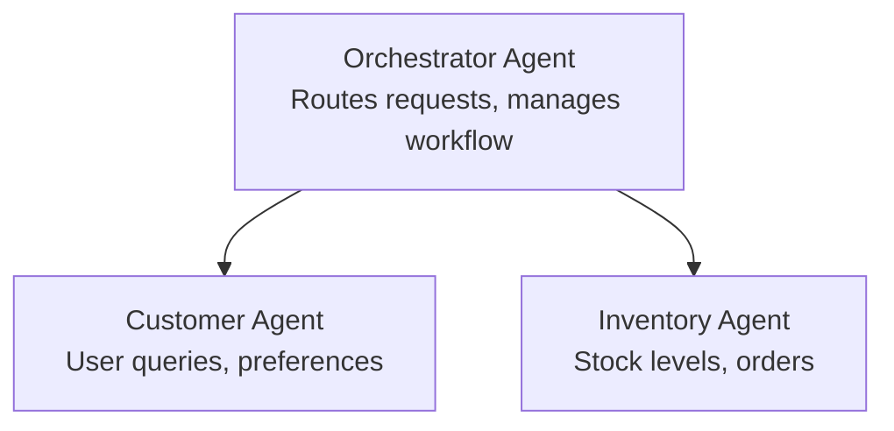

# Kapitel 5: Multi-Agent AI-lösningar

**📚 Kurs**: [AZD För nybörjare](../../README.md) | **⏱️ Varaktighet**: 2-3 timmar | **⭐ Svårighetsgrad**: Avancerad

---

## Översikt

Detta kapitel täcker avancerade multi-agent arkitekturmönster, agentorkestrering och produktionsklara AI-distributioner för komplexa scenarier.

> Kommandovägledning granskad mot den släppta `azd 1.37.2` referensen. Molndistributioner har inte körts.

## Lärandemål

Genom att slutföra detta kapitel kommer du att:
- Förstå multi-agent arkitekturmönster
- Distribuera koordinerade AI-agentssystem
- Implementera agent-till-agent kommunikation
- Bygga produktionsklara multi-agent lösningar

---

## 📚 Lektioner

| # | Lektion | Beskrivning | Tid |
|---|--------|-------------|------|
| 1 | [Multi-Agent Grunder](multi-agent-basics.md) | Praktiskt: distribuera en fungerande multi-agent-app med `azd up` | 45 min |
| 2 | [Koordinationsmönster](../chapter-06-pre-deployment/coordination-patterns.md) | Agentorkestreringsstrategier (fortsätter i Kapitel 6) | 30 min |
| 3 | [ARM-mall Distribution](../../examples/retail-multiagent-arm-template/README.md) | Exempel på distribution med ett klick | 30 min |

> **Börja med Lektion 1.** Det är den enda helt praktiska, distribuerbara lektionen i detta kapitel. Lektion 2 finns i Kapitel 6 (den delas med pre-distributionsplanering), och [Retail Multi-Agent Solution](../../examples/retail-scenario.md) är en arkitekturritning—en designreferens, inte en mall med ett kommando.

---

## 🚀 Snabbstart

```bash
# Option 1: Deploy the multi-agent template used in Lesson 1
azd init --template Azure-Samples/contoso-creative-writer .
azd up

# Option 2: Initialize a Foundry agent interactively with the GA bundle
azd ext install microsoft.foundry
azd ai agent init
azd up
```

> **Vilket tillvägagångssätt?** Använd `azd init --template` för att starta från ett fungerande exempel. Använd `azd ai agent init` interaktivt, eller `azd ai agent init --template <path-to-azure.yaml>` för att anta ett befintligt agentprojekt. Se [AZD AI CLI-referensen](../chapter-08-production/production-ai-practices.md#azd-ai-cli-commands-and-extensions) för versionskrav och utvärderingsmigrering.

Kör dessa alternativ i separata tomma mappar. GA Foundry-arbetsflödet kräver `azd >= 1.37.0`; dess interaktiva flöde genererar inte den anpassade Service Bus-pipelinen i koordineringslektionen. För lokal testning, koddistribution och städning av nya kontra återanvända projekt, följ [genomgången för hostad agent](../chapter-02-ai-development/microsoft-foundry-integration.md#hosted-agent-walkthrough-ga).

---

## 🤖 Multi-Agent Arkitektur



---

## 🎯 Utvald lösning: Retail Multi-Agent

The [Retail Multi-Agent Solution](../../examples/retail-scenario.md) demonstrerar:

- **Customer Agent**: Hanterar användarinteraktioner och preferenser
- **Inventory Agent**: Hanterar lager och orderhantering
- **Orchestrator**: Koordinerar mellan agenter
- **Shared Memory**: Kontextshantering mellan agenter

### Använda tjänster

| Tjänst | Syfte |
|---------|---------|
| Microsoft Foundry Models | Språkförståelse |
| Azure AI Search | Produktkatalog |
| Cosmos DB | Agenttillstånd och minne |
| Container Apps | Agenthosting |
| Application Insights | Övervakning |

---

## 🔗 Navigering

| Riktning | Kapitel |
|-----------|---------|
| **Föregående** | [Kapitel 4: Infrastruktur](../chapter-04-infrastructure/README.md) |
| **Nästa** | [Kapitel 6: Fördistribution](../chapter-06-pre-deployment/README.md) |

---

## 📖 Relaterade resurser

- [AI Agenter Guide](../chapter-02-ai-development/agents.md)
- [Produktions AI Praxis](../chapter-08-production/production-ai-practices.md)
- [AI Felsökning](../chapter-07-troubleshooting/ai-troubleshooting.md)

---

<!-- CO-OP TRANSLATOR DISCLAIMER START -->
**Ansvarsfriskrivning**:
Detta dokument har översatts med hjälp av AI-översättningstjänsten [Co-op Translator](https://github.com/Azure/co-op-translator). Även om vi strävar efter noggrannhet, var vänlig notera att automatiska översättningar kan innehålla fel eller brister. Det ursprungliga dokumentet på dess modersmål bör betraktas som den auktoritativa källan. För kritisk information rekommenderas professionell mänsklig översättning. Vi ansvarar inte för några missförstånd eller feltolkningar som uppstår till följd av användningen av denna översättning.
<!-- CO-OP TRANSLATOR DISCLAIMER END -->