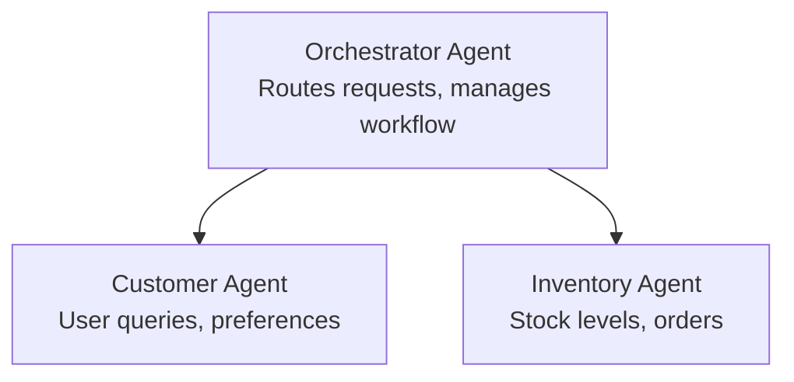

# Kapitel 5: Multi-Agent AI-lösningar

**📚 Kurs**: [AZD För Nybörjare](../../README.md) | **⏱️ Varaktighet**: 2-3 timmar | **⭐ Komplexitet**: Avancerad

---

## Översikt

Detta kapitel behandlar avancerade fleragentarkitekturmönster, agentorkestrering och produktionsfärdiga AI-distributioner för komplexa scenarier.

> Kommandovägledning granskad mot den släppta `azd 1.37.2` referensen. Molndistributioner kördes inte.

## Lärandemål

Genom att slutföra detta kapitel kommer du att:
- Förstå fleragentarkitekturmönster
- Distribuera koordinerade AI-agentssystem
- Implementera agent-till-agent-kommunikation
- Bygga produktionsfärdiga fleragentlösningar

---

## 📚 Lektioner

| # | Lektion | Beskrivning | Tid |
|---|--------|-------------|------|
| 1 | [Multi-Agent Grunder](multi-agent-basics.md) | Praktiskt: distribuera en fungerande fleragentapp med `azd up` | 45 min |
| 2 | [Koordinationsmönster](../chapter-06-pre-deployment/coordination-patterns.md) | Agentorkestreringsstrategier (fortsätter i Kapitel 6) | 30 min |
| 3 | [ARM Template Distribution](../../examples/retail-multiagent-arm-template/README.md) | Exempel på distribution med ett klick | 30 min |

> **Börja med Lektion 1.** Det är den enda helt praktiska och distribuerbara lektionen i detta kapitel. Lektion 2 finns i Kapitel 6 (den delas med planering inför distribution), och [Retail Multi-Agent Solution](../../examples/retail-scenario.md) är en arkitektur-mall—en designreferens, inte en mall med ett enda kommando.

---

## 🚀 Snabbstart

```bash
# Option 1: Deploy the multi-agent template used in Lesson 1
azd init --template Azure-Samples/contoso-creative-writer .
azd up

# Option 2: Initialize a Foundry agent interactively (requires azure.ai.agents)
azd extension install azure.ai.agents
azd ai agent init
azd up
```

> **Vilken metod?** Använd `azd init --template` för att börja från ett fungerande exempel. Använd `azd ai agent init` interaktivt, eller `azd ai agent init --template <path-to-azure.yaml>` för att ta över ett aktuellt agentprojekt. Se [AZD AI CLI-referensen](../chapter-08-production/production-ai-practices.md#azd-ai-cli-commands-and-extensions) för versionskrav och migrering av utvärdering.

Kör dessa alternativ i separata tomma mappar. Agentförlängningen `1.0.0-beta.23` kräver `azd >= 1.37.0`; dess interaktiva flöde genererar inte den anpassade Service Bus-pipelinen i koordineringslektionen.

---

## 🤖 Fleragentarkitektur



---

## 🎯 Utvald lösning: Retail Multi-Agent

Lösningen [Retail Multi-Agent Solution](../../examples/retail-scenario.md) demonstrerar:

- **Kundagent**: Hanterar användarinteraktioner och preferenser
- **Lageragent**: Hanterar lager och orderprocessering
- **Orkestrator**: Koordinerar mellan agenter
- **Delat minne**: Kontextledning över agenter

### Använda tjänster

| Tjänst | Syfte |
|---------|---------|
| Microsoft Foundry Models | Språkförståelse |
| Azure AI Search | Produktkatalog |
| Cosmos DB | Agenttillstånd och minne |
| Container Apps | Agenthosting |
| Application Insights | Övervakning |

---

## 🔗 Navigering

| Riktning | Kapitel |
|-----------|---------|
| **Föregående** | [Kapitel 4: Infrastruktur](../chapter-04-infrastructure/README.md) |
| **Nästa** | [Kapitel 6: Fördistribution](../chapter-06-pre-deployment/README.md) |

---

## 📖 Relaterade resurser

- [AI-agenter Guide](../chapter-02-ai-development/agents.md)
- [Produktion AI-praxis](../chapter-08-production/production-ai-practices.md)
- [AI Felsökning](../chapter-07-troubleshooting/ai-troubleshooting.md)

---

<!-- CO-OP TRANSLATOR DISCLAIMER START -->
**Ansvarsfriskrivning**:
Detta dokument har översatts med hjälp av AI-översättningstjänsten [Co-op Translator](https://github.com/Azure/co-op-translator). Även om vi strävar efter noggrannhet, var vänlig notera att automatiska översättningar kan innehålla fel eller brister. Det ursprungliga dokumentet på dess modersmål bör betraktas som den auktoritativa källan. För kritisk information rekommenderas professionell mänsklig översättning. Vi ansvarar inte för några missförstånd eller feltolkningar som uppstår till följd av användningen av denna översättning.
<!-- CO-OP TRANSLATOR DISCLAIMER END -->