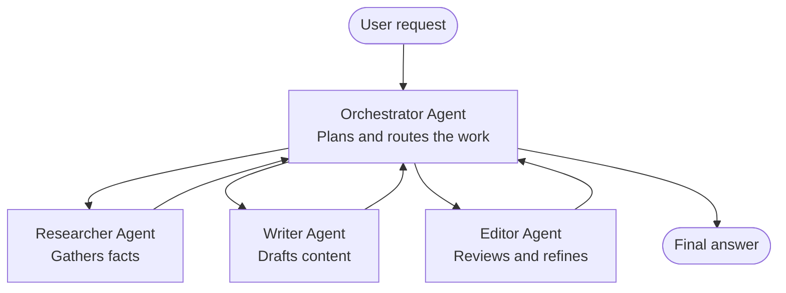

# Grundläggande om multi-agent – Distribuera ditt första koordinerade AI-system

**Kapitelnavigering:**
- **📚 Kursstart**: [AZD för nybörjare](../../README.md)
- **📖 Aktuellt kapitel**: Kapitel 5 - Multi-Agent AI-lösningar
- **⬅️ Föregående**: [Kapitel 4: Infrastruktur](../chapter-04-infrastructure/README.md)
- **➡️ Nästa**: [Koordinationsmönster](../chapter-06-pre-deployment/coordination-patterns.md)

> Kommandovägledning granskad mot den publicerade `azd 1.37.2` referensen. Molndistributioner har inte körts.

## Introduktion

I tidigare kapitel distribuerade du en enskild applikation — och i kapitel 2 distribuerade du en enda AI-agent. Den här lektionen tar nästa steg: att distribuera ett **multi-agent system**, där flera specialiserade agenter samarbetar för att lösa ett problem som ingen enskild agent skulle klara lika bra på egen hand.

Den goda nyheten för nybörjare: **du behöver inga nya kommandon.** En multi-agentlösning är fortfarande ett azd-projekt. Du kommer att `azd init`, `azd up`, testa och `azd down` — exakt det arbetsflödet du redan känner till. Det som ändras är *formen* på appen inuti.

## Lärandemål

I slutet av denna lektion kommer du att:
- Förstå vad “multi-agent” betyder och när det är värt den extra komplexiteten
- Känna igen vanliga roller i ett multi-agent system (dirigent + specialister)
- Distribuera en riktig, fungerande multi-agentmall med `azd up`
- Förstå Azure-resurserna som stöder en multi-agentapp
- Veta hur man verifierar, anpassar och stänger ner lösningen säkert

## Läranderesultat

Efter att ha slutfört denna lektion kommer du kunna:
- Förklara skillnaden mellan en enskild agent och ett multi-agent system
- Välja mellan en enskild agent med verktyg och en riktig multi-agentdesign
- Distribuera och testa en multi-agent mall från början till slut med azd
- Identifiera var varje agent körs och hur de kommunicerar
- Rensa upp alla resurser för att undvika pågående kostnader

---

## Vad är ett multi-agent system?

En enskild AI-agent är en modell med en uppsättning instruktioner och (valfritt) några verktyg. Det fungerar bra för fokuserade uppgifter. Men när en uppgift växer — forskning, sedan skrivande, sedan redigering, sedan faktakontroll — görs agenten långsammare, mindre pålitlig och svårare att felsöka när allt stoppas in i ett enda prompt.

Ett **multi-agent system** delar upp arbetet i specialister som var och en gör ett jobb bra, koordinerade av en dirigent:



### De två rollerna du alltid kommer att se

| Roll | Jobb | Exempel |
|------|-----|---------|
| **Dirigent** | Bestämmer *vad som händer härnäst* och styr arbete mellan agenter | "Först forskning, sedan skriva, sedan redigera" |
| **Specialist** | Gör en fokuserad uppgift och återkommer med ett resultat | En "forskare" som bara samlar fakta |

### Behöver du verkligen flera agenter?

Börja enkelt. Använd multi-agent **bara** när en av dessa är sann:

- ✅ Uppgiften har **skilda steg** som drar nytta av olika instruktioner (forskning vs. skrivande vs. granskning)
- ✅ Du vill att specialister kör **parallellt** för att spara tid
- ✅ Olika steg behöver **olika verktyg eller datakällor**
- ✅ Du behöver att varje steg ska vara **självständigt testbart och felsökningsbart**

Om din uppgift är en enda fråga och svar eller ett enkelt verktygsanrop är en **enskild agent med verktyg** (Kapitel 2) enklare, billigare och lättare att hantera.

> **Tips för nybörjare:** "Fler agenter" är inte "bättre." Varje agent tillför fördröjning, kostnad och en ny sak att övervaka. Lägg till agenter bara när problemet tydligt delas upp i delar.

---

## Två sätt att bygga multi-agent på Azure

| Tillvägagångssätt | Vad det är | Bäst för |
|----------|-----------|----------|
| **Enskild agent + verktyg** | En Foundry-agent som anropar funktioner/verktyg | Enkla arbetsflöden, börja komma igång |
| **Flera koordinerade agenter** | Flera agenter med en dirigent | Skilda steg, parallellt arbete, specialisering |

Den här lektionen fokuserar på det andra tillvägagångssättet med en **färdig mall**, så att du kan se ett riktigt multi-agent system i drift innan du bygger ditt eget.

---

## Praktiskt: Distribuera en fungerande multi-agentapp

Vi kommer att distribuera **Contoso Creative Writer**, ett officiellt Azure-exempel som koordinerar forsknings-, produkt-, skriv- och redigeringsagenter för att producera en artikel. Innan du fortsätter, kontrollera [exemplots förutsättningar och kostnader](https://github.com/Azure-Samples/contoso-creative-writer#azure-account-requirements): det behöver modellkvot, Azure AI Search, Bing Grounding-access, Python, Docker och Bash-kompatibla kopplingar. Modell- och regiontillgänglighet beror på ditt abonnemang; distribution garanteras inte genom att välja en viss region.

### Steg 1: Initiera mallen

```bash
# Create a working folder
mkdir creative-writer && cd creative-writer

# Initialize from the official multi-agent template
azd init --template Azure-Samples/contoso-creative-writer .
```

> Bläddra bland fler multi-agentmallar när som helst i [Awesome AZD AI-galleriet](https://azure.github.io/awesome-azd/?tags=ai). Andra nybörjarvänliga alternativ inkluderar `get-started-with-ai-agents` och `azure-ai-travel-agents`.

### Steg 2: Autentisera

```bash
# Required for azd workflows
azd auth login

# Also required by this sample's Azure CLI hooks
az login
```

### Steg 3: Kontrollera miljön

```bash
# init normally creates/selects an environment; confirm it before proceeding
azd env list
# Only if you need an additional environment:
# azd env new dev
```

### Steg 4: Förhandsgranska, sedan distribuera

```bash
# See what will be created before spending anything (recommended)
azd provision --preview

# Provision infrastructure and deploy all agents in one step
azd up
```

`azd up` kommer att be om saknade abonnemangs- och regionsinställningar, sedan tillhandahålla resurser och distribuera applikationen. Förhandsgranskningen reserverar inte kvot eller garanterar framgång; mallens kopplingar kan fortfarande köras under en tillhandahållandeförhandsgranskning, så kontrollera dem först. För att förlänga hur länge azd väntar på varje **tjänstedistribution** (inte modelltillhandahållande):

```bash
azd deploy --timeout 1800
```

En timeout stoppar azd från att vänta; den avbryter inte distributionen i Azure. Kontrollera resursens status innan du försöker igen.

> **Varning om kostnad och kapacitet:** Multi-agent-appar distribuerar AI-modeller som förbrukar kvot och medför kostnader. Om `azd up` misslyckas på modellkvot, se [AI felsökning](../chapter-07-troubleshooting/ai-troubleshooting.md) för region- och kvotfixar, samt Kapitel 6 [Kapacitetsplanering](../chapter-06-pre-deployment/capacity-planning.md).

---

## Förstå vad du distribuerade

En typisk multi-agentapp som denna tillhandahåller en uppsättning Azure-resurser som motsvarar ansvarsområdena i diagrammet ovan:

| Resurs | Varför den finns |
|----------|----------------|
| **Microsoft Foundry / Modeller** | Värdar språkliga modeller som varje agent använder |
| **Azure AI Search** | Ger forskaragenten grundad data att söka i |
| **Container Apps** (eller App Service) | Värdar dirigent- och agentkod |
| **Cosmos DB** (i vissa exempel) | Lagrar delat tillstånd/minne som skickas mellan agenter |
| **Application Insights** | Spårar förfrågningar *över* agenter för att du ska kunna felsöka flödet |

### Hur agenterna kommunicerar med varandra

I de flesta azd multi-agentexempel körs **dirigenten i din applikationskod** (till exempel med ett ramverk som Semantic Kernel eller Microsoft Agent Framework). Dirigenten anropar varje specialistagent i tur och ordning, vidarebefordrar resultaten och sammanställer slutresultatet. Agenterna delar kontext genom:

- **Funktions-/verktygsanrop** — dirigenten anropar en specialist och får ett resultat tillbaka
- **Delat minne** — en databas (ofta Cosmos DB) håller tillstånd som båda agenter kan läsa
- **Meddelanden/händelser** — för lösare koppling kommunicerar agenter via en kö eller Service Bus

> **Varför detta är viktigt för felsökning:** eftersom varje steg är separat visar Application Insights *vilken* agent som var långsam eller misslyckades. Det är en huvudorsak till att dela upp arbete över agenter från början.

---

## Verifiera distributionen

Bekräfta att systemet faktiskt fungerar innan du går vidare:

```bash
# Show the deployed endpoints
azd show

# Open the app's monitoring dashboard
azd monitor

# Open Application Insights Logs (not a terminal log stream)
azd monitor --logs
```

Öppna sedan app-URL:en från `azd show` och begär en kort artikel. Använd exempelns felsökningsvy för att inspektera dess agentarbetsflöde. Application Insights transaktionssök visar de enskilda stegen bara om exemplet instrumenterar och korrelerar dem; azd lägger inte automatiskt till agentspår.

**Kriterier för framgång:**
- ✅ `azd show` listar en nåbar endpoint
- ✅ En förfrågan producerar ett resultat som tydligt gick igenom flera steg
- ✅ Felsökningsvyn visar flera agentsteg; om spårning är aktiverad, verifiera motsvarande telemetri efter inmatning

---

## Anpassa: Lägg till eller justera en agent

Eftersom varje agent bara är instruktioner plus verktyg är anpassning lättillgänglig:

1. **Hitta agentdefinitionerna** i mallen (ofta en `prompts/`, `agents/` eller `*.prompty` uppsättning filer).
2. **Justera en agents instruktioner** — till exempel, be redigeringsagenten att upprätthålla en specifik ton eller ordantal.
3. **Distribuera om endast koden** (infrastrukturen är oförändrad):

   ```bash
   azd deploy
   ```

För att gå längre med ditt *egna* Foundry-agentprojekt, använd GA-paketet med AZD 1.37.0+ i en separat tom katalog:

```bash
azd ext install microsoft.foundry
azd ai agent init
azd up
azd ai agent invoke      # test, with response timing
```

Se [GA-hosted-agent genomgång](../chapter-02-ai-development/microsoft-foundry-integration.md#hosted-agent-walkthrough-ga) för Agent Inspector lokal testning, fjärrkoddistribution och borttagning. [AZD AI CLI-referensen](../chapter-08-production/production-ai-practices.md#azd-ai-cli-commands-and-extensions) täcker också separat utvärderingsförlängning, optimering och agentborttagning.

---

## Rensa upp

Multi-agent-appar kör flera debiterbara tjänster. Riv ner allt när du är klar:

```bash
# Review the resources and confirm deletion interactively
azd down
```

Borttagning är destruktiv. För ett engångslabb hoppar `azd down --force --purge` över borttagning och ger stöd för mjuk borttagningsbekräftelser; rensning är oåterkallelig där det stöds och kan blockeras av rensningsskydd. Mjuk borttagning är en fråga om återställning/namnåteranvändning, inte i sig ett bevis på pågående kostnader. Kontrollera kvarvarande resurser och fakturering efter uppstädning.

Om du också initierade en hostad agent mot ett befintligt Foundry-projekt, lämnar `azd down` detta projekts agent och andra resurser på plats. Ta bara bort oönskade resurser som du äger separat. För ett nytt Foundry-projekt skapat av dess AZD-miljö tar `azd down` bort resursgruppen och allt i den.

---

## En notering om produktionsmulti-agent system

Lösningen [Retail Multi-Agent Solution](../../examples/retail-scenario.md) i detta repo är en **arkitekturblåkopiering**, inte en en-kommandos-mall—den dokumenterar hur ett produktionssystem för detaljhandel *skulle* byggas (och är tydlig med att en komplett bygga är en omfattande insats). Använd den som en designreferens *efter* att du har distribuerat ett fungerande exempel här. För produktionsaspekter (resiliens, kostnad, övervakning, styrning), fortsätt till [Kapitel 8: Produktionspraxis för AI](../chapter-08-production/production-ai-practices.md).

---

## Sammanfattning

- Ett multi-agent system delar upp arbete mellan specialister koordinerade av en orkestrator.
- Använd det endast när uppgiften har distinkta steg, parallellism eller olika verktyg per steg—annars föredra en enda agent.
- Azd-arbetsflödet är oförändrat: `azd init` → `azd up` → test → `azd down`.
- En riktig mall som `contoso-creative-writer` låter dig se och anpassa en fungerande multi-agent app idag.
- Application Insights-spårning över agenter är en av de största praktiska fördelarna med multi-agent designen.

---

## 🔗 Navigering

| Riktning | Lektion |
|-----------|--------|
| **Föregående** | [Kapitel 4: Infrastruktur](../chapter-04-infrastructure/README.md) |
| **Nästa** | [Koordinationsmönster](../chapter-06-pre-deployment/coordination-patterns.md) |

## 📖 Relaterade resurser

- [AI-agenter guide](../chapter-02-ai-development/agents.md)
- [Koordinationsmönster](../chapter-06-pre-deployment/coordination-patterns.md)
- [Produktionspraxis för AI](../chapter-08-production/production-ai-practices.md)
- [AI felsökning](../chapter-07-troubleshooting/ai-troubleshooting.md)

---

<!-- CO-OP TRANSLATOR DISCLAIMER START -->
**Ansvarsfriskrivning**:
Detta dokument har översatts med hjälp av AI-översättningstjänsten [Co-op Translator](https://github.com/Azure/co-op-translator). Även om vi strävar efter noggrannhet, var vänlig notera att automatiska översättningar kan innehålla fel eller brister. Det ursprungliga dokumentet på dess modersmål bör betraktas som den auktoritativa källan. För kritisk information rekommenderas professionell mänsklig översättning. Vi ansvarar inte för några missförstånd eller feltolkningar som uppstår till följd av användningen av denna översättning.
<!-- CO-OP TRANSLATOR DISCLAIMER END -->