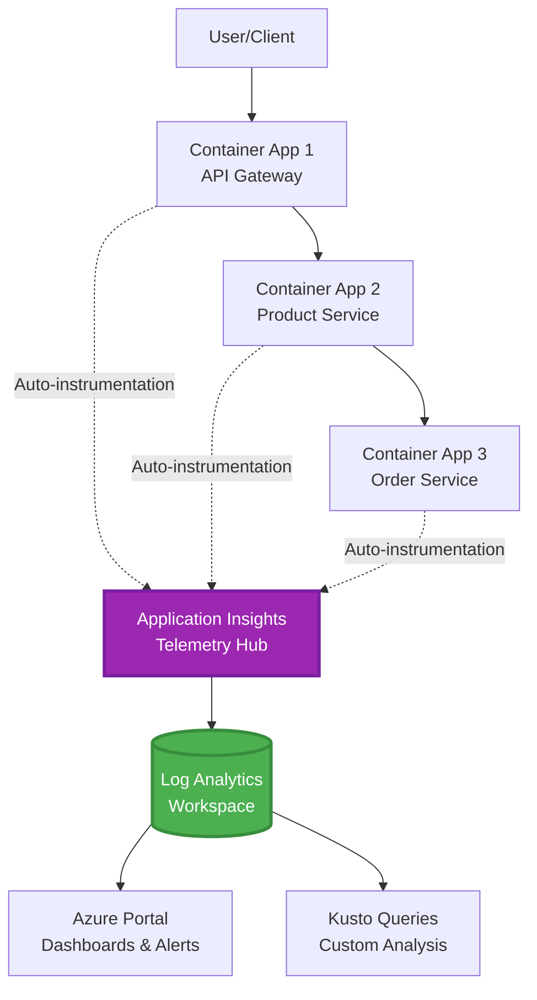
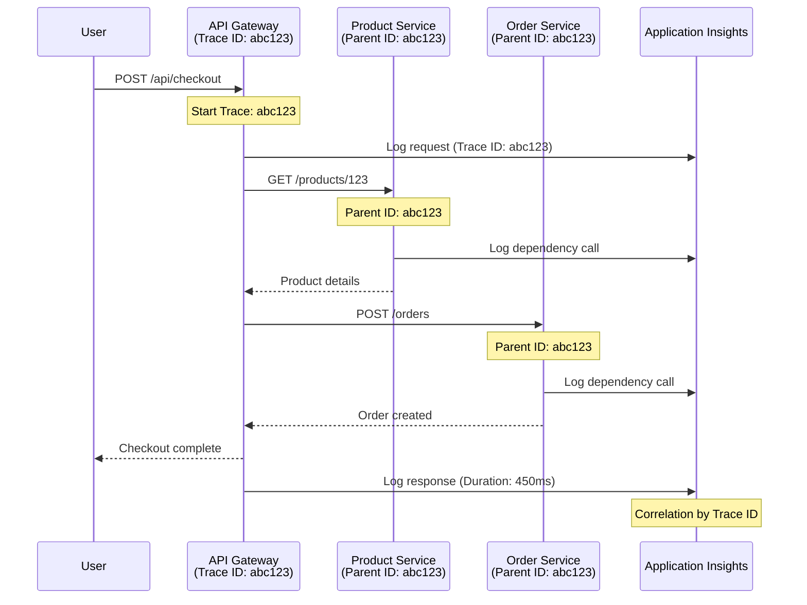

# Application Insights-integration med AZD

⏱️ **Beräknad tid**: 40-50 minuter | 💰 **Kostnadspåverkan**: ~5-15 USD/månad | ⭐ **Komplexitet**: Medel

**📚 Lärväg:**
- ← Föregående: [Preflight Checks](preflight-checks.md) - Validering före distribution
- 🎯 **Du är här**: Application Insights-integration (övervakning, telemetri, felsökning)
- → Nästa: [Deploy Guide](../chapter-04-infrastructure/deployment-guide.md) - Distribuera till Azure
- 🏠 [Kursstart](../../README.md)

---

## Vad du kommer att lära dig

Genom att genomföra denna lektion kommer du att:
- Deklarera **Application Insights** i AZD-infrastrukturen och konfigurera SDK-instrumentering
- Konfigurera **distribuerad spårning** för mikrotjänster
- Implementera **anpassad telemetri** (mått, händelser, beroenden)
- Ställa in **live metrics** för realtidsövervakning
- Skapa **larm och instrumentpaneler** från AZD-distributioner
- Felsöka produktionsproblem med **telemetriförfrågningar**
- Optimera **kostnader och sampling**-strategier
- Övervaka **AI/LLM-applikationer** (tokens, latens, kostnader)

## Varför Application Insights med AZD är viktigt

### Utmaningen: Produktionsobservation

**Utan Application Insights:**
```
❌ No visibility into production behavior
❌ Manual log aggregation across services
❌ Reactive debugging (wait for customer complaints)
❌ No performance metrics
❌ Cannot trace requests across services
❌ Unknown failure rates and bottlenecks
```

**Med Application Insights + AZD:**
```
✅ Automatic telemetry collection
✅ Centralized logs from all services
✅ Proactive issue detection
✅ End-to-end request tracing
✅ Performance metrics and insights
✅ Real-time dashboards
✅ AZD provisions the monitoring declared in your templates
```

**Liknelse**: Application Insights är som en "svart låda" flygregister + cockpit-instrumentbräda för din applikation. Du ser allt som händer i realtid och kan spela upp alla incidenter.

---

## Arkitekturöversikt

### Application Insights i AZD-arkitekturen



### Vad som övervakas automatiskt

Stödd auto-instrumentering fångar förfrågningar/beroenden för instrumenterade bibliotek. Anpassade händelser och mått kräver applikationskod; tillgänglighetstester måste konfigureras separat. Det samlar inte in alla rader nedan bara för att resursen finns.

| Telemetrityp | Vad det fångar | Användningsområde |
|-------------|---------------|------------------|
| **Förfrågningar** | HTTP-förfrågningar, statuskoder, varaktighet | API-prestandaövervakning |
| **Beroenden** | Externa anrop (DB, API:er, lagring) | Identifiera flaskhalsar |
| **Undantag** | Ohanterade fel med stackspår | Felsökning av fel |
| **Anpassade händelser** | Affärshändelser (registrering, köp) | Analys och funnel |
| **Mått** | Prestandaräknare, anpassade mått | Kapacitetsplanering |
| **Spårningar** | Loggmeddelanden med allvarlighetsgrad | Felsökning och revision |
| **Tillgänglighet** | Drifttid och svarstider | SLA-övervakning |

---

## Förutsättningar

### Nödvändiga verktyg

```bash
# Verify Azure Developer CLI
azd version
# Command reference baseline: azd 1.37.2

# Verify Azure CLI
az --version
# ✅ Expected: azure-cli 2.50.0 or higher
```

### Azure-krav

- Aktiv Azure-prenumeration
- Behörigheter att skapa:
  - Application Insights-resurser
  - Log Analytics-arbetsytor
  - Container Appar
  - Resursgrupper

### Kunskapsförutsättningar

Du bör ha genomfört:
- [AZD Basics](../chapter-01-foundation/azd-basics.md) - Grundläggande AZD-koncept
- [Konfiguration](../chapter-03-configuration/configuration.md) - Miljöinställning
- [Första projekt](../chapter-01-foundation/first-project.md) - Grundläggande distribution

---

## Lektion 1: Automatisk Application Insights med AZD

### Hur AZD tillhandahåller Application Insights

AZD tillhandahåller Application Insights **endast när projektets infrastruktur deklarerar det**. `azure.yaml` skapar inte övervakning eller instrumenterar applikationskod självständigt.

> **Exempelscope:** Denna lektion innehåller integrationsfragment, inte ett komplett `monitored-app`-projekt i detta arkiv. Leverera en huvudmall och parameterkartläggning, en Container Apps-miljö, register/image och identitetskonfiguration, Dockerfile och servicetaggar innan distribution. Senare lektioner visar alternativa/tilläggsfragment, inte filer som kan klistras ihop oförändrade. Börja med ett fungerande [mikrotjänstexempel](../../../../examples/microservices) om du behöver en körbar baslinje.

### Projektstruktur

```
monitored-app/
├── azure.yaml                     # AZD configuration
├── infra/
│   ├── main.bicep                # Main infrastructure
│   ├── core/
│   │   └── monitoring.bicep      # Application Insights + Log Analytics
│   └── app/
│       └── api.bicep             # Container App with monitoring
└── src/
    ├── app.py                    # Application with telemetry
    ├── requirements.txt
    └── Dockerfile
```

---

### Steg 1: Konfigurera AZD (azure.yaml)

**Fil: `azure.yaml`**

```yaml
name: monitored-app
metadata:
  template: monitored-app@1.0.0

services:
  api:
    project: ./src
    language: python
    host: containerapp

# Monitoring must be declared in infra/ and enabled in application code.
```

Detta deklarerar den distribuerbara tjänsten. Följande Bicep- och SDK-konfiguration tillhandahåller övervakning; azd lägger inte till dem implicit.

---

### Steg 2: Övervakningsinfrastruktur (Bicep)

**Fil: `infra/core/monitoring.bicep`**

```bicep
param logAnalyticsName string
param applicationInsightsName string
param location string = resourceGroup().location
param tags object = {}

// Log Analytics Workspace (required for Application Insights)
resource logAnalytics 'Microsoft.OperationalInsights/workspaces@2022-10-01' = {
  name: logAnalyticsName
  location: location
  tags: tags
  properties: {
    sku: {
      name: 'PerGB2018'  // Pay-as-you-go pricing
    }
    retentionInDays: 30  // Keep logs for 30 days
    features: {
      enableLogAccessUsingOnlyResourcePermissions: true
    }
  }
}

// Application Insights
resource applicationInsights 'Microsoft.Insights/components@2020-02-02' = {
  name: applicationInsightsName
  location: location
  tags: tags
  kind: 'web'
  properties: {
    Application_Type: 'web'
    WorkspaceResourceId: logAnalytics.id
    IngestionMode: 'LogAnalytics'
    publicNetworkAccessForIngestion: 'Enabled'
    publicNetworkAccessForQuery: 'Enabled'
  }
}

// Outputs for Container Apps
output logAnalyticsWorkspaceId string = logAnalytics.id
output logAnalyticsWorkspaceName string = logAnalytics.name
output applicationInsightsConnectionString string = applicationInsights.properties.ConnectionString
output applicationInsightsInstrumentationKey string = applicationInsights.properties.InstrumentationKey
output applicationInsightsName string = applicationInsights.name
output applicationInsightsId string = applicationInsights.id
```

---

### Steg 3: Koppla Container App till Application Insights

**Fil: `infra/app/api.bicep`**

```bicep
param name string
param location string
param tags object = {}
param containerAppsEnvironmentId string
param containerImage string
param applicationInsightsConnectionString string

resource containerApp 'Microsoft.App/containerApps@2023-05-01' = {
  name: name
  location: location
  tags: tags
  properties: {
    managedEnvironmentId: containerAppsEnvironmentId
    configuration: {
      ingress: {
        external: true
        targetPort: 8000
      }
      secrets: [
        {
          name: 'appinsights-connection-string'
          value: applicationInsightsConnectionString
        }
      ]
    }
    template: {
      containers: [
        {
          name: 'api'
          image: containerImage // Supply an accessible image and registry authentication
          resources: {
            cpu: json('0.5')
            memory: '1Gi'
          }
          env: [
            {
              name: 'APPLICATIONINSIGHTS_CONNECTION_STRING'
              secretRef: 'appinsights-connection-string'
            }
            {
              name: 'APPLICATIONINSIGHTS_ENABLED'
              value: 'true'
            }
          ]
        }
      ]
    }
  }
}

output uri string = 'https://${containerApp.properties.configuration.ingress.fqdn}'
```

---

### Steg 4: Applikationskod med telemetri

**Fil: `src/app.py`**

```python
from flask import Flask, request, jsonify
from azure.monitor.opentelemetry import configure_azure_monitor
import logging
import os

app = Flask(__name__)

# Get Application Insights connection string
connection_string = os.environ.get('APPLICATIONINSIGHTS_CONNECTION_STRING')

if connection_string:
    # Azure Monitor OpenTelemetry instruments supported libraries, including Flask.
    configure_azure_monitor(
        connection_string=connection_string,
        logger_name=__name__,
        enable_live_metrics=True
    )
    logger = logging.getLogger(__name__)
    logger.setLevel(logging.INFO)
    
    print("✅ Application Insights enabled")
else:
    logger = logging.getLogger(__name__)
    logger.setLevel(logging.INFO)
    print("⚠️ Application Insights not configured")

@app.route('/health')
def health():
    logger.info('Health check endpoint called')
    return jsonify({'status': 'healthy', 'monitoring': 'enabled' if connection_string else 'disabled'})

@app.route('/api/products')
def get_products():
    logger.info('Fetching products')
    
    # In-memory fixture: this is not a database dependency call.
    products = [
        {'id': 1, 'name': 'Laptop', 'price': 999.99},
        {'id': 2, 'name': 'Mouse', 'price': 29.99},
        {'id': 3, 'name': 'Keyboard', 'price': 79.99}
    ]
    
    logger.info(f'Returned {len(products)} products')
    return jsonify(products)

@app.route('/api/error-test')
def error_test():
    """Test error tracking"""
    logger.error('Testing error tracking')
    try:
        raise ValueError('This is a test exception')
    except Exception as e:
        logger.exception('Exception occurred in error-test endpoint')
        return jsonify({'error': str(e)}), 500

@app.route('/api/slow')
def slow_endpoint():
    """Test performance tracking"""
    import time
    logger.info('Slow endpoint called')
    time.sleep(3)  # Simulate slow operation
    logger.warning('Endpoint took 3 seconds to respond')
    return jsonify({'message': 'Slow operation completed'})

if __name__ == '__main__':
    app.run(host='0.0.0.0', port=8000)
```

**Fil: `src/requirements.txt`**

```txt
Flask
azure-monitor-opentelemetry
gunicorn
requests
openai
```

Lös upp dessa beroenden i ditt projekt, testa dem tillsammans och lås de resulterande versionerna. Nya projekt bör använda Azure Monitor OpenTelemetry, inte de pensionerade OpenCensus Python-exportörerna.

---

### Steg 5: Distribuera och verifiera

```bash
# Deploy only after completing and wiring the infrastructure fragments above
azd up

# Get app URL
APP_URL=$(azd env get-value API_URL) # Requires this output in main.bicep

# Generate telemetry
curl $APP_URL/health
curl $APP_URL/api/products
curl $APP_URL/api/error-test
curl $APP_URL/api/slow
```

**✅ Förväntat resultat:**
```json
{
  "status": "healthy",
  "monitoring": "enabled"
}
```

---

### Steg 6: Visa telemetri i Azure-portalen

```bash
# Get Application Insights details
azd env get-values | grep APPLICATIONINSIGHTS

# Open in Azure Portal
az monitor app-insights component show \
  --app $(azd env get-values | grep APPLICATIONINSIGHTS_NAME | cut -d '=' -f2 | tr -d '"') \
  --resource-group $(azd env get-values | grep AZURE_RESOURCE_GROUP | cut -d '=' -f2 | tr -d '"') \
  --query "appId" -o tsv
```

**Navigera till Azure Portal → Application Insights → Transaction Search**

Du bör se:
- ✅ HTTP-förfrågningar med statuskoder
- ✅ Förfrågningsvaraktighet (3+ sekunder för `/api/slow`)
- ✅ Undantagsdetaljer från `/api/error-test`
- ✅ Anpassade loggmeddelanden

---

## Lektion 2: Anpassad telemetri och händelser

### Spåra affärshändelser

Låt oss lägga till anpassad telemetri för kritiska affärshändelser.

**Fil: `src/telemetry.py`**

```python
from contextlib import contextmanager
from azure.monitor.opentelemetry import configure_azure_monitor
from opentelemetry import metrics, trace
from opentelemetry.trace import SpanKind
import logging
import os

class TelemetryClient:
    """Custom telemetry client for Application Insights"""
    
    def __init__(self, connection_string=None):
        self.connection_string = connection_string or os.environ.get('APPLICATIONINSIGHTS_CONNECTION_STRING')
        
        # Configure once per process. If app.py already calls this, keep only
        # one configure_azure_monitor call and use logger_name='telemetry'.
        if self.connection_string:
            configure_azure_monitor(
                connection_string=self.connection_string,
                logger_name=__name__,
                enable_live_metrics=True
            )
        self.logger = logging.getLogger(__name__)
        self.logger.setLevel(logging.INFO)
        self.tracer = trace.get_tracer(__name__)
        self.meter = metrics.get_meter(__name__)
        self.instruments = {}
    
    def track_event(self, event_name: str, properties: dict = None):
        """Track custom business event"""
        properties = properties or {}
        self.logger.info(
            f"CustomEvent: {event_name}",
            extra={
                # OTel log attributes become customDimensions in App Insights.
                    'event_name': event_name,
                    **properties
            }
        )
    
    def track_metric(self, metric_name: str, value: float, properties: dict = None):
        """Track custom metric"""
        properties = properties or {}
        if metric_name not in self.instruments:
            self.instruments[metric_name] = self.meter.create_histogram(metric_name)
        self.instruments[metric_name].record(value, attributes=properties)
    
    @contextmanager
    def track_dependency(self, name: str):
        """Time the real operation inside a client span; exceptions mark failure."""
        with self.tracer.start_as_current_span(name, kind=SpanKind.CLIENT) as span:
            yield span

# Global telemetry client
telemetry = TelemetryClient()
```

### Uppdatera applikation med anpassade händelser

**Fil: `src/app.py` (förbättrad)**

Lägg till dessa routes i den befintliga Flask-applikationen; behåll de tidigare health/test-routarna. Det förkortade blocket nedan visar en separat app för tydlighet. Telemetriinitiering finns nu i `telemetry.py`—initiera inte exportörer två gånger.

```python
from flask import Flask, request, jsonify
from telemetry import telemetry
import time
import random
import os

app = Flask(__name__)

@app.route('/api/purchase', methods=['POST'])
def purchase():
    """Track purchase event with custom telemetry"""
    data = request.get_json(silent=True) or {}
    product_id = data.get('product_id')
    quantity = data.get('quantity', 1)
    price = data.get('price', 0)
    if not isinstance(quantity, int) or quantity < 1 or \
       not isinstance(price, (int, float)) or price < 0:
        return jsonify({'error': 'quantity and price must be non-negative numbers; quantity >= 1'}), 400
    
    # Track business event
    telemetry.track_event('Purchase', {
        'product_id': product_id,
        'quantity': quantity,
        'total_amount': price * quantity,
        'user_id': request.headers.get('X-User-Id', 'anonymous')
    })
    
    # Track revenue metric
    telemetry.track_metric('Revenue', price * quantity, {
        'product_id': product_id,
        'currency': 'USD'
    })
    
    return jsonify({
        'order_id': f'ORD-{random.randint(1000, 9999)}',
        'status': 'confirmed',
        'total': price * quantity
    })

@app.route('/api/search')
def search():
    """Track search queries"""
    query = request.args.get('q', '')
    
    start_time = time.time()
    
    # Simulate search (would be real database query)
    results = [{'id': 1, 'name': f'Result for {query}'}]
    
    duration = (time.time() - start_time) * 1000  # Convert to ms
    
    # Track search event
    telemetry.track_event('Search', {
        'query': query,
        'results_count': len(results),
        'duration_ms': duration
    })
    
    # Track search performance metric
    telemetry.track_metric('SearchDuration', duration, {
        'query_length': len(query)
    })
    
    return jsonify({'results': results, 'count': len(results)})

@app.route('/api/external-call')
def external_call():
    """Track external API dependency"""
    import requests
    
    try:
        # Set an actual test endpoint; api.example.com is not a working API.
        with telemetry.track_dependency('ExternalAPI'):
            response = requests.get(os.environ['EXTERNAL_API_URL'], timeout=5)
            response.raise_for_status()
            result = response.json()
    except Exception as e:
        return jsonify({'error': 'External dependency failed'}), 502
    
    return jsonify(result)

if __name__ == '__main__':
    app.run(host='0.0.0.0', port=8000)
```

### Testa anpassad telemetri

```bash
# Track purchase event
curl -X POST $APP_URL/api/purchase \
  -H "Content-Type: application/json" \
  -H "X-User-Id: user123" \
  -d '{"product_id": 1, "quantity": 2, "price": 29.99}'

# Track search event
curl "$APP_URL/api/search?q=laptop"

# Track external dependency
curl $APP_URL/api/external-call
```

**Visa i Azure Portal:**

Navigera till Application Insights → Logs och kör sedan:

```kusto
// View purchase events
traces
| where customDimensions.event_name == "Purchase"
| project 
    timestamp,
    product_id = tostring(customDimensions.product_id),
    total_amount = todouble(customDimensions.total_amount),
    user_id = tostring(customDimensions.user_id)
| order by timestamp desc

// Revenue recorded in Purchase events (not a billing ledger)
traces
| where customDimensions.event_name == "Purchase"
| summarize TotalRevenue = sum(todouble(customDimensions.total_amount)) by bin(timestamp, 1h)
| render timechart

// View search performance
traces
| where customDimensions.event_name == "Search"
| summarize 
    AvgDuration = avg(todouble(customDimensions.duration_ms)),
    SearchCount = count()
  by bin(timestamp, 5m)
| render timechart
```

---

## Lektion 3: Distribuerad spårning för mikrotjänster

### Aktivera spårning över tjänster

Med kompatibel instrumentering och W3C trace-context-propagation korrelerar Application Insights förfrågningar mellan tjänster. Att dela en kopplingssträng ensam etablerar inte parent-child-spans. Följande arkitekturfragment refererar till moduler du måste implementera.

**Fil: `infra/main.bicep`**

```bicep
targetScope = 'subscription'

param environmentName string
param location string = 'eastus'

var tags = { 'azd-env-name': environmentName }

resource rg 'Microsoft.Resources/resourceGroups@2021-04-01' = {
  name: 'rg-${environmentName}'
  location: location
  tags: tags
}

// Monitoring (shared by all services)
module monitoring './core/monitoring.bicep' = {
  name: 'monitoring'
  scope: rg
  params: {
    logAnalyticsName: 'log-${environmentName}'
    applicationInsightsName: 'appi-${environmentName}'
    location: location
    tags: tags
  }
}

// API Gateway
module apiGateway './app/api-gateway.bicep' = {
  name: 'api-gateway'
  scope: rg
  params: {
    name: 'ca-gateway-${environmentName}'
    location: location
    tags: union(tags, { 'azd-service-name': 'gateway' })
    applicationInsightsConnectionString: monitoring.outputs.applicationInsightsConnectionString
  }
}

// Product Service
module productService './app/product-service.bicep' = {
  name: 'product-service'
  scope: rg
  params: {
    name: 'ca-products-${environmentName}'
    location: location
    tags: union(tags, { 'azd-service-name': 'products' })
    applicationInsightsConnectionString: monitoring.outputs.applicationInsightsConnectionString
  }
}

// Order Service
module orderService './app/order-service.bicep' = {
  name: 'order-service'
  scope: rg
  params: {
    name: 'ca-orders-${environmentName}'
    location: location
    tags: union(tags, { 'azd-service-name': 'orders' })
    applicationInsightsConnectionString: monitoring.outputs.applicationInsightsConnectionString
  }
}

output APPLICATIONINSIGHTS_CONNECTION_STRING string = monitoring.outputs.applicationInsightsConnectionString
output GATEWAY_URL string = apiGateway.outputs.uri
```

### Visa end-to-end-transaktion



**Förfråga end-to-end-spår:**

```kusto
// Find complete request flow
let traceId = "abc123...";  // Copy operation_Id from a request in Application Insights
dependencies
| union requests
| where operation_Id == traceId
| project 
    timestamp,
    type = itemType,
    name,
    duration,
    success,
    cloud_RoleName
| order by timestamp asc
```

---

## Lektion 4: Live Metrics och realtidsövervakning

### Aktivera Live Metrics Stream

Live Metrics tillhandahåller nästan realtids telemetri när det stöds och är aktiverat av SDK:n. Det är inte en latens-SLA. Python OpenTelemetry-inställningen ovan väljer med `enable_live_metrics=True`.

**Åtkomst till Live Metrics:**

```bash
# Get Application Insights resource
APPI_NAME=$(azd env get-values | grep APPLICATIONINSIGHTS_NAME | cut -d '=' -f2 | tr -d '"')

# Get resource group
RG_NAME=$(azd env get-values | grep AZURE_RESOURCE_GROUP | cut -d '=' -f2 | tr -d '"')

echo "Navigate to: Azure Portal → Resource Groups → $RG_NAME → $APPI_NAME → Live Metrics"
```

**Vad du ser i realtid:**
- ✅ Inkommande förfrågningsfrekvens (förfrågningar/sek)
- ✅ Utgående beroendeanrop
- ✅ Undantagsräkning
- ✅ CPU- och minnesanvändning
- ✅ Aktiva serverantal
- ✅ Provtagningsdata för telemetri

### Generera belastning för testning

```bash
# Generate load to see live metrics
for i in {1..100}; do
  curl --silent --max-time 10 "$APP_URL/api/products"
  curl --silent --max-time 10 "$APP_URL/api/search?q=test$i"
done

# Watch live metrics in Azure Portal
# You should see request rate spike
```

---

## Praktiska övningar

### Övning 1: Ställ in larm ⭐⭐ (Medel)

**Mål**: Skapa larm för höga felprocent och långsamma svar.

**Steg:**

1. **Skapa larm för felprocent:**

```bash
# Get Application Insights resource ID
APPI_ID=$(az monitor app-insights component show \
  --app $APPI_NAME \
  --resource-group $RG_NAME \
  --query "id" -o tsv)

# Create metric alert for failed requests
az monitor metrics alert create \
  --name "High-Error-Rate" \
  --resource-group $RG_NAME \
  --scopes $APPI_ID \
  --condition "count requests/failed > 10" \
  --window-size 5m \
  --evaluation-frequency 1m \
  --description "Alert when failed request count exceeds 10 per 5 minutes"
```

2. **Skapa larm för långsamma svar:**

```bash
az monitor metrics alert create \
  --name "Slow-Responses" \
  --resource-group $RG_NAME \
  --scopes $APPI_ID \
  --condition "avg requests/duration > 3000" \
  --window-size 5m \
  --evaluation-frequency 1m \
  --description "Alert when average response time exceeds 3 seconds"
```

3. **Skapa larm via Bicep (föredras för AZD):**

**Fil: `infra/core/alerts.bicep`**

```bicep
param applicationInsightsId string
param actionGroupId string = ''
param location string = resourceGroup().location

// High error rate alert
resource errorRateAlert 'Microsoft.Insights/metricAlerts@2018-03-01' = {
  name: 'high-error-rate'
  location: 'global'
  properties: {
    description: 'Alert when error rate exceeds threshold'
    severity: 2
    enabled: true
    scopes: [
      applicationInsightsId
    ]
    evaluationFrequency: 'PT1M'
    windowSize: 'PT5M'
    criteria: {
      'odata.type': 'Microsoft.Azure.Monitor.SingleResourceMultipleMetricCriteria'
      allOf: [
        {
          name: 'Error rate'
          metricName: 'requests/failed'
          operator: 'GreaterThan'
          threshold: 10
          timeAggregation: 'Count'
        }
      ]
    }
    actions: actionGroupId != '' ? [
      {
        actionGroupId: actionGroupId
      }
    ] : []
  }
}

// Slow response alert
resource slowResponseAlert 'Microsoft.Insights/metricAlerts@2018-03-01' = {
  name: 'slow-responses'
  location: 'global'
  properties: {
    description: 'Alert when response time is too high'
    severity: 3
    enabled: true
    scopes: [
      applicationInsightsId
    ]
    evaluationFrequency: 'PT1M'
    windowSize: 'PT5M'
    criteria: {
      'odata.type': 'Microsoft.Azure.Monitor.SingleResourceMultipleMetricCriteria'
      allOf: [
        {
          name: 'Response duration'
          metricName: 'requests/duration'
          operator: 'GreaterThan'
          threshold: 3000
          timeAggregation: 'Average'
        }
      ]
    }
  }
}

output errorAlertId string = errorRateAlert.id
output slowResponseAlertId string = slowResponseAlert.id
```

4. **Testa larm:**

```bash
# Generate errors
for i in {1..20}; do
  curl $APP_URL/api/error-test
done

# Generate slow responses
for i in {1..10}; do
  curl $APP_URL/api/slow
done

# Check rule configuration (not fired/resolved alert-instance history)
az monitor metrics alert list \
  --resource-group $RG_NAME \
  --query "[].{Name:name, Enabled:enabled}" \
  --output table
```

**✅ Framgångskriterier:**
- ✅ Larm skapade framgångsrikt
- ✅ Larm utläses när trösklar överskrids
- ✅ Kan visa larmhistorik i Azure Portalen
- ✅ Integrerat med AZD-distribution

**Tid**: 20-25 minuter

---

### Övning 2: Skapa anpassad instrumentpanel ⭐⭐ (Medel)

**Mål**: Bygg en instrumentpanel som visar viktiga applikationsmått.

**Steg:**

1. **Skapa instrumentpanel via Azure Portal:**

Navigera till: Azure Portal → Dashboards → Ny instrumentpanel

2. **Lägg till rutor för viktiga mått:**

- Antal förfrågningar (senaste 24 timmarna)
- Genomsnittlig svarstid
- Felprocent
- Topp 5 långsammaste operationer
- Geografisk fördelning av användare

3. **Skapa instrumentpanel via Bicep:**

**Fil: `infra/core/dashboard.bicep`**

```bicep
param dashboardName string
param applicationInsightsId string
param location string = resourceGroup().location

resource dashboard 'Microsoft.Portal/dashboards@2020-09-01-preview' = {
  name: dashboardName
  location: location
  properties: {
    lenses: [
      {
        order: 0
        parts: [
          // Request count
          {
            position: {
              x: 0
              y: 0
              rowSpan: 4
              colSpan: 6
            }
            metadata: {
              type: 'Extension/Microsoft_OperationsManagementSuite_Workspace/PartType/LogsDashboardPart'
              inputs: [
                {
                  name: 'resourceId'
                  value: applicationInsightsId
                }
                {
                  name: 'query'
                  value: '''
                    requests
                    | summarize RequestCount = count() by bin(timestamp, 1h)
                    | render timechart
                  '''
                }
              ]
            }
          }
          // Error rate
          {
            position: {
              x: 6
              y: 0
              rowSpan: 4
              colSpan: 6
            }
            metadata: {
              type: 'Extension/Microsoft_OperationsManagementSuite_Workspace/PartType/LogsDashboardPart'
              inputs: [
                {
                  name: 'resourceId'
                  value: applicationInsightsId
                }
                {
                  name: 'query'
                  value: '''
                    requests
                    | summarize 
                        Total = count(),
                        Failed = countif(success == false)
                    | extend ErrorRate = (Failed * 100.0) / Total
                    | project ErrorRate
                  '''
                }
              ]
            }
          }
        ]
      }
    ]
  }
}

output dashboardId string = dashboard.id
```

4. **Distribuera instrumentpanel:**

```bicep
// Add to a subscription-scoped main.bicep with rg and monitoring declared
module dashboard './core/dashboard.bicep' = {
  name: 'dashboard'
  scope: rg
  params: {
    dashboardName: 'dashboard-${environmentName}'
    applicationInsightsId: monitoring.outputs.applicationInsightsId
    location: location
  }
}
```

```bash
# Deploy
azd up
```

**✅ Framgångskriterier:**
- ✅ Instrumentpanelen visar viktiga mått
- ✅ Kan fästas på Azure Portal-startsidan
- ✅ Uppdateras i realtid
- ✅ Distribuerbar via AZD

**Tid**: 25-30 minuter

---

### Övning 3: Övervaka AI/LLM-applikation ⭐⭐⭐ (Avancerad)

**Mål**: Spåra Microsoft Foundry-modellers användning (tokens, kostnader, latens).

**Steg:**

1. **Skapa AI-övervakningswrapper:**

**Fil: `src/ai_telemetry.py`**

```python
from telemetry import telemetry
from openai import AzureOpenAI
import time

class MonitoredAzureOpenAI:
    """Microsoft Foundry Models client with automatic telemetry"""
    
    def __init__(self, api_key, endpoint, input_usd_per_million,
                 output_usd_per_million, api_version="2024-10-21"):
        self.client = AzureOpenAI(
            api_key=api_key,
            api_version=api_version,
            azure_endpoint=endpoint
        )
        self.input_rate = input_usd_per_million
        self.output_rate = output_usd_per_million
    
    def chat_completion(self, model: str, messages: list, **kwargs):
        """Track chat completion with telemetry"""
        start_time = time.time()
        
        try:
            # Call Microsoft Foundry Models
            response = self.client.chat.completions.create(
                model=model,
                messages=messages,
                **kwargs
            )
            
            duration = (time.time() - start_time) * 1000  # ms
            
            # Extract usage
            usage = response.usage
            prompt_tokens = usage.prompt_tokens
            completion_tokens = usage.completion_tokens
            total_tokens = usage.total_tokens
            
            # Approximation: supply actual deployment/region/contract rates.
            # Cached input, batch, provisioned and other charges need separate accounting.
            prompt_cost = (prompt_tokens / 1_000_000) * self.input_rate
            completion_cost = (completion_tokens / 1_000_000) * self.output_rate
            total_cost = prompt_cost + completion_cost
            
            # Track custom event
            telemetry.track_event('OpenAI_Request', {
                'model': model,
                'prompt_tokens': prompt_tokens,
                'completion_tokens': completion_tokens,
                'total_tokens': total_tokens,
                'duration_ms': duration,
                'cost_usd': total_cost,
                'success': True
            })
            
            # Track metrics
            telemetry.track_metric('OpenAI_Tokens', total_tokens, {
                'model': model,
                'type': 'total'
            })
            
            telemetry.track_metric('OpenAI_Cost', total_cost, {
                'model': model,
                'currency': 'USD'
            })
            
            telemetry.track_metric('OpenAI_Duration', duration, {
                'model': model
            })
            
            return response
            
        except Exception as e:
            duration = (time.time() - start_time) * 1000
            
            telemetry.track_event('OpenAI_Request', {
                'model': model,
                'duration_ms': duration,
                'success': False,
                'error': str(e)
            })
            
            raise
```

2. **Använd övervakad klient:**

```python
from flask import Flask, request, jsonify
from ai_telemetry import MonitoredAzureOpenAI
import os

app = Flask(__name__)

# Initialize monitored OpenAI client
openai_client = MonitoredAzureOpenAI(
    api_key=os.environ['AZURE_OPENAI_API_KEY'],
    endpoint=os.environ['AZURE_OPENAI_ENDPOINT'],
    input_usd_per_million=float(os.environ['INPUT_USD_PER_MILLION']),
    output_usd_per_million=float(os.environ['OUTPUT_USD_PER_MILLION'])
)

@app.route('/api/chat', methods=['POST'])
def chat():
    data = request.json
    user_message = data.get('message')
    
    # Call with automatic monitoring
    response = openai_client.chat_completion(
        model=os.environ['AZURE_OPENAI_DEPLOYMENT'], # Deployment name, not catalog ID
        messages=[
            {'role': 'user', 'content': user_message}
        ]
    )
    
    return jsonify({
        'response': response.choices[0].message.content,
        'tokens': response.usage.total_tokens
    })
```

3. **Förfråga AI-mått:**

```kusto
// Total AI spend over time
traces
| where customDimensions.event_name == "OpenAI_Request"
| where tobool(customDimensions.success) == true
| summarize TotalCost = sum(todouble(customDimensions.cost_usd)) by bin(timestamp, 1h)
| render timechart

// Token usage by model
traces
| where customDimensions.event_name == "OpenAI_Request"
| summarize 
    TotalTokens = sum(toint(customDimensions.total_tokens)),
    RequestCount = count()
  by Model = tostring(customDimensions.model)

// Average latency
traces
| where customDimensions.event_name == "OpenAI_Request"
| summarize AvgDuration = avg(todouble(customDimensions.duration_ms))
| project AvgDurationSeconds = AvgDuration / 1000

// Cost per request
traces
| where customDimensions.event_name == "OpenAI_Request"
| extend Cost = todouble(customDimensions.cost_usd)
| summarize 
    TotalCost = sum(Cost),
    RequestCount = count(),
    AvgCostPerRequest = avg(Cost)
```

**✅ Framgångskriterier:**
- ✅ Varje OpenAI-anrop spåras automatiskt
- ✅ Tokenanvändning och kostnader synliga
- ✅ Latens övervakad
- ✅ Budgetlarm kan sättas

**Tid**: 35-45 minuter

---

## Kostnadsoptimering

### Samplingstrategier

Styr kostnader genom att sampela telemetri:

```python
import os

# Configure before the one configure_azure_monitor() call in your process.
os.environ["OTEL_TRACES_SAMPLER"] = "microsoft.fixed_percentage"
os.environ["OTEL_TRACES_SAMPLER_ARG"] = "0.1" # 10% trace sampling
```

Spårningssampling minskar inte varje telemetrikategori med 90 %. Mått och självständigt emitterade loggar behöver egna volymkontroller. Välj samplingsfrekvens baserat på observationsbehov, inte ett generellt produktionsförbud.

Ställ in SDK-sampling explicit; komponentens `SamplingPercentage`-egenskap är inget substitut för att konfigurera Python OpenTelemetry-samplern.

### Dataretention

```bicep
resource logAnalytics 'Microsoft.OperationalInsights/workspaces@2022-10-01' = {
  name: logAnalyticsName
  properties: {
    retentionInDays: 30  // Minimum (cheapest)
    // Options: 30, 31, 60, 90, 120, 180, 270, 365, 550, 730
  }
}
```

### Månadskostnadsuppskattning

| Datavolym | Retention | Månadskostnad |
|----------|-----------|--------------|
| 1 GB/månad | 30 dagar | ~2-5 USD |
| 5 GB/månad | 30 dagar | ~10-15 USD |
| 10 GB/månad | 90 dagar | ~25-40 USD |
| 50 GB/månad | 90 dagar | ~100-150 USD |

Dessa siffror är vägledande, inte offerter. Kontrollera prissättning för ingest, retention, larm och test i din region och avtal; fria tilldelningar delas/områdesbegränsas enligt Azure Monitor-prissättning, inte en garanterad gratis SKU per Application Insights-resurs.

---

## Kunskapskontrollpunkt

### 1. Grundläggande integration ✓

Testa din förståelse:

- [ ] **Q1**: Hur tillhandahåller AZD Application Insights?
  - **S**: Det distribuerar uttryckligen de övervakningsresurser som projektets Bicep/Terraform-mallar deklarerar.

- [ ] **Q2**: Vilken miljövariabel aktiverar Application Insights?
  - **S**: `APPLICATIONINSIGHTS_CONNECTION_STRING`

- [ ] **Q3**: Vilka är de tre huvudsakliga telemetrityperna?
  - **S**: Förfrågningar (HTTP-anrop), Beroenden (externa anrop), Undantag (fel)

**Praktisk verifiering:**
```bash
# Check if Application Insights is configured
azd env get-values | grep APPLICATIONINSIGHTS

# Verify telemetry is flowing
az monitor app-insights metrics show \
  --app $APPI_NAME \
  --resource-group $RG_NAME \
  --metric "requests/count"
```

---

### 2. Anpassad telemetri ✓

Testa din förståelse:

- [ ] **Q1**: Hur spårar du anpassade affärshändelser?
  - **S**: Denna lektions wrapper skriver strukturerade OTel-loggar med `event_name`-attribut, sökbara i `traces`; dessa är inte automatiskt `customEvents`.

- [ ] **Q2**: Vad är skillnaden mellan händelser och mått?
  - **S**: Händelser är diskreta händelser, mått är numeriska mätningar

- [ ] **Q3**: Hur korrelerar du telemetri över tjänster?
  - **S**: Application Insights använder automatiskt `operation_Id` för korrelation

**Praktisk verifiering:**
```kusto
// Verify custom events
traces
| where customDimensions.event_name != ""
| summarize count() by tostring(customDimensions.event_name)
```

---

### 3. Produktionsövervakning ✓

Testa din förståelse:

- [ ] **Q1**: Vad är sampling och varför används det?
  - **S**: Sampling minskar datavolymen (och kostnaden) genom att endast fånga en procentandel av telemetrin

- [ ] **Q2**: Hur ställer du in larm?
  - **S**: Använd måttlarm i Bicep eller Azure Portal baserat på Application Insights-mått

- [ ] **Q3**: Vad är skillnaden mellan Log Analytics och Application Insights?
  - **S**: Application Insights lagrar data i Log Analytics-arbetsyta; App Insights tillhandahåller applikationsspecifika vyer

**Praktisk verifiering:**
```bash
# Check the sampler configured for the running application, not only the ARM component.
az containerapp show --name "$APP_NAME" --resource-group "$RG_NAME" \
  --query "properties.template.containers[].env[?starts_with(name, 'OTEL_TRACES_SAMPLER')]"
```

---

## Bästa praxis

### ✅ GÖR:

1. **Använd korrelations-ID:n**
   ```python
   logger.info('Processing order', extra={
           'order_id': order_id,
           'user_id': user_id
   })
   ```

2. **Ställ in larm för kritiska mått**
   ```bicep
   // Error rate, slow responses, availability
   ```

3. **Använd strukturerad loggning**
   ```python
   # ✅ GOOD: Structured
   logger.info('User signup', extra={'user_id': 'pseudonymous-id'})
   
   # ❌ BAD: Unstructured
   logger.info(f'User 123 signed up')
   ```

4. **Övervaka beroenden**
   ```python
   # Automatically track database calls, HTTP requests, etc.
   ```

5. **Använd Live Metrics under distributioner**

### ❌ GÖR INTE:

1. **Logga inte känslig data**
   ```python
   # ❌ BAD
   logger.info(f'Login: {username}:{password}')
   
   # ✅ GOOD
   logger.info('Login attempt', extra={'result': 'failed'})
   ```

2. **Välj inte sampling utan att mäta volym och diagnostiska behov**
   ```python
   # ❌ Expensive
   # 100% traces may be appropriate for a small workload or investigation.
   
   # ✅ Cost-effective
   # A lower trace rate reduces visibility; validate coverage before enabling.
   ```

3. **Ignorera inte dead letter-köer**

4. **Glöm inte att ställa in datalagringsgränser**

---

## Felsökning

### Problem: Ingen telemetri visas

**Diagnos:**
```bash
# Check connection string is set
azd env get-values | grep APPLICATIONINSIGHTS

# Check application logs via Azure Monitor
azd monitor --logs

# Or use Azure CLI for Container Apps:
az containerapp logs show --name $APP_NAME --resource-group $RG_NAME --tail 50
```

**Lösning:**
```bash
# Verify connection string in Container App
az containerapp show \
  --name $APP_NAME \
  --resource-group $RG_NAME \
  --query "properties.template.containers[0].env" \
  | grep -i applicationinsights
```

---

### Problem: Höga kostnader

**Diagnos:**
```bash
# Query ingestion volume in the linked Log Analytics workspace.
# WORKSPACE_ID is the workspace customer ID (GUID), not its ARM resource ID.
az monitor log-analytics query --workspace "$WORKSPACE_ID" \
  --analytics-query "Usage | where TimeGenerated > ago(30d) | where IsBillable == true | summarize IngestedMB=sum(Quantity) by DataType"
```

**Lösning:**
- Minska samplingsfrekvensen
- Minska lagringstiden
- Ta bort detaljerad loggning

---

## Lär dig mer

### Officiell dokumentation
- [Application Insights Översikt](https://learn.microsoft.com/azure/azure-monitor/app/app-insights-overview)
- [Azure Monitor OpenTelemetry-inställning](https://learn.microsoft.com/azure/azure-monitor/app/opentelemetry-enable?tabs=python)
- [Kusto Query Language](https://learn.microsoft.com/azure/data-explorer/kusto/query/)
- [AZD-övervakning](https://learn.microsoft.com/azure/developer/azure-developer-cli/monitor-your-app)

### Nästa steg i denna kurs
- ← Föregående: [Preflight Checks](preflight-checks.md)
- → Nästa: [Deployment Guide](../chapter-04-infrastructure/deployment-guide.md)
- 🏠 [Kursens startsida](../../README.md)

### Relaterade exempel
- [Microsoft Foundry Models Exempel](../../../../examples/azure-openai-chat) - AI telemetri
- [Microservices Exempel](../../../../examples/microservices) - Distribuerad spårning

---

## Sammanfattning

**Du har lärt dig:**
- ✅ Automatisk Application Insights-provisionering med AZD
- ✅ Anpassad telemetri (händelser, mätvärden, beroenden)
- ✅ Distribuerad spårning över mikrotjänster
- ✅ Live-mätvärden och realtidsövervakning
- ✅ Varningar och dashboards
- ✅ AI/LLM applikationsövervakning
- ✅ Kostnadsoptimeringsstrategier

**Viktiga insikter:**
1. **Deklarera övervakning explicit** - AZD distribuerar dina mallar; SDK-instrumentering skickar telemetri
2. **Använd strukturerad loggning** - Gör förfrågningar enklare
3. **Följ affärshändelser** - Inte bara tekniska mätvärden
4. **Övervaka AI-kostnader** - Följ tokens och utgifter
5. **Ställ in varningar** - Var proaktiv, inte reaktiv
6. **Optimera kostnader** - Använd sampling och lagringsgränser

**Nästa steg:**
1. Slutför de praktiska övningarna
2. Lägg till Application Insights i dina AZD-projekt
3. Skapa anpassade dashboards för ditt team
4. Lär dig [Deployment Guide](../chapter-04-infrastructure/deployment-guide.md)

---

<!-- CO-OP TRANSLATOR DISCLAIMER START -->
**Ansvarsfriskrivning**:
Detta dokument har översatts med hjälp av AI-översättningstjänsten [Co-op Translator](https://github.com/Azure/co-op-translator). Även om vi strävar efter noggrannhet, var vänlig notera att automatiska översättningar kan innehålla fel eller brister. Det ursprungliga dokumentet på dess modersmål bör betraktas som den auktoritativa källan. För kritisk information rekommenderas professionell mänsklig översättning. Vi ansvarar inte för några missförstånd eller feltolkningar som uppstår till följd av användningen av denna översättning.
<!-- CO-OP TRANSLATOR DISCLAIMER END -->