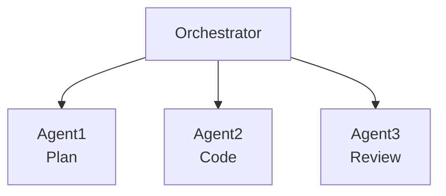
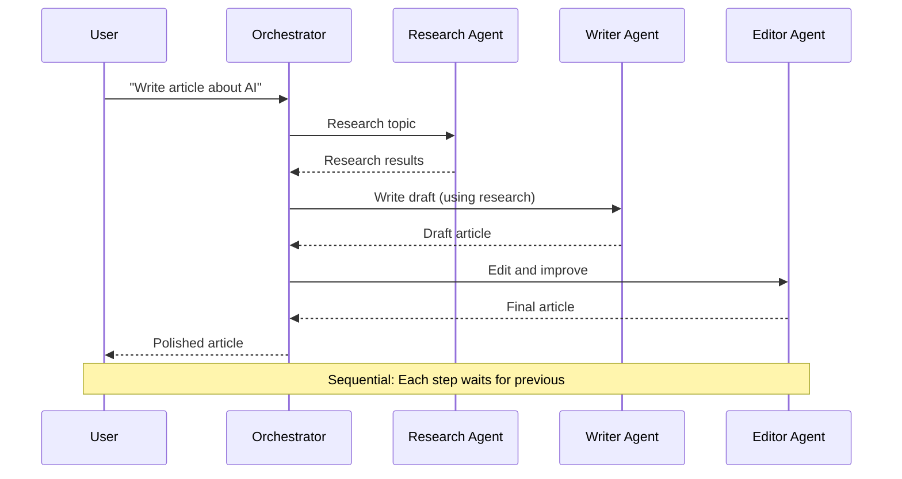
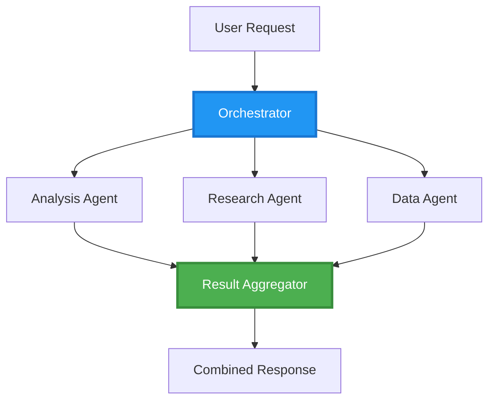
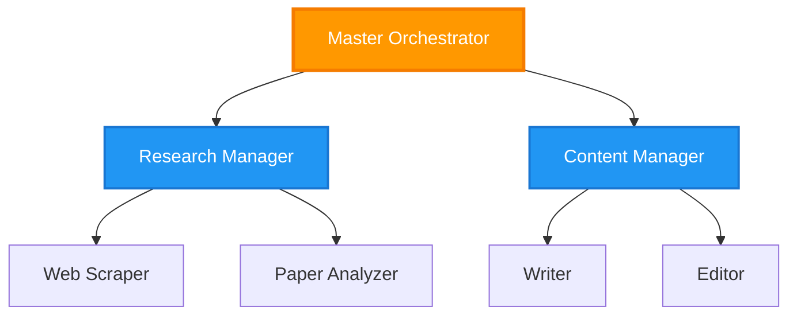
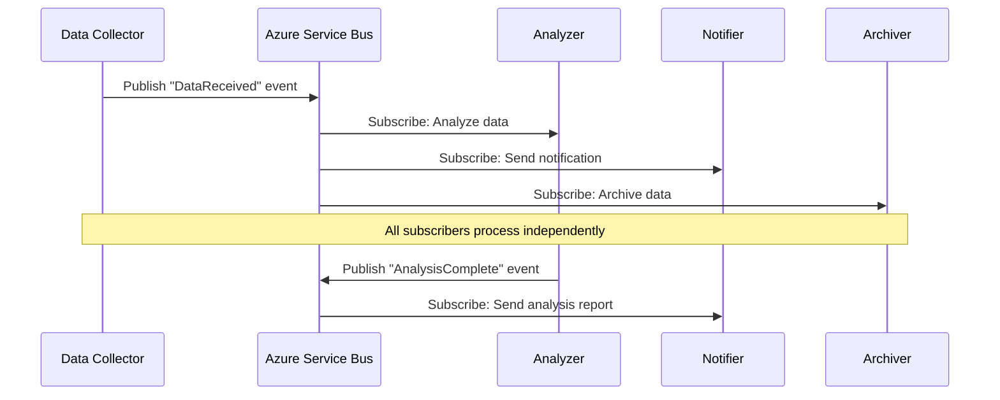
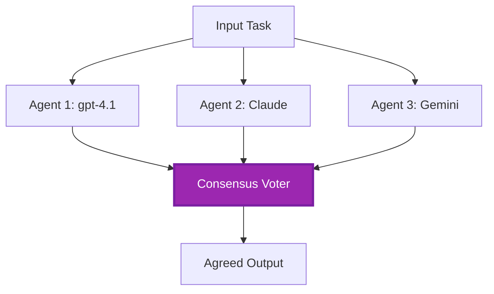
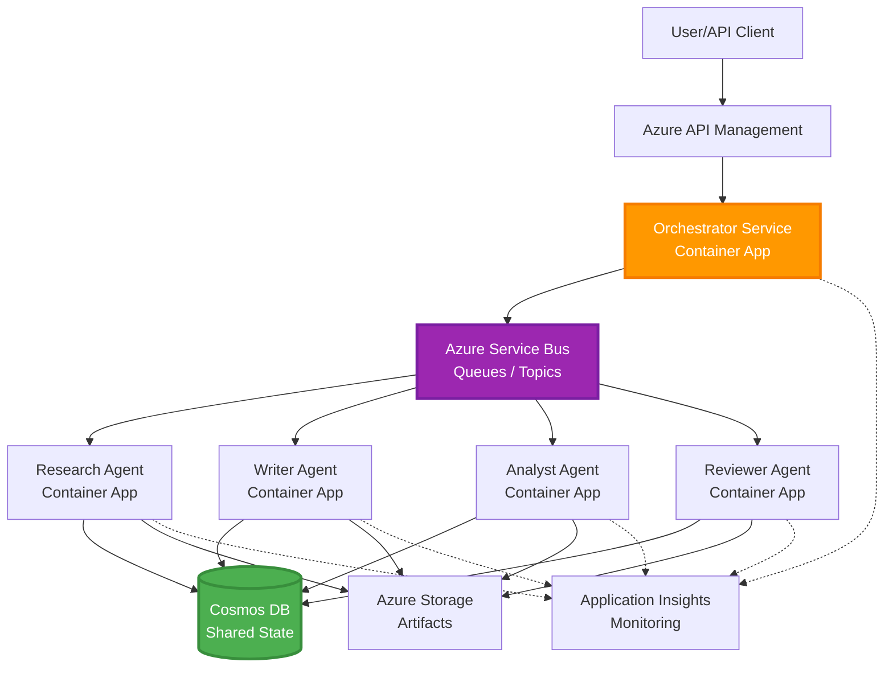

# Mönster för samordning av flera agenter

⏱️ **Beräknad tid**: 60-75 minuters läsning; flera timmar för implementering | 💰 **Beräknad kostnad**: arbetsbelastningsberoende | ⭐ **Komplexitet**: Avancerad

**📚 Lärandebana:**
- ← Föregående: [Kapacitetsplanering](capacity-planning.md) - Resursdimensionering och skalningsstrategier
- 🎯 **Du är här**: Mönster för samordning av flera agenter (orkestrering, kommunikation, tillståndshantering)
- → Nästa: [SKU-val](sku-selection.md) - Välja rätt Azure-tjänster
- 🏠 [Kursstart](../../README.md)

---

## Vad du kommer att lära dig

Genom att slutföra denna lektion kommer du att:
- Förstå **arkitekturmönster för flera agenter** och när de ska användas
- Implementera **orkestreringsmönster** (centraliserade, decentraliserade, hierarkiska)
- Designa **kommunikationsstrategier** för agenter (synkrona, asynkrona, händelsestyrda)
- Hantera **delat tillstånd** över distribuerade agenter
- Distribuera **system med flera agenter** på Azure med AZD
- Använda **samordningsmönster** för verkliga AI-scenarier
- Övervaka och felsöka distribuerade agentsystem

## Varför samordning av flera agenter är viktigt

### Utvecklingen: Från enskild agent till flera agenter

**Enskild agent (enkel):**
```
User → Agent → Response
```
- ✅ Lätt att förstå och implementera
- ✅ Snabb för enkla uppgifter
- ❌ Begränsad av enskild modells kapacitet
- ❌ Kan inte parallellisera komplexa uppgifter
- ❌ Ingen specialisering

**System med flera agenter (avancerat):**

- ✅ Specialiserade agenter för specifika uppgifter
- ✅ Parallell exekvering för snabbhet
- ✅ Modulärt och underhållbart
- ✅ Bättre på komplexa arbetsflöden
- ⚠️ Kräver samordningslogik

**Analog:** En enskild agent är som en person som gör alla uppgifter. Flera agenter är som ett team där varje medlem har specialiserade färdigheter (forskare, kodare, granskare, skribent) som samarbetar.

---

## Kärnmönster för samordning

### Mönster 1: Sekventiell samordning (Ansvarskedja)

**När det används**: Uppgifter måste slutföras i specifik ordning, varje agent bygger vidare på föregående resultat.



**Fördelar:**
- ✅ Klar dataflöde
- ✅ Lätt att felsöka
- ✅ Förutsägbar exekveringsordning

**Begränsningar:**
- ❌ Långsammare (ingen parallellism)
- ❌ Ett fel stoppar hela kedjan
- ❌ Klarar inte sammanlänkade uppgifter

**Exempel på användningsfall:**
- Innehållsskapande pipeline (forskning → skriv → redigera → publicera)
- Kodgenerering (planera → implementera → testa → distribuera)
- Rapportgenerering (datainsamling → analys → visualisering → sammanfattning)

---

### Mönster 2: Parallell samordning (Fan-Out/Fan-In)

**När det används**: Oberoende uppgifter kan köras samtidigt, resultat sammanställs i slutet.



**Fördelar:**
- ✅ Snabbt (parallell exekvering)
- ✅ Felförtåligt (delresultat accepteras)
- ✅ Skalbart horisontellt

**Begränsningar:**
- ⚠️ Resultat kan komma i fel ordning
- ⚠️ Kräver aggregeringslogik
- ⚠️ Komplex tillståndshantering

**Exempel på användningsfall:**
- Datainsamling från flera källor (API:er + databaser + web scraping)
- Konkurrensanalys (flera modeller genererar lösningar, bästa väljs)
- Översättningstjänster (översätt till flera språk samtidigt)

---

### Mönster 3: Hierarkisk samordning (Chef-Arbetare)

**När det används**: Komplexa arbetsflöden med underuppgifter, delegation behövs.



**Fördelar:**
- ✅ Hanterar komplexa arbetsflöden
- ✅ Modulärt och underhållbart
- ✅ Klara ansvarsfördelningar

**Begränsningar:**
- ⚠️ Mer komplex arkitektur
- ⚠️ Högre latens (flera samordningslager)
- ⚠️ Kräver avancerad orkestrering

**Exempel på användningsfall:**
- Företagsdokumenthantering (klassificera → dirigera → bearbeta → arkivera)
- Datapipelines i flera steg (importera → rengöra → transformera → analysera → rapportera)
- Komplexa automatiseringsflöden (planering → resursallokering → exekvering → övervakning)

---

### Mönster 4: Händelsestyrd samordning (Publicera-Prenumerera)

**När det används**: Agenter behöver reagera på händelser, lös koppling önskas.



**Fördelar:**
- ✅ Lös koppling mellan agenter
- ✅ Lätt att lägga till nya agenter (bara prenumerera)
- ✅ Asynkron bearbetning
- ✅ Resilient (meddelandepersistens)

**Begränsningar:**
- ⚠️ Eventuell konsistens
- ⚠️ Komplex felsökning
- ⚠️ Utmaningar med meddelandeordning

**Exempel på användningsfall:**
- Realtidsövervakningssystem (larmen, instrumentpaneler, loggar)
- Multikanalsnotifikationer (e-post, SMS, push, Slack)
- Datapipelines (flera konsumenter av samma data)

---

### Mönster 5: Konsensusbaserad samordning (Omröstning/Quorum)

**När det används**: Krävs överenskommelse från flera agenter innan fortsättning.



**Fördelar:**
- ✅ Högre noggrannhet (flera åsikter)
- ✅ Felförtåligt (minderheters fel accepteras)
- ✅ Inbyggd kvalitetskontroll

**Begränsningar:**
- ❌ Dyrt (flera modellanrop)
- ❌ Långsammare (väntar på alla agenter)
- ⚠️ Kräver konfliktlösning

**Exempel på användningsfall:**
- Innehållsmoderering (flera modeller granskar innehåll)
- Kodgranskning (flera lintverktyg/analysatorer)
- Medicinsk diagnos (flera AI-modeller, expertvalidering)

---

## Arkitekturöversikt

### Komplett system med flera agenter på Azure



**Nyckelkomponenter:**

| Komponent | Syfte | Azure-tjänst |
|-----------|---------|---------------|
| **API Gateway** | Ingångspunkt, begränsa hastighet, autentisering | API Management |
| **Orkestrator** | Samordnar agenternas arbetsflöden | Container Apps |
| **Meddelandekö** | Asynkron kommunikation | Service Bus / Event Hubs |
| **Agenter** | Specialiserade AI-arbetare | Container Apps / Functions |
| **Tillståndslager** | Delat tillstånd, uppgiftsspårning | Cosmos DB |
| **Artefaktlagring** | Dokument, resultat, loggar | Blob Storage |
| **Övervakning** | Distribuerad spårning, loggar | Application Insights |

Service Bus-köer/ämnen och Event Hubs är olika tjänster med olika leverans- och konsumtionsmodeller; Event Hubs är ingen ersättning direkt för Service Bus-arbetarkoden nedan. Parallellism, persisterade meddelanden och modellomröstning garanterar inte i sig felfrihet eller högre noggrannhet.

---

## Förutsättningar

### Nödvändiga verktyg

```bash
# Verify Azure Developer CLI
azd version
# Command reference baseline: azd 1.37.2

# Verify Azure CLI
az --version
# ✅ Expected: azure-cli 2.50.0 or higher

# Verify Docker (for local testing)
docker --version
# ✅ Expected: Docker version 20.10 or higher
```

### Azure-krav

- Aktiv Azure-prenumeration
- Behörighet att skapa:
  - Container Apps
  - Service Bus-namnrymder
  - Cosmos DB-konton
  - Storage-konton
  - Application Insights

### Kunskapsförutsättningar

Du bör ha slutfört:
- [Konfigurationshantering](../chapter-03-configuration/configuration.md)
- [Autentisering & Säkerhet](../chapter-03-configuration/authsecurity.md)
- [Exempel på mikrotjänster](../../../../examples/microservices)

---

## Implementeringsguide

> **Designfragment, inte ett helt driftsättningsbart labb:** Projektstrukturen och `File:`-etiketterna nedan beskriver filer att skapa i ditt eget projekt; detta repositorium innehåller inte en komplett `multi-agent-system`-applikation. Saknade delar inkluderar huvud-/parametermallar, Container Apps-miljö/registrering, Dockerfiler och beroendelås, Cosmos databas/container-inställningar, modellutplaceringar, identitets-/rollkonfiguration, skalningsregler, och parallella arbetare/köer. Förvänta dig inte att `azd init` genererar dessa filer eller att `azd up` distribuerar koden oförändrad. För en körbar startpunkt, slutför [Grundläggande om flera agenter](../chapter-05-multi-agent/multi-agent-basics.md).

**Antaganden för körning:** Python 3.10+, `azure-servicebus`, `azure-cosmos`, `openai`, Flask och (för övervakning) `azure-monitor-opentelemetry`; placera `shared` på Python-importvägen i varje tjänstbild. Cosmos `agent-state/tasks`-containern måste redan finnas med partitioneringsnyckeln `/id`. Nyckelbaserade anslutningar förenklar dessa fragment, inte produktionsriktlinjer: föredra hanterade identiteter med avgränsade Service Bus/Cosmos/OpenAI datadelroller. Exponera inte nycklar i utskrifter eller loggar.

Service Bus-leverans är **minst en gång**. Behåll idempotens per uppgift **och steg**, använd optimistisk samtidighet (ETags) för läs/ändra/skriv-tillstånd och förnya meddelandelås under lång bearbetning. Den enkla tillståndshanteraren nedan är endast sekventiell och implementerar inte dessa produktionsgarantier.

### Projektstruktur

```
multi-agent-system/
├── azure.yaml                    # AZD configuration
├── infra/
│   ├── main.bicep               # Main infrastructure
│   ├── core/
│   │   ├── servicebus.bicep     # Message queue
│   │   ├── cosmos.bicep         # State store
│   │   ├── storage.bicep        # Artifact storage
│   │   └── monitoring.bicep     # Application Insights
│   └── app/
│       ├── orchestrator.bicep   # Orchestrator service
│       └── agent.bicep          # Agent template
└── src/
    ├── orchestrator/            # Orchestration logic
    │   ├── app.py
    │   ├── workflows.py
    │   └── Dockerfile
    ├── agents/
    │   ├── research/            # Research agent
    │   ├── writer/              # Writer agent
    │   ├── analyst/             # Analyst agent
    │   └── reviewer/            # Reviewer agent
    └── shared/
        ├── state_manager.py     # Shared state logic
        └── message_handler.py   # Message handling
```

---

## Lektion 1: Sekventiellt samordningsmönster

### Implementering: Innehållsskapande pipeline

Låt oss designa en sekventiell pipeline: Forskning → Skriv → Redigera. Publicering ingår inte i detta exempel.

### 1. AZD-konfiguration

**Fil: `azure.yaml`**

```yaml
name: content-pipeline
metadata:
  template: multi-agent-sequential@1.0.0

services:
  orchestrator:
    project: ./src/orchestrator
    language: python
    host: containerapp
  
  research-agent:
    project: ./src/agents/research
    language: python
    host: containerapp
  
  writer-agent:
    project: ./src/agents/writer
    language: python
    host: containerapp
  
  editor-agent:
    project: ./src/agents/editor
    language: python
    host: containerapp
```

### 2. Infrastruktur: Service Bus för samordning

**Fil: `infra/core/servicebus.bicep`**

```bicep
param name string
param location string
param tags object = {}

resource serviceBusNamespace 'Microsoft.ServiceBus/namespaces@2022-10-01-preview' = {
  name: name
  location: location
  tags: tags
  sku: {
    name: 'Standard'
    tier: 'Standard'
  }
  properties: {
    minimumTlsVersion: '1.2'
  }
}

// Queue for orchestrator → research agent
resource researchQueue 'Microsoft.ServiceBus/namespaces/queues@2022-10-01-preview' = {
  parent: serviceBusNamespace
  name: 'research-tasks'
  properties: {
    maxDeliveryCount: 3
    lockDuration: 'PT5M'
    deadLetteringOnMessageExpiration: true
  }
}

// Queue for research agent → writer agent
resource writerQueue 'Microsoft.ServiceBus/namespaces/queues@2022-10-01-preview' = {
  parent: serviceBusNamespace
  name: 'writer-tasks'
  properties: {
    maxDeliveryCount: 3
    lockDuration: 'PT5M'
  }
}

// Queue for writer agent → editor agent
resource editorQueue 'Microsoft.ServiceBus/namespaces/queues@2022-10-01-preview' = {
  parent: serviceBusNamespace
  name: 'editor-tasks'
  properties: {
    maxDeliveryCount: 3
    lockDuration: 'PT5M'
  }
}

output namespace string = serviceBusNamespace.name
// Do not output RootManageSharedAccessKey. Resolve scoped credentials
// securely or use managed identity in the application and scale rules.
```

### 3. Hantering av delat tillstånd

**Fil: `src/shared/state_manager.py`**

```python
from azure.cosmos import CosmosClient, PartitionKey
from datetime import datetime, timezone
import os

class StateManager:
    """Manages shared state across agents using Cosmos DB"""
    
    def __init__(self):
        endpoint = os.environ['COSMOS_ENDPOINT']
        key = os.environ['COSMOS_KEY']
        
        self.client = CosmosClient(endpoint, key)
        self.database = self.client.get_database_client('agent-state')
        self.container = self.database.get_container_client('tasks')
    
    def create_task(self, task_id: str, task_type: str, input_data: dict):
        """Create a new task"""
        task = {
            'id': task_id,
            'type': task_type,
            'status': 'pending',
            'input': input_data,
            'created_at': datetime.now(timezone.utc).isoformat(),
            'steps': []
        }
        self.container.create_item(task)
        return task
    
    def update_task_step(self, task_id: str, step_name: str, result: dict):
        """Update task with completed step"""
        task = self.container.read_item(task_id, partition_key=task_id)
        
        task['steps'].append({
            'name': step_name,
            'completed_at': datetime.now(timezone.utc).isoformat(),
            'result': result
        })
        
        self.container.replace_item(task_id, task)
        return task
    
    def complete_task(self, task_id: str, final_result: dict):
        """Mark task as complete"""
        task = self.container.read_item(task_id, partition_key=task_id)
        task['status'] = 'completed'
        task['result'] = final_result
        task['completed_at'] = datetime.now(timezone.utc).isoformat()
        self.container.replace_item(task_id, task)
        return task
    
    def get_task(self, task_id: str):
        """Retrieve task state"""
        return self.container.read_item(task_id, partition_key=task_id)
```

### 4. Orkestratortjänst

**Fil: `src/orchestrator/app.py`**

```python
from flask import Flask, request, jsonify
from azure.servicebus import ServiceBusClient, ServiceBusMessage
import json
import uuid
import os
from shared.state_manager import StateManager

app = Flask(__name__)
state_manager = StateManager()

# Service Bus connection
servicebus_connection_str = os.environ['SERVICEBUS_CONNECTION_STRING']
servicebus_client = ServiceBusClient.from_connection_string(servicebus_connection_str)

@app.route('/health', methods=['GET'])
def health():
    return jsonify({'status': 'healthy', 'service': 'orchestrator'})

@app.route('/create-content', methods=['POST'])
def create_content():
    """
    Sequential workflow: Research → Write → Edit (returns a draft; no publishing)
    """
    data = request.get_json(silent=True) or {}
    topic = data.get('topic')
    
    if not topic:
        return jsonify({'error': 'Topic required'}), 400
    
    # Create task in state store
    task_id = str(uuid.uuid4())
    task = state_manager.create_task(
        task_id=task_id,
        task_type='content_creation',
        input_data={'topic': topic}
    )
    
    # Send message to research agent (first step)
    sender = servicebus_client.get_queue_sender('research-tasks')
    message = ServiceBusMessage(
        body=json.dumps({
            'task_id': task_id,
            'topic': topic,
            'next_queue': 'writer-tasks'  # Where to send results
        }),
        content_type='application/json'
    )
    
    with sender:
        sender.send_messages(message)
    
    return jsonify({
        'task_id': task_id,
        'status': 'started',
        'workflow': 'sequential',
        'steps': ['research', 'write', 'edit'],
        'message': 'Content creation pipeline initiated'
    }), 202

@app.route('/task/<task_id>', methods=['GET'])
def get_task_status(task_id):
    """Check task status"""
    try:
        task = state_manager.get_task(task_id)
        return jsonify(task)
    except Exception as e:
        return jsonify({'error': str(e)}), 404

if __name__ == '__main__':
    app.run(host='0.0.0.0', port=8080)
```

### 5. Forskningsagent

**Fil: `src/agents/research/app.py`**

```python
from azure.servicebus import ServiceBusClient, ServiceBusMessage
from openai import AzureOpenAI
import json
import os
import time
from shared.state_manager import StateManager

# Initialize clients
state_manager = StateManager()
servicebus_client = ServiceBusClient.from_connection_string(
    os.environ['SERVICEBUS_CONNECTION_STRING']
)

openai_client = AzureOpenAI(
    api_key=os.environ['AZURE_OPENAI_API_KEY'],
    api_version="2024-10-21",
    azure_endpoint=os.environ['AZURE_OPENAI_ENDPOINT']
)

def process_research_task(message_data):
    """Process research request and pass to writer"""
    task_id = message_data['task_id']
    topic = message_data['topic']
    next_queue = message_data['next_queue']
    
    print(f"🔬 Researching: {topic}")
    
    # Call Microsoft Foundry Models for research
    response = openai_client.chat.completions.create(
        model=os.environ['AZURE_OPENAI_DEPLOYMENT'],
        messages=[
            {"role": "system", "content": "You are a research assistant. Provide comprehensive research on the given topic."},
            {"role": "user", "content": f"Research this topic thoroughly: {topic}"}
        ],
        max_tokens=1500
    )
    
    research_results = response.choices[0].message.content
    
    # Update state
    state_manager.update_task_step(
        task_id=task_id,
        step_name='research',
        result={'research': research_results}
    )
    
    # Send to next agent (writer)
    sender = servicebus_client.get_queue_sender(next_queue)
    message = ServiceBusMessage(
        body=json.dumps({
            'task_id': task_id,
            'topic': topic,
            'research': research_results,
            'next_queue': 'editor-tasks'
        }),
        content_type='application/json'
    )
    
    with sender:
        sender.send_messages(message)
    
    print(f"✅ Research complete for task {task_id}")

def main():
    """Listen to research queue"""
    receiver = servicebus_client.get_queue_receiver('research-tasks')
    
    print("🔬 Research Agent started, listening for tasks...")
    
    with receiver:
        while True:
            messages = receiver.receive_messages(max_wait_time=5)
            for message in messages:
                try:
                    message_data = json.loads(str(message))
                    process_research_task(message_data)
                    receiver.complete_message(message)
                except Exception as e:
                    print(f"❌ Error processing message: {e}")
                    receiver.abandon_message(message)

if __name__ == '__main__':
    main()
```

### 6. Skribentagent

**Fil: `src/agents/writer/app.py`**

```python
from azure.servicebus import ServiceBusClient, ServiceBusMessage
from openai import AzureOpenAI
import json
import os
from shared.state_manager import StateManager

state_manager = StateManager()
servicebus_client = ServiceBusClient.from_connection_string(
    os.environ['SERVICEBUS_CONNECTION_STRING']
)

openai_client = AzureOpenAI(
    api_key=os.environ['AZURE_OPENAI_API_KEY'],
    api_version="2024-10-21",
    azure_endpoint=os.environ['AZURE_OPENAI_ENDPOINT']
)

def process_writing_task(message_data):
    """Write article based on research"""
    task_id = message_data['task_id']
    topic = message_data['topic']
    research = message_data['research']
    next_queue = message_data['next_queue']
    
    print(f"✍️ Writing article: {topic}")
    
    # Call Microsoft Foundry Models to write article
    response = openai_client.chat.completions.create(
        model=os.environ['AZURE_OPENAI_DEPLOYMENT'],
        messages=[
            {"role": "system", "content": "You are a professional writer. Write engaging, well-structured articles."},
            {"role": "user", "content": f"Based on this research:\n\n{research}\n\nWrite a comprehensive article about: {topic}"}
        ],
        max_tokens=2000
    )
    
    article_draft = response.choices[0].message.content
    
    # Update state
    state_manager.update_task_step(
        task_id=task_id,
        step_name='writing',
        result={'draft': article_draft}
    )
    
    # Send to editor
    sender = servicebus_client.get_queue_sender(next_queue)
    message = ServiceBusMessage(
        body=json.dumps({
            'task_id': task_id,
            'topic': topic,
            'draft': article_draft
        }),
        content_type='application/json'
    )
    
    with sender:
        sender.send_messages(message)
    
    print(f"✅ Article draft complete for task {task_id}")

def main():
    """Listen to writer queue"""
    receiver = servicebus_client.get_queue_receiver('writer-tasks')
    
    print("✍️ Writer Agent started, listening for tasks...")
    
    with receiver:
        while True:
            messages = receiver.receive_messages(max_wait_time=5)
            for message in messages:
                try:
                    message_data = json.loads(str(message))
                    process_writing_task(message_data)
                    receiver.complete_message(message)
                except Exception as e:
                    print(f"❌ Error: {e}")
                    receiver.abandon_message(message)

if __name__ == '__main__':
    main()
```

### 7. Redaktörsagent

**Fil: `src/agents/editor/app.py`**

```python
from azure.servicebus import ServiceBusClient
from openai import AzureOpenAI
import json
import os
from shared.state_manager import StateManager

state_manager = StateManager()
servicebus_client = ServiceBusClient.from_connection_string(
    os.environ['SERVICEBUS_CONNECTION_STRING']
)

openai_client = AzureOpenAI(
    api_key=os.environ['AZURE_OPENAI_API_KEY'],
    api_version="2024-10-21",
    azure_endpoint=os.environ['AZURE_OPENAI_ENDPOINT']
)

def process_editing_task(message_data):
    """Edit and finalize article"""
    task_id = message_data['task_id']
    topic = message_data['topic']
    draft = message_data['draft']
    
    print(f"📝 Editing article: {topic}")
    
    # Call Microsoft Foundry Models to edit
    response = openai_client.chat.completions.create(
        model=os.environ['AZURE_OPENAI_DEPLOYMENT'],
        messages=[
            {"role": "system", "content": "You are an expert editor. Improve grammar, clarity, and structure."},
            {"role": "user", "content": f"Edit and improve this article:\n\n{draft}"}
        ],
        max_tokens=2000
    )
    
    final_article = response.choices[0].message.content
    
    # Mark task as complete
    state_manager.complete_task(
        task_id=task_id,
        final_result={
            'topic': topic,
            'final_article': final_article,
            'word_count': len(final_article.split())
        }
    )
    
    print(f"✅ Article finalized for task {task_id}")

def main():
    """Listen to editor queue"""
    receiver = servicebus_client.get_queue_receiver('editor-tasks')
    
    print("📝 Editor Agent started, listening for tasks...")
    
    with receiver:
        while True:
            messages = receiver.receive_messages(max_wait_time=5)
            for message in messages:
                try:
                    message_data = json.loads(str(message))
                    process_editing_task(message_data)
                    receiver.complete_message(message)
                except Exception as e:
                    print(f"❌ Error: {e}")
                    receiver.abandon_message(message)

if __name__ == '__main__':
    main()
```

### 8. Distribuera och testa

Dessa kommandon gäller **endast efter att du implementerat de saknade projektfilerna**. Interaktiv initialisering av Foundry-agent är ett separat arbetsflöde; det genererar inte denna Service Bus-design.

```bash
# In your completed custom project
azd up

# Alternative in a SEPARATE empty folder (agents beta.23 requires azd >= 1.37)
azd extension install azure.ai.agents
azd ai agent init
azd up
```

> Se [AZD AI CLI-kommandon](../chapter-08-production/production-ai-practices.md#azd-ai-cli-commands-and-extensions) för alla `azd ai`-flaggor och alternativ.

```bash
# Get orchestrator URL
ORCHESTRATOR_URL=$(azd env get-values | grep ORCHESTRATOR_URL | cut -d '=' -f2 | tr -d '"')

# Create content
curl -X POST $ORCHESTRATOR_URL/create-content \
  -H "Content-Type: application/json" \
  -d '{"topic": "The Future of AI in Healthcare"}'
```

**✅ Förväntat resultat:**
```json
{
  "task_id": "a1b2c3d4-e5f6-7890-abcd-ef1234567890",
  "status": "started",
  "workflow": "sequential",
  "steps": ["research", "write", "edit"],
  "message": "Content creation pipeline initiated"
}
```

**Kontrollera uppgiftens framsteg:**
```bash
TASK_ID="a1b2c3d4-e5f6-7890-abcd-ef1234567890"
curl $ORCHESTRATOR_URL/task/$TASK_ID
```

**✅ Förväntat resultat (slutfört):**
```json
{
  "id": "a1b2c3d4-e5f6-7890-abcd-ef1234567890",
  "type": "content_creation",
  "status": "completed",
  "steps": [
    {
      "name": "research",
      "completed_at": "2025-11-19T10:30:00Z",
      "result": {"research": "..."}
    },
    {
      "name": "writing",
      "completed_at": "2025-11-19T10:32:00Z",
      "result": {"draft": "..."}
    }
  ],
  "result": {
    "topic": "The Future of AI in Healthcare",
    "final_article": "...",
    "word_count": 1500
  }
}
```

---

## Lektion 2: Parallellt samordningsmönster

### Implementering: Multi-källa forskningsaggregator

Låt oss bygga ett parallellt system som samlar information från flera källor samtidigt.

### Parallell orkestrator

**Fil: `src/orchestrator/parallel_workflow.py`**

```python
from flask import Flask, request, jsonify
from azure.servicebus import ServiceBusClient, ServiceBusMessage
import json
import uuid
import os
from shared.state_manager import StateManager

app = Flask(__name__)
state_manager = StateManager()

servicebus_client = ServiceBusClient.from_connection_string(
    os.environ['SERVICEBUS_CONNECTION_STRING']
)

@app.route('/research-parallel', methods=['POST'])
def research_parallel():
    """
    Parallel workflow: Multiple agents work simultaneously
    """
    data = request.json
    query = data.get('query')
    
    task_id = str(uuid.uuid4())
    task = state_manager.create_task(
        task_id=task_id,
        task_type='parallel_research',
        input_data={
            'query': query,
            'agents': ['web', 'academic', 'news', 'social']
        }
    )
    
    # Fan-out: publish sequentially; workers may process concurrently.
    agents = [
        ('web-research-queue', 'web'),
        ('academic-research-queue', 'academic'),
        ('news-research-queue', 'news'),
        ('social-research-queue', 'social')
    ]
    
    for queue_name, agent_type in agents:
        sender = servicebus_client.get_queue_sender(queue_name)
        message = ServiceBusMessage(
            body=json.dumps({
                'task_id': task_id,
                'query': query,
                'agent_type': agent_type,
                'result_queue': 'aggregation-queue'
            }),
            content_type='application/json'
        )
        
        with sender:
            sender.send_messages(message)
    
    return jsonify({
        'task_id': task_id,
        'status': 'started',
        'workflow': 'parallel',
        'agents_dispatched': 4,
        'message': 'Parallel research initiated'
    }), 202

if __name__ == '__main__':
    app.run(host='0.0.0.0', port=8080)
```

### Aggregeringslogik

**Fil: `src/agents/aggregator/app.py`**

```python
from azure.servicebus import ServiceBusClient
import json
import os
from collections import defaultdict
from shared.state_manager import StateManager

state_manager = StateManager()
servicebus_client = ServiceBusClient.from_connection_string(
    os.environ['SERVICEBUS_CONNECTION_STRING']
)

# Single-process demo only: not durable or shared across replicas.
# Production: use durable unique (task_id, agent_type) result records.
task_results = defaultdict(dict)
expected_agents = 4  # web, academic, news, social

def process_result(message_data):
    """Aggregate results from parallel agents"""
    task_id = message_data['task_id']
    agent_type = message_data['agent_type']
    result = message_data['result']
    
    # Store result
    task_results[task_id][agent_type] = {
        'agent': agent_type,
        'data': result
    }
    
    print(f"📊 Received result from {agent_type} agent ({len(task_results[task_id])}/{expected_agents})")
    
    # Check if all agents completed (fan-in)
    if len(task_results[task_id]) == expected_agents:
        print(f"✅ All agents completed for task {task_id}. Aggregating...")
        
        # Combine results
        aggregated = {
            'query': message_data['query'],
            'sources': list(task_results[task_id].values()),
            'summary': generate_summary(list(task_results[task_id].values()))
        }
        
        # Mark complete
        state_manager.complete_task(task_id, aggregated)
        
        # Clean up
        del task_results[task_id]
        
        print(f"✅ Aggregation complete for task {task_id}")

def generate_summary(results):
    """Generate summary from all sources"""
    summaries = [r['data'].get('summary', '') for r in results]
    return '\n\n'.join(summaries)

def main():
    """Listen to aggregation queue"""
    receiver = servicebus_client.get_queue_receiver('aggregation-queue')
    
    print("📊 Aggregator started, listening for results...")
    
    with receiver:
        while True:
            messages = receiver.receive_messages(max_wait_time=5)
            for message in messages:
                try:
                    message_data = json.loads(str(message))
                    process_result(message_data)
                    receiver.complete_message(message)
                except Exception as e:
                    print(f"❌ Error: {e}")
                    receiver.abandon_message(message)

if __name__ == '__main__':
    main()
```

**Fördelar med parallellt mönster:**
- ⚡ **Potentiellt lägre latens** (begränsad av långsammaste arbetare plus samordningskostnad)
- 🔄 **Kan stödja delresultat** med explicita tidsgränser och felhantering (implementeras ej i grundläggande aggregator)
- 📈 **Skalbar** (lägg till fler agenter enkelt)

---

## Praktiska övningar

### Övning 1: Lägg till timeout-hantering ⭐⭐ (Medel)

**Mål**: Implementera timeout-logik så att aggregatorn inte väntar för evigt på långsamma agenter.

**Utgångspunkt:** Kör denna lokala tidsgränssimulering före integration i en köarbetare. En timeout kontrollerad endast när ett annat meddelande anländer triggas aldrig om den saknade arbetaren inte skickar något.

**Steg**:

1. **Lägg till timeout-uppföljning i aggregatorn:**

```python
import asyncio

async def simulated_agent(name, delay):
    await asyncio.sleep(delay)
    return {'agent': name, 'result': 'done'}

async def main():
    tasks = [asyncio.create_task(simulated_agent(name, delay))
             for name, delay in [('web', 0.1), ('academic', 0.2),
                                 ('news', 0.3), ('social', 3)]]
    done, pending = await asyncio.wait(tasks, timeout=1)
    results = [task.result() for task in done]
    for task in pending:
        task.cancel()
    await asyncio.gather(*pending, return_exceptions=True)
    print({'completed_agents': len(results), 'timed_out': bool(pending)})
    assert len(results) == 3 and pending

asyncio.run(main())
```

2. **Förväntat resultat:**

```text
{'completed_agents': 3, 'timed_out': True}
```

3. **Kösystemintegration (designuppgift):** Behåll deadline för utskick och förväntade agenter när uppgift skapas, kör periodisk deadlinesvep oberoende av inkommande resultat, slutför delresultat atomärt och ignorera sena/dubblettmeddelanden för slutförda uppgifter. Lokal timeout avbryter inte fjärrarbetare.

Endast för ditt implementerade projekt:

```bash
azd deploy aggregator

# Submit task
curl -X POST $ORCHESTRATOR_URL/research-parallel \
  -H "Content-Type: application/json" \
  -d '{"query": "AI safety research"}'

# Check results after 30 seconds
curl $ORCHESTRATOR_URL/task/$TASK_ID
```

**✅ Framgångskriterier:**
- ✅ Lokalt test returnerar efter sin ettsekunders deadline även om en agent är ofullständig
- ✅ Svar indikerar delresultat (`"timed_out": true`)
- ✅ Tillgängliga resultat returneras (3 av 4 agenter)

**Tid**: 20-25 minuter

---

### Övning 2: Implementera återförsök-logik ⭐⭐⭐ (Avancerad)

**Mål**: Försök automatiskt igen med misslyckade agentuppgifter innan du ger upp.

**Steg**:

1. **Använd Service Bus leveransräkningar snarare än egna återförsökstämplar:**

```python
import json
import time
# Integration fragment: use a live peek-lock ServiceBusReceiver.
# Set queue maxDeliveryCount to 4 for one attempt + up to three retries.
```

2. **Lägg till återförsökshanterare hos agenter:**

```python
def process_with_retry(message, receiver, process_func):
    """Process message with automatic retry on failure"""
    try:
        message_data = json.loads(str(message))
        
        # Process the message
        process_func(message_data)
        
        # Success - complete
        receiver.complete_message(message)
        
    except Exception as e:
        if message.delivery_count < 4:
            # Bounded exponential delay: 5s, 10s, 20s.
            # Renew the lock if processing + waiting can exceed its duration.
            time.sleep(5 * 2 ** (message.delivery_count - 1))
            receiver.abandon_message(message)
        else:
            # Max retries exceeded - move to dead letter queue
            print(f"❌ Max attempts exceeded for message {message.message_id}")
            receiver.dead_letter_message(
                message,
                reason="MaxRetriesExceeded",
                error_description=str(e)
            )
```

3. **Övervaka dödsbrevlåda:**

```python
def monitor_dead_letters():
    """Check dead letter queue for failed messages"""
    receiver = servicebus_client.get_queue_receiver(
        'research-tasks',
        sub_queue='deadletter'
    )
    
    with receiver:
        messages = receiver.receive_messages(max_wait_time=5)
        for message in messages:
            print(f"☠️ Dead letter: {message.message_id}")
            print(f"Reason: {message.dead_letter_reason}")
            print(f"Description: {message.dead_letter_error_description}")
```

**✅ Framgångskriterier:**
- ✅ Misslyckade uppgifter gör automatiskt upp till 3 återförsök
- ✅ Exponentiell backoff mellan återförsök (5s, 10s, 20s) med förnyelse av meddelandelås vid behov
- ✅ Efter max återförsök skickas meddelanden till dödsbrevlådan
- ✅ Dödsbrev kan inspekteras; uppspelning kräver separat idempotent återhämtningsarbetsflöde

**Tid**: 30-40 minuter

---

### Övning 3: Implementera säkringsbrytare (Circuit Breaker) ⭐⭐⭐ (Avancerad)

**Mål**: Förhindra kaskadfel genom att stoppa anrop till felande agenter.

**Steg**:

1. **Skapa säkringsbrytarklass:**

```python
from enum import Enum
from datetime import datetime, timedelta, timezone

class CircuitState(Enum):
    CLOSED = "closed"      # Normal operation
    OPEN = "open"          # Failing, reject requests
    HALF_OPEN = "half_open"  # Testing if recovered

class CircuitBreaker:
    def __init__(self, failure_threshold=5, timeout_seconds=60):
        self.failure_threshold = failure_threshold
        self.timeout_seconds = timeout_seconds
        self.failure_count = 0
        self.last_failure_time = None
        self.state = CircuitState.CLOSED
    
    def call(self, func):
        """Execute function with circuit breaker protection"""
        if self.state == CircuitState.OPEN:
            # Check if timeout expired
            if datetime.now(timezone.utc) - self.last_failure_time > timedelta(seconds=self.timeout_seconds):
                self.state = CircuitState.HALF_OPEN
                print("🔄 Circuit breaker: HALF_OPEN (testing)")
            else:
                raise Exception(f"Circuit breaker OPEN for agent. Try again in {self.timeout_seconds}s")
        
        try:
            result = func()
            
            # Success
            self.failure_count = 0 # Count consecutive failures only
            if self.state == CircuitState.HALF_OPEN:
                self.state = CircuitState.CLOSED
                self.failure_count = 0
                print("✅ Circuit breaker: CLOSED (recovered)")
            
            return result
            
        except Exception as e:
            self.failure_count += 1
            self.last_failure_time = datetime.now(timezone.utc)
            
            if self.failure_count >= self.failure_threshold:
                self.state = CircuitState.OPEN
                print(f"🔴 Circuit breaker: OPEN (too many failures)")
            
            raise
```

2. **Applicera på agentanrop:**

```python
# In orchestrator
agent_circuits = {
    'web': CircuitBreaker(failure_threshold=5, timeout_seconds=60),
    'academic': CircuitBreaker(failure_threshold=5, timeout_seconds=60),
    'news': CircuitBreaker(failure_threshold=5, timeout_seconds=60),
    'social': CircuitBreaker(failure_threshold=5, timeout_seconds=60)
}

def send_to_agent(agent_type, message_data):
    """Send with circuit breaker protection"""
    circuit = agent_circuits[agent_type]
    
    try:
        circuit.call(lambda: send_message(agent_type, message_data))
    except Exception as e:
        print(f"⚠️ Skipping {agent_type} agent: {e}")
        # Continue with other agents
```

Den här kretsen skyddar **skickningsoperationen**, inte slutförandet av den fjärrstyrda arbetaren: att framgångsrikt köa ett meddelande säger ingenting om huruvida en agent är aktiv. `send_message` är din applikations sändarfunktion. För exekveringskretsar, mata in observerade uppgiftsfel/tidsavbrott i en uthållig koordinator. Denna i-minnet-klass är en enkeltrådad demonstration, inte en distribuerad kretsbrytare.

3. **Testa kretsbrytaren lokalt:**

```python
# Run after the class definition; no Azure changes required.
circuit = CircuitBreaker(failure_threshold=5, timeout_seconds=0)
def fail():
    raise RuntimeError("simulated failure")
for _ in range(5):
    try:
        circuit.call(fail)
    except RuntimeError:
        pass
assert circuit.state == CircuitState.OPEN
assert circuit.call(lambda: "recovered") == "recovered"
assert circuit.state == CircuitState.CLOSED
print("Circuit breaker recovery verified")
```

**✅ Framgångskriterier:**
- ✅ Efter 5 fel öppnas kretsen (avvisar förfrågningar)
- ✅ Efter 60 sekunder går kretsen till halvöppen (testar återhämtning)
- ✅ Andra agenter fortsätter arbeta normalt
- ✅ Kretsen stängs automatiskt när agenten återhämtar sig

**Tid**: 40–50 minuter

---

## Övervakning och Felsökning

### Distribuerad Spårning med Application Insights

**Fil: `src/shared/tracing.py`**

```python
from azure.monitor.opentelemetry import configure_azure_monitor
from opentelemetry import trace
from opentelemetry.trace import SpanKind
import logging
import os

connection_string = os.environ.get('APPLICATIONINSIGHTS_CONNECTION_STRING')

# Configure once per process. Message send/receive trace-context propagation
# and agent attributes on exceptions need explicit instrumentation.
if connection_string:
    configure_azure_monitor(connection_string=connection_string, logger_name=__name__)
tracer = trace.get_tracer(__name__)

# Configure logging
logger = logging.getLogger(__name__)
logger.setLevel(logging.INFO)

def trace_agent_call(agent_name, task_id, operation_name, operation):
    """Trace agent operations"""
    with tracer.start_as_current_span(f'agent.{agent_name}.{operation_name}', kind=SpanKind.CLIENT) as span:
        span.set_attribute('agent', agent_name)
        span.set_attribute('task_id', task_id)
        span.set_attribute('operation', operation_name)
        
        try:
            result = operation()
            span.set_attribute('status', 'success')
            logger.info('Agent operation completed', extra={
                'agent': agent_name, 'task_id': task_id, 'operation': operation_name
            })
            return result
        except Exception as e:
            span.set_attribute('status', 'error')
            logger.exception('Agent operation failed', extra={
                'agent': agent_name, 'task_id': task_id, 'operation': operation_name
            })
            raise
```

### Application Insights-frågor

**Spåra multi-agent-flöden:**

```kusto
// Trace complete workflow for a task
traces
| where customDimensions.task_id == "a1b2c3d4-..."
| project timestamp, message, customDimensions.agent, customDimensions.operation
| order by timestamp asc
```

**Prestandajämförelse av agenter:**

```kusto
// Compare agent execution times
dependencies
| where name contains "agent"
| summarize 
    avg_duration = avg(duration),
    p95_duration = percentile(duration, 95),
    count = count()
  by agent = tostring(customDimensions.agent)
| order by avg_duration desc
```

**Felanalys:**

```kusto
// Find which agents fail most
exceptions
| where customDimensions.agent != ""
| summarize 
    failure_count = count(),
    unique_errors = dcount(outerMessage)
  by agent = tostring(customDimensions.agent)
| order by failure_count desc
```

---

## Kostnadsanalys

### Kostnader för Multi-Agent System (månatliga uppskattningar)

Illustrativa planeringssiffror endast, inte offerter: summan nedan är **240-565 USD/månad**. Verifiera aktuella regionala priser, aktiva/inaktiva repliktimmar, in- och utdata-tokenmix, lagring och telemetri. Serverless har ingen minsta garanterad genomströmning men fakturerar fortfarande för förfrågningar och lagring.

| Komponent | Konfiguration | Kostnad |
|-----------|--------------|------|
| **Orkestrator** | 1 Container App (1 vCPU, 2GB) | 30-50 USD |
| **4 Agenter** | 4 Container Appar (0,5 vCPU, 1GB vardera) | 60-120 USD |
| **Service Bus** | Standardnivå, 10M meddelanden | 10-20 USD |
| **Cosmos DB** | Serverless, 5GB lagring, 1M RU | 25-50 USD |
| **Blob Storage** | 10GB lagring, 100K operationer | 5-10 USD |
| **Application Insights** | 5GB ingestion | 10-15 USD |
| **Microsoft Foundry Models** | gpt-4.1, 10M token | 100-300 USD |
| **Totalt** | | **240-565 USD/månad** |

### Kostnadsoptimeringsstrategier

1. **Använd serverless där det är möjligt:**
   ```bicep
   // Cosmos DB serverless (no minimum cost)
   properties: {
     databaseAccountOfferType: 'Standard'
     capabilities: [{ name: 'EnableServerless' }]
   }
   ```

2. **Skala ner agenter till noll när de är inaktiva:**
   ```bicep
   scale: {
     minReplicas: 0  // Requires a Service Bus/KEDA scale rule to wake workers
     maxReplicas: 10
   }
   ```

3. **Använd batchning för Service Bus:**
   ```python
   # Send messages in batches (cheaper)
   sender.send_messages([message1, message2, message3])
   ```

4. **Cachelagra ofta använda resultat:**
   ```python
   # Use Azure Cache for Redis
   if cache.exists(query_hash):
       return cache.get(query_hash)
   ```

---

## Bästa praxis

### ✅ GÖR:

1. **Använd idempotenta operationer**
   ```python
   # Pseudocode: implement a durable, atomic per-step deduplication claim.
   def process_task(task_id):
       raise NotImplementedError("Claim (task_id, step) atomically, execute, persist outcome")
   ```

2. **Implementera omfattande loggning**
   ```python
   logger.info(f"Agent: {agent_name}, Task: {task_id}, Action: {action}")
   ```

3. **Använd korrelations-ID:n**
   ```python
   # Pass task_id through entire workflow
   message_data = {
       'task_id': task_id,  # Correlation ID
       'timestamp': datetime.utcnow().isoformat()
   }
   ```

4. **Sätt meddelandets TTL (time-to-live)**
   ```bicep
   properties: {
     defaultMessageTimeToLive: 'PT1H'  // 1 hour max
   }
   ```

5. **Övervaka dead letter-köer**
   ```python
   # Regular monitoring of failed messages
   monitor_dead_letters()
   ```

### ❌ GÖR INTE:

1. **Skapa inte cirkulära beroenden**
   ```python
   # ❌ BAD: Agent A → Agent B → Agent A (infinite loop)
   # ✅ GOOD: Define clear directed acyclic graph (DAG)
   ```

2. **Blockera inte agenttrådar**
   ```python
   # ❌ BAD: Synchronous wait
   while not task_complete:
       time.sleep(1)
   
   # ✅ GOOD: Use message queue callbacks
   ```

3. **Ignorera inte delvisa fel**
   ```python
   # ❌ BAD: Fail entire workflow if one agent fails
   # ✅ GOOD: Return partial results with error indicators
   ```

4. **Använd inte oändliga omförsök**
   ```python
   # ❌ BAD: retry forever
   # ✅ GOOD: max_retries = 3, then dead letter
   ```

---

## Felsökningsguide

### Problem: Meddelanden fastnar i kön

**Symptom:**
- Meddelanden samlas i kön
- Agenter bearbetar inte
- Uppgiftsstatus fastnar på "väntande"

**Diagnos:**
```bash
# Check queue depth
az servicebus queue show \
  --resource-group "$RG_NAME" \
  --namespace-name mybus \
  --name research-tasks \
  --query "countDetails"

# Check agent logs using Azure CLI
az containerapp logs show --name research-agent --resource-group $RG_NAME --tail 50
```

**Lösningar:**

1. **Öka antalet agentrepliker:**
   ```bash
   az containerapp update \
     --resource-group "$RG_NAME" \
     --name research-agent \
     --min-replicas 3 \
     --max-replicas 10
   ```

2. **Kontrollera dead letter-kön:**
   ```bash
   az servicebus queue show \
     --resource-group "$RG_NAME" \
     --namespace-name mybus \
     --name research-tasks \
     --query "countDetails.deadLetterMessageCount"
   ```

---

### Problem: Uppgiftstidutgång/slutförs aldrig

**Symptom:**
- Uppgiftsstatus förblir "pågående"
- Vissa agenter slutför, andra inte
- Inga felmeddelanden

**Diagnos:**
```bash
# Check task state
curl $ORCHESTRATOR_URL/task/$TASK_ID

# Check Application Insights
# Run query: traces | where customDimensions.task_id == "..."
```

**Lösningar:**

1. **Implementera timeout i aggregator (Övning 1)**

2. **Kontrollera för agentfel med Azure Monitor:**
   ```bash
   # View logs via azd monitor
   azd monitor --logs
   
   # Or use Azure CLI to check specific container app logs
   az containerapp logs show --name <agent-name> --resource-group $RG_NAME --follow | grep "ERROR\|FAIL"
   ```

3. **Verifiera att alla agenter körs:**
   ```bash
   az containerapp list \
     --resource-group rg-agents \
     --query "[].{name:name, status:properties.runningStatus}"
   ```

---

## Lär dig mer

### Officiell dokumentation
- [Azure Service Bus](https://learn.microsoft.com/azure/service-bus-messaging/service-bus-messaging-overview)
- [Cosmos DB](https://learn.microsoft.com/azure/cosmos-db/introduction)
- [Container Apps DAPR](https://learn.microsoft.com/azure/container-apps/dapr-overview)
- [AI Agent Orchestration Patterns](https://learn.microsoft.com/azure/architecture/ai-ml/guide/ai-agent-design-patterns)

### Nästa steg i kursen
- ← Föregående: [Kapacitetsplanering](capacity-planning.md)
- → Nästa: [Val av SKU](sku-selection.md)
- 🏠 [Kurshemsida](../../README.md)

### Relaterade exempel
- [Microservices-exempel](../../../../examples/microservices) - Mönster för tjänstekommunikation
- [Microsoft Foundry Models-exempel](../../../../examples/azure-openai-chat) - AI-integration

---

## Sammanfattning

**Du har lärt dig:**
- ✅ Fem samordningsmönster (sekventiell, parallell, hierarkisk, händelsestyrd, konsensus)
- ✅ Multi-agent-arkitektur på Azure (Service Bus, Cosmos DB, Container Appar)
- ✅ Tillståndshantering över distribuerade agenter
- ✅ Timeout-hantering, omförsök och kretsbrytare
- ✅ Övervakning och felsökning av distribuerade system
- ✅ Strategier för kostnadsoptimering

**Viktiga lärdomar:**
1. **Välj rätt mönster** - Sekventiellt för ordnade arbetsflöden, parallellt för snabbhet, händelsestyrt för flexibilitet
2. **Hantera tillstånd noggrant** - Använd Cosmos DB eller liknande för delat tillstånd
3. **Hantera fel på ett smidigt sätt** - Timeout, omförsök, kretsbrytare, dead letter-köer
4. **Övervaka allt** - Distribuerad spårning är avgörande för felsökning
5. **Optimera kostnader** - Skala till noll, använd serverless, implementera cachelagring

**Nästa steg:**
1. Slutför praktiska övningar
2. Bygg ett multi-agent-system för ditt användningsfall
3. Studera [Val av SKU](sku-selection.md) för att optimera prestanda och kostnad

---

<!-- CO-OP TRANSLATOR DISCLAIMER START -->
**Ansvarsfriskrivning**:
Detta dokument har översatts med hjälp av AI-översättningstjänsten [Co-op Translator](https://github.com/Azure/co-op-translator). Även om vi strävar efter noggrannhet, var vänlig notera att automatiska översättningar kan innehålla fel eller brister. Det ursprungliga dokumentet på dess modersmål bör betraktas som den auktoritativa källan. För kritisk information rekommenderas professionell mänsklig översättning. Vi ansvarar inte för några missförstånd eller feltolkningar som uppstår till följd av användningen av denna översättning.
<!-- CO-OP TRANSLATOR DISCLAIMER END -->