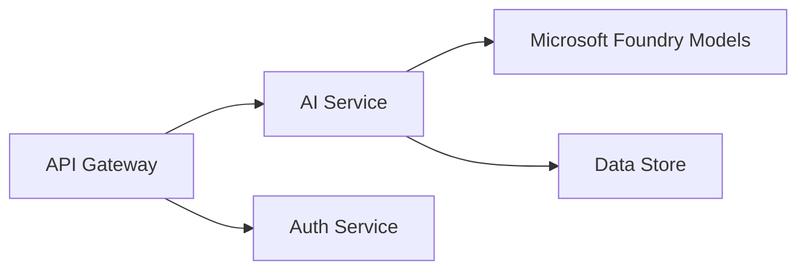
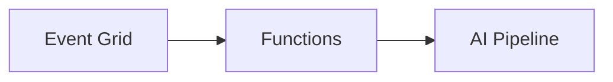

# Kapitel 8: Produktions- & Företagsmönster

**📚 Kurs**: [AZD För nybörjare](../../README.md) | **⏱️ Varaktighet**: 2-3 timmar | **⭐ Svårighetsgrad**: Avancerad

---

## Översikt

Detta kapitel täcker företagsklara distributionsmönster, säkerhetsförstärkning, övervakning och kostnadsoptimering för produktions-AI-arbetsbelastningar.

Detta är en arkitekturreferens, inte en fullständig distributionsbar produktionmall. Exempel utelämnar integrationsdetaljer som måste tillhandahållas och testas i din egen applikation; att läsa checklistan garanterar inte produktionsberedskap.

> **Foundry GA-uppdatering (2026-11-09):** Använd `azd >= 1.37.0` och det allmänt tillgängliga `microsoft.foundry` 1.0-paketet för Foundry-workflowen; utvärderingar installeras separat. Se [release-omfång och migrering](production-ai-practices.md#recent-release-changes-and-fixes) och [exempel på autentiserad pipeline](production-ai-practices.md#cicd-pipeline-configuration). Detta är en dokumentationsöversyn, inte en validering av live-distribution eller generell GA-status för valfria förhandsvisningsfunktioner.

## Lärandemål

Genom att slutföra detta kapitel kommer du att:
- Distribuera resilienta applikationer i flera regioner
- Implementera företags säkerhetsmönster
- Konfigurera omfattande övervakning
- Optimera kostnader i skala
- Sätta upp CI/CD-pipelines med AZD

---

## 📚 Lektioner

| # | Lektion | Beskrivning | Tid |
|---|--------|-------------|------|
| 1 | [Produktions AI-praktiker](production-ai-practices.md) | Företagsdistributionsmönster | 90 min |

---

## 🚀 Produktionschecklista

- [ ] Multi-region-distribution för resiliens
- [ ] Hanterad identitet för autentisering (inga nycklar)
- [ ] Application Insights för övervakning
- [ ] Kostnadsbudgetar och varningar konfigurerade
- [ ] Säkerhetsskanning aktiverad
- [ ] CI/CD-pipelineintegration
- [ ] Plan för katastrofåterställning

---

## 🏗️ Arkitekturmönster

### Mönster 1: Mikrotjänster AI



### Mönster 2: Händelsestyrd AI



---

## 🔐 Säkerhetsbästa praxis

```bicep
// Illustrative properties from different resources, NOT a standalone Bicep file.
// Attach identity to the application host:
identity: {
  type: 'SystemAssigned'
}

// AI account properties (also require private endpoints, DNS and app connectivity):
properties: {
  publicNetworkAccess: 'Disabled'
  networkAcls: {
    defaultAction: 'Deny'
  }
}
```

---

## 💰 Kostnadsoptimering

| Strategi | Huvudbegränsning |
|----------|---------|
| Skala till noll (Container Apps) | Kräver en lämplig trigger; andra tjänster ger fortfarande kostnader |
| Använd konsumtionsnivåer för utveckling | Jämför vald tjänsteprissättning och arbetsbelastning |
| Schema-baserad skalning | Skala via stödjande infrastruktur/automation |
| Reservationer/provisionerad kapacitet | Endast när det stöds; åtaganden kan öka passiva kostnader |

Använd [det kompletta budgetresursmönstret](production-ai-practices.md#2-cost-monitoring-and-budgets) med giltigt startdatum, faktureringsomfång, mottagare och behörigheter. En budget skickar varningar; den sätter inte en övre gräns för utgifter. Besparingar beror på mätt användning och är inte garanterade procentsatser.

---

## 📊 Övervakningsuppsättning

```bash
# Open the Application Insights logs view (requires configured monitoring)
azd monitor --logs

# Check Application Insights
azd monitor --overview

# View metrics
az monitor metrics list --resource <resource-id>
```

---

## 🔗 Navigering

| Riktning | Kapitel |
|-----------|---------|
| **Föregående** | [Kapitel 7: Felsökning](../chapter-07-troubleshooting/README.md) |
| **Kurs slutförd** | [Kursstart](../../README.md) |

---

## 📖 Relaterade resurser

- [AI-agenter guide](../chapter-02-ai-development/agents.md)
- [Application Insights](../chapter-06-pre-deployment/application-insights.md)
- [Multi-agentlösningar](../chapter-05-multi-agent/README.md)
- [Mikrotjänster Exempel](../../examples/microservices/README.md)

---

<!-- CO-OP TRANSLATOR DISCLAIMER START -->
**Ansvarsfriskrivning**:
Detta dokument har översatts med hjälp av AI-översättningstjänsten [Co-op Translator](https://github.com/Azure/co-op-translator). Även om vi strävar efter noggrannhet, var vänlig notera att automatiska översättningar kan innehålla fel eller brister. Det ursprungliga dokumentet på dess modersmål bör betraktas som den auktoritativa källan. För kritisk information rekommenderas professionell mänsklig översättning. Vi ansvarar inte för några missförstånd eller feltolkningar som uppstår till följd av användningen av denna översättning.
<!-- CO-OP TRANSLATOR DISCLAIMER END -->