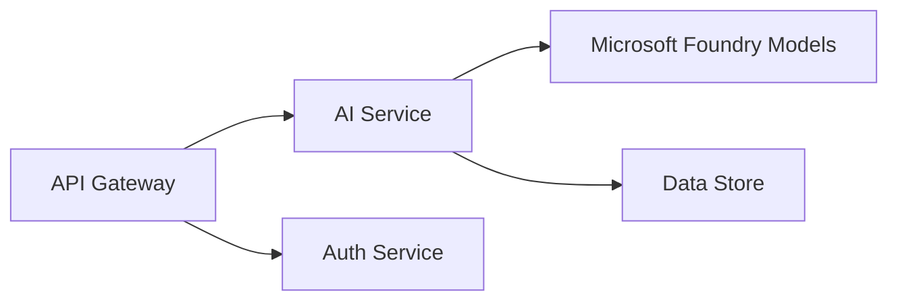
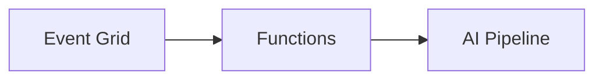

# Kapitel 8: Produktions- och företagsmönster

**📚 Kurs**: [AZD För nybörjare](../../README.md) | **⏱️ Varaktighet**: 2-3 timmar | **⭐ Svårighetsgrad**: Avancerad

---

## Översikt

Detta kapitel täcker företagsfärdiga distributionsmönster, säkerhetshärdning, övervakning och kostnadsoptimering för produktions-AI-arbetsbelastningar.

Detta är en arkitektonisk referens, inte en komplett driftsättbar produktionmall. Exempel utelämnar integrationsdetaljer som måste tillhandahållas och testas i din egen applikation; att läsa checklistan certifierar inte produktionsredo.

> **Versionsgranskning (2026-11-04):** AI CLI-vägledning kontrollerades mot `azd 1.37.2`, agenter `1.0.0-beta.23`, och utvärderingar `1.0.0-beta.2` dokumentation/källa. Se [versionsändringar och korrigeringar](production-ai-practices.md#recent-release-changes-and-fixes) för kompatibilitetskrav och migrationsdetaljer; detta är inte en live-validering av distribution.

## Lärandemål

När du har slutfört detta kapitel kommer du att kunna:
- Driftsätta resilienta applikationer över flera regioner
- Implementera företags säkerhetsmönster
- Konfigurera omfattande övervakning
- Optimera kostnader i stor skala
- Sätta upp CI/CD-pipelines med AZD

---

## 📚 Lektioner

| # | Lektion | Beskrivning | Tid |
|---|--------|-------------|------|
| 1 | [Produktions-AI-praktiker](production-ai-practices.md) | Företags distributionsmönster | 90 min |

---

## 🚀 Produktionschecklista

- [ ] Multi-region distribution för resiliens
- [ ] Hanterad identitet för autentisering (inga nycklar)
- [ ] Application Insights för övervakning
- [ ] Kostnadsbudgetar och varningar konfigurerade
- [ ] Säkerhetsskanning aktiverad
- [ ] CI/CD-pipeline integration
- [ ] Katastrofåterhämtningsplan

---

## 🏗️ Arkitekturmönster

### Mönster 1: Microservices AI



### Mönster 2: Event-Driven AI



---

## 🔐 Säkerhetsbästa praxis

```bicep
// Illustrative properties from different resources, NOT a standalone Bicep file.
// Attach identity to the application host:
identity: {
  type: 'SystemAssigned'
}

// AI account properties (also require private endpoints, DNS and app connectivity):
properties: {
  publicNetworkAccess: 'Disabled'
  networkAcls: {
    defaultAction: 'Deny'
  }
}
```

---

## 💰 Kostnadsoptimering

| Strategi | Huvudbegränsning |
|----------|---------|
| Skala ner till noll (Container Apps) | Kräver en lämplig trigger; andra tjänster orsakar fortfarande kostnader |
| Använd konsumtionsnivåer för utveckling | Jämför vald tjänsteprissättning och arbetsbelastning |
| Schemalagd skalning | Skala via stödd infrastruktur/automation |
| Reservationer/provisionerad kapacitet | Endast när det stöds; åtaganden kan öka stilleståndskostnader |

Använd [komplett budgetresursmönster](production-ai-practices.md#2-cost-monitoring-and-budgets) med giltigt startdatum, faktureringsomfång, mottagare och behörigheter. En budget skickar varningar; den begränsar inte utgifter. Besparingar beror på mätt användning och är inte garanterade i procent.

---

## 📊 Övervakningsinställning

```bash
# Open the Application Insights logs view (requires configured monitoring)
azd monitor --logs

# Check Application Insights
azd monitor --overview

# View metrics
az monitor metrics list --resource <resource-id>
```

---

## 🔗 Navigation

| Riktning | Kapitel |
|-----------|---------|
| **Föregående** | [Kapitel 7: Felsökning](../chapter-07-troubleshooting/README.md) |
| **Kurs slutförd** | [Kursens startsida](../../README.md) |

---

## 📖 Relaterade resurser

- [AI Agentguiden](../chapter-02-ai-development/agents.md)
- [Application Insights](../chapter-06-pre-deployment/application-insights.md)
- [Multimedia-agentlösningar](../chapter-05-multi-agent/README.md)
- [Microservices-exempel](../../examples/microservices/README.md)

---

<!-- CO-OP TRANSLATOR DISCLAIMER START -->
**Ansvarsfriskrivning**:
Detta dokument har översatts med hjälp av AI-översättningstjänsten [Co-op Translator](https://github.com/Azure/co-op-translator). Även om vi strävar efter noggrannhet, var vänlig notera att automatiska översättningar kan innehålla fel eller brister. Det ursprungliga dokumentet på dess modersmål bör betraktas som den auktoritativa källan. För kritisk information rekommenderas professionell mänsklig översättning. Vi ansvarar inte för några missförstånd eller feltolkningar som uppstår till följd av användningen av denna översättning.
<!-- CO-OP TRANSLATOR DISCLAIMER END -->