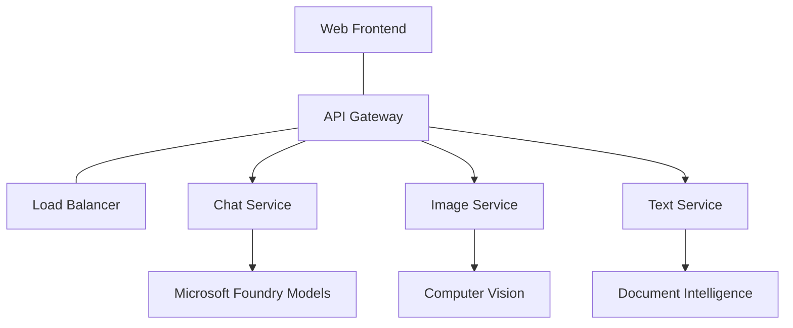

# Bästa praxis för AI-arbetsbelastning i produktion med AZD

**Kapitelnavigering:**
- **📚 Kurshem**: [AZD för nybörjare](../../README.md)
- **📖 Nuvarande kapitel**: Kapitel 8 - Produktions- och företagsmönster
- **⬅️ Föregående kapitel**: [Kapitel 7: Felsökning](../chapter-07-troubleshooting/debugging.md)
- **⬅️ Även relaterat**: [AI Workshop Lab](../chapter-02-ai-development/ai-workshop-lab.md)
- **🎯 Kurs slutförd**: [AZD för nybörjare](../../README.md)

## Översikt

Denna guide förklarar designmönster för produktion av AI med hjälp av Azure Developer CLI (AZD). Det är en designreferens, inte en distribuerbar applikation eller en produktionscertifiering.

**Exempelgränser:** Om inte explicit beskrivs som kompletta, förutsätter Bicep-fragment parametrar och refererade resurser från en innehållande mall. De utelämnar värdbilder/planer, identiteter, rolltilldelningar, DNS, utdata och annan nödvändig integration. YAML-tjänstvägar och hook/test-skript är illustrativa filer att skapa i **din egen applikation**; de tillhandahålls inte av denna kurs. Använd ett fungerande AZD-exempel som bas, sammanställ den kompletta infrastrukturen och testa i en isolerad miljö innan produktion.

## Viktiga utmaningar som hanteras

Vanliga produktionsbekymmer inkluderar distribution av flera tjänster, hantering av identiteter och hemligheter, skalning, kostnadskontroller och övervakning. Ingen uppmätt förekomst påstås här.

## Arkitekturmönster för produktions-AI

### Mönster 1: Mikrotjänster AI-arkitektur

**När används det**: Komplexa AI-applikationer med flera funktioner



**AZD-implementering**:

```yaml
# azure.yaml
name: enterprise-ai-platform
services:
  web:
    project: ./web
    host: staticwebapp
  api-gateway:
    project: ./api-gateway
    host: containerapp
  chat-service:
    project: ./services/chat
    host: containerapp
  vision-service:
    project: ./services/vision
    host: containerapp
  text-service:
    project: ./services/text
    host: containerapp
```

### Mönster 2: Event-driven AI-behandling

**När används det**: Batchbearbetning, dokumentanalys, asynkrona arbetsflöden

```bicep
// Event Hub for AI processing pipeline
resource eventHub 'Microsoft.EventHub/namespaces@2024-01-01' = {
  name: eventHubNamespaceName
  location: location
  sku: {
    name: 'Standard'
    tier: 'Standard'
    capacity: 1
  }
}

// Service Bus for reliable message processing
resource serviceBus 'Microsoft.ServiceBus/namespaces@2024-01-01' = {
  name: serviceBusNamespaceName
  location: location
  sku: {
    name: 'Premium'
    tier: 'Premium'
    capacity: 1
  }
}

// Function App for processing
resource functionApp 'Microsoft.Web/sites@2023-01-01' = {
  name: functionAppName
  location: location
  kind: 'functionapp,linux'
  properties: {
    siteConfig: {
      appSettings: [
        {
          name: 'FUNCTIONS_EXTENSION_VERSION'
          value: '~4'
        }
        {
          name: 'AZURE_OPENAI_ENDPOINT'
          value: '@Microsoft.KeyVault(VaultName=${keyVault.name};SecretName=openai-endpoint)'
        }
      ]
    }
  }
}
```

Detta skapar namnrymdsfragment, inte hubs, köer, prenumerationer eller Funktionsutlösare. En körbar Funktion behöver också en värdplan, runtime-/lagringskonfiguration, en kopplad identitet, RBAC och nätverksåtkomst. Key Vault-referensen behöver tillstånd att läsa hemligheten; en slutpunktens URL är inte en referens.

## Att tänka på AI-agenters hälsa

När en traditionell webbapp går sönder, är symtomen bekanta: en sida laddas inte, en API returnerar ett fel eller en distribution misslyckas. AI-drivna applikationer kan gå sönder på samma sätt – men de kan också bete sig på mer subtila sätt som inte ger uppenbara felmeddelanden.

Denna sektion hjälper dig att bygga en mental modell för att övervaka AI-arbetsbelastningar så att du vet var du ska leta när saker inte verkar vara rätt.

### Hur agenthälsa skiljer sig från traditionell apphälsa

Traditionella appar kan också ha subtila korrekthetsfel. En AI-agent lägger till icke-deterministisk svarskvalitet till vanliga tillgänglighets- och korrekthetsbekymmer. Tänk på agenthälsa i två lager:

| Lager | Vad att övervaka | Var att titta |
|-------|------------------|--------------|
| **Infrastrukturhälsa** | Är tjänsten igång? Är resurser tillhandahållna? Är slutpunkter nåbara? | `azd monitor`, Azure Portal resursstatus, container-/apploggar |
| **Beteendehälsa** | Svarar agenten korrekt? Är svaren i tid? Anropas modellen korrekt? | Application Insights-spårningar, modelleranropslatens-metriker, svarskvalitetsloggar |

Infrastrukturhälsa är bekant – det är samma för vilken azd-app som helst. Beteendehälsa är det nya lagret som AI-arbetsbelastningar introducerar.

### Var att titta när AI-appar inte beter sig som förväntat

Om din AI-applikation inte ger de resultat du förväntar dig, här är en konceptuell checklista:

1. **Börja med grunderna.** Kör appen? Kan den nå sina beroenden? Kontrollera `azd monitor` och resursstatus precis som du skulle för vilken app som helst.
2. **Kontrollera modellanlutningen.** Anropar din applikation AI-modellen framgångsrikt? Misslyckade eller timeoutade modell-anrop är den vanligaste orsaken till problem med AI-appar och kommer att synas i dina applikationsloggar.
3. **Inspektera input och grundande säkert.** Felaktiga svar kan bero på hämtning, instruktioner, modellbegränsningar eller verktygsexekvering. Använd åtkomstkontrollerade, redigerade diagnostiska data; aktivera inte godtycklig prompt-/svarsloggning i produktion.
4. **Granska svarslatens.** AI-modellanrop är långsammare än typiska API-anrop. Om din app känns långsam, kolla om modellens svarstider ökat – detta kan indikera avmattning, kapacitetsgränser eller regionnivå-trängsel.
5. **Var uppmärksam på kostnadssignaler.** Oväntade toppar i token-användning eller API-anrop kan indikera en loop, en felkonfigurerad prompt eller överdrivna omförsök.

Du behöver inte bemästra observabilitetsverktyg direkt. Nyckeln är att AI-applikationer har ett extra beteendelager att övervaka, och azd:s inbyggda övervakning (`azd monitor`) ger dig en utgångspunkt för att undersöka båda lagren.

---

## Säkerhetsbästa praxis

### 1. Zero-Trust säkerhetsmodell

**Implementeringsstrategi:**
- Ingen tjänst-till-tjänst-kommunikation utan autentisering
- Alla API-anrop använder hanterade identiteter
- Nätverksisolering med privata slutpunkter
- Åtkomstkontroller med minsta privilegium

```bicep
// Managed Identity for each service
resource chatServiceIdentity 'Microsoft.ManagedIdentity/userAssignedIdentities@2023-01-31' = {
  name: 'chat-service-identity'
  location: location
}

// Role assignments with minimal permissions
resource openAIUserRole 'Microsoft.Authorization/roleAssignments@2022-04-01' = {
  scope: openAIAccount
  name: guid(openAIAccount.id, chatServiceIdentity.id, '5e0bd9bd-7b93-4f28-af87-19fc36ad61bd')
  properties: {
    roleDefinitionId: subscriptionResourceId('Microsoft.Authorization/roleDefinitions', '5e0bd9bd-7b93-4f28-af87-19fc36ad61bd')
    principalId: chatServiceIdentity.properties.principalId
    principalType: 'ServicePrincipal'
  }
}
```

### 2. Säker hantering av hemligheter

**Key Vault-integrationsmönster**:

```bicep
// Key Vault with proper access policies
resource keyVault 'Microsoft.KeyVault/vaults@2023-02-01' = {
  name: keyVaultName
  location: location
  properties: {
    tenantId: tenant().tenantId
    sku: {
      family: 'A'
      name: 'standard' // Premium is needed for HSM-backed keys, not ordinary secrets
    }
    enableRbacAuthorization: true  // Use RBAC instead of access policies
    enablePurgeProtection: true    // Prevent accidental deletion
    enableSoftDelete: true
    softDeleteRetentionInDays: 90
  }
}

// Optional legacy key-auth alternative; omit when using Entra ID.
resource openAIKeySecret 'Microsoft.KeyVault/vaults/secrets@2023-02-01' = {
  parent: keyVault
  name: 'openai-api-key'
  properties: {
    value: openAIAccount.listKeys().key1
    attributes: {
      enabled: true
    }
  }
}
```

Tilldela runtime-identiteten `Key Vault Secrets User` på lämplig omfattning och koppla den till värden; `enableRbacAuthorization` ger ingen åtkomst ensam. Föredra OpenAI hanterad identitetsautentisering med `disableLocalAuth: true`. Den valfria nyckelsekreten är endast meningsfull för ett medvetet nyckelaktiverat konto, och provisioneringsprincipalen behöver också tillstånd att skriva hemligheter.

### 3. Nätverkssäkerhet

**Konfiguration av privat slutpunkt**:

```bicep
// Virtual Network for AI services
resource virtualNetwork 'Microsoft.Network/virtualNetworks@2023-04-01' = {
  name: vnetName
  location: location
  properties: {
    addressSpace: {
      addressPrefixes: ['10.0.0.0/16']
    }
    subnets: [
      {
        name: 'ai-services-subnet'
        properties: {
          addressPrefix: '10.0.1.0/24'
          privateEndpointNetworkPolicies: 'Disabled'
        }
      }
      {
        name: 'app-services-subnet'
        properties: {
          addressPrefix: '10.0.2.0/24'
          delegations: [
            {
              name: 'Microsoft.Web/serverFarms'
              properties: {
                serviceName: 'Microsoft.Web/serverFarms'
              }
            }
          ]
        }
      }
    ]
  }
}

// Private endpoints for all AI services
resource openAIPrivateEndpoint 'Microsoft.Network/privateEndpoints@2023-04-01' = {
  name: '${openAIAccountName}-pe'
  location: location
  properties: {
    subnet: {
      id: virtualNetwork.properties.subnets[0].id
    }
    privateLinkServiceConnections: [
      {
        name: 'openai-connection'
        properties: {
          privateLinkServiceId: openAIAccount.id
          groupIds: ['account']
        }
      }
    ]
  }
}
```

Privata slutpunkter kräver även privata DNS-zongrupper/VNet-länkar och applikations-VNet-integration. De blockerar inte automatiskt publik åtkomst: inaktivera explicit den publika nätverksåtkomsten för AI-kontot efter att ha verifierat privat anslutning och distributionsåtkomst.

## Prestanda och skalning

### 1. Auto-skalningsstrategier

**Automatisk skalning för Container Apps**:

```bicep
resource containerApp 'Microsoft.App/containerApps@2023-05-01' = {
  name: containerAppName
  location: location
  properties: {
    configuration: {
      ingress: {
        external: true
        targetPort: 8000
        transport: 'http'
      }
    }
    template: {
      scale: {
        minReplicas: 2  // Always have 2 instances minimum
        maxReplicas: 50 // Scale up to 50 for high load
        rules: [
          {
            name: 'http-scaling'
            http: {
              metadata: {
                concurrentRequests: '20'  // Scale when >20 concurrent requests
              }
            }
          }
          {
            name: 'cpu-scaling'
            custom: {
              type: 'cpu'
              metadata: {
                type: 'Utilization'
                value: '70'  // Scale when CPU >70%
              }
            }
          }
        ]
      }
    }
  }
}
```

### 2. Cachningsstrategier

**Redis-cache för AI-svar**:

```bicep
// Legacy Azure Cache for Redis example (not recommended for new deployments)
resource redisCache 'Microsoft.Cache/redis@2023-04-01' = {
  name: redisCacheName
  location: location
  properties: {
    sku: {
      name: 'Premium'
      family: 'P'
      capacity: 1
    }
    enableNonSslPort: false
    minimumTlsVersion: '1.2'
    redisConfiguration: {
      'maxmemory-policy': 'allkeys-lru'
    }
    // Sharding distributes data; replication/failover provides availability.
    shardCount: 2
  }
}

// Cache configuration in application
var cacheConnectionString = '${redisCache.properties.hostName}:6380,password=${redisCache.listKeys().primaryKey},ssl=True,abortConnect=False'
```

Azure Cache för Redis Basic/Standard/Premium är på en [avvecklingsbana](https://learn.microsoft.com/azure/azure-cache-for-redis/retirement-faq). Använd Azure Managed Redis för nya design och dess dokumenterade SKU, identitets- och TLS-konfiguration istället för att kopiera denna gamla resurs till ett nytt produktionssystem. Anslutningssträngsraden är en icke-fungerande platshållare, inte en referens. Partionera cache-nycklar efter auktorisering, modell/instruktioner och hämtning version, med utgångstid; en delad skrivskyddad cache kan exponera data från en annan användare.

### 3. Lastbalansering och trafikhantering

**Application Gateway med WAF**:

```bicep
// Application Gateway with Web Application Firewall
resource applicationGateway 'Microsoft.Network/applicationGateways@2023-04-01' = {
  name: appGatewayName
  location: location
  properties: {
    sku: {
      name: 'WAF_v2'
      tier: 'WAF_v2'
      capacity: 2
    }
    webApplicationFirewallConfiguration: {
      enabled: true
      firewallMode: 'Prevention'
      ruleSetType: 'OWASP'
      ruleSetVersion: '3.2'
    }
    // Backend pools for AI services
    backendAddressPools: [
      {
        name: 'ai-services-pool'
        properties: {
          backendAddresses: [
            {
              fqdn: '${containerApp.properties.configuration.ingress.fqdn}'
            }
          ]
        }
      }
    ]
  }
}
```

Detta är en partiell gateway-resurs: en riktig distribution behöver också gateway-subnät/IP-konfiguration, frontend-IP:er och portar, TLS-lyssnare/certifikat, backend HTTP-inställningar/probes, ruttningsregler och prioriteringar, samt en granskad WAF-policy. TLS-värdnamn/SNI och autentisering måste matcha Container App-backenden.

## 💰 Kostnadsoptimering

### 1. Rätt dimensionering av resurser

**Miljöspecifika konfigurationer**:

Dessa namn är **illustrativa anpassade mallinmatningar**, inte automatiska AZD-inställningar. Kartlägg varje till `infra/main.parameters.json`/Bicep och värdkonfiguration först. Exempelvis använder RAG-exemplet `AZURE_SEARCH_SERVICE_SKU` och `AZURE_OPENAI_CHATGPT_DEPLOYMENT_CAPACITY`, inte generiska namn nedan. Ge Container Apps minne en stödd enhet som `1Gi` i själva resursen. Tillämpa infrastrukturförändringar med `azd up` eller `azd provision`; `azd deploy` ensam tillämpar inte Bicep-ändringar.

```bash
# Development environment
azd env new development
azd env set AZURE_OPENAI_SKU "S0"
azd env set AZURE_OPENAI_CAPACITY 10
azd env set AZURE_SEARCH_SKU "basic"
azd env set CONTAINER_CPU 0.5
azd env set CONTAINER_MEMORY 1.0

# Production environment  
azd env new production
azd env set AZURE_OPENAI_SKU "S0"
azd env set AZURE_OPENAI_CAPACITY 100
azd env set AZURE_SEARCH_SKU "standard"
azd env set CONTAINER_CPU 2.0
azd env set CONTAINER_MEMORY 4.0
```

### 2. Kostnadsövervakning och budget

```bicep
// Supply the first day of the current UTC month, e.g. 2026-11-01T00:00:00Z.
param budgetStartDate string

// Cost management and budgets
resource budget 'Microsoft.Consumption/budgets@2024-08-01' = {
  name: 'ai-workload-budget'
  properties: {
    timePeriod: {
      startDate: budgetStartDate
    }
    timeGrain: 'Monthly'
    amount: 2000  // In the billing currency, not necessarily USD
    category: 'Cost'
    notifications: {
      warning: {
        enabled: true
        operator: 'GreaterThan'
        threshold: 80
        contactEmails: [
          'finance@company.com'
          'engineering@company.com'
        ]
        contactRoles: [
          'Owner'
          'Contributor'
        ]
      }
      critical: {
        enabled: true
        operator: 'GreaterThan'
        threshold: 95
        contactEmails: [
          'cto@company.com'
        ]
      }
    }
  }
}
```

Ersätt exemplet på mottagare och kontrollera omfattning/tillstånd. Budgetvarningar använder fördröjda faktureringsdata och genomdriver inte en utgiftsgräns.

### 3. Optimering av tokenanvändning

**OpenAI kostnadshantering**:

Detta är endast en teckenbaserad heuristik för UI-förhandsvisning, **inte** en modelltoken-gränskontrollant. Produktionskod måste använda en tokenizer lämplig för den distribuerade modellen och ta hänsyn till systeminstruktioner, verktygsschema, historik och utbudsbudget. Avvisa ett överstort användarmeddelande istället för att tyst trunkera det.

```typescript
// Application-level token optimization
class TokenOptimizer {
  private readonly maxTokens = 4000;
  private readonly reserveTokens = 500;
  
  optimizePrompt(userInput: string, context: string): string {
    const availableTokens = this.maxTokens - this.reserveTokens;
    if (this.estimateTokens(userInput) + 8 >= availableTokens) {
      throw new Error("User input exceeds the illustrative prompt budget");
    }
    const estimatedTokens = this.estimateTokens(userInput + context) + 8;
    
    if (estimatedTokens > availableTokens) {
      // Truncate context, not user input
      context = this.truncateContext(context, Math.max(0, availableTokens - this.estimateTokens(userInput) - 8));
    }
    
    return `${context}\n\nUser: ${userInput}`;
  }
  
  private estimateTokens(text: string): number {
    // Rough estimation: 1 token ≈ 4 characters
    return Math.ceil(text.length / 4);
  }

  private truncateContext(text: string, estimatedBudget: number): string {
    return text.slice(0, Math.max(0, estimatedBudget) * 4);
  }
}
```

## Övervakning och observabilitet

### 1. Omfattande Application Insights

```bicep
// Application Insights with advanced features
resource applicationInsights 'Microsoft.Insights/components@2020-02-02' = {
  name: applicationInsightsName
  location: location
  kind: 'web'
  properties: {
    Application_Type: 'web'
    WorkspaceResourceId: logAnalyticsWorkspace.id
    SamplingPercentage: 100  // Ingestion setting; review cost and SDK sampling separately
    DisableIpMasking: false  // Retain IP masking
  }
}

// Custom metrics for AI operations
resource aiMetricAlerts 'Microsoft.Insights/metricAlerts@2018-03-01' = {
  name: 'ai-high-error-rate'
  location: 'global'
  properties: {
    description: 'Alert when failed request count exceeds 10 in five minutes'
    severity: 2
    enabled: true
    scopes: [
      applicationInsights.id
    ]
    evaluationFrequency: 'PT1M'
    windowSize: 'PT5M'
    criteria: {
      'odata.type': 'Microsoft.Azure.Monitor.SingleResourceMultipleMetricCriteria'
      allOf: [
        {
          name: 'high-error-rate'
          metricName: 'requests/failed'
          operator: 'GreaterThan'
          threshold: 10
          timeAggregation: 'Count'
        }
      ]
    }
  }
}
```

### 2. AI-specifik övervakning

**Anpassade instrumentpaneler för AI-metriker**:

```json
{
  "dashboard": {
    "name": "AI Application Monitoring",
    "tiles": [
      {
        "name": "OpenAI Request Volume",
        "query": "dependencies | where target contains 'openai' | summarize count() by bin(timestamp, 5m)"
      },
      {
        "name": "AI Response Latency",
        "query": "dependencies | where target contains 'openai' | summarize avg(duration) by bin(timestamp, 5m)"
      },
      {
        "name": "Token Usage",
        "query": "customMetrics | where name == 'openai_tokens_used' | summarize sum(value) by bin(timestamp, 1h)"
      },
      {
        "name": "Cost per Hour",
        "query": "customMetrics | where name == 'openai_cost' | summarize sum(value) by bin(timestamp, 1h)"
      }
    ]
  }
}
```

Denna JSON är en applikationsdefinierad skiss, inte ett importabelt Azure Portal-instrumentpanelsschema. Token-/kostnadsfrågorna kräver att din app emitterar exakt dessa anpassade metrik; de skapas inte av AZD. Anpassa beroendefilter för din faktiska modell-slutpunkt/span-namn.

### 3. Hälsokontroller och upptid-övervakning

```bicep
// Application Insights availability tests
resource availabilityTest 'Microsoft.Insights/webtests@2022-06-15' = {
  name: 'ai-app-availability-test'
  location: location
  tags: {
    'hidden-link:${applicationInsights.id}': 'Resource'
  }
  properties: {
    SyntheticMonitorId: 'ai-app-availability-test'
    Name: 'AI Application Availability Test'
    Description: 'Tests AI application endpoints'
    Enabled: true
    Frequency: 300  // 5 minutes
    Timeout: 120    // 2 minutes
    Kind: 'standard'
    Locations: [
      {
        Id: 'us-east-2-azr'
      }
      {
        Id: 'us-west-2-azr'
      }
    ]
    Request: {
      RequestUrl: 'https://${webApp.properties.defaultHostName}/health'
      HttpVerb: 'GET'
      FollowRedirects: true
      ParseDependentRequests: false
    }
    ValidationRules: {
      ExpectedHttpStatusCode: 200
      SSLCheck: true
      SSLCertRemainingLifetimeCheck: 7
    }
  }
}
```

## Katastrofåterställning och hög tillgänglighet

Den föregående testen förutsätter en befintlig App Service `webApp` och Application Insights-resurs. Standardtest för tillgänglighet är fakturerbara och kräver en nåbar slutpunkt; privata appar behöver en lämplig privat övervakningsdesign. URL-pingtester är föråldrade; använd [standardtester för tillgänglighet](https://learn.microsoft.com/azure/azure-monitor/app/availability).

### 1. Multi-region-distribution

```yaml
# azure.yaml - Multi-region configuration
name: ai-app-multiregion
services:
  api-primary:
    project: ./api
    host: containerapp
    env:
      AZURE_REGION: eastus
  api-secondary:
    project: ./api
    host: containerapp
    env:
      AZURE_REGION: westus2
```

```bicep
// Separate App Service topology, not the Container Apps declarations above
resource trafficManager 'Microsoft.Network/trafficManagerProfiles@2022-04-01' = {
  name: trafficManagerProfileName
  location: 'global'
  properties: {
    profileStatus: 'Enabled'
    trafficRoutingMethod: 'Priority'
    dnsConfig: {
      relativeName: trafficManagerProfileName
      ttl: 30
    }
    monitorConfig: {
      protocol: 'HTTPS'
      port: 443
      path: '/health'
      intervalInSeconds: 30
      toleratedNumberOfFailures: 3
      timeoutInSeconds: 10
    }
    endpoints: [
      {
        name: 'primary-endpoint'
        type: 'Microsoft.Network/trafficManagerProfiles/azureEndpoints'
        properties: {
          targetResourceId: primaryAppService.id
          endpointStatus: 'Enabled'
          priority: 1
        }
      }
      {
        name: 'secondary-endpoint'
        type: 'Microsoft.Network/trafficManagerProfiles/azureEndpoints'
        properties: {
          targetResourceId: secondaryAppService.id
          endpointStatus: 'Enabled'
          priority: 2
        }
      }
    ]
  }
}
```

Miljövariabler väljer inte resursplatser. IaC måste tillhandahålla distinkta regionala värdar och binda varje tjänst med `resourceName` eller `azd-service-name`-taggar. Trafikhanterarexemplet är en **separat App Service-topologi** (`primaryAppService`/`secondaryAppService`), inte routning för Container Apps-deklarationerna. Container Apps kräver en lämpligt konfigurerad extern slutpunkt/front door, TLS/anpassad domän-routing och hälsoprob.

### 2. Backup och återställning av data

```bicep
// Backup configuration for critical data
resource backupVault 'Microsoft.DataProtection/backupVaults@2023-05-01' = {
  name: backupVaultName
  location: location
  identity: {
    type: 'SystemAssigned'
  }
  properties: {
    storageSettings: [
      {
        datastoreType: 'VaultStore'
        type: 'LocallyRedundant'
      }
    ]
  }
}

```

Vaulten ensam säkerhetskopierar inget. Konfigurera en **arbetsspecifik stödd policy och backup-instans**, källbehörigheter, retention och återställningstester med [Azure Backup-stödmatriser](https://learn.microsoft.com/azure/backup/backup-support-matrix). Det finns ingen generisk Azure Backup-policy för hostade Azure OpenAI-modell-distributioner. Behåll infrastruktur-/modell-distributionsdefinitioner i källkontroll; skydda uppladdade dokument, applikationsdata och finjusteringsartefakter med varje backingtjänsts stödda backup/export-funktioner. Definiera och testa RPO/RTO uttryckligen.

## DevOps och CI/CD-integration

### 1. GitHub Actions-arbetsflöde

```yaml
# .github/workflows/deploy-ai-app.yml
name: Deploy AI Application

on:
  push:
    branches: [main]
  pull_request:
    branches: [main]

jobs:
  test:
    runs-on: ubuntu-latest
    steps:
      - uses: actions/checkout@v4
      
      - name: Setup Python
        uses: actions/setup-python@v4
        with:
          python-version: '3.11'
          
      - name: Install dependencies
        run: |
          pip install -r requirements.txt
          pip install pytest
          
      - name: Run tests
        run: pytest tests/
        
      - name: AI Safety Tests
        run: |
          python scripts/test_ai_safety.py
          python scripts/validate_prompts.py

```

Detta är **endast testdelen** av ett arbetsflöde och förutsätter att du har skapat `requirements.txt`, `tests/` och de två säkerhetsskripten. Lägg till autentiserade OIDC provisions-/distributionsjobb från [CI/CD Pipeline-konfiguration](#cicd-pipeline-configuration), med `needs: test`, en pålitlig push-/manuell utlösare och skyddade GitHub-miljöer. Distribuera inte opålitlig pull-request-kod med molnreferenser. En ny runner har ingen vald lokal AZD-miljö; tillhandahåll miljö-/prenumerations-/platsinmatningar och använd `azd auth login`, inte bara `azure/login`.

### 2. Infrastrukturvalidering

```bash
# scripts/validate_infrastructure.sh
#!/bin/bash
set -euo pipefail

echo "Validating AI infrastructure deployment..."

# Requires Azure CLI login and the resource group selected explicitly.
: "${AZURE_RESOURCE_GROUP:?Set AZURE_RESOURCE_GROUP}"
: "${AZURE_OPENAI_NAME:?Set AZURE_OPENAI_NAME}"
: "${AZURE_OPENAI_CHAT_DEPLOYMENT:?Set the actual deployment name}"

# A successful empty list is not proof that resources exist.
types=("Microsoft.CognitiveServices/accounts" "Microsoft.Search/searchServices"
       "Microsoft.Storage/storageAccounts" "Microsoft.KeyVault/vaults")
for resource_type in "${types[@]}"; do
    count=$(az resource list --resource-group "$AZURE_RESOURCE_GROUP" \
        --resource-type "$resource_type" --query "length(@)" -o tsv)
    if [[ "$count" -lt 1 ]]; then
        echo "ERROR: No $resource_type found in $AZURE_RESOURCE_GROUP"
        exit 1
    fi
done

# Validate OpenAI model deployments
echo "Validating OpenAI model deployments..."
state=$(az cognitiveservices account deployment show \
  --name "$AZURE_OPENAI_NAME" --resource-group "$AZURE_RESOURCE_GROUP" \
  --deployment-name "$AZURE_OPENAI_CHAT_DEPLOYMENT" \
  --query "properties.provisioningState" -o tsv)
if [[ "$state" != "Succeeded" ]]; then
    echo "ERROR: Required model deployment is not provisioned successfully"
    exit 1
fi

echo "Infrastructure validation completed successfully!"
```

Förväntat: en nollavslutning och slutförandemeddelande endast när alla förväntade typer finns och den namngivna modell-distributionen är provisionerad. Detta kontrollerar inventarie-/provisioneringstillstånd, **inte** resursstatus, exakt topologi, RBAC, nätverkstillgänglighet eller modellbeteende. Anpassa förväntade typer till din arkitektur och utför därefter separat autentiserat applikationsberedskapstest.

## Checklista för produktionsberedskap

### Säkerhet ✅
- [ ] Alla tjänster använder hanterade identiteter
- [ ] Hemligheter lagrade i Key Vault
- [ ] Privata slutpunkter konfigurerade
- [ ] Nätverkssäkerhetsgrupper implementerade
- [ ] RBAC med minsta privilegium
- [ ] WAF aktiverat på publika slutpunkter

### Prestanda ✅
- [ ] Auto-skalning konfigurerad
- [ ] Cachning implementerad
- [ ] Lastbalansering uppsatt
- [ ] CDN för statiskt innehåll
- [ ] Databaskopplingspoolning
- [ ] Optimering av tokenanvändning

### Övervakning ✅
- [ ] Application Insights konfigurerad
- [ ] Anpassade mätvärden definierade
- [ ] Larmregler uppsatta
- [ ] Instrumentpanel skapad
- [ ] Hälsokontroller implementerade
- [ ] Logg-retentionspolicyer

### Tillförlitlighet ✅
- [ ] Multi-region-distribution
- [ ] Backup- och återställningsplan
- [ ] Kretsbrytare implementerade
- [ ] Retry-policyer konfigurerade
- [ ] Graceful degradation
- [ ] Hälsokontrollslutpunkter

### Kostnadshantering ✅
- [ ] Budgetvarningar konfigurerade
- [ ] Rätt dimensionering av resurser
- [ ] Dev/test-rabatter tillämpade
- [ ] Reserverade instanser inköpta
- [ ] Kostnadsövervakningsinstrumentpanel
- [ ] Regelbundna kostnadsöversyner

### Efterlevnad ✅
- [ ] Krav på datalokalisation uppfyllda
- [ ] Revisionloggning aktiverad
- [ ] Efterlevnadspolicyer tillämpade
- [ ] Säkerhetsbaslinjer implementerade
- [ ] Regelbundna säkerhetsbedömningar
- [ ] Incidenthanteringsplan

## Prestandamått

### Illustrativa produktionmål

Dessa är exempel-SLO:er att förhandla och belastningstesta, inte uppmätta benchamark eller garantier. Svarslatens beror på modell-/utdata-längd; månadstokenkostnad beror på trafik och pris, inte enbart tokenantal.

| Metrik | Mål | Övervakning |
|--------|-----|------------|
| **Svarstid** | < 2 sekunder | Application Insights |
| **Tillgänglighet** | 99,9 % | Upptid-övervakning |
| **Felprocent** | < 0,1 % | Applikationsloggar |
| **Modellkostnad** | < $500/månad (exempelbudget) | Kostnadshantering |
| **Samtidiga användare** | 1000+ | Belastningstest |
| **Återhämtningstid** | < 1 timme | Katastrofåterställningstester |

### Belastningstestning

Följande är en gränssnittsskiss för ett belastningstestskript **du måste implementera**; detta repository tillhandahåller inte `scripts/load_test.py`. Definiera förfrågningsdata, autentisering, representativa arbetsbelastningar, percentil latency-/felkontroller och en kostnadstak i ditt valda belastningstestverktyg innan du kör det:

```bash
# Load testing script for AI applications
python scripts/load_test.py \
  --endpoint https://your-ai-app.azurewebsites.net \
  --concurrent-users 100 \
  --duration 300 \
  --ramp-up 60
```

## 🤝 Gemenskapens bästa praxis

Baserat på feedback från Microsoft Foundry Discord-gemenskapen:

### Viktigaste rekommendationerna från gemenskapen:

1. **Börja smått, skala upp gradvis**: Börja med grundläggande SKU:er och skala upp efter verklig användning
2. **Övervaka allt**: Sätt upp omfattande övervakning från dag ett
3. **Automatisera säkerhet**: Använd infrastruktur som kod för konsekvent säkerhet
4. **Testa noggrant**: Inkludera AI-specifika tester i din pipeline
5. **Planera för kostnader**: Övervaka tokenanvändning och ställ in budgetvarningar tidigt

### Vanliga fallgropar att undvika:

- ❌ Att hårdkoda API-nycklar i koden
- ❌ Att inte sätta upp rätt övervakning
- ❌ Att ignorera kostnadsoptimering
- ❌ Att inte testa felhanteringsscenarier
- ❌ Att sätta i produktion utan hälsokontroller

## AZD AI CLI-kommandon och tillägg

AZD inkluderar en växande uppsättning AI-specifika kommandon och tillägg som förenklar produktionsarbetsflöden för AI. Dessa verktyg överbryggar gapet mellan lokal utveckling och produktionssättning för AI-arbetsbelastningar.

> **Utgåvarevision (2026-11-04):** CLI-guidningen nedan har kontrollerats mot publicerade versioner av `azd` **1.37.2**, `azure.ai.agents` **1.0.0-beta.23**, och `azure.ai.evaluations` **1.0.0-beta.2**. Agents beta.23 kräver `azd >= 1.37.0`; evaluations beta.2 kräver `azd >= 1.33.0`. Använd minst 1.37.0 för det kombinerade arbetsflödet. Detta är en dokumentations-/källgranskning, inte en live Azure-distributionsvalidering.

### AZD-tillägg för AI

AZD använder ett tilläggssystem för att lägga till AI-specifika funktioner. Installera och hantera tillägg med:

```bash
# List all available extensions (including AI)
azd extension list

# Inspect installed extension details
azd version
azd extension show azure.ai.agents

# Install the Foundry agents extension
azd extension install azure.ai.agents

# Install the separate Foundry evaluations extension
azd extension install azure.ai.evaluations

# Install the fine-tuning extension
azd extension install azure.ai.finetune

# Install the custom models extension
azd extension install azure.ai.models

# Upgrade all installed extensions
azd extension upgrade --all
```

**Tillgängliga AI-tillägg:**

| Tillägg | Syfte | Status |
|---------|---------|--------|
| `azure.ai.agents` | Hantering av Foundry Agent Service | Förhandsgranskning |
| `azure.ai.evaluations` | Evalueringsdatasätt, bedömare, evalueringsgrupper och körningar | Förhandsgranskning |
| `azure.ai.skills` | Återanvändbara agentfärdigheter | Förhandsgranskning |
| `azure.ai.connections` | Foundry-anslutningar (datakällor, verktyg) | Förhandsgranskning |
| `azure.ai.finetune` | Finjustering av Foundry-modeller | Förhandsgranskning |
| `azure.ai.models` | Anpassade Foundry-modeller | Förhandsgranskning |
| `azure.coding-agent` | Konfiguration för kodande agent | Tillgänglig |

> Kör `azd extension list --installed` och `azd extension show azure.ai.evaluations` för att inspektera installerade versioner. Uppgradera först kärn-CLI med [installations-/uppdateringsinstruktionerna](https://learn.microsoft.com/azure/developer/azure-developer-cli/install-azd) (för en Windows winget-installation: `winget upgrade Microsoft.Azd`), sedan kör `azd extension upgrade --all`. Det finns inget kärn-`azd upgrade`-kommando. Granska brytande förändringar innan du uppgraderar produktionsautomation; anta inte att en tilläggsuppgradering bevarar gamla kommando- eller konfigurationsformat.

### Senaste versionsändringar och buggfixar

| Version | Vad som ändras för denna kurs |
|---------|------------------------------|
| `azd 1.37.0` | Lägger till stabila deployment-preview-API:er och åtgärdar så att tilläggsredigeringar inte överskriver orelaterade `azure.yaml`-inställningar. |
| `azd 1.37.1` | Åtgärdar Ctrl+C-propagation över tillägg och skiljer avbrytanden/tidsgränser från generiska fel. |
| `azd 1.37.2` | Förbättrar provisioneringsvalidering: kritiska varningar är standard **Nej**, misslyckas utan bekräftelse i obevakade körningar, och avbrytning hoppar över efterprovisioneringshooks. Fixar även oprecisa miljövärden i neklistor för Deployment Stacks när den alfa-funktionen är aktiverad. |
| Agents `beta.22` | Migrerar evaluering till `azd ai eval`, ändrar optimering till GA v1 API, kräver plural `toolboxes`, och separerar hanterade-harness, röst och långvariga preview-opt-ins. Fixar miljöspecifik modellsval och toolbox-autentisering. |
| Agents `beta.23` | Exponerar `init --harness`; fixar A2A 0.3 svarutdata, ogiltiga prompt-agentvägar/moduler över infrastrukturnivåer, diagnostik för aktiveringstidsgränser och kvarvarande developer RBAC-varningar. |
| Evaluations `beta.2` | Kräver camelCase konfiguration för evaluering, lägger till statisk/simulerad konversationsframställning och explicita lokal-filkällor, samt fixar dataset identitets-/versionhantering, kvalitetsgrindräkningar och felslagsdiagnostik. |

En agentaktiveringstidsgräns bevisar **inte** en distributionsfel: inspektera den försöka versionen och dess status innan du försöker igen. Developer RBAC-varningar kan finnas kvar även när provisionering lyckats; lös den saknade åtkomsten innan du anropar som den utvecklaren.

Källor: [AZD-versioner](https://github.com/Azure/azure-dev/releases), [agents beta.23-release](https://github.com/Azure/azure-dev/releases/tag/azd-ext-azure-ai-agents_1.0.0-beta.23), [agents beta.22-migrering](https://github.com/Azure/azure-dev/releases/tag/azd-ext-azure-ai-agents_1.0.0-beta.22), och [evaluations beta.2-release](https://github.com/Azure/azure-dev/releases/tag/azd-ext-azure-ai-evaluations_1.0.0-beta.2).

**Vad är de nyare `skills` och `connections` tilläggen?**

Två förhandsgranskningstillägg dök upp parallellt med agentverktygen och är värda att förstå även som nybörjare:

- **`azure.ai.skills`** — En **färdighet** är en återanvändbar kapacitet (ett paketerat verktyg eller beteende) du kan koppla till en eller flera agenter istället för att implementera om den varje gång. Tänk på det som en delad byggsten: definiera en "sök i dokumentationen" eller "kolla upp en beställning"-färdighet en gång, och återanvänd den över agenter. Detta håller mångagentssystem (Kapitel 5) konsekventa och undviker kopiera-klistra.
- **`azure.ai.connections`** — En **anslutning** är en hanterad länk från ditt Foundry-projekt till en extern resurs som dina agenter behöver—en datakälla (som Azure AI Search), ett verktygendpoint, eller en annan tjänst. Anslutningar centraliserar *var* och *hur* agenter får åtkomst till data, så att autentiseringsuppgifter och slutpunkter finns på ett styrt ställe istället för utspridda i koden.

Du behöver inte dessa för att distribuera dina första agenter—håll dig till `azure.ai.agents` medan du lär dig. Använd `skills` när du märker att du duplicerar samma verktyg över agenter, och `connections` när flera agenter delar samma datakälla.

### Initiering av agentprojekt med `azd ai agent init`

Kommandot `azd ai agent init` skaffar ett Microsoft Foundry agentprojekt. Använd en aktuell `azure.yaml`-projektmall, inte ett implicit legacy agentmanifest:

```bash
# Initialize a new agent project from a local project template
azd ai agent init --template ./templates/support-agent/azure.yaml

# Initialize and target a specific Foundry project
azd ai agent init --template ./templates/support-agent/azure.yaml --project-id <foundry-project-id>

# Adopt the template into a different directory
azd ai agent init --template ./templates/support-agent/azure.yaml --src ./agents/my-agent
```

**Viktiga flaggor:**

| Flagg | Beskrivning |
|-------|-------------|
| `-t, --template` | Sökväg eller stödjer GitHub-URI till ett `azure.yaml` projekt-dokument |
| `-p, --project-id` | Befintligt Microsoft Foundry Project ID för din azd-miljö |
| `-s, --src` | Källkatalog för genererade agenter, eller målkatalog vid adoption av ett projekt |
| `--kind` | Initiera en `hosted`, `prompt`, eller preview `prompt-voice` agent |
| `--harness` | Valfritt exekveringsharnesk för `--kind prompt`; kräver preview-opt-in |
| `-e, --environment` | Azd-miljön att använda |

`--manifest`/`-m` är ett föråldrat alias för `--template`/`-t`; att byta flaggnamn konverterar inte ett gammalt manifest till ett aktuellt projektdokument. `--host containerapp` är inte en aktuell agent-init-flagga. För en vanlig Container Apps-applikation, använd `azd init --template` med en mall som deklarerar `host: containerapp`.

För ett befintligt projekt med exakt en `azure.ai.project`-tjänst, lägger `azd ai agent add support-agent --file ./agents/support-agent.yaml` till eller uppdaterar en direkt agentdefinition utan att provisionera eller distribuera. Runtime-kommandon nekar legacy implicit `agent.yaml`/AgentManifest och nästlade tjänste-`config:`-definitioner; migrera dem till en aktuell `azure.ai.agent`-tjänst. När init skriver ut ett `cd` näst steg, kör det innan `azd up`: init ändrar inte din skal-katalog.

**Produktionstips**: Använd `--project-id` för att direkt koppla till ett befintligt Foundry-projekt, så att din agentkod och molnresurser är länkade från början.

#### Valfria preview-funktioner

Hanterat harnesk, röst och långvarig anrop är inaktiverade som standard. Ange endast omkopplaren för funktionen du behöver i **skal-/CI-processmiljön**, inte med `azd env set`:

| Funktion | Prozessmiljövariabel |
|---------|---------------------|
| Hanterat harnesk (`init --kind prompt --harness ...`) | `AZD_ALPHA_ENABLE_AGENTS_MANAGED_HARNESS=true` |
| Röst (`init --kind prompt-voice`) | `AZD_ALPHA_ENABLE_AGENTS_VOICE=true` |
| Långvarigt anrop | `AZD_ALPHA_ENABLE_AGENTS_LONG_RUNNING=true` |

Till exempel, använd `export AZD_ALPHA_ENABLE_AGENTS_MANAGED_HARNESS=true` i Bash eller `$env:AZD_ALPHA_ENABLE_AGENTS_MANAGED_HARNESS = "true"` i PowerShell innan du kör relevant kommando. En omkopplare aktiverar inte de andra. Se [released agents README](https://github.com/Azure/azure-dev/blob/azd-ext-azure-ai-agents_1.0.0-beta.23/cli/azd/extensions/azure.ai.agents/README.md) för alla preview-omkopplare och begränsningar.

### Hantera agentens livscykel

Använd `azure.ai.agents` för att testa, inspektera, optimera och pensionera agenter, och det separata `azure.ai.evaluations`-tillägget för att mäta kvalitet:

```bash
# Invoke a deployed agent and view server response timing
# (total latency and time to first byte)
azd ai agent invoke

# Show the live endpoint configuration before changing it
azd ai agent endpoint show

# Download the deployed source of a code-based hosted agent
# (with SHA-256 verification)
azd ai agent code download

# Delete a hosted agent and all of its versions
# (--force terminates active sessions)
azd ai agent delete --force
```

**Livscykel översikt:**

| Steg | Kommando | Produktionsanvändning |
|-------|---------|---------------------|
| Testa | `azd ai agent invoke` | Validera svar och mät latens innan release |
| Inspektera | `azd ai agent endpoint show` | Granska endpoint auth/konfiguration; upptäck brytande förändringar tidigt |
| Mäta | `azd ai eval init`, `generate`, `run start` | Definiera, distribuera och utför upprepade evalueringar |
| Förbättra | `azd ai agent optimize --eval <evaluation-name> --optimize-model <optimizer-deployment>` | Återanvänd kompatibel evaluering för att optimera agenten |
| Återhämta | `azd ai agent code download` | Hämta exakt distribuerad källa för revision/rollback |
| Pensionera | `azd ai agent delete --force` | Avsluta en agent och dess versioner snyggt |

> Dessa är previewskommandon och kan ändras mellan tilläggsversioner. Kör `azd ai agent --help` för att se exakt vilka underkommandon som finns i din installerade version.

`endpoint show` stöder hostade, prompt- och röstagenter, men endpointuppdateringar är endast hostade; arbetsflödesagenter stöds inte. Nedladdning av kod och exemplen för pensionering av hostad agent ovan är inte generella operationer för varje agenttyp.

#### Migrering av evaluering och kvalitetskontroller

Från och med agents **1.0.0-beta.22 (2026-10-23)** ger legacy `azd ai agent eval` kommandon migrationsvägledning istället för det tidigare evalueringsarbetsflödet. Kopiera inte gamla `eval generate --dataset ...`-exempel: evaluering finns nu under **`azd ai eval`**.

I ett initierat agentprojekt, autentisera med `azd auth login`, bekräfta vald miljö/Foundry-projekt och installera `azure.ai.evaluations`. En domarmodells distribution behövs för modellbaserad poängsättning; generering och konversationssimulation kan kräva egna modellval och medföra ytterligare kostnader.

```bash
# Scaffold evals/ and wire an azure.ai.eval service into azure.yaml
azd ai eval init

# Optionally synthesize a rubric and dataset from the agent
azd ai eval generate

# Review generated files, then register datasets, evaluators, and eval groups
azd up

# Start an evaluation and wait for its results
azd ai eval run start --wait

# Inspect runs and available test-case output
azd ai eval run list
azd ai eval run show <run-id>
azd ai eval run output list <run-id>
```

Följ de interaktiva valen och utskrivna näst steg snarare än att anta att genererade resurser redan är registrerade. Evalueringskonfiguration finns normalt i `evals/azure.eval.yaml`, refererad av `azure.ai.eval`-tjänsten i `azure.yaml`. Nycklar är **camelCase** (`evaluationLevel`, `maxSamples`, `initializationParameters`, `dataMapping`); gamla snake_case konfigurationsnycklar nekas. Vägar inuti en refererad konfiguration löses relativt till den filen, inte till repository-root.

För konversationsevalueringar, välj **statisk** för att poängsätta avslutade utskrifter utan att anropa en agent, eller **simulation** för att generera konversationer från scenariosådd. Simulation behöver en agentmål, en simulatormodell och ett separat domarmodellval. För obevakade kommandon, ange ingångarna listade av `azd ai eval init --help` och `azd ai eval generate --help`; anta inte att genereringsmodellen också är domare eller simulator.

För CI, konfigurera en explicit kvalitetsprincip med `azd ai eval run start --help` (`--fail-on`) och behandla en icke-nollavslutning som fel. En slutförd körning är inte automatiskt ett kvalitetsgodkännande. Granska misslyckade/felande rader och diagnoser; saknade eller inkonsekventa resultatantal är inget bevis på framgång. Registrerade dataset behåller sin tjänstidentitet/version; `--max-samples` kan inte dela upp ett registrerat dataset. Publicera ett mindre dataset medvetet eller använd en stödjad lokal-filkälla.

```bash
# Example CI policy: at least 90% of all test cases must pass
azd ai eval run start --wait --fail-on "pass-rate=0.9"
```

Godkännandegrinden använder godkända testfall dividerade med totala testfall; felade, felande, hoppade och andra icke-godkända rader räknas mot den. Kombinera inte en grind med `--no-wait`, som returnerar innan ett beslut är tillgängligt.

#### Migration av optimeringskonfiguration

Optimering använder nu GA v1 API. För att återanvända en kompatibel **omgångsbaserad, datasetstödd** evaluering från det nya arbetsflödet:

```bash
# Replace placeholders with the evaluation name and optimizer model deployment
azd ai agent optimize --eval-config ./evals/azure.eval.yaml --eval <evaluation-name> --optimize-model <optimizer-deployment>
```

`--eval` väljer en utvärdering; `--eval-config` väljer dess konfigurationsfil (inklusive filbaserade definitioner). `--config` tar istället en **fristående optimerings-API-förfrågan** i YAML eller JSON. Skicka inte en gammal agent `eval.yaml` eller den nya `azure.eval.yaml` till `--config`, och kombinera inte `--config` med `--eval`/`--eval-config`. Konversations-, spårbaserade eller simuleringsutvärderingar är inte utbytbara med datasetbaserade optimeringsgenvägar; använd det stödjade optimeringsförfrågningsformatet för dessa scenarier. Granska kandidater innan du tillämpar eller distribuerar dem.

Se [utvärderingsreferensen för den granskade releasen](https://github.com/Azure/azure-dev/blob/azd-ext-azure-ai-evaluations_1.0.0-beta.2/cli/azd/extensions/azure.ai.evaluations/README.md) och [optimeringskommando-källan för den granskade releasen](https://github.com/Azure/azure-dev/blob/azd-ext-azure-ai-agents_1.0.0-beta.23/cli/azd/extensions/azure.ai.agents/internal/cmd/optimize.go) för exakta alternativ.

#### Förhandsgranskning av skrivskyddad värdbaserad agentdistribution

För en befintlig Foundry-bunden miljö med en enhetlig `azure.ai.agent`-tjänst av `kind: hosted`, jämför stödjad konfiguration innan distribution:

```bash
azd deploy <service-name> --preview --no-prompt
```

Denna förhandsgranskning distribuerar inte agenten. Det är inte en komplett infrastruktur-/säkerhetsdiff: prompt-/röst-/arbetsflödesagenter, äldre konfigurationslayouter och vissa värdbaserade inställningar ligger utanför dess scope. Ett `unknown`-resultat är inte godkännande för distribution. Det finns inget fristående `azd ai agent deploy`- eller agent-`--dry-run`-kommando; använd den kärnbaserade distributionsarbetsflödet.

### Model Context Protocol (MCP) med `azd mcp`

AZD inkluderar inbyggt stöd för MCP-server (Alpha), vilket gör det möjligt för AI-agenter och verktyg att interagera med dina Azure-resurser via ett standardiserat protokoll:

```bash
# Start the MCP server for your project
azd mcp start

# Review current Copilot consent rules for tool execution
azd copilot consent list
```

MCP-servern exponerar din azd-projektkontext – miljöer, tjänster och Azure-resurser – för AI-drivna utvecklingsverktyg. Detta möjliggör:

- **AI-assisterad distribution**: Låt kodningsagenter fråga din projektstatus och utlösa distributioner
- **Resursupptäckt**: AI-verktyg kan upptäcka vilka Azure-resurser ditt projekt använder
- **Miljöhantering**: Agenter kan växla mellan dev/staging/produktionsmiljöer

### Infrastrukturgenerering med `azd infra generate`

För produktions-API-arbetsbelastningar kan du generera och anpassa Infrastruktur som kod snarare än att förlita dig på automatisk provisioning:

```bash
# Generate supported infrastructure for this project type
azd infra generate
```

Stöd beror på projekt/värd och installerade leverantörer; detta är inte ett allmänt reverse engineering-kommando för godtyckliga Azure-resurser eller ett löfte om att generera både Bicep och Terraform. Kör `azd infra generate --help` och inspektera det genererade formatet. Där det stöds låter skrivning av IaC till disk dig:
- Granska och revisionera infrastrukturen innan distribution
- Lägg till anpassade säkerhetspolicys (nätverksregler, privata slutpunkter)
- Integrera med befintliga IaC-granskningsprocesser
- Versionshantera infrastrukturförändringar separat från applikationskod

### Livscykelhakar för produktion

AZD-hakar låter dig injicera anpassad logik i varje skede av distributionslivscykeln – kritiskt för produktions-API-arbetsbelastningar:

```yaml
# azure.yaml - Production hooks example
name: ai-production-app
hooks:
  preprovision:
    shell: sh
    run: scripts/validate-quotas.sh    # Check AI model quota before provisioning
  postprovision:
    shell: sh
    run: scripts/verify-networking.sh  # Verify IaC-provisioned private connectivity
  predeploy:
    shell: sh
    run: scripts/run-ai-safety-tests.sh  # Run prompt safety checks
  postdeploy:
    shell: sh
    run: scripts/smoke-test.sh           # Verify agent responses post-deploy
services:
  agent-api:
    project: ./src/agent
    host: containerapp
    hooks:
      predeploy:
        shell: sh
        run: scripts/validate-model-access.sh  # Per-service hook
```

```bash
# Run a specific hook manually during development
azd hooks run predeploy
```

**Rekommenderade produktionshakar för API-arbetsbelastningar:**

| Hak | Användningsfall |
|------|--------------|
| `preprovision` | Validera abonnemangsgränser för kapacitet av AI-modeller |
| `postprovision` | Verifiera privat anslutning och nödvändiga resursernas utdata |
| `predeploy` | Kör AI-säkerhetstester, validera promptmallar |
| `postdeploy` | Röktesta agenters svar, verifiera modellanslutning |

### CI/CD-pipelinekonfiguration

Använd `azd pipeline config` för att koppla ditt projekt till GitHub Actions eller Azure Pipelines med säker Azure-autentisering:

```bash
# Configure CI/CD pipeline (interactive)
azd pipeline config

# Configure with a specific provider
azd pipeline config --provider github
```

Detta kommando:
- Skapar eller konfigurerar en pipeline-identitet; granska dess genererade rollomfång/tillstånd istället för att anta minsta privilegium
- Konfigurerar federerade referenser (inga lagrade hemligheter)
- Genererar eller uppdaterar din pipelinedefinitionsfil
- Sätter nödvändiga miljövariabler i ditt CI/CD-system

#### Steg-för-steg: din första GitHub Actions-pipeline

Här är hela genomgången från ett fungerande azd-projekt till automatiska distributioner vid varje push.

**1. Se till att ditt projekt finns på GitHub**

```bash
git init
git add .
git commit -m "Initial azd project"
gh repo create my-ai-app --private --source=. --push
```

**2. Kör pipeline-konfiguration**

```bash
azd pipeline config --provider github
```

azd kommer interaktivt:
- Fråga vilket Azure-abonnemang och vilken miljö som ska användas
- Skapa en Entra **appregistrering + serviceprincipal** för pipelinen
- Ställa in **federerade referenser (OIDC)** – så att GitHub autentiserar mot Azure med kortlivade tokens och **inga hemligheter lagras**
- Trycka de nödvändiga **variablerna** till din GitHub-repo (`AZURE_CLIENT_ID`, `AZURE_TENANT_ID`, `AZURE_SUBSCRIPTION_ID`, `AZURE_ENV_NAME`, `AZURE_LOCATION`)

**3. Förstå det genererade arbetsflödet**

För en stödd mall, konfigurera/granska `.github/workflows/azure-dev.yml`. De viktiga delarna ser ut så här (mallen måste tillhandahålla appens verktygskedja och miljöparametrar):

```yaml
# .github/workflows/azure-dev.yml
on:
  push:
    branches: [ main ]
  workflow_dispatch:        # lets you run it manually too

permissions:
  id-token: write           # required for OIDC federated login
  contents: read

jobs:
  build:
    runs-on: ubuntu-latest
    env:
      AZURE_CLIENT_ID: ${{ vars.AZURE_CLIENT_ID }}
      AZURE_TENANT_ID: ${{ vars.AZURE_TENANT_ID }}
      AZURE_SUBSCRIPTION_ID: ${{ vars.AZURE_SUBSCRIPTION_ID }}
      AZURE_ENV_NAME: ${{ vars.AZURE_ENV_NAME }}
      AZURE_LOCATION: ${{ vars.AZURE_LOCATION }}
    steps:
      - uses: actions/checkout@v4
      - name: Install azd
        uses: Azure/setup-azd@v2
      - name: Log in with OIDC
        run: azd auth login --client-id "$AZURE_CLIENT_ID" --federated-credential-provider "github" --tenant-id "$AZURE_TENANT_ID"
      - name: Provision infrastructure
        run: azd provision --no-prompt
      - name: Deploy application
        run: azd deploy --no-prompt
```

**4. Bekräfta att det fungerar**

```bash
# Push a change to trigger the pipeline
git commit -am "Trigger pipeline" --allow-empty
git push
```

Öppna fliken **Actions** i din GitHub-repo och titta på arbetsflödet köras `azd provision` och `azd deploy` automatiskt.

> **Varför federerade referenser är viktiga:** äldre pipelines lagrade en klienthemlighet i GitHub. OIDC federerade referenser tar bort den hemligheten helt – GitHub begär en kortlivad token vid runtime, vilket både är säkrare och inget som behöver roteras eller läcka. Detta är standard som `azd pipeline config` konfigurerar.

> **Hemligheter vs. variabler:** icke-känsliga identifierare (`AZURE_CLIENT_ID`, etc.) läggs i repo **variabler**. Om din app verkligen behöver en hemlighet vid bygget, lägg till den som en GitHub **hemlighet** och referera till den med `${{ secrets.NAME }}` – men föredra Key Vault + hanterad identitet vid runtime (se [Kapitel 3](../chapter-03-configuration/authsecurity.md)).

**Produktionsarbetsflöde med pipeline-konfiguration:**

```bash
# 1. Set up production environment
azd env new production
azd env set AZURE_OPENAI_CAPACITY 100

# 2. Configure the pipeline
azd pipeline config --provider github

# 3. Review the generated trigger, provisioning/deployment steps, and approvals
```

#### Steg-för-steg: Azure DevOps Pipelines

Föredrar du Azure DevOps framför GitHub Actions? azd stöder det inbyggt med `azdo`-leverantören. Flödet är nära identiskt – azd genererar pipeline-filen, skapar en serviceanslutning och kopplar autentisering.

**1. Se till att du har ett Azure DevOps-projekt**

Du behöver en organisation och ett projekt på `https://dev.azure.com/<your-org>`. Generera en Personal Access Token (PAT) med behörigheterna **Build (Läsa & köra)**, **Code (Läsa & skriva)** och **Service Connections (Läsa, fråga & hantera)** – azd kommer att efterfråga den.

**2. Konfigurera pipelinen**

```bash
azd pipeline config --provider azdo
```

azd kommer att:
- Fråga om din Azure DevOps-organisation och projekt
- Skapa (eller återanvända) en **serviceanslutning** till Azure med en serviceprincipal
- Konfigurera **arbetsbelastningsidentitetsfederation (OIDC)** så ingen klienthemlighet lagras
- Konfigurera en pipeline-definition (vanligtvis `.azdo/pipelines/azure-dev.yml`) från projektets pipeline-mall

**3. Granska den genererade pipelinen**

Använd projektets genererade pipeline, inklusive dess **Azure serviceanslutning och AZD-autentiseringssteg**. Den officiella [Azure Pipelines installationsguiden](https://learn.microsoft.com/azure/developer/azure-developer-cli/pipeline-azure-pipelines) visar installationsfragmentet nedan; detta är **endast installation**, inte ett körbart autentiserat distributionsarbetsflöde:

```yaml
# .azdo/pipelines/azure-dev.yml (installer fragment only)
trigger:
  - main

pool:
  vmImage: ubuntu-latest

steps:
  - task: setup-azd@0
    displayName: Install azd
```

Installera AZD Azure DevOps-tillägget om den uppgiften inte är tillgänglig i din organisation. Kopiera inte bara rena `azd provision`/`azd deploy`-shell-steg utan autentisering: att ha en serviceanslutning konfigurerad loggar inte automatiskt in varje process i AZD. Följ den genererade mallens OIDC-inloggning och auktoriserade uppgiftskontext, och ange den valda miljön/abonnemanget/platsen.

**4. Varifrån variablerna kommer**

azd lagrar miljövärdena (`AZURE_ENV_NAME`, `AZURE_LOCATION`, `AZURE_SUBSCRIPTION_ID`) som en **variabelgrupp** i Azure DevOps så att pipelinen kan läsa dem. Du kan visa och redigera dem under **Pipelines → Library**.

> **Samma OIDC-fördel som GitHub:** `azdo`-leverantören konfigurerar också arbetsbelastningsidentitetsfederation som standard, så ingen klienthemlighet lagras i serviceanslutningen – Azure DevOps byter en kortlivad token vid runtime. Skicka `--auth-type client-credentials` endast om din organisation ännu inte kan använda OIDC.

**5. Kör den**

```bash
git commit -am "Add Azure DevOps pipeline" --allow-empty
git push
```

Öppna **Pipelines** i Azure DevOps för att titta när `azd provision` och `azd deploy` körs.

### Lägga till komponenter med `azd add`

Lägg successivt till Azure-tjänster i ett befintligt projekt:

```bash
# Add a new service component interactively
azd add
```

Detta är särskilt användbart för att utöka produktions-API-applikationer – till exempel lägga till en vektorsöktjänst, en ny agentendpoint eller en övervakningskomponent till en befintlig distribution.

## Ytterligare resurser

- **Azure Well-Architected Framework**: [Vägledning för AI-arbetsbelastningar](https://learn.microsoft.com/azure/well-architected/ai/)
- **Microsoft Foundry-dokumentation**: [Officiell dokumentation](https://learn.microsoft.com/azure/ai-studio/)
- **Community Templates**: [Azure Samples](https://github.com/Azure-Samples)
- **Discord Community**: [#Azure-kanal](https://discord.gg/microsoft-azure)
- **Agent Skills för Azure**: [microsoft/github-copilot-for-azure på skills.sh](https://skills.sh/microsoft/github-copilot-for-azure) – Återanvändbara agentfärdigheter för Azure AI, Foundry, distribution, kostnadsoptimering och diagnostik. Installera i din editor:
  ```bash
  npx skills add microsoft/github-copilot-for-azure
  ```

---

**Kapitelnavigering:**
- **📚 Kurshem**: [AZD för nybörjare](../../README.md)
- **📖 Nuvarande kapitel**: Kapitel 8 - Produktions- och företagsmönster
- **⬅️ Föregående kapitel**: [Kapitel 7: Felsökning](../chapter-07-troubleshooting/debugging.md)
- **⬅️ Även relaterat**: [AI Workshop Lab](../chapter-02-ai-development/ai-workshop-lab.md)
- **🎯 Kurs avslutad**: [AZD för nybörjare](../../README.md)

**Kom ihåg**: Produktions-API-arbetsbelastningar kräver noggrann planering, övervakning och kontinuerlig optimering. Börja med dessa mönster och anpassa dem efter dina specifika krav.

---

<!-- CO-OP TRANSLATOR DISCLAIMER START -->
**Ansvarsfriskrivning**:
Detta dokument har översatts med hjälp av AI-översättningstjänsten [Co-op Translator](https://github.com/Azure/co-op-translator). Även om vi strävar efter noggrannhet, var vänlig notera att automatiska översättningar kan innehålla fel eller brister. Det ursprungliga dokumentet på dess modersmål bör betraktas som den auktoritativa källan. För kritisk information rekommenderas professionell mänsklig översättning. Vi ansvarar inte för några missförstånd eller feltolkningar som uppstår till följd av användningen av denna översättning.
<!-- CO-OP TRANSLATOR DISCLAIMER END -->