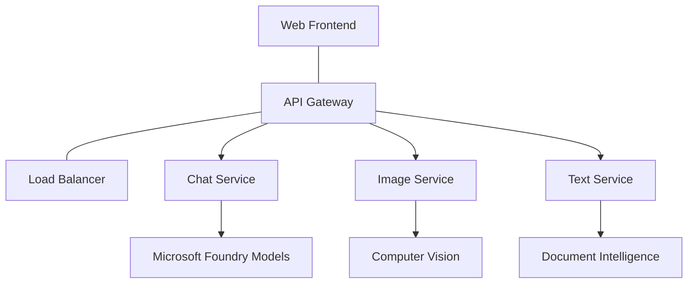

# Bästa praxis för AI-arbetsbelastningar i produktion med AZD

**Kapitelnavigation:**
- **📚 Kurshem**: [AZD för nybörjare](../../README.md)
- **📖 Nuvarande kapitel**: Kapitel 8 - Produktions- och företagsmönster
- **⬅️ Föregående kapitel**: [Kapitel 7: Felsökning](../chapter-07-troubleshooting/debugging.md)
- **⬅️ Även relaterade**: [AI Workshop Lab](../chapter-02-ai-development/ai-workshop-lab.md)
- **🎯 Kurs avslutad**: [AZD för nybörjare](../../README.md)

## Översikt

Denna guide förklarar AI-designmönster för produktion med Azure Developer CLI (AZD). Det är en designreferens, inte en distribuerbar applikation eller en produktionscertifiering.

**Exempelgränser:** Om inte uttryckligen beskrivet som fullständigt antar Bicep-fragment parametrar och refererade resurser från en innehållande mall. De utelämnar värdbilder/planer, identiteter, rolltilldelningar, DNS, output och annan nödvändig integration. YAML-servicevägar och hook/test-skript är illustrativa filer att skapa i **din egen applikation**; de tillhandahålls inte av denna kurs. Använd ett fungerande AZD-exempel som bas, sammanställ hela infrastrukturen och testa i en isolerad miljö innan produktion.

## Viktiga utmaningar som tas upp

Vanliga produktionsproblem inkluderar distribuerade tjänster, identitets- och hemlighetshantering, skalning, kostnadskontroller och övervakning. Ingen mätt prevalens påstås här.

## Arkitekturpattern för produktions-AI

### Mönster 1: Mikrotjänstarkitektur för AI

**När det ska användas**: Komplexa AI-applikationer med flera funktioner



**AZD-implementering**:

```yaml
# azure.yaml
name: enterprise-ai-platform
services:
  web:
    project: ./web
    host: staticwebapp
  api-gateway:
    project: ./api-gateway
    host: containerapp
  chat-service:
    project: ./services/chat
    host: containerapp
  vision-service:
    project: ./services/vision
    host: containerapp
  text-service:
    project: ./services/text
    host: containerapp
```

### Mönster 2: Händelsedriven AI-bearbetning

**När det ska användas**: Batchbearbetning, dokumentanalys, asynkrona arbetsflöden

```bicep
// Event Hub for AI processing pipeline
resource eventHub 'Microsoft.EventHub/namespaces@2024-01-01' = {
  name: eventHubNamespaceName
  location: location
  sku: {
    name: 'Standard'
    tier: 'Standard'
    capacity: 1
  }
}

// Service Bus for reliable message processing
resource serviceBus 'Microsoft.ServiceBus/namespaces@2024-01-01' = {
  name: serviceBusNamespaceName
  location: location
  sku: {
    name: 'Premium'
    tier: 'Premium'
    capacity: 1
  }
}

// Function App for processing
resource functionApp 'Microsoft.Web/sites@2023-01-01' = {
  name: functionAppName
  location: location
  kind: 'functionapp,linux'
  properties: {
    siteConfig: {
      appSettings: [
        {
          name: 'FUNCTIONS_EXTENSION_VERSION'
          value: '~4'
        }
        {
          name: 'AZURE_OPENAI_ENDPOINT'
          value: '@Microsoft.KeyVault(VaultName=${keyVault.name};SecretName=openai-endpoint)'
        }
      ]
    }
  }
}
```

Detta skapar namnutrymmesfragment, inte nav, köer, prenumerationer eller Function-triggers. En körbar Function kräver också en värdplan, runtime-/lagringskonfiguration, en kopplad identitet, RBAC och nätverksåtkomst. Key Vault-referensen behöver tillstånd att läsa hemligheten; en endpoint-URL är inte i sig en behörighet.

## Att tänka på AI-agentens hälsa

När en traditionell webbapp kraschar är symptomen välkända: en sida laddas inte, ett API returnerar ett fel eller en distribution misslyckas. AI-drivna applikationer kan bryta på samma sätt – men kan också bete sig subtilt felaktigt utan uppenbara felmeddelanden.

Detta avsnitt hjälper dig att bygga en mental modell för att övervaka AI-arbetsbelastningar så att du vet var du ska leta när saker verkar fel.

### Hur agenthälsa skiljer sig från traditionell apphälsa

Traditionella appar kan också ha subtila korrekthetsfel. En AI-agent lägger till icke-deterministisk svarskvalitet till vanliga tillgänglighets- och korrekthetsproblem. Tänk på agenthälsa i två lager:

| Lager | Vad man ska följa | Var man ska leta |
|-------|--------------|---------------|
| **Infrastrukturhälsa** | Kör tjänsten? Är resurser tilldelade? Är endpoints åtkomliga? | `azd monitor`, Azure Portal resursstatus, container-/app-loggar |
| **Beteendehälsa** | Svarar agenten korrekt? Är svaren snabba? Anropas modellen rätt? | Application Insights-traces, latency-metriker för modellanrop, loggar över svarskvalitet |

Infrastrukturhälsa är bekant – samma som för vilken azd-app som helst. Beteendehälsa är det nya lager som AI-arbetsbelastningar introducerar.

### Var man ska leta när AI-appar inte beter sig som förväntat

Om din AI-applikation inte ger förväntade resultat, här är en konceptuell checklista:

1. **Börja med grunderna.** Kör appen? Kan den nå sina beroenden? Kontrollera `azd monitor` och resursstatus som du skulle för vilken app som helst.
2. **Kontrollera modellanslutningen.** Anropar din app AI-modellen framgångsrikt? Misslyckade eller tidsöverskridna modellanrop är den vanligaste orsaken till AI-app-problem och syns i dina applikationsloggar.
3. **Inspektera input och grundning säkert.** Felaktiga svar kan bero på hämtning, instruktioner, modellbegränsningar eller verktygsexekvering. Använd åtkomstkontrollerad, raderad diagnostisk data; aktivera inte obehörig prompt-/svarlogsning i produktion.
4. **Granska svarstider.** AI-modellanrop är långsammare än typiska API-anrop. Om appen känns seg, kontrollera om modellens svarstider har ökat – detta kan indikera throttling, kapacitetsbegränsningar eller regional överbelastning.
5. **Bevaka kostnadssignaler.** Ovntade toppar i token-användning eller API-anrop kan indikera loopar, felkonfigurerade prompts eller överdrivna försök.

Du behöver inte behärska observabilitetsverktyg direkt. Nyckeln är att AI-appar har ett extra beteendelager att bevaka, och azd:s inbyggda övervakning (`azd monitor`) ger dig en startpunkt för att undersöka båda lagren.

---

## Säkerhetsbästa praxis

### 1. Zero-Trust säkerhetsmodell

**Implementeringsstrategi**:
- Ingen tjänst-till-tjänst-kommunikation utan autentisering
- Alla API-anrop använder hanterade identiteter
- Nätverksisolering med privata endpoints
- Minst privilegier i åtkomstkontroller

```bicep
// Managed Identity for each service
resource chatServiceIdentity 'Microsoft.ManagedIdentity/userAssignedIdentities@2023-01-31' = {
  name: 'chat-service-identity'
  location: location
}

// Role assignments with minimal permissions
resource openAIUserRole 'Microsoft.Authorization/roleAssignments@2022-04-01' = {
  scope: openAIAccount
  name: guid(openAIAccount.id, chatServiceIdentity.id, '5e0bd9bd-7b93-4f28-af87-19fc36ad61bd')
  properties: {
    roleDefinitionId: subscriptionResourceId('Microsoft.Authorization/roleDefinitions', '5e0bd9bd-7b93-4f28-af87-19fc36ad61bd')
    principalId: chatServiceIdentity.properties.principalId
    principalType: 'ServicePrincipal'
  }
}
```

### 2. Säker hemlighetshantering

**Key Vault-integrationsmönster**:

```bicep
// Key Vault with proper access policies
resource keyVault 'Microsoft.KeyVault/vaults@2023-02-01' = {
  name: keyVaultName
  location: location
  properties: {
    tenantId: tenant().tenantId
    sku: {
      family: 'A'
      name: 'standard' // Premium is needed for HSM-backed keys, not ordinary secrets
    }
    enableRbacAuthorization: true  // Use RBAC instead of access policies
    enablePurgeProtection: true    // Prevent accidental deletion
    enableSoftDelete: true
    softDeleteRetentionInDays: 90
  }
}

// Optional legacy key-auth alternative; omit when using Entra ID.
resource openAIKeySecret 'Microsoft.KeyVault/vaults/secrets@2023-02-01' = {
  parent: keyVault
  name: 'openai-api-key'
  properties: {
    value: openAIAccount.listKeys().key1
    attributes: {
      enabled: true
    }
  }
}
```

Tilldela runtime-identiteten `Key Vault Secrets User` på rätt scope och anslut den till värden; `enableRbacAuthorization` ensam ger ingen åtkomst. Föredra OpenAI hanterad identitetsautentisering med `disableLocalAuth: true`. Den valfria nyckelhemligheten är endast meningsfull för ett medvetet nyckelaktiverat konto och provisioning-principalen behöver också tillstånd att skriva hemligheter.

### 3. Nätverkssäkerhet

**Privat endpoint-konfiguration**:

```bicep
// Virtual Network for AI services
resource virtualNetwork 'Microsoft.Network/virtualNetworks@2023-04-01' = {
  name: vnetName
  location: location
  properties: {
    addressSpace: {
      addressPrefixes: ['10.0.0.0/16']
    }
    subnets: [
      {
        name: 'ai-services-subnet'
        properties: {
          addressPrefix: '10.0.1.0/24'
          privateEndpointNetworkPolicies: 'Disabled'
        }
      }
      {
        name: 'app-services-subnet'
        properties: {
          addressPrefix: '10.0.2.0/24'
          delegations: [
            {
              name: 'Microsoft.Web/serverFarms'
              properties: {
                serviceName: 'Microsoft.Web/serverFarms'
              }
            }
          ]
        }
      }
    ]
  }
}

// Private endpoints for all AI services
resource openAIPrivateEndpoint 'Microsoft.Network/privateEndpoints@2023-04-01' = {
  name: '${openAIAccountName}-pe'
  location: location
  properties: {
    subnet: {
      id: virtualNetwork.properties.subnets[0].id
    }
    privateLinkServiceConnections: [
      {
        name: 'openai-connection'
        properties: {
          privateLinkServiceId: openAIAccount.id
          groupIds: ['account']
        }
      }
    ]
  }
}
```

Privata endpoints kräver också privata DNS-zon-grupper/VNet-länkar och applikations-VNet-integration. De blockerar inte automatiskt offentlig åtkomst: inaktivera explicit AI-kontots offentliga nätverksåtkomst efter att ha validerat privat anslutning och distributionsåtkomst.

## Prestanda och skalning

### 1. Autoskalningsstrategier

**Autoskalning för Container Apps**:

```bicep
resource containerApp 'Microsoft.App/containerApps@2023-05-01' = {
  name: containerAppName
  location: location
  properties: {
    configuration: {
      ingress: {
        external: true
        targetPort: 8000
        transport: 'http'
      }
    }
    template: {
      scale: {
        minReplicas: 2  // Always have 2 instances minimum
        maxReplicas: 50 // Scale up to 50 for high load
        rules: [
          {
            name: 'http-scaling'
            http: {
              metadata: {
                concurrentRequests: '20'  // Scale when >20 concurrent requests
              }
            }
          }
          {
            name: 'cpu-scaling'
            custom: {
              type: 'cpu'
              metadata: {
                type: 'Utilization'
                value: '70'  // Scale when CPU >70%
              }
            }
          }
        ]
      }
    }
  }
}
```

### 2. Caching-strategier

**Redis-cache för AI-svar**:

```bicep
// Legacy Azure Cache for Redis example (not recommended for new deployments)
resource redisCache 'Microsoft.Cache/redis@2023-04-01' = {
  name: redisCacheName
  location: location
  properties: {
    sku: {
      name: 'Premium'
      family: 'P'
      capacity: 1
    }
    enableNonSslPort: false
    minimumTlsVersion: '1.2'
    redisConfiguration: {
      'maxmemory-policy': 'allkeys-lru'
    }
    // Sharding distributes data; replication/failover provides availability.
    shardCount: 2
  }
}

// Cache configuration in application
var cacheConnectionString = '${redisCache.properties.hostName}:6380,password=${redisCache.listKeys().primaryKey},ssl=True,abortConnect=False'
```

Azure Cache for Redis Basic/Standard/Premium är på en [utfasningsväg](https://learn.microsoft.com/azure/azure-cache-for-redis/retirement-faq). Använd Azure Managed Redis för nya lösningar samt dess dokumenterade SKU, identitet och TLS-konfiguration istället för att kopiera denna äldre resurs till ett nytt produktionssystem. Anslutningssträngs-raden är en icke-fungerande platshållare, inte en behörighet. Partionera cache-nycklar efter auktorisation, modell/instruktioner och hämtningversion med utgång; en delad läsbar cache kan exponera en annan användares data.

### 3. Lastbalansering och trafikhantering

**Application Gateway med WAF**:

```bicep
// Application Gateway with Web Application Firewall
resource applicationGateway 'Microsoft.Network/applicationGateways@2023-04-01' = {
  name: appGatewayName
  location: location
  properties: {
    sku: {
      name: 'WAF_v2'
      tier: 'WAF_v2'
      capacity: 2
    }
    webApplicationFirewallConfiguration: {
      enabled: true
      firewallMode: 'Prevention'
      ruleSetType: 'OWASP'
      ruleSetVersion: '3.2'
    }
    // Backend pools for AI services
    backendAddressPools: [
      {
        name: 'ai-services-pool'
        properties: {
          backendAddresses: [
            {
              fqdn: '${containerApp.properties.configuration.ingress.fqdn}'
            }
          ]
        }
      }
    ]
  }
}
```

Detta är en partiell gateway-resurs: en verklig distribution kräver även gateway-subnet/IP-konfiguration, frontend-IP:er och portar, TLS-lyssnare/certifikat, backend HTTP-inställningar/prober, routningsregler och prioritet, samt en granskad WAF-policy. TLS-hostnamn/SNI och autentisering måste matcha Container App:s backend.

## 💰 Kostnadsoptimering

### 1. Rätt storlek på resurser

**Miljöspecifika konfigurationer**:

Dessa namn är **illustrativa anpassade mallinmatningar**, inte automatiska AZD-inställningar. Mappa var och en till `infra/main.parameters.json`/Bicep och värdkonfiguration först. Till exempel använder RAG-exemplet `AZURE_SEARCH_SERVICE_SKU` och `AZURE_OPENAI_CHATGPT_DEPLOYMENT_CAPACITY`, inte de generiska namnen nedan. Ge Container Apps-minne en stödd enhet som `1Gi` i den faktiska resursen. Applicera infrastruktursändringar med `azd up` eller `azd provision`; `azd deploy` ensam applicerar inte Bicep-ändringar.

```bash
# Development environment
azd env new development
azd env set AZURE_OPENAI_SKU "S0"
azd env set AZURE_OPENAI_CAPACITY 10
azd env set AZURE_SEARCH_SKU "basic"
azd env set CONTAINER_CPU 0.5
azd env set CONTAINER_MEMORY 1.0

# Production environment  
azd env new production
azd env set AZURE_OPENAI_SKU "S0"
azd env set AZURE_OPENAI_CAPACITY 100
azd env set AZURE_SEARCH_SKU "standard"
azd env set CONTAINER_CPU 2.0
azd env set CONTAINER_MEMORY 4.0
```

### 2. Kostnadsövervakning och budgetar

```bicep
// Supply the first day of the current UTC month, e.g. 2026-11-01T00:00:00Z.
param budgetStartDate string

// Cost management and budgets
resource budget 'Microsoft.Consumption/budgets@2024-08-01' = {
  name: 'ai-workload-budget'
  properties: {
    timePeriod: {
      startDate: budgetStartDate
    }
    timeGrain: 'Monthly'
    amount: 2000  // In the billing currency, not necessarily USD
    category: 'Cost'
    notifications: {
      warning: {
        enabled: true
        operator: 'GreaterThan'
        threshold: 80
        contactEmails: [
          'finance@company.com'
          'engineering@company.com'
        ]
        contactRoles: [
          'Owner'
          'Contributor'
        ]
      }
      critical: {
        enabled: true
        operator: 'GreaterThan'
        threshold: 95
        contactEmails: [
          'cto@company.com'
        ]
      }
    }
  }
}
```

Byt ut exempelmottagare och kontrollera scope/tillstånd. Budgetvarningar använder fördröjd faktureringsdata och handlägger inte spenderingsgräns.

### 3. Tokenanvändningsoptimering

**OpenAI kostnadshantering**:

Detta är endast en teckenbaserad heuristik för UI-förhandsvisning, **inte** en modellens token-gränsvaliderare. Produktionskod måste använda rätt tokenizer för den distribuerade modellen och ta hänsyn till systeminstruktioner, verktygsscheman, historik och output-budget. Avvisa ett för stort användarmeddelande istället för att tyst trunkera det.

```typescript
// Application-level token optimization
class TokenOptimizer {
  private readonly maxTokens = 4000;
  private readonly reserveTokens = 500;
  
  optimizePrompt(userInput: string, context: string): string {
    const availableTokens = this.maxTokens - this.reserveTokens;
    if (this.estimateTokens(userInput) + 8 >= availableTokens) {
      throw new Error("User input exceeds the illustrative prompt budget");
    }
    const estimatedTokens = this.estimateTokens(userInput + context) + 8;
    
    if (estimatedTokens > availableTokens) {
      // Truncate context, not user input
      context = this.truncateContext(context, Math.max(0, availableTokens - this.estimateTokens(userInput) - 8));
    }
    
    return `${context}\n\nUser: ${userInput}`;
  }
  
  private estimateTokens(text: string): number {
    // Rough estimation: 1 token ≈ 4 characters
    return Math.ceil(text.length / 4);
  }

  private truncateContext(text: string, estimatedBudget: number): string {
    return text.slice(0, Math.max(0, estimatedBudget) * 4);
  }
}
```

## Övervakning och observabilitet

### 1. Omfattande Application Insights

```bicep
// Application Insights with advanced features
resource applicationInsights 'Microsoft.Insights/components@2020-02-02' = {
  name: applicationInsightsName
  location: location
  kind: 'web'
  properties: {
    Application_Type: 'web'
    WorkspaceResourceId: logAnalyticsWorkspace.id
    SamplingPercentage: 100  // Ingestion setting; review cost and SDK sampling separately
    DisableIpMasking: false  // Retain IP masking
  }
}

// Custom metrics for AI operations
resource aiMetricAlerts 'Microsoft.Insights/metricAlerts@2018-03-01' = {
  name: 'ai-high-error-rate'
  location: 'global'
  properties: {
    description: 'Alert when failed request count exceeds 10 in five minutes'
    severity: 2
    enabled: true
    scopes: [
      applicationInsights.id
    ]
    evaluationFrequency: 'PT1M'
    windowSize: 'PT5M'
    criteria: {
      'odata.type': 'Microsoft.Azure.Monitor.SingleResourceMultipleMetricCriteria'
      allOf: [
        {
          name: 'high-error-rate'
          metricName: 'requests/failed'
          operator: 'GreaterThan'
          threshold: 10
          timeAggregation: 'Count'
        }
      ]
    }
  }
}
```

### 2. AI-specifik övervakning

**Anpassade dashboards för AI-metriker**:

```json
{
  "dashboard": {
    "name": "AI Application Monitoring",
    "tiles": [
      {
        "name": "OpenAI Request Volume",
        "query": "dependencies | where target contains 'openai' | summarize count() by bin(timestamp, 5m)"
      },
      {
        "name": "AI Response Latency",
        "query": "dependencies | where target contains 'openai' | summarize avg(duration) by bin(timestamp, 5m)"
      },
      {
        "name": "Token Usage",
        "query": "customMetrics | where name == 'openai_tokens_used' | summarize sum(value) by bin(timestamp, 1h)"
      },
      {
        "name": "Cost per Hour",
        "query": "customMetrics | where name == 'openai_cost' | summarize sum(value) by bin(timestamp, 1h)"
      }
    ]
  }
}
```

Denna JSON är en applikationsdefinierad skiss, inte ett importbart Azure-portal dashboard-schema. Token-/kostnadsfrågor kräver att din app emitterar exakt dessa anpassade metrik; de skapas inte av AZD. Anpassa beroendefilter för din faktiska model endpoint/span-namn.

### 3. Hälsokontroller och uptime-övervakning

```bicep
// Application Insights availability tests
resource availabilityTest 'Microsoft.Insights/webtests@2022-06-15' = {
  name: 'ai-app-availability-test'
  location: location
  tags: {
    'hidden-link:${applicationInsights.id}': 'Resource'
  }
  properties: {
    SyntheticMonitorId: 'ai-app-availability-test'
    Name: 'AI Application Availability Test'
    Description: 'Tests AI application endpoints'
    Enabled: true
    Frequency: 300  // 5 minutes
    Timeout: 120    // 2 minutes
    Kind: 'standard'
    Locations: [
      {
        Id: 'us-east-2-azr'
      }
      {
        Id: 'us-west-2-azr'
      }
    ]
    Request: {
      RequestUrl: 'https://${webApp.properties.defaultHostName}/health'
      HttpVerb: 'GET'
      FollowRedirects: true
      ParseDependentRequests: false
    }
    ValidationRules: {
      ExpectedHttpStatusCode: 200
      SSLCheck: true
      SSLCertRemainingLifetimeCheck: 7
    }
  }
}
```

## Katastrofåterställning och hög tillgänglighet

Det föregående testet förutsätter en befintlig App Service `webApp` och Application Insights-resurs. Standard tillgänglighetstester är avgiftsbelagda och kräver en åtkomlig endpoint; privata appar kräver en lämplig privat övervakningsdesign. URL-pingtester är föråldrade; använd [standard availability tests](https://learn.microsoft.com/azure/azure-monitor/app/availability).

### 1. Multiregionsdistribution

```yaml
# azure.yaml - Multi-region configuration
name: ai-app-multiregion
services:
  api-primary:
    project: ./api
    host: containerapp
    env:
      AZURE_REGION: eastus
  api-secondary:
    project: ./api
    host: containerapp
    env:
      AZURE_REGION: westus2
```

```bicep
// Separate App Service topology, not the Container Apps declarations above
resource trafficManager 'Microsoft.Network/trafficManagerProfiles@2022-04-01' = {
  name: trafficManagerProfileName
  location: 'global'
  properties: {
    profileStatus: 'Enabled'
    trafficRoutingMethod: 'Priority'
    dnsConfig: {
      relativeName: trafficManagerProfileName
      ttl: 30
    }
    monitorConfig: {
      protocol: 'HTTPS'
      port: 443
      path: '/health'
      intervalInSeconds: 30
      toleratedNumberOfFailures: 3
      timeoutInSeconds: 10
    }
    endpoints: [
      {
        name: 'primary-endpoint'
        type: 'Microsoft.Network/trafficManagerProfiles/azureEndpoints'
        properties: {
          targetResourceId: primaryAppService.id
          endpointStatus: 'Enabled'
          priority: 1
        }
      }
      {
        name: 'secondary-endpoint'
        type: 'Microsoft.Network/trafficManagerProfiles/azureEndpoints'
        properties: {
          targetResourceId: secondaryAppService.id
          endpointStatus: 'Enabled'
          priority: 2
        }
      }
    ]
  }
}
```

Miljövariabler väljer inte resursplatser. IaC måste disponera distinkta regionala värdar och binda varje tjänst med `resourceName` eller `azd-service-name` taggar. Traffic Manager-exemplet är en **separat App Service-topologi** (`primaryAppService`/`secondaryAppService`), inte routing för Container Apps-deklarationer. Container Apps kräver en korrekt konfigurerad extern endpoint/front door, TLS/anpassad-domänrouting och hälsoprobningar.

### 2. Databackup och återställning

```bicep
// Backup configuration for critical data
resource backupVault 'Microsoft.DataProtection/backupVaults@2023-05-01' = {
  name: backupVaultName
  location: location
  identity: {
    type: 'SystemAssigned'
  }
  properties: {
    storageSettings: [
      {
        datastoreType: 'VaultStore'
        type: 'LocallyRedundant'
      }
    ]
  }
}

```

Själva vaulten säkerhetskopierar inget. Konfigurera en **arbetsbelastningsspecifik stödd policy och backupinstans**, källa-tillstånd, retention och återställningstester med hjälp av [Azure Backup supportmatriser](https://learn.microsoft.com/azure/backup/backup-support-matrix). Det finns ingen generell Azure Backup-policy för hostade Azure OpenAI modell-distributioner. Håll infrastruktur-/modelldefinitioner i versionskontroll; skydda uppladdade dokument, applikationsdata och finjusteringsartefakter med varje backing-tjänsts stödda backup/exportfunktioner. Definiera och testa RPO/RTO uttryckligen.

## DevOps och CI/CD-integration

### 1. GitHub Actions arbetsflöde

```yaml
# .github/workflows/deploy-ai-app.yml
name: Deploy AI Application

on:
  push:
    branches: [main]
  pull_request:
    branches: [main]

jobs:
  test:
    runs-on: ubuntu-latest
    steps:
      - uses: actions/checkout@v4
      
      - name: Setup Python
        uses: actions/setup-python@v4
        with:
          python-version: '3.11'
          
      - name: Install dependencies
        run: |
          pip install -r requirements.txt
          pip install pytest
          
      - name: Run tests
        run: pytest tests/
        
      - name: AI Safety Tests
        run: |
          python scripts/test_ai_safety.py
          python scripts/validate_prompts.py

```

Detta är **endast testdelen** av ett arbetsflöde och förutsätter att du skapat `requirements.txt`, `tests/` och två säkerhetsskript. Lägg till autentiserade OIDC-provisionerings-/distributionsjobb från [CI/CD Pipeline Configuration](#cicd-pipeline-configuration), med `needs: test`, en betrodd push/manual trigger och skyddade GitHub-miljöer. Distribuera inte opålitlig pull-request-kod med molnlegitimationer. En ny runner har ingen vald lokal AZD-miljö; tillhandahåll miljö-/abonnemangs-/platsinput och använd `azd auth login`, inte bara `azure/login`.

### 2. Infrastrukturvalidering

```bash
# scripts/validate_infrastructure.sh
#!/bin/bash
set -euo pipefail

echo "Validating AI infrastructure deployment..."

# Requires Azure CLI login and the resource group selected explicitly.
: "${AZURE_RESOURCE_GROUP:?Set AZURE_RESOURCE_GROUP}"
: "${AZURE_OPENAI_NAME:?Set AZURE_OPENAI_NAME}"
: "${AZURE_OPENAI_CHAT_DEPLOYMENT:?Set the actual deployment name}"

# A successful empty list is not proof that resources exist.
types=("Microsoft.CognitiveServices/accounts" "Microsoft.Search/searchServices"
       "Microsoft.Storage/storageAccounts" "Microsoft.KeyVault/vaults")
for resource_type in "${types[@]}"; do
    count=$(az resource list --resource-group "$AZURE_RESOURCE_GROUP" \
        --resource-type "$resource_type" --query "length(@)" -o tsv)
    if [[ "$count" -lt 1 ]]; then
        echo "ERROR: No $resource_type found in $AZURE_RESOURCE_GROUP"
        exit 1
    fi
done

# Validate OpenAI model deployments
echo "Validating OpenAI model deployments..."
state=$(az cognitiveservices account deployment show \
  --name "$AZURE_OPENAI_NAME" --resource-group "$AZURE_RESOURCE_GROUP" \
  --deployment-name "$AZURE_OPENAI_CHAT_DEPLOYMENT" \
  --query "properties.provisioningState" -o tsv)
if [[ "$state" != "Succeeded" ]]; then
    echo "ERROR: Required model deployment is not provisioned successfully"
    exit 1
fi

echo "Infrastructure validation completed successfully!"
```

Förväntat: en nollutgång och slutförandemeddelande endast när alla förväntade typer finns och den namngivna modelldistributionen är tilldelad. Detta kontrollerar inventarie-/distributionsstatus, **inte** resursstatus, exakt topologi, RBAC, nätverksåtkomlighet eller modellbeteende. Anpassa de förväntade typerna till din arkitektur och genomför sedan ett separat autentiserat applikationsberedskapstest.

## Produktionsberedskapschecklista

### Säkerhet ✅
- [ ] Alla tjänster använder hanterade identiteter
- [ ] Hemligheter lagras i Key Vault
- [ ] Privata endpoints konfigurerade
- [ ] Nätverkssäkerhetsgrupper implementerade
- [ ] RBAC med minst privilegier
- [ ] WAF aktiverad på offentliga endpoints

### Prestanda ✅
- [ ] Autoskalning konfigurerad
- [ ] Caching implementerad
- [ ] Lastbalansering uppsatt
- [ ] CDN för statiskt innehåll
- [ ] Databasanslutningspoolning
- [ ] Tokenanvändningsoptimering

### Övervakning ✅
- [ ] Application Insights konfigurerad
- [ ] Anpassade metrik definierade
- [ ] Larmregler uppsatta
- [ ] Dashboard skapad
- [ ] Hälsokontroller implementerade
- [ ] Loggbehållningspolicyer

### Tillförlitlighet ✅
- [ ] Multiregionsdistribution
- [ ] Backup- och återställningsplan
- [ ] Kretsbrytare implementerade
- [ ] Retrierytmer konfigurerade
- [ ] Graciös degradering
- [ ] Hälsokontrollendpoints

### Kostnadshantering ✅
- [ ] Budgetvarningar konfigurerade
- [ ] Rätt storlek på resurser
- [ ] Rabatt för utveckling/test applicerad
- [ ] Reserverade instanser inköpta
- [ ] Kostnadsövervakningsdashboard
- [ ] Regelbunden kostnadsgranskning

### Efterlevnad ✅
- [ ] Uppfyllda krav på datalagring
- [ ] Aktiverad revisionsloggning
- [ ] Efterlevnadspolicys applicerade
- [ ] Säkerhetsstandarder implementerade
- [ ] Regelbundna säkerhetsbedömningar
- [ ] Incidenthanteringsplan

## Prestandamått

### Illustrativa produktsmål

Dessa är exempel-SLO:er för förhandling och belastningstestning, inte mätta mått eller garantier. Svarslatens beror på modell-/outputlängd; månatlig tokenkostnad beror på trafik och priser, inte bara tokenantal.

| Metrik | Mål | Övervakning |
|--------|--------|------------|
| **Svarstid** | < 2 sekunder | Application Insights |
| **Tillgänglighet** | 99.9% | Uptime-övervakning |
| **Felprocent** | < 0.1% | Applikationsloggar |
| **Modellkostnad** | < $500/månad (exemp budget) | Kostnadshantering |
| **Samtidiga användare** | 1000+ | Belastningstestning |
| **Återhämtningstid** | < 1 timme | Tester för katastrofåterställning |

### Belastningstestning

Följande är en gränssnittsskiss för ett belastningstestskript **du måste implementera**; detta förråd tillhandahåller inte `scripts/load_test.py`. Definiera förfrågningsinnehåll, autentisering, representativa arbetsbelastningar, percentillatens-/fel-assertioner och en spenderingsgräns i ditt valda belastningstestverktyg innan du kör det:

```bash
# Load testing script for AI applications
python scripts/load_test.py \
  --endpoint https://your-ai-app.azurewebsites.net \
  --concurrent-users 100 \
  --duration 300 \
  --ramp-up 60
```

## 🤝 Communityns bästa praxis

Baserat på feedback från Microsoft Foundry Discord-communityn:

### Topprekommendationer från communityn:

1. **Börja smått, skala gradvis**: Börja med grundläggande SKU:er och skala upp baserat på faktisk användning
2. **Övervaka allt**: Sätt upp omfattande övervakning från dag ett
3. **Automatisera säkerhet**: Använd infrastruktur som kod för konsekvent säkerhet
4. **Testa grundligt**: Inkludera AI-specifik testning i din pipeline
5. **Planera för kostnader**: Övervaka tokenanvändning och ställ in budgetvarningar tidigt

### Vanliga fallgropar att undvika:

- ❌ Att hårdkoda API-nycklar i kod
- ❌ Att inte sätta upp korrekt övervakning
- ❌ Att ignorera kostnadsoptimering
- ❌ Att inte testa felscenarier
- ❌ Att distribuera utan hälsokontroller

## AZD AI CLI-kommandon och tillägg

AZD inkluderar en växande uppsättning AI-specifika kommandon och tillägg som förenklar produktionsflöden för AI. Dessa verktyg överbryggar klyftan mellan lokal utveckling och produktionsdistribution för AI-arbetsbelastningar.

> **Foundry GA-uppdatering (2026-11-09):** Bundeln `microsoft.foundry` nådde **1.0 / allmän tillgänglighet** den [5 november 2026](https://devblogs.microsoft.com/azure-sdk/microsoft-foundry-azure-developer-cli-ga/). Använd **`azd >= 1.37.0`** för detta arbetsflöde. Den tidigare granskningen av `azd 1.37.2`, agents beta.23 och evaluations beta.2 finns kvar nedan som migrationshistorik, inte som aktuell bundle-version. Detta är en dokumentations-/källgranskning, inte en validering av en live-distribution eller ett påstående att varje valfri tillägg, API eller förhandsvisningsfunktion är GA.

### AZD-tillägg för AI

AZD använder ett tilläggssystem för att lägga till AI-specifika funktioner. Installera och hantera tillägg med:

```bash
# List all available extensions (including AI)
azd extension list

# Inspect installed versions
azd version
azd ext list --installed

# Install the GA Foundry bundle
azd ext install microsoft.foundry

# Install the separate Foundry evaluations extension
azd extension install azure.ai.evaluations

# Install the fine-tuning extension
azd extension install azure.ai.finetune

# Install the custom models extension
azd extension install azure.ai.models

# Upgrade the Foundry bundle
azd ext upgrade microsoft.foundry
```

**Tillgängliga AI-tillägg:**

| Tillägg | Syfte | Status |
|-----------|---------|--------|
| `microsoft.foundry` | Meta-paket som installerar de sju kärntilläggen nedan; ingen egen kommandogrupp | GA bundle 1.0 |
| `azure.ai.agents` | `azd ai agent`: agentuppsättning, lokal körning och drift | Ingår; oberoende versionerad |
| `azure.ai.connections` | `azd ai connection`: projektanslutningar | Ingår; oberoende versionerad |
| `azure.ai.inspector` | `azd ai inspector`: lokal Agent Inspector UI | Ingår; oberoende versionerad |
| `azure.ai.projects` | `azd ai project`: projektresurser och modellutplaceringar | Ingår; oberoende versionerad |
| `azure.ai.routines` | `azd ai routine`: scheman och triggers | Ingår; oberoende versionerad |
| `azure.ai.skills` | `azd ai skill`: återanvändbara beteenderiktlinjer | Ingår; oberoende versionerad |
| `azure.ai.toolboxes` | `azd ai toolbox`: versionerade verktygssamlingar | Ingår; oberoende versionerad |
| `azure.ai.evaluations` | Utvärderingsdataset, utvärderare, utvärderingsgrupper och körningar | Separat installation/release |
| `azure.ai.dataset` | Datasetregistrering och versionering | Separat installation/release |
| `azure.ai.finetune` | Foundry-modell finjustering | Separat installation/release |
| `azure.ai.models` | Foundry-anpassade modeller | Separat installation/release |

Att installera `azure.ai.agents` individuellt stöds fortfarande och installerar dess beroenden; bundeln är kursens standard för GA-arbetsflödet. Bundle GA är inte en generell släppstatusgaranti för sina komponenters valfria funktioner. Se [tilläggspaketering och verifiering](https://learn.microsoft.com/azure/foundry/agents/how-to/install-cli-foundry-extensions) och granska installerad kommandohjälp innan du använder dem.

> Uppgradera kärn-CLI först med `azd update` eller rätt [installations-/uppdateringsmetod](https://learn.microsoft.com/azure/developer/azure-developer-cli/install-azd), kör sedan `azd ext upgrade microsoft.foundry`. Uppdatera separat installerade utvärderingar vid behov med `azd ext upgrade azure.ai.evaluations`. Det finns inget kärn-`azd upgrade`-kommando. Spåra och granska oberoende versionerade tillägg i produktionsautomatisering; en uppgradering migrerar inte automatiskt gammal konfiguration.

### Senaste ändringar och fixar i versioner

| Version | Vad som ändras för denna kurs |
|---------|------------------------------|
| `microsoft.foundry` 1.0 GA (2026-11-05) | Standardinställ till paketet med sju tillägg, behåll agent-/distributionsinställningar i `azure.yaml`, testa lokalt med Agent Inspector och ladda upp kod för en fjärrbyggnad i Foundry. Installera utvärderingar separat och installera nödvändiga tillägg igen på CI-löpare. |
| `azd 1.37.0` | Lägger till stabila APIs för deploymentsförhandsgranskning och åtgärdar att redigering av tillägg omskriver orelaterade `azure.yaml`-inställningar. |
| `azd 1.37.1` | Åtgärdar att Ctrl+C vidarebefordras över tillägg och särskiljer avbokningar/tidsgränser från generella fel. |
| `azd 1.37.2` | Förbättrar validering av provisionering: kritiska varningar är standard till **Nej**, misslyckas utan bekräftelse vid obevakade körningar, och avbokning hoppar över efter-provision-krokar. Åtgärdar också oavslutade miljövärden i neklistor för Deployment Stacks när den alfa-funktionen är aktiverad. |
| Agents `beta.22` | Migrerar utvärdering till `azd ai eval`, ändrar optimering till GA v1 API, kräver plural av `toolboxes` och separerar hanterad-rigg, röst och långvarig förhandsgranskning för opt-in. Åtgärdar miljöspecifik modellval och autentisering för verktygslåda. |
| Agents `beta.23` | Exponerar `init --harness`; åtgärdar A2A 0.3 svar-output, ogiltiga prompt-agent-vägar/moduler över infrastruktur-lager, diagnostik vid aktiveringstidens tidsgräns och kvarvarande varningar för utvecklar-RBAC. |
| Evaluations `beta.2` | Kräver camelCase-konfiguration för utvärdering, lägger till statisk/simulerad konversationsskapande och explicita källor för lokala filer, och åtgärdar datasetidentitet/-versionshantering, kvalitetsgrindantal och diagnostik för misslyckade körningar. |

En tidsgräns för aktivering av agent bevisar **inte** att deployment misslyckats: inspektera den försöka versionen och dess tillstånd innan du försöker igen. Utvecklarvarningar för RBAC kan kvarstå även när provisioneringen lyckas; lös den saknade åtkomsten innan du anropar som den utvecklaren.

Beta-raderna ovan beskriver tidigare åtgärder och migreringsgränser, inte ett krav på att fästa nya projekt till dessa versioner.

Källor: [Foundry GA-annons](https://devblogs.microsoft.com/azure-sdk/microsoft-foundry-azure-developer-cli-ga/), [AZD-utgåvor](https://github.com/Azure/azure-dev/releases), [agents beta.23 release](https://github.com/Azure/azure-dev/releases/tag/azd-ext-azure-ai-agents_1.0.0-beta.23), [agents beta.22 migration](https://github.com/Azure/azure-dev/releases/tag/azd-ext-azure-ai-agents_1.0.0-beta.22), och [evaluations beta.2 release](https://github.com/Azure/azure-dev/releases/tag/azd-ext-azure-ai-evaluations_1.0.0-beta.2).

**Vad är de paketbundna `skills` och `connections` tilläggen?**

Dessa installeras med kärnpaketet men tjänar olika syften:

- **`azure.ai.skills`** — En **skill** paketerar återanvändbara beteenderiktlinjer för agenter. Dela granskade instruktioner över agenter istället för att kopiera dem. En skill implementerar inte själv ett verktyg eller ger åtkomst till data; använd verktygslådor och applikationskod för verktygsutförande.
- **`azure.ai.connections`** — En **connection** är en hanterad länk från ditt Foundry-projekt till en extern resurs dina agenter behöver—en datakälla (som Azure AI Search), en verktygspunkt, eller en annan tjänst. Anslutningar centraliserar *var* och *hur* agenter får åtkomst till data, så autentiseringsuppgifter och endpoints finns på ett styrt ställe istället för utspridda i koden.

Du behöver inte konfigurera varje paketbunden kapacitet för att distribuera din första agent. Använd skills när agenter delar beteenderiktlinjer och connections när de delar externa resurser.

### Initiera Agentprojekt med `azd ai agent init`

Kommandot `azd ai agent init` skapar ett Microsoft Foundry-agentprojekt. För ett körbart exempel på koddistribution med Python 3.13+ och aktuell uv, följ [GA hosted-agent walkthrough](../chapter-02-ai-development/microsoft-foundry-integration.md#hosted-agent-walkthrough-ga). Kommandona nedan illustrerar istället hur du använder **din egen** aktuella `azure.yaml` projektmall; den namngivna lokala mallen levereras inte av denna kurs:

```bash
# Initialize a new agent project from a local project template
azd ai agent init --template ./templates/support-agent/azure.yaml

# Initialize and target a specific Foundry project
azd ai agent init --template ./templates/support-agent/azure.yaml --project-id <foundry-project-id>

# Adopt the template into a different directory
azd ai agent init --template ./templates/support-agent/azure.yaml --src ./agents/my-agent
```

**Viktiga flaggor:**

| Flagga | Beskrivning |
|------|-------------|
| `-t, --template` | Sökväg eller stödjer GitHub-URI till ett `azure.yaml` projektfil |
| `-p, --project-id` | Befintligt Microsoft Foundry-projekt-ID för din azd-miljö |
| `-s, --src` | Källkatalog för genererade agenter, eller målkatalog när du adopterar ett projekt |
| `--deploy-mode code` | Ladda upp källkod för en fjärr Foundry-bygg istället för att bygga en lokal container |
| `--model-deployment` | Återanvänd en namngiven befintlig modellutplacering vid initialisering |
| `--kind` | Initialisera en `hosted`, `prompt` eller förhandsgransknings `prompt-voice` agent |
| `--harness` | Valfri körningsram för `--kind prompt`; kräver dess förhandsgranskningsval |
| `-e, --environment` | Azd-miljön att använda |

`--manifest`/`-m` är en föråldrad alias för `--template`/`-t`; att byta namn på flaggan konverterar inte ett gammalt manifest till ett aktuellt projektfil. `--host containerapp` är inte en aktuell flagga för agent-init. För en vanlig Container Apps-applikation, använd `azd init --template` med en mall som deklarerar `host: containerapp`.

För ett befintligt projekt med exakt en `azure.ai.project` tjänst, lägger `azd ai agent add support-agent --file ./agents/support-agent.yaml` till eller uppdaterar en direkt agentdefinition utan att provisionera eller distribuera. Runtime-kommandon avvisar äldre implicita `agent.yaml`/AgentManifest och nästlade tjänst `config:` definitioner; migrera dem till en aktuell `azure.ai.agent` tjänst. När init skriver ut ett `cd` nästa steg, kör det innan `azd up`: init ändrar inte din shell-katalog.

**Produktionstips**: Använd `--project-id` för att koppla direkt till ett befintligt Foundry-projekt och behåll din agentkod och molnresurser kopplade från början.

#### Valfria Förhandsgranskningsfunktioner

Hanterad körningsram, röst och långvariga anrop är som standard inaktiverade. Sätt endast omkopplaren för den funktion du behöver i **shell-/CI-processmiljön**, inte med `azd env set`:

| Funktion | Processmiljövariabel |
|---------|------------------------------|
| Hanterad körningsram (`init --kind prompt --harness ...`) | `AZD_ALPHA_ENABLE_AGENTS_MANAGED_HARNESS=true` |
| Röst (`init --kind prompt-voice`) | `AZD_ALPHA_ENABLE_AGENTS_VOICE=true` |
| Långvariga anrop | `AZD_ALPHA_ENABLE_AGENTS_LONG_RUNNING=true` |

Till exempel, använd `export AZD_ALPHA_ENABLE_AGENTS_MANAGED_HARNESS=true` i Bash eller `$env:AZD_ALPHA_ENABLE_AGENTS_MANAGED_HARNESS = "true"` i PowerShell innan du kör relevant kommando. En omkopplare aktiverar inte de andra. Se [released agents README](https://github.com/Azure/azure-dev/blob/azd-ext-azure-ai-agents_1.0.0-beta.23/cli/azd/extensions/azure.ai.agents/README.md) för alla förhandsgranskningsomkopplare och begränsningar.

### Hantera Agentens Livscykel

Paketets `azure.ai.agents`-tillägg stöder lokal testning och driftsatta agentoperationer. Installera `azure.ai.evaluations` separat för att mäta kvalitet:

```bash
# Start the local agent and Agent Inspector (leave running)
azd ai agent run

# From a second terminal in the project directory
azd ai agent invoke --local "Explain how this agent is deployed."

# Invoke a deployed agent and view server response timing
# (total latency and time to first byte)
azd ai agent invoke

# Show the live endpoint configuration before changing it
azd ai agent endpoint show

# Download the deployed source of a code-based hosted agent
# (with SHA-256 verification)
azd ai agent code download

# Delete a hosted agent and all of its versions
# (--force terminates active sessions)
azd ai agent delete --force
```

**Livscykel i korthet:**

| Steg | Kommando | Produktion användning |
|-------|---------|----------------|
| Lokal test | `azd ai agent run`, sedan `azd ai agent invoke --local "Test prompt"` | Inspektera förfrågningar och svar före driftsättning; Azure-modellanrop debiteras fortfarande |
| Distribuera | `azd deploy` | I kodläge byggs den uppladdade källan på distans i Foundry |
| Testa | `azd ai agent invoke` | Validera svar och mät latens innan release |
| Diagnostisera | `azd ai agent doctor`, `azd ai agent monitor --follow` | Kontrollera installation/tillstånd och strömma agentloggar |
| Inspektera | `azd ai agent endpoint show` | Granska slutpunktens autentisering/konfiguration; upptäck brytande ändringar tidigt |
| Mäta | `azd ai eval init`, `generate`, `run start` | Definiera, distribuera och genomför upprepbara utvärderingar |
| Förbättra | `azd ai agent optimize --eval <evaluation-name> --optimize-model <optimizer-deployment>` | Återanvänd en kompatibel utvärdering för att optimera agenten |
| Återställ | `azd ai agent code download` | Hämta den exakt driftsatta källan för revision/återställning |
| Pensionera | `azd ai agent delete --force` | Ta ner en agent och dess versioner på ett rent sätt |

> Kör `azd ai agent --help` för att inspektera kommandon i din installerade version. Paketet är GA; oberoende styrda förhandsgranskningsfunktioner kräver fortfarande opt-in. Före städning, skilj på att ta bort agent från att ta bort projekt: `azd down` tar bort resursgruppen för ett nyss skapat projekt, men lämnar resurser för återanvända projekt kvar. Följ [riktlinjerna för rensning](../chapter-02-ai-development/microsoft-foundry-integration.md#7-clean-up-deliberately).

`endpoint show` stöder hostade, prompt- och röstagenter, men uppdateringar av slutpunkter är endast för hostade; agenter för arbetsflöden stöds inte. Kodnedladdning och ovan nämnda exempel på pensionering av hostad agent är inte generella operationer för alla agenttyper.

#### Migrering av utvärdering och kvalitetskontroller

Från och med agenter **1.0.0-beta.22 (2026-10-23)** ger äldre `azd ai agent eval`-kommandon migreringsvägledning istället för det tidigare utvärderingsarbetsflödet. Kopiera inte gamla `eval generate --dataset ...`-exempel: utvärdering finns nu under **`azd ai eval`**.

I ett initialiserat agentprojekt, autentisera med `azd auth login`, bekräfta den valda miljön/Foundry-projektet och installera `azure.ai.evaluations`. En domarmodellsdistribution behövs för modellbaserad poängsättning; generering och konversationssimulering kan kräva sina egna modellval och medföra ytterligare kostnader.

```bash
# Generate a draft rubric and dataset from the deployed agent
azd ai eval generate

# After reviewing the assets, configure a named evaluation
azd ai eval init --name quality

# Review generated files, then register datasets, evaluators, and eval groups
azd up

# Start an evaluation and wait for its results
azd ai eval run start --eval quality --wait

# Inspect runs and available test-case output
azd ai eval run list
azd ai eval run show <run-id>
azd ai eval run output list <run-id>
```

För GA-annonseringens exempel, välj **Dataset och evaluator** och **Turn** under generering, välj sedan de granskade tillgångarna och en domarmodell under initialisering. Följ utskrivna nästa steg istället för att anta att genererade tillgångar redan är registrerade. Du kan också initialisera mot en befintlig granskad dataset/rubrik utan att generera ny data. Utvärderingskonfigurationen finns normalt i `evals/azure.eval.yaml`, refererad av `azure.ai.eval`-tjänsten i `azure.yaml`. Nycklar är **camelCase** (`evaluationLevel`, `maxSamples`, `initializationParameters`, `dataMapping`); gamla snake_case-konfigurationsnycklar avvisas. Sökvägar inom en refererad konfiguration löses relativt den filen, inte repository-roten.

För konversationsutvärderingar, välj **statisk** för att poängsätta fullständiga transkript utan att anropa en agent, eller **simulering** för att generera konversationer från scenariosådder. Simulering behöver ett agentmål, en simulator-modell och ett separat domarmodellsval. För obevakade kommandon, tillhandahåll de indata som listas av `azd ai eval init --help` och `azd ai eval generate --help`; anta inte att genereringsmodellen också är domare eller simulator.

För CI, konfigurera en explicit kvalitetsprincip med `azd ai eval run start --help` (`--fail-on`) och betrakta ett icke-noll värd-avslut som ett misslyckande. En avslutad körning är inte automatiskt ett kvalitetsgodkännande. Granska misslyckade/felaktiga rader och diagnoser; saknade eller inkonsekventa resultatantal är inte bevis på framgång. Registrerade datasätt behåller sin tjänsteidentitet/version; `--max-samples` kan inte underuppsätta ett registrerat datasätt. Publicera ett mindre datasätt avsiktligt eller använd en stödd lokal fils källa.

```bash
# Example CI policy: at least 90% of all test cases must pass
azd ai eval run start --eval quality --wait --no-prompt --fail-on "pass-rate=0.9"
```

Godkännandetröskeln använder godkända testfall dividerat med totala testfall; misslyckade, felfyllda, hoppade och på annat sätt icke godkända rader räknas emot den. Kombinera inte en tröskel med `--no-wait`, som returnerar innan ett utslag är tillgängligt.

#### Migrering av optimeringskonfiguration

Optimering använder nu GA v1 API. För att återanvända en kompatibel **turn-level, dataset-backad** utvärdering från den nya arbetsflödet:

```bash
# Replace placeholders with the evaluation name and optimizer model deployment
azd ai agent optimize --eval-config ./evals/azure.eval.yaml --eval <evaluation-name> --optimize-model <optimizer-deployment>
```

`--eval` väljer en utvärdering; `--eval-config` väljer dess konfigurationsfil (inklusive fil-baserade definitioner). `--config` tar istället en **fristående optimerings-API-förfrågan** i YAML eller JSON. Skicka inte en gammal agent `eval.yaml` eller den nya `azure.eval.yaml` till `--config`, och kombinera inte `--config` med `--eval`/`--eval-config`. Konversations-, spårbaserade eller simuleringsutvärderingar är inte utbytbara med dataset-backad optimeringsgenväg; använd den stödda optimeringsförfrågeformatet för dessa scenarier. Granska kandidater innan du använder eller distribuerar dem.

Se [utvärderingsreferens för den granskade utgåvan](https://github.com/Azure/azure-dev/blob/azd-ext-azure-ai-evaluations_1.0.0-beta.2/cli/azd/extensions/azure.ai.evaluations/README.md) och [optimeringskommandokälla för den granskade utgåvan](https://github.com/Azure/azure-dev/blob/azd-ext-azure-ai-agents_1.0.0-beta.23/cli/azd/extensions/azure.ai.agents/internal/cmd/optimize.go) för exakta alternativ.

#### Förhandsvisning av värdhagent med skrivskyddad driftsättning

För en befintlig Foundry-bunden miljö med en enhetlig `azure.ai.agent`-tjänst av `kind: hosted`, jämför stöd för konfiguration innan driftsättning:

```bash
azd deploy <service-name> --preview --no-prompt
```

Denna förhandsvisning distribuerar inte agenten. Det är inte en komplett infrastruktur-/säkerhets-diff: prompt-/röst-/arbetsflödesagenter, äldre konfigurationslayouter och vissa värdinställningar omfattas inte. Ett `unknown`-resultat är inte godkännande för driftsättning. Det finns inget fristående `azd ai agent deploy` eller agent `--dry-run`-kommando; använd kärndistributionsarbetsflödet.

### Modellkontextprotokoll (MCP) med `azd mcp`

AZD inkluderar inbyggt MCP-servestöd (Alpha), som gör det möjligt för AI-agenter och verktyg att interagera med dina Azure-resurser via ett standardiserat protokoll:

```bash
# Start the MCP server for your project
azd mcp start

# Review current Copilot consent rules for tool execution
azd copilot consent list
```

MCP-servern exponerar din azd-projektkontext—miljöer, tjänster och Azure-resurser—till AI-drivna utvecklingsverktyg. Detta möjliggör:

- **AI-assisterad driftsättning:** Låt kodningsagenter fråga om projektstatus och utlösa driftsättningar
- **Resursupptäckt:** AI-verktyg kan upptäcka vilka Azure-resurser ditt projekt använder
- **Miljöhantering:** Agenter kan växla mellan dev/staging/produktionsmiljöer

### Infrastrukturgenerering med `azd infra generate`

För produktions-AI-arbetsbelastningar kan du generera och anpassa Infrastructure as Code istället för att förlita dig på automatisk provisionering:

```bash
# Generate supported infrastructure for this project type
azd infra generate
```

Stödet beror på projekt/värd och installerade leverantörer; detta är inte ett generellt reverse-engineering-kommando för godtyckliga Azure-resurser eller ett löfte om att generera både Bicep och Terraform. Kör `azd infra generate --help` och inspektera det genererade formatet. Där det stöds, låter skrivning av IaC till disk dig:
- Granska och auditera infrastruktur innan driftsättning
- Lägga till anpassade säkerhetspolicyer (nätverksregler, privata slutpunkter)
- Integrera med befintliga IaC-granskningsprocesser
- Versionskontrollera infrastrukturförändringar separat från applikationskoden

### Produktionslivscykelkrokar

AZD-krokar låter dig injicera anpassad logik i varje steg av driftsättningslivscykeln—kritiskt för produktions-AI-arbetsbelastningar:

```yaml
# azure.yaml - Production hooks example
name: ai-production-app
hooks:
  preprovision:
    shell: sh
    run: scripts/validate-quotas.sh    # Check AI model quota before provisioning
  postprovision:
    shell: sh
    run: scripts/verify-networking.sh  # Verify IaC-provisioned private connectivity
  predeploy:
    shell: sh
    run: scripts/run-ai-safety-tests.sh  # Run prompt safety checks
  postdeploy:
    shell: sh
    run: scripts/smoke-test.sh           # Verify agent responses post-deploy
services:
  agent-api:
    project: ./src/agent
    host: containerapp
    hooks:
      predeploy:
        shell: sh
        run: scripts/validate-model-access.sh  # Per-service hook
```

```bash
# Run a specific hook manually during development
azd hooks run predeploy
```

**Rekommenderade produktionskrokar för AI-arbetsbelastningar:**

| Krok | Användningsfall |
|------|--------------|
| `preprovision` | Validera prenumerationskvoter för AI-modellkapacitet |
| `postprovision` | Verifiera privat anslutning och nödvändiga resursutdata |
| `predeploy` | Kör AI-säkerhetstester, validera promptmallar |
| `postdeploy` | Röktesta agentrespons, verifiera modellanslutning |

### CI/CD-pipelinekonfiguration

Validera först projektet lokalt och genomför en framgångsrik `azd up`. Använd sedan `azd pipeline config` för att koppla det till GitHub Actions eller Azure Pipelines med säker Azure-autentisering:

```bash
# Configure CI/CD pipeline (interactive)
azd pipeline config

# Configure with a specific provider
azd pipeline config --provider github
```

Detta kommando:
- Skapar eller konfigurerar en pipeline-identitet; granska dess genererade rollomfång/tillstånd istället för att anta minst privilegium
- Konfigurerar federerade inloggningsuppgifter (inga lagrade hemligheter)
- Genererar eller uppdaterar din pipeline-definitionfil
- Sätter nödvändiga miljövariabler i ditt CI/CD-system

#### Steg-för-steg: din första GitHub Actions-pipeline

Här är den fulla genomgången från ett fungerande azd-projekt till automatiserade driftsättningar vid varje push.

**1. Se till att ditt projekt finns på GitHub**

```bash
git init
git add .
git commit -m "Initial azd project"
gh repo create my-ai-app --private --source=. --push
```

**2. Kör pipelinekonfiguration**

```bash
azd pipeline config --provider github
```

azd kommer interaktivt:
- Fråga vilken Azure-prenumeration och miljö som ska riktas mot
- Skapa en Entra **appregistrering + service-principal** för pipelinen
- Ställa in **federerade inloggningsuppgifter (OIDC)**—så GitHub autentiserar mot Azure med kortlivade tokens och **inga hemligheter lagras**
- Skjuta de nödvändiga **variablerna** till ditt GitHub-repo (`AZURE_CLIENT_ID`, `AZURE_TENANT_ID`, `AZURE_SUBSCRIPTION_ID`, `AZURE_ENV_NAME`, `AZURE_LOCATION`)

**3. Förstå det genererade arbetsflödet**

För en stödd mall, konfigurera/granska `.github/workflows/azure-dev.yml`. Följande Foundry-exempel behåller checkout, OIDC-inloggning och inställningar för målmiljö samt installerar GA-paketet plus utvärderingar på runnern. Lägg till din apps verktygskedja och infrastrukturleverantörens krav; för Terraform, behåll dess genererade setup, fjärrstatus och autentiseringssteg. Välj och lås en granskad AZD-version vid eller över 1.37.0; detta utdrag använder minsta versionskravet från meddelandet.

```yaml
# .github/workflows/azure-dev.yml
on:
  push:
    branches: [ main ]
  workflow_dispatch:        # lets you run it manually too

permissions:
  id-token: write           # required for OIDC federated login
  contents: read

concurrency:
  group: foundry-production-deployment
  cancel-in-progress: false

jobs:
  build:
    runs-on: ubuntu-latest
    env:
      AZURE_CLIENT_ID: ${{ vars.AZURE_CLIENT_ID }}
      AZURE_TENANT_ID: ${{ vars.AZURE_TENANT_ID }}
      AZURE_SUBSCRIPTION_ID: ${{ vars.AZURE_SUBSCRIPTION_ID }}
      AZURE_ENV_NAME: ${{ vars.AZURE_ENV_NAME }}
      AZURE_LOCATION: ${{ vars.AZURE_LOCATION }}
    steps:
      - uses: actions/checkout@v4
      - name: Install azd
        uses: Azure/setup-azd@v2
        with:
          version: 1.37.0
      - name: Install Foundry extensions
        run: azd ext install microsoft.foundry azure.ai.evaluations
      - name: Log in with OIDC
        run: azd auth login --client-id "$AZURE_CLIENT_ID" --federated-credential-provider "github" --tenant-id "$AZURE_TENANT_ID"
      - name: Provision infrastructure
        run: azd provision --no-prompt
      - name: Deploy application
        run: azd deploy --no-prompt
      - name: Evaluate deployed agent
        run: azd ai eval run start --eval quality --wait --no-prompt --fail-on "pass-rate=0.9"
```

Utvärderingssteget kräver en committad `evals/azure.eval.yaml`, dess tjänstreferens i `azure.yaml`, granskade testtillgångar utan hemligheter och pipeline-åtkomst till refererade datasätt, evaluatorer och modell-distributioner. Konfigurera `quality`-utvärderingen innan du aktiverar detta steg; utelämna både steget och utvärderingsinstallationen om ditt projekt inte använder det. En slutförd körning är inte en kvalitetsgrind: detta exempel kräver minst 90 % av alla fall för att godkännas.

Använd en separat AZD-miljö och lämpliga godkännanden för varje steg. Konkurrensgruppen serialiserar endast detta arbetsflöde, inte andra verktyg eller repositories som uppdaterar samma agent. Ge nödvändiga resurs- och Foundry-behörigheter till pipeline-identiteten och lagra eventuella nödvändiga körningsuppgifter i hemligheter, inte i konfigurationscommits. Se den [kompletta Foundry CI/CD-guiden](https://learn.microsoft.com/azure/foundry/agents/how-to/set-up-ci-cd-cli) för leverantörsspecifika krav.

**4. Verifiera att det fungerar**

```bash
# Push a change to trigger the pipeline
git commit -am "Trigger pipeline" --allow-empty
git push
```

Öppna fliken **Actions** i ditt GitHub-repo och titta på arbetsflödet köra `azd provision` och `azd deploy` automatiskt.

> **Varför federerade inloggningsuppgifter är viktiga:** äldre pipelines lagrade en klienthemlighet i GitHub. OIDC-federerade inloggningsuppgifter tar bort den hemligheten helt—GitHub begär en kortlivad token vid körning, vilket är både säkrare och inget som behöver roteras eller läcka. Detta är standard som `azd pipeline config` konfigurerar.

> **Hemligheter vs. variabler:** icke-känsliga identifierare (`AZURE_CLIENT_ID`, etc.) går i repo **variabler**. Om din app verkligen behöver en hemlighet vid bygget, lägg till den som en GitHub **hemlighet** och referera till den med `${{ secrets.NAME }}`—men föredra Key Vault + hanterad identitet vid körtid (se [Kapitel 3](../chapter-03-configuration/authsecurity.md)).

**Produktionsarbetsflöde med pipelinekonfiguration:**

```bash
# 1. Set up production environment
azd env new production
azd env set AZURE_OPENAI_CAPACITY 100

# 2. Configure the pipeline
azd pipeline config --provider github

# 3. Review the generated trigger, provisioning/deployment steps, and approvals
```

#### Steg-för-steg: Azure DevOps Pipelines

Föredrar du Azure DevOps framför GitHub Actions? azd stöder det inbyggt med `azdo`-leverantören. Flödet är nästan identiskt—azd genererar pipelinefilen, skapar en tjänstkoppling och kopplar upp autentisering.

**1. Se till att du har ett Azure DevOps-projekt**

Du behöver en organisation och ett projekt på `https://dev.azure.com/<your-org>`. Generera en Personlig åtkomsttoken (PAT) med **Build (Read & execute)**, **Code (Read & write)** och **Service Connections (Read, query & manage)**-omfång—azd kommer att be om den.

**2. Konfigurera pipelinen**

```bash
azd pipeline config --provider azdo
```

azd kommer:
- Fråga efter din Azure DevOps-organisation och projekt
- Skapa (eller återanvänd) en **tjänstkoppling** till Azure med en service principal
- Konfigurera **workload identity federation (OIDC)** så att inget klienthemlighet lagras
- Konfigurera en pipeline-definition (vanligen `.azdo/pipelines/azure-dev.yml`) från projektets pipelinemall

**3. Granska den genererade pipelinen**

Använd projektets genererade pipeline, inklusive dess **Azure-tjänstkoppling och AZD-autentiseringssteg**. Den officiella [Azure Pipelines installationsguiden](https://learn.microsoft.com/azure/developer/azure-developer-cli/pipeline-azure-pipelines) visar installationsfragmentet nedan; detta är **endast installation**, inte ett körbart autentiserat driftsättningsarbetsflöde:

```yaml
# .azdo/pipelines/azure-dev.yml (installer fragment only)
trigger:
  - main

pool:
  vmImage: ubuntu-latest

steps:
  - task: setup-azd@0
    displayName: Install azd
```

Installera AZD Azure DevOps-tillägget om den uppgiften inte finns i din organisation. För Foundry-jobb, verifiera AZD 1.37.0+ och installera `microsoft.foundry` på runnaren, plus `azure.ai.evaluations` när utvärderingar krävs. Kopiera inte bara `azd provision`/`azd deploy` skalsteg utan autentisering: att ha en konfigurerad tjänstkoppling loggar inte automatiskt in varje process till AZD. Följ den genererade mallens OIDC-inloggning och auktoriserade uppgiftssammanhang, och ange den valda miljön/prenumeration/plats.

**4. Var variablerna kommer ifrån**

azd lagrar miljövärdena (`AZURE_ENV_NAME`, `AZURE_LOCATION`, `AZURE_SUBSCRIPTION_ID`) som en **variabelgrupp** i Azure DevOps så att pipelinen kan läsa dem. Du kan visa och redigera dem under **Pipelines → Library**.

> **Samma OIDC-fördel som GitHub:** `azdo`-leverantören konfigurerar också workload identity federation som standard, så det finns ingen klienthemlighet lagrad i tjänstkopplingen—Azure DevOps byter en kortlivad token vid körning. Skicka `--auth-type client-credentials` endast om din organisation ännu inte kan använda OIDC.

**5. Kör den**

```bash
git commit -am "Add Azure DevOps pipeline" --allow-empty
git push
```

Öppna **Pipelines** i Azure DevOps för att titta på `azd provision` och `azd deploy` köras.

### Lägga till komponenter med `azd add`

Lägga till Azure-tjänster stegvis i ett befintligt projekt:

```bash
# Add a new service component interactively
azd add
```

Detta är särskilt användbart för att utöka produktions-AI-applikationer—till exempel lägga till en vektorsöktjänst, en ny agentendpoint eller en övervakningskomponent till en befintlig driftsättning.

## Ytterligare resurser

- **Azure Well-Architected Framework**: [AI-arbetsbelastningsvägledning](https://learn.microsoft.com/azure/well-architected/ai/)
- **Microsoft Foundry-dokumentation**: [Officiell dokumentation](https://learn.microsoft.com/azure/ai-studio/)
- **Community mallar**: [Azure Samples](https://github.com/Azure-Samples)
- **Discord-community**: [#Azure-kanal](https://discord.gg/microsoft-azure)
- **Agent Skills for Azure**: [microsoft/github-copilot-for-azure på skills.sh](https://skills.sh/microsoft/github-copilot-for-azure) - Återanvändbara agentfärdigheter för Azure AI, Foundry, driftsättning, kostnadsoptimering och diagnostik. Installera i din editor:
  ```bash
  npx skills add microsoft/github-copilot-for-azure
  ```

---

**Kapitelnavigering:**
- **📚 Kursstart**: [AZD För nybörjare](../../README.md)
- **📖 Nuvarande kapitel**: Kapitel 8 - Produktion & Företagsmönster
- **⬅️ Föregående kapitel**: [Kapitel 7: Felsökning](../chapter-07-troubleshooting/debugging.md)
- **⬅️ Även relaterat**: [AI Workshop Lab](../chapter-02-ai-development/ai-workshop-lab.md)
- **🎯 Kurs slutförd**: [AZD För nybörjare](../../README.md)

**Kom ihåg**: Produktions-AI-arbetsbelastningar kräver noggrann planering, övervakning och kontinuerlig optimering. Börja med dessa mönster och anpassa dem till dina specifika krav.

---

<!-- CO-OP TRANSLATOR DISCLAIMER START -->
**Ansvarsfriskrivning**:
Detta dokument har översatts med hjälp av AI-översättningstjänsten [Co-op Translator](https://github.com/Azure/co-op-translator). Även om vi strävar efter noggrannhet, var vänlig notera att automatiska översättningar kan innehålla fel eller brister. Det ursprungliga dokumentet på dess modersmål bör betraktas som den auktoritativa källan. För kritisk information rekommenderas professionell mänsklig översättning. Vi ansvarar inte för några missförstånd eller feltolkningar som uppstår till följd av användningen av denna översättning.
<!-- CO-OP TRANSLATOR DISCLAIMER END -->