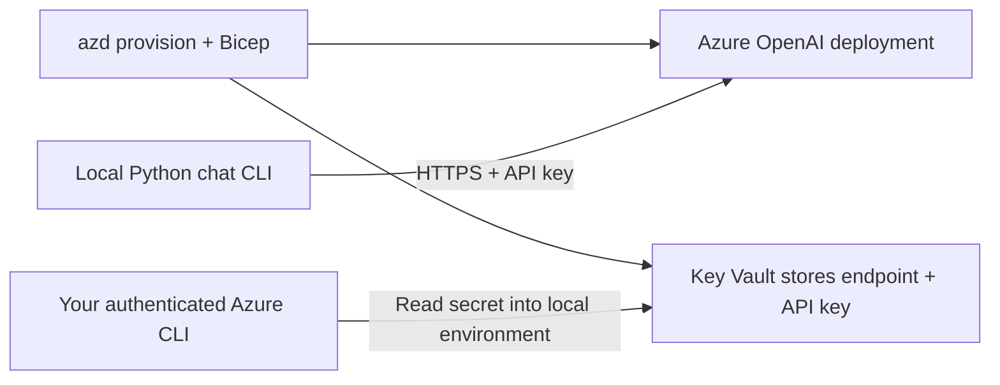

# Azure OpenAI Chat — Lokal CLI och AZD-infrastruktur

**Nivå:** Mellan · **Tid:** 35–60 minuter inklusive uppsättning

Detta exempel tillhandahåller en **Azure OpenAI-resurs och Key Vault**, sedan körs en
interaktiv Python chat-CLI **på din dator**. Den hostar inte en webbapplikation
eller Container App. Standardmodellen är `gpt-4.1`, version `2025-04-14`, med
`GlobalStandard` driftskapacitet 20. Kontrollera aktuell tillgänglighet och kvot i
din valda region innan tillhandahållande; modellens livscykeldatum kan ändras.

## Lärandemål

- Tillhandahåll modellinfrastruktur med Bicep och azd.
- Hämta en API-nyckel från Key Vault utan att lägga den i driftsutdata.
- Skicka Chat Completions-förfrågningar och behåll konversationshistorik.
- Tolka tokens-stånd och begränsningar för kostnadsuppskattningar.



Det finns ingen hanterad identitetsruntime-integration, multi-region failover, anpassad
hastighetsbegränsare, strömningsläge eller hostad beräkning i detta exempel. OpenAI SDK:n
utför upp till två försök för återförsökbara fel; CLI rapporterar återstående fel.

## Förutsättningar

- En aktuell stabil [azd](https://learn.microsoft.com/azure/developer/azure-developer-cli/install-azd)
  (publicerad release vid gransknings-tid: 1.37.2).
- [Azure CLI](https://learn.microsoft.com/cli/azure/install-azure-cli).
- Python **3.10+** (3.11 rekommenderas) och en virtuell miljö.
- Ett Azure-abonnemang med behörighet att skapa Cognitive Services och Key Vault
  resurser, distribuera modeller samt läsa valvets hemligheter.
- Regional tillgänglighet och `GlobalStandard` kvot för `gpt-4.1`. Åtkomstkrav
  beror på abonnemang och funktion; det finns ingen garanterad godkänd tidsram.

```bash
azd version
az version
python --version
azd auth login
az login
```

Dessa är separata autentiseringssessioner. Välj samma abonnemang i båda
verktygen innan du kör kommandona nedan.

## Kom igång snabbt (Bash)

Kör från repositoryts rot:

```bash
cd examples/azure-openai-chat
azd env new myopenai
azd provision
```

Välj en stödjad region. Tillhandahållandet skapar en resursgrupp, OpenAI-konto,
modellutplacering, Key Vault, och `openai-endpoint`/`openai-api-key` hemligheterna.
Det finns **inga tjänster att distribuera** i `azure.yaml`.

Ladda icke-hemliga utdata och hämta hemligheten i din nuvarande shell:

```bash
export AZURE_OPENAI_ENDPOINT="$(azd env get-value AZURE_OPENAI_ENDPOINT)"
export AZURE_OPENAI_MODEL="$(azd env get-value AZURE_OPENAI_MODEL)"
KV_NAME="$(azd env get-value AZURE_KEY_VAULT_NAME)"
export AZURE_OPENAI_API_KEY="$(az keyvault secret show \
  --vault-name "$KV_NAME" --name openai-api-key --query value --output tsv)"

python -m venv .venv
source .venv/bin/activate
python -m pip install -r src/requirements.txt
python src/chat.py
```

I PowerShell, aktivera med `.\.venv\Scripts\Activate.ps1` och tilldela miljö
variabler med `$env:AZURE_OPENAI_ENDPOINT = azd env get-value AZURE_OPENAI_ENDPOINT`
(och liknande för modellen). Hämta API-nyckeln med
`$env:AZURE_OPENAI_API_KEY = az keyvault secret show --vault-name $KV_NAME --name openai-api-key --query value -o tsv`.
Sätt `$KV_NAME = azd env get-value AZURE_KEY_VAULT_NAME` först.

Skriv inte ut, begå eller klistra in API-nyckeln i ärenderapporter. CLI läser process
miljövariabler; den hämtar **inte** Key Vault-hemligheter eller laddar `.env` filer.
`config.py` validerar slutpunkt, tokenbegränsning och temperatur vid start.

Förväntad utdata (innehåll och användning varierar):

```text
Azure OpenAI Chat Application
Model: gpt-4.1
...
You: Say hello in one sentence.
Assistant: Hello! How can I help you today?
[Tokens: ... | Cost: $...]
```

Kommandon: `stats` visar summor, `clear` rensar konversationshistorik, och
`quit`/`exit` avslutar sessionen. Det finns inga `--stream`, `--show-tokens`, `tokens`,
eller `cost` kommandon.

## Verifiera distributionen

Efter att ha laddat shellvariablerna ovan:

```bash
curl --fail-with-body \
  "${AZURE_OPENAI_ENDPOINT%/}/openai/deployments/${AZURE_OPENAI_MODEL}/chat/completions?api-version=2024-10-21" \
  -H "Content-Type: application/json" \
  -H "api-key: $AZURE_OPENAI_API_KEY" \
  -d '{"messages":[{"role":"user","content":"Say hello!"}],"max_tokens":50}'

az keyvault secret list --vault-name "$KV_NAME" --query "[].name" -o table
```

Framgång: API:n returnerar HTTP 200 med `choices[0].message.content` och `usage`;
valvet listar `openai-api-key` och `openai-endpoint`. En lyckad ARM-distribution
verifierar inte inferens ensam.

## Filer och konfiguration

```text
azure.yaml                         # Infrastructure-only AZD project
infra/main.bicep                   # Subscription deployment
infra/main.parameters.json         # Environment, location, principal ID
infra/resources/openai.bicep       # Account + model
infra/resources/keyvault.bicep     # Vault + deploying user's secret access policy
infra/resources/secrets.bicep      # Writes secrets, no key output
src/chat.py                        # Interactive CLI
src/config.py                      # Environment validation
src/requirements.txt               # Python packages
```

För att ändra den tillhandahållna modellen/versionen/kapaciteten, redigera standardvärdena i
`infra/main.bicep` och kör `azd provision`. Att sätta `AZURE_OPENAI_MODEL` i din
shell väljer endast ett **befintligt distributionsnamn**; det distribuerar inte en annan modell.

| Runtimevariabel | Standard / källa |
|---|---|
| `AZURE_OPENAI_ENDPOINT` | Obligatorisk; azd icke-hemliga utdata |
| `AZURE_OPENAI_API_KEY` | Obligatorisk; hämtas från Key Vault |
| `AZURE_OPENAI_MODEL` | `gpt-4.1`; Azure distributionsnamn |
| `AZURE_OPENAI_MAX_TOKENS` | 800 (valideringsintervall 1–4096) |
| `AZURE_OPENAI_TEMPERATURE` | 0.7 (intervall 0–2) |
| `AZURE_OPENAI_INPUT_PRICE_PER_1K` | 0,002 USD; illustrativ icke-cachelagrad ingångstaxa |
| `AZURE_OPENAI_OUTPUT_PRICE_PER_1K` | 0,008 USD; illustrativ utgångstaxa |

## Kostnader och säkerhetsbegränsningar

Kostnadsvisningen är en **uppskattning**, inte Azure-fakturering. Den multiplicerar API-token
användning med konfigurerade priser och tar inte hänsyn till cachelagrade ingångsrabatter,
regionala/SKU skillnader, skatter, prisändringar eller misslyckade/återförsökta anrop.
Åsidosätt **båda priserna** när du använder en annan modell eller SKU och kontrollera aktuell
[Azure OpenAI-prissättning](https://azure.microsoft.com/pricing/details/cognitive-services/openai-service/).

Som illustration kostar 100 förfrågningar som använder 500 icke-cachelagrade ingångs- och 200 utgångstokens vardera
vid standardpriserna `100 × (500/1000 × .002 + 200/1000 × .008) = $0.26`.
Key Vault-operationer/lagring medför separata avgifter. Det finns ingen fast 50 $/månad
avgift för denna lokala CLI och ingen hostad beräkning i mallen.

Valvet använder en åtkomstpolicy för den distribuerande huvudmannen; det är inte ett RBAC- eller
hanterad identitetsapplikationsexempel. Publika slutpunkter och API-nyckelautentisering
används för undervisning. Begränsa behörigheter och lägg till lämplig identitets-/nätverks-
kontroll innan du anpassar för produktion.

## Praktiska övningar

### 1. Verifiera kontext och återställ den

**Start:** köra CLI. **Mål:** observera historiken.
Säg "Kom ihåg ordet cedar," sedan fråga "Vilket ord bad jag dig komma ihåg?"
Kör `stats`; två lyckade turer ska räknas som två utbytta meddelanden.
Kör `clear` och `stats`; utbytta meddelanden ska vara noll (token-summor kvarstår).
Modellens exakta formulering är inte deterministisk.

### 2. Ändra svarbegränsningen

**Start:** avsluta CLI men behåll samma shell.
Kör `export AZURE_OPENAI_MAX_TOKENS=100`, starta om `python src/chat.py` och be om
en kort förklaring av azd. Kontrollera att bannern visar 100.
Återställ med `unset AZURE_OPENAI_MAX_TOKENS`. En mindre svarbegränsning minskar inte
redan skickade historiktokens.

### Vanliga problem

- **Saknade miljövariabler:** tillhandahållande exporterar inte shellvärden;
  upprepa exportstegen. En ny terminal behöver dem igen.
- **403 vid läsning av Key Vault:** verifiera Azure CLI-abonnemang/inloggning och huvudmannen
  i vapnets åtkomstpolicy. Policysändringar kan ta tid att sprida sig.
- **404 inferens:** kontrollera distributionsnamn, slutpunkt och distributionsstatus.
- **429 inferens:** vänta på att hastighetsbegränsningar återställs; verifiera regional modellkvot.
  CLI tar bort misslyckade turer från historiken så omförsök duplicerar dem inte.
- **Kontextlängd:** exemplet trimmar inte långa konversationer; använd `clear`.
- **Modell otillgänglig/uttjänt:** kontrollera aktuell modell-tillgänglighet och uppdatera
  modell/version/SKU tillsammans; API-version och modellversion är olika inställningar.

## Rensning och nästa steg

```bash
azd down
unset AZURE_OPENAI_API_KEY
```

Key Vaults retention för mjuk borttagning är sju dagar; rensning kräver separata behörigheter.
Det finns inget fast testpaket; kör inte ett icke-existerande `pytest tests/`-kommando.
Lägg till mockade API-tester innan du utökar koden.

[Containerexempel](../../../../examples/container-app) · [Blueprint för detaljhandelsarkitektur](../retail-scenario.md) ·
[Kursstart](../../README.md) · [Rapportera ett problem](https://github.com/microsoft/AZD-for-beginners/issues)

---

<!-- CO-OP TRANSLATOR DISCLAIMER START -->
**Ansvarsfriskrivning**:
Detta dokument har översatts med hjälp av AI-översättningstjänsten [Co-op Translator](https://github.com/Azure/co-op-translator). Även om vi strävar efter noggrannhet, var vänlig notera att automatiska översättningar kan innehålla fel eller brister. Det ursprungliga dokumentet på dess modersmål bör betraktas som den auktoritativa källan. För kritisk information rekommenderas professionell mänsklig översättning. Vi ansvarar inte för några missförstånd eller feltolkningar som uppstår till följd av användningen av denna översättning.
<!-- CO-OP TRANSLATOR DISCLAIMER END -->