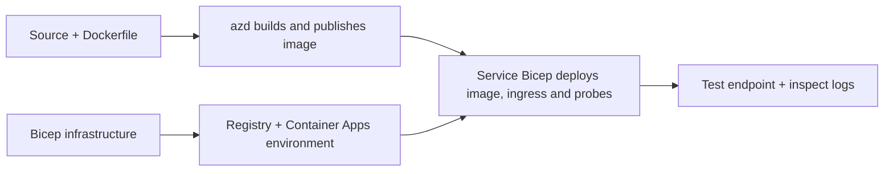

# Exempel på distribution av Container App med AZD

Den här katalogen innehåller två inlärningsexempel med källkod, Dockerfiler,
Bicep-infrastruktur och `azure.yaml`. Ingen är anpassad för produktion.

## Välj ett exempel

| Exempel | Vad som är implementerat | Förutsättningar |
|---|---|---|
| [Simple Flask API](../../../../examples/container-app/simple-flask-api) | Enkel Python CRUD API, objekt i minnet, hälsokontroller, HTTP-skalning | Grundläggande CLI- och HTTP-kunskaper |
| [Två-tjänsters mikrotjänster](../../../../examples/container-app/microservices) | Node.js gateway, intern read-only Python-produktjänst, telemetri och skalning | Slutför först enkel-tjänst exemplet |

Avsätt 30–60 minuter inklusive installation och verifiering. Azure-provisioneringstider varierar.

## Förutsättningar

- [Azure Developer CLI](https://learn.microsoft.com/azure/developer/azure-developer-cli/install-azd)
- [Azure CLI](https://learn.microsoft.com/cli/azure/install-azure-cli) för verifieringskommandon
- Docker med sin daemon igång för att bygga dessa containerbilder
- Ett Azure-abonnemang med behörighet att skapa resurser och tillräcklig regional kvot
- Bash för shellexemplen, eller motsvarande PowerShell-kommandon

```bash
azd version
az version
docker info
azd auth login
az login
```

De två verktygen har separata inloggningssessioner. Använd en aktuell stabil azd; den nuvarande
publicerade versionen vid granskningstillfället är 1.37.2. Äldre minimiversionskrav är ingen
kompatibilitetsgaranti.

## Kom igång snabbt

Från rotkatalogen i repository:

```bash
cd examples/container-app/simple-flask-api
azd env new flask-demo
azd up
API_URL=$(azd env get-value API_ENDPOINT)
curl --fail-with-body "${API_URL}/health"
```

Förväntat: HTTP 200 med `"status": "healthy"`. Följ exempel-README för att skapa,
läsa, uppdatera och ta bort ett objekt samt inspektera loggar.



Initial provisionering använder en offentlig hello-world-bild på port 80. Tjänstespecifika
Bicep-parameterfiler låter `azd deploy` ersätta den med den byggda applikationsbilden
och rätt app-port/prober (8000 för Flask/produkt, 8080 för gateway).
Behåll dessa filer med deras `azure.yaml` `module` inställningar.

## Konfiguration: vad ändrar vad

`azure.yaml` väljer källkataloger, språk, värdar och distributionsmoduler.
Container CPU/minne, ingress, prober, replikeringsantal och skalningsregler definieras
i **Bicep**, inte godtyckliga `resources`, `scale` eller `regions` tjänsteegenskaper.

`azd env set SOME_VALUE ...` lagrar ett värde lokalt. Det ändrar bara en distribuerad
resurs när en parameter, miljökartläggning eller hook uttryckligen använder det
värdet. Dessa exempel använder inte `MAX_REPLICAS`, `SCALE_TO_ZERO_TIMEOUT`,
`CONTAINER_APP_REPLICA_TYPE` eller anpassade kanarivärden från azd-miljövärden.
Redigera relevant Bicep och kör `azd up` för att provisionera om och distribuera.

Lägg inte applikationskällkod under `infra/`. `project` måste peka på källkatalogen
som innehåller Dockerfilen och beroendemani-filen.

## Övervakning och kostnader

- `azd monitor --logs` öppnar en portalvy; det är inte en terminalloggström.
  Använd `az containerapp logs show --follow` med det faktiska resursnamnet.
- Den enkla API:n skriver ut stdout-loggar som samlas via Container Apps/Log Analytics.
  Dess provisionerade Application Insights-resurs är inte automatiskt instrumenterad.
- Mikrotjänstergatewayen använder Node.js Application Insights SDK; Python-
  tjänsten exporterar applikationsloggsspår. Fullständig Python request/dependency-spårning
  är inte konfigurerad.
- Skalning till noll kan minska beräkningskostnader, men register och logginsamling/lagring
  kan ändå kosta pengar. Mikrotjänstarnas standardinställningar håller repliker igång.
  Uppskatta din region och användning i
  [Azure pricing calculator](https://azure.microsoft.com/pricing/calculator/).

## Avancerade mönster — ej inkluderade implementationer

Detta är designriktningar, inte ytterligare lokala projekt eller kopi-och-klistra-exempel:

- **Persistenta data och autentisering:** ersätt minnesbutiker och lägg till
  Microsoft Entra ID autentisering/auktorisering före produktion.
- **Blue-green/canary:** använd Container Apps flervektionsläge, viktningar för revisioner,
  trafikvikter, hälsokontroller och rollback-procedurer.
  Det finns ingen `deploymentStrategy: canary` azd-konfiguration i dessa exempel.
  Se [hantering av revisioner](https://learn.microsoft.com/azure/container-apps/revisions).
- **Multi-region:** skapa separata miljöer och appar i Bicep och designa
  global routing och datakonsistens. En tjänstelista `regions` är inte en azd-
  distributionsmekanism.
- **Köarbetare:** lägg till arbetarkälla, beroenden, köresurser, en hanterad
  identitet med data-plane-roller och autentiserad skalningsregel. Kopiera inte
  en tom `src/worker`-sökväg och förvänta dig ett körbart projekt.
- **Dapr:** provisionera komponenter, konfigurera sidecar, installera motsvarande SDK,
  och implementera felhantering för state/pub-sub.
- **Secrets:** använd hanterad identitet och rolltilldelningar där det är möjligt. Att bara
  skapa en Key Vault ger inte applikationer åtkomst eller laddar hemligheter.

## Rensa upp

Från exempel-katalogen:

```bash
azd down
```

Granska borttagningsförfrågningar och bekräfta att den dedikerade resursgruppen tas bort.
Använd inte dessa exempel som produktionsbas utan ytterligare design och tester.

[Exempelindex](../README.md) · [Kurshemsida](../../README.md) ·
[Container Apps-dokumentation](https://learn.microsoft.com/azure/container-apps/) ·
[Rapportera ett problem](https://github.com/microsoft/AZD-for-beginners/issues)

---

<!-- CO-OP TRANSLATOR DISCLAIMER START -->
**Ansvarsfriskrivning**:
Detta dokument har översatts med hjälp av AI-översättningstjänsten [Co-op Translator](https://github.com/Azure/co-op-translator). Även om vi strävar efter noggrannhet, var vänlig notera att automatiska översättningar kan innehålla fel eller brister. Det ursprungliga dokumentet på dess modersmål bör betraktas som den auktoritativa källan. För kritisk information rekommenderas professionell mänsklig översättning. Vi ansvarar inte för några missförstånd eller feltolkningar som uppstår till följd av användningen av denna översättning.
<!-- CO-OP TRANSLATOR DISCLAIMER END -->