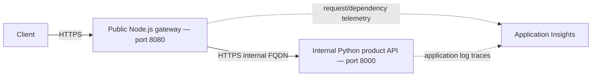

# Två-tjänsts mikrotjänster — Azure Container Apps

**Nivå:** Mellan · **Tid:** 45–60 minuter inklusive setup

Detta inlärningsexempel implementerar en **Node.js API Gateway** och en **skrivskyddad Python
Produktjänst**. Källkod, Dockerfiles, Bicep och azd-konfiguration ingår.
Det är inte ett produktionshärdat system.

## Vad du kommer att lära dig

- Distribuera två tjänster oberoende av varandra.
- Använd ett internt backend FQDN över HTTPS.
- Verifiera svar för framgång, ej hittad och otillgänglig tjänst.
- Förstå telemetri och oberoende skalningsgränser.



Produktkatalogen innehåller fem fasta produkter i minnet. Det finns **inga POST,
PUT eller DELETE-handlers**, databas, Service Bus, order-/användare-/notifikationstjänst,
C# eller Go-kod. Dessa är framtida utvecklingsidéer, inte medföljande funktioner.
Gatewayen autentiserar inte användare; intern ingång är inget substitut
för applikationsauktorisering.

## Förutsättningar

Slutför [enkel Flask API](../../../../../examples/container-app/simple-flask-api) först.
Installera en aktuell stabil azd (publicerad version vid granskning: 1.37.2), Azure CLI,
och Docker med daemon igång. Du behöver en Azure-prenumeration, behörighet
för att skapa resurser samt regional Container Apps-kvot.

```bash
azd version
az version
docker info
azd auth login
az login
```

Använd samma prenumeration i båda CLI-verktygen. Kommandon nedan använder Bash.

## Distribuera och verifiera

Från rotmappen i depån:

```bash
cd examples/container-app/microservices
azd env new microservices-demo
azd up
GATEWAY_URL=$(azd env get-value API_GATEWAY_URL)
RG_NAME=$(azd env get-value AZURE_RESOURCE_GROUP)
GATEWAY_NAME=$(azd env get-value API_GATEWAY_NAME)
PRODUCT_NAME=$(azd env get-value PRODUCT_SERVICE_NAME)

curl --fail-with-body "${GATEWAY_URL}/health"
curl --fail-with-body "${GATEWAY_URL}/api/products"
curl --fail-with-body "${GATEWAY_URL}/api/products/1"
curl -i "${GATEWAY_URL}/api/products/999"
```

**Framgång:** health 200; list 200 med **fem** produkter; produkt 1 är en Laptop
prissatt till 999,99 med lager på 50; okänd produkt ger 404.
Beskrivningar ingår i svaren; tidsstämplar varierar.

Initial provision använder publika hello-world images på port 80 så att det inte
försöker hämta icke-existerande images från ett tomt register. Tjänstspecificerade Bicep-moduler
och parameterfiler ersätter dem med byggda images och app-portar/prober under
`azd deploy`. Huvudparametrar bevarar publicerade imagenamn för senare provisionering.

## Tjänster och nätverk

| Tjänst | Exponerade ändpunkter | Standardresurser |
|---|---|---|
| Gateway | GET `/`, `/health`, `/api/products`, `/api/products/:id` | 1 vCPU, 2 GiB, 2–20 repliker |
| Produkt | GET `/`, `/health`, `/products`, `/products/<id>` | 0,5 vCPU, 1 GiB, 1–10 repliker |

Produkt-ingress har `external: false` och `allowInsecure: false`. Bicep injicerar
`PRODUCT_SERVICE_URL=https://<actual-internal-fqdn>` i gatewayen. HTTP skulle
omdirigera; HTTPS matchar den konfigurerade ingressen. Ett kort DNS-namn måste överensstämma med
**det faktiska Container App-namnet**, inte den logiska tjänstnyckeln `product-service`.
Försök inte att anropa den interna URL:en direkt från din laptop.

Gatewayen har en timeout på fem sekunder för produktanrop. Saknade produkt-ID:n
ger 404; transportfel/andra backendfel ger 503. Gateway
`/health` kontrollerar endast gateway, inte backend-tillgänglighet.

## Filer och konfiguration

```text
azure.yaml
infra/main.bicep
infra/main.parameters.json
infra/abbreviations.json
infra/core/container-apps-environment.bicep
infra/core/monitor.bicep
infra/app/api-gateway.bicep
infra/app/api-gateway.parameters.json
infra/app/product-service.bicep
infra/app/product-service.parameters.json
src/api-gateway/{app.js,package.json,Dockerfile}
src/product-service/{main.py,requirements.txt,Dockerfile}
```

Skalning, CPU/minne, portar och prober ställs in i `infra/app/*.bicep`. Ändra dessa
filer och kör `azd up` för att applicera infrastrukturen och göra om deploy. Det finns ingen
`GATEWAY_MAX_REPLICAS` miljövariabelparameter i detta exempel.

För kodändringar endast:

```bash
azd deploy product-service
azd deploy api-gateway
```

Node-imagen använder Node 22; Python-imagen använder Python 3.11. Båda binder till
`0.0.0.0`. Ingress/prober använder port 8080 (gateway) respektive 8000 (produkt).

## Lokal utveckling med Docker

Kör från denna exempel-mapp. Använd ett användardefinierat nätverk, **inte `localhost`
för att en container ska nå en annan**:

```bash
docker network create azd-microservices-demo
docker build -t local-product ./src/product-service
docker build -t local-gateway ./src/api-gateway
docker run -d --name azd-product --network azd-microservices-demo local-product
docker run -d --name azd-gateway --network azd-microservices-demo \
  -p 8080:8080 -e PRODUCT_SERVICE_URL=http://azd-product:8000 local-gateway
curl --fail-with-body http://localhost:8080/api/products
```

Förväntat: fem produkter. HTTP används endast för detta lokala Docker-nätverk.

```bash
docker stop azd-product azd-gateway
docker rm azd-product azd-gateway
docker network rm azd-microservices-demo
```

## Övervakning

```bash
az containerapp logs show --name "$GATEWAY_NAME" --resource-group "$RG_NAME" --follow
# In a separate terminal:
az containerapp logs show --name "$PRODUCT_NAME" --resource-group "$RG_NAME" --tail 100
```

`azd monitor --logs` öppnar en portalvy; den strömmar inte terminalloggar.
Node SDK samlar in gateway-förfrågningar/beroenden. Pythons `AzureLogHandler`
exporterar **loggspårningar**, inte automatiska Flask-förfrågningar, SQL-beroenden eller fulla
distribuerade spår. OpenCensus är ett äldre SDK; föredra Azure Monitor OpenTelemetry
när du utökar detta exempel.

I Application Insights Logs, generera förfrågningar och inspektera:

```kusto
requests
| where timestamp > ago(1h)
| where name contains "products"
| summarize RequestCount=count(), AvgDuration=avg(duration) by bin(timestamp, 5m)
```

För Pythons applikationsmeddelanden:

```kusto
traces
| where timestamp > ago(1h)
| where message contains "products"
| project timestamp, message, severityLevel
```

Tillåt bearbetningsfördröjning och sampling; förvänta dig inte exakt begärandeantal eller
garanterad latens. Inga anpassade larm eller dashboards är konfigurerade.

## Praktiska övningar

### Övning 1: Ändra katalogen

**Utgångspunkt:** `src/product-service/main.py`.
**Mål:** verifiera oberoende tjänstdistribution.
Ändra Laptops lager från 50 till 49 i den fasta `products` listan, kör
`azd deploy product-service`, sedan gör en förfrågan på `${GATEWAY_URL}/api/products/1`.

**Framgångskriterier / lösning:** HTTP 200 med `"stock":49`. Återställ till 50 och distribuera om.
**Vanligt problem:** redigera gatewayen istället för tjänsten som äger katalogen.
Detta ändrar källdata, inte en persistent inventariedatabas.

### Övning 2: Verifiera konfiguration av repliker

**Utgångspunkt:** `infra/app/product-service.bicep`.
**Mål:** observera en infrastrukturförändring utan gissning om autoskalning.
Ändra `minReplicas: 1` till `minReplicas: 2`, kör `azd up`, sedan:

```bash
az containerapp show --name "$PRODUCT_NAME" --resource-group "$RG_NAME" \
  --query properties.template.scale -o json
```

**Framgångskriterier:** konfigurerat minimum är 2 och maximum förblir 10.
Återställ minimum till 1 och kör `azd up`.
**Vanligt problem:** `azd deploy` ensam tillämpar inte ändringar på orelaterad delad
infrastruktur. Sätt inte `maxReplicas` till noll som fel-simulering.
Detta verifierar konfiguration, inte ett belastningstest eller garanterat ögonblickligt replikantal.

### Övning 3: Testa hantering av otillgänglig tjänst lokalt

**Utgångspunkt:** båda lokala Docker-containrarna ovan körs.
**Mål:** skilja backend-fel från en saknad produkt.
Stoppa endast produktcontainern:

```bash
docker stop azd-product
curl -i http://localhost:8080/api/products
docker start azd-product
curl --fail-with-body http://localhost:8080/api/products
```

**Framgångskriterier:** medan den är stoppad returnerar gateway 503 med
`"error":"Product service unavailable"`; efter omstart returnerar listan 200.
Försök igen efter en kort uppstartsfördröjning om nödvändigt.
**Vanligt problem:** att stoppa gatewayen testar ett annat fel (ingen HTTP-svar).

## Kostnader och produktionsluckor

Standardminimum av repliker håller beräkningen igång. Register och övervakning medför också
kostnader. Det finns inget validerat fast pris på 50 USD/månad totalt: uppskatta regional CPU/minne,
repliktimmar, förfrågningar, register och loggarkivering i
[Azure prisräknare](https://azure.microsoft.com/pricing/calculator/).
Ta bort inlärningsresurser snabbt.

Produktionsarbete inkluderar autentisering/auktorisering, scoped managed identities,
persistent data, validering av indata/utdata, stödd instrumentering för observabilitet,
belastnings-/feltestning, CI/CD, larm och återställningsprocedurer. Att lägga till en order-
tjänst, kö eller databas är en separat implementationsuppgift, inte en färdig
övning eller en funktion som redan finns här.

## Felsökning och städning

- **Bild hittades inte under första provisionering:** bootstrap bör använda public image;
  verifiera standardvärden för huvudimageparametrar och mappings i deploymentsmodulerna.
- **503 produkter:** kontrollera produktloggar, bildrevision och injicerad intern HTTPS-URL.
- **404 oväntad väg:** produkt-API är skrivskyddat; verifiera routen, inte en icke-existerande CRUD-handler.
- **Ingen telemetri:** inspektera kopplingssträngar vid körning utan att exponera dem och
  tillåt bearbetningsfördröjning. Pythons förfrågningstabeller fylls inte av dess logghanterare.

Från denna exempelmapp:

```bash
azd down
```

Granska borttagningspromptar och verifiera att dedikerad resursgrupp tas bort.

[Föregående: Flask API](../../../../../examples/container-app/simple-flask-api) · [Nästa: Databasapp](../../../../../examples/database-app) ·
[AI-utveckling](../../../docs/chapter-02-ai-development/README.md) ·
[Kursens startsida](../../../README.md) · [Rapportera ett problem](https://github.com/microsoft/AZD-for-beginners/issues)

---

<!-- CO-OP TRANSLATOR DISCLAIMER START -->
**Ansvarsfriskrivning**:
Detta dokument har översatts med hjälp av AI-översättningstjänsten [Co-op Translator](https://github.com/Azure/co-op-translator). Även om vi strävar efter noggrannhet, var vänlig notera att automatiska översättningar kan innehålla fel eller brister. Det ursprungliga dokumentet på dess modersmål bör betraktas som den auktoritativa källan. För kritisk information rekommenderas professionell mänsklig översättning. Vi ansvarar inte för några missförstånd eller feltolkningar som uppstår till följd av användningen av denna översättning.
<!-- CO-OP TRANSLATOR DISCLAIMER END -->