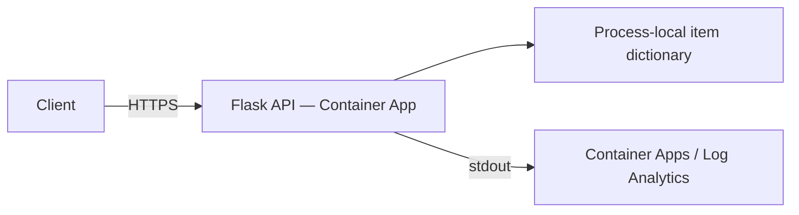

# Enkel Flask API — Azure Container Apps

**Nivå:** Nybörjare · **Tid:** 30–45 minuter inklusive installation

Distribuera en Python Flask CRUD API med Azure Developer CLI (azd). Källkod, Dockerfile,
Bicep och distributionsparametrar ingår. Detta är ett **lärande-exempel**, inte
en produktionsfärdig API.

## Vad du kommer lära dig

- Bygga och publicera en container via azd.
- Konfigurera ingress och liveness/readiness-prober.
- Verifiera CRUD-svar och inspektera applikationsloggar.
- Förstå varför data i minnet är olämpligt för beständiga applikationer.



**Viktigt:** objekt hålls i en process. Standard är **en Gunicorn worker,
0–1 repliker**, avsiktligt för att undvika inkonsekvent data över workers/repliker.
Objekt förloras vid omstart, versionsändring eller skalning till noll. Ökade repliker
kräver delad beständig lagring. API:et har ingen autentisering eller auktorisering.

## Förutsättningar

- [Aktuell stabil azd](https://learn.microsoft.com/azure/developer/azure-developer-cli/install-azd)
  (publicerad version vid granskning: 1.37.2).
- [Azure CLI](https://learn.microsoft.com/cli/azure/install-azure-cli) för verifiering.
- Docker med dess daemon igång; det krävs för standard lokal bildbyggnad.
- Azure-abonnemang, behörigheter för resurs skapande och kvot för Container Apps i regionen.
- Bash för kommandon nedan (eller motsvarande PowerShell).
- Python 3.11 för frivillig lokal utveckling.

```bash
azd version
az version
docker info
azd auth login
az login
```

CLI-verktygen har separata inloggningssessioner. Använd samma abonnemang i båda.

## Kom igång snabbt

Från repositories root-mapp:

```bash
cd examples/container-app/simple-flask-api
azd env new flask-demo
azd up
API_URL=$(azd env get-value API_ENDPOINT)
RG_NAME=$(azd env get-value AZURE_RESOURCE_GROUP)
API_NAME=$(azd env get-value API_NAME)
curl --fail-with-body "${API_URL}/health"
```

Förväntat: HTTP 200 och JSON med `"status":"healthy"`,
`"service":"simple-flask-api"` och en aktuell UTC-tidsstämpel.
Provisoriskt och bildbygge tar vanligtvis några minuter; tider varierar.

Initial provisioning använder en publik hello-world-bild som lyssnar på port 80.
`azure.yaml` väljer `infra/app/api.bicep` och dess matchande parameterfil för
tjänstedistribution, som byter bild, ingress och prober till port 8000.
Ta inte bort dessa distributionsparametrar.

## Verifiera CRUD

Kör följande i ordning medan samma replik är aktiv:

```bash
# Create: HTTP 201; note the returned id (1 for a fresh process).
curl -i -X POST "${API_URL}/api/items" \
  -H "Content-Type: application/json" \
  -d '{"name":"Test Item","description":"My first item"}'

# Read list: HTTP 200, total 1 in a fresh process.
curl --fail-with-body "${API_URL}/api/items"

# Replace 1 if your create response returned another id.
curl --fail-with-body "${API_URL}/api/items/1"
curl -i -X PUT "${API_URL}/api/items/1" \
  -H "Content-Type: application/json" -d '{"name":"Updated Item"}'
curl -i -X DELETE "${API_URL}/api/items/1"
curl -i "${API_URL}/api/items/1"
```

Framgång: POST 201, läser/PUT 200, DELETE 204 utan kropp, sedan saknat objekt 404.
Felaktigt/form-inkorrekt JSON eller ett tomt namn ger 400.
Om ett objekt försvinner mellan förfrågningar, kontrollera omstart eller skalning till noll;
detta är en avsiktlig minnesbegränsning, inte beständighet.

| Endpoint | Metoder |
|---|---|
| `/` | GET — tjänsteinformation |
| `/health` | GET — liveness/readiness |
| `/api/items` | GET, POST |
| `/api/items/{id}` | GET, PUT, DELETE |

## Loggar och konfiguration

```bash
az containerapp logs show --name "$API_NAME" --resource-group "$RG_NAME" --follow
```

Förväntat: Gunicorn-start, request access-loggar och applikationsmeddelanden.
`azd monitor --logs` öppnar en portalvisning; den strömmar inte till terminalen.
Application Insights är uppsatt men **inte instrumenterat av denna Flask-kod**;
använd Container Apps/Log Analytics för stdout-loggar.

Redigera `infra/app/api.bicep` för CPU/minne, replikgränser eller skalregler, kör sedan
`azd up`. Standard är 0,5 vCPU, 1 GiB, min 0 / max 1 replik och ett
HTTP-tröskelvärde på 50 samtidiga förfrågningar. Skalning till noll kan ge kallstartslatens.

Obestämda `azd env set MAX_REPLICAS`, `API_KEY`, `LOG_LEVEL` eller
`SCALE_TO_ZERO_TIMEOUT` värden är **inte kopplade till denna mall eller app**.
Att sätta ett värde gör det inte automatiskt till en runtime-miljövariabel.
Bilden binder port 8000 explicit; uppdatera Dockerfile, Bicep ingress och prober
tillsammans om port ändras.

## Filer

```text
azure.yaml
infra/main.bicep
infra/main.parameters.json
infra/app/container-apps.bicep       # Environment, registry, monitoring
infra/app/api.bicep                  # App, ingress, probes, scale settings
infra/app/api.parameters.json        # Image and resource values for azd deploy
src/app.py
src/Dockerfile
src/requirements.txt
```

## Lokal utveckling

Från denna exempel-mapp:

```bash
python -m venv .venv
source .venv/bin/activate  # PowerShell: .\.venv\Scripts\Activate.ps1
python -m pip install -r src/requirements.txt
python src/app.py
```

I en annan terminal, testa `http://localhost:8000/health` och CRUD-endpoints.
Eller bygg och kör den faktiska bilden:

```bash
docker build -t flask-api:local ./src
docker run --rm -p 8000:8000 flask-api:local
```

För kod-ändringar efter första distribution, kör `azd deploy api`.
För Bicep-ändringar, kör `azd up` för att reprovisionera och distribuera.

## Praktiska övningar

### 1. Validera avvisning av ogiltig input

**Utgångspunkt:** distribuerad API, `API_URL` ovan.
**Mål:** verifiera att API:et avvisar ogiltiga JSON-strukturer och saknade namn.

```bash
curl -i -X POST "${API_URL}/api/items" \
  -H "Content-Type: application/json" -d '[]'
curl -i -X POST "${API_URL}/api/items" \
  -H "Content-Type: application/json" -d '{"name":""}'
```

**Framgångskriterier/lösning:** båda returnerar 400 med JSON-fel, inte 500.
**Vanligt problem:** att utelämna JSON content-type header.

### 2. Lägg till en skrivskyddad version endpoint

**Utgångspunkt:** `src/app.py`. **Mål:** utöka och distribuera om API:et.
Lägg till detta före `if __name__ == '__main__':`-blocket:

```python
@app.route('/version', methods=['GET'])
def version():
    return jsonify({'version': '1.0.0'})
```

Kör `azd deploy api`, sedan `curl --fail-with-body "${API_URL}/version"`.
**Framgångskriterier:** HTTP 200 och `{"version":"1.0.0"}`.
**Vanligt problem:** att placera routen efter det blockerande `app.run()` anropet när
man testar med `python src/app.py`.

### Kunskapskontrollpunkt

Varför räcker inte en worker för beständiga data? För att även en process förlorar
sin dictionary vid omstart. En produktionsversion behöver beständig delad lagring,
autentisering, auktorisering, migreringar, tester och driftövervakning.

## Kostnader och felsökning

Detta är inte en garanterad $0 distribution: grundläggande registry och logglagring/-insamling
kan ge kostnader även när appbolaget är på noll. Använd
[prisräknare](https://azure.microsoft.com/pricing/calculator/) för din region.

- **Docker build-fel:** bekräfta `docker info`, nätverksåtkomst och beroenden.
- **Ohälsosam app:** inspektera konsol-/systemloggar och verifiera bildport, ingress,
  och prober stämmer överens. En platshållare får inte provas på Flask-porten.
- **403/behörigheter:** bekräfta abonnemang och resurs-skaparbehörigheter.
- **Objekt försvinner:** intern minnesstatus återställs vid omstart/skalning till noll; lägg till en databas
  för beständigt beteende.

## Rensa upp och nästa steg

```bash
azd down
```

Granska rensningsprompten och verifiera att dedikerad resursgrupp tas bort.
Använd inte destruktiv rensning mot en resursgrupp som innehåller orelaterad data.

[Nästa: Databasapp](../../../../../examples/database-app) · [Mikrotjänster](../../../../../examples/container-app/microservices) ·
[Containeröversikt](../README.md) · [Kursstart](../../../README.md) ·
[Rapportera ett problem](https://github.com/microsoft/AZD-for-beginners/issues)

---

<!-- CO-OP TRANSLATOR DISCLAIMER START -->
**Ansvarsfriskrivning**:
Detta dokument har översatts med hjälp av AI-översättningstjänsten [Co-op Translator](https://github.com/Azure/co-op-translator). Även om vi strävar efter noggrannhet, var vänlig notera att automatiska översättningar kan innehålla fel eller brister. Det ursprungliga dokumentet på dess modersmål bör betraktas som den auktoritativa källan. För kritisk information rekommenderas professionell mänsklig översättning. Vi ansvarar inte för några missförstånd eller feltolkningar som uppstår till följd av användningen av denna översättning.
<!-- CO-OP TRANSLATOR DISCLAIMER END -->