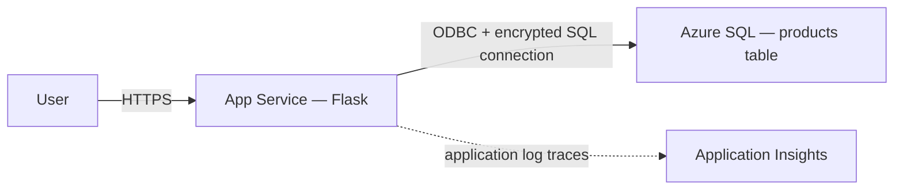

# Flask och Azure SQL på App Service

**Nivå:** Mellan · **Tid:** 30–60 minuter inklusive förutsättningar

Detta exempel distribuerar ett Python Flask read API till **Linux App Service** och en Basic
Azure SQL-databas. Källa, Bicep och azd-konfiguration ingår. Det är en
lärandeapplikation, inte en färdig databasarkitektur för produktion.

## Vad du kommer att lära dig

- Provisionera App Service, SQL och övervakningsresurser med Bicep.
- Konfigurera krypterad SQL-anslutning utan att begå referenser.
- Initiera ett schema innan Gunicorn-arbetare startar.
- Verifiera seedade data, inte-hittade-svar och databasens hälsa.



Resurser: dedikerad resursgrupp, B1 Linux App Service-plan, Python 3.11 Web
App, SQL-server och Basic 2-GB databas, Application Insights och Log Analytics.
Web App använder **käll-/ZIP-distribution och Oryx beroendeinstallation**;
`azd deploy` bygger eller distribuerar inte den valfria Dockerfilen.

## Förutsättningar

- Nuvarande stabil [azd](https://learn.microsoft.com/azure/developer/azure-developer-cli/install-azd)
  (publicerad version vid granskningstillfället: 1.37.2).
- [Azure CLI](https://learn.microsoft.com/cli/azure/install-azure-cli) för verifiering.
- Azure-prenumeration, behörigheter att skapa de listade resurserna och regional kvot.
- Python **3.11** för lokal utveckling; den begångna `pyodbc==5.0.1` kan kräva
  inbyggda byggverktyg på nyare Python-versioner.
- Microsoft ODBC Driver 18 (eller 17) för SQL Server på lokala maskiner. `pip install
  pyodbc` installerar inte systemdrivrutinen. Se
  [ODBC-installation](https://learn.microsoft.com/sql/connect/odbc/download-odbc-driver-for-sql-server).
- Docker endast om du testar den valfria containern lokalt.

```bash
azd version
az version
azd auth login
az login
```

Använd samma prenumeration i båda verktygen. Kommandon nedan använder Bash.

## Distribution

Från repository-roten:

```bash
cd examples/database-app
azd env new sql-demo
azd provision
azd deploy
WEB_URL=$(azd env get-value WEB_APP_URI)
WEB_NAME=$(azd env get-value WEB_APP_NAME)
RG_NAME=$(azd env get-value AZURE_RESOURCE_GROUP)
```

Välj en stödd region. `sqlAdminLogin` är standardvärde till `sqladmin`; den nödvändiga
`sqlAdminPassword` är en säker parameter. Ange ett starkt lösenord när du uppmanas.
Håll distributionsreferenser utanför Git och ärenderapporter. Den nuvarande anslutnings
strängsinterpolationen förväntar sig ett lösenord utan anslutningssträngs-avgränsare såsom
`;`; anpassa escape-tecken innan du använder sådana värden.

Bicep sätter ett startkommando som kör `init_database()` **innan** Gunicorn
arbetare startar. Detta är nödvändigt eftersom import av `app:app` inte utför
Pythons `if __name__ == '__main__'` block. På en ny databas skapar initialiseringen
`products` och lägger till fem rader. Det är en enkel undervisnings-seed, inte ett
samtidigt migreringsramverk; använd korrekta migrationer innan instanser skalas ut.

Appen väljer installerad Microsoft ODBC Driver 18, därefter 17, om anslutnings
strängen inte uttryckligen namnger en driver. Om ingen finns misslyckas start med
ett åtgärdigt installationsfel. Verifiera drivrutinens tillgänglighet i din valda
App Service runtime istället för att anta det.

## Verifiera

```bash
curl --fail-with-body "${WEB_URL}/"
curl --fail-with-body "${WEB_URL}/health"
curl --fail-with-body "${WEB_URL}/products"
curl --fail-with-body "${WEB_URL}/products/1"
curl -i "${WEB_URL}/products/999"
```

Förväntat:

- `/` returnerar endpoint-information.
- `/health` returnerar 200 med `{"status":"healthy","database":"connected"}`.
- `/products` returnerar fem seedade produkter på en ny databas.
- `/products/1` returnerar Laptop med pris 1299.99.
- En icke-existerande produkt returnerar 404 med `{"error":"Product not found"}`.

API:et är endast för läsning. Det finns ingen POST/PUT/DELETE-rutt eller webbläsargränssnitt.
Databasanslutningsfel returnerar 503 från `/health`; det är ingen framgång.

## Filer och konfiguration

```text
azure.yaml                         # Python App Service source deployment
infra/main.bicep
infra/main.parameters.json
infra/abbreviations.json
infra/resources/sql-server.bicep
infra/resources/sql-database.bicep
infra/resources/app-service-plan.bicep
infra/resources/web-app.bicep       # Settings + initialization/startup command
infra/resources/app-insights.bicep
src/web/app.py
src/web/requirements.txt
src/web/Dockerfile                 # Optional local container, not the azd target
.env.sample
```

`SQL_CONNECTION_STRING` skickas som en säker Bicep-parameter till Web App-modulen
och lagras i App Service-inställningar, inte som distributionsutdata.
`APPLICATIONINSIGHTS_CONNECTION_STRING` konfigurerar loggexport.
`SCM_DO_BUILD_DURING_DEPLOYMENT=true` aktiverar server-side beroendeinstallation.
Att ställa in godtyckliga `azd env`-värden ändrar inte automatiskt appinställningar.

SQL brandväggens `0.0.0.0` regel tillåter anslutningar från **Azure-tjänster,
inklusive andras prenumerationer**, förutsatt SQL-autentisering. Den är
inte begränsad till denna app eller prenumeration. SQL offentlig nätverksåtkomst är aktiverad.
Använd scoped networking och en icke-admin app-identitet innan produktion.

## Lokal utveckling

Använd Python 3.11 och en installerad Microsoft SQL ODBC-driver:

```bash
python -m venv .venv
source .venv/bin/activate  # PowerShell: .\.venv\Scripts\Activate.ps1
python -m pip install -r src/web/requirements.txt
export SQL_CONNECTION_STRING='Server=tcp:YOUR_SERVER.database.windows.net,1433;Database=YOUR_DATABASE;UID=YOUR_USER;PWD=YOUR_PASSWORD;Encrypt=yes;TrustServerCertificate=no;Connection Timeout=30;'
python src/web/app.py
```

Byt ut platshållare säkert. En kopierad `.env`-fil **laddas inte automatiskt**
av denna applikation. Exportera variabler i ditt aktuella shell istället.
För Azure SQL från en laptop, tillåt tillfälligt endast din egen publika IP:

```bash
SQL_SERVER=$(azd env get-value SQL_SERVER_NAME)
MY_IP=YOUR_PUBLIC_IP
az sql server firewall-rule create -g "$RG_NAME" -s "$SQL_SERVER" \
  -n AllowMyLearningIP --start-ip-address "$MY_IP" --end-ip-address "$MY_IP"
```

Ta bort regeln efter testning:

```bash
az sql server firewall-rule delete -g "$RG_NAME" -s "$SQL_SERVER" -n AllowMyLearningIP
```

Valfritt containertest från denna exempel-mapp:

```bash
docker build -t sql-flask:local src/web
docker run --rm -p 8000:8000 -e SQL_CONNECTION_STRING sql-flask:local
```

Denna bild installerar Driver 18 med Debian 12 paketförråd som matchar dess
Bookworm-bas, initierar databasen en gång och startar sedan Gunicorn.

## Övervakning och felsökning

Aktivera/följ App Service filsystemets applikationsloggar vid uppstartsdiagnostik:

```bash
az webapp log config --name "$WEB_NAME" --resource-group "$RG_NAME" \
  --application-logging filesystem --level information
az webapp log tail --name "$WEB_NAME" --resource-group "$RG_NAME"
```

Denna kod exporterar applikationens **loggspår** via en äldre OpenCensus-handler.
Den konfigurerar inte automatisk Flask-förfrågan/beroende spårning, Live Metrics,
SQL revision, diagnostikinställningar eller aviseringar. Dessa kräver separat setup.
För ny instrumentering, företrädesvis Azure Monitor OpenTelemetry.

I Application Insights Logs, efter att ha gjort API-förfrågningar:

```kusto
traces
| where timestamp > ago(1h)
| where message contains "products" or message contains "Health check"
| project timestamp, message, severityLevel
```

Tillåt fördröjning i ingestion. Förfrågetabell eller Live Metrics aktivitet är inte ett fullföljande
kriterium för denna logg-ensamma instrumentering.

- **Saknad drivrutin:** inspektera `pyodbc.drivers()` i runtime och installera en
  stödd Microsoft ODBC-driver. Ett Python-paket räcker inte.
- **Anslutningsfel:** kontrollera SQL-inställningar, referenser, brandvägg och vald
  prenumeration. Inaktivera inte kryptering för att kringgå ett fel.
- **Saknad produkttabell:** bekräfta att Bicep startkommando distribuerades;
  att starta `gunicorn app:app` ensam hoppar över initialisering.
- **Paketbyggfel:** använd Python 3.11 eller tillhandahåll inbyggda byggförutsättningar.
- **Nollpris-data:** noll är ett giltigt decimalt pris; det måste serialiseras som 0.0,
  inte `null`.

## Praktiska övningar

### Övning 1: Verifiera saknat-produkt-beteende

**Utgångspunkt:** distribuerat API och `WEB_URL` ovan.
**Mål:** särskilj en saknad rad från en trasig databas.
Begär `/health` och `/products/999` med kommandona ovan.
**Framgångskriterier / svar:** hälsa 200, icke-existerande produkt 404 (inte 500 eller 503).
**Vanligt problem:** anta att ett "inte-hittad"-svar bevisar att SQL-anslutningen är trasig.

### Övning 2: Ändra ett seedat värde

**Utgångspunkt:** Azure SQL Query Editor, kopplad till exempeldatabasen.
**Mål:** visa att API-data lagras i SQL snarare än processminne.

```sql
UPDATE products SET price = 0 WHERE id = 1;
SELECT id, name, price FROM products WHERE id = 1;
```

Begär `${WEB_URL}/products/1`. **Framgångskriterier:** priset är `0.0`, inte `null`.
Återställ värdet:

```sql
UPDATE products SET price = 1299.99 WHERE id = 1;
```

**Vanligt problem:** redigering av Python seed-listan uppdaterar inte rader redan i SQL.
Kör inte schema-/dataövningar mot en produktionsdatabas.

### Övning 3: Lägg till en skrivskyddad räkne-endpoint

**Utgångspunkt:** `src/web/app.py`.
**Mål:** utöka API:et med en parametrar-fri aggregeringsfråga.
Lägg till detta före `if __name__ == '__main__':` blocket:

```python
@app.route('/product-count')
def product_count():
    from contextlib import closing
    with closing(get_db_connection()) as conn, closing(conn.cursor()) as cursor:
        cursor.execute("SELECT COUNT(*) FROM products")
        return jsonify({'count': cursor.fetchone()[0]})
```

Kör `azd deploy web`, begär sedan `${WEB_URL}/product-count`.
**Framgångskriterier:** 200 med `{"count":5}` på den orörda seedade databasen.
**Vanligt problem:** ändra rutten men glömma att distribuera om.
För produktion, lägg till felhantering/tester; denna korta övning fokuserar på frågan.

## Kostnader, produktionsbrister och städning

B1 App Service och Basic-databasen debiteras medan de är provisionerade. Att stoppa
Web App stoppar **inte** debitering av App Service-plan. Loggar och lagring kan tillkomma kostnader för.
Använd [Azure priskalkylator](https://azure.microsoft.com/pricing/calculator/)
för aktuell regional prissättning. Att byta till F1 kräver också att `alwaysOn` inaktiveras;
det är inte en enkel ersättning. SQL serverless är inte automatiskt gratis.

Produktionsarbete inkluderar en least-privilege appidentitet (inte SQL admin),
autentisering/auktorisering, privat nätverk, säkra migrationer, anslutningspoolning/livscykelgranskning,
telemetri, revision, larm, tester och återhämtningsprocedurer.
Redis caching och ytterligare tabeller är utvecklingsidéer, inte implementerade övningar.

Från denna exempel-mapp:

```bash
azd down
```

Granska borttagningsprompten och verifiera att den dedikerade resursgruppen tas bort.
Ta inte bort grupper som innehåller orelaterad data.

[Container-exempel](../../../../examples/container-app) ·
[AI-utveckling](../../docs/chapter-02-ai-development/README.md) ·
[Kurs startsida](../../README.md) · [Rapportera ett problem](https://github.com/microsoft/AZD-for-beginners/issues)

---

<!-- CO-OP TRANSLATOR DISCLAIMER START -->
**Ansvarsfriskrivning**:
Detta dokument har översatts med hjälp av AI-översättningstjänsten [Co-op Translator](https://github.com/Azure/co-op-translator). Även om vi strävar efter noggrannhet, var vänlig notera att automatiska översättningar kan innehålla fel eller brister. Det ursprungliga dokumentet på dess modersmål bör betraktas som den auktoritativa källan. För kritisk information rekommenderas professionell mänsklig översättning. Vi ansvarar inte för några missförstånd eller feltolkningar som uppstår till följd av användningen av denna översättning.
<!-- CO-OP TRANSLATOR DISCLAIMER END -->