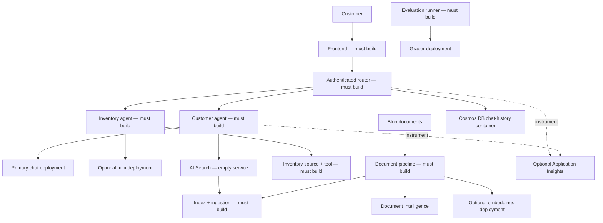

# Flera agenters kundsupport — Detaljhandelsarkitekturens blueprint

**Kapitel 5: AI-lösningar med flera agenter**

- [Kurshem](../README.md)
- [Kapitel 5](../docs/chapter-05-multi-agent/README.md)
- [Förkunskap: AI-integration](../docs/chapter-02-ai-development/microsoft-foundry-integration.md)
- [Nästa: Kapacitetsplanering](../docs/chapter-06-pre-deployment/capacity-planning.md)
- [ARM-infrastrukturstomme](retail-multiagent-arm-template/README.md)

> **Arkitekturguiden, inte en fungerande applikation.** De enda detaljhandelsimplementerings-
>filerna är `azuredeploy.json`, `azuredeploy.parameters.json` och `deploy.sh` i
> `retail-multiagent-arm-template/`. Router-/frontend-containrar är hello-world-
> platshållare. Ingen detaljhandelsagent, UI, datainmatningspipelinen, utvärderare, skanner
> eller applikationstestsvit finns lokalt.

## Översikt

**Mål:** designa ett kundsupportssystem med en kundagent och en lageragent,
identifiera vad infrastrukturen tillhandahåller och planera saknade applikationskontrakt
och verifiering.

**Målgrupp:** utvecklare som har slutfört den lokala
[chattexempeln](../../../examples/azure-openai-chat) och [två-tjänster-container-exemplet](../../../examples/container-app/microservices).
Avsätt 2–3 timmar för arkitekturstudie. Att bygga applikationen är ett separat
projekt: 80–120 utvecklingstimmar är en illustrativ planeringsuppskattning för
erfarna utvecklare, **inte ett leveranslöfte**; produktionsförfining, tester,
säkerhetsgranskning och drift kräver ytterligare arbete.

### Lärandemål

- Förklara routing, grundning, verktygstillstånd och samtalets ägarskap.
- Fördela modellidentifierare, driftsättningsnamn, API-versioner och ARM-versioner.
- Designa dokumentinmatning och hämtning med matchande vektordimensioner.
- Definiera verifierbara funktionella, utvärderings- och felåterställningskrav.
- Separera valfria arkitekturmål från faktiska resurser som tillhandahålls.

## Lösningsarkitektur



Detta är en **målapplikationsarkitektur**, inte ett diagram över körande agent-
tjänster. ARM-stommen skapar de underliggande tjänsterna och två platshållar-
containrar endast. Front Door, register, hanterade identiteter, rolltilldelningar,
privata slutpunkter, failover, applikationsinstrumentering och aviseringar ingår inte.

### Ansvar och kontrakt

| Komponent | Krävt beteende | Bevis innan det anses komplett |
|---|---|---|
| Frontend | Autentisera användare, rendera chatt, ladda upp dokument säkert | UI- och uppladdningstester, tillgängliga felmeddelanden |
| Router | Auktorisera förfrågningar, välj agent, begränsa verktygsanrop/tidsgränser | Routingtester, auktoriseringskontroller, feltester |
| Kundagent | Grundlägg policy-/produktsvar i godkända källor | Korrekt referens, avstå vid frånvaro av data |
| Lagerverktyg | Läs auktoritativ lagerinformation med avgränsade tillstånd | Deterministiska lagertester; ingen påhittad tillgänglighet |
| Dokumentpipeline | Extrahera, dela upp, embedda, indexera, uppdatera/radera | Indexerade uppställningar och retry/död-brev-beteende |
| Konversationslagring | Isolera användare, upprätthålla lagringstid | Auktoriseringstester över användare och TTL-tester |
| Utvärderingskörning | Jämför resultat med sanningsdata och bedömningsmall | Täcksgrad, felräkningar, reproducerbara rapporter |

Tänk på routern som en reception och verktyg som begränsade interna system:
att välja en specialist är inte auktorisering att få tillgång till varje kunds journaler.
Upprätthåll identitet och tillstånd i applikationskoden och datatjänster, inte i promptar.

## Infrastruktur kontra applikation

Läs [stommens README](retail-multiagent-arm-template/README.md) innan
du tillhandahåller. Den listar exakta resurser, lägen, kostnader och begränsningar.

| Logisk användning | ARM-distributionsnamn | Modell / version | Standardregion |
|---|---|---|---|
| Kundchatt | `gpt-4.1-chat` | `gpt-4.1` / `2025-04-14` | `eastus2` |
| Lager | `gpt-4.1-mini-inventory` | `gpt-4.1-mini` / `2025-04-14` | `westus2`, valfritt |
| Embeddingar | `text-embedding-ada-002` | `text-embedding-ada-002` / `2` | `francecentral`, valfritt |
| Utvärdering | `gpt-4.1-grader` | `gpt-4.1` / `2025-04-14` | Primär region som standard |

Kontrollera modell/version/SKU-tillgänglighet och kvot i **varje region**. Chatt/mini/grader
använder `GlobalStandard`; embeddingar använder `Standard`. Kartläggningar av kapacitet-enhet-till-TPM är
modell-specifika. Lägg inte till olikartade kapacitetenheter som en universell kvotgaranti.

Ett Azure OpenAI-anrops `model` argument är **distributionsnamnet**, inte
nödvändigtvis katalogens modellidentifierare. Data-planens API-version `2024-10-21`
skiljer sig från modelversionen `2025-04-14` och ARM-resursen `apiVersion`.
Man kan inte åtgärda en otillgänglig modell genom att enbart ändra data-planens API-version.

`--no-multi-region` hoppar över sekundära och embeddingskonton. Ett primärt chatt- och
självständigt bedömarkonto återstår. Separata modellkonton ger ingen automatisk
failover; det kräver applikationsrouting, kompatibla distributioner, hälsokontroller,
begränsningar för omförsök och granskning av dataresidens.

## Implementeringsplan

### 1. Börja med en testad interaktion

Innan du tillhandahåller den stora stommodellen, använd det lokala chattexemplet för att
etablera inferensanslutning. Definiera en representativ kundfråga, den godkända
svarskällan, förväntad referens och felbeteende när den källan saknas.

### 2. Definiera routing och verktygsgränser

Skapa din egen routersource, beroendemanifest, Dockerfile och tester. Ett
illustrativt kontrakt kan vara `POST /chat` med `{"message":"...","conversation_id":"..."}`.
**Denna slutpunkt är ett designförslag; den implementeras inte av ARM-mallen.**

Validera kroppstyper/gränser, härled användaridentitet från autentisering, upprätthåll
samtalets ägarskap, tillämpa tidsgränser för förfrågningar och returnera meningsfulla felkoder.
Behandla inte HTTP-fel eller tomma svar som framgångsrika agentresultat.

### 3. Implementera grundning och inmatning

ARM-mallen skapar inte ett sökindex. Detta är en **referens-JSON-
fragment att anpassa i din egen indexdefinition**, inte en fil som redan finns i repot:

```json
{
  "name": "retail-product-index",
  "fields": [
    {"name": "id", "type": "Edm.String", "key": true},
    {"name": "title", "type": "Edm.String", "searchable": true},
    {"name": "content", "type": "Edm.String", "searchable": true},
    {"name": "category", "type": "Edm.String", "filterable": true},
    {
      "name": "content_vector",
      "type": "Collection(Edm.Single)",
      "searchable": true,
      "dimensions": 1536,
      "vectorSearchProfile": "retail-profile"
    }
  ],
  "vectorSearch": {
    "algorithms": [{"name": "retail-hnsw", "kind": "hnsw"}],
    "profiles": [{"name": "retail-profile", "algorithm": "retail-hnsw"}]
  }
}
```

Profilen länkar vektorfältet till dess algoritm. Dimensionerna måste matcha den
faktiska embeddingutdata (1536 för denna `ada-002` distribution). För Python-hämtning,
använd `azure.search.documents.models.VectorizedQuery` istället för en ofullständig
ordbok som saknar sin typ av vektorfråga:

```python
# Reference function only: supply an authenticated async SearchClient and an embedding.
from azure.search.documents.models import VectorizedQuery

async def retrieve(search_client, embedding):
    results = await search_client.search(
        search_text=None,
        vector_queries=[VectorizedQuery(
            vector=embedding,
            k_nearest_neighbors=5,
            fields="content_vector"
        )],
        select=["id", "title", "content"]
    )
    return [document async for document in results]
```

Skapa en separat inmatningsimplementation som:

1. Auktoriserar uppladdningsåtkomst och validerar innehållstyp och storlek.
2. Läser privata blobbar med autentiserade SDK-anrop. En privat blob-URL ensam
   är **inte** en läsbar Document Intelligence-ingång; skicka nedladdade byte med
   `AnalyzeDocumentRequest(bytes_source=...)` eller använd en lämpligt avgränsad,
   kortlivad SAS efter att ha granskat åtkomstkraven.
3. Extraherar text, delar upp den för att passa inbäddningsbegränsningar och genererar inbäddningar.
4. Skapar stabila giltiga dokumentnycklar och laddar upp delar med matchande vektorer.
5. Kontrollerar indexeringsresultat per dokument, hanterar omförsök och uppdaterar/raderar gammal data.

Interpolera inte godtyckliga användarnycklar/-värden i OData-filter. Tillåt lista fält,
verifiera värdetyper och undvik strängcitat. Boolean- och numeriska filter kräver
typade literals, inte citerade strängar.

### 4. Webbgrunder

**Bing Search v7 pensionerades den 11 augusti 2025.** Det gamla `Microsoft.Bing/accounts`
resurs- och `api.bing.microsoft.com/v7.0/search` exemplen är inte en stödjer implementeringsväg.
Utvärdera en nu stödd grundläggande integration i Microsoft Foundry och dess SDK, behörigheter,
fakturering och citeringskrav; ingen är implementerad här. Det är inte en direkt ersättning för den pensionerade slutpunkten.


### 5. Lägg till telemetri och utvärdering

Att skapa Application Insights instrumenterar inte koden. Använd stödd Azure Monitor
OpenTelemetry-instrumentering när du bygger en ny applikation, sprid trace-
kontext mellan tjänster och undvik att logga kund-promptar, dokument eller hemligheter.
Att trunkera en fråga anonymiserar den **inte**.

Mät förfrågningslängd, routing-/verktygsfel, relevans för återvinning, korrekthet för citation,
tokenanvändning och avhållsamhet. Spara verifierade lager-/policyfakta
tillsammans med utvärderingsfall: en grader kan inte pålitligt avgöra faktuell korrekthet
bara utifrån en fråga och ett svar.

En graderdistribution är inte en utvärderingskörning. Implementera en versionshanterad bedömningsmatris,
strukturerad utdata/schema-verifiering, poängintervalkontroller, räknare för transportfel
och mänskligt granskade fall. Rapportera ofullständiga/felaktiga fall separat; konvertera dem
inte till framgångsrika betyg eller inkludera tyst dem som modell-svar med noll kvalitet.

På samma sätt innebär några nyckelordskontroller inte en säkerhetscertifiering. Ett misslyckat HTTP-
anrop, saknad teststrategi, eller tomt svar måste göra ett test **inkonklusivt eller
misslyckat**, inte ge en ”100 % säker” poäng. Utför auktoriserad testning med lämpliga
verktyg och mänsklig granskning innan något produktskapskrav.

### 6. Distribuera din applikation

Skapa egna källkataloger, manifest, tester, register och behörigheter för bildhämtning.
Byt ut platshållare med byggda bilder och uppdatera ingress/prober för att
matcha varje apps lyssningsport. Konfigurera körningens miljövariabler i Bicep
eller en uttrycklig stödd azd-miljökartläggning.

Det finns inget generiskt `config`-ordbok under en azd-tjänst som automatiskt
skapar körmiljövariabler. `azd env set` ändrar bara resurser som
explicit konsumerar dessa värden. Ingen kanarie, regionslista eller finjusteringskrok är
implementerad i detta ramverk.

## Praktiska designövningar

Dessa är **arkitekturövningar**, inte påståenden om exekverbart färdigkod.

### Övning 1: Verifiera gränsen

**Startpunkt:** de tre filerna i `retail-multiagent-arm-template/`.
**Mål:** skilj provisioning från applikationsfunktionalitet.
Öppna `azuredeploy.json`, lokalisera båda containerbilderna och `targetPort` värden,
och lista sedan applikationskomponenter som saknas i arkivet.

**Framgångskriterier / svar:** båda bilderna är hello-world-platshållare som lyssnar
på port 80; agenter, chattgränssnitt, routerhanterare, indexering/ingestion,
utvärderare och scanner saknas. En lyckad platshållar-rootförfrågan validerar inte `/chat`.
**Vanligt problem:** att tolka resursnamn såsom `retail-router` som fungerande kod.

### Övning 2: Spåra vektorkonfigurationen

**Startpunkt:** index JSON ovan.
**Mål:** förstå relationen fält → profil → algoritm.
Identifiera vilka värden som måste ändras vid byte till en inbäddningsmodell med en
annan utgångsdimension, och undersök sedan `retrieve` funktionen.

**Framgångskriterier / svar:** ändra fältet `dimensions` till faktisk vektorlängd;
håll `vectorSearchProfile` i linje med en deklarerad profil och dess algoritm;
`fields` frågan måste namnge vektorfältet. Regenerera befintliga dokumentvektorer
när inbäddningsmodellen ändras.
**Vanligt problem:** ändra bara modellnamnet medan inkompatibla vektorer behålls.

### Övning 3: Definiera ett feltest

**Startpunkt:** ansvarstabell.
**Mål:** förhindra falsk framgång.
Skriv förväntat beteende för en otillgänglig lager-API, en sökindex utan
matchande dokument, och en utvärderingsförfrågan som returnerar HTTP 503.

**Framgångskriterier / svar:** inga påhittade lagervärden; explicit avhållande eller
eskalering när sammanhang saknas; utvärderingen rapporterar ett transportfel snarare
än godkänd kvalitet eller säkerhet. Lägg till körbara tester när du bygger applikationen.
**Vanligt problem:** fånga varje undantag och fortsätta med ett tomt svar.

## Kostnader, felsökning och städning

- Infrastruktur medför löpande kostnader även med tomma sökindex och platshållar-
  appar. Använd aktuella regionala priser; varken "minimalt" eller multi-region innebär gratis.
- Tokenkostnader beror på modell, cache:ad/ocache:ad input, output och distributions-SKU.
  Routing kan spara pengar endast om uppmätt arbetsbelastning och kvalitetsresultat motiverar det;
  en fast besparing på 60–80 % är inte garanterad.
- Kontrollera modelltillgänglighet och kvot innan provisioning; skilj på behörighets-
  fel, namn på distribution, region, modellversion och API-version.
- Kör inte saknade `setup-data.sh`, evaluator-CLI:er eller `pytest tests/` kommandon.
  Deras implementationer är del av din utvecklingskö.
- Ramverket är bara ARM: följ dess
  [verifierings- och städinstruktioner](retail-multiagent-arm-template/README.md).
  `azd down` hanterar inte dessa resurser.

## Relaterade resurser

- [Fungerande lokalt chatt-exempel](../../../examples/azure-openai-chat)
- [Fungerande tvåtjänst-containerexempel](../../../examples/container-app/microservices)
- [AI Search vektorindex](https://learn.microsoft.com/azure/search/vector-search-how-to-create-index)
- [Container Apps dokumentation](https://learn.microsoft.com/azure/container-apps/)
- [Felsökning](../docs/chapter-07-troubleshooting/common-issues.md)
- [Rapportera ett problem](https://github.com/microsoft/AZD-for-beginners/issues)

---

<!-- CO-OP TRANSLATOR DISCLAIMER START -->
**Ansvarsfriskrivning**:
Detta dokument har översatts med hjälp av AI-översättningstjänsten [Co-op Translator](https://github.com/Azure/co-op-translator). Även om vi strävar efter noggrannhet, var vänlig notera att automatiska översättningar kan innehålla fel eller brister. Det ursprungliga dokumentet på dess modersmål bör betraktas som den auktoritativa källan. För kritisk information rekommenderas professionell mänsklig översättning. Vi ansvarar inte för några missförstånd eller feltolkningar som uppstår till följd av användningen av denna översättning.
<!-- CO-OP TRANSLATOR DISCLAIMER END -->