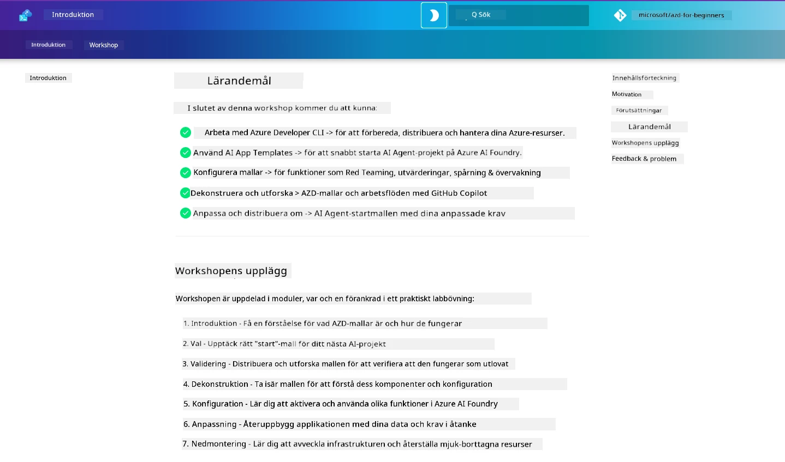

<div align="center">
  <div style="background: linear-gradient(135deg, #0078d4, #106ebe); border-radius: 10px; padding: 20px; margin: 20px 0; box-shadow: 0 4px 15px rgba(0, 120, 212, 0.3); border: 2px solid #005a9e;">
    <h2 style="color: white; margin: 0; font-size: 24px; text-shadow: 1px 1px 2px rgba(0,0,0,0.3);">
      🎯 AZD för AI-utvecklare Workshop
    </h2>
    <p style="color: white; margin: 10px 0 0 0; font-size: 16px; text-shadow: 1px 1px 2px rgba(0,0,0,0.3);">
      <strong>En praktisk workshop för att bygga AI-applikationer med Azure Developer CLI.</strong><br>
      Slutför 7 moduler för att bemästra AZD-mallar och AI-distributionsarbetsflöden.
    </p>
    <div style="margin-top: 15px;">
      <span style="background: rgba(255,255,255,0.2); padding: 5px 10px; border-radius: 15px; color: white; font-size: 14px;">
        📅 Källvägledning granskat: November 2026
      </span>
    </div>
  </div>
</div>

# AZD för AI-utvecklare Workshop

Välkommen till den praktiska workshopen för att lära dig Azure Developer CLI (AZD) med fokus på AI-applikationsdistribution. Den här workshopen hjälper dig att få en praktisk förståelse för AZD-mallar i 3 steg:

1. **Upptäck** - hitta mallen som passar dig.
1. **Distribuera** - distribuera och validera att det fungerar
1. **Anpassa** - modifiera och iterera för att göra det till ditt!

Under workshopen kommer du också att introduceras till kärnverktyg och arbetsflöden för utvecklare, för att hjälpa dig effektivisera din hela utvecklingsresa.

<br/>

## Webbläsarbaserad guide

Workshop-lektionerna är i Markdown. Du kan navigera dem direkt i GitHub - eller starta en webbläsarbaserad förhandsvisning som visas i skärmdumpen nedan.



För att använda detta alternativ - gör en fork av repositorn till din profil, och starta GitHub Codespaces. När VS Code-terminalen är aktiv, skriv detta kommando:

Denna webbläsarförhandsvisning fungerar i GitHub Codespaces, dev-containrar, eller en lokal klon med Python och MkDocs installerade.

```bash title="" linenums="0"
python -m pip install -r requirements-dev.txt
python -m mkdocs serve --config-file workshop/mkdocs.yml
```

Kör dessa kommandon från **kursens root-repository**, inte från det separat initierade AI-exemplet. Håll förhandsvisningen i förgrunden så att fel syns; stoppa den med Ctrl+C. För att kontrollera sidan utan att servera den, kör `python -m mkdocs build --strict --config-file workshop/mkdocs.yml`.

Om några sekunder kommer en popup-dialog att visas. Välj alternativet att `Open in browser`. Den webbaserade guiden öppnas nu i en ny webbläsarflik. Några fördelar med denna förhandsvisning:

1. **Inbyggd sökning** - hitta nyckelord eller lektioner snabbt.
1. **Kopiera-ikon** - hovra över kodblock för att se detta alternativ
1. **Temaväxling** - växla mellan mörkt och ljust tema
1. **Få hjälp** - klicka på Discord-ikonen i sidfoten för att gå med!

<br/>

## Workshop-översikt

**Tid:** 3-4 timmar  
**Nivå:** Nybörjare till Mellanliggande  
**Förkunskaper:** Kännedom om Azure, AI-koncept, VS Code & kommandoradsverktyg.

Detta är en praktisk workshop där du lär dig genom att göra. När du har slutfört övningarna rekommenderar vi att du går igenom AZD For Beginners-kursplanen för att fortsätta din läranderesa med säkerhet och produktivitetsbästa praxis.

| Tid| Modul  | Mål |
|:---|:---|:---|
| 15 min | [Introduktion](docs/instructions/0-Introduction.md) | Sätta scenen, förstå målen |
| 30 min | [Välj AI-mall](docs/instructions/1-Select-AI-Template.md) | Utforska alternativ och välj startmall |
| 30 min | [Validera AI-mall](docs/instructions/2-Validate-AI-Template.md) | Distribuera standardlösning till Azure |
| 30 min | [Dekonstruera AI-mall](docs/instructions/3-Deconstruct-AI-Template.md) | Utforska struktur och konfiguration |
| 30 min | [Konfigurera AI-mall](docs/instructions/4-Configure-AI-Template.md) | Aktivera och prova tillgängliga funktioner |
| 30 min | [Anpassa AI-mall](docs/instructions/5-Customize-AI-Template.md) | Anpassa mallen efter dina behov |
| 30 min | [Riva ner infrastruktur](docs/instructions/6-Teardown-Infrastructure.md) | Rensa upp och frigör resurser |
| 15 min | [Avslutning & Nästa steg](docs/instructions/7-Wrap-up.md) | Läranderesurser, Workshop-utmaning |

<br/>

## Vad du kommer lära dig

Tänk på AZD-mallen som en lärandesandbox för att utforska olika möjligheter och verktyg för end-to-end-utveckling på Microsoft Foundry. I slutet av denna workshop bör du ha en intuitiv känsla för olika verktyg och koncept i detta sammanhang.

| Koncept  | Mål |
|:---|:---|
| **Azure Developer CLI** | Förstå verktygets kommandon och arbetsflöden |
| **AZD-mallar** | Förstå projektstruktur och konfiguration |
| **Azure AI Agent** | Provisionera & distribuera Microsoft Foundry-projekt |
| **Azure AI Search** | Aktivera kontextteknik med agenter |
| **Observabilitet** | Utforska spårning, övervakning och utvärderingar |
| **Red Teaming** | Utforska motståndstestning och motåtgärder |

<br/>

## Workshop-struktur

Workshopen är strukturerad för att ta dig på en resa från mallupptäckt, till distribution, dekonstruering och anpassning - med den officiella [Kom igång med AI-agenter](https://github.com/Azure-Samples/get-started-with-ai-agents) startmallen som grund.

### [Modul 1: Välj AI-mall](docs/instructions/1-Select-AI-Template.md) (30 min)

- Vad är AI-mallar?
- Var kan jag hitta AI-mallar?
- Hur kan jag komma igång med att bygga AI-agenter?
- **Lab**: Snabbstart i Codespaces eller en dev-container

### [Modul 2: Validera AI-mall](docs/instructions/2-Validate-AI-Template.md) (30 min)

- Vad är AI-mallens arkitektur?
- Vad är AZD-utvecklingsarbetsflödet?
- Hur kan jag få hjälp med AZD-utveckling?
- **Lab**: Distribuera & validera AI-agentmall

### [Modul 3: Dekonstruera AI-mall](docs/instructions/3-Deconstruct-AI-Template.md) (30 min)

- Utforska din miljö i `.azure/` 
- Utforska din resursuppsättning i `infra/` 
- Utforska din AZD-konfiguration i `azure.yaml`s
- **Lab**: Modifiera miljövariabler & distribuera om

### [Modul 4: Konfigurera AI-mall](docs/instructions/4-Configure-AI-Template.md) (30 min)
- Utforska: Retrieval Augmented Generation
- Utforska: Agentutvärdering & Red Teaming
- Utforska: Spårning & övervakning
- **Lab**: Utforska AI-agent + Observabilitet

### [Modul 5: Anpassa AI-mall](docs/instructions/5-Customize-AI-Template.md) (30 min)
- Definiera: PRD med scenariokrav
- Konfigurera: Miljövariabler för AZD
- Implementera: Livscykelkrokar för tillagda uppgifter
- **Lab**: Anpassa mallen för mitt scenario

### [Modul 6: Riva ner infrastruktur](docs/instructions/6-Teardown-Infrastructure.md) (30 min)
- Sammanfatta: Vad är AZD-mallar?
- Sammanfatta: Varför använda Azure Developer CLI?
- Nästa steg: Prova en annan mall!
- **Lab**: Avprovisionera infrastruktur & städa upp

<br/>

## Workshop-utmaning

Vill du utmana dig själv att göra mer? Här är några projektförslag - eller dela dina idéer med oss!!

| Projekt | Beskrivning |
|:---|:---|
|1. **Dekonstruera en komplex AI-mall** | Använd arbetsflödet och verktygen vi beskrivit och se om du kan distribuera, validera och anpassa en annan AI-lösningsmall. _Vad lärde du dig?_|
|2. **Anpassa efter ditt scenario**  | Försök skriva ett PRD (Produktkravdokument) för ett annat scenario. Använd sedan GitHub Copilot i ditt mallrepo i Agent Model - och be det generera ett anpassningsarbetsflöde för dig. _Vad lärde du dig? Hur kunde du förbättra dessa förslag?_|
| | |

## Har du feedback?

1. Lägg upp ett ärende i detta repo - tagga det `Workshop` för enkelhetens skull.
1. Gå med i Microsoft Foundry Discord - koppla upp dig med dina kollegor!


| | | 
|:---|:---|
| **📚 Kursstart**| [AZD For Beginners](../README.md)|
| **📖 Dokumentation** | [Kom igång med AI-mallar](https://learn.microsoft.com/en-us/azure/ai-foundry/how-to/develop/ai-template-get-started)|
| **🛠️AI-mallar** | [Microsoft Foundry-mallar](https://ai.azure.com/templates) |
|**🚀 Nästa steg** | [Börja workshop](#workshop-overview) |
| | |

<br/>

---

**Navigering:** [Huvudkurs](../README.md) | [Introduktion](docs/instructions/0-Introduction.md) | [Modul 1: Välj mall](docs/instructions/1-Select-AI-Template.md)

**Redo att börja bygga AI-applikationer med AZD?**

[Börja workshop: Introduktion →](docs/instructions/0-Introduction.md)

---

<!-- CO-OP TRANSLATOR DISCLAIMER START -->
**Ansvarsfriskrivning**:
Detta dokument har översatts med hjälp av AI-översättningstjänsten [Co-op Translator](https://github.com/Azure/co-op-translator). Även om vi strävar efter noggrannhet, var vänlig notera att automatiska översättningar kan innehålla fel eller brister. Det ursprungliga dokumentet på dess modersmål bör betraktas som den auktoritativa källan. För kritisk information rekommenderas professionell mänsklig översättning. Vi ansvarar inte för några missförstånd eller feltolkningar som uppstår till följd av användningen av denna översättning.
<!-- CO-OP TRANSLATOR DISCLAIMER END -->