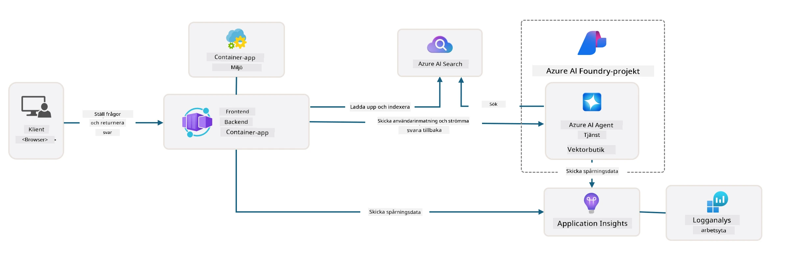

# 3. Dekonstruera en mall

!!! tip "NÄR DU ÄR KLAR MED DETTA MODUL SKA DU KUNNA"

    - [ ] Use GitHub Copilot and optional MCP tools for Azure documentation and read-only exploration
    - [ ] Identify the template's application, infrastructure, configuration, and test entry points
    - [ ] Verify generated explanations against actual repository files
    - [ ] **Lab 3:** Trace one request and one configuration input through the project

---

## 1. Aktivera GitHub Copilot

Öppna det initierade AI-exemplet i VS Code och aktivera [GitHub Copilot](https://code.visualstudio.com/docs/copilot/chat/chat-agent-mode). Logga in med ett konto som har en giltig plan; användningsgränser varierar. Be Copilot förklara källkoden innan du godkänner ändringar.

### Valfria MCP-servrar

Dessa tjänster kan erbjuda ytterligare verktyg:

- [Azure MCP Server](https://learn.microsoft.com/azure/developer/azure-mcp-server/overview)
- [Microsoft Learn MCP Server](https://learn.microsoft.com/training/support/mcp)

I VS Code, granska [MCP-konfigurationsguiden](https://code.visualstudio.com/docs/copilot/chat/mcp-servers) och skapa `.vscode/mcp.json` om det behövs:

```json
{
  "servers": {
    "Azure MCP Server": {
      "type": "stdio",
      "command": "npx",
      "args": ["-y", "@azure/mcp@latest", "server", "start"]
    },
    "microsoft.docs.mcp": {
      "type": "http",
      "url": "https://learn.microsoft.com/api/mcp"
    }
  }
}
```

Kommandot `npx` kräver en stödd installation av Node.js/npm och laddar ner körbar kod. Granska paketet och fastställ en godkänd version för en reproducerbar teamkonfiguration. Starta servrarna med VS Codes MCP-kontroller och inspektera deras tillgängliga verktyg; namn kan ändras mellan versioner.

**Autentisering är separat.** Använd `azd auth login` för AZD. Följ Azure MCP:s dokumenterade autentiseringsflöde för dess verktyg; endast AZD-inloggning etablerar inte en MCP-session. Använd `az login` separat när en övning eller hook anropar Azure CLI.

Prova läsbarhets-promptar:

1. ”Använd Microsoft Learn MCP för att hitta dokumentationen för Azure Developer CLI-konfiguration.”
2. ”Förklara detta repositories `azure.yaml`; ange de filer som implementerar varje hook.”
3. ”Använd de tillgängliga Azure MCP-verktygen och lista mina distribuerade resurser utan att ändra något.”

Kontrollera vald tenant/prenumeration och varje föreslaget verktygsanrop. Godkänn inte resursers skapande, borttagning eller ändringar av åtkomst endast för att utforska arkitekturen.

## 2. Förstå arkitekturen

Exemplet är värd för en Python FastAPI-backend och ett React/TypeScript-frontend i Azure Container Apps. Backend kommunicerar med en agent i ett Microsoft Foundry-projekt. Hämtning och observabilitet beror på aktiverade mallfunktioner och lyckad installation; de är inte garanterade enbart för att applikationen distribuerades.



Jämför detta diagram med [aktuella upstream-distributionsguiden](https://github.com/Azure-Samples/get-started-with-ai-agents/blob/main/docs/deployment.md) och dina faktiska resurser. Kontrollera konfigurerad modelldistribution, agentverktyg, hanterad identitet, rolltilldelningar och valfria AI Search/Application Insights-resurser.

**Övning:** Be Copilot spåra en chattförfrågan från frontend genom API:et till Foundry, med fil- och funktionsreferenser. Öppna dessa referenser och verifiera förklaringen. Dra inte slutsatser om implementerad autentisering, routing eller auktorisering enbart från ett diagram.

## 3. Repositoriets struktur

Följande valda sökvägar kontrollerades mot exemplet den 4 november 2026. Din initierade revision är fortfarande sanningskällan:

```text
get-started-with-ai-agents/
  azure.yaml
  docker-compose.yaml
  requirements-dev.txt
  .devcontainer/
  infra/
    main.bicep
    main.parameters.json
    api.bicep
    core/
  src/
    Dockerfile
    pyproject.toml
    requirements.txt
    api/
      main.py
      routes.py
      search_index_manager.py
    frontend/
      package.json
      src/
    files/
  scripts/
    validate_env_vars.sh
    validate_env_vars.ps1
    postdeploy.sh
    postdeploy.ps1
  tests/
    test_evaluation.py
    test_red_teaming.py
  docs/
    deployment.md
    deploy_customization.md
    ai_search.md
    observability.md
    local_development.md
    troubleshooting.md
```

### Infrastruktur och konfiguration

`infra/main.bicep` orkestrerar resurser; `main.parameters.json` kopplar mallens indata till AZD:s miljövärden. `azure.yaml` väljer applikationstjänst och livscykelkrokar. Följ ett indata som `USE_AZURE_AI_SEARCH_SERVICE` genom dessa filer för att hitta vad som faktiskt ändras.

### Applikation och identitet

Läs `src/api/` och `src/frontend/` tillsammans. Identifiera var agenten skapas eller hämtas, var instruktioner/verktyg konfigureras och vilken identitet varje Azure-anrop använder. Exempelfiler under `src/files/` är demonstrationsdata, inte en produktionskatalog eller auktoriseringsmodell.

### Tester och observabilitet

Nuvarande utvärderings- och red teamings ingångspunkter finns under `tests/`; äldre `evals/` och `airedteaming/` katalogreferenser är föråldrade för detta exempel. Läs `docs/observability.md` för förutsättningar och kostnader innan du kör molntester. Dessa Python-tester är separata från den valfria `azure.ai.evaluations` AZD-tillägget.

## 4. Verifiera dina fynd

- Identifiera API-rutten, agentinteraktionen och hämtning av kod för en exempel-Fråga.
- Förklara vilken identitet som kommer åt Foundry och vilken konfiguration som väljer dess slutpunkt.
- Hitta de faktiska pre-up och post-deploy-skripten och deras felhantering.
- Lista eventuella beroenden eller valfria funktioner som saknas i din distribution.

Fortsätt till [Konfigurera en mall](4-Configure-AI-Template.md).

---

<!-- CO-OP TRANSLATOR DISCLAIMER START -->
**Ansvarsfriskrivning**:
Detta dokument har översatts med hjälp av AI-översättningstjänsten [Co-op Translator](https://github.com/Azure/co-op-translator). Även om vi strävar efter noggrannhet, var vänlig notera att automatiska översättningar kan innehålla fel eller brister. Det ursprungliga dokumentet på dess modersmål bör betraktas som den auktoritativa källan. För kritisk information rekommenderas professionell mänsklig översättning. Vi ansvarar inte för några missförstånd eller feltolkningar som uppstår till följd av användningen av denna översättning.
<!-- CO-OP TRANSLATOR DISCLAIMER END -->