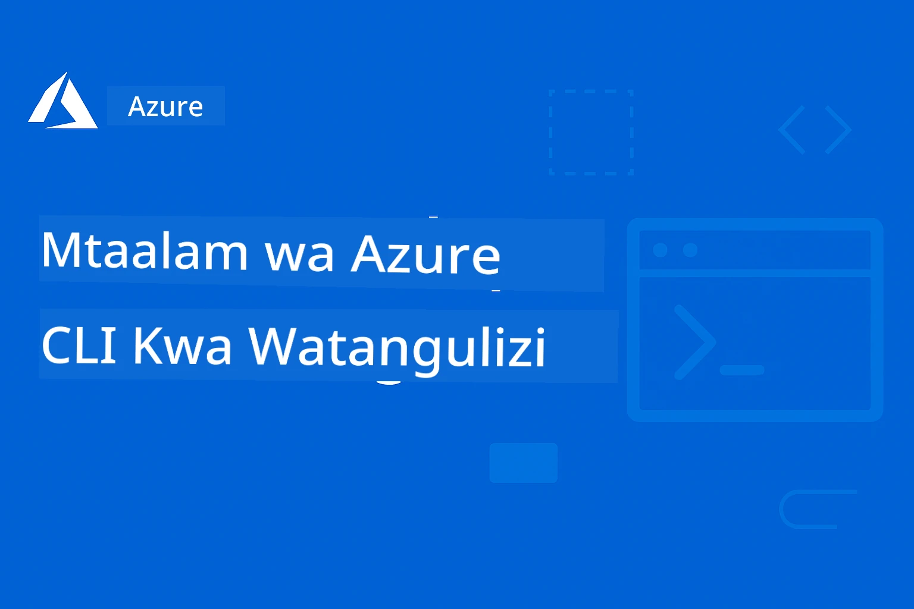

# AZD Kwa Waanzilishi: Safari ya Kujifunza Iliyo Pangiliwa

 

[](https://github.com/microsoft/AZD-for-beginners)
[](https://GitHub.com/microsoft/azd-for-beginners/network/)
[](https://github.com/microsoft/AZD-for-beginners)

[](https://discord.com/invite/nkVh3dp)
[](https://discord.gg/nTYy5BXMWG)

---

### Tafsiri ZilizojitOKEZA (Zilizosasishwa Daima)

<!-- CO-OP TRANSLATOR LANGUAGES TABLE START -->
[Arabic](../ar/README.md) | [Bengali](../bn/README.md) | [Bulgarian](../bg/README.md) | [Burmese (Myanmar)](../my/README.md) | [Chinese (Simplified)](../zh-CN/README.md) | [Chinese (Traditional, Hong Kong)](../zh-HK/README.md) | [Chinese (Traditional, Macau)](../zh-MO/README.md) | [Chinese (Traditional, Taiwan)](../zh-TW/README.md) | [Croatian](../hr/README.md) | [Czech](../cs/README.md) | [Danish](../da/README.md) | [Dutch](../nl/README.md) | [Estonian](../et/README.md) | [Finnish](../fi/README.md) | [French](../fr/README.md) | [German](../de/README.md) | [Greek](../el/README.md) | [Hebrew](../he/README.md) | [Hindi](../hi/README.md) | [Hungarian](../hu/README.md) | [Indonesian](../id/README.md) | [Italian](../it/README.md) | [Japanese](../ja/README.md) | [Kannada](../kn/README.md) | [Khmer](../km/README.md) | [Korean](../ko/README.md) | [Lithuanian](../lt/README.md) | [Malay](../ms/README.md) | [Malayalam](../ml/README.md) | [Marathi](../mr/README.md) | [Nepali](../ne/README.md) | [Nigerian Pidgin](../pcm/README.md) | [Norwegian](../no/README.md) | [Persian (Farsi)](../fa/README.md) | [Polish](../pl/README.md) | [Portuguese (Brazil)](../pt-BR/README.md) | [Portuguese (Portugal)](../pt-PT/README.md) | [Punjabi (Gurmukhi)](../pa/README.md) | [Romanian](../ro/README.md) | [Russian](../ru/README.md) | [Serbian (Cyrillic)](../sr/README.md) | [Slovak](../sk/README.md) | [Slovenian](../sl/README.md) | [Spanish](../es/README.md) | [Swahili](./README.md) | [Swedish](../sv/README.md) | [Tagalog (Filipino)](../tl/README.md) | [Tamil](../ta/README.md) | [Telugu](../te/README.md) | [Thai](../th/README.md) | [Turkish](../tr/README.md) | [Ukrainian](../uk/README.md) | [Urdu](../ur/README.md) | [Vietnamese](../vi/README.md)

> **Unapendelea Kuiga Mitaa?**
>
> Hifadhidata hii ina tafsiri za lugha zaidi ya 50 ambazo huongeza kwa kiasi kikubwa ukubwa wa kupakua. Ili kuiga bila tafsiri, tumia sparse checkout:
>
> **Bash / macOS / Linux:**
> ```bash
> git clone --filter=blob:none --sparse https://github.com/microsoft/AZD-for-beginners.git
> cd AZD-for-beginners
> git sparse-checkout set --no-cone '/*' '!translations' '!translated_images'
> ```
>
> **CMD (Windows):**
> ```cmd
> git clone --filter=blob:none --sparse https://github.com/microsoft/AZD-for-beginners.git
> cd AZD-for-beginners
> git sparse-checkout set --no-cone "/*" "!translations" "!translated_images"
> ```
>
> Hii inakupa yote unayohitaji kukamilisha kozi kwa upakuaji wa haraka zaidi.
<!-- CO-OP TRANSLATOR LANGUAGES TABLE END -->

## 🆕 Nini Kipya Katika azd Leo

> 📌 **Sasisho la Foundry GA (2026-11-09):** Kifurushi cha **`microsoft.foundry` 1.0 kinapatikana kwa ujumla**, kilitangazwa tarehe [5 Novemba, 2026](https://devblogs.microsoft.com/azure-sdk/microsoft-foundry-azure-developer-cli-ga/). Tumia **`azd >= 1.37.0`** na usanidie kwa `azd ext install microsoft.foundry`. Fuata [mwongozo wa mwenyeji aliyehifadhiwa](docs/chapter-02-ai-development/microsoft-foundry-integration.md#hosted-agent-walkthrough-ga) kwa usanidi, upimaji wa eneo na uenezaji. Sasisho hili linatokana na muongozo uliochapishwa, si uenezaji wa moja kwa moja wa Azure; kifurushi cha GA hakiufanyi kipengele chochote cha hiari, nyongeza, au SDK kupatikana kwa ujumla.

Azure Developer CLI inaunga mkono aina nyingi za programu, ikiwa ni pamoja na programu za wavuti, API, na maajenti wa AI, kupitia wenyeji wanaoungwa mkono, templeti, na nyongeza.

Hapa ni kile inamaanisha kwako:

- **Kifurushi cha GA kwa maendeleo ya Foundry.** `microsoft.foundry` inasakinisha nyongeza saba kuu, ikiwa ni pamoja na maajenti, miradi, na Mchunguzi wa Maajenti. Msimbo wa maajenti na mipangilio ya uenezaji hubaki pamoja ndani ya `azure.yaml`.
- **Jaribu kwenye eneo lako, kisha eneza msimbo wako.** Tumia `azd ai agent init --deploy-mode code`, `azd provision`, na `azd ai agent run` kuchunguza maombi na majibu ya eneo. Kisha tumia `azd deploy` kwa ujenzi wa mbali katika Foundry, bila ujenzi wa kontena wa eneo.
- **Pima ubora kwa njia tofauti.** Sakinisha **`azure.ai.evaluations`** kwa ajili ya `azd ai eval generate`, `init`, na `run start`; haijajumuishwa katika kifurushi. Fuatilia seti za data zilizopitiwa na vigezo pamoja na msimbo wako. Miradi ya zamani inapaswa kufuata [mwongozo wa uhamishaji wa tathmini na ubora](docs/chapter-08-production/production-ai-practices.md#evaluation-migration-and-quality-checks).
- **Tumia tena usanidi katika CI/CD.** Baada ya mafanikio ya `azd up`, sanidi bomba la kazi kwa `azd pipeline config`. Sakinisha kifurushi kwenye mtendaji na hifadhi mipangilio ya uthibitishaji na mazingira yaliyozalishwa.
- **Msingi wa kila siku umeleta urahisi.** Toleo la hivi karibuni limefanya `azd init` kuwa idempotent (salama kurudi tena), limetumia `azd auth login` kuondoa tokeni zilizochakaa moja kwa moja, na kuongezwa kidokezo cha marafiki cha kuanzisha kwa mara ya kwanza kwa `azd tool`.
- **Mtiririko mkuu haujakabadilika.** Iwe unatangaza programu ya todo, huduma ndogo, au suluhisho la AI la maajenti wengi, amri ni zile zile.

> **Kumbuka kwa watumiaji wa Aspire:** Microsoft sasa inarejelea bidhaa hiyo kama **Aspire tu** (zamani ".NET Aspire"). Usaidizi wa azd kwa Aspire haujabadilika—jina pekee ndilo lililobadilishwa.

Ikiwa umewahi kutumia azd kabla, msaada wa AI ni nyongeza ya asili—si zana tofauti au njia ya juu zaidi. Ikiwa unaanza sasa, utajifunza mtiririko mmoja unaofaa kila kitu.

---

## 🚀 Azure Developer CLI (azd) ni Nini?

**Azure Developer CLI (azd)** ni chombo cha amri rahisi kwa watengenezaji kinachorahisisha uenezaji wa programu kwenye Azure. Badala ya kuunda na kuunganisha rasilimali nyingi za Azure kwa mikono, unaweza kueneza programu nzima kwa amri moja.

### Uchawi wa `azd up`

```bash
# This single command does everything:
# ✅ Creates all Azure resources  
# ✅ Configures networking and security
# ✅ Builds your application code
# ✅ Deploys to Azure
# ✅ Gives you a working URL
azd up
```

Templeti inatoa usanidi wa programu na miundombinu. Uenezaji unaofanikiwa bado unahitaji huduma/mifano inayoungwa mkono, kwepesi ya kutosha na ruhusa, ingizo sahihi, na uhakiki wa programu iliyosemwa. `azd up` haiifanyi templeti kuwa salama, inayokubalika, au tayari kwa uzalishaji moja kwa moja.

---

## ❓ Azure Developer CLI vs Azure CLI: Tofauti ni Nini?

Hii ndiyo swali la kawaida zaidi kwa wanaoanza. Hapa ni jibu rahisi:

| Kipengele | **Azure CLI (`az`)** | **Azure Developer CLI (`azd`)** |
|---------|---------------------|--------------------------------|
| **Madhumuni** | Kusimamia rasilimali za Azure binafsi | Kuzaa programu kamili |
| **Mtazamo** | Kuelekea miundombinu | Kuelekea programu |
| **Mfano** | `az webapp create --name myapp...` | `azd up` |
| **Lugha ya Kujifunza** | Lazima ujue huduma za Azure | Jua tu programu yako |
| **Bora Kwa** | DevOps, Miundombinu | Watengenezaji, Uumbaji wa mfano |

### Mfano Rahisi

- **Azure CLI** ni kama kuwa na zana zote za kujenga nyumba - nyundo, ukataji, nati. Unaweza kujenga kitu chochote, lakini unahitaji kujua ujenzi.
- **Azure Developer CLI** ni kama kuajiri mkandarasi - unaelezea unachotaka, wao wanaanzisha ujenzi.

### Wakati wa Kutumia Kila Moja

| Hali | Tumia Hii |
|----------|----------|
| "Nataka kueneza programu yangu ya wavuti kwa haraka" | `azd up` |
| "Nahitaji kuunda akaunti ya uhifadhi tu" | `az storage account create` |
| "Ninaunda programu kamili ya AI" | `azd init --template azure-search-openai-demo` |
| "Nahitaji kutatua shida ya rasilimali ya Azure maalum" | `az resource show` |
| "Nataka kueneza kwenye mazingira yangu ya uzalishaji yaliyosanidiwa" | Pitia usanidi, upatikanaji, gharama, na milango ya uendeshaji kabla ya `azd up --environment production` |

### Hufanya Kazi Pamoja!

AZD na Azure CLI zina uthibitisho na usanidi tofauti. Tumia `azd auth login` kwa AZD, na `az login` wakati mshipi au amri ya uchunguzi inahitaji Azure CLI kwa wazi. Unaweza kutumia zote mbili:
```bash
# Deploy your app with AZD
azd up

# Then fine-tune specific resources with Azure CLI
az webapp config set --name myapp --always-on true
```

---

## 🌟 Pata Templeti katika Awesome AZD

Usianze kutafuta upya! **Awesome AZD** ni mkusanyiko wa jamii wa templeti zinazotolewa kuenea:

| Rasilimali | Maelezo |
|----------|-------------|
| 🔗 [**Maktaba ya Awesome AZD**](https://azure.github.io/awesome-azd/) | Vinjari templeti 200+ kwa uenezaji kwa bonyeza moja |
| 🔗 [**Tuma Templeti**](https://github.com/Azure/awesome-azd/issues) | Changia templeti zako mwenyewe kwa jamii |
| 🔗 [**Hifadhi ya GitHub**](https://github.com/Azure/awesome-azd) | Pevu na chunguza chanzo |

### Templeti maarufu za AI kutoka Awesome AZD

Chagua templeti moja katika saraka yake tupu; amri zilizo chini ni mbadala. `.` ya mwisho inanzisha saraka hiyo.

```bash
# RAG Chat with Microsoft Foundry Models + AI Search
azd init --template azure-search-openai-demo .

# Quick AI Chat Application
azd init --template openai-chat-app-quickstart .

# AI Agents with Foundry Agents
azd init --template get-started-with-ai-agents .
```

---

## 🎯 Kuanza kwa Hatua 3

Kabla ya kuanza, hakikisha mashine yako iko tayari kwa templeti unayotaka kueneza:

**Windows:**
```powershell
.\validate-setup.ps1
```

**macOS / Linux:**
```bash
bash ./validate-setup.sh
```

Ikiwa ukaguzi wowote unashindwa, rekebisha kwanza kisha endelea na kuanza kwa haraka.

### Hatua 1: Sakinisha AZD (Dakika 2)

**Windows:**
```powershell
winget install microsoft.azd
```

**macOS:**
```bash
brew tap azure/azd && brew install azd
```

**Linux:**
```bash
curl -fsSL https://aka.ms/install-azd.sh | bash
```

### Hatua 2: Thibitisha Uthibitisho kwa AZD

```bash
# Optional if you plan to use Azure CLI commands directly in this course
az login

# Required for AZD workflows
azd auth login
```

Ikiwa huna uhakika unahitaji ipi, fuata mchakato kamili wa usanidi katika [Usanidi & Utekelezaji](docs/chapter-01-foundation/installation.md#authentication-setup).

### Hatua 3: Eneza Programu Yako ya Kwanza

```bash
# Initialize from a template
azd init --template todo-nodejs-mongo .

# Deploy to Azure (creates everything!)
azd up
```

**🎉 Hiyo ndio!** Programu yako sasa iko hai kwenye Azure.

### Safisha Baadaye (Usisahau!)

```bash
# Remove all resources when done experimenting
azd down --force --purge
```

---

## 📚 Jinsi ya Kutumia Kozi Hii

Kozi hii imeundwa kwa **kujifunza hatua kwa hatua** - anza mahali unapojisikia vizuri na endelea:

| Uzoefu Wako | Anza Hapa |
|-----------------|------------|
| **Mpya kwa Azure** | [Sura ya 1: Msingi](#-chapter-1-foundation--quick-start) |
| **Unajua Azure, mpya kwa AZD** | [Sura ya 1: Msingi](#-chapter-1-foundation--quick-start) |
| **Unataka kueneza programu za AI** | [Sura ya 2: Maendeleo ya AI-Kwanza](#-chapter-2-ai-first-development-recommended-for-ai-developers) |
| **Unataka mazoezi ya vitendo** | [🎓 Warsha ya Interaktif](workshop/README.md) - maabara ya mwelekeo wa masaa 3-4 |
| **Unahitaji mifumo ya uzalishaji** | [Sura ya 8: Uzalishaji & Biashara](#-chapter-8-production--enterprise-patterns) |

### Usanidi wa Haraka

1. **Tengeneza Nakala ya Hifadhi Hii**: [](https://GitHub.com/microsoft/azd-for-beginners/fork)
2. **Nakili Nakala**: `git clone https://github.com/YOUR-USERNAME/azd-for-beginners.git`
3. **Pata Msaada**: [Jumuiya ya Discord ya Azure](https://discord.com/invite/ByRwuEEgH4)

> **Unapendelea kunakili eneo lako?**

> Hifadhidata hii inajumuisha tafsiri zaidi ya 50 za lugha ambazo huongeza kwa kiasi kikubwa ukubwa wa kupakua. Ili kufanikisha bila tafsiri, tumia sparse checkout:
> ```bash
> git clone --filter=blob:none --sparse https://github.com/microsoft/AZD-for-beginners.git
> cd AZD-for-beginners
> git sparse-checkout set --no-cone '/*' '!translations' '!translated_images'
> ```
> Hii inakupa kila kitu unachohitaji kukamilisha kozi kwa upakuaji wa haraka zaidi.


## Muhtasari wa Kozi

Jifunze Azure Developer CLI (azd) kupitia sura zilizopangwa kwa ajili ya kujifunza hatua kwa hatua. **Mkazo maalum juu ya uenezaji wa programu za AI kwa ushirikiano na Microsoft Foundry.**

### Kwa Nini Kozi Hii Ni Muhimu kwa Waendelezaji Wa Kisasa

Waendelezaji wanaoeneza mzigo wa AI mara nyingi wanahitaji mwongozo juu ya:
- Miundo tata ya huduma nyingi za AI
- Mazoezi bora ya uenezaji wa AI kwa matumizi ya uzalishaji  
- Ushirikiano na usanidi wa huduma za Azure AI
- Ufanisi wa gharama kwa mzigo wa AI
- Utatuzi wa matatizo maalum ya uenezaji wa AI

### Malengo ya Kujifunza

Kwa kukamilisha kozi hii iliyopangwa, utakuwa na uwezo wa:
- **Kumiliki Misingi ya AZD**: Dhana kuu, usakinishaji, na usanidi
- **Kuwa na Uwezo wa Kuwasilisha Programu za AI**: Tumia AZD na huduma za Microsoft Foundry
- **Kutumia Miundombinu kama Msimbo**: Simamia rasilimali za Azure kwa kutumia templates za Bicep
- **Kutatua Matatizo ya Uenezaji**: Suluhisha matatizo ya kawaida na tatua makosa
- **Kuboresha kwa Matumizi ya Uzalishaji**: Usalama, upanuzi, ufuatiliaji, na usimamizi wa gharama
- **Kujenga Suluhisho za Wakamishna Wengi**: Shughulikia miundo tata ya AI

## Kabla ya Kuanzia: Akaunti, Ufikiaji, na Mawazo

Kabla ya kuanza Sura ya 1, hakikisha una mambo yafuatayo. Hatua za usakinishaji zilizo hapo baadaye kwenye mwongozo huu zinadhani mambo haya yanashughulikiwa tayari.

- **Usajili wa Azure**: Unaweza kutumia usajili uliopo kutoka kazini au akaunti yako mwenyewe, au kuunda [jaribio la bure](https://aka.ms/azurefreetrial) kuanza.
- **Idhini ya kuunda rasilimali za Azure**: Kwa mazoezi mengi, unapaswa kuwa na angalau ufikiaji wa **Contributor** kwenye usajili au kikundi cha rasilimali kinacholengwa. Baadhi ya sura pia zinaweza kudhani kwamba unaweza kuunda vikundi vya rasilimali, utambulisho wa usimamizi, na uteuzi za RBAC.
- [**Akaunti ya GitHub**](https://github.com): Hii ni muhimu kwa kugawanya hifadhidata, kufuatilia mabadiliko yako mwenyewe, na kutumia GitHub Codespaces kwa warsha.
- **Masharti ya wakati wa kuendesha templates**: Baadhi ya templates zinahitaji zana za eneo kama Node.js, Python, Java, au Docker. Run validate ya usanidi kabla ya kuanza ili kuona zana zilizokosekana mapema.
- **Ujuzi wa kawaida wa terminal**: Huhitaji kuwa mtaalamu, lakini unapaswa kuwa na urahisi wa kuendesha amri kama `git clone`, `azd auth login`, na `azd up`.

> **Unafanya kazi kwenye usajili wa shirika?**
> Ikiwa mazingira yako ya Azure yanadhibitiwa na msimamizi, thibitisha mapema kuwa unaweza kueneza rasilimali kwenye usajili au kikundi cha rasilimali unachopanga kutumia. Ikiwa sivyo, omba usajili wa sandbox au ufikiaji wa Contributor kabla ya kuanza.

> **Umeanza kwa Azure?**
> Anza na jaribio lako la Azure au usajili wa pay-as-you-go huko https://aka.ms/azurefreetrial ili uweze kukamilisha mazoezi kutoka mwanzo hadi mwisho bila kusubiri idhini za kiwango cha tenant.

## 🗺️ Ramani ya Kozi: Urambazaji wa Haraka kwa Sura

Kila sura ina README maalum yenye malengo ya kujifunza, mwanzoni haraka, na mazoezi:

| Sura | Mada | Masomo | Muda | Ugumu |
|---------|-------|---------|----------|------------|
| **[Sura 1: Msingi](docs/chapter-01-foundation/README.md)** | Kuanzisha | [Misingi ya AZD](docs/chapter-01-foundation/azd-basics.md) &#124; [Usakinishaji](docs/chapter-01-foundation/installation.md) &#124; [Mradi wa Kwanza](docs/chapter-01-foundation/first-project.md) | Dakika 30-45 | ⭐ |
| **[Sura 2: Maendeleo ya AI](docs/chapter-02-ai-development/README.md)** | Programu za AI-Kwanza | [Ushirikiano na Foundry](docs/chapter-02-ai-development/microsoft-foundry-integration.md) &#124; [Wakamishna wa AI](docs/chapter-02-ai-development/agents.md) &#124; [Uenezaji wa Mfano](docs/chapter-02-ai-development/ai-model-deployment.md) &#124; [Warsha](docs/chapter-02-ai-development/ai-workshop-lab.md) | Saa 1-2 | ⭐⭐ |
| **[Sura 3: Usanidi](docs/chapter-03-configuration/README.md)** | Usalama & Usanidi | [Usanidi](docs/chapter-03-configuration/configuration.md) &#124; [Usalama na Uthibitishaji](docs/chapter-03-configuration/authsecurity.md) | Dakika 45-60 | ⭐⭐ |
| **[Sura 4: Miundombinu](docs/chapter-04-infrastructure/README.md)** | IaC & Uenezaji | [Mwongozo wa Uenezaji](docs/chapter-04-infrastructure/deployment-guide.md) &#124; [Utayarishaji](docs/chapter-04-infrastructure/provisioning.md) | Saa 1-1.5 | ⭐⭐⭐ |
| **[Sura 5: Wakamishna Wengi](docs/chapter-05-multi-agent/README.md)** | Suluhisho za AI | [Mfano wa Reja-Reja](examples/retail-scenario.md) &#124; [Mifumo ya Kuratibu](docs/chapter-06-pre-deployment/coordination-patterns.md) | Saa 2-3 | ⭐⭐⭐⭐ |
| **[Sura 6: Kabla ya Uenezaji](docs/chapter-06-pre-deployment/README.md)** | Mipango & Uhakikisho | [Ukaguzi wa Awali](docs/chapter-06-pre-deployment/preflight-checks.md) &#124; [Upangaji wa Uwezo](docs/chapter-06-pre-deployment/capacity-planning.md) &#124; [Uchaguzi wa SKU](docs/chapter-06-pre-deployment/sku-selection.md) &#124; [Uchunguzi wa Programu](docs/chapter-06-pre-deployment/application-insights.md) | Saa 1 | ⭐⭐ |
| **[Sura 7: Utatuzi wa Matatizo](docs/chapter-07-troubleshooting/README.md)** | Tatua & Rekebisha | [Matatizo ya Kawaida](docs/chapter-07-troubleshooting/common-issues.md) &#124; [Utambuzi wa Makosa](docs/chapter-07-troubleshooting/debugging.md) &#124; [Matatizo ya AI](docs/chapter-07-troubleshooting/ai-troubleshooting.md) | Saa 1-1.5 | ⭐⭐ |
| **[Sura 8: Uzalishaji](docs/chapter-08-production/README.md)** | Mifumo ya Shirika | [Mazoezi ya Uzalishaji](docs/chapter-08-production/production-ai-practices.md) | Saa 2-3 | ⭐⭐⭐⭐ |
| **[🎓 Warsha](workshop/README.md)** | Maabara ya Vitendo | [Utangulizi](workshop/docs/instructions/0-Introduction.md) &#124; [Uchaguzi](workshop/docs/instructions/1-Select-AI-Template.md) &#124; [Uhakikisho](workshop/docs/instructions/2-Validate-AI-Template.md) &#124; [Uivunjaji](workshop/docs/instructions/3-Deconstruct-AI-Template.md) &#124; [Usanidi](workshop/docs/instructions/4-Configure-AI-Template.md) &#124; [Ubadilishaji](workshop/docs/instructions/5-Customize-AI-Template.md) &#124; [Uondoaji](workshop/docs/instructions/6-Teardown-Infrastructure.md) &#124; [Hitimisho](workshop/docs/instructions/7-Wrap-up.md) | Saa 3-4 | ⭐⭐ |

**Muda wa Jumla wa Kozi:** ~Saa 10-14 | **Maendeleo ya Ujuzi:** Mwanafunzi → Tayari kwa Uzalishaji

---

## 📚 Sura za Kujifunza

*Chagua njia yako ya kujifunza kulingana na kiwango cha uzoefu na malengo*

### 🚀 Sura ya 1: Msingi & Anza Haraka
**Mawazo ya awali**: Usajili wa Azure, ujuzi wa amri za msingi  
**Muda**: Dakika 30-45  
**Ugumu**: ⭐

#### Utajifunza Nini
- Kuelewa misingi ya Azure Developer CLI
- Kusakinisha AZD kwenye jukwaa lako
- Uenezaji wako wa kwanza uliofanikiwa

#### Vyanzo vya Kujifunza
- **🎯 Anza Hapa**: [Azure Developer CLI ni Nini?](#-what-is-azure-developer-cli-azd)
- **📖 Nadharia**: [Misingi ya AZD](docs/chapter-01-foundation/azd-basics.md) - Dhana kuu na istilahi
- **⚙️ Usanidi**: [Usakinishaji & Usanidi](docs/chapter-01-foundation/installation.md) - Mwongozo maalum wa jukwaa
- **🛠️ Vitendo**: [Mradi Wako wa Kwanza](docs/chapter-01-foundation/first-project.md) - Mafunzo hatua kwa hatua
- **📋 Marejeo ya Haraka**: [Karatasi ya Amri](resources/cheat-sheet.md)

#### Mazoezi ya Vitendo
```bash
# Quick installation check
azd version

# Deploy your first application
azd init --template todo-nodejs-mongo .
azd up
```

**💡 Matokeo ya Sura**: Fanikisha uenezaji wa programu ya wavuti rahisi kwenye Azure kwa kutumia AZD

**✅ Uhakikisho wa Mafanikio:**
```bash
# After completing Chapter 1, you should be able to:
azd version              # Shows installed version
azd init --template todo-nodejs-mongo  # Initializes project
azd up                  # Deploys to Azure
azd show                # Displays running app URL
# Application opens in browser and works
azd down --force --purge  # Cleans up resources
```

**📊 Uwekaji wa Muda:** Dakika 30-45  
**📈 Kiwango cha Ujuzi Baada:** Inaweza kueneza programu za msingi kwa kujitegemea

---

### 🤖 Sura ya 2: Maendeleo ya AI-Kwanza (Inapendekezwa kwa Waendelezaji wa AI)
**Mawazo ya awali**: Sura ya 1 imekamilika  
**Muda**: Saa 1-2  
**Ugumu**: ⭐⭐

#### Utajifunza Nini
- Ushirikiano wa Microsoft Foundry na AZD
- Kueneza programu zilizotumia nguvu ya AI
- Kuelewa usanidi wa huduma za AI

#### Vyanzo vya Kujifunza
- **🎯 Anza Hapa**: [Ushirikiano wa Microsoft Foundry](docs/chapter-02-ai-development/microsoft-foundry-integration.md)
- **🤖 Wakamishna wa AI**: [Mwongozo wa Wakamishna wa AI](docs/chapter-02-ai-development/agents.md) - Kueneza wawakilishi wenye akili kwa kutumia AZD
- **📖 Mifumo**: [Uenezaji wa Mfano wa AI](docs/chapter-02-ai-development/ai-model-deployment.md) - Kueneza na kusimamia mifano ya AI
- **🛠️ Warsha**: [Maabara ya Warsha ya AI](docs/chapter-02-ai-development/ai-workshop-lab.md) - Fanya suluhisho zako za AI ziwe tayari kwa AZD
- **🎥 Mwongozo wa Kiingilio**: [Vifaa vya Warsha](workshop/README.md) - Kujifunza kupitia kivinjari na MkDocs * Mazingira ya DevContainer
- **📋 Templates**: [Templates za Microsoft Foundry](#featured-microsoft-foundry-templates)
- **📝 Mifano**: [Mifano ya Uenezaji wa AZD](examples/README.md)

#### Mazoezi ya Vitendo
```bash
# Deploy your first AI application
azd init --template azure-search-openai-demo .
azd up

# Try additional AI templates
azd init --template openai-chat-app-quickstart .
azd init --template agent-openai-python-prompty .
```

**💡 Matokeo ya Sura**: Enezaji na usanidi wa programu ya mazungumzo yenye nguvu ya AI na uwezo wa RAG

**✅ Uhakikisho wa Mafanikio:**
```bash
# After Chapter 2, you should be able to:
azd init --template azure-search-openai-demo .
azd up
# Test the AI chat interface
# Ask questions and get AI-powered responses with sources
# Verify search integration works
azd monitor  # Check Application Insights shows telemetry
azd down --force --purge
```

**📊 Uwekaji wa Muda:** Saa 1-2  
**📈 Kiwango cha Ujuzi Baada:** Inaweza kueneza programu za kujifunza AI na kubaini mahitaji zaidi ya kuwa tayari kwa uzalishaji
**💰 Uelewa wa Gharama:** Elewa gharama za maendeleo za $80-150/mwezi, gharama za uzalishaji $300-3500/mwezi

#### 💰 Mambo ya Kuzingatia Kuhusu Gharama za Uenezaji wa AI

**Mazingira ya Maendeleo (Makadirio $80-150/mwezi):**
- Mifano ya Microsoft Foundry (Lipa-kama-unatumia): $0-50/mwezi (kutegemea matumizi ya tokeni)
- Utafutaji wa AI (Kiwango cha msingi): $75/mwezi
- Programu za Container (Matumizi): $0-20/mwezi
- Uhifadhi (Kawaida): $1-5/mwezi

**Mazingira ya Uzalishaji (Makadirio $300-3,500+/mwezi):**
- Mifano ya Microsoft Foundry (PTU kwa utendaji thabiti): $3,000+/mwezi AU Lipa-kama-unatumia kwa kiasi kikubwa
- Utafutaji wa AI (Kiwango cha kawaida): $250/mwezi
- Programu za Container (Zilizotengwa): $50-100/mwezi
- Uhakiki wa Programu: $5-50/mwezi
- Uhifadhi (Premium): $10-50/mwezi

**💡 Vidokezo vya Kuboresha Gharama:**
- Angalia bei za utekelezaji wa mfano na mikopo maalum ya akaunti; Azure OpenAI haina kifurushi cha bure cha tokeni 50,000 kwa mwezi
- Endesha `azd down` kufuta rasilimali zisizohitajika tena, baada ya kupitia mazingira yaliyoteuliwa
- Anza na bili ya matumizi, boresha hadi PTU tu kwa uzalishaji
- Tumia `azd provision --preview` kukagua miundombinu iliyopangwa, kisha upime bei ya rasilimali zinazotokana na Hesabu ya Bei ya Azure
- Washa upanuzi wa moja kwa moja: lipa tu kwa matumizi halisi

**Ufuatiliaji wa Gharama:**
```bash
# Inspect planned resources (this does not calculate prices)
azd provision --preview

# Monitor actual costs in Azure Portal
az consumption budget list --resource-group <your-rg>
```

---

### ⚙️ Sura ya 3: Usanidi & Uthibitishaji
**Mawazo ya awali**: Sura ya 1 imekamilika  
**Muda**: Dakika 45-60  
**Ugumu**: ⭐⭐

#### Utajifunza Nini
- Usanidi na usimamizi wa mazingira
- Mazoezi bora ya uthibitishaji na usalama
- Kuweka majina na kupanga rasilimali

#### Vyanzo vya Kujifunza
- **📖 Usanidi**: [Mwongozo wa Usanidi](docs/chapter-03-configuration/configuration.md) - Usanidi wa mazingira
- **🔐 Usalama**: [Mifumo ya uthibitishaji na utambulisho wa usimamizi](docs/chapter-03-configuration/authsecurity.md) - Mifumo ya uthibitishaji
- **📝 Mifano**: [Mfano wa Programu ya Database](examples/database-app/README.md) - Mifano ya AZD kwa Database

#### Mazoezi ya Vitendo
- Sanidi mazingira mengi (dev, staging, prod)
- Anzisha uthibitishaji wa utambulisho wa usimamizi
- Tekeleza usanidi maalum wa mazingira

**💡 Matokeo ya Sura**: Simamia mazingira mengi kwa uthibitishaji na usalama unaofaa

---

### 🏗️ Sura ya 4: Miundombinu kama Msimbo & Uenezaji
**Mawazo ya awali**: Sura 1-3 zimekamilika  
**Muda**: Saa 1-1.5  
**Ugumu**: ⭐⭐⭐

#### Utajifunza Nini
- Mifumo ya kueneza ya hali ya juu
- Miundombinu kama Msimbo kwa kutumia Bicep
- Mikakati ya kuandaa rasilimali

#### Vyanzo vya Kujifunza
- **📖 Uenezaji**: [Mwongozo wa Uenezaji](docs/chapter-04-infrastructure/deployment-guide.md) - Mchakato kamili
- **🏗️ Utayarishaji**: [Kuandaa Rasilimali](docs/chapter-04-infrastructure/provisioning.md) - Usimamizi wa rasilimali za Azure
- **📝 Mifano**: [Mfano wa Programu ya Container](../../examples/container-app) - Uenezaji wa programu zilizo ndani ya container

#### Mazoezi ya Vitendo
- Tengeneza templates za Bicep za kibinafsi
- Enezaji programu nyingi za huduma
- Tekeleza mikakati ya uenezaji wa blue-green

**💡 Matokeo ya Sura**: Enezaji programu tata za huduma nyingi kwa kutumia templates za miundombinu za kibinafsi

---

### 🎯 Sura ya 5: Suluhisho za AI za Wakamishna Wengi (Kwa Watekelezaji Wa Juu)
**Mawazo ya awali**: Sura 1-2 zimekamilika  
**Muda**: Saa 2-3  
**Ugumu**: ⭐⭐⭐⭐

#### Utajifunza Nini
- Mifumo ya usanifu wa mawakala wengi
- Usanifu na kuratibu mawakala
- Uenezaji wa AI tayari kwa uzalishaji

#### Vyanzo vya Kujifunza
- **🤖 Ubunifu Maarufu**: [Suluhisho la Mawakala Wengi la Rejareja](examples/retail-scenario.md) - Ramani ya usanifu, si programu kamili
- **🛠️ Violezo vya ARM**: [Kifurushi cha Violezo vya ARM](../../examples/retail-multiagent-arm-template) - Mfumo wa miundombinu; angalia vigezo vya awali na vipengele vya programu vinavyokosekana
- **📖 Usanifu**: [Mifumo ya uratibu wa mawakala wengi](docs/chapter-06-pre-deployment/coordination-patterns.md) - Mifumo

#### Mazoezi ya Vitendo
```bash
# Inspect the retail infrastructure scaffold before choosing to deploy it
cd examples/retail-multiagent-arm-template
cat README.md

# After an intentional deployment, inspect infrastructure state
az deployment group show --resource-group <rg-name> --name <deployment-name>
```

**💡 Matokeo ya Sura**: Elewa muundo wa mawakala wengi na tambua utekelezaji, uthibitisho, na kazi za uendeshaji zinazohitajika zaidi ya mfumo wa miundombinu

---

### 🔍 Sura ya 6: Uthibitisho wa Kabla ya Utekelezaji & Mipango
**Vigezo**: Sura 4 imekamilika  
**Muda**: Saa 1  
**Uchangamfu**: ⭐⭐

#### Utajifunza Nini
- Mipango ya uwezo na uthibitisho wa rasilimali
- Mikakati ya kuchagua SKU
- Ukaguzi wa kabla ya kuruka na uendeshaji wa moja kwa moja

#### Vyanzo vya Kujifunza
- **📊 Mipango**: [Mipango ya Uwezo](docs/chapter-06-pre-deployment/capacity-planning.md) - Uthibitisho wa rasilimali
- **💰 Uchaguzi**: [Uchaguzi wa SKU](docs/chapter-06-pre-deployment/sku-selection.md) - Chaguzi zinazopunguza gharama
- **✅ Uthibitisho**: [Mikaguzi ya Kabla ya Kuruka](docs/chapter-06-pre-deployment/preflight-checks.md) - Maandishi ya otomatiki

#### Mazoezi ya Vitendo
- Endesha maandishi ya uthibitisho wa uwezo
- Boresha uteuzi wa SKU kwa ajili ya gharama
- Tekeleza ukaguzi wa otomatiki kabla ya utekelezaji

**💡 Matokeo ya Sura**: Thibitisha na boresha utekelezaji kabla ya utekelezaji halisi

---

### 🚨 Sura ya 7: Utatuzi wa Matatizo & Kurekebisha Hitilafu
**Vigezo**: Sura yoyote ya utekelezaji imemalizika  
**Muda**: Saa 1-1.5  
**Uchangamfu**: ⭐⭐

#### Utajifunza Nini
- Mbinu za utatuzi wa hitilafu kwa mfumo ulioandaliwa
- Matatizo ya kawaida na ufumbuzi wake
- Utatuzi wa matatizo maalum kwa AI

#### Vyanzo vya Kujifunza
- **🔧 Matatizo ya Kawaida**: [Matatizo ya Kawaida](docs/chapter-07-troubleshooting/common-issues.md) - Maswali yanayoulizwa mara kwa mara na ufumbuzi
- **🕵️ Kurekebisha Hitilafu**: [Mwongozo wa Kurekebisha Hitilafu](docs/chapter-07-troubleshooting/debugging.md) - Mikakati hatua kwa hatua
- **🤖 Matatizo ya AI**: [Utatuzi wa Matatizo Maalum ya AI](docs/chapter-07-troubleshooting/ai-troubleshooting.md) - Matatizo ya huduma za AI

#### Mazoezi ya Vitendo
- Tambua madai ya ufanisi wa utekelezaji
- Rekebisha matatizo ya uthibitishaji
- Rekebisha uhusiano wa huduma za AI

**💡 Matokeo ya Sura**: Tambua na rekebisha matatizo ya kawaida ya utekelezaji peke yako

---

### 🏢 Sura ya 8: Mifumo ya Uzalishaji & Biashara
**Vigezo**: Sura 1-4 zimekamilika  
**Muda**: Saa 2-3  
**Uchangamfu**: ⭐⭐⭐⭐

#### Utajifunza Nini
- Mikakati ya utekelezaji wa uzalishaji
- Mifumo ya usalama wa biashara
- Ufuatiliaji na uboreshaji wa gharama

#### Vyanzo vya Kujifunza
- **🏭 Uzalishaji**: [Mbinu Bora za AI za Uzalishaji](docs/chapter-08-production/production-ai-practices.md) - Mifumo ya biashara
- **📝 Mifano**: [Mfano wa Microservices](../../examples/microservices) - Miamko tata
- **📊 Ufuatiliaji**: [Ushirikiano wa Application Insights](docs/chapter-06-pre-deployment/application-insights.md) - Ufuatiliaji

#### Mazoezi ya Vitendo
- Tekeleza mifumo ya usalama wa biashara
- Weka mfumo wa ufuatiliaji wa kina
- Tekeleza uzalishaji kwa usimamizi sahihi

**💡 Matokeo ya Sura**: Tekeleza programu zenye uzalishaji kamili tayari kwa biashara

---

## 🎓 Muhtasari wa Warsha: Uzoefu wa Kujifunza wa Vitendo

> **⚠️ HALI YA WARSHA: Maendeleo Hai**  
> Vifaa vya warsha kwa sasa vinaendelezwa na kuboreshwa. Moduli kuu zinafanya kazi, lakini sehemu za juu ziko mbeleni. Tunaendelea kwa bidii kumalizia maudhui yote. [Fuata maendeleo →](workshop/README.md)

### Vifaa vya Warsha ya Shughuli
**Ujifunzaji wa kina za vitendo ukiwa na zana zinazotumia kivinjari na mazoezi ya mwongozo**

Vifaa vyetu vya warsha vinatoa uzoefu wa kujifunza uliopangwa na wa mwingiliano unaoendana na mtaala wa sura ulio hapo juu. Warsha imekusudiwa kwa ujifunzaji wa kujitegemea na vikao vinavyoendeshwa na mwalimu.

#### 🛠️ Sifa za Warsha
- **Kiolesura Kinachotumia Kivinjari**: Warsha kamili inayotumia MkDocs yenye huduma za utafutaji, kunakili, na mandhari
- **Ushirikiano wa GitHub Codespaces**: Utayarishaji wa mazingira ya maendeleo kwa bonyeza moja
- **Njia ya Kujifunza Iliyopangwa**: Mazoezi ya moduli 8 (saa 3-4 kwa jumla)
- **Mbinu Inayoendelea**: Utangulizi → Uchaguzi → Uthibitisho → Uvunjaji → Usanidi → Urekebishaji → Ufutaji → Hitimisho
- **Mazingira ya DevContainer Yenye Kuingiliana**: Zana na utegemezi wa aina yake tayari

#### 📚 Muundo wa Moduli za Warsha
Warsha hufuata **mbinu inayoendelea yenye moduli 8** inayokupeleka kutoka kugundua hadi ustadi wa utekelezaji:

| Moduli | Mada | Utafanya Nini | Muda |
|--------|-------|----------------|----------|
| **0. Utangulizi** | Muhtasari wa Warsha | Elewa malengo ya kujifunza, vigezo vya awali, na muundo wa warsha | Dakika 15 |
| **1. Uchaguzi** | Ugunduzi wa Violezo | Chunguza violezo vya AZD na chagua kiungo sahihi cha AI kwa hali yako | Dakika 20 |
| **2. Uthibitisho** | Tekeleza & Thibitisha | Tekeleza kiolezo na `azd up` na thibitisha kuwa miundombinu inafanya kazi | Dakika 30 |
| **3. Uvunjaji** | Elewa Muundo | Tumia GitHub Copilot kuchunguza usanifu wa kiolezo, faili za Bicep, na mpangilio wa msimbo | Dakika 30 |
| **4. Usanidi** | Azure.yaml Uchambuzi wa Kina | Jifunze usanidi wa `azure.yaml`, mizunguko ya maisha, na vigezo vya mazingira | Dakika 30 |
| **5. Urekebishaji** | Tengeneza Kulingana na Mahitaji Yako | Wezesha Utafutaji wa AI, ufuatiliaji, tathmini, na rekebisha kwa hali yako | Dakika 45 |
| **6. Ufutaji** | Safisha | Ondoa rasilimali kwa usalama kwa kutumia `azd down --purge` | Dakika 15 |
| **7. Hitimisho** | Hatua Zifuatazo | Kagua mafanikio, dhana kuu, na endelea safari yako ya kujifunza | Dakika 15 |

**Mtiririko wa Warsha:**
```
Introduction → Selection → Validation → Deconstruction → Configuration → Customization → Teardown → Wrap-up
     ↓            ↓           ↓              ↓               ↓              ↓            ↓           ↓
  Overview    Find the     Deploy &      Explore        Master         Customize     Clean up    Review &
             right        verify        code &        azure.yaml      for your      resources   next steps
             template                   structure                     scenario
```

#### 🚀 Kuanzisha na Warsha
```bash
# Option 1: GitHub Codespaces (Recommended)
# Click "Code" → "Create codespace on main" in the repository

# Option 2: Local Development
git clone https://github.com/microsoft/azd-for-beginners.git
cd azd-for-beginners/workshop
# Follow the setup instructions in workshop/README.md
```

#### 🎯 Matokeo ya Kujifunza kutoka kwa Warsha
Kwa kukamilisha warsha, washiriki watakuwa:
- **Tekeleza Programu za AI za Uzalishaji**: Tumia AZD na huduma za Microsoft Foundry
- **Kuwa Mtaalamu wa Miundo ya Mawakala Wengi**: Tekeleza suluhisho la wakala wa AI wakiwa na uratibu
- **Tekeleza Mbinu Bora za Usalama**: Sanidi uthibitishaji na udhibiti wa upatikanaji
- **Boresha kwa Kiwango Kikubwa**: Buni utekelezaji wenye gharama nafuu na utendaji mzuri
- **Tatua Matatizo ya Utekelezaji**: Rekebisha matatizo ya kawaida peke yako

#### 📖 Vyanzo vya Warsha
- **🎥 Mwongozo wa Kuchangia**: [Vifaa vya Warsha](workshop/README.md) - Mazingira ya kujifunza kupitia kivinjari
- **📋 Maelekezo ya Moduli kwa Moduli**:
  - [0. Utangulizi](workshop/docs/instructions/0-Introduction.md) - Muhtasari wa warsha na malengo
  - [1. Uchaguzi](workshop/docs/instructions/1-Select-AI-Template.md) - Tafuta na chagua violezo vya AI
  - [2. Uthibitisho](workshop/docs/instructions/2-Validate-AI-Template.md) - Tekeleza na thibitisha violezo
  - [3. Uvunjaji](workshop/docs/instructions/3-Deconstruct-AI-Template.md) - Chunguza usanifu wa kiolezo
  - [4. Usanidi](workshop/docs/instructions/4-Configure-AI-Template.md) - Jifunze azure.yaml
  - [5. Urekebishaji](workshop/docs/instructions/5-Customize-AI-Template.md) - Rekebisha kwa hali yako
  - [6. Ufutaji](workshop/docs/instructions/6-Teardown-Infrastructure.md) - Safisha rasilimali
  - [7. Hitimisho](workshop/docs/instructions/7-Wrap-up.md) - Kagua na hatua za baadaye
- **🛠️ Maabara ya Warsha ya AI**: [Maabara ya Warsha ya AI](docs/chapter-02-ai-development/ai-workshop-lab.md) - Mazoezi yanayolenga AI
- **💡 Anza Haraka**: [Mwongozo wa Kuanzisha Warsha](workshop/README.md#browser-based-guide) - Usanidi wa mazingira

**Inafaa Kwa**: Mafunzo ya kampuni, kozi za chuo, kujifunza kwa mwendo wako, na kambi za waendelezaji.

---

## 📖 Uchambuzi wa Kina: Uwezo wa AZD

Zaidi ya misingi, AZD hutoa sifa zenye nguvu kwa utekelezaji wa uzalishaji:

- **Utekelezaji unaotegemea Violezo** - Tumia violezo vilivyotengenezwa awali kwa mifumo ya kawaida ya programu
- **Miundombinu kama Msimbo** - Dhibiti rasilimali za Azure kwa kutumia Bicep au Terraform  
- **Mifumo Inayochanganyika** - Kuwezesha utayarishaji, utekelezaji, na ufuatiliaji wa programu kwa urahisi
- **Rafiki kwa Waendelezaji** - Imepangwa kwa ajili ya ufanisi na uzoefu wa waendelezaji

### **AZD + Microsoft Foundry: Inafaa kwa Utekelezaji wa AI**

**Kwa Nini AZD kwa Suluhisho za AI?** AZD inashughulikia changamoto kuu za waendelezaji wa AI:

- **Violezo Vilivyo Tayari kwa AI** - Violezo vilivyosanidiwa awali kwa Microsoft Foundry Models, Azure AI Services, na kazi za ML
- **Utekelezaji wa AI Salama** - Mifumo ya usalama yenye kujengwa kwa ajili ya huduma za AI, funguo za API, na njia za modeli  
- **Mifumo Bora ya AI za Uzalishaji** - Mbinu bora kwa utekelezaji wa programu za AI wenye upanuzi na gharama nafuu
- **Mizunguko ya Kazi ya AI Kuanzia Mwisho hadi Mwisho** - Kuanzia maendeleo ya modeli hadi utekelezaji wa uzalishaji na ufuatiliaji sahihi
- **Boresha Gharama** - Mbinu za uratibu wa rasilimali na upanuzi wa kazi za AI
- **Muunganisho wa Microsoft Foundry** - Muunganisho wa moja kwa moja kwa katalogi ya modeli ya Microsoft Foundry na njia zake

---

## 🎯 Maktaba za Violezo & Mifano

### Maarufu: Violezo vya Microsoft Foundry
**Anza hapa ikiwa unatekeleza programu za AI!**

> **Kumbuka:** Violezo hivi vinaonyesha mifumo mbalimbali ya AI. Baadhi ni Mifano ya Azure ya nje, mengine ni utekelezaji wa ndani.

| Kiolezo | Sura | Ugumu | Huduma | Aina |
|----------|---------|------------|----------|------|
| [**Anza na mazungumzo ya AI**](https://github.com/Azure-Samples/get-started-with-ai-chat) | Sura 2 | ⭐⭐ | AzureOpenAI + Azure AI Model Inference API + Azure AI Search + Azure Container Apps + Application Insights | Nje |
| [**Anza na mawakala wa AI**](https://github.com/Azure-Samples/get-started-with-ai-agents) | Sura 2 | ⭐⭐ | Foundry Agents + AzureOpenAI + Azure AI Search + Azure Container Apps + Application Insights| Nje |
| [**Onyesho la Azure Search + OpenAI**](https://github.com/Azure-Samples/azure-search-openai-demo) | Sura 2 | ⭐⭐ | Azure OpenAI + Azure AI Search + Container Apps (kawaida) + Hifadhi | Nje |
| [**Anzisha Haraka ya OpenAI Chat App**](https://github.com/Azure-Samples/openai-chat-app-quickstart) | Sura 2 | ⭐ | AzureOpenAI + Container Apps + Application Insights | Nje |
| [**Agent OpenAI Python Prompty**](https://github.com/Azure-Samples/agent-openai-python-prompty) | Sura 5 | ⭐⭐⭐ | AzureOpenAI + Azure Functions + Prompty | Nje |
| [**Contoso Chat RAG**](https://github.com/Azure-Samples/contoso-chat) | Sura 8 | ⭐⭐⭐⭐ | AzureOpenAI + AI Search + Cosmos DB + Container Apps | Nje |
| [**Suluhisho la Mawakala Wengi la Rejareja**](examples/retail-scenario.md) | Sura 5 | ⭐⭐⭐⭐ | Ramani iliyopendekezwa ya usanifu na mfumo wa miundombinu; utekelezaji wa programu unahitajika | **Ramani ya ndani** |

### Maarufu: Hali Kamili za Kujifunza
**Violezo vya programu zilizo tayari kwa uzalishaji zilioambatana na sura za kujifunza**

| Kiolezo | Sura ya Kujifunza | Ugumu | Kujifunza Muhimu |
|----------|------------------|------------|--------------|
| [**openai-chat-app-quickstart**](https://github.com/Azure-Samples/openai-chat-app-quickstart) | Sura 2 | ⭐ | Mifumo ya msingi ya utekelezaji wa AI |
| [**azure-search-openai-demo**](https://github.com/Azure-Samples/azure-search-openai-demo) | Sura 2 | ⭐⭐ | Utekelezaji wa RAG na Azure AI Search |
| [**get-started-with-ai-agents**](https://github.com/Azure-Samples/get-started-with-ai-agents) | Sura 2 | ⭐⭐ | Mazungumzo yanayoendeshwa na wakala na majaribio maalum ya mfano |
| [**agent-openai-python-prompty**](https://github.com/Azure-Samples/agent-openai-python-prompty) | Sura 5 | ⭐⭐⭐ | Mfumo wa wakala na simu za kazi |
| [**contoso-chat**](https://github.com/Azure-Samples/contoso-chat) | Sura 8 | ⭐⭐⭐ | Usanifishaji wa AI wa biashara |
| [**retail-multi-agent-solution**](examples/retail-scenario.md) | Sura 5 | ⭐⭐⭐⭐ | Muundo wa mawakala wengi na mawakala wa Mteja na Hisa |

### Kujifunza Kwa Aina ya Mfano

> **📌 Mifano ya Ndani vs. Nje:**  
> **Mifano ya Ndani** (katika hifadhidata hii) = Angalia README ya mfano kwa hali ya utekelezaji na vigezo vya awali
> **Mifano ya Nje** (Mifano ya Azure) = Nakili kutoka kwa hifadhidata zilizounganishwa

#### Mifano ya Ndani (Imeko tayari Kutumika)
- [**Suluhisho la Mawakala Wengi la Rejareja**](examples/retail-scenario.md) - Ramani ya usanifu na mfumo wa miundombinu wa ARM
  - Nafasi za mawakala wa Mteja na Hisa zilizopewa pendekezo
  - Ufuatiliaji, tathmini, na msimbo wa programu lazima utekelezwe na kuangaliwa
  - Kutoa rasilimali pekee hakutaleta programu ya rejareja inayofanya kazi

#### Mifano ya Ndani - Programu za Kontena (Sura 2-5)
**Mifano ya kina ya utekelezaji wa kontena katika hifadhidata hii:**
- [**Mifano ya Programu za Kontena**](examples/container-app/README.md) - Mwongozo kamili wa uenezaji wa kontena
  - [API rahisi ya Flask](../../examples/container-app/simple-flask-api) - API ya msingi ya REST na kipimo-cha-sifuri
  - [Usanifu wa Microservices](../../examples/container-app/microservices) - Sampuli ya huduma mbili; kuimarisha uzalishaji ni kazi ya ziada
  - Muanzo wa haraka, uzalishaji, na mifumo ya juu ya utekelezaji
  - Mwongozo wa ufuatiliaji, usalama, na uboreshaji wa gharama

#### Mifano ya Nje - Programu Rahisi (Sura 1-2)
**Nakili hifadhidata hizi za Mifano ya Azure kuanza:**
- [Programu Rahisi ya Wavuti - Node.js + MongoDB](https://github.com/Azure-Samples/todo-nodejs-mongo) - Mifumo msingi ya utekelezaji
- [Tovuti Tarihi - React SPA](https://github.com/Azure-Samples/todo-csharp-sql-swa-func) - Uenezaji wa maudhui ya statiki
- [Container App - Python Flask](https://github.com/Azure-Samples/container-apps-store-api-microservice) - Utekelezaji wa REST API

#### Mifano ya Nje - Muunganiko wa Database (Sura 3-4)  
- [Database App - C# + SQL](https://github.com/Azure-Samples/todo-csharp-sql) - Mifumo ya muunganisho wa database
- [Functions + Cosmos DB](https://github.com/Azure-Samples/todo-python-mongo-swa-func) - Mtiririko wa data usio na seva

#### Mifano ya Nje - Mifumo ya Juu (Sura 4-8)
- [Java Microservices](https://github.com/Azure-Samples/java-microservices-aca-lab) - Miundo ya huduma nyingi
- [Container Apps Jobs](https://github.com/Azure-Samples/container-apps-jobs) - Uendeshaji wa kazi ya nyuma  
- [Enterprise ML Pipeline](https://github.com/Azure/mlops-v2) - Mifumo ya rejeleo ya MLOps; si templeti ya AZD inayoweza kutumika moja kwa moja

### Mkusanyiko wa Templeti za Nje
- [**Gallerii Rasmi ya Templeti za AZD**](https://azure.github.io/awesome-azd/) - Mkusanyiko uliodhibitiwa wa templeti rasmi na jamii
- [**Templeti za Azure Developer CLI**](https://learn.microsoft.com/en-us/azure/developer/azure-developer-cli/azd-templates) - Nyaraka za templeti za Microsoft Learn
- [**Kabrasha la Mifano**](examples/README.md) - Mifano ya kujifunza ya ndani yenye maelezo ya kina

---

## 📚 Rasilimali za Kujifunza & Marejeleo

### Marejeleo ya Haraka
- [**Karatasi ya Amri**](resources/cheat-sheet.md) - Amri muhimu za azd zilizopangwa kwa sura
- [**Kamusi**](resources/glossary.md) - Nenosiri za Azure na azd  
- [**Maswali Yanayoulizwa Mara kwa Mara**](resources/faq.md) - Maswali ya kawaida yaliyopangwa kwa sura ya kujifunza
- [**Mwongozo wa Kujifunza**](resources/study-guide.md) - Mazoezi kamili ya utendaji

### Warsha za Vitendo
- [**Warsha ya AI Lab**](docs/chapter-02-ai-development/ai-workshop-lab.md) - Fanya suluhisho lako la AI liweze kutekelezwa na AZD (masaa 2-3)
- [**Warsha ya Kiingilio**](workshop/README.md) - Mazoezi ya moduli 8 kwa MkDocs na GitHub Codespaces
  - Inafuata: Utangulizi → Uteuzi → Ukaguzi → Uharibifu → Usanidi → Ubadilishaji → Ufutaji → Hitimisho

### Rasilimali za Kujifunza Nje
- [Nyaraka za Azure Developer CLI](https://learn.microsoft.com/en-us/azure/developer/azure-developer-cli/)
- [Kituo cha Miundo ya Azure](https://learn.microsoft.com/en-us/azure/architecture/)
- [Kalkuleta ya Bei ya Azure](https://azure.microsoft.com/pricing/calculator/)
- [Hali ya Azure](https://status.azure.com/)

### Ujuzi wa Wakala wa AI kwa Mhariri Wako
- [**Ujuzi wa Microsoft Azure kwenye skills.sh**](https://skills.sh/microsoft/github-copilot-for-azure) - Ujuzi 37 wa wakala huru kwa AI ya Azure, Foundry, utekelezaji, uchambuzi, uboreshaji wa gharama, na zaidi. Weka katika GitHub Copilot, Cursor, Claude Code, au wakala yeyote anayezingatia:
  ```bash
  npx skills add microsoft/github-copilot-for-azure
  ```

---

## 🔧 Mwongozo wa Haraka wa Matatizo

**Matatizo ya kawaida yanayokabiliwa na wanaoanza na suluhisho za papo hapo:**

<details>
<summary><strong>❌ "azd: amri haipatikani"</strong></summary>

```bash
# Install AZD first
# Windows (PowerShell):
winget install microsoft.azd

# macOS:
brew tap azure/azd && brew install azd

# Linux:
curl -fsSL https://aka.ms/install-azd.sh | bash

# Verify installation
azd version
```
</details>

<details>
<summary><strong>❌ "Hakuna usajili ulibonyezwa" au "Usajili haujawa sawa"</strong></summary>

```bash
# List available subscriptions
az account list --output table

# Set default subscription
az account set --subscription "<subscription-id-or-name>"

# Set for AZD environment
azd env set AZURE_SUBSCRIPTION_ID "<subscription-id>"

# Verify
az account show
```
</details>

<details>
<summary><strong>❌ "Hakuna Kiasi Cha Kutosha" au "Kiasi kimezidi"</strong></summary>

```bash
# Try different Azure region
azd env set AZURE_LOCATION "westus2"
azd up

# Or use smaller SKUs in development
# Edit infra/main.parameters.json:
{
  "sku": "B1"  // Instead of "P1V2"
}
```
</details>

<details>
<summary><strong>❌ "azd up" inashindwa katikati ya mchakato</strong></summary>

```bash
# Option 1: Inspect the error and retry after correcting its cause
azd show
azd up --debug

# Option 2: Just fix infrastructure
azd provision

# Option 3: Check detailed status
azd show

# Option 4: Check logs in Azure Monitor
azd monitor --logs
```
</details>

<details>
<summary><strong>❌ "Uthibitisho umeshindikana" au "Tokeni imeshatimia muda"</strong></summary>

```bash
# Re-authenticate for AZD
azd auth logout
azd auth login

# Optional: refresh Azure CLI too if you are running az commands
az logout
az login

# Verify authentication
az account show
```
</details>

<details>
<summary><strong>❌ "Rasilimali tayari ipo" au migongano ya majina</strong></summary>

```bash
# Inspect the conflicting resource before changing or deleting anything.
# For an isolated new deployment, create a separate environment:
azd env new dev-v2
azd up
```
</details>

<details>
<summary><strong>❌ Utekelezaji wa templeti unachukua muda mrefu sana</strong></summary>

**Muda wa kawaida wa kusubiri:**
- Programu rahisi ya wavuti: dakika 5-10
- Programu na database: dakika 10-15
- Programu za AI: dakika 15-25 (Utoaji wa OpenAI ni polepole)

```bash
# Check progress
azd show

# If stuck >30 minutes, check Azure Portal:
azd monitor --overview
# Look for failed deployments
```
</details>

<details>
<summary><strong>❌ "Ruhusa imekataa" au "Imehukumiwa"</strong></summary>

```bash
# Check your Azure role
az role assignment list --assignee $(az account show --query user.name -o tsv)

# You need at least "Contributor" role
# Ask your Azure admin to grant:
# - Contributor (for resources)
# - User Access Administrator (for role assignments)
```
</details>

<details>
<summary><strong>❌ Haiwezi kupata URL ya programu iliyotolewa</strong></summary>

```bash
# Show all service endpoints
azd show

# Or open Azure Portal
azd monitor

# Check specific service
azd env get-values
# Look for *_URL variables
```
</details>

### 📚 Rasilimali Kamili za Utatuzi wa Matatizo

- **Mwongozo wa Matatizo ya Kawaida:** [Suluhisho za Kina](docs/chapter-07-troubleshooting/common-issues.md)
- **Matatizo Maalum ya AI:** [Utatuzi wa AI](docs/chapter-07-troubleshooting/ai-troubleshooting.md)
- **Mwongozo wa Kurekebisha:** [Kurekebisha hatua kwa hatua](docs/chapter-07-troubleshooting/debugging.md)
- **Pata Msaada:** [Azure Discord](https://discord.gg/microsoft-azure) #azure-developer-cli

---

## 🎓 Kumaliza Kozi & Cheti

### Ufuatiliaji wa Maendeleo
Fuata maendeleo yako ya kujifunza kupitia kila sura:

- [ ] **Sura 1**: Msingi & Anza Haraka ✅
- [ ] **Sura 2**: Maendeleo ya AI-Kwanza ✅  
- [ ] **Sura 3**: Usanidi & Uthibitisho ✅
- [ ] **Sura 4**: Miundombinu kama Msimbo & Utekelezaji ✅
- [ ] **Sura 5**: Suluhisho za AI zenye Wakala Wengi ✅
- [ ] **Sura 6**: Ukaguzi & Mipango Kabla ya Utekelezaji ✅
- [ ] **Sura 7**: Utatuzi wa Matatizo & Kurekebisha ✅
- [ ] **Sura 8**: Mfano wa Uzalishaji & Biashara ✅

### Uthibitisho wa Kujifunza
Baada ya kumaliza kila sura, thibitisha maarifa yako kwa:
1. **Zoezi la Kivitendo**: Maliza utekelezaji wa sura
2. **Ukaguzi wa Maarifa**: Kagua sehemu ya Maswali Yanayoulizwa Mara kwa Mara kwa sura yako
3. **Mjadala wa Jamii**: Shiriki uzoefu wako katika Azure Discord
4. **Sura Ifuatayo**: Hamia kiwango kinachofuata cha ugumu

### Manufaa ya Kumaliza Kozi
Baada ya kumaliza sura zote, utakuwa na:
- **Uzoefu wa Uzalishaji**: Programu halisi za AI zilizotekelezwa kwenye Azure
- **Ujuzi wa Kitaalamu**: Uwezo wa utekelezaji tayari kwa biashara  
- **Uthibitisho wa Jamii**: Mwanachama shirikishi wa jamii ya watengenezaji wa Azure
- **Kuendeleza Kazi**: Utaalamu unaohitajika wa AZD na utekelezaji wa AI

---

## 🤝 Jamii & Msaada

### Pata Msaada & Msaada
- **Matatizo ya Kiufundi**: [Ripoti kasoro na ombi la vipengele](https://github.com/microsoft/azd-for-beginners/issues)
- **Maswali ya Kujifunza**: [Jamii ya Microsoft Azure Discord](https://discord.gg/microsoft-azure) na [](https://discord.gg/nTYy5BXMWG)
- **Msaada Maalum wa AI**: Jiunge na [](https://discord.gg/nTYy5BXMWG)
- **Nyaraka**: [Nyaraka Rasmi za Azure Developer CLI](https://learn.microsoft.com/en-us/azure/developer/azure-developer-cli/)

### Maarifa ya Jamii kutoka Microsoft Foundry Discord

**Mada zinazojadiliwa na jamii:**
- Utekelezaji wa huduma nyingi, usimamizi wa cheti, na utayari wa uzalishaji
- Templeti maalum za AI, miongozo ya utatuzi, na mbinu bora

**Jiunge na jamii yetu ili:**
- Shiriki uzoefu wako wa AZD + AI na upate msaada
- Pata maandalizi ya awali ya templeti mpya za AI
- Changia mbinu bora za utekelezaji wa AI
- Kuathiri maendeleo ya vipengele vya AI + AZD yajayo

### Kuchangia Kozi
Tunakaribisha michango! Tafadhali soma [Mwongozo wa Michango](CONTRIBUTING.md) kwa maelezo kuhusu:
- **Uboreshaji wa Yaliyomo**: Boresha sura na mifano iliyopo
- **Mifano Mpya**: Ongeza hali halisi na templeti  
- **Tafsiri**: Saidia kudumisha msaada wa lugha nyingi
- **Ripoti za Kasoro**: Boresha usahihi na uwazi
- **Viwango vya Jamii**: Fuata miongozo ya kijumla ya jamii yetu

---

## 📄 Habari za Kozi

### Leseni
Mradi huu una leseni chini ya Leseni ya MIT - angalia faili la [LICENSE](../../LICENSE) kwa maelezo.

### Rasilimali za Microsoft Learning Zilizohusiana

Timu yetu hutengeneza kozi zingine za kujifunza kamili:

<!-- CO-OP TRANSLATOR OTHER COURSES START -->
### LangChain
[](https://aka.ms/langchain4j-for-beginners)
[](https://aka.ms/langchainjs-for-beginners?WT.mc_id=m365-94501-dwahlin)
[](https://github.com/microsoft/langchain-for-beginners?WT.mc_id=m365-94501-dwahlin)
---

### Azure / Edge / MCP / Wakala
[](https://github.com/microsoft/AZD-for-beginners?WT.mc_id=academic-105485-koreyst)
[](https://github.com/microsoft/edgeai-for-beginners?WT.mc_id=academic-105485-koreyst)
[](https://github.com/microsoft/mcp-for-beginners?WT.mc_id=academic-105485-koreyst)
[](https://github.com/microsoft/ai-agents-for-beginners?WT.mc_id=academic-105485-koreyst)

---
 
### Mfululizo wa AI Inayozalisha
[](https://github.com/microsoft/generative-ai-for-beginners?WT.mc_id=academic-105485-koreyst)
[-9333EA?style=for-the-badge&labelColor=E5E7EB&color=9333EA)](https://github.com/microsoft/Generative-AI-for-beginners-dotnet?WT.mc_id=academic-105485-koreyst)
[-C084FC?style=for-the-badge&labelColor=E5E7EB&color=C084FC)](https://github.com/microsoft/generative-ai-for-beginners-java?WT.mc_id=academic-105485-koreyst)
[-E879F9?style=for-the-badge&labelColor=E5E7EB&color=E879F9)](https://github.com/microsoft/generative-ai-with-javascript?WT.mc_id=academic-105485-koreyst)

---
 
### Kujifunza Msingi
[](https://aka.ms/ml-beginners?WT.mc_id=academic-105485-koreyst)
[](https://aka.ms/datascience-beginners?WT.mc_id=academic-105485-koreyst)
[](https://aka.ms/ai-beginners?WT.mc_id=academic-105485-koreyst)
[](https://github.com/microsoft/Security-101?WT.mc_id=academic-96948-sayoung)
[](https://aka.ms/webdev-beginners?WT.mc_id=academic-105485-koreyst)
[](https://aka.ms/iot-beginners?WT.mc_id=academic-105485-koreyst)
[](https://github.com/microsoft/xr-development-for-beginners?WT.mc_id=academic-105485-koreyst)

---
 
### Mfululizo wa Copilot
[](https://aka.ms/GitHubCopilotAI?WT.mc_id=academic-105485-koreyst)
[](https://github.com/microsoft/mastering-github-copilot-for-dotnet-csharp-developers?WT.mc_id=academic-105485-koreyst)
[](https://github.com/microsoft/CopilotAdventures?WT.mc_id=academic-105485-koreyst)
<!-- CO-OP TRANSLATOR OTHER COURSES END -->

---

## 🗺️ Urambazaji wa Kozi

**🚀 Tayari Kuanza Kujifunza?**

**Waanzilishi**: Anza na [Sura 1: Msingi & Anza Haraka](#-chapter-1-foundation--quick-start)  
**Waendelezaji wa AI**: Ruka hadi [Sura 2: Maendeleo ya AI-Kwanza](#-chapter-2-ai-first-development-recommended-for-ai-developers)  
**Waendelezaji Wenye Uzoefu**: Anza na [Sura 3: Usanidi & Uthibitisho](#️-chapter-3-configuration--authentication)

**Hatua Ifuatayo**: [Anza Sura 1 - Misingi ya AZD](docs/chapter-01-foundation/azd-basics.md) →

---

<!-- CO-OP TRANSLATOR DISCLAIMER START -->
**Kionyozo**:
Hati hii imetafsiriwa kwa kutumia huduma ya tafsiri ya AI [Co-op Translator](https://github.com/Azure/co-op-translator). Ingawa tunajitahidi kupata usahihi, tafadhali fahamu kwamba tafsiri za kiotomatiki zinaweza kuwa na makosa au upungufu wa usahihi. Hati ya asili katika lugha yake halisi inapaswa kuchukuliwa kama chanzo cha mamlaka. Kwa taarifa muhimu, tafsiri ya kitaalamu inayofanywa na binadamu inapendekezwa. Hatutojibu kwa kuelewa vibaya au tafsiri potofu zinazotokea kutokana na matumizi ya tafsiri hii.
<!-- CO-OP TRANSLATOR DISCLAIMER END -->