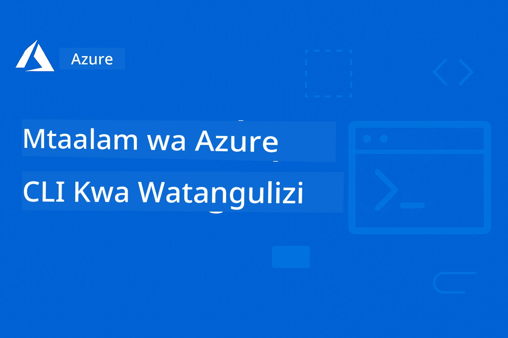

# AZD Kwa Waanzilishi: Safari Iliyoandaliwa ya Kujifunza

 

[](https://github.com/microsoft/AZD-for-beginners)
[](https://GitHub.com/microsoft/azd-for-beginners/network/)
[](https://github.com/microsoft/AZD-for-beginners)

[](https://discord.com/invite/nkVh3dp)
[](https://discord.gg/nTYy5BXMWG)

---

### Taaluma za Makinikia (Daima za Kisasa)

<!-- CO-OP TRANSLATOR LANGUAGES TABLE START -->
[Arabic](../ar/README.md) | [Bengali](../bn/README.md) | [Bulgarian](../bg/README.md) | [Burmese (Myanmar)](../my/README.md) | [Chinese (Simplified)](../zh-CN/README.md) | [Chinese (Traditional, Hong Kong)](../zh-HK/README.md) | [Chinese (Traditional, Macau)](../zh-MO/README.md) | [Chinese (Traditional, Taiwan)](../zh-TW/README.md) | [Croatian](../hr/README.md) | [Czech](../cs/README.md) | [Danish](../da/README.md) | [Dutch](../nl/README.md) | [Estonian](../et/README.md) | [Finnish](../fi/README.md) | [French](../fr/README.md) | [German](../de/README.md) | [Greek](../el/README.md) | [Hebrew](../he/README.md) | [Hindi](../hi/README.md) | [Hungarian](../hu/README.md) | [Indonesian](../id/README.md) | [Italian](../it/README.md) | [Japanese](../ja/README.md) | [Kannada](../kn/README.md) | [Khmer](../km/README.md) | [Korean](../ko/README.md) | [Lithuanian](../lt/README.md) | [Malay](../ms/README.md) | [Malayalam](../ml/README.md) | [Marathi](../mr/README.md) | [Nepali](../ne/README.md) | [Nigerian Pidgin](../pcm/README.md) | [Norwegian](../no/README.md) | [Persian (Farsi)](../fa/README.md) | [Polish](../pl/README.md) | [Portuguese (Brazil)](../pt-BR/README.md) | [Portuguese (Portugal)](../pt-PT/README.md) | [Punjabi (Gurmukhi)](../pa/README.md) | [Romanian](../ro/README.md) | [Russian](../ru/README.md) | [Serbian (Cyrillic)](../sr/README.md) | [Slovak](../sk/README.md) | [Slovenian](../sl/README.md) | [Spanish](../es/README.md) | [Swahili](./README.md) | [Swedish](../sv/README.md) | [Tagalog (Filipino)](../tl/README.md) | [Tamil](../ta/README.md) | [Telugu](../te/README.md) | [Thai](../th/README.md) | [Turkish](../tr/README.md) | [Ukrainian](../uk/README.md) | [Urdu](../ur/README.md) | [Vietnamese](../vi/README.md)

> **Unapendelea Kujaribu Kwenye Kompyuta Yako?**
>
> Hifadhi hii ina tafsiri za lugha zaidi ya 50 ambazo huongeza kiasi cha pakua. Ili kuikopa bila tafsiri, tumia sparse checkout:
>
> **Bash / macOS / Linux:**
> ```bash
> git clone --filter=blob:none --sparse https://github.com/microsoft/AZD-for-beginners.git
> cd AZD-for-beginners
> git sparse-checkout set --no-cone '/*' '!translations' '!translated_images'
> ```
>
> **CMD (Windows):**
> ```cmd
> git clone --filter=blob:none --sparse https://github.com/microsoft/AZD-for-beginners.git
> cd AZD-for-beginners
> git sparse-checkout set --no-cone "/*" "!translations" "!translated_images"
> ```
>
> Hii inakupa kila kitu unachohitaji kukamilisha kozi kwa upakuaji wa haraka zaidi.
<!-- CO-OP TRANSLATOR LANGUAGES TABLE END -->

## 🆕 Nini Kipya katika azd Leo

> 📌 **Mapitio ya toleo la AI CLI (2026-11-04):** Mwongozo ulithibitishwa dhidi ya hati/mhazini zilizochapishwa za **`azd 1.37.2`**, **mawakala `1.0.0-beta.23`**, na **tathmini `1.0.0-beta.2`**. Tumia `azd >= 1.37.0` kwa mtiririko wa pamoja. Endesha `azd version` na [sasisha CLI kuu](https://learn.microsoft.com/azure/developer/azure-developer-cli/install-azd) kabla ya virutubisho. Angalia [mabadiliko na marekebisho ya toleo](docs/chapter-08-production/production-ai-practices.md#recent-release-changes-and-fixes). Hii sio uhakiki wa moja kwa moja wa utekelezaji wa kozi nzima.

Azure Developer CLI inaunga mkono aina nyingi za programu, ikijumuisha tovuti, API, na mawakala wa AI, kupitia wahudumu wanaotegemewa, templates, na virutubisho.

Hapa kuna maana yake kwako:

- **Mawakala wa AI sasa ni mizigo ya daraja la kwanza kwa azd.** Unaweza kuanzisha, kupeleka, na kusimamia miradi ya mawakala wa AI kwa kutumia mtiririko wa `azd init` → `azd up` unaojulikana.
- **Mzunguko wa maisha wa wakala kupitia virutubisho viwili.** Tumia `azure.ai.agents` kuanzisha, kuitisha, kuboresha, na kustaafu mawakala. Sakinisha **`azure.ai.evaluations`** tofauti kwa ajili ya `azd ai eval init`, `generate`, na `run start`. Mawakala beta.22 yalibadilisha mtiririko wa tathmini wa zamani na kubadilisha usanidi wa uboreshaji; fuata [mwongozo wa uhamishaji](docs/chapter-08-production/production-ai-practices.md#evaluation-migration-and-quality-checks).
- **Vipengele zaidi vya ujenzi wa AI.** Virutubisho vipya vya awali—`azure.ai.skills` na `azure.ai.connections`—vinakuwezesha kusimamia ujuzi wa wakala unaoweza kutumika tena na muunganiko wa Foundry moja kwa moja na azd.
- **Muunganiko wa Microsoft Foundry** unaleta utekelezaji wa modeli, uenyekezaji wa wakala, na usanidi wa huduma za AI moja kwa moja ndani ya mfumo wa templates wa azd.
- **Msingi mzuri zaidi wa kila siku.** Matoleo ya hivi karibuni yamefanya `azd init` kuwa idempotent (salama kuyarudia), yamefanya `azd auth login` kufuta tokeni za zamani kiotomatiki, na kuongeza ushauri wa usanidi wa mara ya kwanza wa kirafiki wa `azd tool`.
- **Mtiririko mkuu haujabadilika.** Iwapo unapeleka programu ya todo, huduma ndogo, au suluhisho la AI lenye mawakala wengi, amri ni zile zile.

> **Kumbuka kwa watumiaji wa Aspire:** Microsoft sasa inarejelea bidhaa tu kama **Aspire** (zamani ".NET Aspire"). Msaada wa azd kwa Aspire haujabadilika—jina tu ndilo lililobadilishwa.

Ikiwa umewahi kutumia azd hapo awali, msaada wa AI ni nyongeza ya kawaida—si zana ya pekee wala njia ya juu. Ikiwa unaanza sasa, utajifunza mtiririko mmoja unaofanya kazi kwa kila kitu.

---

## 🚀 Azure Developer CLI (azd) ni Nini?

**Azure Developer CLI (azd)** ni zana ya amri inayowezesha waendelezaji kupeleka programu kwa urahisi Azure. Badala ya kuundwa na kuunganisha rasilimali nyingi za Azure kwa mikono, unaweza kupeleka programu nzima kwa amri moja.

### Uchawi wa `azd up`

```bash
# This single command does everything:
# ✅ Creates all Azure resources  
# ✅ Configures networking and security
# ✅ Builds your application code
# ✅ Deploys to Azure
# ✅ Gives you a working URL
azd up
```

Template hutoa usanidi wa programu na miundombinu. Utekelezaji wenye mafanikio bado unahitaji huduma/modeli zinazoungiwa mkono, hisa ya kutosha na ruhusa, viingilio sahihi, na uhakiki wa programu iliyotolewa. `azd up` haiifanyi template kuwa salama, inayozingatia sheria, au tayari kwa uzalishaji moja kwa moja.

---

## ❓ Azure Developer CLI na Azure CLI: Tofauti ni Nini?

Hii ni swali la kawaida zaidi kwa waanzilishi. Hapa ni jibu rahisi:

| Kipengele | **Azure CLI (`az`)** | **Azure Developer CLI (`azd`)** |
|---------|---------------------|--------------------------------|
| **Lengo** | Kusimamia rasilimali binafsi za Azure | Kupeleka programu kamili |
| **Mtazamo** | Kuangalia miundombinu | Kuangalia programu |
| **Mfano** | `az webapp create --name myapp...` | `azd up` |
| **Mwelekeo wa Kujifunza** | Lazima ujue huduma za Azure | Jua tu programu yako |
| **Kwa Wapi Bora** | DevOps, Miundombinu | Waendelezaji, Uundaji modeli |

### Mfano Rahisi

- **Azure CLI** ni kama kuwa na zana zote za kujenga nyumba - nyundo, msumeno, nyuzi. Unaweza kujenga chochote, lakini unahitaji kujua ujenzi.
- **Azure Developer CLI** ni kama kuajiri mkandarasi - unaeleza unachotaka, nao wanashughulikia ujenzi.

### Wakati wa Kutumia Kila Moja

| Tukio | Tumia Hii |
|----------|----------|
| "Nataka kupeleka tovuti yangu haraka" | `azd up` |
| "Nahitaji kuunda akaunti ya kuhifadhi tu" | `az storage account create` |
| "Ninaunda programu kamili ya AI" | `azd init --template azure-search-openai-demo` |
| "Nahitaji kutatua tatizo kwa rasilimali maalum ya Azure" | `az resource show` |
| "Nataka kupeleka kwenye mazingira yangu ya uzalishaji iliyopangwa" | Kagua usanidi, upatikanaji, gharama, na lango la uendeshaji kabla ya `azd up --environment production` |

### Hushirikiana Pamoja!

AZD na Azure CLI vina uthibitishaji na usanidi tofauti. Tumia `azd auth login` kwa AZD, na `az login` wakati amri ya hooking au uchunguzi inahitaji Azure CLI kwa wazi. Unaweza kutumia zote mbili:
```bash
# Deploy your app with AZD
azd up

# Then fine-tune specific resources with Azure CLI
az webapp config set --name myapp --always-on true
```

---

## 🌟 Pata Templesi katika Awesome AZD

Usianze kutoka mwanzo! **Awesome AZD** ni mkusanyiko wa jumuiya wa templesi tayari kwa kupeleka:

| Rasilimali | Maelezo |
|----------|-------------|
| 🔗 [**Gaari ya Awesome AZD**](https://azure.github.io/awesome-azd/) | Vinjari templates zaidi ya 200 kwa kubofya mara moja |
| 🔗 [**Wasilisha Template**](https://github.com/Azure/awesome-azd/issues) | Changia template yako kwa jumuiya |
| 🔗 [**Hifadhi ya GitHub**](https://github.com/Azure/awesome-azd) | Alama na chunguza chanzo |

### Templesi Maarufu za AI kutoka Awesome AZD

Chagua moja ya templeti katika saraka yake bure; amri hapa chini ni mbadala. `.` ya mwisho huanzisha saraka hiyo.

```bash
# RAG Chat with Microsoft Foundry Models + AI Search
azd init --template azure-search-openai-demo .

# Quick AI Chat Application
azd init --template openai-chat-app-quickstart .

# AI Agents with Foundry Agents
azd init --template get-started-with-ai-agents .
```

---

## 🎯 Kuanzia Katika Hatua 3

Kabla hujaanza, hakikisha kompyuta yako iko tayari kwa templeti unayotaka kupeleka:

**Windows:**
```powershell
.\validate-setup.ps1
```

**macOS / Linux:**
```bash
bash ./validate-setup.sh
```

Ikiwa ukaguzi wowote unashindikana, unda tatizo hilo kwanza kisha endelea na kuanza haraka.

### Hatua 1: Sakinisha AZD (Dakika 2)

**Windows:**
```powershell
winget install microsoft.azd
```

**macOS:**
```bash
brew tap azure/azd && brew install azd
```

**Linux:**
```bash
curl -fsSL https://aka.ms/install-azd.sh | bash
```

### Hatua 2: Thibitisha Kwa AZD

```bash
# Optional if you plan to use Azure CLI commands directly in this course
az login

# Required for AZD workflows
azd auth login
```

Ikiwa huna uhakika unahitaji ipi, fuata mchakato mzima wa usanidi katika [Usakinishaji & Usanidi](docs/chapter-01-foundation/installation.md#authentication-setup).

### Hatua 3: Peleka Programu Yako Ya Kwanza

```bash
# Initialize from a template
azd init --template todo-nodejs-mongo .

# Deploy to Azure (creates everything!)
azd up
```

**🎉 Hiyo ndio!** Programu yako sasa iko moja kwa moja Azure.

### Safisha Baadaye (Usisahau!)

```bash
# Remove all resources when done experimenting
azd down --force --purge
```

---

## 📚 Jinsi ya Kutumia Kozi Hii

Kozi hii imeundwa kwa ajili ya **kujifunza kwa hatua** - anza pale ulipopendelea na inuka hatua kwa hatua:

| Uzoefu Wako | Anza Hapa |
|-----------------|------------|
| **Mpya kabisa kwa Azure** | [Sura 1: Msingi](#-chapter-1-foundation--quick-start) |
| **Unajua Azure, mpya kwa AZD** | [Sura 1: Msingi](#-chapter-1-foundation--quick-start) |
| **Unataka kupeleka programu za AI** | [Sura 2: Maendeleo ya AI Kwanza](#-chapter-2-ai-first-development-recommended-for-ai-developers) |
| **Unataka mazoezi ya mikono** | [🎓 Warsha ya Kiraia](workshop/README.md) - mafunzo ya saa 3-4 |
| **Unahitaji mifano ya uzalishaji** | [Sura 8: Uzalishaji & Biashara](#-chapter-8-production--enterprise-patterns) |

### Usanidi wa Haraka

1. **Fanya Fork Hifadhi Hii**: [](https://GitHub.com/microsoft/azd-for-beginners/fork)
2. **Ikopa**: `git clone https://github.com/YOUR-USERNAME/azd-for-beginners.git`
3. **Pata Msaada**: [Jumuiya ya Discord ya Azure](https://discord.com/invite/ByRwuEEgH4)

> **Unapendelea Kujaribu Kwenye Kompyuta Yako?**

> Hifadhi hii ina tafsiri za lugha zaidi ya 50 ambazo huongeza kiasi cha pakua. Ili kuikopa bila tafsiri, tumia sparse checkout:
> ```bash
> git clone --filter=blob:none --sparse https://github.com/microsoft/AZD-for-beginners.git
> cd AZD-for-beginners
> git sparse-checkout set --no-cone '/*' '!translations' '!translated_images'
> ```
> Hii inakupa kila kitu unachohitaji kukamilisha kozi kwa upakuaji wa haraka zaidi.


## Muhtasari wa Kozi

Jifunze Azure Developer CLI (azd) kupitia sura zilizopangwa kwa ajili ya kujifunza kwa hatua kwa hatua. **Mkazo maalum juu ya utoaji wa programu za AI kwa ushirikiano wa Microsoft Foundry.**

### Kwa Nini Kozi Hii ni Muhimu kwa Waendelezaji wa Kisasa

Waendelezaji wanaotoa kazi za AI mara nyingi wanahitaji mwongozo juu ya:
- Miundo tata ya huduma nyingi za AI
- Mbinu bora za utoaji wa AI kwa uzalishaji  
- Uunganishaji na usanidi wa huduma za Azure AI
- Uboreshaji wa gharama kwa kazi za AI
- Kusuluhisha matatizo maalum ya utoaji wa AI

### Malengo ya Kujifunza

Kwa kukamilisha kozi hii iliyopangwa, utakuwa:
- **Mtaalamu wa Misingi ya AZD**: Misingi ya msingi, usakinishaji, na usanidi
- **Tangaza Programu za AI**: Tumia AZD na huduma za Microsoft Foundry
- **Tekeleza Miundombinu kama Msimbo**: Dhibiti rasilimali za Azure kwa kutumia templeti za Bicep
- **Suluhisha Matatizo ya Utoaji**: Rekebisha matatizo ya kawaida na fanya utafiti wa makosa
- **Boresha kwa Uzalishaji**: Usalama, kupanua, ufuatiliaji, na usimamizi wa gharama
- **Jenga Suluhisho za Wakala Wengi**: Toa miundo tata ya AI

## Kabla ya Kuanzia: Akaunti, Upatikanaji, na Makadirio

Kabla ya kuanza Sura ya 1, hakikisha una mambo yafuatayo. Hatua za usakinishaji baadaye katika mwongozo huu zinadhani mambo haya tayari yameshughulikiwa.

- **Usajili wa Azure**: Unaweza kutumia usajili uliopo kutoka kazini au akaunti yako mwenyewe, au tengeneza [jaribio la bure](https://aka.ms/azurefreetrial) kuanza.
- **Idhini ya kuunda rasilimali za Azure**: Kwa mazoezi mengi, unapaswa kuwa na angalau upatikanaji wa **Mchangiaji** kwenye usajili au kundi la rasilimali lengwa. Sura nyingine zinaweza pia kudhani unaweza kuunda makundi ya rasilimali, vitambulisho vinavyosimamiwa, na uteuzi wa RBAC.
- [**Akaunti ya GitHub**](https://github.com): Hii ni muhimu kwa kutawanya hazina, kufuatilia mabadiliko yako mwenyewe, na kutumia GitHub Codespaces kwa warsha.
- **Mahitaji ya kuendesha templeti**: Templeti zingine zinahitaji zana za ndani kama Node.js, Python, Java, au Docker. Endesha kigeuzi cha usanidi kabla ya kuanza ili ugundue zana zilizokosekana mapema.
- **Uelewa wa msingi wa terminal**: Huhitaji kuwa mtaalamu, lakini unapaswa kuwa na urahisi wa kuendesha amri kama `git clone`, `azd auth login`, na `azd up`.

> **Unafanya kazi katika usajili wa shirika?**
> Ikiwa mazingira yako ya Azure yanadhibitiwa na msimamizi, thibitisha kabla hujaanza kwamba unaweza kutoa rasilimali katika usajili au kundi la rasilimali unalopanga kutumia. Ikiwa si hivyo, omba usajili wa sandbox au upatikanaji wa Mchangiaji kabla ya kuanza.

> **Mpya kwa Azure?**
> Anza na jaribio lako la Azure au usajili wa malipo-pamoja na matumizi kwenye https://aka.ms/azurefreetrial ili uweze kumaliza mazoezi kwa ukamilifu bila kusubiri idhini za ngazi ya mkoloni.

## 🗺️ Ramani ya Kozi: Uvinjari wa Haraka kwa Surah

Kila sura ina README ya kina na malengo ya kujifunza, kuanza kwa haraka, na mazoezi:

| Sura | Mada | Masomo | Muda | Ugumu |
|---------|-------|---------|----------|------------|
| **[Sura 1: Misingi](docs/chapter-01-foundation/README.md)** | Kuanzia | [Misingi ya AZD](docs/chapter-01-foundation/azd-basics.md) &#124; [Usakinishaji](docs/chapter-01-foundation/installation.md) &#124; [Mradi wa Kwanza](docs/chapter-01-foundation/first-project.md) | Dakika 30-45 | ⭐ |
| **[Sura 2: Uendelezaji wa AI](docs/chapter-02-ai-development/README.md)** | Programu za AI-Kwanza | [Ushirikiano wa Foundry](docs/chapter-02-ai-development/microsoft-foundry-integration.md) &#124; [Wakala wa AI](docs/chapter-02-ai-development/agents.md) &#124; [Utoaji Modeli](docs/chapter-02-ai-development/ai-model-deployment.md) &#124; [Warsha](docs/chapter-02-ai-development/ai-workshop-lab.md) | Saa 1-2 | ⭐⭐ |
| **[Sura 3: Usanidi](docs/chapter-03-configuration/README.md)** | Usalama na Uthibitisho | [Usanidi](docs/chapter-03-configuration/configuration.md) &#124; [Usalama na Uthibitisho](docs/chapter-03-configuration/authsecurity.md) | Dakika 45-60 | ⭐⭐ |
| **[Sura 4: Miundombinu](docs/chapter-04-infrastructure/README.md)** | IaC na Utoaji | [Mwongozo wa Utoaji](docs/chapter-04-infrastructure/deployment-guide.md) &#124; [Upatikanaji](docs/chapter-04-infrastructure/provisioning.md) | Saa 1-1.5 | ⭐⭐⭐ |
| **[Sura 5: Wakala Wengi](docs/chapter-05-multi-agent/README.md)** | Suluhisho za Wakala wa AI | [Senario ya Rejareja](examples/retail-scenario.md) &#124; [Mifumo ya Uratibu](docs/chapter-06-pre-deployment/coordination-patterns.md) | Saa 2-3 | ⭐⭐⭐⭐ |
| **[Sura 6: Kabla ya Utoaji](docs/chapter-06-pre-deployment/README.md)** | Mipango na Uthibitisho | [Kagua Kabla ya Kuenda](docs/chapter-06-pre-deployment/preflight-checks.md) &#124; [Mipango ya Uwezo](docs/chapter-06-pre-deployment/capacity-planning.md) &#124; [Uchaguzi wa SKU](docs/chapter-06-pre-deployment/sku-selection.md) &#124; [Maarifa ya App](docs/chapter-06-pre-deployment/application-insights.md) | Saa 1 | ⭐⭐ |
| **[Sura 7: Kusuluhisha Matatizo](docs/chapter-07-troubleshooting/README.md)** | Tatuu na Rekebisho | [Matatizo ya Kawaida](docs/chapter-07-troubleshooting/common-issues.md) &#124; [Kufuatilia Makosa](docs/chapter-07-troubleshooting/debugging.md) &#124; [Matatizo ya AI](docs/chapter-07-troubleshooting/ai-troubleshooting.md) | Saa 1-1.5 | ⭐⭐ |
| **[Sura 8: Uzalishaji](docs/chapter-08-production/README.md)** | Mifumo ya Shirika | [Mbinu za Uzalishaji](docs/chapter-08-production/production-ai-practices.md) | Saa 2-3 | ⭐⭐⭐⭐ |
| **[🎓 Warsha](workshop/README.md)** | Maabara ya Vitendo | [Utangulizi](workshop/docs/instructions/0-Introduction.md) &#124; [Uchaguzi](workshop/docs/instructions/1-Select-AI-Template.md) &#124; [Uthibitisho](workshop/docs/instructions/2-Validate-AI-Template.md) &#124; [Uchambuzi](workshop/docs/instructions/3-Deconstruct-AI-Template.md) &#124; [Usanidi](workshop/docs/instructions/4-Configure-AI-Template.md) &#124; [Ubadilishaji](workshop/docs/instructions/5-Customize-AI-Template.md) &#124; [Ufumbuzi](workshop/docs/instructions/6-Teardown-Infrastructure.md) &#124; [Hitimisho](workshop/docs/instructions/7-Wrap-up.md) | Saa 3-4 | ⭐⭐ |

**Muda wa Jumla wa Kozi:** ~ Saa 10-14 | **Maendeleo ya Uwezo:** Mwanzo → Tayari kwa Uzalishaji

---

## 📚 Sura za Kujifunza

*Chagua njia yako ya kujifunza kulingana na kiwango cha uzoefu na malengo*

### 🚀 Sura 1: Msingi & Anza Haraka
**Mahitaji**: Usajili wa Azure, maarifa ya msingi ya mstari wa amri  
**Muda**: Dakika 30-45  
**Ugumu**: ⭐

#### Kile Utakachojifunza
- Kuelewa misingi ya Azure Developer CLI
- Kusakinisha AZD kwenye jukwaa lako
- Utoaji wako wa kwanza uliofanikiwa

#### Vyanzo vya Kujifunza
- **🎯 Anza Hapa**: [Azure Developer CLI ni Nini?](#-what-is-azure-developer-cli-azd)
- **📖 Nadharia**: [Misingi ya AZD](docs/chapter-01-foundation/azd-basics.md) - Misingi na istilahi
- **⚙️ Usanidi**: [Usakinishaji na Usanidi](docs/chapter-01-foundation/installation.md) - Mwongozo maalum kwa jukwaa
- **🛠️ Vitendo**: [Mradi Wako wa Kwanza](docs/chapter-01-foundation/first-project.md) - Mafundisho kwa hatua
- **📋 Marejeleo ya Haraka**: [Kadi ya Aamri](resources/cheat-sheet.md)

#### Mazoezi ya Vitendo
```bash
# Quick installation check
azd version

# Deploy your first application
azd init --template todo-nodejs-mongo .
azd up
```

**💡 Matokeo ya Sura**: Toa programu rahisi ya wavuti kwa Azure ukitumia AZD

**✅ Uhakiki wa Mafanikio:**
```bash
# After completing Chapter 1, you should be able to:
azd version              # Shows installed version
azd init --template todo-nodejs-mongo  # Initializes project
azd up                  # Deploys to Azure
azd show                # Displays running app URL
# Application opens in browser and works
azd down --force --purge  # Cleans up resources
```

**📊 Muda wa Kuwekeza:** Dakika 30-45  
**📈 Kiwango cha Uwezo Baada:** Unaweza kutoa programu za msingi kwa kujitegemea

---

### 🤖 Sura 2: Uendelezaji wa AI-Kwanza (Iliopendekezwa kwa Waendelezaji wa AI)
**Mahitaji**: Sura 1 imekamilika  
**Muda**: Saa 1-2  
**Ugumu**: ⭐⭐

#### Kile Utakachojifunza
- Ushirikiano wa Microsoft Foundry na AZD
- Kutoa programu zilizoendesha na akili ya bandia
- Kuelewa usanidi wa huduma za AI

#### Vyanzo vya Kujifunza
- **🎯 Anza Hapa**: [Ushirikiano wa Microsoft Foundry](docs/chapter-02-ai-development/microsoft-foundry-integration.md)
- **🤖 Wakala wa AI**: [Mwongozo wa Wakala wa AI](docs/chapter-02-ai-development/agents.md) - Tumia wakala werevu kwa AZD
- **📖 Mifumo**: [Utoaji wa Modeli za AI](docs/chapter-02-ai-development/ai-model-deployment.md) - Toa na simamia modeli za AI
- **🛠️ Warsha**: [Maabara ya AI](docs/chapter-02-ai-development/ai-workshop-lab.md) - Fanya suluhisho zako za AI ziwe tayari kwa AZD
- **🎥 Mwongozo wa Ushirikiano**: [Vifaa vya Warsha](workshop/README.md) - Kujifunza kivinjari na MkDocs * Mazingira ya DevContainer
- **📋 Templeti**: [Templeti za Microsoft Foundry](#featured-microsoft-foundry-templates)
- **📝 Mifano**: [Mifano ya Utoaji wa AZD](examples/README.md)

#### Mazoezi ya Vitendo
```bash
# Deploy your first AI application
azd init --template azure-search-openai-demo .
azd up

# Try additional AI templates
azd init --template openai-chat-app-quickstart .
azd init --template agent-openai-python-prompty .
```

**💡 Matokeo ya Sura**: Toa na usanidi programu ya mazungumzo yenye AI na uwezo wa RAG

**✅ Uhakiki wa Mafanikio:**
```bash
# After Chapter 2, you should be able to:
azd init --template azure-search-openai-demo .
azd up
# Test the AI chat interface
# Ask questions and get AI-powered responses with sources
# Verify search integration works
azd monitor  # Check Application Insights shows telemetry
azd down --force --purge
```

**📊 Muda wa Kuwekeza:** Saa 1-2  
**📈 Kiwango cha Uwezo Baada:** Unaweza kutoa programu za kujifunza AI na kutambua mahitaji ya ziada ya uzalishaji
**💰 Uelewa wa Gharama:** Fahamu gharama za maendeleo $80-150/mwezi, gharama za uzalishaji $300-3500/mwezi

#### 💰 Mambo ya Kuzingatia kwa Gharama za Utoaji wa AI

**Mazingira ya Maendeleo (Kadiria $80-150/mwezi):**
- Modeli za Microsoft Foundry (LIPA kadri unavyotumia): $0-50/mwezi (kulingana na matumizi ya tokeni)
- Utafutaji wa AI (Ngazi ya Msingi): $75/mwezi
- Programu za Kontena (Matumizi): $0-20/mwezi
- Hifadhi (Ya Kawaida): $1-5/mwezi

**Mazingira ya Uzalishaji (Kadiria $300-3,500+/mwezi):**
- Modeli za Microsoft Foundry (PTU kwa utendaji thabiti): $3,000+/mwezi AU LIPA kadri unavyotumia kwa kiasi kikubwa
- Utafutaji wa AI (Ngazi ya Kawaida): $250/mwezi
- Programu za Kontena (Maelekezo): $50-100/mwezi
- Maarifa ya Programu: $5-50/mwezi
- Hifadhi (Premium): $10-50/mwezi

**💡 Vidokezo vya Kuongeza Ufanisi wa Gharama:**
- Angalia bei za uamuzi wa modeli na mikopo maalum ya akaunti; Azure OpenAI hajatumia posho ya bure ya tokeni 50,000 kila mwezi
- Endesha `azd down` kufuta rasilimali wakati hazihitajiki tena, baada ya kukagua mazingira yaliyoteuliwa
- Anza na bili inayotegemea matumizi, boresha hadi PTU tu kwa ajili ya uzalishaji
- Tumia `azd provision --preview` kuchunguza miundombinu iliyopangwa, kisha punguzo bei rasilimali zitakazozalishwa na Kihesabu cha Bei cha Azure
- Wezesha upanuzi wa moja kwa moja: lipa tu kwa matumizi halisi

**Ufuatiliaji wa Gharama:**
```bash
# Inspect planned resources (this does not calculate prices)
azd provision --preview

# Monitor actual costs in Azure Portal
az consumption budget list --resource-group <your-rg>
```

---

### ⚙️ Sura 3: Usanidi na Uthibitisho
**Mahitaji**: Sura 1 imekamilika  
**Muda**: Dakika 45-60  
**Ugumu**: ⭐⭐

#### Kile Utakachojifunza
- Usanidi wa mazingira na usimamizi
- Mbinu bora za uthibitisho na usalama
- Ulinganifu na kupanga majina ya rasilimali

#### Vyanzo vya Kujifunza
- **📖 Usanidi**: [Mwongozo wa Usanidi](docs/chapter-03-configuration/configuration.md) - Usanidi wa mazingira
- **🔐 Usalama**: [Mifumo ya uthibitisho na kitambulisho kinachosimamiwa](docs/chapter-03-configuration/authsecurity.md) - Mifumo ya uthibitisho
- **📝 Mifano**: [Mfano wa Programu ya Database](examples/database-app/README.md) - Mifano ya AZD ya Database

#### Mazoezi ya Vitendo
- Sanidi mazingira mengi (dev, staging, prod)
- Sanidi uthibitisho wa kitambulisho kinachosimamiwa
- Tekeleza usanidi maalum kwa mazingira

**💡 Matokeo ya Sura**: Dhibiti mazingira mengi kwa uthibitisho sahihi na usalama

---

### 🏗️ Sura 4: Miundombinu kama Msimbo & Utoaji
**Mahitaji**: Sura 1-3 zimekamilika  
**Muda**: Saa 1-1.5  
**Ugumu**: ⭐⭐⭐

#### Kile Utakachojifunza
- Mifumo ya utoaji wa juu
- Miundombinu kama Msimbo kwa Bicep
- Mikakati ya upatikanaji wa rasilimali

#### Vyanzo vya Kujifunza
- **📖 Utoaji**: [Mwongozo wa Utoaji](docs/chapter-04-infrastructure/deployment-guide.md) - Mchakato kamili
- **🏗️ Upatikanaji**: [Upatikanaji wa Rasilimali](docs/chapter-04-infrastructure/provisioning.md) - Usimamizi wa rasilimali za Azure
- **📝 Mifano**: [Mfano wa Programu ya Kontena](../../examples/container-app) - Utoaji wa containerized

#### Mazoezi ya Vitendo
- Tengeneza templeti za Bicep zilizobinafsishwa
- Tumia programu za huduma nyingi
- Tekeleza mikakati ya utoaji wa blue-green

**💡 Matokeo ya Sura**: Toa programu tata za huduma nyingi kwa kutumia templeti za miundombinu zilizoandaliwa

---

### 🎯 Sura 5: Suluhisho za Wakala Wengi AI (Cha Juu)
**Mahitaji**: Sura 1-2 zimekamilika  
**Muda**: Saa 2-3  
**Ugumu**: ⭐⭐⭐⭐

#### Kile Utakachojifunza
- Mifumo ya usanifu wa wakala wengi
- Usimamizi na uratibu wa wakala
- Utoaji wa AI tayari kwa uzalishaji

#### Vyanzo vya Kujifunza
- **🤖 Ubunifu Maarufu**: [Suluhisho la Wakala Wengi wa Rejareja](examples/retail-scenario.md) - Ramani ya usanifu, sio programu kamili
- **🛠️ ARM Templates**: [Pakiti la Templeti za ARM](../../examples/retail-multiagent-arm-template) - Muundo wa miundombinu; hupitia masharti na vipengele vinavyokosekana vya programu
- **📖 Architecture**: [Mifumo ya uratibu wa mawakala wengi](docs/chapter-06-pre-deployment/coordination-patterns.md) - Mifumo

#### Mazoezi ya Kivitendo
```bash
# Inspect the retail infrastructure scaffold before choosing to deploy it
cd examples/retail-multiagent-arm-template
cat README.md

# After an intentional deployment, inspect infrastructure state
az deployment group show --resource-group <rg-name> --name <deployment-name>
```

**💡 Matokeo ya Sura**: Elewa muundo wa mawakala wengi na tambua utekelezaji, uthibitishaji, na kazi ya uendeshaji inayohitajika zaidi ya miundombinu scaffold

---

### 🔍 Sura ya 6: Uthibitishaji & Mipango Kabla ya Utekelezaji
**Sharti**: Sura ya 4 imemalizika  
**Muda**: Saa 1  
**Ugumu**: ⭐⭐

#### Utajifunza Nini
- Mipango ya uwezo na uthibitishaji wa rasilimali
- Mbinu za uchaguzi wa SKU
- Ukaguzi wa kabla ya kuruka na uendeshaji wa kiotomatiki

#### Rasilimali za Kujifunza
- **📊 Mipango**: [Mipango ya Uwezo](docs/chapter-06-pre-deployment/capacity-planning.md) - Uthibitishaji wa rasilimali
- **💰 Uchaguzi**: [Uchaguzi wa SKU](docs/chapter-06-pre-deployment/sku-selection.md) - Chaguo linalozingatia gharama nafuu
- **✅ Uthibitishaji**: [Ukaguzi wa Kabla ya Kuruka](docs/chapter-06-pre-deployment/preflight-checks.md) - Visaidizi vya kiotomatiki

#### Mazoezi ya Kivitendo
- Endesha visaidizi vya uthibitishaji wa uwezo
- Boreshaji wa uchaguzi wa SKU kwa gharama
- Tekeleza ukaguzi wa kabla ya utekelezaji wa kiotomatiki

**💡 Matokeo ya Sura**: Thibitisha na boresha utekelezaji kabla ya kutekeleza

---

### 🚨 Sura ya 7: Utatuzi wa Matatizo & Urekebishaji
**Sharti**: Sura yoyote ya utekelezaji imemalizika  
**Muda**: Saa 1-1.5  
**Ugumu**: ⭐⭐

#### Utajifunza Nini
- Mbinu za sistematiki za urekebishaji
- Masuala ya kawaida na suluhisho
- Utatuzi wa matatizo maalumu kwa AI

#### Rasilimali za Kujifunza
- **🔧 Masuala ya Kawaida**: [Masuala ya Kawaida](docs/chapter-07-troubleshooting/common-issues.md) - Maswali yanayoulizwa mara kwa mara na suluhisho
- **🕵️ Urekebishaji**: [Mwongozo wa Urekebishaji](docs/chapter-07-troubleshooting/debugging.md) - Mikakati ya hatua kwa hatua
- **🤖 Masuala ya AI**: [Utatuzi wa Matatizo wa Maalumu kwa AI](docs/chapter-07-troubleshooting/ai-troubleshooting.md) - Matatizo ya huduma za AI

#### Mazoezi ya Kivitendo
- Tambua sababu za kushindwa kwa utekelezaji
- Tatua matatizo ya uthibitishaji
- Rekebisha uunganishaji wa huduma za AI

**💡 Matokeo ya Sura**: Tambua peke yako na tatua matatizo ya kawaida ya utekelezaji

---

### 🏢 Sura ya 8: Mifumo ya Uzalishaji & Biashara
**Sharti**: Sura 1-4 zimemalizika  
**Muda**: Saa 2-3  
**Ugumu**: ⭐⭐⭐⭐

#### Utajifunza Nini
- Mikakati ya utekelezaji wa uzalishaji
- Mifumo ya usalama wa biashara
- Ufuatiliaji na uboreshaji wa gharama

#### Rasilimali za Kujifunza
- **🏭 Uzalishaji**: [Mbinu Bora za AI za Uzalishaji](docs/chapter-08-production/production-ai-practices.md) - Mifumo ya biashara
- **📝 Mifano**: [Mfano wa Microservices](../../examples/microservices) - Miundo tata
- **📊 Ufuatiliaji**: [Mwingiliano wa Application Insights](docs/chapter-06-pre-deployment/application-insights.md) - Ufuatiliaji

#### Mazoezi ya Kivitendo
- Tekeleza mifumo ya usalama wa biashara
- Seti kamili ya ufuatiliaji
- Tekeleza kwenye uzalishaji kwa usimamizi bora

**💡 Matokeo ya Sura**: Tekeleza programu za tayari kwa biashara zenye uwezo kamili wa uzalishaji

---

## 🎓 Muhtasari wa Warsha: Mazoezi ya Mikono

> **⚠️ HALI YA WARSHA: Maendeleo Hai**  
> Vifaa vya warsha vinaendelea kuandaliwa na kuboreshwa. Moduli kuu zinafanya kazi, lakini baadhi ya sehemu za juu hazijakamilika. Tunafanya kazi kwa bidii kukamilisha maudhui yote. [Fuata maendeleo →](workshop/README.md)

### Vifaa vya Warsha Ya Kuingiliana
**Kujifunza kwa mikono kwa kina na zana za kivinjari na mazoezi yaliyoongozwa**

Vifaa vya warsha yetu vina uzoefu wa kujifunza uliopangwa na kuingiliana unaoendana na mtaala wa sura ulio hapo juu. Warsha hii imeundwa kwa ajili ya kujifunza kwa mwendo wako na kikao kinachoongozwa na mwalimu.

#### 🛠️ Sifa za Warsha
- **Kiolesura Kinachotegemea Kivinjari**: Warsha kamili inayoendeshwa na MkDocs yenye sifa za utafutaji, kunakili, na mandhari
- **Uunganisho wa GitHub Codespaces**: Usanidi wa mazingira ya maendeleo kwa bonyeza moja
- **Njia ya Kujifunza Iliyopangwa**: Mazoezi ya moduli 8 yaliyoongozwa (saa 3-4 jumla)
- **Mbinu ya Hatua kwa Hatua**: Utangulizi → Uchaguzi → Uthibitishaji → Uvunjaji → Usanidi → Ubunifu → Usafishaji → Mapitio
- **Mazingira ya DevContainer Yaliyoingiliana**: Zana na tegemezi zilizowekwa tayari

#### 📚 Muundo wa Moduli za Warsha
Warsha hutumia **mbinu ya hatua 8** inayokupeleka kutoka ugunduzi hadi ustadi wa utekelezaji:

| Moduli | Mada | Utakavyoifanya | Muda |
|--------|-------|----------------|----------|
| **0. Utangulizi** | Muhtasari wa Warsha | Elewa malengo ya kujifunza, masharti, na muundo wa warsha | Dakika 15 |
| **1. Uchaguzi** | Ugunduzi wa Templeti | Chunguza templeti za AZD na chagua templeti sahihi ya AI kwa tukio lako | Dakika 20 |
| **2. Uthibitishaji** | Tekeleza & Thibitisha | Tekeleza templeti kwa `azd up` na thibitisha kazi za miundombinu | Dakika 30 |
| **3. Uvunjaji** | Elewa Muundo | Tumia GitHub Copilot kuchunguza usanifu wa templeti, faili za Bicep, na upangaji wa msimbo | Dakika 30 |
| **4. Usanidi** | Azure.yaml Kwa Undani | Jifunze usanidi wa `azure.yaml`, hooks za maisha, na vigezo vya mazingira | Dakika 30 |
| **5. Ubunifu** | Ifanye Yako | Washa AI Search, ufuatiliaji, tathmini, na ubinafsishe kwa tukio lako | Dakika 45 |
| **6. Usafishaji** | Safisha | Ondoa rasilimali kwa usalama kwa kutumia `azd down --purge` | Dakika 15 |
| **7. Mapitio** | Hatua Zifuatazo | Pitia mafanikio, dhana kuu, na endelea safari yako ya kujifunza | Dakika 15 |

**Mtiririko wa Warsha:**
```
Introduction → Selection → Validation → Deconstruction → Configuration → Customization → Teardown → Wrap-up
     ↓            ↓           ↓              ↓               ↓              ↓            ↓           ↓
  Overview    Find the     Deploy &      Explore        Master         Customize     Clean up    Review &
             right        verify        code &        azure.yaml      for your      resources   next steps
             template                   structure                     scenario
```

#### 🚀 Kuanzia na Warsha
```bash
# Option 1: GitHub Codespaces (Recommended)
# Click "Code" → "Create codespace on main" in the repository

# Option 2: Local Development
git clone https://github.com/microsoft/azd-for-beginners.git
cd azd-for-beginners/workshop
# Follow the setup instructions in workshop/README.md
```

#### 🎯 Matokeo ya Kujifunza Warsha
Kwa kumaliza warsha, washiriki watakuwa:
- **Tekeleza Programu za AI za Uzalishaji**: Tumia AZD na huduma za Microsoft Foundry
- **Stadi za Miundo ya Mawakala Wengi**: Tekeleza suluhisho la mawakala wa AI kwa ushirikiano
- **Tekeleza Mbinu Bora za Usalama**: Sanidi uthibitishaji na udhibiti wa upatikanaji
- **Boresha kwa Kiwango**: Buni utekelezaji wa gharama nafuu na utendaji mzuri
- **Tatua Matatizo ya Utekelezaji**: Tatua matatizo ya kawaida peke yako

#### 📖 Rasilimali za Warsha
- **🎥 Mwongozo wa Kuingiliana**: [Vifaa vya Warsha](workshop/README.md) - Mazingira ya kujifunza kupitia kivinjari
- **📋 Maelekezo kwa Moduli Kila Moja**:
  - [0. Utangulizi](workshop/docs/instructions/0-Introduction.md) - Muhtasari wa warsha na malengo
  - [1. Uchaguzi](workshop/docs/instructions/1-Select-AI-Template.md) - Tafuta na chagua templeti za AI
  - [2. Uthibitishaji](workshop/docs/instructions/2-Validate-AI-Template.md) - Tekeleza na thibitisha templeti
  - [3. Uvunjaji](workshop/docs/instructions/3-Deconstruct-AI-Template.md) - Chunguza usanifu wa templeti
  - [4. Usanidi](workshop/docs/instructions/4-Configure-AI-Template.md) - Jifunze azure.yaml
  - [5. Ubunifu](workshop/docs/instructions/5-Customize-AI-Template.md) - Binafsisha kwa tukio lako
  - [6. Usafishaji](workshop/docs/instructions/6-Teardown-Infrastructure.md) - Safisha rasilimali
  - [7. Mapitio](workshop/docs/instructions/7-Wrap-up.md) - Pitia na hatua zinazofuata
- **🛠️ Maabara ya Warsha ya AI**: [Maabara ya Warsha ya AI](docs/chapter-02-ai-development/ai-workshop-lab.md) - Mazoezi yanayolenga AI
- **💡 Mwanzo wa Haraka**: [Mwongozo wa Usanidi wa Warsha](workshop/README.md#browser-based-guide) - Usanidi wa mazingira

**Inafaa kwa**: Mafunzo ya taasisi, kozi za vyuo vikuu, kujifunza kwa mwendo wako, na bootcamps za watengenezaji programu.

---

## 📖 Uchunguzi wa Kina: Uwezo wa AZD

Zaidi ya msingi, AZD hutoa sifa zenye nguvu kwa utekelezaji wa uzalishaji:

- **Utekelezaji kwa templeti** - Tumia templeti zilizojengwa tayari kwa mifumo ya kawaida ya programu
- **Miundombinu kama Msimbo** - Dhibiti rasilimali za Azure kwa kutumia Bicep au Terraform  
- **Mtiririko uliounganishwa** - Sasisha, tekeleza, na fuatilia programu kwa urahisi
- **Rahisi kwa watengenezaji** - Imeboreshwa kwa ufanisi na uzoefu wa mtengenezaji programu

### **AZD + Microsoft Foundry: Muhimu kwa Utekelezaji wa AI**

**Kwa Nini AZD kwa Suluhisho za AI?** AZD inashughulikia changamoto kuu za watengenezaji wa AI:

- **Templeti Tayari kwa AI** - Templeti zilizoandaliwa tayari kwa Microsoft Foundry Models, Huduma za AI za Azure, na mzigo wa ML
- **Utekelezaji wa AI Ulio Salama** - Mifumo ya usalama iliyojengwa kwa huduma za AI, funguo za API, na maeneo ya mfano  
- **Mifumo ya AI ya Uzalishaji** - Mbinu bora za utekelezaji wa programu za AI zinazostawi, zenye gharama nafuu
- **Mtiririko wa Kazi wa AI Kuanzia Mwanzo hadi Mwisho** - Kutoka kwa maendeleo ya mfano hadi utekelezaji wa uzalishaji na ufuatiliaji sahihi
- **Uboreshaji wa Gharama** - Mikakati ya ugawaji rasilimali na upanuzi kwa mzigo wa AI
- **Muunganisho wa Microsoft Foundry** - Muunganisho wa urahisi na katalogi na maeneo ya mfano wa Microsoft Foundry

---

## 🎯 Templeti & Maktaba ya Mifano

### Imetajwa: Templeti za Microsoft Foundry
**Anza hapa ikiwa unatekeleza programu za AI!**

> **Kumbuka:** Templeti hizi zinaonyesha mifumo mbalimbali ya AI. Baadhi ni Sampuli za Azure za nje, zingine ni utekelezaji wa ndani.

| Templeti | Sura | Ugumu | Huduma | Aina |
|----------|---------|------------|----------|------|
| [**Anza na mazungumzo ya AI**](https://github.com/Azure-Samples/get-started-with-ai-chat) | Sura 2 | ⭐⭐ | AzureOpenAI + AI Model Inference API ya Azure + Azure AI Search + Azure Container Apps + Application Insights | Nje |
| [**Anza na mawakala wa AI**](https://github.com/Azure-Samples/get-started-with-ai-agents) | Sura 2 | ⭐⭐ | Mawakala wa Foundry + AzureOpenAI + Azure AI Search + Azure Container Apps + Application Insights| Nje |
| [**Demo ya Azure Search + OpenAI**](https://github.com/Azure-Samples/azure-search-openai-demo) | Sura 2 | ⭐⭐ | Azure OpenAI + Azure AI Search + Container Apps (default) + Storage | Nje |
| [**Anza Haraka ya App ya Mazungumzo ya OpenAI**](https://github.com/Azure-Samples/openai-chat-app-quickstart) | Sura 2 | ⭐ | AzureOpenAI + Container Apps + Application Insights | Nje |
| [**Agent OpenAI Python Prompty**](https://github.com/Azure-Samples/agent-openai-python-prompty) | Sura 5 | ⭐⭐⭐ | AzureOpenAI + Azure Functions + Prompty | Nje |
| [**Contoso Chat RAG**](https://github.com/Azure-Samples/contoso-chat) | Sura 8 | ⭐⭐⭐⭐ | AzureOpenAI + AI Search + Cosmos DB + Container Apps | Nje |
| [**Suluhisho la Wakala Wengi katika Rejareja**](examples/retail-scenario.md) | Sura 5 | ⭐⭐⭐⭐ | Muundo uliopendekezwa na scaffold ya miundombinu; utekelezaji wa programu unahitajika | **Ramani ya ndani** |

### Imetajwa: Hali Kamili za Kujifunza
**Templeti za programu za uzalishaji zilizopangwa kwa sura za kujifunza**

| Templeti | Sura ya Kujifunza | Ugumu | Kujifunza Muhimu |
|----------|------------------|------------|--------------|
| [**openai-chat-app-quickstart**](https://github.com/Azure-Samples/openai-chat-app-quickstart) | Sura 2 | ⭐ | Mifumo ya msingi ya utekelezaji wa AI |
| [**azure-search-openai-demo**](https://github.com/Azure-Samples/azure-search-openai-demo) | Sura 2 | ⭐⭐ | Utekelezaji wa RAG na Azure AI Search |
| [**anza-na-mawakala-wa-ai**](https://github.com/Azure-Samples/get-started-with-ai-agents) | Sura 2 | ⭐⭐ | Mazungumzo yaliyoambatana na wakala na majaribio maalumu ya tathmini |
| [**agent-openai-python-prompty**](https://github.com/Azure-Samples/agent-openai-python-prompty) | Sura 5 | ⭐⭐⭐ | Mfumo wa wakala na kupiga simu kazi |
| [**contoso-chat**](https://github.com/Azure-Samples/contoso-chat) | Sura 8 | ⭐⭐⭐ | Mipangilio ya biashara ya AI |
| [**retail-multi-agent-solution**](examples/retail-scenario.md) | Sura 5 | ⭐⭐⭐⭐ | Muundo wa mawakala wengi na mawakala wa Wateja na Hesabu |

### Kujifunza kwa Aina ya Mfano

> **📌 Mifano ya Ndani vs. za Nje:**  
> **Mifano ya Ndani** (katika hifadhidata hii) = Angalia README ya mfano kwa hali ya utekelezaji na masharti
> **Mifano ya Nje** (Sampuli za Azure) = Nakili kutoka hifadhidata zilizounganishwa

#### Mifano ya Ndani (Tayari Kutumika)
- [**Suluhisho la Wakala Wengi katika Rejareja**](examples/retail-scenario.md) - Ramani ya usanifu na scaffold ya miundombinu ya ARM
  - Majukumu ya wakala wa Wateja na Hesabu yaliyopendekezwa
  - Ufuatiliaji, tathmini, na msimbo wa programu lazima utekelezwe na uthibitishwe
  - Utoaji wa rasilimali pekee hauzalishi programu ya rejareja inayofanya kazi

#### Mifano ya Ndani - Programu za Kontena (Sura 2-5)
**Mifano kamili ya utekelezaji wa kontena katika hifadhidata hii:**
- [**Mifano ya Programu za Kontena**](examples/container-app/README.md) - Mwongozo kamili wa utekelezaji wa kontena
  - [API Rahisi ya Flask](../../examples/container-app/simple-flask-api) - API ya Msingi na kupungua kwa kiwango hadi sifuri
  - [Muundo wa Microservices](../../examples/container-app/microservices) - Sampuli ya huduma mbili; kuimarisha uzalishaji ni kazi ya ziada
  - Mianya ya kuanza haraka, uzalishaji, na za juu za utekelezaji
  - Mwongozo wa ufuatiliaji, usalama, na uboreshaji wa gharama

#### Mifano ya Nje - Programu Rahisi (Sura 1-2)
**Nakili hifadhidata hizi za Sampuli za Azure kuanza:**
- [Programu Rahisi ya Mtandao - Node.js + MongoDB](https://github.com/Azure-Samples/todo-nodejs-mongo) - Mianya ya msingi ya utekelezaji
- [Tovuti ya Takwimu - React SPA](https://github.com/Azure-Samples/todo-csharp-sql-swa-func) - Utekelezaji wa maudhui ya takwimu
- [Programu ya Kontena - Python Flask](https://github.com/Azure-Samples/container-apps-store-api-microservice) - Utekelezaji wa REST API

#### Mifano ya Nje - Muunganisho wa Database (Sura 3-4)  
- [Programu ya Hifadhidata - C# + SQL](https://github.com/Azure-Samples/todo-csharp-sql) - Mifumo ya muunganisho wa hifadhidata
- [Funguo + Cosmos DB](https://github.com/Azure-Samples/todo-python-mongo-swa-func) - Mchakato wa data usio na seva

#### Mifano ya Nje - Mifumo ya Juu (Sura 4-8)
- [Microservices za Java](https://github.com/Azure-Samples/java-microservices-aca-lab) - Miundo ya huduma nyingi
- [Kazi za Programu za Kontena](https://github.com/Azure-Samples/container-apps-jobs) - Uendeshaji wa nyuma  
- [Mlolongo wa ML wa Shirika](https://github.com/Azure/mlops-v2) - Mifumo ya marejeleo ya MLOps; sio шаблон ya AZD inayoweza kuingizwa moja kwa moja

### Maktaba za Mifano za Nje
- [**Maktaba Rasmi ya Mifano ya AZD**](https://azure.github.io/awesome-azd/) - Mkusanyiko ulioratibiwa wa mifano rasmi na ya jamii
- [**Mifano ya Azure Developer CLI**](https://learn.microsoft.com/en-us/azure/developer/azure-developer-cli/azd-templates) - Nyaraka za mfano za Microsoft Learn
- [**Saraja ya Mifano**](examples/README.md) - Mifano ya kujifunza ya ndani yenye maelezo ya kina

---

## 📚 Rasilimali za Kujifunza & Marejeleo

### Marejeleo ya Haraka
- [**Orodha ya Amri**](resources/cheat-sheet.md) - Amri muhimu za azd zilizopangwa kwa sura
- [**Kamusi**](resources/glossary.md) - Istilahi za Azure na azd  
- [**Maswali Yanayoulizwa Mara kwa Mara**](resources/faq.md) - Maswali ya kawaida yaliyopangwa kwa sura za kujifunza
- [**Mwongozo wa Kujifunza**](resources/study-guide.md) - Mazoezi kamili ya vitendo

### Warsha za Vitendo
- [**Warsha ya AI Lab**](docs/chapter-02-ai-development/ai-workshop-lab.md) - Tengeneza suluhisho lako la AI linaloweza kusambazwa kwa AZD (saa 2-3)
- [**Warsha ya Kuedukika**](workshop/README.md) - Mazoezi ya moduli 8 yanayoliongoza na MkDocs na GitHub Codespaces
  - Inafuata: Utangulizi → Uchaguzi → Uthibitishaji → Uvunjaji → Usanidi → Ubinafsishaji → Kufunga → Hitimisho

### Rasilimali za Kujifunza Nje
- [Nyaraka za Azure Developer CLI](https://learn.microsoft.com/en-us/azure/developer/azure-developer-cli/)
- [Kituo cha Miundo ya Azure](https://learn.microsoft.com/en-us/azure/architecture/)
- [Kikokotoo cha Bei za Azure](https://azure.microsoft.com/pricing/calculator/)
- [Hali ya Azure](https://status.azure.com/)

### Ujuzi wa Wakala wa AI kwa Mhariri Wako
- [**Ujuzi wa Microsoft Azure kwenye skills.sh**](https://skills.sh/microsoft/github-copilot-for-azure) - Ujuzi 37 wa wakala wazi kwa AI za Azure, Foundry, usambazaji, uchambuzi, uboreshaji wa gharama, na zaidi. Wainstall katika GitHub Copilot, Cursor, Claude Code, au wakala yeyote anayeelekezwa:
  ```bash
  npx skills add microsoft/github-copilot-for-azure
  ```

---

## 🔧 Mwongozo wa Haraka wa Kutatua Matatizo

**Matatizo ya kawaida yanayokumbwa na wanaoanza na suluhisho za haraka:**

<details>
<summary><strong>❌ "azd: amri haijapatikana"</strong></summary>

```bash
# Install AZD first
# Windows (PowerShell):
winget install microsoft.azd

# macOS:
brew tap azure/azd && brew install azd

# Linux:
curl -fsSL https://aka.ms/install-azd.sh | bash

# Verify installation
azd version
```
</details>

<details>
<summary><strong>❌ "Hakuna usajili ulioonekana" au "Usajili haujowekwa"</strong></summary>

```bash
# List available subscriptions
az account list --output table

# Set default subscription
az account set --subscription "<subscription-id-or-name>"

# Set for AZD environment
azd env set AZURE_SUBSCRIPTION_ID "<subscription-id>"

# Verify
az account show
```
</details>

<details>
<summary><strong>❌ "InsufficientQuota" au "Kiasi kimezidi"</strong></summary>

```bash
# Try different Azure region
azd env set AZURE_LOCATION "westus2"
azd up

# Or use smaller SKUs in development
# Edit infra/main.parameters.json:
{
  "sku": "B1"  // Instead of "P1V2"
}
```
</details>

<details>
<summary><strong>❌ "azd up" imefeli katikati</strong></summary>

```bash
# Option 1: Inspect the error and retry after correcting its cause
azd show
azd up --debug

# Option 2: Just fix infrastructure
azd provision

# Option 3: Check detailed status
azd show

# Option 4: Check logs in Azure Monitor
azd monitor --logs
```
</details>

<details>
<summary><strong>❌ "Uthibitishaji umefeli" au "Token imeisha muda"</strong></summary>

```bash
# Re-authenticate for AZD
azd auth logout
azd auth login

# Optional: refresh Azure CLI too if you are running az commands
az logout
az login

# Verify authentication
az account show
```
</details>

<details>
<summary><strong>❌ "Rasilimali tayari ipo" au migongano ya majina</strong></summary>

```bash
# Inspect the conflicting resource before changing or deleting anything.
# For an isolated new deployment, create a separate environment:
azd env new dev-v2
azd up
```
</details>

<details>
<summary><strong>❌ Usambazaji wa mfano unachukua muda mrefu sana</strong></summary>

**Muda wa kusubiri wa kawaida:**
- Programu rahisi ya wavuti: dakika 5-10
- Programu yenye hifadhidata: dakika 10-15
- Programu za AI: dakika 15-25 (Usambazaji wa OpenAI ni polepole)

```bash
# Check progress
azd show

# If stuck >30 minutes, check Azure Portal:
azd monitor --overview
# Look for failed deployments
```
</details>

<details>
<summary><strong>❌ "Ruhusa umekataliwa" au "Imezuiliwa"</strong></summary>

```bash
# Check your Azure role
az role assignment list --assignee $(az account show --query user.name -o tsv)

# You need at least "Contributor" role
# Ask your Azure admin to grant:
# - Contributor (for resources)
# - User Access Administrator (for role assignments)
```
</details>

<details>
<summary><strong>❌ Haiwezi kupata URL ya programu iliyosambazwa</strong></summary>

```bash
# Show all service endpoints
azd show

# Or open Azure Portal
azd monitor

# Check specific service
azd env get-values
# Look for *_URL variables
```
</details>

### 📚 Rasilimali Kamili za Kutatua Matatizo

- **Mwongozo wa Masuala ya Kawaida:** [Suluhisho Zilizofafanuliwa](docs/chapter-07-troubleshooting/common-issues.md)
- **Masuala Maalum ya AI:** [Kutatua Matatizo ya AI](docs/chapter-07-troubleshooting/ai-troubleshooting.md)
- **Mwongozo wa Utafutaji hitilafu:** [Utafutaji hitilafu hatua kwa hatua](docs/chapter-07-troubleshooting/debugging.md)
- **Pata Msaada:** [Azure Discord](https://discord.gg/microsoft-azure) #azure-developer-cli

---

## 🎓 Kumaliza Kozi & Cheti

### Ufuatiliaji wa Maendeleo
Fuata maendeleo yako ya kujifunza kupitia kila sura:

- [ ] **Sura 1**: Msingi & Mwanzo wa Haraka ✅
- [ ] **Sura 2**: Maendeleo ya AI-Kwanza ✅  
- [ ] **Sura 3**: Usanidi & Uthibitishaji ✅
- [ ] **Sura 4**: Miundombinu kama Msimbo & Usambazaji ✅
- [ ] **Sura 5**: Suluhisho za AI za Wakala Wengi ✅
- [ ] **Sura 6**: Uthibitishaji & Mipango Kabla ya Usambazaji ✅
- [ ] **Sura 7**: Kutatua Matatizo & Utafutaji hitilafu ✅
- [ ] **Sura 8**: Mifumo ya Uzalishaji & Shirika ✅

### Uthibitishaji wa Kujifunza
Baada ya kumaliza kila sura, hakikisha maarifa yako kwa:
1. **Mazoezi ya Vitendo**: Maliza usambazaji wa vitendo wa sura
2. **Uhakiki wa Maarifa**: Pitia sehemu ya FAQ ya sura yako
3. **Majadiliano ya Jamii**: Shiriki uzoefu wako katika Azure Discord
4. **Sura Inayofuata**: Hama kwa kiwango kinachofuata cha ugumu

### Faida za Kumaliza Kozi
Baada ya kumaliza sura zote, utakuwa na:
- **Uzoefu wa Uzalishaji**: Programu halisi za AI zilizowekwa kwenye Azure
- **Ujuzi wa Kitaalamu**: Uwezo wa usambazaji tayari kwa Shirika  
- **Kutambuliwa kwa Jamii**: Mwanachama hai wa jamii ya waendelezaji wa Azure
- **Kuendeleza Kazi**: Ujuzi unaotakiwa wa AZD na usambazaji wa AI

---

## 🤝 Jamii & Msaada

### Pata Msaada & Ushauri
- **Masuala ya Kiufundi**: [Ripoti ya kasoro na maombi ya vipengele](https://github.com/microsoft/azd-for-beginners/issues)
- **Maswali ya Kujifunza**: [Jamii ya Microsoft Azure Discord](https://discord.gg/microsoft-azure) na [](https://discord.gg/nTYy5BXMWG)
- **Msaada Maalum wa AI**: Jiunge na [](https://discord.gg/nTYy5BXMWG)
- **Nyaraka**: [Nyaraka rasmi za Azure Developer CLI](https://learn.microsoft.com/en-us/azure/developer/azure-developer-cli/)

### Maarifa ya Jamii kutoka Microsoft Foundry Discord

**Mada zinazojadiliwa na jamii:**
- Usambazaji wa huduma nyingi, usimamizi wa vyeti, na utayari wa uzalishaji
- Mifano maalum ya AI, miongozo ya kutatua matatizo, na mbinu bora

**Jiunge na jamii yetu kwa:**
- Shiriki uzoefu wako wa AZD + AI na pata msaada
- Pata matoleo ya mapema ya mifano mipya ya AI
- Changia mbinu bora za usambazaji wa AI
- Kuathiri maendeleo ya vipengele vya AI + AZD siku za usoni

### Kuchangia Kozi
Tunakaribisha michango! Tafadhali soma [Mwongozo wa Michango](CONTRIBUTING.md) kwa maelezo kuhusu:
- **Uboreshaji wa Maudhui**: Boreshaji wa sura zilizopo na mifano
- **Mifano Mpya**: Ongeza hali halisi na mifano  
- **Tafsiri**: Saidia kudumisha msaada wa lugha nyingi
- **Ripoti za Kasoro**: Boresha usahihi na uwazi
- **Vigezo vya Jamii**: Fuata miongozo yetu ya jamii jumuishi

---

## 📄 Taarifa za Kozi

### Leseni
Mradi huu umepewa leseni chini ya Leseni ya MIT - angalia faili la [LICENSE](../../LICENSE) kwa maelezo.

### Rasilimali Zinazohusiana za Kujifunza Microsoft

Timu yetu hutengeneza kozi zingine za kujifunza kamili:

<!-- CO-OP TRANSLATOR OTHER COURSES START -->
### LangChain
[](https://aka.ms/langchain4j-for-beginners)
[](https://aka.ms/langchainjs-for-beginners?WT.mc_id=m365-94501-dwahlin)
[](https://github.com/microsoft/langchain-for-beginners?WT.mc_id=m365-94501-dwahlin)
---

### Azure / Edge / MCP / Wakala
[](https://github.com/microsoft/AZD-for-beginners?WT.mc_id=academic-105485-koreyst)
[](https://github.com/microsoft/edgeai-for-beginners?WT.mc_id=academic-105485-koreyst)
[](https://github.com/microsoft/mcp-for-beginners?WT.mc_id=academic-105485-koreyst)
[](https://github.com/microsoft/ai-agents-for-beginners?WT.mc_id=academic-105485-koreyst)

---
 
### Mfululizo wa AI ya Uumbaji
[](https://github.com/microsoft/generative-ai-for-beginners?WT.mc_id=academic-105485-koreyst)
[-9333EA?style=for-the-badge&labelColor=E5E7EB&color=9333EA)](https://github.com/microsoft/Generative-AI-for-beginners-dotnet?WT.mc_id=academic-105485-koreyst)
[-C084FC?style=for-the-badge&labelColor=E5E7EB&color=C084FC)](https://github.com/microsoft/generative-ai-for-beginners-java?WT.mc_id=academic-105485-koreyst)
[-E879F9?style=for-the-badge&labelColor=E5E7EB&color=E879F9)](https://github.com/microsoft/generative-ai-with-javascript?WT.mc_id=academic-105485-koreyst)

---
 
### Kujifunza Msingi
[](https://aka.ms/ml-beginners?WT.mc_id=academic-105485-koreyst)
[](https://aka.ms/datascience-beginners?WT.mc_id=academic-105485-koreyst)
[](https://aka.ms/ai-beginners?WT.mc_id=academic-105485-koreyst)
[](https://github.com/microsoft/Security-101?WT.mc_id=academic-96948-sayoung)
[](https://aka.ms/webdev-beginners?WT.mc_id=academic-105485-koreyst)
[](https://aka.ms/iot-beginners?WT.mc_id=academic-105485-koreyst)
[](https://github.com/microsoft/xr-development-for-beginners?WT.mc_id=academic-105485-koreyst)

---
 
### Mfululizo wa Copilot
[](https://aka.ms/GitHubCopilotAI?WT.mc_id=academic-105485-koreyst)
[](https://github.com/microsoft/mastering-github-copilot-for-dotnet-csharp-developers?WT.mc_id=academic-105485-koreyst)
[](https://github.com/microsoft/CopilotAdventures?WT.mc_id=academic-105485-koreyst)
<!-- CO-OP TRANSLATOR OTHER COURSES END -->

---

## 🗺️ Uendeshaji wa Kozi

**🚀 Tayari Kuanzia Kujifunza?**

**Waanzilishi**: Anza na [Sura 1: Msingi & Mwanzo wa Haraka](#-chapter-1-foundation--quick-start)  
**Waendelezaji wa AI**: Ruka kwenda [Sura 2: Maendeleo ya AI-Kwanza](#-chapter-2-ai-first-development-recommended-for-ai-developers)  
**Waendelezaji Wenye Uzoefu**: Anza na [Sura 3: Usanidi & Uthibitishaji](#️-chapter-3-configuration--authentication)

**Hatua Zifuatazo**: [Anza Sura 1 - Misingi ya AZD](docs/chapter-01-foundation/azd-basics.md) →

---

<!-- CO-OP TRANSLATOR DISCLAIMER START -->
**Kionyozo**:
Hati hii imetafsiriwa kwa kutumia huduma ya tafsiri ya AI [Co-op Translator](https://github.com/Azure/co-op-translator). Ingawa tunajitahidi kupata usahihi, tafadhali fahamu kwamba tafsiri za kiotomatiki zinaweza kuwa na makosa au upungufu wa usahihi. Hati ya asili katika lugha yake halisi inapaswa kuchukuliwa kama chanzo cha mamlaka. Kwa taarifa muhimu, tafsiri ya kitaalamu inayofanywa na binadamu inapendekezwa. Hatutojibu kwa kuelewa vibaya au tafsiri potofu zinazotokea kutokana na matumizi ya tafsiri hii.
<!-- CO-OP TRANSLATOR DISCLAIMER END -->