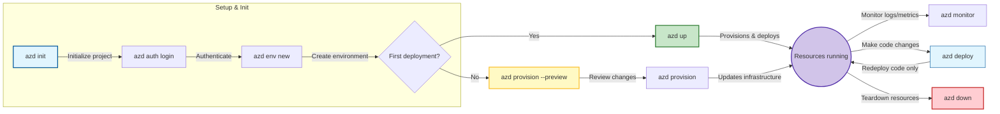
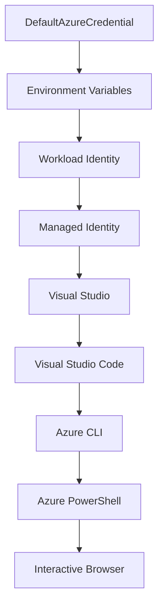

# Misingi ya AZD - Dhana za Msingi na Misingi

**Uelekezaji wa Sura:**
- **📚 Nyumbani kwa Kozi**: [AZD Kwa Waanzilishi](../../README.md)
- **📖 Sura ya Sasa**: Sura 1 - Msingi & Mwanzo wa Haraka
- **⬅️ Iliyopita**: [Muhtasari wa Kozi](../../README.md#-chapter-1-foundation--quick-start)
- **➡️ Ifuatayo**: [Usakinishaji & Mipangilio](installation.md)
- **🚀 Sura Ifuatayo**: [Sura 2: Maendeleo ya AI-Kwanza](../chapter-02-ai-development/microsoft-foundry-integration.md)

## Utangulizi

> Imepitiwa dhidi ya `azd 1.37.2` (Novemba 2026). Amri za Bash hutumia vidishi vilivyo katika nukuu ambavyo lazima ubadilishe. Mitiririko ya kazi ya template hutumia `.` kuanzisha saraka ya sasa; bila hoja ya saraka, uanzishwaji wa template huunda saraka ndogo na haubadilishi saraka ya kazi ya shell yako. Vidokezo vya hali ya juu ni vya mfano, si miradi kamili.

Somo hili linakuletea Azure Developer CLI (azd), zana yenye nguvu ya mstari wa amri inayoongeza kasi safari yako kutoka kwa maendeleo ya eneo la ndani hadi usambazaji wa Azure. Utafahamu dhana za msingi, vipengele muhimu, na kuelewa jinsi azd inavyorahisisha usambazaji wa programu za wingu-asili.

## Malengo ya Kujifunza

Mwisho wa somo hili, utakuwa umeweza:
- Elewa azd ni nini na kusudi lake kuu
- Jifunze dhana za msingi za templates, mazingira, na huduma
- Chunguza vipengele muhimu ikiwemo maendeleo yanayoendeshwa na template na Miundombinu kama Msimbo
- Elewa muundo wa mradi wa azd na mtiririko wa kazi
- Kuwa tayari kusakinisha na kusanidi azd kwa mazingira yako ya maendeleo

## Matokeo ya Kujifunza

Baada ya kumaliza somo hili, utaweza:
- Eleza jukumu la azd katika mitiririko ya kazi ya maendeleo ya wingu wa kisasa
- Tambua vipengele vya muundo wa mradi wa azd
- Eleza jinsi templates, mazingira, na huduma zinavyofanya kazi pamoja
- Elewa faida za Miundombinu kama Msimbo na azd
- Tambua amri tofauti za azd na madhumuni yake

## Azure Developer CLI (azd) ni Nini?

Azure Developer CLI (azd) ni zana ya mstari wa amri iliyotengenezwa kuongeza kasi safari yako kutoka maendeleo ya ndani hadi usambazaji wa Azure. Inarahisisha mchakato wa kujenga, kusambaza, na kusimamia programu za wingu-asili kwenye Azure.

### Unaweza Kusambaza Nini kwa azd?

azd inaunga mkono aina mbalimbali za mizigo ya kazi — na orodha inaendelea kuongezeka. Leo, unaweza kutumia azd kusambaza:

| Aina ya Mizigo ya Kazi | Mifano | Mtiririko Mmoja? |
|---------------|----------|----------------|
| **Programu za jadi** | Programu za wavuti, APIs za REST, tovuti zisizo na mabadiliko | ✅ `azd up` |
| **Huduma na huduma ndogo** | Programu za Kontena, Programu za Kazi, nyuma za huduma nyingi | ✅ `azd up` |
| **Programu zinazotumia AI** | Programu za mazungumzo na Microsoft Foundry Models, suluhisho za RAG na Utafutaji wa AI | ✅ `azd up` |
| **Wakala wa akili** | Wakala walioko Foundry, usimamizi wa wakala wengi | ✅ `azd up` |

Mwenendo wa muhimu ni kwamba **mzunguko wa maisha wa azd hubaki ule ule bila kujali unachosasambaza**. Unaanzisha mradi, kutoa miundombinu, kusambaza msimbo wako, kufuatilia programu yako, na kusafisha — iwe ni tovuti rahisi au wakala wa AI mwenye akili nyingi.

Mtiririko huu ni kwa kusudi. azd hutumia uwezo wa AI kama aina nyingine ya huduma ambayo programu yako inaweza kutumia, si kitu tofauti kabisa. Kivuko cha mazungumzo cha kuungwa mkono na Microsoft Foundry Models ni, kwa mtazamo wa azd, huduma nyingine tu ya kusanidi na kusambaza.

### 🎯 Kwa Nini Utumie AZD? Mlinganisho Halisi

Tufananishe kusambaza programu rahisi ya wavuti yenye hifadhidata:

#### ❌ BILA AZD: Usambazaji wa Azure wa Kawaida (Dakika 30+)

**Mfano wa ulinganisho wa Bash, si mianzo ya programu inayoweza kuendeshwa.** Hii inadhani msimbo wa programu uliopo, majina ya rasilimali ya kipekee, uthibitishaji wa Azure CLI, na nyongeza za CLI zinazohitajika. Tumia mazoezi ya template hapo chini kwa njia ya mwisho hadi mwisho inayoungwa mkono.

```bash
# Step 1: Create resource group
az group create --name myapp-rg --location eastus

# Step 2: Create App Service Plan
az appservice plan create --name myapp-plan \
  --resource-group myapp-rg \
  --sku B1 --is-linux

# Step 3: Create Web App
az webapp create --name myapp-web-unique123 \
  --resource-group myapp-rg \
  --plan myapp-plan \
  --runtime "NODE:22-lts"

# Step 4: Create Cosmos DB account (10-15 minutes)
az cosmosdb create --name myapp-cosmos-unique123 \
  --resource-group myapp-rg \
  --kind MongoDB

# Step 5: Create database
az cosmosdb mongodb database create \
  --account-name myapp-cosmos-unique123 \
  --resource-group myapp-rg \
  --name tododb

# Step 6: Create collection
az cosmosdb mongodb collection create \
  --account-name myapp-cosmos-unique123 \
  --resource-group myapp-rg \
  --database-name tododb \
  --name todos

# Step 7: Get connection string
CONN_STR=$(az cosmosdb keys list \
  --name myapp-cosmos-unique123 \
  --resource-group myapp-rg \
  --type connection-strings \
  --query "connectionStrings[0].connectionString" -o tsv)

# Step 8: Configure app settings
az webapp config appsettings set \
  --name myapp-web-unique123 \
  --resource-group myapp-rg \
  --settings MONGODB_URI="$CONN_STR"

# Step 9: Enable logging
az webapp log config --name myapp-web-unique123 \
  --resource-group myapp-rg \
  --application-logging filesystem \
  --detailed-error-messages true

# Step 10: Set up Application Insights
az monitor app-insights component create \
  --app myapp-insights \
  --location eastus \
  --resource-group myapp-rg

# Step 11: Link App Insights to Web App
INSTRUMENTATION_KEY=$(az monitor app-insights component show \
  --app myapp-insights \
  --resource-group myapp-rg \
  --query "instrumentationKey" -o tsv)

az webapp config appsettings set \
  --name myapp-web-unique123 \
  --resource-group myapp-rg \
  --settings APPINSIGHTS_INSTRUMENTATIONKEY="$INSTRUMENTATION_KEY"

# Step 12: Build application locally
npm install
npm run build

# Step 13: Create deployment package
zip -r app.zip . -x "*.git*" "node_modules/*"

# Step 14: Deploy application
az webapp deployment source config-zip \
  --resource-group myapp-rg \
  --name myapp-web-unique123 \
  --src app.zip

# Step 15: Wait and pray it works 🙏
# (No automated validation, manual testing required)
```

**Matatizo:**
- ❌ Amri 15+ za kukumbuka na kutekeleza kwa mpangilio
- ❌ Kazi ya mkono ya dakika 30-45
- ❌ Rahisi kufanya makosa (matamshi makosa, vigezo vibaya)
- ❌ Vyeti vinahitaji usimamizi wa wazi; kumbukumbu za mchakato na ufuatiliaji wa shell vinaweza kuvitangaza
- ❌ Hakuna urudisho wa moja kwa moja ikiwa kitu kitashindwa
- ❌ Gumu kuiga kwa wanahabari wa timu
- ❌ Tofauti kila wakati (haiwezi kurudiwa)

#### ✅ NA AZD: Usambazaji Otomatiki (Amri 5, Dakika 10-15)

```bash
# Step 1: Initialize from template
azd init --template todo-nodejs-mongo .

# Step 2: Authenticate
azd auth login

# Step 3: Select the environment created during init
azd env select dev

# Step 4: Preview changes (optional but recommended)
azd provision --preview

# Step 5: Deploy everything
azd up

# ✨ Done! Everything is deployed, configured, and monitored
```

**Faida:**
- ✅ **Amri 5** dhidi ya hatua 15+ za mikono
- ✅ **Dakika 10-15** jumla (hasa kusubiri Azure)
- ✅ **Makosa machache ya mikono** - mtiririko thabiti unaoendeshwa na template
- ✅ **Usimamizi salama wa siri** - templates nyingi hutumia uhifadhi wa siri uliofadhiliwa na Azure
- ✅ **Usambazaji unaorudiwa** - mtiririko ule ule kila wakati
- ✅ **Maelezo ya miundombinu inayorudiwa** - chini ya vikwazo, upatikanaji wa eneo, na toleo la template
- ✅ **Tayari kwa timu** - mtu yeyote anaweza kusambaza kwa amri zile zile
- ✅ **Miundombinu kama Msimbo** - templates za Bicep zilizosimamiwa kwa matoleo
- ✅ **Ufuatiliaji unaoelezwa na Template** - Application Insights inapojumuishwa kwenye template

### Muda na Uhakika

Muda uliotajwa hapo juu ni makadirio, si viwango rasmi. azd inapunguza amri unazotakiwa kuratibu, lakini haitahakikishi muda wa usambazaji, kuondoa makosa, au kutoa urudisho wa moja kwa moja wa programu/hifadhidata. Hifadhi matoleo ya kazi katika udhibiti wa chanzo na jaribu taratibu za urejeshaji.

## Dhana za Msingi

### Templates
Templates ni msingi wa azd. Zinajumuisha:
- **Msimbo wa programu** - Msimbo wako wa chanzo na tegemezi
- **Maelezo ya miundombinu** - rasilimali za Azure zilizobainishwa kwa Bicep au Terraform
- **Faili za usanidi** - Mipangilio na vigezo vya mazingira
- **Skripti za usambazaji** - mitiririko ya kazi ya usambazaji wa moja kwa moja

### Mazingira
Mazingira yanawakilisha malengo tofauti ya usambazaji:
- **Maendeleo** - Kwa majaribio na maendeleo
- **Kukaribisha** - Mazingira ya kabla ya uzalishaji
- **Uzalishaji** - Mazingira ya uzalishaji hai

Kila mazingira huendeleza:
- Jina la mazingira na thamani; uingizwaji wa rasilimali hutegemea template ya miundombinu
- Mipangilio ya usanidi
- Hali ya usambazaji

### Huduma
Huduma katika `azure.yaml` zinaelezea vipengele vya programu vinavyoweza kusambazwa:
- **Mbele** - Programu za wavuti, SPA
- **Nyuma** - APIs, huduma ndogo

Hifadhidata na hifadhi kwa kawaida hutolewa kama rasilimali za miundombinu, si watumishi wa huduma waliobuniwa kama `host: postgres`.

## Vipengele Muhimu

### 1. Maendeleo yanayoongozwa na Template
```bash
# Browse available templates
azd template list

# Initialize from a template
azd init --template "<template-name>" .
```

### 2. Miundombinu kama Msimbo
- **Bicep** - Lugha ya kipekee ya Azure
- **Terraform** - Zana ya miundombinu ya multi-wingu
- Bicep hukusanya hadi templates za ARM; ARM ya raw JSON si sehemu tofauti iliyojengwa ndani `infra.provider`.

### 3. Mitiririko ya Kazi Inayoshirikiana
```bash
# Complete deployment workflow
azd up            # Provision + Deploy this is hands off for first time setup

# 🧪 NEW: Preview infrastructure changes before deployment (SAFE)
azd provision --preview    # Simulate infrastructure deployment without making changes

azd provision     # Create Azure resources if you update the infrastructure use this
azd deploy        # Deploy application code or redeploy application code once update
azd down          # Clean up resources
```

#### 🛡️ Kupangilia Miundombinu Salama na Mapitio
Amri ya `azd provision --preview` ni mabadiliko muhimu kwa usambazaji salama:
- **Uchambuzi wa kukausha** - Inaonyesha yatakayoundwa, kubadilishwa, au kufutwa
- **Hakuna utekelezaji wa miundombinu** - Hakiki mabadiliko ya mtoaji; angalia kwa makini kaboloko za mradi kwanza, kwa sababu kaboloko zinaweza kuendesha amri zenye athari
- **Shirikiano la timu** - Shiriki matokeo ya mapitio kabla ya usambazaji
- **Msaada wa mipango ya gharama** - Angalia SKU zilizopendekezwa, kisha zipime kwa Kihesabucha bei cha Azure; mapitio hayawezi kuhesabu bei

```bash
# Example preview workflow
azd provision --preview           # See what will change
# Review the output, discuss with team
azd provision                     # Apply changes with confidence
```

### 📊 Mchoro: Mtiririko wa Maendeleo ya AZD



**Maelezo ya Mtiririko wa Kazi:**
1. **Anzisha** - Anza na template au mradi mpya
2. **Thibitisha** - Thibitisha na Azure
3. **Maz环境** - Unda mazingira ya usambazaji yenye kujitenga
4. **Angalia** - 🆕 Daima angalia mabadiliko ya miundombinu kwanza (kazi salama)
5. **Toa** - Unda/badilisha rasilimali za Azure
6. **Sambaza** - Sambaza msimbo wa programu yako
7. **Fuatilia** - Angalia utendaji wa programu
8. **Rudia** - Fanya mabadiliko na sambaza tena msimbo
9. **Safisha** - Ondoa rasilimali ukimaliza

### 4. Usimamizi wa Maz环境
```bash
# Create and manage environments
azd env new "<environment-name>"
azd env select "<environment-name>"
azd env list
```

### 5. Nyongeza na Amri za AI

azd inatumia mfumo wa nyongeza kuongeza uwezo zaidi ya CLI ya msingi. Hii ni hasa muhimu kwa mizigo ya AI:

```bash
# List available extensions
azd extension list

# Install the GA Foundry bundle (requires azd >= 1.37.0)
azd ext install microsoft.foundry

# Initialize an AI agent project interactively
azd ai agent init

# Test a deployed agent (shows latency and time-to-first-byte)
azd ai agent invoke

# Start the MCP server for AI-assisted development (Alpha)
azd mcp start
```

**Mzunguko wa maisha wa wakala, kuanzia mwanzo hadi mwisho.** Pakiti rasmi ya GA `microsoft.foundry` inajumuisha `azure.ai.agents` na nyongeza sita kuu. Sakinisha `azure.ai.evaluations` kivyake kwa tathmini. Tumia `azd >= 1.37.0` kwa mtiririko huu. Hautaji hizi zote siku ya kwanza:

| Hatua | Amri | Inafanya Nini |
|-------|---------|--------------|
| **Kukokotoa** | `azd ai agent init --template <path-to-azure.yaml>` | Kubali template ya mradi wa wakala wa sasa |
| **Endesha ndani ya eneo la ndani** | `azd ai agent run`, kisha `azd ai agent invoke --local "Test prompt"` katika terminal nyingine | Angalia shughuli za ndani katika Agent Inspector; simu za modeli bado zinatumia Azure |
| **Sambaza** | `azd deploy` | Kwa wakala walioko kwenye mode ya msimbo, pakia chanzo kwa ujenzi wa mbali wa Foundry |
| **Jaribu** | `azd ai agent invoke` | Piga simu kwa wakala na angalia muda wa majibu |
| **Pima** | `azd ai eval init`, `generate`, `run start` | Sanidi, sambaza, na fanya tathmini kwa kutumia nyongeza tofauti |
| **Boreshaji** | `azd ai agent optimize --eval <evaluation-name> --optimize-model <optimizer-deployment>` | Tumia tena tathmini inayolingana kuboresha wakala |
| **Angalia** | `azd ai agent endpoint show` | Tazama usanidi wa kiungo hai |
| **Safisha** | `azd ai agent delete` | Futa wakala aliyohudumiwa na matoleo yote |

> Anza na [mwongozo wa wakala wa GA](../chapter-02-ai-development/microsoft-foundry-integration.md#hosted-agent-walkthrough-ga), unaojumuisha masharti, utoaji, na usafishaji salama. Nyongeza zinajadiliwa zaidi katika marejeleo ya [AZD AI CLI Commands](../chapter-08-production/production-ai-practices.md#azd-ai-cli-commands-and-extensions).

## 📁 Muundo wa Mradi

Muundo wa kawaida wa mradi wa azd:
```
my-app/
├── .azure/                  # Local environments and selected-environment config
│   ├── config.json
│   └── dev/.env
├── .devcontainer/          # Development container config
├── .github/workflows/      # GitHub Actions
├── .vscode/               # VS Code settings
├── infra/                 # Infrastructure code
│   ├── main.bicep        # Main infrastructure template
│   ├── main.parameters.json
│   └── modules/          # Reusable modules
├── src/                  # Application source code
│   ├── api/             # Backend services
│   └── web/             # Frontend application
├── azure.yaml           # azd project configuration
└── README.md
```

## 🔧 Faili za Usanidi

### azure.yaml
Faili kuu ya usanidi wa mradi:
```yaml
name: my-awesome-app
metadata:
  template: my-template@1.0.0

services:
  web:
    project: ./src/web
    language: js
    host: appservice
  api:
    project: ./src/api
    language: js
    host: appservice

hooks:
  preprovision:
    shell: pwsh
    run: echo "Preparing to provision..."
```

### .azure/config.json
Uchaguzi wa mazingira ya msingi wa mradi (kwa mfano; unasimamiwa na azd):
```json
{
  "defaultEnvironment": "dev"
}
```

## 🎪 Mitiririko ya Kawaida na Mazoezi ya Vitendo

> **💡 Vidokezo vya Kujifunza:** Fuata mazoezi haya kwa mpangilio kujenga ujuzi wako wa AZD hatua kwa hatua.

### 🎯 Zoefzi 1: Anzisha Mradi Wako wa Kwanza

**Lengo:** Unda mradi wa AZD na chunguza muundo wake

**Hatua:**
```bash
# Use a proven template
mkdir azd-basics-practice
cd azd-basics-practice
# Choose "dev" for the environment name when prompted
azd init --template todo-nodejs-mongo .

# Explore the generated files
ls -la  # View all files including hidden ones

# Key files created:
# - azure.yaml (main config)
# - infra/ (infrastructure code)
# - src/ (application code)
```

**✅ Mafanikio:** Una azure.yaml, infra/, na saraka za src/

---

### 🎯 Zoefzi 2: Sambaza kwa Azure

**Lengo:** Maliza usambazaji wa mwisho hadi mwisho

**Hatua:**
```bash
# 1. Authenticate
azd auth login

# 2. Select the dev environment created in Exercise 1
azd env select dev
azd env set AZURE_LOCATION eastus

# 3. Preview changes (RECOMMENDED)
azd provision --preview

# 4. Deploy everything
azd up

# 5. Verify deployment
azd show    # View your app URL
```

**Muda Unaotarajiwa:** Dakika 10-15  
**✅ Mafanikio:** URL ya programu inafunguka katika kivinjari

---

### 🎯 Zoefzi 3: Maz环境 Mengi

**Lengo:** Sambaza kwa dev na staging

**Hatua:**
```bash
# Already have dev, create staging
azd env new staging
azd env set AZURE_LOCATION westus2
azd up

# Switch between them
azd env list
azd env select dev
```

**✅ Mafanikio:** Makundi mawili tofauti ya rasilimali katika Azure Portal

**Usafishaji:** Zoefzi 3 huunda usambazaji wa pili unaolipika. Futa zote mbili unapo maliza:

```bash
azd down --environment dev
azd down --environment staging
```

---

### 🛡️ Usafishaji wa Kuangamiza: `azd down --force --purge`

Unapotaka kwa makusudi kufuta rasilimali za mazingira uliyochagua za Azure:

```bash
azd down --force --purge
```

**Inafanya Nini:**
- `--force`: Hakuna maonyo ya uthibitisho
- `--purge`: Pia huondoa kwa kudumu rasilimali zilizofutwa kwa upole zinazoungwa mkono (kwa mfano Key Vaults), pale kinga ya kusafisha inavyo ruhusu. Haiondoi saraka ya eneo la ndani `.azure/`.

**Tumia wakati:** umemaliza na mazingira ya matumizi ya muda. Usichukulie usafishaji wa kuangamiza kama jibu la kwanza kwa hitilafu ya uthibitishaji, ukomo, au usanidi.

---

## 🎪 Marejeleo ya Mtiririko Asili

### Kuanza Mradi Mpya
```bash
# Method 1: Use existing template
azd init --template todo-nodejs-mongo .

# Method 2: Start from scratch
azd init

# Method 3: Use current directory
azd init .
```

### Mzunguko wa Maendeleo
```bash
# Set up development environment
azd auth login
azd env new dev
azd env select dev

# Deploy everything
azd up

# Make changes and redeploy
azd deploy

# Clean up when done
azd down --force --purge # Deletes this environment's discovered Azure resources; review before forcing deletion.
```

## Kuelewa `azd down --force --purge`
Amri ya `azd down --force --purge` ni njia yenye nguvu ya kuondoa kabisa mazingira yako ya azd na rasilimali zote zinazohusiana. Hapa kuna muhtasari wa kile kila bendera inafanya:
```
--force
```
- Hukwepa maonyo ya uthibitisho.
- Inafaa kwa ut automatisimu au uandishi wa skripti ambapo kuingiza kwa mtu mwanzoni si rahisi.
- Hainyimwi ruhusa, kinga ya kusafisha, au kushindwa kwa ufutaji.

```
--purge
```
Inafuta kabisa rasilimali za Azure zilizoondolewa kwa upole zinazoungwa mkono bila uthibitisho wa ziada. Ulinzi wa kufuta kabisa na ruhusa bado zinaendelea kutumika. Hii **haitaondoa** mazingira ya ndani au folda ya `.azure/`.


### Kwa nini utumie zote mbili?
Tumia zote mbili tu unaporudia kusafisha rasilimali za Azure za mazingira yaliyochaguliwa na kufuta kabisa rasilimali zinazoweza kurejeshwa. Hii ni usafishaji hatari, si marekebisho ya jumla au upya wa hali ya ndani.

Ni msaada hasa baada ya kufuta kwa mikono rasilimali ndani ya lango la Azure au unapo badilisha templeti, mazingira, au miongozo ya majina ya kundi la rasilimali.


### Kusimamia Mazingira mengi
```bash
# Create staging environment
azd env new staging
azd env select staging
azd up

# Switch back to dev
azd env select dev

# Compare environments
azd env list
```

## 🔐 Uthibitishaji na Vibali

Tambua tofauti kati ya uthibitishaji wa utekelezaji (`azd auth login`) na uthibitishaji wa SDK ya programu (`DefaultAzureCredential`). Ni tofauti. azd haifanyi matumizi ya vibali vya Azure CLI kwa chaguo-msingi.

### Uthibitishaji wa Azure CLI (`az login`)

Endesha `azd auth login` kwa ajili ya azd. Amri zifuatazo za Azure CLI ni hiari na zinathibitisha amri za `az` kando:

```bash
# Interactive login (opens browser)
az login

# Login with specific tenant
az login --tenant "<tenant-id>"

# Login with service principal
az login --service-principal -u "<app-id>" -p "<password>" --tenant "<tenant-id>"

# Check current login status
az account show

# List available subscriptions
az account list --output table

# Set default subscription
az account set --subscription "<subscription-id>"
```

### Mtiririko wa Uthibitishaji
1. **Ingia kwa Kiwilisho**: Hufungua kivinjari chako chaguo-msingi kwa uthibitishaji
2. **Mtiririko wa Msimbo wa Kifaa**: Kwa mazingira yasiyo na ufikiaji wa kivinjari
3. **Msimamizi wa Huduma**: Kwa hali za otomatiki na CI/CD
4. **Utambulisho Ulioendeshwa**: Kwa programu zinazoendeshwa Azure

### Mwanga wa DefaultAzureCredential

`DefaultAzureCredential` ni aina ya kitambulisho kinachotoa uzoefu rahisi wa uthibitishaji kwa kujaribu vyanzo vya kitambulisho vingi kiotomatiki kwa mpangilio maalum:

#### Mwanga wa Kitambulisho cha SDK ya Programu

Mwanga huo hutegemea lugha ya Azure Identity SDK, toleo, viendelezi vilivyowekwa, na chaguzi zinazopatikana. Mchoro huu ni wa dhana, si mfululizo thabiti wa uthibitishaji wa azd; SDK za hivi karibuni pia zinaweza kujumuisha vitambulisho vya Azure Developer CLI.


#### 1. Mabadiliko ya Mazingira
```bash
# Set environment variables for service principal
export AZURE_CLIENT_ID="<app-id>"
export AZURE_CLIENT_SECRET="<password>"
export AZURE_TENANT_ID="<tenant-id>"
```

#### 2. Utambulisho wa Kazi (Kubernetes/GitHub Actions)
Hutumika kiotomatiki katika:
- Huduma ya Kubernetes ya Azure (AKS) na Utambulisho wa Kazi
- Vitendo vya GitHub na muungano wa OIDC
- Hali nyingine za utambulisho zinazounganishwa

#### 3. Utambulisho ulioendeshwa
Kwa rasilimali za Azure kama:
- Mashine pepe
- Huduma ya Programu
- Azure Functions
- Matumizi ya Kontena

```bash
# Inspect a deployed Container App's configured identity (requires az login)
az containerapp show --name "<app-name>" --resource-group "<rg-name>" --query identity
```

#### 4. Muungano wa Zana za Mwana Programu
- **Visual Studio**: Hutumia akaunti iliyosainiwa kiotomatiki
- **VS Code**: Msaada hutegemea SDK na usanidi wa wakala/kiendelezi unaounga mkono
- **Azure CLI**: Hutumia vitambulisho vya `az login` (hasa kwa maendeleo ya eneo la kazi)

### Mipangilio ya Uthibitishaji ya AZD

```bash
# Method 1: Direct azd authentication (recommended)
azd auth login

# Method 2: Direct azd authentication
azd auth login --use-device-code  # For headless environments

# Method 3: Check authentication status
azd auth login --check-status

# Method 4: Logout and re-authenticate
azd auth logout
azd auth login
```

### Mbinu Bora za Uthibitishaji

#### Kwa Maendeleo ya Kielekezi
```bash
# 1. Log in to azd
azd auth login

# 2. Select the subscription for this initialized environment
azd env set AZURE_SUBSCRIPTION_ID "<subscription-id>"

# 3. Check azd sign-in details (read the status message)
azd auth login --check-status
```

#### Kwa Mizunguko ya CI/CD
```yaml
# Partial GitHub Actions steps: assumes checkout, azd installation,
# required AZURE_* environment values, and pipeline secret configuration.
- name: Deploy with azd
  run: |
    azd auth login --client-id ${{ secrets.AZURE_CLIENT_ID }} \
                    --client-secret ${{ secrets.AZURE_CLIENT_SECRET }} \
                    --tenant-id ${{ secrets.AZURE_TENANT_ID }}
    azd up --no-prompt
```

#### Kwa Mazingira ya Utengenezaji
- Tumia **Utambulisho ulioendeshwa** wakati wa kuendesha rasilimali za Azure
- Tumia **Msimamizi wa Huduma** kwa hali za otomatiki
- Epuka kuhifadhi vitambulisho kwenye msimbo au faili za usanidi
- Tumia **Azure Key Vault** kwa usanidi nyeti

### Masuala na Suluhisho za Uthibitishaji Zinazojirudia

#### Tatizo: "Hakuna usajili ulio patikana"
```bash
# Solution: Set default subscription
az account list --output table
az account set --subscription "<subscription-id>"
azd env set AZURE_SUBSCRIPTION_ID "<subscription-id>"
```

#### Tatizo: "Ruhusa hazitoshi"
```bash
# Solution: Check and assign required roles
az role assignment list --assignee $(az account show --query user.name --output tsv)

# Common required roles:
# - Contributor (for resource management)
# - User Access Administrator (for role assignments)
```

#### Tatizo: "Tokeni imeisha muda wake"
```bash
# Solution: Re-authenticate
az logout
az login
azd auth logout
azd auth login
```

### Uthibitishaji Katika Hali Mbali Mbali

#### Maendeleo ya Kielekezi
```bash
# Personal development account
az login
azd auth login
```

#### Maendeleo ya Timu
```bash
# Use specific tenant for organization
az login --tenant contoso.onmicrosoft.com
azd auth login --tenant-id "<tenant-id>"
```

#### Hali za Wamiliki Wengi
```bash
# Switch between tenants
az login --tenant tenant1.onmicrosoft.com
azd auth login --tenant-id "<tenant-1-id>"
# Select an environment configured with tenant 1's subscription
azd env select tenant1-dev
# Deploy to tenant 1
azd up

az login --tenant tenant2.onmicrosoft.com  
azd auth login --tenant-id "<tenant-2-id>"
azd env select tenant2-dev
# Deploy to tenant 2
azd up
```

### Mawazo ya Usalama

1. **Uhifadhi wa Vitambulisho**: Kamwe usihifadhi vitambulisho katika msimbo wa chanzo
2. **Kizuizi cha Uenezi**: Tumia kanuni ya upungufu wa mamlaka kwa wasimamizi wa huduma
3. **Mzunguko wa Tokeni**: Badilisha siri za msimamizi wa huduma mara kwa mara
4. **Rekodi ya Ukaguzi**: Fuata shughuli za uthibitishaji na usambazaji
5. **Usalama wa Mtandao**: Tumia vituo vya binafsi inapowezekana

### Kutatua Matatizo ya Uthibitishaji

```bash
# Debug authentication issues
azd auth login --check-status
az account show
az account get-access-token

# Common diagnostic commands
whoami                          # Current user context
az ad signed-in-user show      # Microsoft Entra ID user details
az group list                  # Test resource access
```

## Ugunduzi wa Amri

### Ugunduzi
```bash
azd template list              # Browse templates
azd template list --help       # Template discovery options
azd init --help               # Initialization options
```

### Usimamizi wa Mradi
```bash
azd show                     # Project overview
azd env list                # Available environments and selected default
azd config show            # Configuration settings
```

### Ufuatiliaji
```bash
azd monitor                  # Open Azure portal monitoring
azd monitor --logs           # View application logs
azd monitor --live           # View live metrics
azd pipeline config          # Set up CI/CD
```

## Mbinu Bora

### 1. Tumia Majina Yenye Maana
```bash
# Good
azd env new production-east
azd init --template todo-nodejs-mongo .

# Avoid
azd env new env1
azd init --template template1 .
```

### 2. Tumia Violezo
- Anza na violezo vilivyopo
- Rekebisha kwa mahitaji yako
- Tengeneza violezo vinavyoweza kutumika tena kwa shirika lako

### 3. Kutenganisha Mazingira
- Tumia mazingira tofauti kwa maendeleo/kupangilia/utengenezaji
- Kamwe usisambaze moja kwa moja kwenye uzalishaji kutoka kwa mashine ya eneo la kazi
- Tumia mizunguko ya CI/CD kwa usambazaji wa uzalishaji

### 4. Usimamizi wa Usanidi
- Tumia utambulisho ulioendeshwa na Key Vault kwa siri; thamani za kawaida za `azd env set` ni wazi kwa eneo la kazi
- Hifadhi usanidi katika udhibiti wa toleo
- Andika mipangilio maalum ya mazingira

## Mwelekeo wa Kujifunza

### Mwanzo (Wiki 1-2)
1. Sakinisha azd na uthibitishe
2. Sambaza kiolezo rahisi
3. Elewa muundo wa mradi
4. Jifunze amri za msingi (kuinua, kushusha, kusambaza)

### Kati (Wiki 3-4)
1. Rekebisha violezo
2. Simamia mazingira mengi
3. Elewa msimbo wa miundombinu
4. Panga mizunguko ya CI/CD

### Kama Mtaalamu (Wiki 5+)
1. Tengeneza violezo maalum
2. Mifano ya miundombinu ya hali ya juu
3. Usambazaji mikoa mingi
4. Mipangilio ya ngazi ya biashara

## Hatua Zifuatazo

**📖 Endelea Sermoni ya 1 Kwa Kujifunza:**
- [Usakinishaji na Usanidi](installation.md) - Pata azd imesakinishwa na kusanidiwa
- [Mradi Wako wa Kwanza](first-project.md) - Kukamilisha mafunzo ya vitendo
- [Mwongozo wa Usanidi](../chapter-03-configuration/configuration.md) - Chaguzi za usanidi wa juu

**🎯 Tayari kwa Sermoni Ifuatayo?**
- [Sermoni 2: Maendeleo ya AI-Kwanza](../chapter-02-ai-development/microsoft-foundry-integration.md) - Anza kujenga programu za AI

## Rasilimali Zaidi

- [Muhtasari wa Azure Developer CLI](https://learn.microsoft.com/en-us/azure/developer/azure-developer-cli/)
- [Hakikisho za Violezo](https://azure.github.io/awesome-azd/)
- [Mifano ya Jumuiya](https://github.com/Azure-Samples)

---

## 🙋 Maswali Yanayoulizwa Mara kwa Mara

### Maswali ya Kawaida

**Q: Tofauti kati ya AZD na Azure CLI ni nini?**

J: Azure CLI (`az`) ni kwa usimamizi wa rasilimali za Azure binafsi. AZD (`azd`) ni kwa kusimamia programu nzima:

```bash
# Azure CLI - Low-level resource management
az webapp create --name myapp --resource-group rg
az sql server create --name myserver --resource-group rg
# ...many more commands needed

# AZD - Application-level management
azd up  # Deploys entire app with all resources
```

**Fikiria hivyo hivi:**
- `az` = Kufanya kazi na kipande kimoja cha lego
- `azd` = Kufanya kazi na seti kamili za lego

---

**Q: Je, nahitaji kujua Bicep au Terraform kutumia AZD?**

J: Hapana! Anza na violezo:
```bash
# Use existing template - no IaC knowledge needed
azd init --template todo-nodejs-mongo .
azd up
```

Unaweza kujifunza Bicep baadaye ili kubinafsisha miundombinu. Violezo hutoa mifano ya kazi ya kujifunza.

---

**Q: Ni gharama gani kutumia violezo vya AZD?**

J: Gharama zinatofautiana kulingana na eneo, SKU, muda wa matumizi, hali ya database, na matumizi ya mfano. Mazingira ya maendeleo yanaweza kutoa gharama kubwa kila mwezi hata wakiwa wasio tumia; usifikirie aina ya ada $50-150 kwa jumla:

```bash
# Preview resource changes (not prices)
azd provision --preview

# Always cleanup when not using
azd down --force --purge  # Removes all resources
```

**Ushauri mzuri:** Tumia tabaka za bure inapopatikana:
- Huduma ya Programu: tabaka ya F1 (Bure)
- Azure OpenAI: hakuna tozo ya kuaminika ya tokeni bure ya kila mwezi; angalia bei za mfano na ofa za sasa
- Cosmos DB: akaunti zinazostahili njia zilizotolewa zinaweza kujisajili kwa tabaka la bure; violezo visivyo na seva havitafaa moja kwa moja

---

**Q: Je, naweza kutumia AZD na rasilimali za Azure zilizopo?**

J: Ndiyo, lakini ni rahisi kuanza upya. AZD inafanya kazi vizuri zaidi inapodhibiti mzunguko mzima wa maisha. Kwa rasilimali zilizopo:

```bash
# Option 1: Import existing resources (advanced)
azd init
# Then modify infra/ to reference existing resources

# Option 2: Start fresh (recommended)
azd init --template "<verified-template-name>" .
azd up  # Creates new environment
```

---

**Q: Ninamshirikishaje mradi wangu na wenzangu?**

J: Wekesha mradi wa AZD kwenye Git (lakini SI folda ya .azure):

```bash
# Already in .gitignore by default
.azure/        # Contains secrets and environment data
*.env          # Environment variables

# Team members then:
git clone "<your-repo>"
# Change into the cloned repository before running the remaining commands.
azd auth login
azd env new "<their-name>-dev"
azd up
```

Kila mtu anapata muundo sawa kutoka kwa violezo vyao vilevile.

---

### Maswali ya Kukabiliana na Matatizo

**Q: "azd up" ilishindwa katikati. Nifanye nini?**

J: Kagua kosa, lifanye kazi, kisha jaribu tena:

```bash
# Capture detailed diagnostics (redact sensitive values before sharing)
azd up --debug

# Common fixes:

# 1. If quota exceeded:
azd env set AZURE_LOCATION "westus2"  # Try different region

# 2. If resource name conflict:
azd down --force --purge  # Clean slate
azd up  # Retry

# 3. If auth expired:
az login
azd auth login
azd up
```

**Tatizo la kawaida:** Usajili wa Azure usio sahihi umechaguliwa
```bash
az account list --output table
az account set --subscription "<correct-subscription>"
azd env set AZURE_SUBSCRIPTION_ID "<correct-subscription-id>"
```

---

**Q: Ninasambazaje mabadiliko ya msimbo tu bila kusanidi upya miundombinu?**

J: Tumia `azd deploy` badala ya `azd up`:

```bash
azd up          # First time: provision + deploy (slow)

# Make code changes...

azd deploy      # Subsequent times: deploy only (fast)
```

Kimsingi kasi ya kulinganisha:
- `azd up`: dakika 10-15 (huweka miundombinu)
- `azd deploy`: dakika 2-5 (msimbo tu)

---

**Q: Naweza kubinafsisha violezo vya miundombinu?**

J: Ndiyo! Hariri faili za Bicep katika `infra/`:

```bash
# After azd init
cd infra/
code main.bicep  # Edit in VS Code

# Preview changes
azd provision --preview

# Apply changes
azd provision
```

**Ushauri:** Anza kidogo - badilisha kwanza SKU:
```bicep
// infra/main.bicep
sku: {
  name: 'B1'  // Change to 'P1V2' for production
}
```

---

**Q: Nafuta vipi yote AZD iliunda?**

J: Amri moja huondoa rasilimali zote:

```bash
azd down --force --purge

# This deletes:
# - Azure resources/resource groups discovered for the selected environment
# - Supported soft-deleted resources, if purge protection allows
# Local .azure files remain; shared/external resources may remain too.
```

**Daima fanya hivi wakati:**
- Umemaliza kujaribu kiolezo
- Unabadilisha mradi tofauti
- Unataka kuanza upya

**Ukaguzi wa gharama:** Thibitisha kufutwa kwenye Azure na kagua rasilimali zilizohifadhiwa/zimelenga. Ada zilizotumika hapo awali bado zinaendelea.

---

**Q: Nifanye nini kama kwa bahati mbaya nilifuta rasilimali katika Azure Portal?**

J: Hali ya AZD inaweza kutofautiana na hali halisi. Njia ya safisha:

```bash
# 1. Delete remaining resources only if that is your intent
azd down --force --purge

# 2. Start fresh
azd up

# Alternative: Let AZD detect and fix
azd provision  # Will create missing resources
```

---

### Maswali ya Maandalizi ya Juu

**Q: Naweza kutumia AZD katika mizunguko ya CI/CD?**

J: Ndiyo! Mfano wa GitHub Actions:

```yaml
# .github/workflows/deploy.yml
name: Deploy with AZD

on:
  push:
    branches: [main]

jobs:
  deploy:
    runs-on: ubuntu-latest
    steps:
      - uses: actions/checkout@v4
      
      - name: Install azd
        run: curl -fsSL https://aka.ms/install-azd.sh | bash
      
      - name: Azure Login
        run: |
          azd auth login \
            --client-id ${{ secrets.AZURE_CLIENT_ID }} \
            --client-secret ${{ secrets.AZURE_CLIENT_SECRET }} \
            --tenant-id ${{ secrets.AZURE_TENANT_ID }}
      
      - name: Deploy
        env:
          AZURE_ENV_NAME: dev
          AZURE_LOCATION: ${{ vars.AZURE_LOCATION }}
          AZURE_SUBSCRIPTION_ID: ${{ vars.AZURE_SUBSCRIPTION_ID }}
        run: azd up --no-prompt
```

---

**Q: Namshughulikiaje siri na data nyeti?**

J: Tumia Key Vault waziwazi. `azd env set` huandika thamani za kawaida kwenye faili la mazingira la eneo la kazi; hasi huzuia kiatomati uundaji wa hazina, kugawa majukumu, au kuingiza siri kwenye programu yako.

```bash
# Interactive: create/select a Key Vault secret and save its reference
azd env set-secret DATABASE_PASSWORD
```

Unahitaji ruhusa zinazofaa za hazina. Miundombinu/programu lazima itoe msingi wa siri kwa mtumiaji wake na kutoa ruhusa ya utambulisho wa wakati wa utekelezaji. Usichapishe thamani halisi za siri kwenye kumbukumbu.

**Kamwe usiweka:**
- Folda ya `.azure/` (ina data za mazingira)
- Faili za `.env` (siri za eneo la kazi)
- Mifungo ya muunganisho

---

**Q: Naweza kusambaza katika mikoa mingi?**

J: Ndiyo, unda mazingira kwa kila mkoa:

```bash
# East US environment
azd env new prod-eastus
azd env set AZURE_LOCATION eastus
azd up

# West Europe environment
azd env new prod-westeurope
azd env set AZURE_LOCATION westeurope
azd up

# Each environment is independent
azd env list
```

Kwa programu halisi zenye mikoa mingi, rekebisha violezo vya Bicep kusambaza kwa mikoa mingi kwa wakati mmoja.

---

**Q: Naweza kupata msaada wapi nitakapo kwama?**

1. **Nyaraka za AZD:** https://learn.microsoft.com/azure/developer/azure-developer-cli/
2. **Masuala ya GitHub:** https://github.com/Azure/azure-dev/issues
3. **Discord:** [Azure Discord](https://discord.gg/microsoft-azure) - kituo cha #azure-developer-cli
4. **Stack Overflow:** Lebo `azure-developer-cli`
5. **Kozi Hii:** [Mwongozo wa Kutatua Matatizo](../chapter-07-troubleshooting/common-issues.md)

**Ushauri mzuri:** Kabla ya kuuliza, endesha:
```bash
azd show       # Shows current state
azd version    # Shows your version
```
Jumlisha habari hii katika swali lako kwa msaada wa haraka.

---

## 🎓 Nini Kifuatacho?

Sasa unaelewa misingi ya AZD. Chagua njia yako:

### 🎯 Kwa Waanzilishi:
1. **Ifuatayo:** [Usakinishaji na Usanidi](installation.md) - Sakinisha AZD kwenye mashine yako
2. **Kisha:** [Mradi Wako wa Kwanza](first-project.md) - Sambaza programu yako ya kwanza
3. **Zoezi:** Kamilisha mazoezi yote 3 katika somo hili

### 🚀 Kwa W developers AI:
1. **Ruka kwenda:** [Sermoni 2: Maendeleo ya AI-Kwanza](../chapter-02-ai-development/microsoft-foundry-integration.md)
2. **Sambaza:** Katika saraka tupu ya mradi, anza na `azd init --template get-started-with-ai-chat .`
3. **Jifunze:** Jenga huku unasambaza

### 🏗️ Kwa W developers Wenye Uzoefu:
1. **Pitia:** [Mwongozo wa Usanidi](../chapter-03-configuration/configuration.md) - Mipangilio ya hali ya juu
2. **Chunguza:** [Miundombinu kama Msimbo](../chapter-04-infrastructure/provisioning.md) - Uchunguzi wa Bicep
3. **Jenga:** Tengeneza violezo maalum kwa stack yako

---

**Uelekezaji wa Sura:**
- **📚 Nyumbani Kozi**: [AZD Kwa Waanzilishi](../../README.md)
- **📖 Sura ya Sasa**: Sura 1 - Msingi & Mwanzo Haraka  
- **⬅️ Iliyopita**: [Muhtasari wa Kozi](../../README.md#-chapter-1-foundation--quick-start)
- **➡️ Ifuatayo**: [Usakinishaji na Usanidi](installation.md)
- **🚀 Sura Ifuatayo**: [Sura 2: Maendeleo ya AI-Kwanza](../chapter-02-ai-development/microsoft-foundry-integration.md)

---

<!-- CO-OP TRANSLATOR DISCLAIMER START -->
**Kionyozo**:
Hati hii imetafsiriwa kwa kutumia huduma ya tafsiri ya AI [Co-op Translator](https://github.com/Azure/co-op-translator). Ingawa tunajitahidi kupata usahihi, tafadhali fahamu kwamba tafsiri za kiotomatiki zinaweza kuwa na makosa au upungufu wa usahihi. Hati ya asili katika lugha yake halisi inapaswa kuchukuliwa kama chanzo cha mamlaka. Kwa taarifa muhimu, tafsiri ya kitaalamu inayofanywa na binadamu inapendekezwa. Hatutojibu kwa kuelewa vibaya au tafsiri potofu zinazotokea kutokana na matumizi ya tafsiri hii.
<!-- CO-OP TRANSLATOR DISCLAIMER END -->