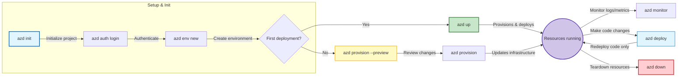
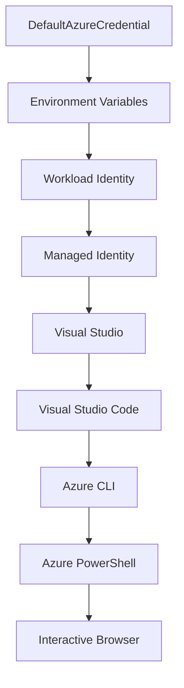

# Misingi ya AZD - Dhana na Misingi Muhimu

**Utaratibu wa Sura:**
- **📚 Kuuza Kozi**: [AZD Kwa Waanzilishi](../../README.md)
- **📖 Sura ya Sasa**: Sura ya 1 - Msingi & Anza Haraka
- **⬅️ Iliyopita**: [Muhtasari wa Kozi](../../README.md#-chapter-1-foundation--quick-start)
- **➡️ Ifuatayo**: [Usanidi & Ufungaji](installation.md)
- **🚀 Sura Ifuatayo**: [Sura ya 2: Maendeleo ya AI-Kwanza](../chapter-02-ai-development/microsoft-foundry-integration.md)

## Utangulizi

> Imeangaliwa dhidi ya `azd 1.37.2` (Novemba 2026). Amri za Bash hutumia nafasi za kuweka zilizo na nukuu ambazo lazima ubadilishe. Mifumo ya mfano hutumia `.` kuanzisha saraka ya sasa; bila hoja ya saraka, uanzishaji wa template hutoa saraka ndogo na haubadilisi saraka ya kazi ya shell yako. Vipande vya juu ni vya mfano, si miradi kamili.

Somo hili linakuanzisha kwa Azure Developer CLI (azd), zana yenye nguvu ya mstari wa amri inayoongeza kasi safari yako kutoka kwa maendeleo ya ndani hadi usambazaji wa Azure. Utajifunza dhana za msingi, vipengele vya msingi, na kuelewa jinsi azd inavyorahisisha usambazaji wa programu za asili za wingu.

## Malengo ya Kujifunza

Mwisho wa somo hili, utakuwa na uwezo wa:
- Elewa Azure Developer CLI ni nini na lengo lake kuu
- Jifunze dhana za msingi za templates, mazingira, na huduma
- Chunguza vipengele muhimu ikiwemo maendeleo yanayoongozwa na template na Miundombinu kama Msimbo
- Elewa muundo wa mradi wa azd na mtiririko wa kazi
- Kuwa tayari kufunga na kusanidi azd kwa mazingira yako ya maendeleo

## Matokeo ya Kujifunza

Baada ya kumaliza somo hili, utaweza:
- Elezea jukumu la azd katika mtiririko wa maendeleo ya wingu wa kisasa
- Tambua vipengele vya muundo wa mradi wa azd
- Eleza jinsi templates, mazingira, na huduma zinavyoshirikiana
- Elewa faida za Miundombinu kama Msimbo kwa kutumia azd
- Tambua amri mbalimbali za azd na madhumuni yao

## Azure Developer CLI (azd) ni Nini?

Azure Developer CLI (azd) ni zana ya mstari wa amri iliyoundwa kuongeza kasi safari yako kutoka maendeleo ya ndani hadi usambazaji wa Azure. Inarahisisha mchakato wa kujenga, kusambaza, na kusimamia programu za asili za wingu kwenye Azure.

### Unaweza Kusambaza Nini kwa azd?

azd inaunga mkono aina mbalimbali za mzigo wa kazi—na orodha inaendelea kuongezeka. Leo, unaweza kutumia azd kusambaza:

| Aina ya Mzigo wa Kazi | Mifano | Mtiririko Mmoja? |
|---------------|----------|----------------|
| **Programu za Kawaida** | Programu za wavuti, REST APIs, tovuti za takatifu | ✅ `azd up` |
| **Huduma na huduma ndogo** | Programu za Kontena, Programu za Kazi, huduma za nyuma nyingi | ✅ `azd up` |
| **Programu zinazotumia AI** | Programu za mazungumzo za Microsoft Foundry Models, suluhisho za RAG na AI Search | ✅ `azd up` |
| **Wakala wenye akili** | Wakala wenye makazi Foundry, usimamiaji wa wakala wengi | ✅ `azd up` |

Muhimu ni kwamba **mzunguko wa maisha wa azd hubaki ule ule bila kujali unachonisambaza**. Unaanzisha mradi, kutoa miundombinu, kusambaza msimbo wako, kufuatilia programu yako, na kusafisha—iwe ni tovuti rahisi au wakala mahiri wa AI.

Mfuatano huu ni kwa kusudi. azd hutumia uwezo wa AI kama huduma nyingine ambayo programu yako inaweza kutumia, si kama kitu kimsingi tofauti. Sehemu ya mazungumzo inayoendeshwa na Microsoft Foundry Models, kutoka kwa mtazamo wa azd, ni huduma nyingine tu ya kusanidi na kusambaza.

### 🎯 Kwa Nini Utumie AZD? Mfano Halisi wa Dunia

Tulinganishe kusambaza programu rahisi ya wavuti yenye hifadhidata:

#### ❌ BILA AZD: Usambazaji wa Azure kwa Mkono (Dakika 30+)

**Mlinganisho wa Bash kwa mfano, si anzacho programu zinazoendeshwa.** Hii inadhani msimbo wa programu unapatikana, majina ya rasilimali ni ya kipekee, uthibitishaji wa Azure CLI, na upanuzi wowote unaohitajika wa CLI. Tumia mazoezi ya template hapa chini kwa njia inayofadhiliwa ya mwisho hadi mwisho.

```bash
# Step 1: Create resource group
az group create --name myapp-rg --location eastus

# Step 2: Create App Service Plan
az appservice plan create --name myapp-plan \
  --resource-group myapp-rg \
  --sku B1 --is-linux

# Step 3: Create Web App
az webapp create --name myapp-web-unique123 \
  --resource-group myapp-rg \
  --plan myapp-plan \
  --runtime "NODE:22-lts"

# Step 4: Create Cosmos DB account (10-15 minutes)
az cosmosdb create --name myapp-cosmos-unique123 \
  --resource-group myapp-rg \
  --kind MongoDB

# Step 5: Create database
az cosmosdb mongodb database create \
  --account-name myapp-cosmos-unique123 \
  --resource-group myapp-rg \
  --name tododb

# Step 6: Create collection
az cosmosdb mongodb collection create \
  --account-name myapp-cosmos-unique123 \
  --resource-group myapp-rg \
  --database-name tododb \
  --name todos

# Step 7: Get connection string
CONN_STR=$(az cosmosdb keys list \
  --name myapp-cosmos-unique123 \
  --resource-group myapp-rg \
  --type connection-strings \
  --query "connectionStrings[0].connectionString" -o tsv)

# Step 8: Configure app settings
az webapp config appsettings set \
  --name myapp-web-unique123 \
  --resource-group myapp-rg \
  --settings MONGODB_URI="$CONN_STR"

# Step 9: Enable logging
az webapp log config --name myapp-web-unique123 \
  --resource-group myapp-rg \
  --application-logging filesystem \
  --detailed-error-messages true

# Step 10: Set up Application Insights
az monitor app-insights component create \
  --app myapp-insights \
  --location eastus \
  --resource-group myapp-rg

# Step 11: Link App Insights to Web App
INSTRUMENTATION_KEY=$(az monitor app-insights component show \
  --app myapp-insights \
  --resource-group myapp-rg \
  --query "instrumentationKey" -o tsv)

az webapp config appsettings set \
  --name myapp-web-unique123 \
  --resource-group myapp-rg \
  --settings APPINSIGHTS_INSTRUMENTATIONKEY="$INSTRUMENTATION_KEY"

# Step 12: Build application locally
npm install
npm run build

# Step 13: Create deployment package
zip -r app.zip . -x "*.git*" "node_modules/*"

# Step 14: Deploy application
az webapp deployment source config-zip \
  --resource-group myapp-rg \
  --name myapp-web-unique123 \
  --src app.zip

# Step 15: Wait and pray it works 🙏
# (No automated validation, manual testing required)
```

**Matatizo:**
- ❌ Amri zaidi ya 15 za kukumbuka na kutekeleza kwa mpangilio
- ❌ Dakika 30-45 za kazi ya mkono
- ❌ Rahisi kufanya makosa (makosa ya kuandika, vigezo vibaya)
- ❌ Nyaraka zinahitaji usimamizi wa wazi; kumbukumbu za kurekebisha na kufuatilia shell zinaweza kuzifunua
- ❌ Hakuna urejeshaji wa moja kwa moja kama kitu kinashindwa
- ❌ Ni vigumu kurudia kwa wanateam
- ❌ Hubadilika kila mara (haitarikiki)

#### ✅ KWA AZD: Usambazaji Otomatiki (Amri 5, Dakika 10-15)

```bash
# Step 1: Initialize from template
azd init --template todo-nodejs-mongo .

# Step 2: Authenticate
azd auth login

# Step 3: Select the environment created during init
azd env select dev

# Step 4: Preview changes (optional but recommended)
azd provision --preview

# Step 5: Deploy everything
azd up

# ✨ Done! Everything is deployed, configured, and monitored
```

**Faida:**
- ✅ **Amri 5** ikilinganishwa na hatua 15+ za mkono
- ✅ **Dakika 10-15** jumla ya muda (mara nyingi kusubiri Azure)
- ✅ **Makosa madogo ya mkono** - mtiririko thabiti, unaoongozwa na template
- ✅ **Usimamizi salama wa siri** - templates nyingi hutumia hifadhi ya siri inayosimamiwa na Azure
- ✅ **Usambazaji unaorudiwa** - mtiririko ule ule kila wakati
- ✅ **Maelezo ya miundombinu yanayorudiwa** - kwa vikwazo, upatikanaji wa maeneo, na matoleo ya template
- ✅ **Timu kupitia** - mtu yeyote anaweza kusambaza kwa amri zile zile
- ✅ **Miundombinu kama Msimbo** - templates za Bicep zilizo na udhibiti wa matoleo
- ✅ **Ufuatiliaji uliotengenezwa na Template** - Application Insights inapojumuishwa katika template

### Muda na Uaminifu

Muda uliotajwa hapo juu ni makadirio, si vigezo vya kulinganisha. azd hupunguza amri unazohitaji kupanga, lakini halihakikishi muda wa kusambaza, kuondoa makosa, au kutoa urejeshaji wa moja kwa moja wa programu/hifadhidata. Hifadhi matoleo yanayofanya kazi katika udhibiti wa chanzo na jaribu taratibu za urejeshaji.

## Dhana Muhimu

### Templates
Templates ni msingi wa azd. Zinajumuisha:
- **Msimbo wa programu** - Msimbo wako na utegemezi
- **Maelezo ya miundombinu** - rasilimali za Azure zilizotajwa kwa Bicep au Terraform
- **Faili za usanidi** - mipangilio na mabadiliko ya mazingira
- **Skripti za usambazaji** - mitiririko ya kazi ya usambazaji otomatiki

### Mazingira
Mazingira yanawakilisha malengo tofauti ya usambazaji:
- **Maendeleo** - Kwa majaribio na maendeleo
- **Kukagua** - Mazingira ya kabla ya uzalishaji
- **Uzalishaji** - Mazingira ya uzalishaji hai

Kila mazingira huweka mwenyewe:
- Jina la mazingira na thamani; kutengwa kwa rasilimali kunategemea template ya miundombinu
- Mipangilio ya usanidi
- Hali ya usambazaji

### Huduma
Huduma katika `azure.yaml` zinaelezea vipengele vya programu vinavyoweza kusambazwa:
- **Mbele** - Programu za wavuti, SPA
- **Nyuma** - APIs, huduma ndogo

Hifadhidata na hifadhi kawaida hutolewa kama rasilimali za miundombinu, si mwenyeji wa huduma waliobuniwa kama `host: postgres`.

## Vipengele Muhimu

### 1. Maendeleo Yanayoongozwa na Template
```bash
# Browse available templates
azd template list

# Initialize from a template
azd init --template "<template-name>" .
```

### 2. Miundombinu kama Msimbo
- **Bicep** - Lugha maalum ya Azure
- **Terraform** - Zana ya miundombinu ya multi-wingu
- Bicep hukusanya kwenye templates za ARM; JSON ghafi ya ARM si `infra.provider` iliotengenezwa tofauti.

### 3. Mitiririko ya Kazi Iliyounganishwa
```bash
# Complete deployment workflow
azd up            # Provision + Deploy this is hands off for first time setup

# 🧪 NEW: Preview infrastructure changes before deployment (SAFE)
azd provision --preview    # Simulate infrastructure deployment without making changes

azd provision     # Create Azure resources if you update the infrastructure use this
azd deploy        # Deploy application code or redeploy application code once update
azd down          # Clean up resources
```

#### 🛡️ Mpango Salama wa Miundombinu kwa Kupitia Awali
Amri ya `azd provision --preview` ni mabadiliko makubwa kwa usambazaji salama:
- **Uchambuzi wa jaribio kavu** - Inaonyesha kile kitakachoundwa, kubadilishwa, au kufutwa
- **Hario ya miundombinu** - Hurekebisha mabadiliko ya muuzaji; hakikisha kuangalia kwanza mapambo ya mradi, kwa kuwa mapambo yanaweza kuendesha amri zenye athari mbaya
- **Ushirikiano wa timu** - Shiriki matokeo ya kupitia awali kabla ya kusambaza
- **Kuingiza mipango ya gharama** - Angalia SKUs zilizopendekezwa, kisha zipange kwa Azure Pricing Calculator; kupitia awali hihesabi bei

```bash
# Example preview workflow
azd provision --preview           # See what will change
# Review the output, discuss with team
azd provision                     # Apply changes with confidence
```

### 📊 Mchoro: Mtiririko wa Maendeleo ya AZD



**Ufafanuzi wa Mtiririko wa Kazi:**
1. **Anza** - Anza na template au mradi mpya
2. **Thibitisha** - Thibitisha na Azure
3. **Mazingira** - Tengeneza mazingira ya usambazaji yasiyojumuisha wengine
4. **Pitia awali** - 🆕 Kila wakati pitia mabadiliko ya miundombinu kwanza (mbinu salama)
5. **Toa** - Tengeneza/rekebisha rasilimali za Azure
6. **Sambaza** - Sambaza msimbo wa programu yako
7. **Fuatilia** - Angalia utendaji wa programu
8. **Rudia** - Fanya mabadiliko na usambaze tena msimbo
9. **Safisha** - Ondoa rasilimali zako baada ya matumizi

### 4. Usimamizi wa Mazingira
```bash
# Create and manage environments
azd env new "<environment-name>"
azd env select "<environment-name>"
azd env list
```

### 5. Upanuzi na Amri za AI

azd hutumia mfumo wa upanuzi kuongeza uwezo zaidi ya CLI kuu. Hii ni muhimu hasa kwa mzigo wa AI:

```bash
# List available extensions
azd extension list

# Install the Foundry agents extension
azd extension install azure.ai.agents

# Initialize an AI agent project interactively
azd ai agent init

# Test a deployed agent (shows latency and time-to-first-byte)
azd ai agent invoke

# Start the MCP server for AI-assisted development (Alpha)
azd mcp start
```

**Mzunguko wa maisha wa wakala, mwisho hadi mwisho.** Tumia `azure.ai.agents` kwa operesheni za mzunguko wa wakala na sakinisha `azure.ai.evaluations` kwa kupata tathmini. Tumia `azd >= 1.37.0` kwa mtiririko unaochanganya. Huhitaji zote hizi siku ya kwanza:

| Hatua | Amri | Inafanya Nini |
|-------|---------|--------------|
| **Uundaji wa Awali** | `azd ai agent init --template <path-to-azure.yaml>` | Kubali template ya mradi wa wakala ulio sasa |
| **Jaribu** | `azd ai agent invoke` | Piga simu kwa wakala na tazama muda wa majibu |
| **Pima** | `azd ai eval init`, `generate`, `run start` | Sanidi, sambaza, na endesha tathmini kwa kutumia upanuzi tofauti |
| **Boresha** | `azd ai agent optimize --eval <evaluation-name> --optimize-model <optimizer-deployment>` | Tumia tena tathmini inayofaa kuboresha wakala |
| **Kagua** | `azd ai agent endpoint show` | Angalia usanidi wa sehemu ya moja kwa moja |
| **Safisha** | `azd ai agent delete` | Futa wakala aliyehifadhiwa na matoleo yake yote |

> Upanuzi umefafanuliwa kwa kina katika [Sura ya 2: Maendeleo ya AI-Kwanza](../chapter-02-ai-development/agents.md) na rejeleo la [Amri za AI za AZD CLI](../chapter-08-production/production-ai-practices.md#azd-ai-cli-commands-and-extensions).

## 📁 Muundo wa Mradi

Muundo wa kawaida wa mradi wa azd:
```
my-app/
├── .azure/                  # Local environments and selected-environment config
│   ├── config.json
│   └── dev/.env
├── .devcontainer/          # Development container config
├── .github/workflows/      # GitHub Actions
├── .vscode/               # VS Code settings
├── infra/                 # Infrastructure code
│   ├── main.bicep        # Main infrastructure template
│   ├── main.parameters.json
│   └── modules/          # Reusable modules
├── src/                  # Application source code
│   ├── api/             # Backend services
│   └── web/             # Frontend application
├── azure.yaml           # azd project configuration
└── README.md
```

## 🔧 Faili za Usanidi

### azure.yaml
Faili kuu ya usanidi wa mradi:
```yaml
name: my-awesome-app
metadata:
  template: my-template@1.0.0

services:
  web:
    project: ./src/web
    language: js
    host: appservice
  api:
    project: ./src/api
    language: js
    host: appservice

hooks:
  preprovision:
    shell: pwsh
    run: echo "Preparing to provision..."
```

### .azure/config.json
Uchaguzi wa mazingira ya default ya mradi (wa mfano; unasimamiwa na azd):
```json
{
  "defaultEnvironment": "dev"
}
```

## 🎪 Mitiririko ya Kazi ya Kawaida na Mazoezi ya Vitendo

> **💡 Ushauri wa Kujifunza:** Fuata mazoezi haya kwa mpangilio ili kujenga ujuzi wako wa AZD kufikia hatua kwa hatua.

### 🎯 Zoeflisho 1: Anzisha Mradi Wako wa Kwanza

**Lengo:** Tengeneza mradi wa AZD na chunguza muundo wake

**Hatua:**
```bash
# Use a proven template
mkdir azd-basics-practice
cd azd-basics-practice
# Choose "dev" for the environment name when prompted
azd init --template todo-nodejs-mongo .

# Explore the generated files
ls -la  # View all files including hidden ones

# Key files created:
# - azure.yaml (main config)
# - infra/ (infrastructure code)
# - src/ (application code)
```

**✅ Mafanikio:** Una azure.yaml, infra/, na saraka za src/

---

### 🎯 Zoeflisho 2: Sambaza kwa Azure

**Lengo:** Kumaliza usambazaji wa mwisho hadi mwisho

**Hatua:**
```bash
# 1. Authenticate
azd auth login

# 2. Select the dev environment created in Exercise 1
azd env select dev
azd env set AZURE_LOCATION eastus

# 3. Preview changes (RECOMMENDED)
azd provision --preview

# 4. Deploy everything
azd up

# 5. Verify deployment
azd show    # View your app URL
```

**Muda Unaotarajiwa:** Dakika 10-15  
**✅ Mafanikio:** URL ya programu inafunguka kwenye kivinjari

---

### 🎯 Zoeflisho 3: Mazingira Mbalimbali

**Lengo:** Sambaza kwa dev na staging

**Hatua:**
```bash
# Already have dev, create staging
azd env new staging
azd env set AZURE_LOCATION westus2
azd up

# Switch between them
azd env list
azd env select dev
```

**✅ Mafanikio:** Makundi mawili tofauti ya rasilimali katika Azure Portal

**Usafishaji:** Zoeflisho 3 linafanya usambazaji wa pili unaolipwa. Futa zote baada ya kumaliza:

```bash
azd down --environment dev
azd down --environment staging
```

---

### 🛡️ Usafishaji wa Kuangamiza: `azd down --force --purge`

Unapotaka kwa makusudi kufuta rasilimali za Azure za mazingira yaliyoteuliwa:

```bash
azd down --force --purge
```

**Inafanya Nini:**
- `--force`: Hakuna masharti ya uthibitisho
- `--purge`: Pia huondoa rasilimali zinazounga mkono kufutwa kwa mkono (kwa mfano Key Vaults), pale ambapo ulinzi wa kusafisha unaruhusu. Haihubui saraka ya `.azure/` ya eneo.

**Tumia wakati:** umemaliza na mazingira yanayotumika mara moja. Usichukue usafishaji wa kuangamiza kama jibu la haraka kwa hitilafu ya uthibitishaji, kikwazo, au usanidi.

---

## 🎪 Rejeleo la Mtiririko wa Asili

### Kuanzisha Mradi Mpya
```bash
# Method 1: Use existing template
azd init --template todo-nodejs-mongo .

# Method 2: Start from scratch
azd init

# Method 3: Use current directory
azd init .
```

### Mzunguko wa Maendeleo
```bash
# Set up development environment
azd auth login
azd env new dev
azd env select dev

# Deploy everything
azd up

# Make changes and redeploy
azd deploy

# Clean up when done
azd down --force --purge # Deletes this environment's discovered Azure resources; review before forcing deletion.
```

## Kuelewa `azd down --force --purge`
Amri ya `azd down --force --purge` ni njia yenye nguvu kabisa ya kuondoa kabisa mazingira yako ya azd na rasilimali zote zinazohusiana. Hapa kuna maelezo ya kile kila bendera inavyoifanya:
```
--force
```
- Inaepuka masharti ya uthibitisho.
- Inafaa kwa uendeshaji wa otomatiki au scripta ambapo ingizo la mkono halifanikiwi.
- Haiingii tofauti za ruhusa, ulinzi wa kusafisha, au kushindwa kufuta.

```
--purge
```
Hufuta mara moja rasilimali za Azure zilizoondolewa kwa upole zilizotangazwa kuondolewa bila uthibitisho wa ziada. Ulinzi wa kusafisha na ruhusa bado zinaendelea kutumika. Hii **haituondoi** mazingira ya ndani au folda ya `.azure/`.


### Kwa nini utumie zote mbili?
Tumia zote mbili tu unapokusudia kufuta rasilimali za Azure za mazingira yaliyoteuliwa na kusafisha rasilimali zinazoweza kurejeshwa. Hii ni usafi wa uharibifu, si ukarabati wa jumla au kuweka upya hali ya ndani.

Ni muhimu hasa baada ya kufuta rasilimali kwa mikono kwenye lango la Azure au wakati wa kubadili templeti, mazingira, au mifumo ya majina ya kikundi cha rasilimali.


### Kusimamia Mazingira Mengi
```bash
# Create staging environment
azd env new staging
azd env select staging
azd up

# Switch back to dev
azd env select dev

# Compare environments
azd env list
```

## 🔐 Uthibitishaji na Nywila

Tofautisha uthibitishaji wa usambazaji (`azd auth login`) na uthibitishaji wa SDK ya programu (`DefaultAzureCredential`). Ni tofauti. azd haitumiwi kwa kutumia nywila za Azure CLI kwa chaguo-msingi.

### Uthibitishaji wa Azure CLI (`az login`)

Endesha `azd auth login` kwa azd. Amri zifuatazo za Azure CLI ni hiari na zinathibitisha amri za `az` kwa tofauti:

```bash
# Interactive login (opens browser)
az login

# Login with specific tenant
az login --tenant "<tenant-id>"

# Login with service principal
az login --service-principal -u "<app-id>" -p "<password>" --tenant "<tenant-id>"

# Check current login status
az account show

# List available subscriptions
az account list --output table

# Set default subscription
az account set --subscription "<subscription-id>"
```

### Mtiririko wa Uthibitishaji
1. **Ingia kwa Kupiga**: Hufungua kivinjari chako asilia kwa uthibitishaji
2. **Mtiririko wa Kodi ya Kifaa**: Kwa mazingira yasiyo na ufikiaji wa kivinjari
3. **Kiongozi wa Huduma**: Kwa michakato ya otomatiki na hali za CI/CD
4. **Utambulisho wa Kusimamiwa**: Kwa programu zilizo karibu na Azure

### Mnyororo wa DefaultAzureCredential

`DefaultAzureCredential` ni aina ya nywila inayotoa uzoefu rahisi wa uthibitishaji kwa kujaribu vyanzo vingi vya uthibitishaji kwa mpangilio maalum:

#### Mnyororo wa Nywila wa SDK ya Programu

Mnyororo halisi unategemea lugha ya Azure Identity SDK, toleo, programu-jalizi zilizowekwa, na chaguzi. Michoro hii ni ya dhana, si mfululizo thabiti wa uthibitishaji wa azd; SDK za karibuni pia zinaweza kujumuisha vyeti vya Azure Developer CLI.


#### 1. Mabadiliko ya Mazingira
```bash
# Set environment variables for service principal
export AZURE_CLIENT_ID="<app-id>"
export AZURE_CLIENT_SECRET="<password>"
export AZURE_TENANT_ID="<tenant-id>"
```

#### 2. Utambulisho wa Kazi (Kubernetes/GitHub Actions)
Hutumika moja kwa moja katika:
- Azure Kubernetes Service (AKS) na Utambulisho wa Kazi
- GitHub Actions na ushirikiano wa OIDC
- Mazingira mengine ya utambulisho wa ushirikiano

#### 3. Utambulisho Usidhibitiwa
Kwa rasilimali za Azure kama:
- Mashine Halisi
- Huduma ya App
- Azure Functions
- Mfano wa Kontena

```bash
# Inspect a deployed Container App's configured identity (requires az login)
az containerapp show --name "<app-name>" --resource-group "<rg-name>" --query identity
```

#### 4. Muungano wa Zana za Mdeveloper
- **Visual Studio**: Hutumia akaunti iliyoingia moja kwa moja
- **VS Code**: Msaada unategemea SDK na usanidi wake wa dalali/programu-jalizi inayoungwa mkono
- **Azure CLI**: Hutumia vyeti vya `az login` (maarufu zaidi kwa maendeleo ya ndani)

### Usanidi wa Uthibitishaji wa AZD

```bash
# Method 1: Direct azd authentication (recommended)
azd auth login

# Method 2: Direct azd authentication
azd auth login --use-device-code  # For headless environments

# Method 3: Check authentication status
azd auth login --check-status

# Method 4: Logout and re-authenticate
azd auth logout
azd auth login
```

### Miongozo Bora ya Uthibitishaji

#### Kwa Maendeleo ya Ndani
```bash
# 1. Log in to azd
azd auth login

# 2. Select the subscription for this initialized environment
azd env set AZURE_SUBSCRIPTION_ID "<subscription-id>"

# 3. Check azd sign-in details (read the status message)
azd auth login --check-status
```

#### Kwa Mipangilio ya CI/CD
```yaml
# Partial GitHub Actions steps: assumes checkout, azd installation,
# required AZURE_* environment values, and pipeline secret configuration.
- name: Deploy with azd
  run: |
    azd auth login --client-id ${{ secrets.AZURE_CLIENT_ID }} \
                    --client-secret ${{ secrets.AZURE_CLIENT_SECRET }} \
                    --tenant-id ${{ secrets.AZURE_TENANT_ID }}
    azd up --no-prompt
```

#### Kwa Mazingira ya Uzalishaji
- Tumia **Utambulisho Usidhibitiwa** unapoendesha kwenye rasilimali za Azure
- Tumia **Kiongozi wa Huduma** kwa hali za kiotomatiki
- Epuka kuhifadhi nywila katika msimbo au faili za usanidi
- Tumia **Azure Key Vault** kwa usanidi nyeti

### Masuala ya Uthibitishaji ya Kawaida na Suluhisho

#### Tatizo: "Hakuna usajili uliopatikana"
```bash
# Solution: Set default subscription
az account list --output table
az account set --subscription "<subscription-id>"
azd env set AZURE_SUBSCRIPTION_ID "<subscription-id>"
```

#### Tatizo: "Idhini haitoshi"
```bash
# Solution: Check and assign required roles
az role assignment list --assignee $(az account show --query user.name --output tsv)

# Common required roles:
# - Contributor (for resource management)
# - User Access Administrator (for role assignments)
```

#### Tatizo: "Tokeni imeisha muda wake"
```bash
# Solution: Re-authenticate
az logout
az login
azd auth logout
azd auth login
```

### Uthibitishaji katika Mifumo Mbalimbali

#### Maendeleo ya Ndani
```bash
# Personal development account
az login
azd auth login
```

#### Maendeleo ya Timu
```bash
# Use specific tenant for organization
az login --tenant contoso.onmicrosoft.com
azd auth login --tenant-id "<tenant-id>"
```

#### Mifumo ya Wamiliki Wengi
```bash
# Switch between tenants
az login --tenant tenant1.onmicrosoft.com
azd auth login --tenant-id "<tenant-1-id>"
# Select an environment configured with tenant 1's subscription
azd env select tenant1-dev
# Deploy to tenant 1
azd up

az login --tenant tenant2.onmicrosoft.com  
azd auth login --tenant-id "<tenant-2-id>"
azd env select tenant2-dev
# Deploy to tenant 2
azd up
```

### Mambo ya Usalama

1. **Uhifadhi wa Nywila**: Kamwe usihifadhi nywila katika msimbo chanzo
2. **Kipimo cha Wazi**: Tumia kanuni ya ruhusa ndogo kwa viongozi wa huduma
3. **Mzunguko wa Tokeni**: Geuza siri za viongozi wa huduma mara kwa mara
4. **Kumbukumbu ya Ukaguzi**: Fuatilia shughuli za uthibitishaji na ueneaji
5. **Usalama wa Mtandao**: Tumia vituo vya kibinafsi inapowezekana

### Utatuzi wa Matatizo ya Uthibitishaji

```bash
# Debug authentication issues
azd auth login --check-status
az account show
az account get-access-token

# Common diagnostic commands
whoami                          # Current user context
az ad signed-in-user show      # Microsoft Entra ID user details
az group list                  # Test resource access
```

## Ugunduzi wa Amri

### Ugunduzi
```bash
azd template list              # Browse templates
azd template list --help       # Template discovery options
azd init --help               # Initialization options
```

### Usimamizi wa Mradi
```bash
azd show                     # Project overview
azd env list                # Available environments and selected default
azd config show            # Configuration settings
```

### Ufuatiliaji
```bash
azd monitor                  # Open Azure portal monitoring
azd monitor --logs           # View application logs
azd monitor --live           # View live metrics
azd pipeline config          # Set up CI/CD
```

## Miongozo Bora

### 1. Tumia Majina Yenye Maana
```bash
# Good
azd env new production-east
azd init --template todo-nodejs-mongo .

# Avoid
azd env new env1
azd init --template template1 .
```

### 2. Tumia Violezo
- Anza na violezo vilivyopo
- Rekebisha kulingana na mahitaji yako
- Tengeneza violezo vinavyoweza kutumika tena kwa shirika lako

### 3. Kutengwa kwa Mazingira
- Tumia mazingira tofauti kwa maendeleo/uandaaji/uzalishaji
- Kamwe usiweke moja kwa moja uzalishaji kutoka kwenye mashine ya ndani
- Tumia mistari ya CI/CD kwa ajili ya kuweka uzalishaji

### 4. Usimamizi wa Usanidi
- Tumia utambulisho usidhibitiwa na Key Vault kwa siri; thamani za kawaida za `azd env set` ni maandishi wazi ya ndani
- Hifadhi usanidi katika udhibiti wa toleo
- Andika nyaraka za mipangilio maalum ya mazingira

## Mchakato wa Kujifunza

### Mwanzo (Wiki 1-2)
1. Sakinisha azd na uthibitishaji
2. Weka sampuli rahisi
3. Elewa muundo wa mradi
4. Jifunze amri za msingi (kupanda, kushuka, kuweka)

### Wastani (Wiki 3-4)
1. Rekebisha violezo
2. Dhibiti mazingira mengi
3. Elewa msimbo wa miundombinu
4. Sanidi mistari ya CI/CD

### Mtaalamu (Wiki 5+)
1. Tengeneza violezo maalum
2. Mifumo ya juu ya miundombinu
3. Uenezaji wa maeneo mengi
4. Usanidi wa daraja la biashara

## Hatua Zifuatazo

**📖 Endelea na Sura ya 1 Kujifunza:**
- [Usakinishaji & Usanidi](installation.md) - Pata azd iliuwe na kusanidiwa
- [Mradi Wako wa Kwanza](first-project.md) - Maliza mafunzo ya vitendo
- [Mwongozo wa Usanidi](../chapter-03-configuration/configuration.md) - Chaguzi za usanidi wa hali ya juu

**🎯 Tayari kwa Sura Ifuatayo?**
- [Sura 2: Maendeleo ya AI-Kwanza](../chapter-02-ai-development/microsoft-foundry-integration.md) - Anza kujenga programu za AI

## Rasilimali Zaidi

- [Muhtasari wa Azure Developer CLI](https://learn.microsoft.com/en-us/azure/developer/azure-developer-cli/)
- [Kampuni ya Violezo](https://azure.github.io/awesome-azd/)
- [Mifano ya Jamii](https://github.com/Azure-Samples)

---

## 🙋 Maswali Yanayoulizwa Mara kwa Mara

### Maswali ya Jumla

**S: Tofauti kati ya AZD na Azure CLI ni nini?**

J: Azure CLI (`az`) ni kwa kusimamia rasilimali binafsi za Azure. AZD (`azd`) ni kwa kusimamia programu zote:

```bash
# Azure CLI - Low-level resource management
az webapp create --name myapp --resource-group rg
az sql server create --name myserver --resource-group rg
# ...many more commands needed

# AZD - Application-level management
azd up  # Deploys entire app with all resources
```

**Fikiri hivi:**
- `az` = Kufanya kazi na vipande vya Lego binafsi
- `azd` = Kufanya kazi na seti kamili za Lego

---

**S: Je, nahitaji kujua Bicep au Terraform kutumia AZD?**

J: Hapana! Anza na violezo:
```bash
# Use existing template - no IaC knowledge needed
azd init --template todo-nodejs-mongo .
azd up
```

Unaweza kujifunza Bicep baadaye kwa kurekebisha miundombinu. Violezo hutoa mifano inayofanya kazi kujifunza kutoka.

---

**S: Je, gharama ya kuendesha violezo vya AZD ni kiasi gani?**

J: Gharama zinatofautiana kwa mkoa, SKU, muda wa uzalishaji, mode ya database, na matumizi ya mfano. Mazingira ya maendeleo yanaweza kusababisha malipo makubwa kila mwezi hata wakati hayatumiki; usihesabu ngazi ya $50-150 kama kanuni:

```bash
# Preview resource changes (not prices)
azd provision --preview

# Always cleanup when not using
azd down --force --purge  # Removes all resources
```

**Ushauri wa mtaalamu:** Tumia ngazi za bure pale zinapotolewa:
- Huduma ya App: ngazi ya F1 (Bure)
- Azure OpenAI: hakuna tokeni za bure za kila mwezi zilizodhaminiwa kwa ujumla; angalia bei ya mfano na toleo la sasa
- Cosmos DB: akaunti zinazostahili kipimo cha mtiririko zinaweza kuchagua ngazi ya bure; violezo vya serverless havithibitishi moja kwa moja

---

**S: Je, naweza kutumia AZD na rasilimali za Azure zilizopo?**

J: Ndiyo, lakini ni rahisi kuanza upya. AZD ina faida zaidi inapoendesha mzunguko mzima wa maisha. Kwa rasilimali zilizopo:

```bash
# Option 1: Import existing resources (advanced)
azd init
# Then modify infra/ to reference existing resources

# Option 2: Start fresh (recommended)
azd init --template "<verified-template-name>" .
azd up  # Creates new environment
```

---

**S: Ninashirikishaje mradi wangu na wenzangu?**

J: Tuma mradi wa AZD kwenye Git (lakini SI kwenye folda ya .azure):

```bash
# Already in .gitignore by default
.azure/        # Contains secrets and environment data
*.env          # Environment variables

# Team members then:
git clone "<your-repo>"
# Change into the cloned repository before running the remaining commands.
azd auth login
azd env new "<their-name>-dev"
azd up
```

Kila mtu hupata miundombinu sawa kutoka kwa violezo hivyo.

---

### Maswali ya Utatuzi wa Matatizo

**S: "azd up" ilishindwa katikati. Nifanye nini?**

J: Angalia kosa, litengeneze, kisha jaribu tena:

```bash
# Capture detailed diagnostics (redact sensitive values before sharing)
azd up --debug

# Common fixes:

# 1. If quota exceeded:
azd env set AZURE_LOCATION "westus2"  # Try different region

# 2. If resource name conflict:
azd down --force --purge  # Clean slate
azd up  # Retry

# 3. If auth expired:
az login
azd auth login
azd up
```

**Tatizo la kawaida:** Usajili wa Azure usio sahihi umechaguliwa
```bash
az account list --output table
az account set --subscription "<correct-subscription>"
azd env set AZURE_SUBSCRIPTION_ID "<correct-subscription-id>"
```

---

**S: Ninawezaje kuweka mabadiliko ya msimbo tu bila kuanzisha upya?**

J: Tumia `azd deploy` badala ya `azd up`:

```bash
azd up          # First time: provision + deploy (slow)

# Make code changes...

azd deploy      # Subsequent times: deploy only (fast)
```

Ulinganifu wa kasi:
- `azd up`: Dakika 10-15 (huanzisha miundombinu)
- `azd deploy`: Dakika 2-5 (msimbo tu)

---

**S: Nawezaje kubadilisha violezo vya miundombinu?**

J: Ndiyo! Hariri faili za Bicep katika `infra/`:

```bash
# After azd init
cd infra/
code main.bicep  # Edit in VS Code

# Preview changes
azd provision --preview

# Apply changes
azd provision
```

**Ushauri:** Anza kidogo - badilisha SKU kwanza:
```bicep
// infra/main.bicep
sku: {
  name: 'B1'  // Change to 'P1V2' for production
}
```

---

**S: Nifute vipi yote ambayo AZD imeunda?**

J: Amri moja huondoa rasilimali zote:

```bash
azd down --force --purge

# This deletes:
# - Azure resources/resource groups discovered for the selected environment
# - Supported soft-deleted resources, if purge protection allows
# Local .azure files remain; shared/external resources may remain too.
```

**Daima endesha hii wakati:**
- Umeisha jaribu kiolezo
- Kubadilisha mradi mwingine
- Unataka kuanza upya

**Angalia gharama:** Thibitisha kufutwa kwa Azure na angalia kama kuna rasilimali zilizohifadhiwa/kushirikiwa. Gharama zilizokusanywa awali bado zinatumika.

---

**S: Nilipofuta rasilimali katika Azure Portal kwa bahati mbaya?**

J: Hali ya AZD inaweza kutosawazishwa. Njia safi:

```bash
# 1. Delete remaining resources only if that is your intent
azd down --force --purge

# 2. Start fresh
azd up

# Alternative: Let AZD detect and fix
azd provision  # Will create missing resources
```

---

### Maswali ya Juu

**S: Naweza kutumia AZD katika mistari ya CI/CD?**

J: Ndiyo! Mfano wa GitHub Actions:

```yaml
# .github/workflows/deploy.yml
name: Deploy with AZD

on:
  push:
    branches: [main]

jobs:
  deploy:
    runs-on: ubuntu-latest
    steps:
      - uses: actions/checkout@v4
      
      - name: Install azd
        run: curl -fsSL https://aka.ms/install-azd.sh | bash
      
      - name: Azure Login
        run: |
          azd auth login \
            --client-id ${{ secrets.AZURE_CLIENT_ID }} \
            --client-secret ${{ secrets.AZURE_CLIENT_SECRET }} \
            --tenant-id ${{ secrets.AZURE_TENANT_ID }}
      
      - name: Deploy
        env:
          AZURE_ENV_NAME: dev
          AZURE_LOCATION: ${{ vars.AZURE_LOCATION }}
          AZURE_SUBSCRIPTION_ID: ${{ vars.AZURE_SUBSCRIPTION_ID }}
        run: azd up --no-prompt
```

---

**S: Nadhani muhimu za siri na data nyeti ni zipi?**

J: Tumia Key Vault waziwazi. `azd env set` huandika thamani za kawaida kwenye faili ya mazingira ya ndani; haifanyi kwa moja kwa moja kuunda vault, kugawa majukumu, au kuingiza siri katika programu yako.

```bash
# Interactive: create/select a Key Vault secret and save its reference
azd env set-secret DATABASE_PASSWORD
```

Unahitaji ruhusa za vault zinazofaa. Miundombinu/programu yako bado inapaswa kuunganisha siri kwa mtumiaji wake na kutoa ruhusa za utambulisho wa wakati wa utekelezaji. Usichapishe thamani za siri zilizo tayari katika kumbukumbu za rekodi.

**Kamwe usilaze kwenye:**
- Folda ya `.azure/` (ina data za mazingira)
- Faili za `.env` (siri za ndani)
- Msimbo wa muunganisho

---

**S: Naweza kuweka uzalishaji kwenye maeneo mengi?**

J: Ndiyo, tengeneza mazingira kwa kila mkoa:

```bash
# East US environment
azd env new prod-eastus
azd env set AZURE_LOCATION eastus
azd up

# West Europe environment
azd env new prod-westeurope
azd env set AZURE_LOCATION westeurope
azd up

# Each environment is independent
azd env list
```

Kwa programu halisi za maeneo mengi, rekebisha violezo vya Bicep kuweka uzalishaji katika maeneo mengi kwa wakati mmoja.

---

**S: Naweza kupata msaada wapi nikiwa nimekwama?**

1. **Nyaraka za AZD:** https://learn.microsoft.com/azure/developer/azure-developer-cli/
2. **Masuala ya GitHub:** https://github.com/Azure/azure-dev/issues
3. **Discord:** [Azure Discord](https://discord.gg/microsoft-azure) - kituo cha #azure-developer-cli
4. **Stack Overflow:** Lebo `azure-developer-cli`
5. **Kozi hii:** [Mwongozo wa Utatuzi](../chapter-07-troubleshooting/common-issues.md)

**Ushauri wa mtaalamu:** Kabla ya kuuliza, endesha:
```bash
azd show       # Shows current state
azd version    # Shows your version
```
Jumuisha habari hii katika swali lako kwa msaada wa haraka.

---

## 🎓 Nini Kifuatacho?

Sasa unaelewa misingi ya AZD. Chagua njia yako:

### 🎯 Kwa Waanzilishi:
1. **Ifuatayo:** [Usakinishaji & Usanidi](installation.md) - Sakinisha AZD kwenye mashine yako
2. **Kisha:** [Mradi Wako wa Kwanza](first-project.md) - Weka programu yako ya kwanza
3. **Mazoezi:** Maliza mazoezi yote 3 katika somo hili

### 🚀 Kwa Watengenezaji wa AI:
1. **Ruka hadi:** [Sura 2: Maendeleo ya AI-Kwanza](../chapter-02-ai-development/microsoft-foundry-integration.md)
2. **Weka:** Katika saraka tupu ya mradi, anza na `azd init --template get-started-with-ai-chat .`
3. **Jifunze:** Jenga wakati unapopeleka

### 🏗️ Kwa Watengenezaji Wenye Uzoefu:
1. **Pitia:** [Mwongozo wa Usanidi](../chapter-03-configuration/configuration.md) - Mipangilio ya hali ya juu
2. **Chunguza:** [Miundombinu kama Msimbo](../chapter-04-infrastructure/provisioning.md) - Ufundishaji wa kina wa Bicep
3. **Jenga:** Tengeneza violezo maalum kwa stack yako

---

**Urambazaji wa Sura:**
- **📚 Kwanza ya Kozi**: [AZD Kwa Waanzilishi](../../README.md)
- **📖 Sura ya Sasa**: Sura 1 - Msingi & Anza Haraka
- **⬅️ Iliyotangulia**: [Muhtasari wa Kozi](../../README.md#-chapter-1-foundation--quick-start)
- **➡️ Ifuatayo**: [Usakinishaji & Usanidi](installation.md)
- **🚀 Sura Ifuatayo**: [Sura 2: Maendeleo ya AI-Kwanza](../chapter-02-ai-development/microsoft-foundry-integration.md)

---

<!-- CO-OP TRANSLATOR DISCLAIMER START -->
**Kionyozo**:
Hati hii imetafsiriwa kwa kutumia huduma ya tafsiri ya AI [Co-op Translator](https://github.com/Azure/co-op-translator). Ingawa tunajitahidi kupata usahihi, tafadhali fahamu kwamba tafsiri za kiotomatiki zinaweza kuwa na makosa au upungufu wa usahihi. Hati ya asili katika lugha yake halisi inapaswa kuchukuliwa kama chanzo cha mamlaka. Kwa taarifa muhimu, tafsiri ya kitaalamu inayofanywa na binadamu inapendekezwa. Hatutojibu kwa kuelewa vibaya au tafsiri potofu zinazotokea kutokana na matumizi ya tafsiri hii.
<!-- CO-OP TRANSLATOR DISCLAIMER END -->