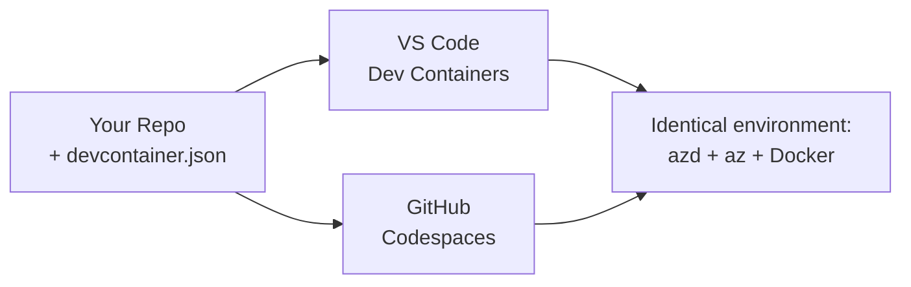

# Dev Containers & GitHub Codespaces kwa azd

**Uchaguzi wa Sura:**
- **📚 Kwanza Kwenye Kozi**: [AZD Kwa Waanzilishi](../../README.md)
- **📖 Sura ya Sasa**: Sura 1 - Msingi & Mwanzo wa Haraka
- **⬅️ Iliyopita**: [Leta Programu Yako](bring-your-own-app.md)
- **🚀 Sura Iliyofuata**: [Sura 2: Maendeleo ya AI-Kwanza](../chapter-02-ai-development/README.md)

> Malengo ya ukaguzi wa amri na usanidi: `azd 1.37.2` (Novemba 2026). Ujenzi wa kontena na usambazaji wa Azure haukufanywa kama sehemu ya ukaguzi huu.

## Utangulizi

Kusakinisha azd, mazingira sahihi ya lugha, Docker, na Azure CLI kwenye kila mashine ni kazi ngumu—na ndiyo sababu nambari ya mafunzo inayosema "inafanya kazi kwenye mashine yangu" kushindwa kwa mtu mwingine. **dev container** inatatua hili kwa kuelezea zana zako zote katika faili moja. Yeye yeyote anayefungua mradi katika VS Code au GitHub Codespaces hupata mazingira sawa kabisa, na azd tayari imewekwa. Somo hili linaonyesha jinsi ya kuongeza moja.

## Malengo ya Kujifunza

Mwisho wa somo hili, utakuwa umejifunza:
- Kuelewa dev container ni nini na kwanini husaidia na azd
- Ongeza `.devcontainer/devcontainer.json` yenye vipengele vya chini kwa mradi
- Jumuisha azd, Azure CLI, na Docker kupitia vipengele vya Dev Container
- Fungua mradi katika GitHub Codespaces au VS Code

## Matokeo ya Kujifunza

Baada ya kukamilisha somo hili, utaweza:
- Kuandika `devcontainer.json` kwa mradi wa azd
- Ongeza azd na zana za Azure bila usakinishaji wa mikono
- Endesha `azd up` kutoka ndani ya kontena au Codespace

---

## Dev Container ni Nini?

Dev container ni mazingira ya maendeleo yaliyotegemea Docker yanayobainishwa na faili ya `.devcontainer/devcontainer.json` katika hifadhidata yako. Unapofungua mradi:

- **VS Code** (ikiwa na ugani wa Dev Containers) hujenga kontena na kuungana nayo.
- **GitHub Codespaces** hujenga kontena sawa katika wingu na kukupa mhariri wa kivinjari.

Kwa njia yoyote ile, kila mshiriki hupata zana sawa—hakuna shida ya "je, umeweka azd?".



---

## Hatua 1: Unda faili ya devcontainer

Unda `.devcontainer/devcontainer.json` kwenye mzizi wa mradi wako:

```json
{
  "name": "azd-project",
  "image": "mcr.microsoft.com/devcontainers/base:bookworm",
  "features": {
    "ghcr.io/devcontainers/features/azure-cli:1": {},
    "ghcr.io/azure/azure-dev/azd:0": { "version": "1.37.2" },
    "ghcr.io/devcontainers/features/docker-in-docker:2": {},
    "ghcr.io/devcontainers/features/node:1": {}
  },
  "customizations": {
    "vscode": {
      "extensions": [
        "ms-azuretools.azure-dev",
        "ms-azuretools.vscode-bicep"
      ]
    }
  },
  "forwardPorts": [3000],
  "postCreateCommand": "azd version"
}
```

Kila sehemu hufanya nini:

| Kikasha | Kusudi |
|-----|---------|
| `image` | Mfumo wa uendeshaji wa msingi kwa kontena |
| `features` | Wasakinishaji walio tayari—hapa: Azure CLI, **azd**, Docker, na Node.js |
| `customizations.vscode.extensions` | Huweka moja kwa moja nyongeza za azd na Bicep VS Code |
| `forwardPorts` | Huonyesha bandari ya programu yako kwa kivinjari chako |
| `postCreateCommand` | Inakimbia mara moja baada ya kontena kujengwa (hapa, ukaguzi wa busara) |

> Toleo la kipengele (`azd:0`) na toleo la CLI lililosakinishwa ni tofauti. Weka chaguo la kipengele la `version` kwa `"1.37.2"` ili kufunga CLI; usitumie toleo la CLI kama lebo ya kipengele.

---

## Hatua 2: Linganisha Kipengele kwa Lugha ya Programu Yako

Badilisha kipengele cha `node` kwa kile lugha programu yako inatumia:

```jsonc
// Python project
"ghcr.io/devcontainers/features/python:1": {},

// .NET project
"ghcr.io/devcontainers/features/dotnet:2": {},

// Java project
"ghcr.io/devcontainers/features/java:1": {},

// Go project
"ghcr.io/devcontainers/features/go:1": {}
```

Hifadhi `docker-in-docker` wakati wa kujenga picha ktk eneo la kazi. Ujenzi wa ACR ya mbali uliosanidiwa (`docker.remoteBuild: true`) ni mbadala; aina ya mwenyeji peke yake haihitaji Docker wa ndani kila wakati.

---

## Hatua 3: Ifungue

**Katika VS Code:**
1. Sakinisha ugani wa **Dev Containers**.
2. Fungua folda ya mradi.
3. Bofya **Reopen in Container** wakati utaombwa (au endesha *Dev Containers: Reopen in Container*).

**Katika GitHub Codespaces:**
1. Suma hifadhidata kwenye GitHub.
2. Bofya **Code → Codespaces → Create codespace on main**.
3. Subiri kontena lijengwe—azd iko tayari katika terminal.

---

## Hatua 4: Sambaza Kutoka Ndani ya Kontena

Kontena ina azd tayari imewekwa, kwa hivyo mtiririko wa kawaida hufanya kazi:

```bash
azd auth login --use-device-code   # device code is handy inside Codespaces
azd up
```

> **Kwa nini `--use-device-code`?** Katika kontena ya mbali au Codespace hakuna kivinjari cha ndani cha kuelekeza, kwa hivyo kuingia kwa kifaa ni njia ya kuaminika. Utaweka nambari kwenye kichupo cha kivinjari kumaliza kuingia.

---

## Makosa ya Kawaida

| Tatizo | Suluhisho |
|---------|-----|
| `azd up` haiwezi kujenga picha | Ongeza kipengele cha `docker-in-docker` |
| Kuingia kivinjari kusimamaa katika Codespaces | Tumia `azd auth login --use-device-code` |
| Zana zinatofautiana kati ya wanateamu | Funga CLI kupitia chaguo la kipengele cha azd `version` na fungua mazingira ya lugha |
| Programu haifikiwi kwenye kivinjari | Ongeza bandari kwa `forwardPorts` |

---

## Muhtasari

- Dev container hufanya zana zako za azd zirudiwe kwa kila mtu.
- Ongeza azd, Azure CLI, na Docker kupitia vipengele vya Dev Container.
- Linganisha kipengele cha lugha kwa programu yako na hifadhi `docker-in-docker` kwa wenyeji wa kontena.
- Tumia kuingia kwa njia ya kifaa unapoendesha ndani ya Codespaces.

---

## 🔗 Uchaguzi wa Ku-navige

| Mwelekeo | Rasilimali |
|-----------|----------|
| **Iliyopita** | [Leta Programu Yako](bring-your-own-app.md) |
| **Kwanza Kwenye Sura** | [Sura 1: Msingi & Mwanzo wa Haraka](README.md) |
| **Sura Iliyofuata** | [Sura 2: Maendeleo ya AI-Kwanza](../chapter-02-ai-development/README.md) |

## 📖 Rasilimali Zinazohusiana

- [Ufungaji & Usanidi](installation.md)
- [Orodha ya Amri](../../resources/cheat-sheet.md)
- [Maelezo Rasmi ya Dev Containers](https://containers.dev/)
- [Kipengele cha azd Dev Container](https://github.com/Azure/azure-dev/tree/main/ext/devcontainer)

---

<!-- CO-OP TRANSLATOR DISCLAIMER START -->
**Kionyozo**:
Hati hii imetafsiriwa kwa kutumia huduma ya tafsiri ya AI [Co-op Translator](https://github.com/Azure/co-op-translator). Ingawa tunajitahidi kupata usahihi, tafadhali fahamu kwamba tafsiri za kiotomatiki zinaweza kuwa na makosa au upungufu wa usahihi. Hati ya asili katika lugha yake halisi inapaswa kuchukuliwa kama chanzo cha mamlaka. Kwa taarifa muhimu, tafsiri ya kitaalamu inayofanywa na binadamu inapendekezwa. Hatutojibu kwa kuelewa vibaya au tafsiri potofu zinazotokea kutokana na matumizi ya tafsiri hii.
<!-- CO-OP TRANSLATOR DISCLAIMER END -->