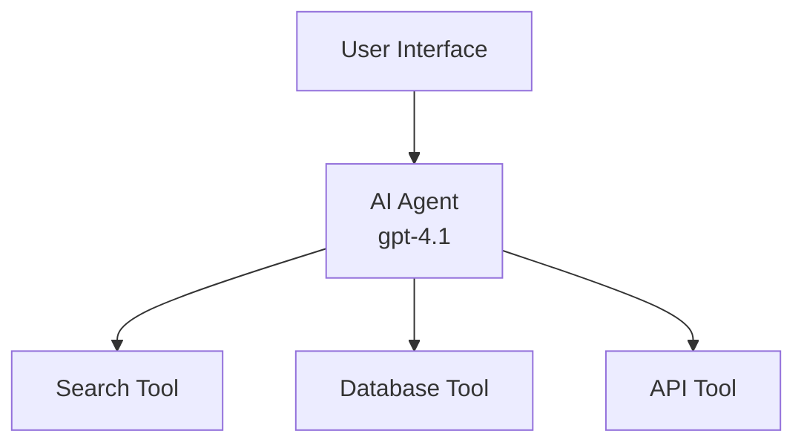
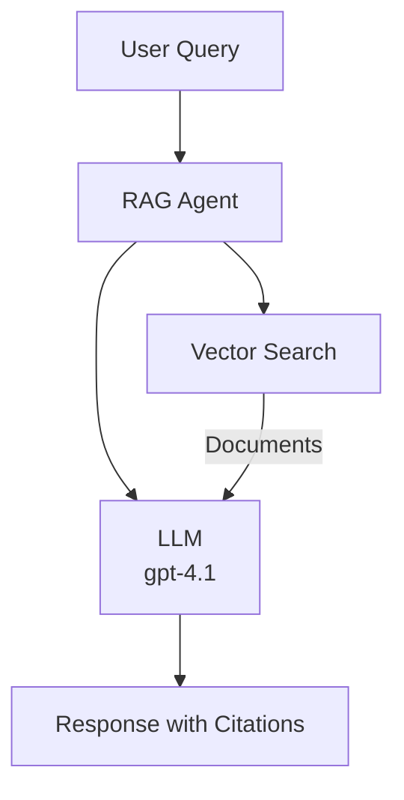
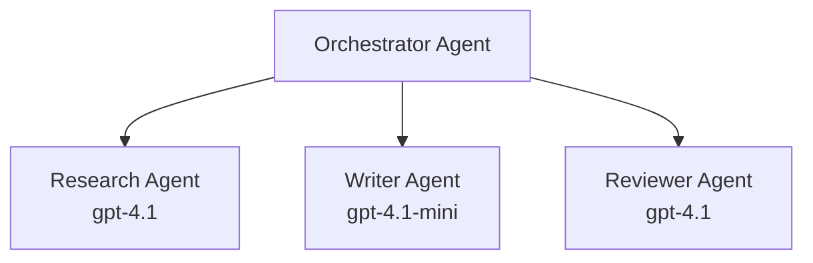

# Mawakala wa AI na Azure Developer CLI

**Uvinjari wa Sura:**
- **📚 Nyumbani kwa Kozi**: [AZD Kwa Waanzilishi](../../README.md)
- **📖 Sura ya Sasa**: Sura ya 2 - Maendeleo ya AI-Kwanza
- **⬅️ Iliyotangulia**: [Muungano wa Microsoft Foundry](microsoft-foundry-integration.md)
- **➡️ Ifuatayo**: [Usambazaji wa Mfano wa AI](ai-model-deployment.md)
- **🚀 Kipekee**: [Suluhisho za Mawakala Anuwai](../../examples/retail-scenario.md)

---

## Utangulizi

Mawakala wa AI ni programu huru zinazoweza kuona mazingira yao, kufanya maamuzi, na kuchukua hatua kufikia malengo maalum. Tofauti na chatbots rahisi zinazojibu maelekezo, mawakala wanaweza:

- **Tumia zana** - Piga simu za API, tafuta katika hifadhidata, endesha msimbo
- **Panga na fikiri** - Gawanya kazi ngumu katika hatua
- **Jifunze kutokana na muktadha** - Hifadhi kumbukumbu na badilika tabia
- **Shirikiana** - Fanya kazi na mawakala wengine (mifumo ya mawakala wengi)

Mwongozo huu unaonyesha jinsi ya kusambaza mawakala wa AI kwa Azure kwa kutumia Azure Developer CLI (azd).

Kutumia muktadha wa mazungumzo si mafunzo ya mfano: kumbukumbu ya kudumu, udhibiti wa upatikanaji, na uhifadhi lazima zatekelezwe/zanukuliwe na programu.

> **Uboreshaji wa Foundry GA (2026-11-09):** Sakinisha kundi la 1.0 la `microsoft.foundry` lililopatikana kwa kawaida kwa kutumia `azd >= 1.37.0`. Tathmini zinasakinishwa tofauti; vipengele vya onyesho hiari na kipande cha SDK cha kawaida hapo chini havikugezwi kwenda GA na tangazo la kundi. Mwongozo huu unatokana na [tangazo la GA](https://devblogs.microsoft.com/azure-sdk/microsoft-foundry-azure-developer-cli-ga/) na nyaraka, si usambazaji wa moja kwa moja wa Azure.

## Malengo ya Kujifunza

Kwa kumaliza mwongozo huu, utakuwa na uwezo wa:
- Kuelewa ni nini mawakala wa AI na jinsi wanavyotofautiana na chatbots
- Kusambaza templeti za mawakala wa AI zilizojengwa awali kwa kutumia AZD
- Kusanidi Mawakala wa Foundry kwa mawakala maalum
- Kutekeleza mifumo ya msingi ya mawakala (matumizi ya zana, RAG, mawakala wengi)
- Kufuatilia na kufanyia utatuzi mawakala waliosambazwa

## Matokeo ya Kujifunza

Baada ya kumaliza, utaweza:
- Kusambaza programu za mawakala wa AI kwa Azure kwa amri moja
- Kusanidi zana na uwezo wa mawakala
- Kutekeleza kizazi kilichoongezwa ukaguzi (RAG) kwa mawakala
- Kubuni usanifu wa mawakala wengi kwa michakato ngumu
- Kutatua shida za kawaida za usambazaji wa mawakala

---

## 🤖 Nini Kinatofautisha Wakala na Chatbot?

| Kipengele | Chatbot | Wakala wa AI |
|---------|---------|----------|
| **Tabia** | Kujibu maelekezo | Kuchukua hatua huru |
| **Zana** | Inaweza kutumia upokeaji au zana | Kawaida hutumia zana katika mzunguko wa malengo |
| **Kumbukumbu** | Inategemea programu | Kumbukumbu ya kudumu ikiwa imetekelezwa wazi |
| **Mipango** | Jibu moja | Fikra za hatua nyingi |
| **Ushirikiano** | Kiumbe kimoja | Inaweza kufanya kazi na mawakala wengine |

### Mfano Rahisi

- **Chatbot** = Mtu msaidizi anayejibu maswali kwenye dawati la habari
- **Wakala wa AI** = Msaidizi binafsi anayezungumza simu, kuweka miadi, na kukamilisha kazi kwa ajili yako

---

## 🚀 Anza Haraka: Sambaza Wakala Wako wa Kwanza

Chagua chaguo moja katika **kifurushi kipya kisicho na kitu cha kazi**. Amri ya mwisho `.` huanzisha hapo; bila mahali pa wazi, AZD ya sasa inaweza kuunda saraka ndogo yenye jina la templeti na haiwezi kubadilisha saraka ya shell yako. Hifadhi templeti/mazingira tofauti katika saraka tofauti.

Muda/bei zilizoorodheshwa hapa chini ni mifano, si nukuu zilizoidhinishwa. Angalia masharti ya mtihani, bei, idadi ya modeli, na huduma za ziada kabla ya kusambaza.

### Chaguo 1: Templeti ya Mawakala wa Foundry (Inayopendekezwa)

```bash
# Initialize the AI agents template
azd init --template get-started-with-ai-agents .

# Deploy to Azure
azd up
```

**Kinachosambazwa:** Miundombinu ya mfano uliopo na chaguo zilizochaguliwa huchagua mfano, zana, mwenyeji, na rasilimali za ufuatiliaji. Pitia README yake na `infra/` kabla ya kuandaa; usidhani kila templeti la wakala lina Search au kiolesura cha wavuti.

**Muda:** ~dakika 15-20
**Gharama:** ~$100-150/kwa mwezi (maendeleo)

### Chaguo 2: Mawakala wa Uandishi wa Ubunifu na Prompty

```bash
# Initialize the Prompty-based agent template
azd init --template https://github.com/Azure-Samples/contoso-creative-writer .

# Deploy to Azure
azd up
```

**Kinachosambazwa:** Mfano wa uandishi wa mawakala wengi wa FastAPI/Prompty ukitumia Azure OpenAI, Bing Grounding, na Azure AI Search. Kabrari ya zamani ya `agent-openai-python-prompty` inaelekeza hapa; si templeti ndogo ya wakala wa hali ya hewa wa Azure Functions. Fuata README yake ya sasa kwa mwenyeji, idadi ya mfano, na masharti ya Bing Grounding.

**Muda:** ~dakika 10-15
**Gharama:** ~$50-100/kwa mwezi (maendeleo)

### Chaguo 3: Wakala wa RAG Chat

```bash
# Initialize RAG chat template
azd init --template azure-search-openai-demo .

# Deploy to Azure
azd up
```

**Kinachosambazwa:**
- ✅ Miundo ya Microsoft Foundry
- ✅ Azure AI Search na data ya mfano
- ✅ Mchakato wa usindikaji wa hati
- ✅ Kiolesura cha mazungumzo chenye marejeo

**Muda:** ~dakika 15-25
**Gharama:** ~$80-150/kwa mwezi (maendeleo)

### Chaguo 4: Wakala Aliyojiandikisha na Kifurushi cha GA cha Foundry

Tumia [mwongozo kamili wa wakala aliyejikwaa](microsoft-foundry-integration.md#hosted-agent-walkthrough-ga) kwa mfano wa API wa Msingi wa Mfumo wa Majibu wa Python Agent. Njia hii ya usambazaji inahitaji Python 3.13+, uv wa sasa, ruhusa za Foundry, na idadi ya mfano wa mkoa. Thibitisha simu za SDK za ndani tofauti kwa kutumia vyeti vya Azure CLI.

```bash
azd auth login
azd ext install microsoft.foundry
```

Katika saraka tupu, anzisha mfano:

```text
azd ai agent init --template https://github.com/microsoft-foundry/foundry-samples/blob/main/samples/python/hosted-agents/agent-framework/responses/01-basic/azure.yaml --deploy-mode code --src .
```

Chagua mradi mpya au uliopo, pitia `azure.yaml`, na endesha `azd provision`. Tumia `azd ai agent run` kufungua Agent Inspector na, kutoka kwa terminal nyingine katika saraka hiyo, `azd ai agent invoke --local "Explain how this agent is hosted."`. Baada ya uthibitisho wa ndani, tumia `azd deploy` na `azd ai agent invoke "Explain how this agent is hosted."` kulinganisha majibu yaliyosambazwa. Foundry hujenga chanzo kilichopakuliwa mbali; ujenzi wa kontena la ndani haufai.

**Lini utumie `azd ai agent init` dhidi ya `azd init --template`:**

| Njia | Bora Kwa | Jinsi Inavyofanya Kazi |
|----------|----------|------|
| `azd init --template` | Kuanzia na mfano wa programu inayofanya kazi | Kunakili kabrari kamili ya templeti na msimbo + miundombinu |
| `azd ai agent init --template` | Kubadilisha mradi wa wakala wa Foundry wa sasa | Inatumia hati ya mradi wa `azure.yaml` na ufafanuzi wake |

> **Kidokezo:** Chaguo 1-3 huanzia templeti kamili za programu; Chaguo la 4 hufundisha mtiririko wa kazi wa wakala aliyejikwaa wa GA. Hakuna amri ya kuanzisha inayobadilisha mazingira ya wakala wa zamani moja kwa moja. Kuongeza ufafanuzi wa wakala moja kwa moja kwenye mradi uliopo, angalia [mwongozo wa uanzishaji na uhamishaji](../chapter-08-production/production-ai-practices.md#initializing-agent-projects-with-azd-ai-agent-init).

Sakinisha `azure.ai.evaluations` tofauti kutengeneza na kupitia data/mitihani ya tathmini, sanidi tathmini, na itekeleze kwa kutumia `azd ai eval`. Uboreshaji unaweza kutumia tathmini inayolingana; pitia wagombea kabla ya kusambaza moja waziwazi. Fuata [mtiririko wa tathmini](../chapter-08-production/production-ai-practices.md#evaluation-migration-and-quality-checks) na [uhamishaji wa uboreshaji](../chapter-08-production/production-ai-practices.md#optimization-configuration-migration) kabla ya kutumia mifano ya zamani tena. Kwa usafishaji, rasilimali za mradi wa Foundry uliotumika hubaki baada ya `azd down`; kundi la rasilimali mpya hupangwa kufutwa. Angalia [mwongozo wa usafishaji wa mwendo](microsoft-foundry-integration.md#7-clean-up-deliberately).

---

## 🏗️ Mifumo ya Usanifu wa Wakala

### Mfano 1: Wakala Mmoja na Zana

Mfano rahisi wa wakala - wakala mmoja anayezitumia zana nyingi.



**Bora kwa:**
- Bot za msaada kwa wateja
- Msaidizi wa utafiti
- Mawakala wa uchambuzi wa data

**Mfano wa programu unaohusiana:** `azure-search-openai-demo` unaonyesha RAG, si mzunguko wa wakala wa zana yoyote.

### Mfano 2: Wakala wa RAG (Kizazi Kilichoongezwa Ukaguzi)

Wakala anayevuta hati muhimu kabla ya kutoa majibu.



**Bora kwa:**
- Maktaba ya maarifa ya taasisi
- Mifumo ya maswali na majibu ya hati
- Utafiti wa uwazi na sheria

**Templeti ya AZD:** `azure-search-openai-demo`

### Mfano 3: Mfumo wa Mawakala Wengi

Mawakala maalum wengi wakifanya kazi pamoja kwenye kazi ngumu.



**Bora kwa:**
- Uundaji wa maudhui magumu
- Michakato ya hatua nyingi
- Kazi zinazohitaji utaalamu tofauti

**Jifunze Zaidi:** [Mifumo ya Kuratibu Mawakala Wengi](../chapter-06-pre-deployment/coordination-patterns.md)

---

## ⚙️ Kusanidi Zana za Wakala

Mawakala huwapa nguvu wanapotumia zana. Hapa kuna jinsi ya kusanidi zana za kawaida:

### Usanidi wa Zana katika Mawakala wa Foundry

Kipande hiki cha **SDK ya Huduma ya Wakala ya Kawaida** kinawanusudia `azure-ai-projects==1.0.0` na `azure-ai-agents==1.1.0` kwa kutumia `azure-identity`. Siyo API ya mawakala wa toleo jipya/Responses API inayotumiwa na templeti za sasa za Foundry, wala kiendelezi cha AZD cha `azure.ai.agents` (kifurushi tofauti). Usichanganye vizazi hivi vya API. Weka `PROJECT_ENDPOINT` kwa mwisho wa mradi wa Foundry wa kawaida na `MODEL_DEPLOYMENT_NAME` kwa usambazaji wa mfano unaoungwa mkono; thibitisha kwa kutumia `az login` ndani na toa ruhusa za mradi zinazohitajika.

```python
# agent_config.py
import os
from azure.ai.projects import AIProjectClient
from azure.ai.agents.models import FunctionTool
from azure.identity import DefaultAzureCredential

def search_knowledge_base(query: str) -> str:
    """Search the demonstration knowledge base.

    :param query: Search text.
    :return: Matching demonstration information.
    """
    # Local fixture only, not a production search implementation.
    return "Demo policy: returns are accepted within 30 days."

project_client = AIProjectClient(
    endpoint=os.environ["PROJECT_ENDPOINT"],
    credential=DefaultAzureCredential(),
)
search_tool = FunctionTool(functions={search_knowledge_base})
project_client.agents.enable_auto_function_calls(search_tool)
agent = project_client.agents.create_agent(
    model=os.environ["MODEL_DEPLOYMENT_NAME"],
    name="Support Agent",
    instructions="Use search_knowledge_base for policy questions. Label results as demo data.",
    tools=search_tool.definitions,
)
```

Kusajili kielelezo cha kazi hakutekelezi Python kwenye huduma. Katika SDK hii, `enable_auto_function_calls` pamoja na `agents.runs.create_and_process(...)` hufanya callback kuuendeshwa katika mchakato wako wa mteja. Angalia [mfano wa SDK uliotolewa](https://github.com/Azure/azure-sdk-for-python/blob/azure-ai-agents_1.1.0/sdk/ai/azure-ai-agents/samples/agents_tools/sample_agents_auto_function_call.py). Funga mteja na futa mawakala/mishale ya maonyesho ukimaliza.

### Usanidi wa Mazingira

Majina yafuatayo ni **ingizo la templeti maalum la mfano**, si swichi za ndani za AZD. Kwanza panda kila thamani kupitia `infra/main.parameters.json`, miundombinu, na msimbo wa programu. `azd env set` pekee haibadilishi zana au maagizo ya wakala.

```bash
# Set up agent-specific environment variables
azd env set AZURE_OPENAI_MODEL "gpt-4.1"
azd env set AGENT_INSTRUCTIONS "You are a helpful assistant..."
azd env set ENABLE_CODE_INTERPRETER "true"
azd env set ENABLE_FILE_SEARCH "true"

# Apply wired infrastructure and application changes
azd up
```

---

## 📊 Kufuatilia Mawakala

### Mwingiliano na Application Insights

Ikiwa templeti uliyochagua huandaa Application Insights na kusanidi vipimo:

```bash
# Open monitoring dashboard
azd monitor --overview

# Open the Application Insights logs view (not a streaming log tail)
azd monitor --logs

# View live metrics
azd monitor --live
```

### Vipimo Vikuu vya Kufuatilia

| Kipimo | Maelezo | Lengo |
|--------|-------------|--------|
| Ucheleweshaji wa Jibu | Muda wa kutoa jibu | < sekunde 5 |
| Matumizi ya Tokeni | Tokeni kwa kila ombi | Fuata kwa gharama |
| Asilimia ya Mafanikio ya Kuitwa Zana | % ya utekelezaji mzuri wa zana | > 95% |
| Kiwango cha Makosa | Maombi ya wakala yaliyoshindwa | < 1% |
| Kuridhika kwa Mtumiaji | Alama za maoni | > 4.0/5.0 |

### Kurekodi Maelezo Maalum kwa Mawakala

```python
import os
from azure.monitor.opentelemetry import configure_azure_monitor
from opentelemetry import trace

# Configure Azure Monitor with OpenTelemetry
configure_azure_monitor(
    connection_string=os.environ["APPLICATIONINSIGHTS_CONNECTION_STRING"]
)

tracer = trace.get_tracer(__name__)

def log_agent_interaction(user_query, agent_response, tools_used, latency_ms):
    with tracer.start_as_current_span("agent_interaction") as span:
        span.set_attributes({
            "query_length": len(user_query),  # Do not log raw prompts or personal data
            "response_length": len(agent_response),
            "tools_used": tools_used,
            "latency_ms": latency_ms
        })
```

> **Kumbuka:** Sakinisha kifurushi kinachohitajika: `pip install azure-monitor-opentelemetry`. Kinakuja na utegemezi wa OpenTelemetry; jina la kuingiza si sharti kusakinisha kifurushi chenye jina `opentelemetry`.

---

## 💰 Mambo ya Kuzingatia Gharama

### Makisio ya Gharama za Kila Mwezi kwa Mfano

Hizi ni viwango vya mipango ya mfano, si nukuu au viwango vya matumizi. Eneo, tokeni za mfano, SKUs za Search/hisabati, vikao vya zana, uhifadhi, na trafiki vinaweza kuzidi hizi. Angalia mwongozo wa gharama za mfano na bei za Azure kabla ya `azd up`.

| Mfano | Mazingira ya Maendeleo | Uzalishaji |
|---------|-----------------|------------|
| Wakala Mmoja | $50-100 | $200-500 |
| Wakala wa RAG | $80-150 | $300-800 |
| Mawakala Wengi (mawakala 2-3) | $150-300 | $500-1,500 |
| Mawakala Wengi wa Kampuni | $300-500 | $1,500-5,000+ |

### Vidokezo vya Kuboresha Gharama

1. **Tumia gpt-4.1-mini kwa kazi rahisi** (kama templeti yako inatumia ingizo hili tu)
   ```bash
   azd env set AZURE_OPENAI_MODEL "gpt-4.1-mini"
   ```

2. **Tekeleza uhifadhi wa eneo salama kwa maswali yanayorudiwa.** Jumuisha idhini ya mpangaji/mtumiaji, usambazaji wa mfano, maagizo, na toleo la upokeaji katika ufunguo wa uhifadhi; weka muda wa kumalizika. Usishirikishe majibu ya mazungumzo binafsi kupitia uhifadhi wa maswali tu wa mchakato mzima. Kielelezo cha wakala cha SDK haina njia ya kawaida ya `agent.run()`.

3. **Weka mipaka ya tokeni kwa kila mtiririko**
   ```python
   # Set max_completion_tokens when running the agent, not during creation
   run = project_client.agents.runs.create_and_process(
       thread_id=thread.id,
       agent_id=agent.id,
       max_completion_tokens=1000  # Budget across the run; may finish as incomplete
   )
   ```

4. **Punguza ukubwa wa Container Apps unazoweza kuwa na kazi hadi sifuri wakati hazitumiwi**
   ```bash
   # Custom-template input: must map to template.scale.minReplicas
   azd env set MIN_REPLICAS "0"
   ```
   Tekeleza mabadiliko ya miundombinu kwa kutumia `azd provision` au `azd up`. Kupunguza hadi sifuri kunahitaji kichocheo kinachofaa na hakuzuii Search, uhifadhi, au gharama za mfano/zana.

---

## 🔧 Kutatua Matatizo ya Mawakala

### Masuala ya Kawaida na Ufumbuzi

<details>
<summary><strong>❌ Wakala haajibu simu za zana</strong></summary>

```bash
# Inspect the application deployment (not the agent's registered tools)
azd show

# Verify OpenAI deployment
az cognitiveservices account deployment list \
  --name $AZURE_OPENAI_NAME \
  --resource-group $RG_NAME

# Check agent logs
azd monitor --logs
```

**Sababu za kawaida:**
- Mwendo wa saini wa kazi wa zana hauendani
- Hukumu za ruhusa zinazohitajika hazipo
- Endpoint ya API haipatikani
</details>

<details>
<summary><strong>❌ Ucheleweshaji mkubwa katika majibu ya wakala</strong></summary>

```bash
# Check Application Insights for bottlenecks
azd monitor --live

# Consider using a faster model
azd env set AZURE_OPENAI_MODEL "gpt-4.1-mini"
azd up
```

**Vidokezo vya uboreshaji:**
- Tumia majibu ya mtiririko
- Tekeleza uhifadhi wa majibu
- Punguza ukubwa wa dirisha la muktadha
</details>

<details>
<summary><strong>❌ Wakala arudishe taarifa zisizo sahihi au za kubuniwa</strong></summary>

```python
# Improve with better system prompts
instructions = """
You are a helpful assistant. IMPORTANT:
- Only answer based on provided context
- If you don't know, say "I don't know"
- Always cite your sources
- Never make up information
"""

# Use these instructions in the agent definition.
# For classic file search, first upload/index documents in a vector store,
# then use FileSearchTool(vector_store_ids=[...]) and pass both its
# .definitions and .resources when creating the agent.
```
 Maagizo na upokeehu hupunguza hatari; hakuna uhakikisho wa majibu ya kweli. Tathmini maswali ya msingi na yasiyo na muktadha dhidi ya majibu yanayojulikana.
</details>

<details>
<summary><strong>❌ Makosa ya mipaka ya tokeni yaliyopita</strong></summary>

```python
# Implement context window management
def truncate_context(messages, max_tokens=8000, model="gpt-4.1"):
    """Approximate content-only budget for objects with .content strings."""
    import tiktoken
    encoding = tiktoken.encoding_for_model(model)
    total_tokens = 0
    truncated = []
    
    for msg in reversed(messages):
        msg_tokens = len(encoding.encode(msg.content))
        if total_tokens + msg_tokens > max_tokens:
            break
        truncated.insert(0, msg)
        total_tokens += msg_tokens
    
    return truncated
```
 Msaidizi huyu haizingatii vipengele vya jukumu/zana, maagizo ya mfumo, tokeni za picha, na mzigo wa itifaki. Hifadhi nafasi kwa hizo na ukamilisho; usigawanye jozi za simu za zana/matokeo au kupuuza maagizo muhimu ya mfumo. Sakinisha `tiktoken` tofauti. Sio mkaguzi wa jumla wa dirisha la muktadha.
</details>

---

## 🎓 Mazoezi ya Vitendo

### Zoezi 1: Sambaza Wakala wa Msingi (Dakika 20)

**Lengo:** Sambaza wakala wako wa kwanza wa AI kwa kutumia AZD

```bash
# Step 1: Initialize template
azd init --template get-started-with-ai-agents .

# Step 2: Login to Azure
azd auth login
# If you work across tenants, add --tenant-id <tenant-id>

# Step 3: Deploy
azd up

# Step 4: Test the agent
# Expected output after deployment:
#   Deployment Complete!
#   Endpoint: https://<app-name>.<region>.azurecontainerapps.io
# Open the URL shown in the output and try asking a question

# Step 5: View monitoring
azd monitor --overview

# Step 6: Review the listed resources and confirm cleanup
azd down
```

**Vigezo vya Mafanikio:**
- [ ] Wakala anajibu maswali
- [ ] Anaweza kufikia dashibodi ya ufuatiliaji kupitia `azd monitor`
- [ ] Rasilimali zimesafishwa kwa mafanikio

### Zoefu la 2: Ongeza Zana ya Kawaida (dakika 30)

**Lengo:** Ongeza zana ya kawaida kwa wakala

**Mwanzo:** Tumia mteja wa SDK wa kawaida kutoka [Tool Configuration](#tool-configuration-in-foundry-agents), si template yoyote ile yenye kizazi tofauti cha SDK.

1. Ongeza kifaa hiki cha kuelezewa kwa `agent_config.py`:
   ```python
   def get_weather(location: str) -> str:
       """Return demonstration weather, not live conditions.

       :param location: City name.
       :return: A clearly labelled fixture.
       """
       print(f"TOOL_CALLED: {location}")
       return f"Demo weather in {location}: Sunny, 72°F (fixture, not live)"
   ```
2. Badilisha kanda ya usajili na uundaji wa zana ya utafutaji na:
   ```python
   weather_tool = FunctionTool(functions={get_weather})
   project_client.agents.enable_auto_function_calls(weather_tool)
   agent = project_client.agents.create_agent(
       model=os.environ["MODEL_DEPLOYMENT_NAME"],
       name="Weather Agent",
       instructions="Call get_weather for weather questions; explain that it returns demo data.",
       tools=weather_tool.definitions,
   )
   thread = project_client.agents.threads.create()
   try:
       project_client.agents.messages.create(
           thread_id=thread.id, role="user", content="Use get_weather for Seattle."
       )
       run = project_client.agents.runs.create_and_process(
           thread_id=thread.id, agent_id=agent.id
       )
       if run.status != "completed":
           raise RuntimeError(f"Run status: {run.status}; error: {run.last_error}")
       for message in project_client.agents.messages.list(thread_id=thread.id):
           for text in message.text_messages:
               print(text.text.value)
   finally:
       project_client.agents.threads.delete(thread.id)
       project_client.agents.delete_agent(agent.id)
       project_client.close()
   ```
3. Endesha kwa ndani (hii inaita mradi wa Azure uliopo na husababisha gharama za modeli):
   ```bash
   python agent_config.py
   # Expected: TOOL_CALLED: Seattle, then a completed answer labelled demo data.
   ```

**Vigezo vya Mafanikio:**
- [ ] Wakala anatambua maswali yanayohusiana na hali ya hewa
- [ ] Zana inaitwa kwa usahihi
- [ ] Majibu yanajumuisha taarifa za hali ya hewa

### Zoefu la 3: Tengeneza Wakala wa RAG (dakika 45)

**Lengo:** Unda wakala anayejibu maswali kutoka kwa nyaraka zako

```bash
# Step 1: Deploy RAG template
azd init --template azure-search-openai-demo .
azd up

# Step 2: Upload your documents
# For the sample's local ingestion path, place supported files in data/.
# Run from the sample root after following its Python environment setup:
./scripts/prepdocs.sh
# Windows PowerShell equivalent: .\\scripts\\prepdocs.ps1

# Step 3: Test with domain-specific questions
# Open the web app URL from the azd up output
# Ask questions about your uploaded documents
# Responses should include citation references like [doc.pdf]
```

**Vigezo vya Mafanikio:**
- [ ] Wakala anajibu kutoka kwa nyaraka zilizopakiwa
- [ ] Majibu yanajumuisha rejeleo
- [ ] Maswali ya majaribio yasiyo sehemu ya ufikiaji yanashughulikiwa bila madai yasiyoungwa mkono (sio dhamana kwa kila swali la baadaye)

Ikiwa `USE_CLOUD_INGESTION=true`, tumia badala yake mtiririko wa sampuli wa kuingiza/kupakia katika wingu; kifuniko cha ndani kinasahau kwa makusudi kuingiza. Baada ya majaribio, endesha `azd down` katika mazingira ya RAG na kagua rasilimali zinazotakiwa kufutwa.

---

## 📚 Hatua Zifuatazo

Sasa unapoelewa wa wakala wa AI, chunguza mada hizi za juu:

| Mada | Maelezo | Kiungo |
|-------|-------------|------|
| **Mifumo ya Wa-Agenti Wengi** | Jenga mifumo yenye mawakala wengi wanaoshirikiana | [Mfano wa Wa-Agenti wa Reja reja](../../examples/retail-scenario.md) |
| **Mifumo ya Muungano** | Jifunze mifumo ya mpangilio na mawasiliano | [Mifumo ya Muungano](../chapter-06-pre-deployment/coordination-patterns.md) |
| **Uwekaji Kazi uzalishaji** | Uwekaji wakala endeshi kwa viwanda | [Mazingira ya AI katika Uzalishaji](../chapter-08-production/production-ai-practices.md) |
| **Tathmini ya Wakala** | Jaribu na tathmini ufanisi wa wakala | [Utatuzi wa Changamoto za AI](../chapter-07-troubleshooting/ai-troubleshooting.md) |
| **Maabara ya Warsha ya AI** | Shughuli za vitendo: Fanya suluhisho lako la AI liwe tayari kwa AZD | [Maabara ya Warsha ya AI](ai-workshop-lab.md) |

---

## 📖 Rasilimali Zaidi

### Nyaraka Rasmi
- [Huduma ya Wakala wa Microsoft Foundry](https://learn.microsoft.com/azure/ai-services/agents/)
- [Mwongozo wa Haraka wa Huduma ya Wakala wa Microsoft Foundry](https://learn.microsoft.com/azure/ai-services/agents/quickstart)
- [Mwanga wa Mfumo wa Wakala wa Semantic Kernel](https://learn.microsoft.com/semantic-kernel/)

### Sampuli za AZD kwa Wakala
- [Anza na Wa-Agenti wa AI](https://github.com/Azure-Samples/get-started-with-ai-agents)
- [Wa-Agenti wa Uandishi wa Ubunifu na Prompty](https://github.com/Azure-Samples/contoso-creative-writer)
- [Onyesho la Azure Search OpenAI](https://github.com/Azure-Samples/azure-search-openai-demo)

### Rasilimali za Jamii
- [AZD Bora - Sampuli za Wakala](https://azure.github.io/awesome-azd/?tags=ai-agents)
- [Azure AI Discord](https://discord.gg/microsoft-azure)
- [Microsoft Foundry Discord](https://discord.gg/nTYy5BXMWG)

### Ujuzi wa Wakala kwa Mhariri Wako
- [**Ujuzi wa Wakala wa Microsoft Azure**](https://skills.sh/microsoft/github-copilot-for-azure) - Sakinisha ujuzi unaotumika tena wa wakala wa AI kwa maendeleo ya Azure katika GitHub Copilot, Cursor, au wakala yeyote unaoungwa mkono. Inajumuisha ujuzi wa [Azure AI](https://skills.sh/microsoft/github-copilot-for-azure/azure-ai), [Microsoft Foundry](https://skills.sh/microsoft/github-copilot-for-azure/microsoft-foundry), [uwekaji](https://skills.sh/microsoft/github-copilot-for-azure/azure-deploy), na [uchunguzi](https://skills.sh/microsoft/github-copilot-for-azure/azure-diagnostics):
  ```bash
  npx skills add microsoft/github-copilot-for-azure
  ```

---

**Mwelekeo**
- **Somo lililopita**: [Muungano wa Microsoft Foundry](microsoft-foundry-integration.md)
- **Somo lijalo**: [Uwekaji wa Mfano wa AI](ai-model-deployment.md)

---

<!-- CO-OP TRANSLATOR DISCLAIMER START -->
**Kionyozo**:
Hati hii imetafsiriwa kwa kutumia huduma ya tafsiri ya AI [Co-op Translator](https://github.com/Azure/co-op-translator). Ingawa tunajitahidi kupata usahihi, tafadhali fahamu kwamba tafsiri za kiotomatiki zinaweza kuwa na makosa au upungufu wa usahihi. Hati ya asili katika lugha yake halisi inapaswa kuchukuliwa kama chanzo cha mamlaka. Kwa taarifa muhimu, tafsiri ya kitaalamu inayofanywa na binadamu inapendekezwa. Hatutojibu kwa kuelewa vibaya au tafsiri potofu zinazotokea kutokana na matumizi ya tafsiri hii.
<!-- CO-OP TRANSLATOR DISCLAIMER END -->