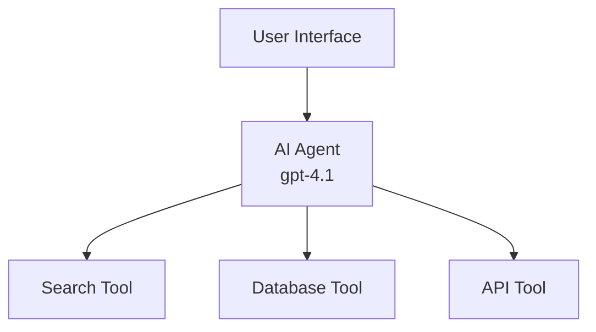
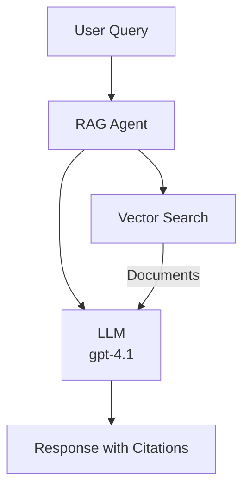
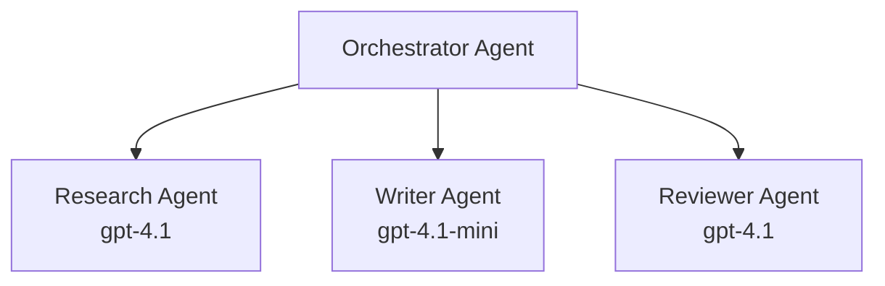

# Wakala wa AI na Azure Developer CLI

**Uabiri wa Sura:**
- **📚 Mwanzo wa Kozi**: [AZD Kwa Waanzilishi](../../README.md)
- **📖 Sura ya Sasa**: Sura ya 2 - Maendeleo ya Kwanza ya AI
- **⬅️ Iliyotangulia**: [Muunganiko wa Microsoft Foundry](microsoft-foundry-integration.md)
- **➡️ Ifuatayo**: [Utekelezaji wa Mfano wa AI](ai-model-deployment.md)
- **🚀 Juu Zaidi**: [Suluhisho za Wakala Wengi](../../examples/retail-scenario.md)

---

## Utangulizi

Wakala wa AI ni programu za kujitegemea zinazoweza kutambua mazingira yao, kufanya maamuzi, na kuchukua hatua kufanikisha malengo maalum. Tofauti na roboti rahisi za mazungumzo zinazojibu tu maelekezo, wakala wanaweza:

- **Kutumia zana** - Kupiga simu za API, kutafuta kwenye hifadhidata, kutekeleza msimbo
- **Kupanga na kufikiria** - Kuvunja kazi ngumu kuwa hatua ndogo ndogo
- **Kujifunza kutoka muktadha** - Kuhifadhi kumbukumbu na kubadilisha mwenendo
- **Kushirikiana** - Kufanya kazi na wakala wengine (mifumo ya wakala wengi)

Mwongozo huu unaonyesha jinsi ya kuhamisha wakala wa AI kwenye Azure kwa kutumia Azure Developer CLI (azd).

Matumizi ya muktadha wa mazungumzo si mafunzo ya mfano: kumbukumbu endelevu, udhibiti wa upatikanaji, na uhifadhi ni lazima zatekelezwe/kusanidiwa na programu.

> **Mapitio ya toleo (2026-11-04):** Mifano ya CLI ilikaguliwa dhidi ya nyaraka/chanzo cha `azd` `1.37.2`, `azure.ai.agents` `1.0.0-beta.23`, na `azure.ai.evaluations` `1.0.0-beta.2`, si utekelezaji wa moja kwa moja wa Azure. Tumia `azd >= 1.37.0` kwa mtiririko wa kazi wa pamoja. Angalia [mabadiliko na marekebisho ya hivi karibuni](../chapter-08-production/production-ai-practices.md#recent-release-changes-and-fixes) kabla ya kusasisha miradi ya zamani.

## Malengo ya Kujifunza

Kwa kukamilisha mwongozo huu, utakuwa na uwezo wa:
- Kuelewa wakala wa AI ni nini na tofauti zao na roboti za mazungumzo
- Kuweka templeti za wakala wa AI zilizo tayari kwa kutumia AZD
- Kusanidi Wakala wa Foundry kwa wakala wa kipekee
- Kutekeleza mifumo ya msingi ya wakala (matumizi ya zana, RAG, wakala wengi)
- Kufuatilia na kutatua matatizo ya wakala waliowekwa

## Matokeo ya Kujifunza

Baada ya kukamilisha, utakuwa na uwezo wa:
- Kuweka programu za wakala wa AI kwenye Azure kwa amri moja
- Kusanidi zana na uwezo wa wakala
- Kutekeleza kizazi kilichosaidiwa na upokeaji (RAG) na wakala
- Kubuni miundo ya wakala wengi kwa kazi ngumu
- Kutatua matatizo ya kawaida ya utekelezaji wa wakala

---

## 🤖 Nini Kinachofanya Wakala Kutofautiana na Roboti ya Mazungumzo?

| Sifa | Roboti ya Mazungumzo | Wakala wa AI |
|---------|---------|----------|
| **Mwenendo** | Anajibu maelekezo | Huchukua hatua za kujitegemea |
| **Zana** | Inaweza kutumia upokeaji au zana | Kwa kawaida hutumia zana katika mduara wa lengo |
| **Kumbukumbu** | Inategemea programu | Kumbukumbu endelevu ikiwa imeelekezwa wazi |
| **Utaratibu** | Jibu moja | Fikiria hatua nyingi |
| **Ushirikiano** | Kitu kimoja | Inaweza kufanya kazi na wakala wengine |

### Mfano Rahisi

- **Roboti ya Mazungumzo** = Mtu msaidizi mwenye msaada akijibu maswali kwenye dawati la taarifa
- **Wakala wa AI** = Msaidizi wa kibinafsi anayewweza kupiga simu, kupanga miadi, na kukamilisha kazi kwa niaba yako

---

## 🚀 Anzia Haraka: Weka Wakala Wako wa Kwanza

Chagua chaguo moja katika **folda mpya tupu ya kazi**. Amri `.` inaanzisha huko; bila sehemu maalum, AZD ya sasa inaweza kuunda folda ndogo yenye jina la templeti na haibadilishi folda ya sasa ya shell yako. Hifadhi templeti/mizeitishaji tofauti katika folda tofauti.

Muda/gia la gharama zilizo hapa chini ni mifano tu, si nukuu halali. Angalia mahitaji ya sasa, bei, idadi ya mfano, na huduma za hiari kabla ya utekelezaji wa kila sampuli.

### Chaguo 1: Templeti ya Wakala wa Foundry (Inayopendekezwa)

```bash
# Initialize the AI agents template
azd init --template get-started-with-ai-agents .

# Deploy to Azure
azd up
```

**Kinachowekwa:** Miundombinu ya sampuli ya sasa na chaguo zilizochaguliwa huchagua mfano, zana, mwenyeji, na rasilimali za ufuatiliaji. Rekebisha README yake na `infra/` kabla ya utoaji; usidhani kila templeti ya wakala ina Search au kiolesura cha wavuti.

**Muda:** takriban dakika 15-20
**Gharama:** takriban $100-150/kwa mwezi (maendeleo)

### Chaguo 2: Wakala wa Uandishi wa Ubunifu na Prompty

```bash
# Initialize the Prompty-based agent template
azd init --template https://github.com/Azure-Samples/contoso-creative-writer .

# Deploy to Azure
azd up
```

**Kinachowekwa:** Sampuli ya uandishi wa wakala wengi wa FastAPI/Prompty inayotumia Azure OpenAI, Bing Grounding, na Azure AI Search. Hifadhi ya zamani `agent-openai-python-prompty` inaelekeza hapa; si templeti ya wakala mdogo wa hali ya hewa wa Azure Functions. Fuata README yake ya sasa kwa mwenyeji, idadi ya mfano, na mahitaji ya Bing Grounding.

**Muda:** takriban dakika 10-15
**Gharama:** takriban $50-100/kwa mwezi (maendeleo)

### Chaguo 3: Wakala wa Mazungumzo wa RAG

```bash
# Initialize RAG chat template
azd init --template azure-search-openai-demo .

# Deploy to Azure
azd up
```

**Kinachowekwa:**
- ✅ Miundo ya Microsoft Foundry
- ✅ Azure AI Search na data ya sampuli
- ✅ Mchakato wa usindikaji wa hati
- ✅ Kiolesura cha mazungumzo chenye marejeo

**Muda:** takriban dakika 15-25
**Gharama:** takriban $80-150/kwa mwezi (maendeleo)

### Chaguo 4: AZD AI Agent Init (Mapitio ya Templeti ya Mradi)

Tumia `azd ai agent init` kwa maingiliano, au tumia mradi wa wakala wa sasa wa `azure.yaml` kwa `--template`/`-t`. Chaguo la zamani la `--manifest`/`-m` ni jina lililotupwa, si mgeuzi wa hati za zamani.

```bash
# Install the AI agents extension
azd extension install azure.ai.agents

# Optional: verify the installed preview version
azd extension show azure.ai.agents

# Initialize from a current agent project template (supply your template path)
azd ai agent init --template ./templates/support-agent/azure.yaml

# Deploy to Azure
azd up

# Test the deployed agent (shows latency + time-to-first-byte)
azd ai agent invoke
```

**Wakati wa kutumia `azd ai agent init` vs `azd init --template`:**

| Mbinu | Bora Kwa Nani | Inavyofanya Kazi |
|----------|----------|------|
| `azd init --template` | Kuanzia mfano wa kazi uliopo | Kunasua hifadhi kamili ya templeti na msimbo + miundombinu |
| `azd ai agent init --template` | Kukubali mradi wa wakala wa Foundry aliyepo | Inatumia hati ya mradi wa `azure.yaml` na ufafanuzi wake |

> **Kidokezo:** Tumia `azd init --template` unapo jifunza (Chaguzi 1-3 hapo juu). Tumia `azd ai agent init` kwa mtiririko wa kazi wa wakala wa Foundry. Kuongeza ufafanuzi wa moja kwa moja wa wakala kwa mradi uliopo, angalia [maelekezo ya kuanzisha na uhamishaji](../chapter-08-production/production-ai-practices.md#initializing-agent-projects-with-azd-ai-agent-init).

Baada ya `azd up`, tumia `azd ai agent invoke` kujaribu, kisha ugani wa `azure.ai.evaluations` tofauti (`azd ai eval init`, `generate`, na `run start`) kupima ubora, na `azd ai agent optimize` kuboresha kwa kutumia usanidi mpya wa tathmini. Wakala beta.22 walibadilisha mtiririko wa kazi wa tathmini ya jadi na kubadilisha muundo wa `--config` wa uboreshaji. Angalia [uhamisho wa tathmini](../chapter-08-production/production-ai-practices.md#evaluation-migration-and-quality-checks) na [uhamisho wa uboreshaji](../chapter-08-production/production-ai-practices.md#optimization-configuration-migration) kabla ya kutumia tena mifano ya zamani.

---

## 🏗️ Mifumo ya Muundo wa Wakala

### Muundo 1: Wakala Mmoja na Zana

Muundo wa wakala rahisi kabisa - wakala mmoja anayeweza kutumia zana nyingi.



**Bora kwa:**
- Roboti wa msaada wa wateja
- Msaidizi wa utafiti
- Wakala wa uchambuzi wa data

**Mfano wa matumizi unaohusiana:** `azure-search-openai-demo` unaonyesha RAG, si mzunguko wa wakala wa zana yoyote ya jumla.

### Muundo 2: Wakala wa RAG (Uzazi Ulioboreshwa kwa Upataji)

Wakala anayepata nyaraka zinazofaa kabla ya kutoa majibu.



**Bora kwa:**
- Misingi ya maarifa ya biashara
- Mifumo ya maswali na majibu ya nyaraka
- Utafiti wa utimilifu na wa kisheria

**Kiolezo cha AZD:** `azure-search-openai-demo`

### Muundo 3: Mfumo wa Wakala Wengi

Wakala wengi maalum wakishirikiana kwenye kazi tata.



**Bora kwa:**
- Uundaji wa maudhui tata
- Miradi yenye hatua nyingi
- Kazi zinazo hitaji utaalamu tofauti

**Jifunze Zaidi:** [Mifumo ya Kuratibu Wakala Wengi](../chapter-06-pre-deployment/coordination-patterns.md)

---

## ⚙️ Kusanidi Vifaa vya Wakala

Wakala huwa wenye nguvu wanapoweza kutumia vifaa. Hapa ni jinsi ya kusanidi vifaa vya kawaida:

### Usanidi wa Vifaa katika Wakala wa Foundry

Sehemu hii ya **Agent Service SDK ya zamani** inalenga `azure-ai-projects==1.0.0` na `azure-ai-agents==1.1.0` na `azure-identity`. Si toleo jipya la API ya versioned-agent/Responses inayotumiwa na baadhi ya templates za Foundry za sasa, wala nyongeza ya `azure.ai.agents` AZD (pakiti tofauti). Usichanganye vizazi hivi vya API. Weka `PROJECT_ENDPOINT` kama hatua ya mradi wa Foundry wa zamani na `MODEL_DEPLOYMENT_NAME` kwa mzigo wa mfano uliopo unaoungwa mkono; thibitisha na `az login` ndani ya eneo lako na peana ruhusa za mradi zinazohitajika.

```python
# agent_config.py
import os
from azure.ai.projects import AIProjectClient
from azure.ai.agents.models import FunctionTool
from azure.identity import DefaultAzureCredential

def search_knowledge_base(query: str) -> str:
    """Search the demonstration knowledge base.

    :param query: Search text.
    :return: Matching demonstration information.
    """
    # Local fixture only, not a production search implementation.
    return "Demo policy: returns are accepted within 30 days."

project_client = AIProjectClient(
    endpoint=os.environ["PROJECT_ENDPOINT"],
    credential=DefaultAzureCredential(),
)
search_tool = FunctionTool(functions={search_knowledge_base})
project_client.agents.enable_auto_function_calls(search_tool)
agent = project_client.agents.create_agent(
    model=os.environ["MODEL_DEPLOYMENT_NAME"],
    name="Support Agent",
    instructions="Use search_knowledge_base for policy questions. Label results as demo data.",
    tools=search_tool.definitions,
)
```

Kusajili schema ya kazi hakuendeshi Python kwenye huduma. Katika SDK hii, `enable_auto_function_calls` pamoja na `agents.runs.create_and_process(...)` hufanya callbacks zilizosajiliwa kwenye mchakato wa mteja wako. Angalia [mfano wa SDK uliotolewa](https://github.com/Azure/azure-sdk-for-python/blob/azure-ai-agents_1.1.0/sdk/ai/azure-ai-agents/samples/agents_tools/sample_agents_auto_function_call.py). Funga mteja na futa mawakala/mistari ya maonyesho mwanzo mwisho.

### Mpangilio wa Mazingira

Majina yafuatayo ni **maingizo ya kiolezo cha desturi ili kuonyesha**, si swichi za kujengwa za AZD. Kwanza pita kila thamani kupitia `infra/main.parameters.json`, miundombinu, na msimbo wa programu. `azd env set` pekee haibadili zana au maelekezo ya wakala.

```bash
# Set up agent-specific environment variables
azd env set AZURE_OPENAI_MODEL "gpt-4.1"
azd env set AGENT_INSTRUCTIONS "You are a helpful assistant..."
azd env set ENABLE_CODE_INTERPRETER "true"
azd env set ENABLE_FILE_SEARCH "true"

# Apply wired infrastructure and application changes
azd up
```

---

## 📊 Kufuatilia Wakala

### Muunganisho wa Application Insights

Ikiwa kiolezo kilichochaguliwa kinatoa Application Insights na kuanzisha kipimo:

```bash
# Open monitoring dashboard
azd monitor --overview

# Open the Application Insights logs view (not a streaming log tail)
azd monitor --logs

# View live metrics
azd monitor --live
```

### Viwango Muhimu vya Kufuatilia

| Kipimo | Maelezo | Lengo |
|--------|-------------|--------|
| Ucheleweshaji wa Jibu | Muda wa kutoa jibu | < sekunde 5 |
| Matumizi ya Tokeni | Tokeni kwa kila ombi | Fuata kwa gharama |
| Kiwango cha Mafanikio cha Kuitwa kwa Zana | % ya utekelezaji wa zana uliofanikiwa | > 95% |
| Kiwango cha Makosa | Omi za wakala zilizoshindikana | < 1% |
| Kuridhika kwa Mtumiaji | Alama za maoni | > 4.0/5.0 |

### Uwekaji wa Kihusika wa Kumbukumbu kwa Wakala

```python
import os
from azure.monitor.opentelemetry import configure_azure_monitor
from opentelemetry import trace

# Configure Azure Monitor with OpenTelemetry
configure_azure_monitor(
    connection_string=os.environ["APPLICATIONINSIGHTS_CONNECTION_STRING"]
)

tracer = trace.get_tracer(__name__)

def log_agent_interaction(user_query, agent_response, tools_used, latency_ms):
    with tracer.start_as_current_span("agent_interaction") as span:
        span.set_attributes({
            "query_length": len(user_query),  # Do not log raw prompts or personal data
            "response_length": len(agent_response),
            "tools_used": tools_used,
            "latency_ms": latency_ms
        })
```

> **Kumbuka:** Sakinisha pakiti inayohitajika: `pip install azure-monitor-opentelemetry`. Inaleta utegemezi wa OpenTelemetry; namespace ya kuingiza si sharti la kusakinisha pakiti yenye jina `opentelemetry`.

---

## 💰 Mambo ya Kufikiria Gharama

### Makadirio ya Gharama za Kila Mwezi Kwa Mfano

Hizi ni anuwai za mpango za kuonyesha, si nukuu wala mipaka ya matumizi. Mkoa, tokeni za mfano, SKUs za Search/compute, vipindi vya zana, uhifadhi, na trafiki vinaweza kuzidi. Angalia mwongozo wa gharama wa sampuli na bei za Azure kabla ya `azd up`.

| Mfano | Mazingira ya Maendeleo | Uzalishaji |
|---------|-----------------|------------|
| Wakala Mmoja | $50-100 | $200-500 |
| Wakala wa RAG | $80-150 | $300-800 |
| Wakala Wengi (wakala 2-3) | $150-300 | $500-1,500 |
| Wakala Wengi wa Kampuni | $300-500 | $1,500-5,000+ |

### Vidokezo vya Kufanikisha Gharama

1. **Tumia gpt-4.1-mini kwa kazi rahisi** (kama tu kiolezo chako kinatumia ingizo hili)
   ```bash
   azd env set AZURE_OPENAI_MODEL "gpt-4.1-mini"
   ```

2. **Tekeleza caching iliyopangwa kwa usalama kwa maswali yanayorudiwa.** Jumuisha uteuzi wa mwenyeji/mtumiaji, mzigo wa mfano, maelekezo, na toleo la urejeshaji katika ufunguo wa cache; weka muda wa kumalizika. Usishiriki majibu ya mazungumzo ya faragha kupitia cache ya maswali tu yenye mchakato mzima. Kifaa cha wakala wa SDK hakina njia ya jumla ya `agent.run()`.

3. **Weka vizingiti vya tokeni kwa kila mtiririko**
   ```python
   # Set max_completion_tokens when running the agent, not during creation
   run = project_client.agents.runs.create_and_process(
       thread_id=thread.id,
       agent_id=agent.id,
       max_completion_tokens=1000  # Budget across the run; may finish as incomplete
   )
   ```

4. **Pandisha Container Apps zinazostahiki hadi sifuri wakati zisizotumika**
   ```bash
   # Custom-template input: must map to template.scale.minReplicas
   azd env set MIN_REPLICAS "0"
   ```
   Tekeleza mabadiliko ya miundombinu kwa kutumia `azd provision` au `azd up`. Kupanda hadi sifuri kunahitaji kiamsha kinachofaa na hakuzimishi Search, uhifadhi, au malipo ya mfano/zana.

---

## 🔧 Kutatua Matatizo ya Wakala

### Masuala Yanayojirudia na Suluhisho

<details>
<summary><strong>❌ Wakala haajibu simu za zana</strong></summary>

```bash
# Inspect the application deployment (not the agent's registered tools)
azd show

# Verify OpenAI deployment
az cognitiveservices account deployment list \
  --name $AZURE_OPENAI_NAME \
  --resource-group $RG_NAME

# Check agent logs
azd monitor --logs
```

**Sababu za kawaida:**
- Kutoendana kwa saini ya kazi ya zana
- Kukosa ruhusa zinazohitajika
- Hatua ya API isiyopatikana
</details>

<details>
<summary><strong>❌ Ucheleweshaji mkubwa katika majibu ya wakala</strong></summary>

```bash
# Check Application Insights for bottlenecks
azd monitor --live

# Consider using a faster model
azd env set AZURE_OPENAI_MODEL "gpt-4.1-mini"
azd up
```

**Vidokezo vya uboreshaji:**
- Tumia majibu ya kuhusishwa moja kwa moja (streaming)
- Tekeleza caching ya majibu
- Punguza ukubwa wa dirisha la muktadha
</details>

<details>
<summary><strong>❌ Wakala anarejesha taarifa zisizo sahihi au za kufikirika</strong></summary>

```python
# Improve with better system prompts
instructions = """
You are a helpful assistant. IMPORTANT:
- Only answer based on provided context
- If you don't know, say "I don't know"
- Always cite your sources
- Never make up information
"""

# Use these instructions in the agent definition.
# For classic file search, first upload/index documents in a vector store,
# then use FileSearchTool(vector_store_ids=[...]) and pass both its
# .definitions and .resources when creating the agent.
```
Maelekezo na urejeshaji hupunguza hatari; hakuna kinachohakikisha majibu halisi. Tathmini maswali ya msingi na yasiyo ya muktadha dhidi ya majibu yaliyojulikana.
</details>

<details>
<summary><strong>❌ Makosa ya kutozidi kikomo cha tokeni</strong></summary>

```python
# Implement context window management
def truncate_context(messages, max_tokens=8000, model="gpt-4.1"):
    """Approximate content-only budget for objects with .content strings."""
    import tiktoken
    encoding = tiktoken.encoding_for_model(model)
    total_tokens = 0
    truncated = []
    
    for msg in reversed(messages):
        msg_tokens = len(encoding.encode(msg.content))
        if total_tokens + msg_tokens > max_tokens:
            break
        truncated.insert(0, msg)
        total_tokens += msg_tokens
    
    return truncated
```
Msaidizi huyu haujumuishi schemas za majukumu/zana, maelekezo ya mfumo, tokeni za picha, na mzigo wa itifaki. Hifadhi nafasi kwa hayo na ukamilishaji; usigawanye jozi za simu za zana/matokeo au kuondoa maelekezo ya lazima ya mfumo. Sakinisha `tiktoken` tofauti. Si mkaguzi wa jumla wa dirisha la muktadha.
</details>

---

## 🎓 Mazoezi ya Vitendo

### Zoeezi 1: Sambaza Wakala wa Msingi (dakika 20)

**Lengo:** Sambaza wakala wako wa AI wa kwanza ukitumia AZD

```bash
# Step 1: Initialize template
azd init --template get-started-with-ai-agents .

# Step 2: Login to Azure
azd auth login
# If you work across tenants, add --tenant-id <tenant-id>

# Step 3: Deploy
azd up

# Step 4: Test the agent
# Expected output after deployment:
#   Deployment Complete!
#   Endpoint: https://<app-name>.<region>.azurecontainerapps.io
# Open the URL shown in the output and try asking a question

# Step 5: View monitoring
azd monitor --overview

# Step 6: Clean up
azd down --force --purge
```

**Vigezo vya Mafanikio:**
- [ ] Wakala anajibu maswali
- [ ] Anaweza kufikia dashibodi ya kufuatilia kupitia `azd monitor`
- [ ] Rasilimali zilisafishwa kwa mafanikio

### Zoeezi 2: Ongeza Zana ya Desturi (dakika 30)

**Lengo:** Ongeza wakala na zana ya desturi

**Mwanzo:** Tumia mteja wa SDK wa zamani kutoka [Tool Configuration](#tool-configuration-in-foundry-agents), si kiolezo chochote na kizazi tofauti cha SDK.

1. Ongeza kifaa hiki cha uhakika kwenye `agent_config.py`:
   ```python
   def get_weather(location: str) -> str:
       """Return demonstration weather, not live conditions.

       :param location: City name.
       :return: A clearly labelled fixture.
       """
       print(f"TOOL_CALLED: {location}")
       return f"Demo weather in {location}: Sunny, 72°F (fixture, not live)"
   ```
2. Badilisha kujiandikisha na kuunda zana ya utafutaji na:
   ```python
   weather_tool = FunctionTool(functions={get_weather})
   project_client.agents.enable_auto_function_calls(weather_tool)
   agent = project_client.agents.create_agent(
       model=os.environ["MODEL_DEPLOYMENT_NAME"],
       name="Weather Agent",
       instructions="Call get_weather for weather questions; explain that it returns demo data.",
       tools=weather_tool.definitions,
   )
   thread = project_client.agents.threads.create()
   try:
       project_client.agents.messages.create(
           thread_id=thread.id, role="user", content="Use get_weather for Seattle."
       )
       run = project_client.agents.runs.create_and_process(
           thread_id=thread.id, agent_id=agent.id
       )
       if run.status != "completed":
           raise RuntimeError(f"Run status: {run.status}; error: {run.last_error}")
       for message in project_client.agents.messages.list(thread_id=thread.id):
           for text in message.text_messages:
               print(text.text.value)
   finally:
       project_client.agents.threads.delete(thread.id)
       project_client.agents.delete_agent(agent.id)
       project_client.close()
   ```
3. Endesha kwa ndani (hii inaita mradi wa Azure uliopo na husababisha malipo ya mfano):
   ```bash
   python agent_config.py
   # Expected: TOOL_CALLED: Seattle, then a completed answer labelled demo data.
   ```

**Vigezo vya Mafanikio:**
- [ ] Wakala anatambua maswali yanayohusiana na hali ya hewa
- [ ] Zana inaitwa kwa usahihi
- [ ] Jibu linajumuisha taarifa za hali ya hewa

### Zoefleo 3: Jenga Wakala wa RAG (dakika 45)

**Lengo:** Tengeneza wakala anayejibu maswali kutoka kwa hati zako

```bash
# Step 1: Deploy RAG template
azd init --template azure-search-openai-demo .
azd up

# Step 2: Upload your documents
# For the sample's local ingestion path, place supported files in data/.
# Run from the sample root after following its Python environment setup:
./scripts/prepdocs.sh
# Windows PowerShell equivalent: .\\scripts\\prepdocs.ps1

# Step 3: Test with domain-specific questions
# Open the web app URL from the azd up output
# Ask questions about your uploaded documents
# Responses should include citation references like [doc.pdf]
```

**Vigezo vya Mafanikio:**
- [ ] Wakala anajibu kutoka kwa hati zilizopakiwa
- [ ] Majibu yanajumuisha marejeleo
- [ ] Maswali ya mtihani yasiyohusiana yashughulikiwa bila madai yasiyoungwa mkono (si dhamana kwa kila swali la baadaye)

Ikiwa `USE_CLOUD_INGESTION=true`, tumia badala yake mtiririko wa kuingiza/kupakia wa wingu wa sampuli; kifuniko cha ndani kinasahau kuingiza kwa makusudi. Baada ya majaribio, endesha `azd down` katika mazingira ya RAG na kagua rasilimali zitakazofutwa.

---

## 📚 Hatua Zifuatazo

Sasa umeelewa wakala wa AI, chunguza mada hizi za juu zaidi:

| Mada | Maelezo | Kiungo |
|-------|-------------|------|
| **Mifumo ya Wakala Wengi** | Jenga mifumo na mawakala wengi wanaoshirikiana | [Mfano wa Wakala Wengi wa Rejareja](../../examples/retail-scenario.md) |
| **Mifumo ya Kuratibu** | Jifunze mitindo ya upangaji na mawasiliano | [Mifumo ya Kuratibu](../chapter-06-pre-deployment/coordination-patterns.md) |
| **Usambazaji wa Uzalishaji** | Usambazaji wa wakala tayari kwa shirika | [Mazingira ya AI Uzalishaji](../chapter-08-production/production-ai-practices.md) |
| **Tathmini ya Wakala** | Jaribu na tathmini utendaji wa wakala | [Ufumbuzi wa AI](../chapter-07-troubleshooting/ai-troubleshooting.md) |
| **Warsha ya AI** | Vitendo: Fanya suluhisho lako la AI liwe sawa na AZD | [Warsha ya AI](ai-workshop-lab.md) |

---

## 📖 Rasilimali Zaidi

### Nyaraka Rasmi
- [Huduma ya Wakala wa Microsoft Foundry](https://learn.microsoft.com/azure/ai-services/agents/)
- [Mwongozo wa Haraka wa Huduma ya Wakala wa Microsoft Foundry](https://learn.microsoft.com/azure/ai-services/agents/quickstart)
- [Muundo wa Wakala wa Semantic Kernel](https://learn.microsoft.com/semantic-kernel/)

### Violezo vya AZD kwa Mawakala
- [Anza na Mawakala wa AI](https://github.com/Azure-Samples/get-started-with-ai-agents)
- [Mawakala wa Uandishi wa Ubunifu na Prompty](https://github.com/Azure-Samples/contoso-creative-writer)
- [Demo ya Azure Search OpenAI](https://github.com/Azure-Samples/azure-search-openai-demo)

### Rasilimali za Jumuiya
- [AZD Nzuri - Violezo vya Wakala](https://azure.github.io/awesome-azd/?tags=ai-agents)
- [Discord ya Azure AI](https://discord.gg/microsoft-azure)
- [Discord ya Microsoft Foundry](https://discord.gg/nTYy5BXMWG)

### Ujuzi wa Wakala kwa Mhariri Wako
- [**Ujuzi wa Wakala wa Microsoft Azure**](https://skills.sh/microsoft/github-copilot-for-azure) - Sakinisha ujuzi wa wakala wa AI unaoweza kutumika tena kwa maendeleo ya Azure katika GitHub Copilot, Cursor, au wakala yoyote unaounga mkono. Inajumuisha ujuzi wa [Azure AI](https://skills.sh/microsoft/github-copilot-for-azure/azure-ai), [Microsoft Foundry](https://skills.sh/microsoft/github-copilot-for-azure/microsoft-foundry), [usambazaji](https://skills.sh/microsoft/github-copilot-for-azure/azure-deploy), na [utambuzi](https://skills.sh/microsoft/github-copilot-for-azure/azure-diagnostics):
  ```bash
  npx skills add microsoft/github-copilot-for-azure
  ```

---

**Uelekezaji**
- **Somo lililotangulia**: [Muunganisho wa Microsoft Foundry](microsoft-foundry-integration.md)
- **Somo linalofuata**: [Usambazaji wa Mfano wa AI](ai-model-deployment.md)

---

<!-- CO-OP TRANSLATOR DISCLAIMER START -->
**Kionyozo**:
Hati hii imetafsiriwa kwa kutumia huduma ya tafsiri ya AI [Co-op Translator](https://github.com/Azure/co-op-translator). Ingawa tunajitahidi kupata usahihi, tafadhali fahamu kwamba tafsiri za kiotomatiki zinaweza kuwa na makosa au upungufu wa usahihi. Hati ya asili katika lugha yake halisi inapaswa kuchukuliwa kama chanzo cha mamlaka. Kwa taarifa muhimu, tafsiri ya kitaalamu inayofanywa na binadamu inapendekezwa. Hatutojibu kwa kuelewa vibaya au tafsiri potofu zinazotokea kutokana na matumizi ya tafsiri hii.
<!-- CO-OP TRANSLATOR DISCLAIMER END -->