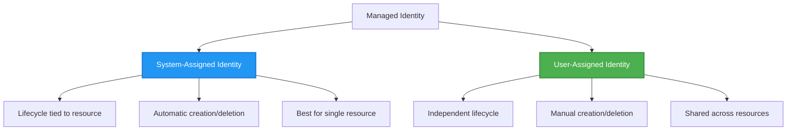

# Mifumo ya Uthibitishaji na Utambulisho Ulioendeshwa

⏱️ **Muda Unaokadiriwa**: Dakika 45-60 kusoma; ruhusu muda zaidi kwa kuunganisha mazoezi | 💰 **Athari ya Gharama**: Utambulisho/RBAC ni bure; kompyuta, uhifadhi, na Key Vault zinazotumika ni za kulipwa | ⭐ **Ugumu**: Kati

> Imehakikiwa dhidi ya `azd 1.37.2` (Novemba 2026). Somo hili lina **vipande vya mfano vya kuunganisha, si kiolezo kamili cha kupakua `secure-app`**. Tengeneza faili zilizotajwa, toa miundombinu inayolingana, na badilisha sehemu za kigezo kabla ya uguaji. Hakuna rasilimali za Azure zilizowekwa wakati wa uhakiki.

**📚 Njia ya Kujifunza:**
- ← Iliyotangulia: [Usimamizi wa Mipangilio](configuration.md) - Kusimamia vigezo vya mazingira na siri
- 🎯 **Uko Hapa**: Uthibitishaji & Usalama (Utambulisho Ulioendeshwa, Key Vault, mifumo salama)
- → Inayofuata: [Miundombinu kama Msimbo](../chapter-04-infrastructure/README.md) - Kuweka na kupeleka rasilimali
- 🏠 [Kwanza ya Kozi](../../README.md)

---

## Unachojifunza

Kwa kukamilisha somo hili, utakuwa umejifunza:
- Kuelewa mifumo ya uthibitishaji ya Azure (funguo, mizunguko ya muunganisho, utambulisho ulioendeshwa)
- Kutumia **Utambulisho Ulioendeshwa** kwa uthibitishaji usiotumia nywila
- Kulinda siri kwa kuunganisha na **Azure Key Vault**
- Kusanidi **udhibiti wa ufikiaji unaotegemea kazi (RBAC)** kwa utoaji wa AZD
- Kutekeleza mbinu bora za usalama katika Container Apps na huduma za Azure
- Kuhamisha kutoka kwenye uthibitishaji wa kutumia funguo kwenda kwenye utambulisho

## Kwa Nini Utambulisho Ulioendeshwa Ni Muhimu

### Tatizo: Uthibitishaji wa Kiasili

**Kabla ya Utambulisho Ulioendeshwa:**
```javascript
// ❌ SECURITY RISK: Hardcoded secrets in code
const connectionString = "Server=mydb.database.windows.net;User=admin;Password=P@ssw0rd123";
const storageKey = "xK7mN9pQ2wR5tY8uI0oP3aS6dF1gH4jK...";
const cosmosKey = "C2x7B9n4M1p8Q5w3E6r0T2y5U8i1O4p7...";
```

**Matatizo:**
- 🔴 **Siri zilizo wazi** kwenye msimbo, faili za usanidi, vigezo vya mazingira
- 🔴 **Mizunguko ya nywila** inahitaji mabadiliko ya msimbo na kuweka tena
- 🔴 **Nyocha za ukaguzi tata** - nani alifikia nini, lini?
- 🔴 **Ueneaji wa siri** - siri zimeenea kwenye mifumo mingi
- 🔴 **Hatari za kuzingatia sheria** - kushindwa ukaguzi wa usalama

### Suluhisho: Utambulisho Ulioendeshwa

**Baada ya Utambulisho Ulioendeshwa:**
```javascript
// ✅ SECURE: No secrets in code
const credential = new DefaultAzureCredential();
const client = new BlobServiceClient(
  "https://mystorageaccount.blob.core.windows.net",
  credential  // Azure automatically handles authentication
);
```

**Manufaa:**
- ✅ **Hakuna siri** kwenye msimbo au usanidi
- ✅ **Mizunguko ya kiotomatiki** - Azure huisimamia
- ✅ **Nyocha kamili za ukaguzi** katika rekodi za Microsoft Entra ID
- ✅ **Usalama wa kati** - usimamia kupitia Azure Portal
- ✅ **Kuenda sambamba na kanuni** - inakidhi viwango vya usalama

**Mfanano**: Uthibitishaji wa jadi ni kama kubeba funguo kadhaa za milango tofauti. Utambulisho Ulioendeshwa ni kama kuwa na kadi ya usalama inayotoa ruhusa kiotomatiki kulingana na wewe ni nani—hakuna funguo ya kupoteza, kunakili, au kuzungusha.

---

## Muhtasari wa Miundombinu

### Mtiririko wa Uthibitishaji kwa Utambulisho Ulioendeshwa

```mermaid
sequenceDiagram
    participant App as Your Application<br/>(Container App)
    participant MI as Managed Identity<br/>(Microsoft Entra ID)
    participant KV as Key Vault
    participant Storage as Azure Storage
    participant DB as Azure SQL
    
    App->>MI: Request access token<br/>(automatic)
    MI->>MI: Verify identity<br/>(no password needed)
    MI-->>App: Return token for requested audience<br/>(lifetime varies)
    
    App->>KV: Get secret<br/>(using token)
    KV->>KV: Check RBAC permissions
    KV-->>App: Return secret value
    
    App->>Storage: Upload blob<br/>(using token)
    Storage->>Storage: Check RBAC permissions
    Storage-->>App: Success
    
    App->>DB: Query data<br/>(using token)
    DB->>DB: Check SQL permissions
    DB-->>App: Return results
    
    Note over App,DB: Request a separate token for each service audience;<br/>SDK credentials handle caching and renewal
```

### Aina za Utambulisho Ulioendeshwa



| Kipengele | Kilichotengwa kwa Mfumo | Kilichotengwa kwa Mtumiaji |
|---------|----------------|---------------|
| **Mzunguko wa Maisha** | Kimefungwa na rasilimali | Hali huru |
| **Uundaji** | Kiotomatiki pamoja na rasilimali | Uundaji wa mikono |
| **Uondoaji** | Inafutwa pamoja na rasilimali | Hunaondolewa baada ya kufutwa kwa rasilimali |
| **Ugawaji** | Rasilimali moja tu | Rasilimali nyingi |
| **Matumizi** | Hali rahisi | Hali tata za rasilimali nyingi |
| **Chaguo la kiolezo** | Kimefafanuliwa katika miundombinu | Kimefafanuliwa katika miundombinu |

---

## Mahitaji ya Awali

### Vyombo Vinavyohitajika

Unapaswa tayari kuwa umevihakikisha kutoka masomo yaliyoandaliwa kabla:

```bash
# Verify Azure Developer CLI
azd version
# ✅ Expected: azd version 1.0.0 or higher

# Verify Azure CLI
az --version
# ✅ Expected: azure-cli 2.50.0 or higher
```

### Mahitaji ya Azure

- Usajili wa Azure unaoendesha
- Ruhusa za:
  - Kuunda utambulisho ulioendeshwa
  - Kutoa majukumu ya RBAC
  - Kuunda rasilimali za Key Vault
  - Kuweka Container Apps

### Maarifa Yanayohitajika

Unapaswa kuwa umekamilisha:
- [Mwongozo wa Usakinishaji](../chapter-01-foundation/installation.md) - Usanidi wa AZD
- [Misingi ya AZD](../chapter-01-foundation/azd-basics.md) - Dhahania kuu
- [Usimamizi wa Mipangilio](configuration.md) - Vigezo vya mazingira

---

## Somo 1: Kuelewa Mifumo ya Uthibitishaji

### Mfumo 1: Mizani ya Muunganisho (Ya zamani - Epuka)

**Jinsi inavyofanya kazi:**
```bash
# Connection string contains credentials
STORAGE_CONNECTION_STRING="DefaultEndpointsProtocol=https;AccountName=myaccount;AccountKey=xK7mN9pQ2wR5..."
COSMOS_CONNECTION_STRING="AccountEndpoint=https://myaccount.documents.azure.com:443/;AccountKey=C2x7..."
SQL_CONNECTION_STRING="Server=myserver.database.windows.net;User=admin;Password=P@ssw0rd..."
```

**Matatizo:**
- ❌ Siri zinazoonekana katika vigezo vya mazingira
- ❌ Zinarekodiwa katika mifumo ya utoaji
- ❌ Ugumu wa kuzungusha
- ❌ Hakuna nyocha ya ukaguzi wa ufikiaji

**Wakati wa kutumia:** Wakati huduma lengwa inahitaji uthibitishaji unaotegemea funguo. Tumia utambulisho inapopatikana; vinginevyo hifadhi funguo kwa usalama na zizungushwe, pamoja na katika uzalishaji.

---

### Mfumo 2: Marejeleo ya Key Vault (Bora)

**Jinsi inavyofanya kazi:**
**Vipande vya Bicep sehemu:** mashamba ya hazina yanayohitajika, utambulisho wa Programu ya Kontena, na ingizo lake la `configuration.secrets` hayajatajwa. `secretRef` huita siri ya Programu ya Kontena; sio **URI ya Hazina ya Msingi** yenyewe. Ili kutumia Hazina ya Msingi, fafanua siri hiyo iliyotajwa kwa kutumia `keyVaultUrl` na `identity` iliyoidhinishwa.

```bicep
// Store secret in Key Vault
resource keyVault 'Microsoft.KeyVault/vaults@2023-02-01' = {
  name: 'mykv'
  properties: {
    enableRbacAuthorization: true
  }
}

// Reference in Container App
env: [
  {
    name: 'STORAGE_KEY'
    secretRef: 'storage-key'  // References Key Vault
  }
]
```

**Manufaa:**
- ✅ Siri zimehifadhiwa salama katika Hazina ya Msingi
- ✅ Usimamizi wa siri uliojumuishwa katikati
- ✅ Mzunguko bila mabadiliko ya msimbo

**Marekebisho:**
- ⚠️ Bado inatumia funguo/nywila
- ⚠️ Inahitaji kusimamia upatikanaji wa Hazina ya Msingi

**Linapotumika:** Hatua ya mpito kutoka kwa mistari ya muunganisho kwenda kwa utambulisho ulioendeshwa.

---

### Mufano 3: Utambulisho Ulioendeshwa (Mazingira Bora)

**Jinsi inavyofanya kazi:**
**Bicep Sehemu:** unganya kipengele cha utambulisho kuwa Programu Kamili ya Kontena na toa `storageAccount` na ufafanuzi wa jukumu. Ugawaji wa jukumu pia unahitaji `name` ya uthibitisho.

```bicep
// Enable managed identity
resource containerApp 'Microsoft.App/containerApps@2023-05-01' = {
  name: 'myapp'
  identity: {
    type: 'SystemAssigned'  // Automatically creates identity
  }
}

// Grant permissions
resource roleAssignment 'Microsoft.Authorization/roleAssignments@2022-04-01' = {
  name: guid(storageAccount.id, containerApp.id, storageBlobDataContributorRole)
  scope: storageAccount
  properties: {
    roleDefinitionId: storageBlobDataContributorRole
    principalId: containerApp.identity.principalId
    principalType: 'ServicePrincipal'
  }
}
```

**Msimbo wa Programu:**
```javascript
// No secrets needed!
const { DefaultAzureCredential } = require('@azure/identity');
const { BlobServiceClient } = require('@azure/storage-blob');

const credential = new DefaultAzureCredential();
const blobServiceClient = new BlobServiceClient(
  'https://mystorageaccount.blob.core.windows.net',
  credential
);
```

**Manufaa:**
- ✅ Hakuna siri katika msimbo/mipangilio
- ✅ Mzunguko wa otomatiki wa sifa
- ✅ Rekodi kamili ya ukaguzi
- ✅ Ruhusa kulingana na RBAC
- ✅ Tayari kwa kufuata miongozo

**Linapotumika:** Pendekeza kwa programu zinazoshikiliwa Azure zinazotumia huduma zinazounga mkono uthibitisho wa Microsoft Entra.

---

### Mufano 4: Wakuu wa Huduma (CI/CD & Uendeshaji Otomati)

Utambulisho ulioendeshwa ni kiwango cha dhahabu *kwa rasilimali zinazoendesha ndani ya Azure*. Lakini vipi kuhusu vitu vinavyoendesha **nje** ya Azure—kama mstari wa utoaji wa CI/CD kwenye wakala wa ujenzi, au script kwenye kompyuta yako ndogo ambayo haiwezi kutumia ingizo lako la mwingiliano? Hapo ndipo **mkuu wa huduma** huingia: utambulisho usio wa binadamu wenye sifa zake ambao mchakato wa kiotomatiki unaweza kuingia kama.

**Jinsi inavyofanya kazi:**

Unda mkuu wa huduma aliyeelekezwa katika kundi la rasilimali (ruksa ndogo kabisa):

```bash
az ad sp create-for-rbac \
  --name "myapp-cicd" \
  --role contributor \
  --scopes "/subscriptions/<sub-id>/resourceGroups/<rg-name>"
```

Hii hutangaza kitambulisho cha mteja, siri ya mteja, na kitambulisho cha mpangaji. azd inaweza kuingia kwao bila mwingiliano:

```bash
azd auth login \
  --client-id "<appId>" \
  --client-secret "<password>" \
  --tenant-id "<tenant>"
```

**Pendekeza sifa zinazoshirikishwa (OIDC) badala ya siri.** Badala ya siri ya mteja ya muda mrefu, sanidi sifa zinazoshirikishwa ili mstari wa utoaji ubadilishane kielezi kifupi—hakuna siri ya kuvuja au kuzungushwa:

```bash
azd auth login \
  --client-id "<appId>" \
  --federated-credential-provider "github" \
  --tenant-id "<tenant>"
```

> `azd pipeline config` huandaa hili kwako moja kwa moja. Angalia maelekezo ya CI/CD katika [Sura ya 8](../chapter-08-production/production-ai-practices.md).

**Manufaa:**
- ✅ Hufanya kazi nje ya Azure (wakaaji wa ujenzi, ndani ya seva, mawingu mengine)
- ✅ Inaweza kudhibitiwa kwa kundi moja la rasilimali na jukumu moja
- ✅ Tofauti inayoshirikishwa (OIDC) haitaki siri kuhifadhiwa

**Marekebisho:**
- ⚠️ Tofauti ya msingi kwa siri inahitaji uhifadhi na mzunguko makini
- ⚠️ Siri iliyovuja inatoa kile ambacho SP inaweza kufanya—hifadhi vizuizi kwa ukali

**Linapotumika:** Mstari wa utoaji wa CI/CD na uendeshaji wa kiotomatiki usio na uwezo wa kutumia utambulisho ulioendeshwa. Pendekeza aina ya **inayoshirikishwa/OIDC** badala ya siri ya mteja, na pendekeza utambulisho ulioendeshwa kila mara wakati mzigo unapoendesha ndani ya Azure.

**Kuhifadhi sifa kwa usalama:**
- Kamwe usihakikishe siri—tumia duka la siri la mstari wako (Siri za GitHub Actions, vikundi vya mabadiliko vya Azure DevOps / Hazina ya Msingi).
- Weka SP katika jukumu ndogo zaidi na kundi la rasilimali linahitaji.
- Weka muda wa kuisha na zungusha, au ondoa kabisa siri kwa OIDC.

---

## Somo la 2: Kutekeleza Utambulisho Ulioendeshwa kwa AZD

### Utekelezaji Hatua kwa Hatua

Vipande vifuatavyo vinaonyesha jinsi ya kuingiza utambulisho ulioendeshwa katika mradi wa Programu ya Kontena. Hizi **si nakala za kuanza na kisha kuendesha:** moduli ya Hifadhi, mazingira kamili ya usimamizi/miundombinu ya rejista, Dockerfile, na faili ya parameta hazijajumuishwa hapa. Anza kutoka kwenye kiolezo cha Programu za Kontena kinachofanya kazi na unganisha mifano hii, ukiendelea na usanidi wa rejista na lebo za huduma.

### Muundo wa Mradi

```
secure-app/
├── azure.yaml                 # AZD configuration
├── infra/
│   ├── main.bicep            # Main infrastructure
│   ├── core/
│   │   ├── identity.bicep    # Managed identity setup
│   │   ├── keyvault.bicep    # Key Vault configuration
│   │   └── storage.bicep     # Storage with RBAC
│   └── app/
│       └── container-app.bicep
└── src/
    ├── app.js                # Application code
    ├── package.json
    └── Dockerfile
```

### 1. Sanidi AZD (azure.yaml)

```yaml
name: secure-app
metadata:
  template: secure-app@1.0.0

services:
  api:
    project: ./src
    language: js
    host: containerapp

# Managed identity must be enabled in the infrastructure, not by this YAML.
```

### 2. Miundombinu: Weka Utambulisho Ulioendeshwa

**Faili: `infra/main.bicep`**

```bicep
targetScope = 'subscription'

param environmentName string
param location string = 'eastus'
param containerAppsEnvironmentId string
param containerImage string

var tags = { 'azd-env-name': environmentName }

// Resource group
resource rg 'Microsoft.Resources/resourceGroups@2021-04-01' = {
  name: 'rg-${environmentName}'
  location: location
  tags: tags
}

// Storage Account
module storage './core/storage.bicep' = {
  name: 'storage'
  scope: rg
  params: {
    name: 'st${uniqueString(rg.id)}'
    location: location
    tags: tags
  }
}

// Key Vault
module keyVault './core/keyvault.bicep' = {
  name: 'keyvault'
  scope: rg
  params: {
    name: 'kv-${uniqueString(rg.id)}'
    location: location
    tags: tags
  }
}

// Container App with Managed Identity
module containerApp './app/container-app.bicep' = {
  name: 'container-app'
  scope: rg
  params: {
    name: 'ca-${environmentName}'
    location: location
    tags: tags
    storageAccountName: storage.outputs.name
    keyVaultName: keyVault.outputs.name
    containerAppsEnvironmentId: containerAppsEnvironmentId
    containerImage: containerImage
  }
}

// Grant Container App access to Storage
module storageRoleAssignment './core/role-assignment.bicep' = {
  name: 'storage-role'
  scope: rg
  params: {
    principalId: containerApp.outputs.identityPrincipalId
    roleDefinitionId: 'ba92f5b4-2d11-453d-a403-e96b0029c9fe'  // Storage Blob Data Contributor
    targetResourceType: 'storage'
    targetResourceName: storage.outputs.name
  }
}

// Grant Container App access to Key Vault
module kvRoleAssignment './core/role-assignment.bicep' = {
  name: 'kv-role'
  scope: rg
  params: {
    principalId: containerApp.outputs.identityPrincipalId
    roleDefinitionId: '4633458b-17de-408a-b874-0445c86b69e6'  // Key Vault Secrets User
    targetResourceType: 'keyvault'
    targetResourceName: keyVault.outputs.name
  }
}

// Outputs
output AZURE_STORAGE_ACCOUNT_NAME string = storage.outputs.name
output AZURE_KEY_VAULT_NAME string = keyVault.outputs.name
output APP_URL string = containerApp.outputs.url
```

### 3. Programu ya Kontena na Utambulisho uliotengwa na Mfumo

**Faili: `infra/app/container-app.bicep`**

```bicep
param name string
param location string
param tags object = {}
param storageAccountName string
param keyVaultName string
param containerAppsEnvironmentId string
param containerImage string

resource containerApp 'Microsoft.App/containerApps@2023-05-01' = {
  name: name
  location: location
  tags: union(tags, { 'azd-service-name': 'api' })
  identity: {
    type: 'SystemAssigned'  // 🔑 Enable managed identity
  }
  properties: {
    managedEnvironmentId: containerAppsEnvironmentId
    configuration: {
      ingress: {
        external: true
        targetPort: 3000
      }
    }
    template: {
      containers: [
        {
          name: 'api'
          image: containerImage // Must exist; configure registry credentials for private images
          resources: {
            cpu: json('0.5')
            memory: '1Gi'
          }
          env: [
            {
              name: 'AZURE_STORAGE_ACCOUNT_NAME'
              value: storageAccountName
            }
            {
              name: 'AZURE_KEY_VAULT_NAME'
              value: keyVaultName
            }
            // 🔑 No secrets - managed identity handles authentication!
          ]
        }
      ]
    }
  }
}

// Output the identity for RBAC assignments
output identityPrincipalId string = containerApp.identity.principalId
output id string = containerApp.id
output url string = 'https://${containerApp.properties.configuration.ingress.fqdn}'
```

### 4. Moduli ya Ugawaji wa Jukumu la RBAC

**Faili: `infra/core/role-assignment.bicep`**

```bicep
param principalId string
param roleDefinitionId string  // Azure built-in role ID
@allowed(['storage', 'keyvault'])
param targetResourceType string
param targetResourceName string

// Typed existing resources give Bicep a valid resource scope, not a string ID.
resource storageTarget 'Microsoft.Storage/storageAccounts@2023-01-01' existing = {
  name: targetResourceName
}
resource vaultTarget 'Microsoft.KeyVault/vaults@2023-02-01' existing = {
  name: targetResourceName
}

resource storageAssignment 'Microsoft.Authorization/roleAssignments@2022-04-01' = if (targetResourceType == 'storage') {
  name: guid(storageTarget.id, principalId, roleDefinitionId)
  scope: storageTarget
  properties: {
    roleDefinitionId: subscriptionResourceId('Microsoft.Authorization/roleDefinitions', roleDefinitionId)
    principalId: principalId
    principalType: 'ServicePrincipal'
  }
}

resource vaultAssignment 'Microsoft.Authorization/roleAssignments@2022-04-01' = if (targetResourceType == 'keyvault') {
  name: guid(vaultTarget.id, principalId, roleDefinitionId)
  scope: vaultTarget
  properties: {
    roleDefinitionId: subscriptionResourceId('Microsoft.Authorization/roleDefinitions', roleDefinitionId)
    principalId: principalId
    principalType: 'ServicePrincipal'
  }
}

// This module assigns at the target resource scope, not the whole resource group.
```

### 5. Msimbo wa Programu na Utambulisho Ulioendeshwa

**Faili: `src/app.js`**

```javascript
const express = require('express');
const { DefaultAzureCredential } = require('@azure/identity');
const { BlobServiceClient } = require('@azure/storage-blob');
const { SecretClient } = require('@azure/keyvault-secrets');

const app = express();
const PORT = process.env.PORT || 3000;

// 🔑 Initialize credential (works automatically with managed identity)
const credential = new DefaultAzureCredential();

// Azure Storage setup
const storageAccountName = process.env.AZURE_STORAGE_ACCOUNT_NAME;
const blobServiceClient = new BlobServiceClient(
  `https://${storageAccountName}.blob.core.windows.net`,
  credential  // No keys needed!
);

// Key Vault setup
const keyVaultName = process.env.AZURE_KEY_VAULT_NAME;
const secretClient = new SecretClient(
  `https://${keyVaultName}.vault.azure.net`,
  credential  // No keys needed!
);

// Health check
app.get('/health', (req, res) => {
  res.json({ status: 'healthy', authentication: 'managed-identity' });
});

// Upload file to blob storage
app.post('/upload', async (req, res) => {
  try {
    const containerClient = blobServiceClient.getContainerClient('uploads');
    await containerClient.createIfNotExists();
    
    const blobName = `file-${Date.now()}.txt`;
    const blockBlobClient = containerClient.getBlockBlobClient(blobName);
    
    const content = 'Hello from managed identity!';
    await blockBlobClient.upload(content, Buffer.byteLength(content));
    
    res.json({
      success: true,
      blobName: blobName,
      message: 'File uploaded using managed identity!'
    });
  } catch (error) {
    console.error('Upload error:', error);
    res.status(500).json({ error: error.message });
  }
});

// Get secret from Key Vault
app.get('/secret/:name', async (req, res) => {
  try {
    const secretName = req.params.name;
    const secret = await secretClient.getSecret(secretName);
    
    res.json({
      name: secretName,
      retrieved: secret.value !== undefined, // Never return the secret value to callers
      message: 'Secret retrieved using managed identity!'
    });
  } catch (error) {
    console.error('Secret error:', error);
    res.status(500).json({ error: error.message });
  }
});

// List blob containers (demonstrates read access)
app.get('/containers', async (req, res) => {
  try {
    const containers = [];
    for await (const container of blobServiceClient.listContainers()) {
      containers.push(container.name);
    }
    
    res.json({
      containers: containers,
      count: containers.length,
      message: 'Containers listed using managed identity!'
    });
  } catch (error) {
    console.error('List error:', error);
    res.status(500).json({ error: error.message });
  }
});

app.listen(PORT, () => {
  console.log(`Secure API listening on port ${PORT}`);
  console.log('Authentication: Managed Identity (passwordless)');
});
```

**Faili: `src/package.json`**

```json
{
  "name": "secure-app",
  "version": "1.0.0",
  "dependencies": {
    "express": "^4.18.2",
    "@azure/identity": "^4.0.0",
    "@azure/storage-blob": "^12.17.0",
    "@azure/keyvault-secrets": "^4.7.0"
  },
  "scripts": {
    "start": "node app.js"
  }
}
```

### 6. Tengeneza na Jaribu

Endesha amri hizi **baada ya** kukamilisha miundombinu iliyokosekana, Dockerfile, na `main.parameters.json` inayolingana katika mradi wako mwenyewe. Thibitisha azd na `azd auth login`; ingia kivyake na `az login` kwa ajili ya ukaguzi wa Azure CLI baadaye. Hatua zilizoonyeshwa ni maonyesho na zinahitaji udhibiti unaofaa wa upatikanaji kabla ya matumizi kwa umma.

```bash
# Initialize AZD environment
azd init

# Deploy infrastructure and application
azd up

# Get the app URL
APP_URL=$(azd env get-value APP_URL)

# Test health check
curl $APP_URL/health
```

**✅ Matokeo Yanayotarajiwa:**
```json
{
  "status": "healthy",
  "authentication": "managed-identity"
}
```

**Jaribu kupakia blob:**
```bash
curl -X POST $APP_URL/upload
```

**✅ Matokeo Yanayotarajiwa:**
```json
{
  "success": true,
  "blobName": "file-1700404800000.txt",
  "message": "File uploaded using managed identity!"
}
```

**Jaribu orodha ya kontena:**
```bash
curl $APP_URL/containers
```

**✅ Matokeo Yanayotarajiwa:**
```json
{
  "containers": ["uploads"],
  "count": 1,
  "message": "Containers listed using managed identity!"
}
```

---

## Majukumu ya Azure RBAC Yanayotumika Mara Kwa Mara

### IDs za Majukumu yaliyojengwa kwa Utambulisho Ulioendeshwa

| Huduma | Jina la Jukumu | ID ya Jukumu | Ruhusa |
|---------|-----------|---------|-------------|
| **Hifadhi** | Msomaji wa Data za Blob za Hifadhi | `2a2b9908-6ea1-4ae2-8e65-a410df84e7d1` | Soma blobs na makontena |
| **Hifadhi** | Mchangiaji wa Data za Blob za Hifadhi | `ba92f5b4-2d11-453d-a403-e96b0029c9fe` | Soma, andika, futa blobs |
| **Hifadhi** | Mchangiaji wa Data za Foleni ya Hifadhi | `974c5e8b-45b9-4653-ba55-5f855dd0fb88` | Soma, andika, futa foleni/ujumbe |
| **Hazina ya Msingi** | Mtumiaji wa Siri za Hazina ya Msingi | `4633458b-17de-408a-b874-0445c86b69e6` | Soma siri |
| **Hazina ya Msingi** | Afisa wa Siri za Hazina ya Msingi | `b86a8fe4-44ce-4948-aee5-eccb2c155cd7` | Soma, andika, futa siri |
| **Cosmos DB** | Msomaji wa Data za Cosmos DB aliyojengwa | `00000000-0000-0000-0000-000000000001` | Soma data za Cosmos DB |
| **Cosmos DB** | Mchangiaji wa Data za Cosmos DB aliyojengwa | `00000000-0000-0000-0000-000000000002` | Soma, andika data za Cosmos DB |
| **Hifadhidata ya SQL** | Mchangiaji wa SQL DB | `9b7fa17d-e63e-47b0-bb0a-15c516ac86ec` | Simamia rasilimali za hifadhidata; hauruhusu ufikiaji wa data za SQL |
| **Huduma ya Basi** | Mwenye Data wa Azure Service Bus | `090c5cfd-751d-490a-894a-3ce6f1109419` | Tuma, pokea, simamia ujumbe |

### Jinsi ya Kupata IDs za Majukumu

IDs mbili zilizotajwa kwa Cosmos DB kwa NoSQL ni **ufafanuzi wa majukumu asilia ya mwelekeo wa data ya Cosmos**, si IDs za majukumu ya usajili wa Azure RBAC. Yape kwa `az cosmosdb sql role assignment create` (au `Microsoft.DocumentDB/databaseAccounts/sqlRoleAssignments`), si `az role assignment create`. Ufikiaji wa data za SQL unahitaji mtumiaji wa hifadhidata wa Entra na ruhusa za SQL.

```bash
# List all built-in roles
az role definition list --query "[].{Name:roleName, ID:name}" --output table

# Search for specific role
az role definition list --query "[?contains(roleName, 'Storage Blob')].{Name:roleName, ID:name}" --output table

# Get role details
az role definition list --name "Storage Blob Data Contributor"
```

---

## Mazoezi ya Vitendo

**Mahitaji ya ushirikiano kwa mazoezi yote matatu:** kiolezo cha Programu ya Kontena kinachofanya kazi katika mradi wako, rasilimali zinazolingana za Bicep, ingizo la Azure CLI/azd, na mamlaka ya kugawa majukumu yanayohitajika. Hizi ni marekebisho yenye mwongozo, si waanzilishi wa kawaida wa ndani; badilisha majina ya rasilimali za mfano na majina yako yaliyotumika.

### Zoelikezi 1: Weka Utambulisho Ulioendeshwa kwa Programu Iliyo Tayari ⭐⭐ (WASTANI)

**Lengo**: Ongeza utambulisho ulioendeshwa kwa uenezaji wa Programu ya Kontena iliyoko

**Mwendo wa Kesi**: Una Programu ya Kontena inayotumia mistari ya muunganisho. Badilisha kuwa utambulisho ulioendeshwa.

**Msingi wa Kuanza:** Programu ya Kontena na usanidi huu:

```bicep
// ❌ Current: Using connection string
env: [
  {
    name: 'STORAGE_CONNECTION_STRING'
    secretRef: 'storage-connection'
  }
]
```

**Hatua:**

1. **Weka utambulisho ulioendeshwa katika Bicep:**

```bicep
resource containerApp 'Microsoft.App/containerApps@2023-05-01' = {
  name: 'myapp'
  identity: {
    type: 'SystemAssigned'  // Add this
  }
  // ... rest of configuration
}
```

2. **Ruhusu upatikanaji wa Hifadhi:**

```bicep
// Get storage account reference
resource storageAccount 'Microsoft.Storage/storageAccounts@2023-01-01' existing = {
  name: storageAccountName
}

// Assign role
resource roleAssignment 'Microsoft.Authorization/roleAssignments@2022-04-01' = {
  name: guid(containerApp.id, 'ba92f5b4-2d11-453d-a403-e96b0029c9fe', storageAccount.id)
  scope: storageAccount
  properties: {
    roleDefinitionId: subscriptionResourceId('Microsoft.Authorization/roleDefinitions', 'ba92f5b4-2d11-453d-a403-e96b0029c9fe')
    principalId: containerApp.identity.principalId
    principalType: 'ServicePrincipal'
  }
}
```

3. **Sasisha msimbo wa programu:**

**Kabla (mstari wa muunganisho):**
```javascript
const { BlobServiceClient } = require('@azure/storage-blob');

const blobServiceClient = BlobServiceClient.fromConnectionString(
  process.env.STORAGE_CONNECTION_STRING
);
```

**Baada (utambulisho ulioendeshwa):**
```javascript
const { DefaultAzureCredential } = require('@azure/identity');
const { BlobServiceClient } = require('@azure/storage-blob');

const credential = new DefaultAzureCredential();
const blobServiceClient = new BlobServiceClient(
  `https://${process.env.STORAGE_ACCOUNT_NAME}.blob.core.windows.net`,
  credential
);
```

4. **Sasisha vigezo vya mazingira:**

```bicep
env: [
  {
    name: 'STORAGE_ACCOUNT_NAME'
    value: storageAccountName  // Just the name, no secrets!
  }
  // Remove STORAGE_CONNECTION_STRING
]
```

5. **Weka na jaribu:**

```bash
# Redeploy
azd up

# Test that it still works
APP_URL=$(azd show --output json | jq -er '.services.api.ingressUrl')
curl --fail -X POST "$APP_URL/upload"
```

**✅ Vigezo vya Mafanikio:**
- ✅ Programu inaanzishwa bila makosa
- ✅ Operesheni za Hifadhi zinafanya kazi (kupakia, kuorodhesha, kupakua)
- ✅ Hakuna mistari ya muunganisho katika vigezo vya mazingira
- ✅ Utambulisho unaonekana katika Azure Portal chini ya "Kitambulisho"

**Uhakiki:**

```bash
# Check managed identity is enabled
az containerapp show \
  --name myapp \
  --resource-group rg-myapp \
  --query "identity.type"
# ✅ Expected: "SystemAssigned"

# Check role assignment
az role assignment list \
  --assignee $(az containerapp show --name myapp --resource-group rg-myapp --query "identity.principalId" -o tsv) \
  --scope /subscriptions/{sub-id}/resourceGroups/rg-myapp/providers/Microsoft.Storage/storageAccounts/mystorageaccount
# ✅ Expected: Shows "Storage Blob Data Contributor" role
```

**Muda**: Dakika 20-30

---

### Zoelikezi 2: Ufikiaji wa Huduma Nyingi na Utambulisho wa Mtumiaji Aliyetengwa ⭐⭐⭐ (Nakuza)

**Lengo**: Tengeneza utambulisho wa mtumiaji aliye ukweli wa kugawanyika kati ya Programu za Kontena nyingi

**Mwendo wa kesi**: Una huduma ndogo 3 zote zinahitaji upatikanaji wa akaunti ya Hifadhi na Hazina ya Msingi moja.

**Hatua:**

1. **Tengeneza utambulisho wa mtumiaji aliye ukweli:**

**Faili: `infra/core/identity.bicep`**

```bicep
param name string
param location string
param tags object = {}

resource userAssignedIdentity 'Microsoft.ManagedIdentity/userAssignedIdentities@2023-01-31' = {
  name: name
  location: location
  tags: tags
}

output id string = userAssignedIdentity.id
output principalId string = userAssignedIdentity.properties.principalId
output clientId string = userAssignedIdentity.properties.clientId
```

2. **Gawa majukumu kwa utambulisho wa mtumiaji aliye ukweli:**

```bicep
// In main.bicep
module userIdentity './core/identity.bicep' = {
  name: 'user-identity'
  scope: rg
  params: {
    name: 'id-${environmentName}'
    location: location
    tags: tags
  }
}

// Grant Storage access
resource storageRoleAssignment 'Microsoft.Authorization/roleAssignments@2022-04-01' = {
  name: guid(storageAccount.id, environmentName, 'storage-contributor')
  scope: storageAccount
  properties: {
    roleDefinitionId: subscriptionResourceId('Microsoft.Authorization/roleDefinitions', 'ba92f5b4-2d11-453d-a403-e96b0029c9fe')
    principalId: userIdentity.outputs.principalId
    principalType: 'ServicePrincipal'
  }
}

// Grant Key Vault access
resource kvRoleAssignment 'Microsoft.Authorization/roleAssignments@2022-04-01' = {
  name: guid(keyVault.id, environmentName, 'kv-secrets-user')
  scope: keyVault
  properties: {
    roleDefinitionId: subscriptionResourceId('Microsoft.Authorization/roleDefinitions', '4633458b-17de-408a-b874-0445c86b69e6')
    principalId: userIdentity.outputs.principalId
    principalType: 'ServicePrincipal'
  }
}
```

3. **Toa utambulisho kwa Maombi mengi ya Container:**

```bicep
resource apiGateway 'Microsoft.App/containerApps@2023-05-01' = {
  name: 'api-gateway'
  identity: {
    type: 'UserAssigned'
    userAssignedIdentities: {
      '${userIdentity.outputs.id}': {}
    }
  }
  // ... rest of config
}

resource productService 'Microsoft.App/containerApps@2023-05-01' = {
  name: 'product-service'
  identity: {
    type: 'UserAssigned'
    userAssignedIdentities: {
      '${userIdentity.outputs.id}': {}
    }
  }
  // ... rest of config
}

resource orderService 'Microsoft.App/containerApps@2023-05-01' = {
  name: 'order-service'
  identity: {
    type: 'UserAssigned'
    userAssignedIdentities: {
      '${userIdentity.outputs.id}': {}
    }
  }
  // ... rest of config
}
```

4. **Msimbo wa programu (hudumia huduma zote kwa mtindo mmoja):**

```javascript
const { ManagedIdentityCredential } = require('@azure/identity');
const { BlobServiceClient } = require('@azure/storage-blob');

// For user-assigned identity, specify the client ID
const credential = new ManagedIdentityCredential(
  process.env.AZURE_CLIENT_ID  // User-assigned identity client ID
);

// Alternative (choose ONE credential declaration):
// const { DefaultAzureCredential } = require('@azure/identity');
// const credential = new DefaultAzureCredential({
//   managedIdentityClientId: process.env.AZURE_CLIENT_ID
// });

const blobServiceClient = new BlobServiceClient(
  `https://${process.env.STORAGE_ACCOUNT_NAME}.blob.core.windows.net`,
  credential
);
```

Weka kila runtime ya Container App `AZURE_CLIENT_ID` kuwa `userIdentity.outputs.clientId` na `STORAGE_ACCOUNT_NAME` kuwa jina lako la hifadhi katika Bicep. Kutoa tu utambulisho au kuendesha `azd env set` hakutumbuizi thamani hizi za runtime.

5. **Weka na thibitisha:**

```bash
azd up

# Test all services can access storage
# Replace with the actual ingress URLs reported for your three services
curl --fail -X POST "$API_GATEWAY_URL/upload"
curl --fail -X POST "$PRODUCT_SERVICE_URL/upload"
curl --fail -X POST "$ORDER_SERVICE_URL/upload"
```

**✅ Vigezo vya Mafanikio:**
- ✅ Utambulisho mmoja umeshirikiwa kati ya huduma 3
- ✅ Huduma zote zinaweza kufikia Storage na Key Vault
- ✅ Utambulisho unaendelea kuwepo ikiwa unafuta huduma moja
- ✅ Usimamizi wa ruhusa ulio katikati  

**Manufaa ya Utambulisho wa Mtumiaji:**
- Utambulisho mmoja tu wa kusimamia
- Ruhusa za muendelezo katika huduma
- Hua unapotoweka huduma
- Bora kwa miundo tata

**Wakati**: Dakika 30-40

---

### Zódi la 3: Tekeleza Mizunguko ya Siri za Key Vault ⭐⭐⭐ (Kiwango cha Juu)

**Lengo**: Hifadhi funguo za API za watu wengine katika Key Vault na uzipate ukitumia utambulisho uliodhibitiwa

**Hali**: Programu yako inahitaji kuita API ya nje (OpenAI, Stripe, SendGrid) inayohitaji funguo za API.

**Hatua**:

1. **Unda Key Vault na RBAC:**

**Faili: `infra/core/keyvault.bicep`**

```bicep
param name string
param location string
param tags object = {}

resource keyVault 'Microsoft.KeyVault/vaults@2023-02-01' = {
  name: name
  location: location
  tags: tags
  properties: {
    enableRbacAuthorization: true  // Use RBAC instead of access policies
    sku: {
      family: 'A'
      name: 'standard'
    }
    tenantId: subscription().tenantId
    enableSoftDelete: true
    softDeleteRetentionInDays: 90
  }
}

// Allow Container App to read secrets
output id string = keyVault.id
output name string = keyVault.name
output uri string = keyVault.properties.vaultUri
```

2. **Hifadhi siri Key Vault:**

```bash
# Get Key Vault name
KV_NAME=$(azd env get-value AZURE_KEY_VAULT_NAME)

# Store third-party API keys
az keyvault secret set \
  --vault-name $KV_NAME \
  --name "OpenAI-ApiKey" \
  --value "sk-proj-xxxxxxxxxxxxx"

az keyvault secret set \
  --vault-name $KV_NAME \
  --name "Stripe-ApiKey" \
  --value "sk_live_xxxxxxxxxxxxx"

az keyvault secret set \
  --vault-name $KV_NAME \
  --name "SendGrid-ApiKey" \
  --value "SG.xxxxxxxxxxxxx"
```

3. **Msimbo wa programu kupokea siri:**

**Faili: `src/config.js`**

```javascript
const { DefaultAzureCredential } = require('@azure/identity');
const { SecretClient } = require('@azure/keyvault-secrets');

class Config {
  constructor() {
    this.credential = new DefaultAzureCredential();
    this.secretClient = new SecretClient(
      `https://${process.env.AZURE_KEY_VAULT_NAME}.vault.azure.net`,
      this.credential
    );
    this.cache = {};
  }

  async getSecret(secretName) {
    // Check cache first
    if (this.cache[secretName]) {
      return this.cache[secretName];
    }

    try {
      const secret = await this.secretClient.getSecret(secretName);
      this.cache[secretName] = secret.value;
      console.log(`✅ Retrieved secret: ${secretName}`);
      return secret.value;
    } catch (error) {
      console.error(`❌ Failed to get secret ${secretName}:`, error.message);
      throw error;
    }
  }

  async getOpenAIKey() {
    return this.getSecret('OpenAI-ApiKey');
  }

  async getStripeKey() {
    return this.getSecret('Stripe-ApiKey');
  }

  async getSendGridKey() {
    return this.getSecret('SendGrid-ApiKey');
  }
}

module.exports = new Config();
```

4. **Tumia siri katika programu:**

**Faili: `src/app.js`**

Kifungu hiki cha programu cha **badiliko** kinahitaji `npm install openai`, ufunguo halisi wa mtu wa tatu, mfano unaopatikana, na miundombinu kutoka kwa mradi wako unaofanya kazi. Inaita OpenAI moja kwa moja, si usambazaji wa Azure OpenAI. Funguo za mfano zilizowekwa hapa haziruhusu ombi kufanyika.

```javascript
const express = require('express');
const config = require('./config');
const { OpenAI } = require('openai');

const app = express();

// Initialize OpenAI with key from Key Vault
let openaiClient;

async function initializeServices() {
  const openaiKey = await config.getOpenAIKey();
  openaiClient = new OpenAI({ apiKey: openaiKey });
  console.log('✅ Services initialized with secrets from Key Vault');
}

app.post('/chat', async (req, res) => {
  try {
    const completion = await openaiClient.chat.completions.create({
      model: 'gpt-4.1',
      messages: [{ role: 'user', content: 'Hello!' }]
    });
    
    res.json({
      response: completion.choices[0].message.content,
      authentication: 'Key from Key Vault via Managed Identity'
    });
  } catch (error) {
    res.status(500).json({ error: error.message });
  }
});

// Start listening only after initialization succeeds.
initializeServices().then(() => {
  app.listen(3000, () => console.log('Key Vault demo running'));
}).catch(error => {
  console.error('Initialization failed:', error.message);
  process.exitCode = 1;
});
```

5. **Weka na jaribu:**

```bash
azd up

# Test that API keys work
curl -X POST https://myapp.azurecontainerapps.io/chat \
  -H "Content-Type: application/json" \
  -d '{"message":"Hello AI"}'
```

**✅ Vigezo vya Mafanikio:**
- ✅ Hakuna funguo za API ndani ya msimbo au mazingira
- ✅ Programu inapokea funguo kutoka Key Vault
- ✅ API za watu wengine zinafanya kazi vyema
- ✅ Inaweza kuzungusha funguo bila kubadilisha msimbo

**Zungusha siri:**

```bash
# Update secret in Key Vault
az keyvault secret set \
  --vault-name $KV_NAME \
  --name "OpenAI-ApiKey" \
  --value "sk-proj-NEW_KEY_HERE"

# Find the active revision name, then restart it to clear the in-process cache
az containerapp revision list --name myapp --resource-group rg-myapp --output table
az containerapp revision restart \
  --name myapp \
  --resource-group rg-myapp \
  --revision "<active-revision-name>"
```

**Wakati**: Dakika 25-35

---

## Sehemu ya Kusahihisha Maarifa

### 1. Mifumo ya Uthibitisho ✓

Jaribu uelewa wako:

- [ ] **Q1**: Ni mifumo gani mitatu kuu ya uthibitisho? 
  - **J**: Mifumo ya uunganisho (ya zamani), Marejeleo ya Key Vault (mabadiliko), Utambulisho ulio simamiwa (bora)

- [ ] **Q2**: Kwa nini utambulisho ulio simamiwa ni bora zaidi kuliko mifumo ya uunganisho?
  - **J**: Hakuna siri katika msimbo, mzunguko wa kiotomatiki, rekodi kamili za ukaguzi, ruhusa za RBAC

- [ ] **Q3**: Ungetumia lini utambulisho wa mtumiaji badala ya utambulisho wa mfumo?
  - **J**: Unaposhiriki utambulisho kati ya rasilimali nyingi au utimilifu wa utambulisho hauhusiani na utimilifu wa rasilimali

**Uhakikisho wa Vitendo:**
```bash
# Check what type of identity your app uses
az containerapp show \
  --name myapp \
  --resource-group rg-myapp \
  --query "identity.type"

# List all role assignments for the identity
az role assignment list \
  --assignee $(az containerapp show --name myapp --resource-group rg-myapp --query "identity.principalId" -o tsv)
```

---

### 2. RBAC na Ruhusa ✓

Jaribu uelewa wako:

- [ ] **Q1**: Je, kitambulisho cha jukumu la "Mchangiaji wa Data ya Blob ya Storage" ni kipi?
  - **J**: `ba92f5b4-2d11-453d-a403-e96b0029c9fe`

- [ ] **Q2**: Ruhusa gani "Mtumiaji wa Siri za Key Vault" anazipata?
  - **J**: Upatikanaji wa kusoma tu siri (hawezi kuunda, kuboresha, au kufuta)

- [ ] **Q3**: Jinsi gani unampa Container App haki ya kufikia Azure SQL?
  - **J**: Sanidi uthibitishaji wa Microsoft Entra, unda utambulisho kama mtumiaji wa database, na mpe ruhusa zinazohitajika za SQL. "Mchangiaji wa DB ya SQL" husimamia rasilimali za Azure tu; hajaruhusu maswali.

**Uhakikisho wa Vitendo:**
```bash
# Find specific role
az role definition list --name "Storage Blob Data Contributor"

# Check what roles are assigned to your identity
PRINCIPAL_ID=$(az containerapp show --name myapp --resource-group rg-myapp --query "identity.principalId" -o tsv)
az role assignment list --assignee $PRINCIPAL_ID --output table
```

---

### 3. Mwangikano wa Key Vault ✓

Jaribu uelewa wako:

- [ ] **Q1**: Jinsi gani unazima RBAC kwa Key Vault badala ya sera za ufikiaji?
  - **J**: Weka `enableRbacAuthorization: true` katika Bicep

- [ ] **Q2**: Maktaba gani ya Azure SDK inasimamia uthibitisho wa utambulisho ulio simamiwa?
  - **J**: `@azure/identity` na darasa la `DefaultAzureCredential`

- [ ] **Q3**: Siri za Key Vault huhifadhiwa kwa muda gani katika cache?
  - **J**: Inategemea programu; tekeleza mkakati wako wa kuhifadhi katika cache

**Uhakikisho wa Vitendo:**
```bash
# Test Key Vault access
az keyvault secret show \
  --vault-name $KV_NAME \
  --name "OpenAI-ApiKey" \
  --query "{name:name,enabled:attributes.enabled}"

# Check RBAC is enabled
az keyvault show \
  --name $KV_NAME \
  --query "properties.enableRbacAuthorization"
# ✅ Expected: true
```

---

## Mbinu Bora za Usalama

### ✅ Fanya:

1. **Daima tumia utambulisho ulio simamiwa katika uzalishaji**
   ```bicep
   identity: {
     type: 'SystemAssigned'
   }
   ```

2. **Tumia majukumu ya RBAC yenye udhaifu mdogo**
   - Tumia majukumu ya "Msomaji" inapowezekana
   - Epuka "Mmiliki" au "Mchangiaji" isipokuwa ni lazima

3. **Hifadhi funguo za watu wengine katika Key Vault**
   ```javascript
   const apiKey = await secretClient.getSecret('ThirdPartyApiKey');
   ```

4. **Washirikisha kumbukumbu za ukaguzi** (kifungu cha rasilimali sehemu; ungana na hangaifu za hifadhi yako na eneo la kazi)
   ```bicep
   resource vaultDiagnostics 'Microsoft.Insights/diagnosticSettings@2021-05-01-preview' = {
     name: 'vault-audit'
     scope: keyVault
     properties: {
       workspaceId: logAnalytics.id
       logs: [{ category: 'AuditEvent', enabled: true }]
     }
   }
   ```

5. **Tumia vitambulisho tofauti kwa maendeleo/majaribio/uzalishaji**
   ```bash
   azd env new dev
   azd env new staging
   azd env new prod
   ```

6. **Zungusha siri mara kwa mara**
   - Weka tarehe za kumalizika kwa siri za Key Vault
   - Panga mizunguko kwa kutumia Azure Functions

### ❌ USIFANYE:

1. **Kamwe usiweka siri moja kwa moja katika msimbo**
   ```javascript
   // ❌ BAD
   const apiKey = "sk-proj-xxxxxxxxxxxxx";
   ```

2. **Usitumie mistari ya uunganisho katika uzalishaji**
   ```javascript
   // ❌ BAD
   BlobServiceClient.fromConnectionString(process.env.STORAGE_CONNECTION_STRING)
   ```

3. **Usitoe ruhusa nyingi sana**
   ```bicep
   // ❌ BAD - too much access
   roleDefinitionId: subscriptionResourceId('Microsoft.Authorization/roleDefinitions', '8e3af657-a8ff-443c-a75c-2fe8c4bcb635')
   
   // ✅ GOOD - least privilege
   roleDefinitionId: subscriptionResourceId('Microsoft.Authorization/roleDefinitions', '2a2b9908-6ea1-4ae2-8e65-a410df84e7d1')
   ```

4. **Usiweke kumbukumbu za siri**
   ```javascript
   // ❌ BAD
   console.log('API Key:', apiKey);
   
   // ✅ GOOD
   console.log('API Key retrieved successfully');
   ```

5. **Usishiriki vitambulisho vya uzalishaji katika mazingira tofauti**
   ```bicep
   // ❌ BAD - same identity for dev and prod
   // ✅ GOOD - separate identities per environment
   ```

---

## Mwongozo wa Utatuzi wa Matatizo

### Tatizo: "Unauthorized" unapotaka kufikia Azure Storage

**Dalili:**
```
Error: Unauthorized (403)
AuthorizationPermissionMismatch: This request is not authorized to perform this operation
```

**Uchunguzi:**

```bash
# Check if managed identity is enabled
az containerapp show \
  --name myapp \
  --resource-group rg-myapp \
  --query "identity.type"
# ✅ Expected: "SystemAssigned" or "UserAssigned"

# Check role assignments
PRINCIPAL_ID=$(az containerapp show --name myapp --resource-group rg-myapp --query "identity.principalId" -o tsv)
az role assignment list --assignee $PRINCIPAL_ID

# Expected: Should see "Storage Blob Data Contributor" or similar role
```

**Suluhisho:**

1. **Toa jukumu la RBAC sahihi:**
```bash
STORAGE_ID=$(az storage account show --name mystorageaccount --resource-group rg-myapp --query "id" -o tsv)
az role assignment create \
  --assignee $PRINCIPAL_ID \
  --role "Storage Blob Data Contributor" \
  --scope $STORAGE_ID
```

2. **Subiri kusambaa (inaweza kuchukua dakika 5-10):**
```bash
# Check role assignment status
az role assignment list --assignee $PRINCIPAL_ID --scope $STORAGE_ID
```

3. **Thibitisha msimbo wa programu unatumia sifa sahihi:**
```javascript
// Make sure you're using DefaultAzureCredential
const credential = new DefaultAzureCredential();
```

---

### Tatizo: Akaunti ya kufikia Key Vault imezuiwa

**Dalili:**
```
Error: Forbidden (403)
The user, group or application does not have secrets get permission
```

**Uchunguzi:**

```bash
# Check Key Vault RBAC is enabled
az keyvault show \
  --name $KV_NAME \
  --query "properties.enableRbacAuthorization"
# ✅ Expected: true

# Check role assignments
az role assignment list \
  --assignee $PRINCIPAL_ID \
  --scope /subscriptions/{sub-id}/resourceGroups/rg-myapp/providers/Microsoft.KeyVault/vaults/$KV_NAME
```

**Suluhisho:**

1. **Washirikisha RBAC kwenye Key Vault:**
```bash
az keyvault update \
  --name $KV_NAME \
  --enable-rbac-authorization true
```

2. **Toa jukumu la Mtumiaji wa Siri za Key Vault:**
```bash
KV_ID=$(az keyvault show --name $KV_NAME --query "id" -o tsv)
az role assignment create \
  --assignee $PRINCIPAL_ID \
  --role "Key Vault Secrets User" \
  --scope $KV_ID
```

---

### Tatizo: DefaultAzureCredential inashindwa k local

**Dalili:**
```
Error: DefaultAzureCredential failed to retrieve a token
CredentialUnavailableError: No credential available
```

**Uchunguzi:**

```bash
# Check if you're logged in
az account show

# Check Azure CLI authentication
az ad signed-in-user show
```

**Suluhisho:**

1. **Ingia kwenye Azure CLI:**
```bash
az login
```

2. **Weka usajili wa Azure:**
```bash
az account set --subscription "Your Subscription Name"
```

3. **Kwa maendeleo ya karibu, tumia mazingira ya mazingira:**
```bash
export AZURE_TENANT_ID="your-tenant-id"
export AZURE_CLIENT_ID="your-client-id"
export AZURE_CLIENT_SECRET="your-client-secret"
```

4. **Au tumia sifa tofauti k local:**
```javascript
const { DefaultAzureCredential, AzureCliCredential } = require('@azure/identity');

// Use AzureCliCredential for local dev
const credential = process.env.NODE_ENV === 'production' 
  ? new DefaultAzureCredential()
  : new AzureCliCredential();
```

---

### Tatizo: Mgawanyo wa jukumu unachukua muda mrefu kusambaa

**Dalili:**
- Jukumu limepewa kwa mafanikio
- Bado kupokea makosa ya 403
- Upatikanaji wa mara kwa mara (wakati mwingine hufanya kazi, wakati mwingine siyo)

**Maelezo:**
Mabadiliko ya Azure RBAC yanaweza kuchukua dakika 5-10 kusambaa ulimwenguni kote.

**Suluhisho:**

```bash
# Wait and retry
echo "Waiting for RBAC propagation..."
sleep 300  # Wait 5 minutes

# Test access
curl --fail -X POST "$APP_URL/upload"

# If still failing, restart the app
az containerapp revision restart \
  --name myapp \
  --resource-group rg-myapp \
  --revision "<active-revision-name>"
```

---

## Mambo ya Gharama

### Gharama za Utambulisho Uliosimamiwa

| Rasilimali | Gharama |
|----------|------|
| **Utambulisho Uliosimamiwa** | 🆓 **BURE** - Hakuna malipo |
| **Mgawanyo wa Jukumu la RBAC** | 🆓 **BURE** - Hakuna malipo |
| **Maombi ya Tokeni ya Microsoft Entra ID** | 🆓 **BURE** - Imejumuishwa |
| **Mifumo ya Key Vault** | $0.03 kwa mifumo 10,000 |
| **Hifadhi ya siri za Key Vault** | Angalia bei za sasa; usifikirie ada ya kuhifadhi siri kwa mwezi kila moja |

**Utambulisho uliosimamiwa huokoa pesa kwa:**
- ✅ Kuondoa mifumo ya Key Vault kwa uthibitisho wa huduma kwa huduma  
- ✅ Kupunguza matukio ya usalama (hakuna siri zilizoelea)
- ✅ Kupunguza mzigo wa uendeshaji (hakuna mzunguko wa mikono)

Idadi ya maombi ya programu si sawa na idadi ya mifumo ya Key Vault: mifumo ya kuhifadhi kwa cache na mizunguko huchukua gharama za kusoma siri. Utambulisho hauondoi malipo ya kompyuta/hifadhi. Angalia [bei za Key Vault](https://azure.microsoft.com/pricing/details/key-vault/) na Kalkuleta ya Bei ya Azure kwa sehemu yako badala ya kudhania akiba za kila mwezi kutokana na idadi ya maombi pekee.

---

## Jifunze Zaidi

### Nyaraka Rasmi
- [Azure Managed Identity](https://learn.microsoft.com/entra/identity/managed-identities-azure-resources/overview)
- [Azure RBAC](https://learn.microsoft.com/azure/role-based-access-control/overview)
- [Azure Key Vault](https://learn.microsoft.com/azure/key-vault/general/overview)
- [DefaultAzureCredential](https://learn.microsoft.com/dotnet/api/azure.identity.defaultazurecredential)

### Nyaraka za SDK
- [@azure/identity (Node.js)](https://www.npmjs.com/package/@azure/identity)
- [Azure.Identity (C#)](https://www.nuget.org/packages/Azure.Identity/)
- [azure-identity (Python)](https://pypi.org/project/azure-identity/)

### Hatua Inayofuata Katika Kozi Hii
- ← Iliyopita: [Usimamizi wa Mipangilio](configuration.md)
- → Inayofuata: [Miundombinu kama Msimbo](../chapter-04-infrastructure/README.md)
- 🏠 [Nyumbani mwa Kozi](../../README.md)

### Mifano Inayohusiana
- [Mfano wa Mazungumzo wa Microsoft Foundry Models](../../../../examples/azure-openai-chat) - Inatumia utambulisho uliosimamiwa kwa Microsoft Foundry Models
- [Mfano wa Microservices](../../../../examples/microservices) - Mifumo ya uthibitisho wa huduma nyingi

---

## Muhtasari

**Umejifunza:**
- ✅ Mifumo mitatu ya uthibitisho (mistari ya muunganisho, Key Vault, utambulisho uliosimamiwa)
- ✅ Jinsi ya kuweka na kusanidi utambulisho uliosimamiwa katika AZD
- ✅ Mgawanyo wa majukumu ya RBAC kwa huduma za Azure
- ✅ Mwangikano wa Key Vault kwa siri za watu wengine
- ✅ Utambulisho uliotengwa kwa mtumiaji na uliotengwa na mfumo
- ✅ Mbinu bora za usalama na utatuzi wa matatizo

**Vidokezo Muhimu:**
1. **Daima tumia utambulisho uliosimamiwa katika uzalishaji** - Hakuna siri, mzunguko wa kiotomatiki
2. **Tumia majukumu ya RBAC yenye udhaifu mdogo** - Toa ruhusa muhimu tu
3. **Hifadhi funguo za watu wengine katika Key Vault** - Usimamizi wa siri ulio katikati
4. **Tofautisha vitambulisho kwa kila mazingira** - Kutengwa kwa maendeleo, majaribio, uzalishaji
5. **Washirikisha kumbukumbu za ukaguzi** - Fuata nani aliyeingia na alifanya nini

**Hatua Zilizofuata:**
1. Kamilisha zódi la vitendo lililoko juu
2. Hamisha programu iliyo tayari kutoka kwenye mistari ya muunganisho hadi utambulisho uliosimamiwa
3. Rudi kwenye mchakato wa kuanzisha wa mgeni: [Mradi wa Kwanza](../chapter-01-foundation/first-project.md)

---

<!-- CO-OP TRANSLATOR DISCLAIMER START -->
**Kionyozo**:
Hati hii imetafsiriwa kwa kutumia huduma ya tafsiri ya AI [Co-op Translator](https://github.com/Azure/co-op-translator). Ingawa tunajitahidi kupata usahihi, tafadhali fahamu kwamba tafsiri za kiotomatiki zinaweza kuwa na makosa au upungufu wa usahihi. Hati ya asili katika lugha yake halisi inapaswa kuchukuliwa kama chanzo cha mamlaka. Kwa taarifa muhimu, tafsiri ya kitaalamu inayofanywa na binadamu inapendekezwa. Hatutojibu kwa kuelewa vibaya au tafsiri potofu zinazotokea kutokana na matumizi ya tafsiri hii.
<!-- CO-OP TRANSLATOR DISCLAIMER END -->