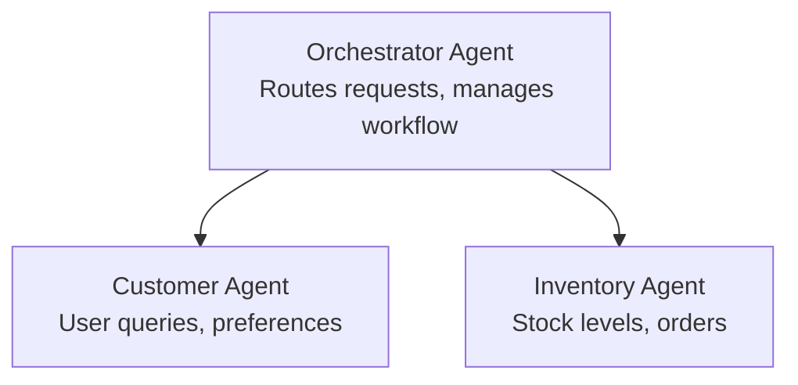

# Sura ya 5: Suluhisho za AI za Wakala Wengi

**📚 Kozi**: [AZD Kwa Waanzilishi](../../README.md) | **⏱️ Muda**: Saa 2-3 | **⭐ Ugumu**: Juu

---

## Muhtasari

Sura hii inashughulikia mifumo ya hali ya juu ya usanifu wa wakala wengi, uratibu wa mawakala, na uanzishaji wa AI unao tayari kwa uzalishaji kwa hali ngumu.

> Maelekezo ya amri yameangaliwa dhidi ya rejeleo lililotolewa la `azd 1.37.2`. Uanzishaji wa wingu haukufanyika.

## Malengo ya Kujifunza

Kwa kumaliza sura hii, utakuwa umejifunza:
- Kuelewa mifumo ya usanifu wa wakala wengi
- Kuanzisha mifumo ya mawakala wa AI inayoratibiwa
- Kutekeleza mawasiliano kati ya mawakala
- Kujenga suluhisho za wakala wengi zinazostahili uzalishaji

---

## 📚 Masomo

| # | Somo | Maelezo | Muda |
|---|--------|-------------|------|
| 1 | [Msingi wa Wakala Wengi](multi-agent-basics.md) | Vitendo: anzisha programu ya wakala wengi inayofanya kazi na `azd up` | Dak 45 |
| 2 | [Mifumo ya Uratibu](../chapter-06-pre-deployment/coordination-patterns.md) | Mikakati ya uratibu wa wakala (itaendelea katika Sura ya 6) | Dak 30 |
| 3 | [Uanzishaji wa Templeti ya ARM](../../examples/retail-multiagent-arm-template/README.md) | Mfano wa uanzishaji kwa bonyeza moja | Dak 30 |

> **Anza na Somo la 1.** Hilo ndilo somo pekee la vitendo kamili, linaloweza kuanzishwa katika sura hii. Somo la 2 lipo katika Sura ya 6 (linashirikiana na upangaji kabla ya uanzishaji), na [Suluhisho la Wakala Wengi la Rejareja](../../examples/retail-scenario.md) ni muundo wa usanifu—rejeleo la muundo, si templeti ya amri moja.

---

## 🚀 Anza Haraka

```bash
# Option 1: Deploy the multi-agent template used in Lesson 1
azd init --template Azure-Samples/contoso-creative-writer .
azd up

# Option 2: Initialize a Foundry agent interactively (requires azure.ai.agents)
azd extension install azure.ai.agents
azd ai agent init
azd up
```

> **Njia gani?** Tumia `azd init --template` kuanza na sampuli inayofanya kazi. Tumia `azd ai agent init` kwa njia ya mwingiliano, au `azd ai agent init --template <path-to-azure.yaml>` kuchukua mradi wa wakala wa sasa. Angalia [rejeleo la CLI la AZD AI](../chapter-08-production/production-ai-practices.md#azd-ai-cli-commands-and-extensions) kwa mahitaji ya toleo na uhamiaji wa tathmini.

Endesha hizi mbadala katika folda tupu tofauti. Kiongezi cha mawakala `1.0.0-beta.23` kinahitaji `azd >= 1.37.0`; mtiririko wake wa mwingiliano hautengenezi bomba la huduma la kawaida katika somo la uratibu.

---

## 🤖 Usanifu wa Wakala Wengi



---

## 🎯 Suluhisho Maarufu: Wakala Wengi wa Rejareja

Suluhisho la [Wakala Wingi wa Rejareja](../../examples/retail-scenario.md) linaonyesha:

- **Mwakala wa Mteja**: Hushughulikia mwingiliano na mapendeleo ya mtumiaji
- **Mwakala wa Hifadhi**: Husimamia bidhaa na usindikaji wa maagizo
- **Mratibu**: Hupanua miongoni mwa mawakala
- **Kumbukumbu Ilioshirikiwa**: Usimamizi wa muktadha kati ya mawakala

### Huduma Zinazotumika

| Huduma | Kusudi |
|---------|---------|
| Microsoft Foundry Models | Uelewa wa lugha |
| Azure AI Search | Katalogi ya bidhaa |
| Cosmos DB | Hali na kumbukumbu ya wakala |
| Container Apps | Utoaji wa wakala |
| Application Insights | Ufuatiliaji |

---

## 🔗 Uabiri

| Mwelekeo | Sura |
|-----------|---------|
| **Iliyotangulia** | [Sura 4: Miundombinu](../chapter-04-infrastructure/README.md) |
| **Ifuatayo** | [Sura 6: Kabla ya Uwekaji](../chapter-06-pre-deployment/README.md) |

---

## 📖 Rasilimali Zinazohusiana

- [Mwongozo wa Wakala wa AI](../chapter-02-ai-development/agents.md)
- [Mazingira ya Uzalishaji ya AI](../chapter-08-production/production-ai-practices.md)
- [Utatuzi wa Matatizo ya AI](../chapter-07-troubleshooting/ai-troubleshooting.md)

---

<!-- CO-OP TRANSLATOR DISCLAIMER START -->
**Kionyozo**:
Hati hii imetafsiriwa kwa kutumia huduma ya tafsiri ya AI [Co-op Translator](https://github.com/Azure/co-op-translator). Ingawa tunajitahidi kupata usahihi, tafadhali fahamu kwamba tafsiri za kiotomatiki zinaweza kuwa na makosa au upungufu wa usahihi. Hati ya asili katika lugha yake halisi inapaswa kuchukuliwa kama chanzo cha mamlaka. Kwa taarifa muhimu, tafsiri ya kitaalamu inayofanywa na binadamu inapendekezwa. Hatutojibu kwa kuelewa vibaya au tafsiri potofu zinazotokea kutokana na matumizi ya tafsiri hii.
<!-- CO-OP TRANSLATOR DISCLAIMER END -->