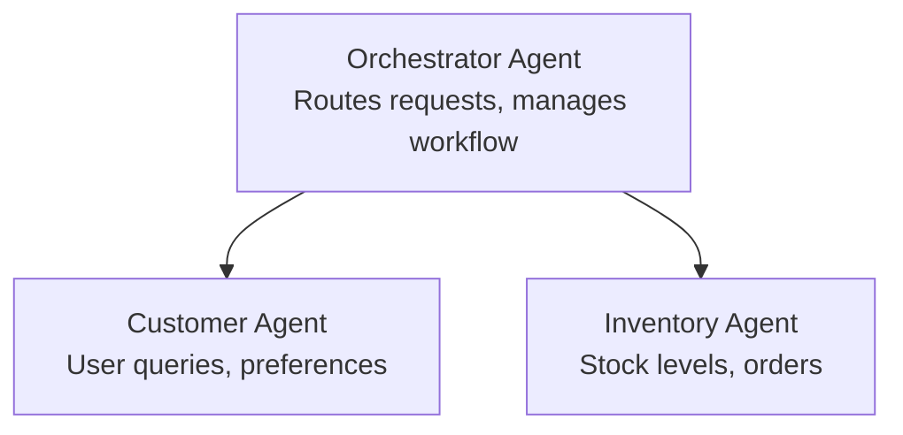

# Sura ya 5: Suluhisho za AI za Wakala Wengi

**📚 Kozi**: [AZD Kwa Waanzilishi](../../README.md) | **⏱️ Muda**: Masaa 2-3 | **⭐ Ugumu**: Wa Juu

---

## Muhtasari

Sura hii inajumuisha mifumo ya usanifu wa wakala wengi wa hali ya juu, uratibu wa mawakala, na uanzishaji wa AI tayari kwa uzalishaji kwa hali ngumu.

> Mwongozo wa amri uliohakikiwa dhidi ya marejeleo ya `azd 1.37.2` yaliyoachiliwa. Usambazaji wa mawingu haukujumuishwa.

## Malengo ya Kujifunza

Kwa kumaliza sura hii, utaweza:
- Kuelewa mifumo ya usanifu wa wakala wengi
- Kusambaza mifumo ya mawakala wa AI walioratibika
- Kutekeleza mawasiliano kati ya mawakala
- Kujenga suluhisho za wakala wengi tayari kwa uzalishaji

---

## 📚 Masomo

| # | Somo | Maelezo | Muda |
|---|--------|-------------|------|
| 1 | [Misingi ya Wakala Wengi](multi-agent-basics.md) | Vitendo: anzisha programu ya wakala wengi inayofanya kazi kwa kutumia `azd up` | Dakika 45 |
| 2 | [Mifumo ya Uratibu](../chapter-06-pre-deployment/coordination-patterns.md) | Mikakati ya uratibu wa wakala (inaendelea katika Sura ya 6) | Dakika 30 |
| 3 | [Usambazaji wa Templeti ya ARM](../../examples/retail-multiagent-arm-template/README.md) | Mfano wa usambazaji wa bonyeza moja | Dakika 30 |

> **Anza na Somo 1.** Ndilo somo pekee la vitendo kamili, linaweza kusambazwa katika sura hii. Somo la 2 lipo katika Sura 6 (linashirikiana na upangaji wa kabla ya usambazaji), na [Suluhisho la Wakala Wengi la Rejareja](../../examples/retail-scenario.md) ni ramani ya usanifu—marejeleo ya muundo, si templeti ya amri moja.

---

## 🚀 Anza Haraka

```bash
# Option 1: Deploy the multi-agent template used in Lesson 1
azd init --template Azure-Samples/contoso-creative-writer .
azd up

# Option 2: Initialize a Foundry agent interactively with the GA bundle
azd ext install microsoft.foundry
azd ai agent init
azd up
```

> **Njia gani?** Tumia `azd init --template` kuanza na sampuli inayofanya kazi. Tumia `azd ai agent init` kwa maingiliano, au `azd ai agent init --template <path-to-azure.yaml>` ili kukubali mradi wa wakala wa sasa. Angalia [marejeleo ya AZD AI CLI](../chapter-08-production/production-ai-practices.md#azd-ai-cli-commands-and-extensions) kwa mahitaji ya toleo na uhamisho wa tathmini.

Endesha mbadala hizi katika folda tofauti tupu. Mchakato wa GA Foundry unahitaji `azd >= 1.37.0`; mtiririko wake wa maingiliano hauundaji bomba la huduma maalum ya Service Bus katika somo la uratibu. Kwa majaribio ya ndani, usambazaji wa msimbo, na usafishaji wa miradi mipya dhidi ya ile inayotumika tena, fuata [mwongozo wa wakala aliyehifadhiwa](../chapter-02-ai-development/microsoft-foundry-integration.md#hosted-agent-walkthrough-ga).

---

## 🤖 Usanifu wa Wakala Wengi



---

## 🎯 Suluhisho Lililochaguliwa: Wakala Wengi wa Rejareja

Suluhisho la [Wakala Wengi wa Biashara Ndogo](../../examples/retail-scenario.md) linaonyesha:

- **Wakala wa Mteja**: Hutatua mwingiliano na mapendeleo ya mtumiaji
- **Wakala wa Hesabu**: Husimamia hisa na usindikaji wa maagizo
- **Mpangiliaji**: Huandalia ushirikiano kati ya mawakala
- **Kumbukumbu Iliyoshirikiwa**: Usimamizi wa muktadha kati ya mawakala

### Huduma Zinazotumiwa

| Huduma | Kusudi |
|---------|---------|
| Miundo ya Microsoft Foundry | Uelewa wa lugha |
| Azure AI Search | Katalogi ya bidhaa |
| Cosmos DB | Hali na kumbukumbu ya wakala |
| Container Apps | Ukaribishaji wa wakala |
| Application Insights | Ufuatiliaji |

---

## 🔗 Uelekezaji

| Mwongozo | Sura |
|-----------|---------|
| **Iliyopita** | [Sura ya 4: Miundombinu](../chapter-04-infrastructure/README.md) |
| **Ifuatayo** | [Sura ya 6: Kabla ya Uwekaji](../chapter-06-pre-deployment/README.md) |

---

## 📖 Vyanzo Vinavyohusiana

- [Mwongozo wa Wakala wa AI](../chapter-02-ai-development/agents.md)
- [Mila za AI za Uzalishaji](../chapter-08-production/production-ai-practices.md)
- [Utatua wa Matatizo ya AI](../chapter-07-troubleshooting/ai-troubleshooting.md)

---

<!-- CO-OP TRANSLATOR DISCLAIMER START -->
**Kionyozo**:
Hati hii imetafsiriwa kwa kutumia huduma ya tafsiri ya AI [Co-op Translator](https://github.com/Azure/co-op-translator). Ingawa tunajitahidi kupata usahihi, tafadhali fahamu kwamba tafsiri za kiotomatiki zinaweza kuwa na makosa au upungufu wa usahihi. Hati ya asili katika lugha yake halisi inapaswa kuchukuliwa kama chanzo cha mamlaka. Kwa taarifa muhimu, tafsiri ya kitaalamu inayofanywa na binadamu inapendekezwa. Hatutojibu kwa kuelewa vibaya au tafsiri potofu zinazotokea kutokana na matumizi ya tafsiri hii.
<!-- CO-OP TRANSLATOR DISCLAIMER END -->