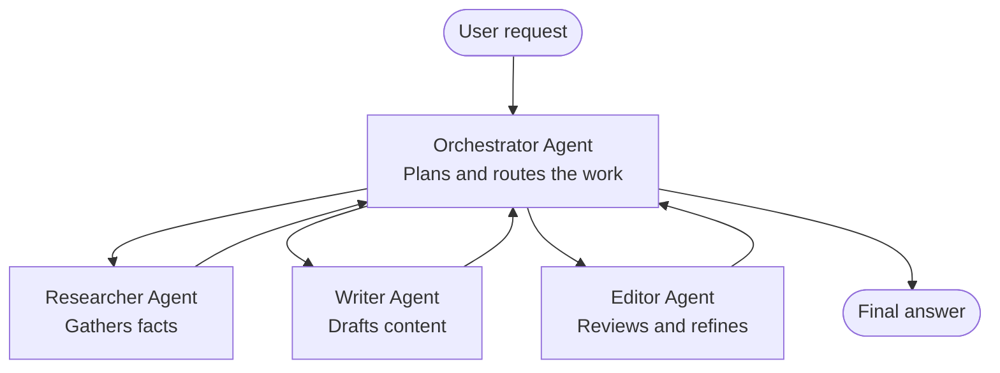

# Misingi ya Wakala Wengi - Tumia Mfumo Wako wa Kwanza wa AI unaoratibiwa

**Mwelekeo wa Sura:**
- **📚 Nyumbani kwa Kozi**: [AZD Kwa Waanzilishi](../../README.md)
- **📖 Sura ya Sasa**: Sura ya 5 - Suluhisho za AI za Wakala Wengi
- **⬅️ Iliyotangulia**: [Sura 4: Miundombinu](../chapter-04-infrastructure/README.md)
- **➡️ Inayofuata**: [Mifumo ya Uratibu](../chapter-06-pre-deployment/coordination-patterns.md)

> Mwongozo wa amri umepitiwa dhidi ya rejeleo la `azd 1.37.2` lililotolewa. Matumizi katika wingu hayakufanyika.

## Utangulizi

Katika sura zilizopita uliweka programu moja—na katika Sura ya 2 uliweka wakala mmoja wa AI. Somo hili linachukua hatua inayofuata: kuweka **mfumo wa wakala wengi**, ambapo watoa huduma maalum wengi hufanya kazi pamoja kutatua tatizo ambalo wakala mmoja hawezi kulitatua vyema peke yake.

Habari njema kwa waanzilishi: **huhitaji amri mpya.** Suluhisho la wakala wengi bado ni mradi wa azd. Uta`azd init`, `azd up`, jaribu, na `azd down`—hasa mtiririko wa kazi unaoujua tayari. Kinachobadilika ni *umbo* la programu ndani.

## Malengo ya Kujifunza

Mwisho wa somo hili, utaweza:
- Kuelewa maana ya "wakala wengi" na ni lini inafaa kwa ugumu zaidi
- Kutambua majukumu ya kawaida katika mfumo wa wakala wengi (mratibu + wataalamu)
- Kuweka mfano halisi, unaofanya kazi wa wakala wengi kwa kutumia `azd up`
- Kuelewa rasilimali za Azure zinazosaidia programu ya wakala wengi
- Kujua jinsi ya kuthibitisha, kubinafsisha, na kuondoa suluhisho kwa usalama

## Matokeo ya Kujifunza

Baada ya kumaliza somo hili, utaweza:
- Eleza tofauti kati ya wakala mmoja na mfumo wa wakala wengi
- Chagua kati ya wakala mmoja aliye na zana na muundo halisi wa wakala wengi
- Weka na jaribu mfano wa wakala wengi kutoka mwanzo mpaka mwisho kwa azd
- Tambua wapi kila wakala anafanya kazi na jinsi wanavyowasiliana
- Safisha rasilimali zote ili kuepuka malipo yanayoendelea

---

## Mfumo wa Wakala Wengi ni Nini?

Wakala mmoja wa AI ni mfano mmoja wenye seti ya maagizo na (hiari) baadhi ya zana. Hiyo inafanya kazi vizuri kwa kazi zilizo na lengo moja. Lakini kadri kazi inavyokua—tafiti, kisha kuandika, kisha kuhariri, kisha kukagua ukweli—kuweka kila kitu katika moja prompt huharibu kasi ya wakala, kuufanya usiwe wa kuaminika, na kuufanya ugumu kurekebisha makosa.

Mfumo wa **wakala wengi** unagawa kazi kwa wataalamu wanaofanya kazi moja vyema kila mmoja, wakiratibiwa na mratibu:



### Majukumu mawili utakayoyaona kila mara

| Jukumu | Kazi | Mfano |
|------|-----|---------|
| **Mrattibu** | Anaamua *kinachofuatia* na kupeleka kazi kati ya wakala | "Kwanza tafiti, kisha andika, kisha hariri" |
| **Mtaalamu** | Anafanya kazi moja ya umakini na hurudisha matokeo | "mtafiti" anayekusanya ukweli tu |

### Je! unahitaji wakala wengi kweli?

Anza kwa urahisi. Tumia mfumo wa wakala wengi **tu** wakati mojawapo ifuatayo ni kweli:

- ✅ Kazi ina **stadi tofauti** zinazofaidi maagizo tofauti (tafiti dhidi ya uandishi dhidi ya mapitio)
- ✅ Unataka wataalamu wafanye kazi **sawa kwa wakati mmoja** kuokoa muda
- ✅ Hatua tofauti zinahitaji **zana au vyanzo vya data tofauti**
- ✅ Unahitaji kila hatua iweze kupimwa na kurekebishwa kwa uhuru

Ikiwa kazi yako ni swali-jibu moja au kuitwa kwa zana rahisi, **wakala mmoja aliye na zana** (Sura 2) ni rahisi, nafuu, na rahisi kuendesha.

> **Kidokezo kwa waanzilishi:** "Wakala wengi" si sawa na "bora". Kila wakala huongeza ucheleweshaji, gharama, na kitu kipya cha kufuatilia. Ongeza wakala tu wakati tatizo linaonekana kugawanyika vipengele wazi.

---

## Njia Mbili za Kujenga Wakala Wengi kwenye Azure

| Mbinu | Ni Nini | Inafaa Kwa Nini |
|----------|-----------|----------|
| **Wakala mmoja + zana** | Wakala mmoja wa Foundry anayefanya simu kwa kazi/zaana | Mtiririko rahisi, kuanza kazi |
| **Wakala wengi walio ratibishwa** | Wakala kadhaa na mratibu | Hatua tofauti, kazi kwa wakati mmoja, utaalamu |

Somo hili linazingatia mbinu ya pili kwa kutumia **kiolezo tayari**, ili uone mfumo halisi wa wakala wengi ukifanya kazi kabla hujajenga wako mwenyewe.

---

## Vitendo: Weka Programu ya Wakala Wengi Inayofanya Kazi

Tutapeleka **Mwandishi Mbunifu wa Contoso**, sampuli rasmi ya Azure inayoratibu wakala wa utafiti, bidhaa, uandishi, na uhariri kutengeneza makala. Kabla ya kuendelea, angalia [mahitaji na gharama za sampuli](https://github.com/Azure-Samples/contoso-creative-writer#azure-account-requirements): inahitaji kiwango cha mfano, Azure AI Search, ufikiaji wa Bing Grounding, Python, Docker, na hooks zinazolingana na Bash. Upatikanaji wa mfano na eneo hutegemea usajili wako; kuweka si hakikisho kwa kuchagua eneo fulani.

### Hatua 1: Anzisha kiolezo

```bash
# Create a working folder
mkdir creative-writer && cd creative-writer

# Initialize from the official multi-agent template
azd init --template Azure-Samples/contoso-creative-writer .
```

> Tafuta zaidi kiolezo cha wakala wengi wakati wowote katika [Maktaba ya Ajabu ya AZD AI](https://azure.github.io/awesome-azd/?tags=ai). Chaguzi nyingine rafiki kwa waanzilishi ni pamoja na `get-started-with-ai-agents` na `azure-ai-travel-agents`.

### Hatua 2: Thibitisha utambulisho

```bash
# Required for azd workflows
azd auth login

# Also required by this sample's Azure CLI hooks
az login
```

### Hatua 3: Angalia mazingira

```bash
# init normally creates/selects an environment; confirm it before proceeding
azd env list
# Only if you need an additional environment:
# azd env new dev
```

### Hatua 4: Tazama awali, kisha weka

```bash
# See what will be created before spending anything (recommended)
azd provision --preview

# Provision infrastructure and deploy all agents in one step
azd up
```

`azd up` itakuuliza mipangilio ya usajili na eneo isiyokamilika, kisha itatayarisha rasilimali na kuweka programu. Tazama awali haihifadhi kiwango wala hakikishi mafanikio; hooks za kiolezo zinaweza kuendelea kuendesha wakati wa mtazamo wa maandalizi, hivyo zitazame kwanza. Kuongeza muda ambao azd inasubiri kwa kila **uwekaji huduma** (si maandalizi ya mfano):

```bash
azd deploy --timeout 1800
```

Muda wa kusubiri unakoma azd kusubiri; haubatilishi uwekaji katika Azure. Angalia hali ya rasilimali kabla ya kujaribu tena.

> **Tahadhari kuhusu gharama na uwezo:** Programu za wakala wengi huweka miundo ya AI inayotumia kiwango na kusababisha gharama. Ikiwa `azd up` itashindwa kwa kiwango cha mfano, angalia [Utatuzi wa AI](../chapter-07-troubleshooting/ai-troubleshooting.md) kwa marekebisho ya eneo na kiwango, na Sura ya 6 [Mipango ya Uwezo](../chapter-06-pre-deployment/capacity-planning.md).

---

## Kuelewa Uliouweka

Programu ya kawaida ya wakala wengi kama hii hutayarisha seti ya rasilimali za Azure zinazolingana moja kwa moja na majukumu katika mchoro hapo juu:

| Rasilimali | Sababu ya kuwepo |
|----------|----------------|
| **Microsoft Foundry / Miundo** | Inahudumia miundo ya lugha inayotumiwa na kila wakala |
| **Azure AI Search** | Hutoa data ya msingi kwa wakala mtafiti kutafuta |
| **Container Apps** (au Huduma ya App) | Inahudumia mratibu na msimbo wa wakala |
| **Cosmos DB** (katika baadhi ya sampuli) | Huhifadhi hali/kumbukumbu ya pamoja kati ya wakala |
| **Application Insights** | Hufuatilia maombi *kati ya* wakala ili uweze kurekebisha mtiririko |

### Jinsi wakala wanavyowasiliana

Katika sampuli nyingi za azd wakala wengi, **mratibu huendesha katika msimbo wa programu yako** (kwa mfano, kwa kutumia fremu kama Semantic Kernel au Microsoft Agent Framework). Mratibu hupiga simu kwa kila wakala mtaalamu kwa zamu, hupitisha matokeo, na kuunda jibu la mwisho. Wakala hushirikiana muktadha kupitia:

- **Simu za kazi/zanani** — mratibu huita mtaalamu na kupata matokeo
- **Kumbukumbu ya pamoja** — hifadhidata (mara nyingi Cosmos DB) inahifadhi hali ambayo wakala wote wanajua
- **Ujumbe/Matukio** — kwa muingiliano mwepesi, wakala huwasiliana kupitia mstari au Service Bus

> **Kwa nini hii ni muhimu kwa utatuzi:** kwa kuwa kila hatua ni tofauti, Application Insights inaonyesha *wakala gani* aliochelewa au kushindwa. Hiyo ndiyo sababu kuu ya kugawanya kazi kati ya wakala.

---

## Thibitisha Uwekaji

Hakikisha mfumo unafanya kazi kabla ya kuendelea:

```bash
# Show the deployed endpoints
azd show

# Open the app's monitoring dashboard
azd monitor

# Open Application Insights Logs (not a terminal log stream)
azd monitor --logs
```

Kisha fungua URL ya programu kutoka `azd show` na omba makala fupi. Tumia mtazamo wa utatuzi wa sampuli kuangalia mtiririko wa wakala. Utafutaji wa shughuli za Transaction za Application Insights unaweza kuonyesha hatua binafsi tu kama sampuli imetumia vifaa na kuwaunganisha; azd haufanyi kiotomatiki kuongeza spani za wakala.

**Vigezo vya mafanikio:**
- ✅ `azd show` inaorodhesha kiunganishi kinachopatikana
- ✅ Ombi hutengeneza matokeo yaliyo kupitia hatua nyingi wazi
- ✅ Mtazamo wa utatuzi unaonyesha hatua nyingi za wakala; ikiwa ufuatiliaji umewezeshwa, thibitisha telemetry inayolingana baada ya kuingizwa

---

## Binafsisha: Ongeza au Rekebisha Wakala

Kwa kuwa kila wakala ni maagizo pamoja na zana, kubinafsisha ni rahisi:

1. **Tafuta ufafanuzi wa wakala** katika kiolezo (mara nyingi faili za `prompts/`, `agents/`, au `*.prompty`).
2. **Sahihisha maagizo ya wakala** — kwa mfano, waambie mhariri wa wakala kuweka sauti maalum au idadi ya maneno.
3. **Weka tena msimbo tu** (miundombinu haibadiliki):

   ```bash
   azd deploy
   ```

Kuendelea na mradi wako wa wakala wa Foundry mwenyewe, tumia kifurushi cha GA na AZD 1.37.0+ katika saraka tupu tofauti:

```bash
azd ext install microsoft.foundry
azd ai agent init
azd up
azd ai agent invoke      # test, with response timing
```

Angalia [mwongozo wa wakala aliyeandikishwa GA](../chapter-02-ai-development/microsoft-foundry-integration.md#hosted-agent-walkthrough-ga) kwa majaribio ya ndani ya Agent Inspector, utoaji msimbo wa mbali, na usafishaji umiliki. [Rejeleo la AZD AI CLI](../chapter-08-production/production-ai-practices.md#azd-ai-cli-commands-and-extensions) pia linasimamia nyongeza za tathmini tofauti, usanifu, na ufutaji wa wakala.

---

## Safisha

Programu za wakala wengi huendesha huduma nyingi zenye malipo. Zima kila kitu ukimaliza:

```bash
# Review the resources and confirm deletion interactively
azd down
```

Kufuta ni kitendo cha kuharibu. Kwa maabara ya kuondoa, `azd down --force --purge` hupuuza ufutaji na uthibitisho wa kufuta laini ulioambatana; kufuta kabisa ni jambo lisilorevukika pale linapoungwa mkono na linaweza kuzuiwa na kinga ya kufuta. Ufutaji laini ni damu ya kurejesha/kutumia tena majina, si uthibitisho wa malipo yanayoendelea. Angalia rasilimali zilizoibebwa na bili baada ya usafi.

Ikiwa pia ulianzisha wakala aliyeandikwa kwa mradi wa Foundry uliopo, `azd down` huacha wakala wa mradi huo na rasilimali nyingine mahali pake. Ondoa tu rasilimali zisizotakikana unazomiliki tofauti. Kwa mradi mpya wa Foundry unaotengenezwa na mazingira yake ya AZD, `azd down` huharibu kundi la rasilimali na kila kitu kilicho ndani.

---

## Kumbusho Kuhusu Mifumo Ya Wakala Wengi Zaidi kwenye Uzalishaji

Suluhisho la [Retail Multi-Agent](../../examples/retail-scenario.md) katika hazina hii ni **mchoro wa usanifu**, sio templeti ya amri moja—linarekodi jinsi mfumo wa rejareja wa uzalishaji *usingefanyika* kujengwa (na linaonyesha wazi kuwa ujenzi kamili ni juhudi kubwa). Litumie kama rejeleo la muundo *baada* ya kuwa umeweka mfano unaofanya kazi hapa. Kwa masuala ya uzalishaji (uvumilivu, gharama, ufuatiliaji, utawala), endelea na [Sura ya 8: Miongozo ya AI ya Uzalishaji](../chapter-08-production/production-ai-practices.md).

---

## Muhtasari

- Mfumo wa mawakala wengi hugawanya kazi kati ya wataalamu wanaoratibiwa na mpangaji kazi.
- Utumie tu pale kazi ikiwa na hatua tofauti, mfululizo wa kazi, au zana tofauti kwa kila hatua—vivyo hivyo chagua wakala mmoja.
- Mchakato wa azd haujabadilika: `azd init` → `azd up` → test → `azd down`.
- Templeti halisi kama `contoso-creative-writer` hukuwezesha kuona na kubinafsisha programu ya wakala wengi inayofanya kazi leo.
- Ufuatiliaji wa Application Insights kati ya mawakala ni mojawapo ya faida kubwa za muundo wa mawakala wengi.

---

## 🔗 Uabiri

| Mwelekeo | Somo |
|-----------|--------|
| **Iliyotangulia** | [Sura ya 4: Miundombinu](../chapter-04-infrastructure/README.md) |
| **Ifuatayo** | [Mifumo ya Uratibu](../chapter-06-pre-deployment/coordination-patterns.md) |

## 📖 Rasilimali Zinazohusiana

- [Mwongozo wa Wakala wa AI](../chapter-02-ai-development/agents.md)
- [Mifumo ya Uratibu](../chapter-06-pre-deployment/coordination-patterns.md)
- [Mazoezi ya AI ya Uzalishaji](../chapter-08-production/production-ai-practices.md)
- [Utatuzi wa Tatizo la AI](../chapter-07-troubleshooting/ai-troubleshooting.md)

---

<!-- CO-OP TRANSLATOR DISCLAIMER START -->
**Kionyozo**:
Hati hii imetafsiriwa kwa kutumia huduma ya tafsiri ya AI [Co-op Translator](https://github.com/Azure/co-op-translator). Ingawa tunajitahidi kupata usahihi, tafadhali fahamu kwamba tafsiri za kiotomatiki zinaweza kuwa na makosa au upungufu wa usahihi. Hati ya asili katika lugha yake halisi inapaswa kuchukuliwa kama chanzo cha mamlaka. Kwa taarifa muhimu, tafsiri ya kitaalamu inayofanywa na binadamu inapendekezwa. Hatutojibu kwa kuelewa vibaya au tafsiri potofu zinazotokea kutokana na matumizi ya tafsiri hii.
<!-- CO-OP TRANSLATOR DISCLAIMER END -->