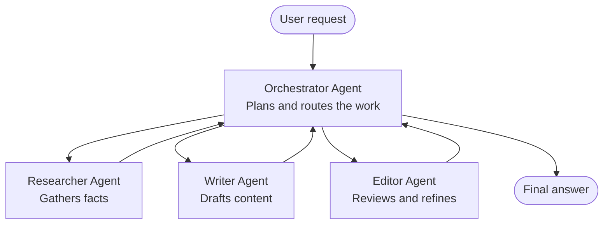

# Misingi ya Wakala Wengi - Tumia Mfumo wako wa AI wa Kurasimishwa wa Kwanza

**Kuongoza Sura:**
- **📚 Mwanzo wa Kozi**: [AZD Kwa Waanzilishi](../../README.md)
- **📖 Sura ya Sasa**: Sura ya 5 - Suluhisho za AI za Wakala Wengi
- **⬅️ Iliyopita**: [Sura 4: Miundombinu](../chapter-04-infrastructure/README.md)
- **➡️ Ifuatayo**: [Mifumo ya Kuratibu](../chapter-06-pre-deployment/coordination-patterns.md)

> Mwongozo wa amri umepitiwa dhidi ya rejea ya `azd 1.37.2` iliyotolewa. Usambazaji wa wingu haukujumuishwa.

## Utangulizi

Katika sura za awali uliweka programu moja—na katika Sura 2 uliweka wakala mmoja wa AI. Somo hili linachukua hatua inayofuata: kuweka **mfumo wa wakala wengi**, ambapo mawakala maalum kadhaa hufanya kazi pamoja kutatua tatizo ambalo wakala mmoja pekee hangeweza kushughulikia kwa ufanisi peke yake.

Habari njema kwa wanaoanza: **huna haja ya amri mpya.** Suluhisho la wakala wengi bado ni mradi wa azd. Utatumia `azd init`, `azd up`, jaribu, na `azd down`—hasa mtiririko wa kazi unaojua tayari. Kinachobadilika ni *umbo* la app ndani.

## Malengo ya Kujifunza

Mwisho wa somo hili, utaweza:
- Elewa maana ya "wakala wengi" na wakati unaostahili ugumu wa ziada
- Tambua majukumu ya kawaida katika mfumo wa wakala wengi (mratibu + wataalamu)
- Weka kiolezo halisi cha wakala wengi kinachofanya kazi kwa `azd up`
- Elewa rasilimali za Azure zinazounga mkono app ya wakala wengi
- Jua jinsi ya kuthibitisha, kubinafsisha, na kubomoa suluhisho kwa usalama

## Matokeo ya Kujifunza

Baada ya kumaliza somo hili, utaweza:
- Eleza tofauti kati ya wakala mmoja na mfumo wa wakala wengi
- Chagua kati ya wakala mmoja akiwa na zana na muundo halisi wa wakala wengi
- Weka na ujaribu kiolezo cha wakala wengi kutoka mwanzo mpaka mwisho kwa azd
- Tambua pa kila wakala anafanya kazi na jinsi wanavyowasiliana
- Safisha rasilimali zote kuzuia malipo yanayoendelea

---

## Nini Mfumo wa Wakala Wengi Unamaanisha?

Wakala mmoja wa AI ni mfano mmoja ulio na seti ya maagizo na (hiari) zana fulani. Hii hufanya kazi vizuri kwa kazi zilizolengwa. Lakini kazi inapoendelea—tafiti, kisha uandishi, kisha uhakiki, kisha uhakiki wa ukweli—kuunganisha kila kitu katika ombi moja hufanya wakala kuchelewa, kuwa hatari zaidi, na kuwa mgumu zaidi kusahihisha.

**Mfumo wa wakala wengi** hutenganisha kazi kwa wataalamu ambao kila mmoja hufanya kazi moja vizuri, ikiratibiwa na mratibu:



### Majukumu mawili utayoyaona kila mara

| Wajukumu | Kazi | Mfano |
|------|-----|---------|
| **Mratibu** | Anaamua *kinachotokea kinachofuata* na huwabeba kazi mawakala | "Kwanza tafiti, kisha andika, kisha hakiki" |
| **Mtaalamu** | Hufanya kazi moja iliyolengwa na hurudisha matokeo | "mtafiti" anayekusanya fakta pekee |

### Je, kweli unahitaji mawakala wengi?

Anza kwa urahisi. Tumaini mawakala wengi **tu** wakati mojawapo ya haya ni kweli:

- ✅ Kazi ina **miundo tofauti** inayofaidika na maagizo tofauti (tafiti dhidi ya uandishi dhidi ya uhakiki)
- ✅ Unataka wataalamu wafanye **kazi sambamba** kuokoa muda
- ✅ Hatua tofauti zinahitaji **zana au vyanzo tofauti vya data**
- ✅ Unahitaji kila hatua iweze **kujaribiwa na kusahihishwa kivyake**

Ikiwa kazi yako ni swali na jibu moja au simu rahisi ya zana, **wakala mmoja mzuri na zana** (Sura ya 2) ni rahisi, nafuu, na rahisi kuendesha.

> **Ushauri kwa Mwanzo:** "Mawakala wengi" sio "bora zaidi." Kila wakala huongeza ucheleweshaji, gharama, na kitu kipya cha kufuatilia. Ongeza mawakala tu wakati tatizo linatenganishwa wazi katika sehemu.

---

## Njia Mbili za Kujenga Wakala Wengi kwenye Azure

| Njia | Ni Kipi | Inafaa Kwa Nini |
|----------|-----------|----------|
| **Wakala mmoja + zana** | Wakala mmoja wa Foundry ambaye huita kazi/zana | Mtiririko rahisi, kuanza |
| **Mawakala wengi walioratibiwa** | Mawakala kadhaa na mratibu | Miundo tofauti, kazi sambamba, utaalamu |

Somo hili linazingatia njia ya pili kwa kutumia **kiolezo tayari kilichotengenezwa**, ili uweze kuona mfumo halisi wa wakala wengi ukifanya kazi kabla ya kujenga wako mwenyewe.

---

## Vitendo: Weka Programu Inayofanya Kazi ya Wakala Wengi

Tutasambaza **Mwandishi wa Ubunifu wa Contoso**, sampuli rasmi ya Azure inayoratibu mawakala wa utafiti, bidhaa, uandishi, na uhakiki kuandaa makala. Kabla ya kuendelea, angalia [mahitaji ya sampuli na gharama](https://github.com/Azure-Samples/contoso-creative-writer#azure-account-requirements): inahitaji asilimia ya mfano, Azure AI Search, upatikanaji wa Bing Grounding, Python, Docker, na vifaa vinavyooana na Bash. Upatikanaji wa mfano na eneo hutegemea usajili wako; usambazaji hauhakikishwi kwa kuchagua eneo maalum.

### Hatua 1: Anzisha kiolezo

```bash
# Create a working folder
mkdir creative-writer && cd creative-writer

# Initialize from the official multi-agent template
azd init --template Azure-Samples/contoso-creative-writer .
```

> Vinjari viongezeo vingine vya wakala wengi wakati wowote katika [Jumba la Muziki la AZD AI](https://azure.github.io/awesome-azd/?tags=ai). Chaguzi nyingine rafiki kwa waanzilishi ni pamoja na `get-started-with-ai-agents` na `azure-ai-travel-agents`.

### Hatua 2: Thibitisha

```bash
# Required for azd workflows
azd auth login

# Also required by this sample's Azure CLI hooks
az login
```

### Hatua 3: Kagua mazingira

```bash
# init normally creates/selects an environment; confirm it before proceeding
azd env list
# Only if you need an additional environment:
# azd env new dev
```

### Hatua 4: Angalia mapema, kisha sambaza

```bash
# See what will be created before spending anything (recommended)
azd provision --preview

# Provision infrastructure and deploy all agents in one step
azd up
```

`azd up` itakuomba mipangilio ya usajili na eneo lisilokuwepo, kisha ipange rasilimali na usambazaji wa programu. Muonekano hauhifadhi asilimia wala kuhakikishia mafanikio; vifaa vya kiolezo vinaweza bado kufanya kazi wakati wa muonekano wa huduma, kwa hivyo vikagua kwanza. Ili kuongeza muda azd inasubiri kwa kila **usambazaji wa huduma** (si utoaji wa mfano):

```bash
azd deploy --timeout 1800
```

Muda wa mwisho unasimamisha kusubiri kwa azd; haulifutili usambazaji Azure. Kagua hali ya rasilimali kabla ya kujaribu tena.

> **Tahadhari kuhusu gharama na uwezo:** Programu za wakala wengi husambaza mifano ya AI inayotumia asilimia na kusababisha gharama. Ikiwa `azd up` inashindwa kwa asilimia ya mfano, angalia [Utatuzi wa AI](../chapter-07-troubleshooting/ai-troubleshooting.md) kwa marekebisho ya eneo na asilimia, na Sura 6 [Mipango ya Uwezo](../chapter-06-pre-deployment/capacity-planning.md).

---

## Elewa Uliyosambaza

App ya kawaida ya wakala wengi kama hii huweka seti ya rasilimali za Azure zinazolingana moja kwa moja na majukumu katika mchoro hapo juu:

| Rasilimali | Sababu ya kuwepo kwake |
|----------|----------------|
| **Microsoft Foundry / Mifano** | Hudumia mifano ya lugha ambayo wakala kila mmoja hutumia |
| **Azure AI Search** | Hupa wakala mtafiti data ya msingi ya kutafuta |
| **Container Apps** (au Huduma ya App) | Hudumia mratibu na msimbo wa wakala |
| **Cosmos DB** (katika baadhi ya sampuli) | Huhifadhi hali/memory ya pamoja inayopita kati ya mawakala |
| **Application Insights** | Hufuatilia maombi *katika* mawakala ili uweze kusahihisha mtiririko |

### Jinsi mawakala wanavyowasiliana

Katika sampuli nyingi za wakala wengi za azd, **mratibu hufanya kazi ndani ya msimbo wa programu yako** (kwa mfano, kutumia fremu kama Semantic Kernel au Microsoft Agent Framework). Mratibu huita kila wakala mtaalamu kwa zamu, hupitisha matokeo, na huunda jibu la mwisho. Mawakala hushirikiana kwa:

- **Kuitwa kazi/za zana** — mratibu huita mtaalamu na hupata jibu
- **Kumbukumbu ya pamoja** — database (mara nyingi Cosmos DB) ina hali ambayo mawakala wote wanasoma
- **Ujumbe/matukio** — kwa uhusiano hafifu zaidi, mawakala wanawasiliana kupitia safu au Service Bus

> **Kwa nini hii ni muhimu kusahihisha:** kwa sababu kila hatua ni tofauti, Application Insights inaonyesha ni wakala gani aliachelewa au kushindwa. Hiyo ni sababu kuu ya kutenganisha kazi kwa mawakala tangu mwanzo.

---

## Thibitisha Usambazaji

Thibitisha mfumo unafanya kazi kabla ya kuendelea:

```bash
# Show the deployed endpoints
azd show

# Open the app's monitoring dashboard
azd monitor

# Open Application Insights Logs (not a terminal log stream)
azd monitor --logs
```

Kisha fungua URL ya app kutoka `azd show` na omba makala fupi. Tumia mtazamo wa kusahihisha sampuli kuangalia mtiririko wa wakala wake. Utafutaji wa miamala wa Application Insights unaweza kuonyesha hatua binafsi ikiwa sampuli ina vifaa na huoanisha; azd hautoa mipaka ya wakala moja kwa moja.

**Vigezo vya mafanikio:**
- ✅ `azd show` inaorodhesha sehemu inayoweza kufikiwa
- ✅ Ombi hutoa matokeo yaliyo kupitia hatua nyingi wazi
- ✅ Mtazamo wa kusahihisha unaonyesha hatua nyingi za wakala; ikiwa ufuatiliaji umewezeshwa, thibitisha telemetry inayolingana baada ya usindikaji

---

## Binafsisha: Ongeza au Rekebisha Wakala

Kwa kuwa kila wakala ni maagizo pamoja na zana, ubinafsishaji ni rahisi:

1. **Tafuta ufafanuzi wa wakala** katika kiolezo (mara nyingi ni seti ya faili `prompts/`, `agents/`, au `*.prompty`).
2. **Rekebisha maagizo ya wakala** — kwa mfano,ambia wakala mhariri kufuata mtindo maalum au idadi ya maneno.
3. **Weka tena msimbo tu** (miundombinu haijabadilika):

   ```bash
   azd deploy
   ```

Ili kuendelea na mradi wako wa wakala wa Foundry, tumia utangulizi unaoingiliana wa ugani wa wakala:

```bash
azd extension install azure.ai.agents
azd ai agent init
azd up
azd ai agent invoke      # test, with response timing
```

Angalia [Sura 2: Mawakala](../chapter-02-ai-development/agents.md) na [marejeo ya AZD AI CLI](../chapter-08-production/production-ai-practices.md#azd-ai-cli-commands-and-extensions) kwa mzunguko kamili: wakala `invoke`, sehemu tofauti za tathmini `azd ai eval` mtiririko, wakala `optimize`, na wakala `delete`.

---

## Safisha

Programu za wakala wengi zinaendesha huduma nyingi zinazolipishwa. Bomoa kila kitu unapomaliza:

```bash
# Review the resources and confirm deletion interactively
azd down
```

Uondoaji ni mwovu. Kwa maabara ya kutumia mara moja, `azd down --force --purge` hupita uondoaji na uthibitisho wa ufutaji mwepesi wa kuunga mkono; ufutaji wa mwepesi ni suala la kupona/utumiaji wa jina, sio ushahidi wa malipo yanayoendelea. Angalia rasilimali zilizobaki na bili baada ya usafi.

---

## Kumbuka Kuhusu Mifumo ya Wakala Wengi ya Uzalishaji

Suluhisho la [Retail Multi-Agent](../../examples/retail-scenario.md) katika hifadhidata hii ni **mchoro wa usanifu**, sio kiolezo cha amri moja—linarekodi jinsi mfumo wa rejareja wa uzalishaji *ungaweza* kujengwa (na linaonyesha wazi kwamba ujenzi kamili ni jitihada kubwa). Litumie kama rejeleo la muundo *baada* ya umepeleka sampuli inayofanya kazi hapa. Kwa masuala ya uzalishaji (uvumilivu, gharama, ufuatiliaji, utawala), endelea kwenye [Sura ya 8: Mazoezi ya AI katika Uzalishaji](../chapter-08-production/production-ai-practices.md).

---

## Muhtasari

- Mfumo wa mawakala wengi huwagawanya kazi miongoni mwa wataalamu wanaoratibiwa na mpangaji.
- Utumie tu wakati kazi ina hatua tofauti, utendaji sambamba, au zana tofauti kwa kila hatua—vinyume na hivyo chagua wakala mmoja.
- Mchakato wa azd haubadiliki: `azd init` → `azd up` → jaribu → `azd down`.
- Kiolezo halisi kama `contoso-creative-writer` kinakuruhusu kuona na kubinafsisha programu ya mawakala wengi inayofanya kazi leo.
- Ufuatiliaji wa Application Insights miongoni mwa mawakala ni mojawapo ya faida kubwa za muundo wa mawakala wengi.

---

## 🔗 Uabiri

| Mwelekeo | Somo |
|-----------|--------|
| **Kabla** | [Sura ya 4: Miundombinu](../chapter-04-infrastructure/README.md) |
| **Ifuatayo** | [Mifumo ya Uratibu](../chapter-06-pre-deployment/coordination-patterns.md) |

## 📖 Rasilimali Zinazohusiana

- [Mwongozo wa Mawakala wa AI](../chapter-02-ai-development/agents.md)
- [Mifumo ya Uratibu](../chapter-06-pre-deployment/coordination-patterns.md)
- [Mbinu za Utengenezaji wa AI](../chapter-08-production/production-ai-practices.md)
- [Utatuzi wa Matatizo ya AI](../chapter-07-troubleshooting/ai-troubleshooting.md)

---

<!-- CO-OP TRANSLATOR DISCLAIMER START -->
**Kionyozo**:
Hati hii imetafsiriwa kwa kutumia huduma ya tafsiri ya AI [Co-op Translator](https://github.com/Azure/co-op-translator). Ingawa tunajitahidi kupata usahihi, tafadhali fahamu kwamba tafsiri za kiotomatiki zinaweza kuwa na makosa au upungufu wa usahihi. Hati ya asili katika lugha yake halisi inapaswa kuchukuliwa kama chanzo cha mamlaka. Kwa taarifa muhimu, tafsiri ya kitaalamu inayofanywa na binadamu inapendekezwa. Hatutojibu kwa kuelewa vibaya au tafsiri potofu zinazotokea kutokana na matumizi ya tafsiri hii.
<!-- CO-OP TRANSLATOR DISCLAIMER END -->