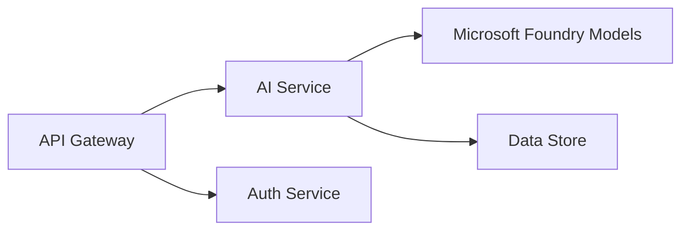
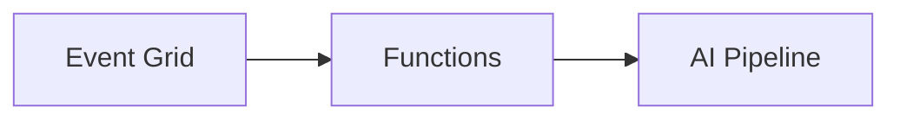

# Sura ya 8: Mifumo ya Uzalishaji & Biashara

**📚 Kozi**: [AZD Kwa Waanzilishi](../../README.md) | **⏱️ Muda**: Saa 2-3 | **⭐ Ugumu**: Juu

---

## Muhtasari

Sura hii inashughulikia mifumo ya utoaji tayari kwa biashara, kuimarisha usalama, ufuatiliaji, na uboreshaji wa gharama kwa mizigo ya AI ya uzalishaji.

Hii ni kumbukumbu ya usanifu, si kiolezo kamili cha uzalishaji kinachoweza kutumika moja kwa moja. Mifano hugawanya maelezo ya muunganiko ambayo yanapaswa kutolewa na kujaribiwa katika programu yako mwenyewe; kusoma orodha ya ukaguzi haimaanishi uko tayari kwa uzalishaji.

> **Mapitio ya toleo (2026-11-04):** Mwongozo wa AI CLI ulifikirishwa dhidi ya hati/chanzo cha `azd 1.37.2`, maajenti `1.0.0-beta.23`, na tathmini `1.0.0-beta.2`. Tazama [mabadiliko na marekebisho ya toleo](production-ai-practices.md#recent-release-changes-and-fixes) kwa mahitaji ya muunganisho na maelezo ya uhamisho; hii si uthibitisho wa utoaji wa moja kwa moja.

## Malengo ya Kujifunza

Kwa kumaliza sura hii, utaweza:
- Kutoa programu zenye ustahimilivu katika maeneo mengi
- Kutekeleza mifumo ya usalama wa biashara
- Kupanga ufuatiliaji wa kina
- Kuboresha gharama kwa wingi
- Kuanzisha njia za CI/CD kwa kutumia AZD

---

## 📚 Masomo

| # | Somo | Maelezo | Muda |
|---|--------|-------------|------|
| 1 | [Mazingira ya Uzalishaji ya AI](production-ai-practices.md) | Mifumo ya utoaji biashara | Dakika 90 |

---

## 🚀 Orodha ya Ukaguzi wa Uzalishaji

- [ ] Utoaji wa maeneo mengi kwa ustahimilivu
- [ ] Utambuzi uliodhibitiwa kwa uthibitishaji (bila funguo)
- [ ] Application Insights kwa ajili ya ufuatiliaji
- [ ] Bajeti za gharama na arifa zimepangwa
- [ ] Upimaji wa usalama umewezeshwa
- [ ] Muunganisho wa njia za CI/CD
- [ ] Mpango wa kurejesha baada ya maafa

---

## 🏗️ Mifumo ya Usanifu

### Mfano 1: AI ya Microservices



### Mfano 2: AI Inayotegemea Matukio



---

## 🔐 Mbinu Bora za Usalama

```bicep
// Illustrative properties from different resources, NOT a standalone Bicep file.
// Attach identity to the application host:
identity: {
  type: 'SystemAssigned'
}

// AI account properties (also require private endpoints, DNS and app connectivity):
properties: {
  publicNetworkAccess: 'Disabled'
  networkAcls: {
    defaultAction: 'Deny'
  }
}
```

---

## 💰 Uboreshaji wa Gharama

| Mkakati | Vizingiti Vikuu |
|----------|---------|
| Kudhibiti kwa kiwango cha sifuri (Container Apps) | Inahitaji kichocheo kinachofaa; huduma nyingine bado husababisha gharama |
| Tumia ngazi za matumizi kwa maendeleo | Linganisha bei ya huduma iliyochaguliwa na mzigo wa kazi |
| Mipangilio ya upanuzi kwa ratiba | Panua kupitia miundombinu/otomatiki inayounga mkono |
| Hifadhi/uwezo uliowekwa | Ni pale panapoungwa mkono; ahadi zinaweza kuongeza gharama zisizotumika |

Tumia [mfano kamili wa rasilimali ya bajeti](production-ai-practices.md#2-cost-monitoring-and-budgets) na tarehe halali ya kuanza, upeo wa bili, wapokeaji, na ruhusa. Bajeti hutuma arifa; haisimamishi matumizi. Akiba hutegemea matumizi yaliyopimwa na si asilimia iliyohakikishwa.

---

## 📊 Mipangilio ya Ufuatiliaji

```bash
# Open the Application Insights logs view (requires configured monitoring)
azd monitor --logs

# Check Application Insights
azd monitor --overview

# View metrics
az monitor metrics list --resource <resource-id>
```

---

## 🔗 Urambazaji

| Mwelekeo | Sura |
|-----------|---------|
| **Iliyopita** | [Sura 7: Utatuzi wa Matatizo](../chapter-07-troubleshooting/README.md) |
| **Kozi Imekamilika** | [Nyumbani kwa Kozi](../../README.md) |

---

## 📖 Vyanzo Vinavyohusiana

- [Mwongozo wa Maajenti wa AI](../chapter-02-ai-development/agents.md)
- [Application Insights](../chapter-06-pre-deployment/application-insights.md)
- [Suluhisho za Maajenti Wengi](../chapter-05-multi-agent/README.md)
- [Mfano wa Microservices](../../examples/microservices/README.md)

---

<!-- CO-OP TRANSLATOR DISCLAIMER START -->
**Kionyozo**:
Hati hii imetafsiriwa kwa kutumia huduma ya tafsiri ya AI [Co-op Translator](https://github.com/Azure/co-op-translator). Ingawa tunajitahidi kupata usahihi, tafadhali fahamu kwamba tafsiri za kiotomatiki zinaweza kuwa na makosa au upungufu wa usahihi. Hati ya asili katika lugha yake halisi inapaswa kuchukuliwa kama chanzo cha mamlaka. Kwa taarifa muhimu, tafsiri ya kitaalamu inayofanywa na binadamu inapendekezwa. Hatutojibu kwa kuelewa vibaya au tafsiri potofu zinazotokea kutokana na matumizi ya tafsiri hii.
<!-- CO-OP TRANSLATOR DISCLAIMER END -->