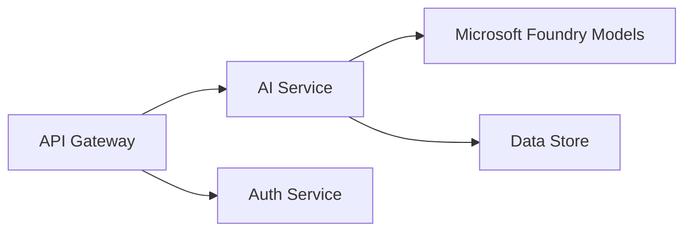
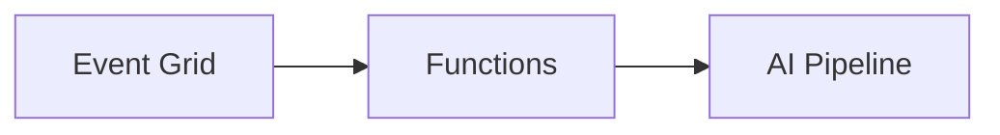

# Sura ya 8: Mifumo ya Uzalishaji & Biashara

**📚 Kozi**: [AZD Kwa Waanzilishi](../../README.md) | **⏱️ Muda**: masaa 2-3 | **⭐ Ugumu**: Kiwango cha Juu

---

## Muhtasari

Sura hii inashughulikia mifumo ya ueneaji inayokubalika kwa biashara, kuimarisha usalama, ufuatiliaji, na uboreshaji wa gharama kwa mzigo kazi wa AI wenye uzalishaji.

Hii ni rejeleo la usanifu, si kiolezo kamili cha kuweza kutumika uzalishaji. Mifano huacha maelezo ya ujumuishaji ambayo lazima yatolewa na kujaribiwa katika programu yako mwenyewe; kusoma orodha ya ukaguzi hakuhakiki utayari wa uzalishaji.

> **Sasisho la Foundry GA (2026-11-09):** Tumia `azd >= 1.37.0` na kundi la 1.0 la `microsoft.foundry` lililopatikana kwa ujumla kwa mchakato wa Foundry; tathmini zinawekwa kwa tofauti. Angalia [wigo wa toleo na uhamishaji](production-ai-practices.md#recent-release-changes-and-fixes) na [mfano wa mteremko uliothibitishwa](production-ai-practices.md#cicd-pipeline-configuration). Hii ni mapitio ya nyaraka, si uthibitisho wa uwekaji moja kwa moja au hali ya GA kwa vipengele vya onyesho la hiari.

## Malengo ya Kujifunza

Kwa kumaliza sura hii, utaweza:
- Kueneza programu zinazoimirika katika mikoa mingi
- Kutekeleza mifumo ya usalama ya biashara
- Kusanidi ufuatiliaji kamili
- Kuboresha gharama kwa kiwango kikubwa
- Kuanzisha mistari ya CI/CD kwa kutumia AZD

---

## 📚 Masomo

| # | Somo | Maelezo | Muda |
|---|--------|-------------|------|
| 1 | [Mazingira ya AI ya Uzalishaji](production-ai-practices.md) | Mifumo ya ueneaji wa biashara | Dakika 90 |

---

## 🚀 Orodha ya Ukaguzi wa Uzalishaji

- [ ] Ueneaji wa mikoa mingi kwa uhimili
- [ ] Utambulisho ulioendeshwa kwa usimamizi kwa uthibitishaji (bila funguo)
- [ ] Application Insights kwa ufuatiliaji
- [ ] Bajeti za gharama na arifa zimewekwa
- [ ] Usahihishaji wa usalama umewezeshwa
- [ ] Ujumuishaji wa mteremko wa CI/CD
- [ ] Mpango wa urejeshaji wa maafa

---

## 🏗️ Mifumo ya Usanifu

### Mfano 1: Microservices AI



### Mfano 2: AI Inayotegemea Matukio



---

## 🔐 Mazoezi Bora ya Usalama

```bicep
// Illustrative properties from different resources, NOT a standalone Bicep file.
// Attach identity to the application host:
identity: {
  type: 'SystemAssigned'
}

// AI account properties (also require private endpoints, DNS and app connectivity):
properties: {
  publicNetworkAccess: 'Disabled'
  networkAcls: {
    defaultAction: 'Deny'
  }
}
```

---

## 💰 Uboreshaji wa Gharama

| Mikakati | Kizuizi Kikuu |
|----------|---------|
| Kupunguza hadi sifuri (Programu za Kontena) | Inahitaji kichocheo kinachofaa; huduma zingine bado zinatoa gharama |
| Tumia ngazi za matumizi kwa maendeleo | Linganisha bei ya huduma iliyochaguliwa na mzigo wa kazi |
| Kupanga vifaa kwa ratiba | Punguza kupitia miundombinu/matikio yaliyotumika |
| Hifadhi / uwezo uliopangwa | Ni pale inapopatikana tu; ahadi zinaweza kuongeza gharama za kusimama pasipo shughuli |

Tumia [mfano kamili wa rasilimali ya bajeti](production-ai-practices.md#2-cost-monitoring-and-budgets) ikiwa na tarehe halali ya kuanzia, wigo wa bili, wapokeaji, na ruhusa. Bajeti hutuma arifa; haizuizi matumizi. Akiba hutegemea matumizi yaliyopimwa na haina asilimia inayohakikisha.

---

## 📊 Usanidi wa Ufuatiliaji

```bash
# Open the Application Insights logs view (requires configured monitoring)
azd monitor --logs

# Check Application Insights
azd monitor --overview

# View metrics
az monitor metrics list --resource <resource-id>
```

---

## 🔗 Urambazaji

| Mwelekeo | Sura |
|-----------|---------|
| **Iliyotangulia** | [Sura ya 7: Utatuzi wa Matatizo](../chapter-07-troubleshooting/README.md) |
| **Kozi Imekamilika** | [Mwanzo wa Kozi](../../README.md) |

---

## 📖 Rasilimali Zinazohusiana

- [Mwongozo wa Wakala wa AI](../chapter-02-ai-development/agents.md)
- [Application Insights](../chapter-06-pre-deployment/application-insights.md)
- [Suluhisho za Wakala Wengi](../chapter-05-multi-agent/README.md)
- [Mfano wa Microservices](../../examples/microservices/README.md)

---

<!-- CO-OP TRANSLATOR DISCLAIMER START -->
**Kionyozo**:
Hati hii imetafsiriwa kwa kutumia huduma ya tafsiri ya AI [Co-op Translator](https://github.com/Azure/co-op-translator). Ingawa tunajitahidi kupata usahihi, tafadhali fahamu kwamba tafsiri za kiotomatiki zinaweza kuwa na makosa au upungufu wa usahihi. Hati ya asili katika lugha yake halisi inapaswa kuchukuliwa kama chanzo cha mamlaka. Kwa taarifa muhimu, tafsiri ya kitaalamu inayofanywa na binadamu inapendekezwa. Hatutojibu kwa kuelewa vibaya au tafsiri potofu zinazotokea kutokana na matumizi ya tafsiri hii.
<!-- CO-OP TRANSLATOR DISCLAIMER END -->